# 20250918-看完Meta Connect 2025，我感觉科幻片里的东西真要来了

> 来源：[https://aigcreative.feishu.cn/docx/CKoNdfhWto4D5OxUPGec7MZen3T](https://aigcreative.feishu.cn/docx/CKoNdfhWto4D5OxUPGec7MZen3T)

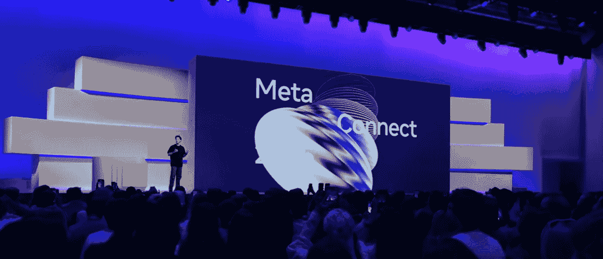

刚看完了今年的 Meta Connect 2025发布会，里面有不少新东西，想跟大家分享一些我的看法。

每年这种科技春晚级别的发布会，我都会习惯性地调低一些期待，毕竟颠覆性的产品不是年年都有。

但今年 Meta 的一些发布，确实让我觉得，他们正在一些关键的方向上，迈出了很实在的一步。

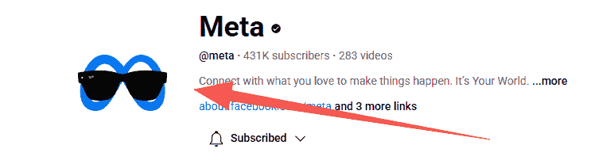

# 01.

过去几年，市面上的智能眼镜，包括 Meta 自己和雷朋合作的前几代，功能都比较集中，像是拍照、听歌、打电话。

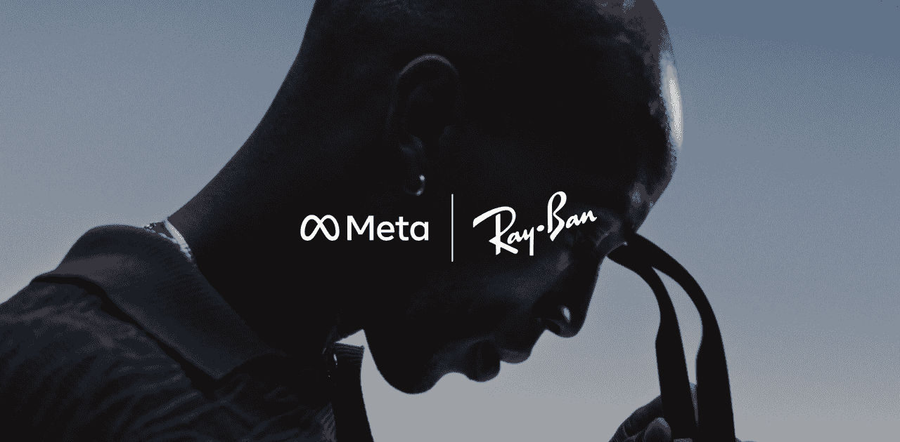

它们更像是一个手机的配件，把一些常用功能放到了你脸上，方便是方便，但离大家想象中的“未来智能终端”还有点距离。

Mark Zuckerberg明确指出，Meta的目标是打造外观精美、能提供个人超级智能和逼真临场感的眼镜，并将其视为个人AI的理想形态。眼镜是唯一能够让AI实时“看到你所看，听到你所听”的设备。

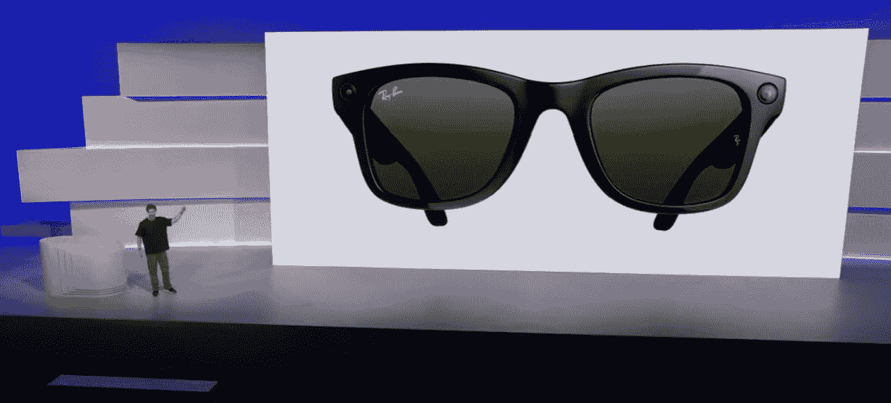

为确保这一宏大愿景的成功落地并避免重蹈技术产品的覆辙，Meta确立了三项以用户体验为中心的设计价值观：

• 卓越眼镜为先 (Great glasses first)：在集成任何技术之前，产品必须是设计精良、佩戴舒适的优质眼镜。美学与人体工学的优先级被置于首位。

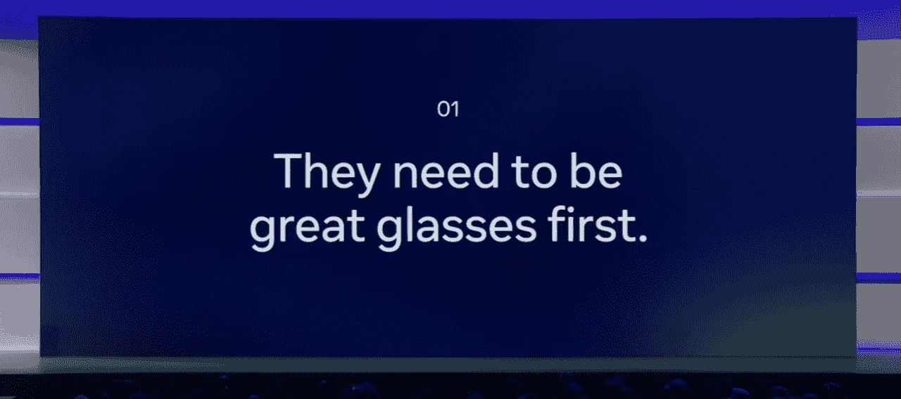

• **技术无感融入 (Technology **gets out of the way)：技术应在需要时提供强大功能，在其他时候则悄然隐于后台，从而保护用户与他人交流时的临场感，避免智能手机带来的隔阂。

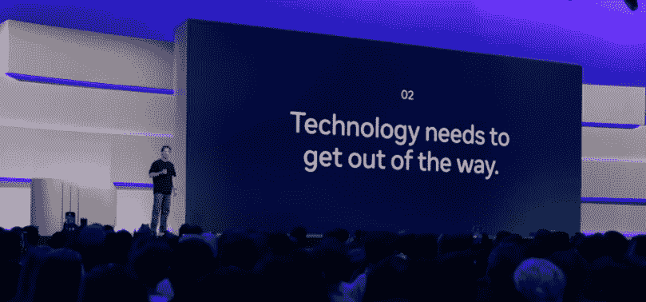

• **严肃对待超级智能 (Take superint**elligence seriously)：AI 的发展应服务于人，赋予个体更强大的能力。Meta 的设计理念是预先考虑未来所需传感器，通过软件持续升级，让眼镜和用户一同变得更智能。

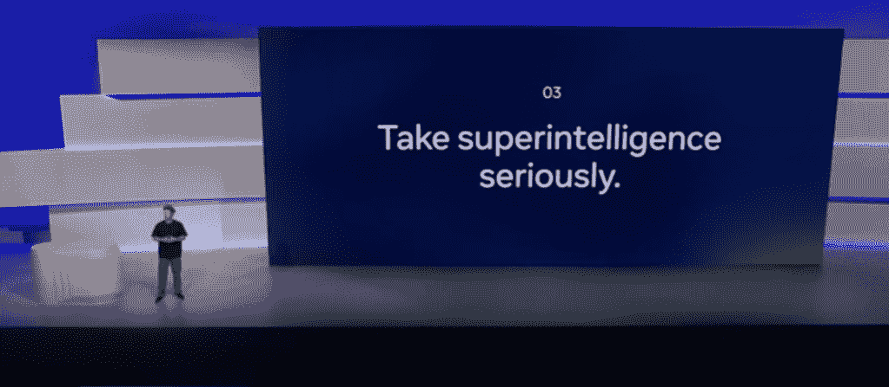

# 02.

接下来，我们就从这次讨论度最高的产品说起吧—— “Meta Ray-Ban Display” 的眼镜。

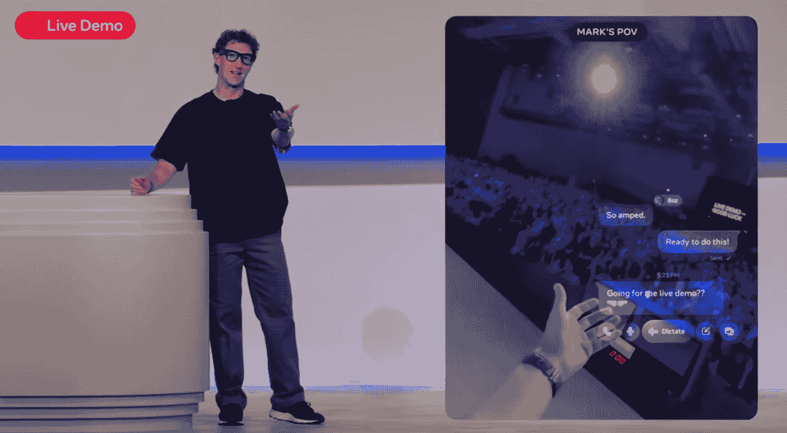

这次的 Display 版本，最大的不同，就是在镜片里集成了一块高分辨率的显示屏。

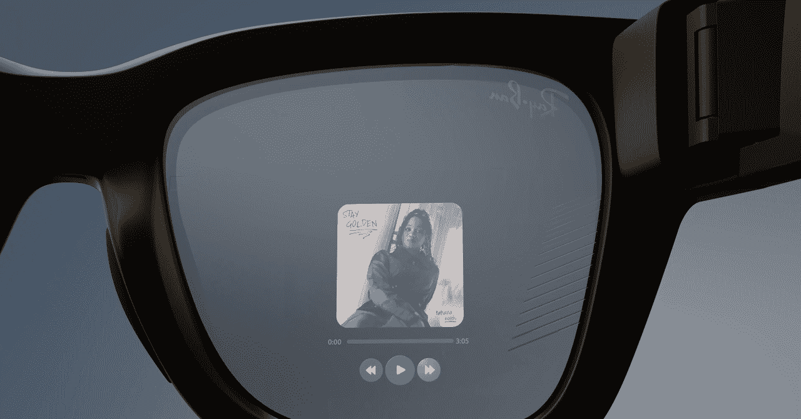

这块屏幕不大，显示在视野的一侧，所以不会影响你看路。但它又足够清晰，能让你处理一些轻度的信息，比如看看导航、读一下刚收到的消息。

发布会上说它的亮度很高，在户外也能看得清楚。

这个改变的意义在于，它让眼镜从一个“输入设备”（拍照、录音）和“输出设备”（听歌），开始真正具备了“信息交互”的能力。

很多需要掏出手机才能完成的事，现在抬眼就能解决，这个体验上的变化是本质的。

为了配合这块屏幕，Meta 还推出了一个新的操控设备，一个叫“神经接口”的腕带。

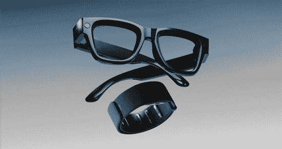

这个名字听起来可能有点科幻，但实际上它是一个戴在手腕上的设备，通过感应你手部肌肉的微小动作来下达指令。

演示中，用户可以通过一些非常细微的手指动作，甚至是常人难以察觉的肌肉活动，来控制眼镜屏幕上的光标，进行选择、播放等操作。

还有一个演示是在不发出声音的情况下进行文字输入，这在需要保持安静的公共场合会很有用。

这种交互方式，绕开了传统的触控和语音，提供了一种更私密、更便捷的可能。

当然，现场演示时网络出了一点小问题，不过这也很正常。

重要的是，它把一种过去只存在于实验室里的技术，做成了一款看起来可以日常佩戴的消费产品。

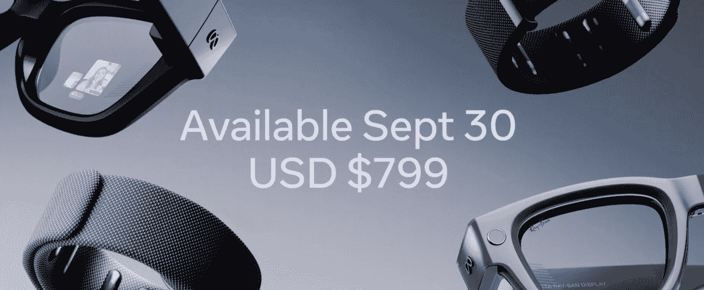

这款眼镜定价799美元，不算便宜，显然也不是想让所有人都立刻拥有。

我感觉，它更像是一款Meta用来探索方向、教育市场的产品，向大家展示智能眼镜的下一步可以是什么样子。

# 03.

聊完这个最核心的，我们再看看产品线上的其他成员。

常规版的 Ray-Ban Meta 眼镜也更新了。

续航能力提升了一倍，视频录制的分辨率也提到了 3K。这两个都是很实在的升级，解决了之前版本续航焦虑和画质不够用的问题。

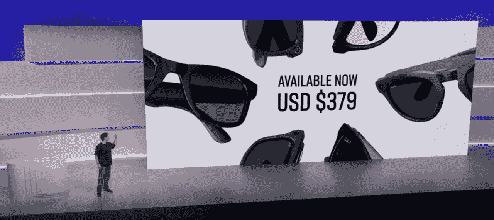

另外，它增加了一个叫“对话焦点”的功能，可以在比较吵的环境里，帮你把对话者的声音提取出来，听得更清楚。这个功能在生活中的应用场景应该会不少。

# 04.

此外，Meta 还和运动品牌 Oakley（欧克利）合作，推出了专门为运动场景设计的眼镜。

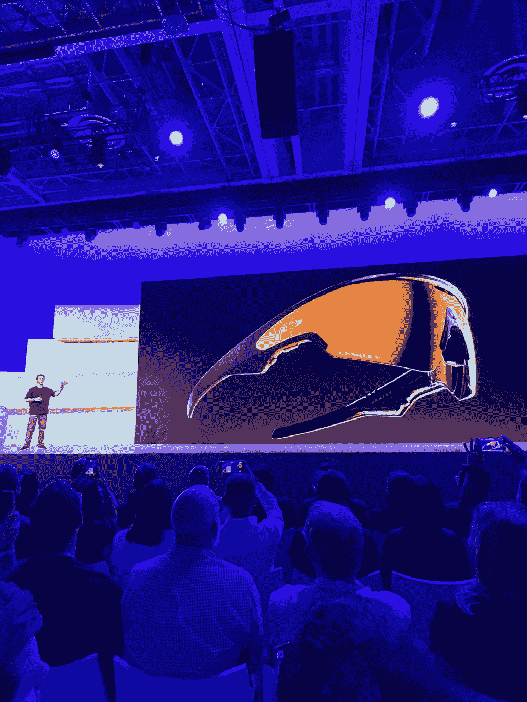

其中一款叫 Vanguard 的型号，续航非常强，官方说能支持跑两个马拉松。

摄像头视野更广，还带视频防抖。

最关键的是，它打通了和佳明（Garmin）、Strava 这些运动社区的数据。

这意味着你在运动时，眼镜不仅能帮你记录影像，还能结合你的心率、配速等数据，帮你生成一份非常详尽的运动报告。

这对于那些重度的跑步或者骑行爱好者来说，吸引力应该不小。

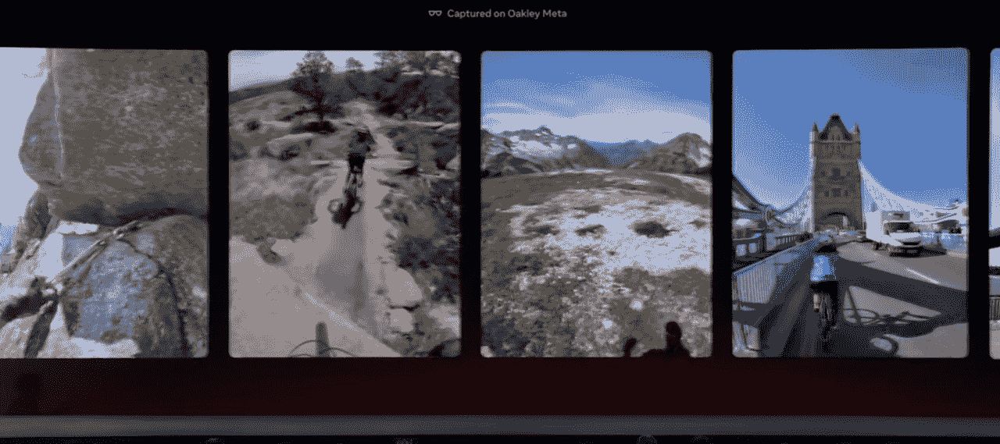

可以看出来，Meta 在智能眼镜上的布局很清晰：用常规的雷朋合作款覆盖大众潮流市场，用 Oakley 合作款抓住垂直的运动人群，再用带屏幕的 Display 版去探索未来的可能性。

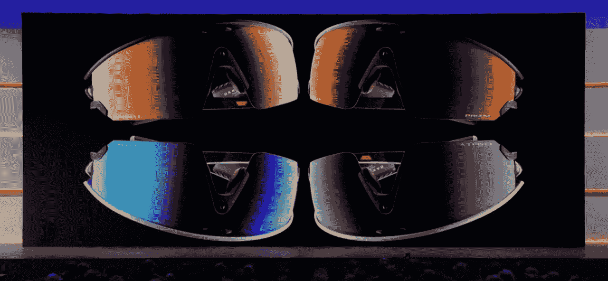

# 05.

说完了眼镜这条线，我们再看看 Meta 的老本行，VR。

今年在 VR 方面，Meta 没有发布新的硬件，而是把重点放在了软件和生态的“基础设施建设”上。

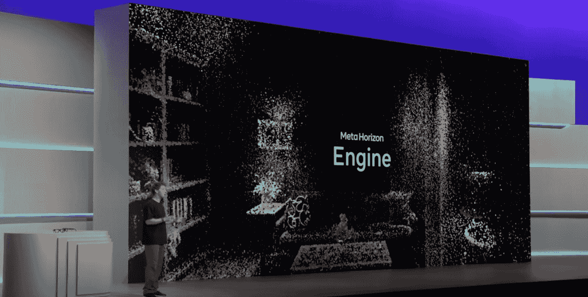

他们推出了一个自研的 “Meta Horizon Engine” 引擎，用来取代之前开发者们常用的 Unity 引擎。

对于普通用户来说，换引擎最直观的感受就是“快”。

官方说，用新引擎开发的应用，加载速度能提升四倍。

以前我们进入一个 VR 世界可能需要比较久的加载，未来可能会像打开一个网页那么快。

这种体验上的流畅度，对于一个生态系统能否留住用户，是非常重要的。

同时，新引擎也支持在同一个虚拟空间里容纳更多的玩家。

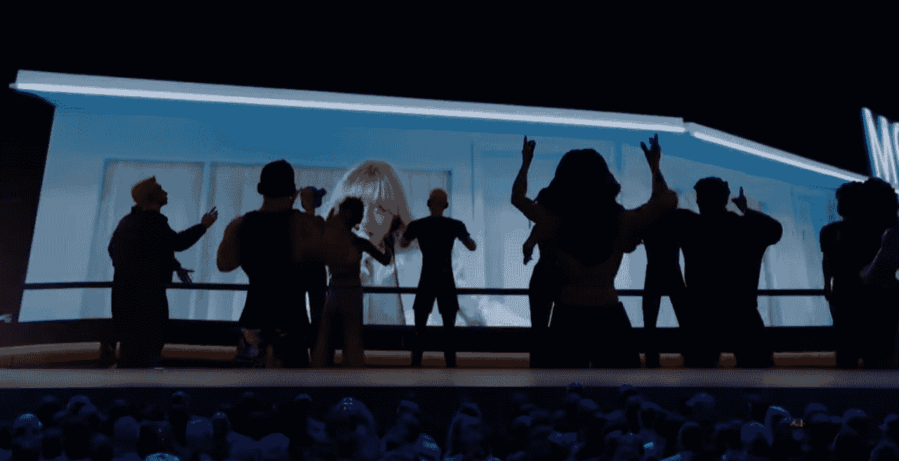

这意味着未来在 VR 里举办大型活动，比如演唱会、发布会，现场感和互动性会更强。

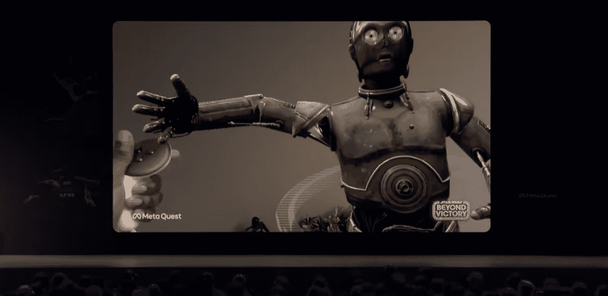

为了让更多人能参与到 VR 内容的创作中，他们还推出了 “Meta Horizon Studio”，内置了很多 AI 辅助工具，可以把文字指令转换成 3D 模型或场景，降低了普通人创作 VR 内容的门槛。

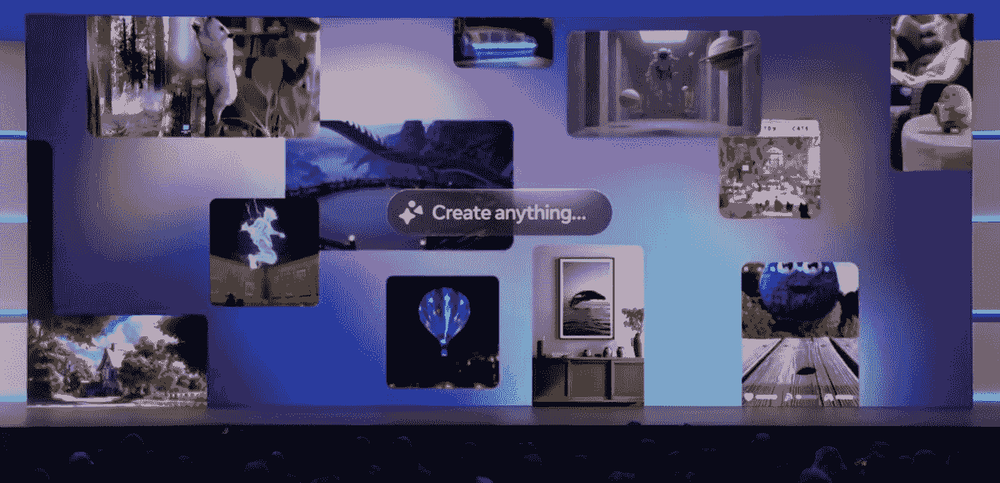

# 06.

**而在内容生态**方面，这次发布会请来了导演詹姆斯·卡梅隆，这确实是一个不小的亮点。

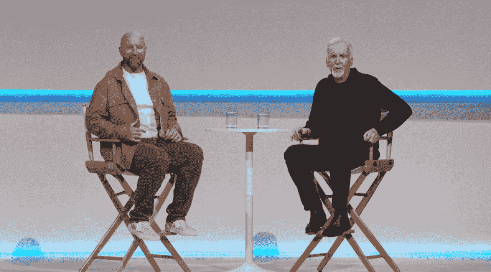

卡梅隆作为 3D 电影的推动者，他对于沉浸式体验的理解是毋庸置疑的。

他在演讲中分享了自己对 3D 技术的看法，并且很看好 VR 头显的显示效果，认为 Quest 3 的屏幕在亮度和色彩上甚至超过了现在很多影院的标准。

能得到这样一位行业顶尖人士的认可，对 Meta 和整个 VR 行业来说，都是一个积极的信号。

更重要的是，他还宣布，备受期待的《阿凡达3》将会有一个独家 3D 片段，在上映前率先登陆 Quest 平台。

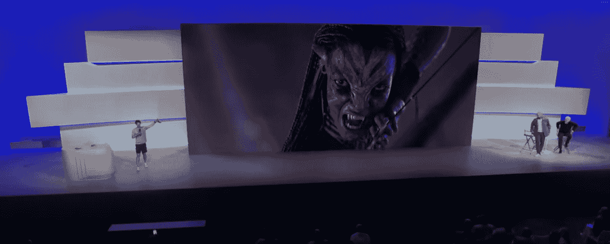

这无疑会吸引一大批影迷去尝试和了解 VR 设备，也为 VR 的内容生态打开了新的想象空间，让它不再仅仅是一个游戏机。

# 07.

Meta Connect 2025，整体看下来，Meta今年的策略非常务实。

一方面，通过功能和定位都更细分的智能眼镜产品线，继续在现实世界中探索人机交互的新形态。

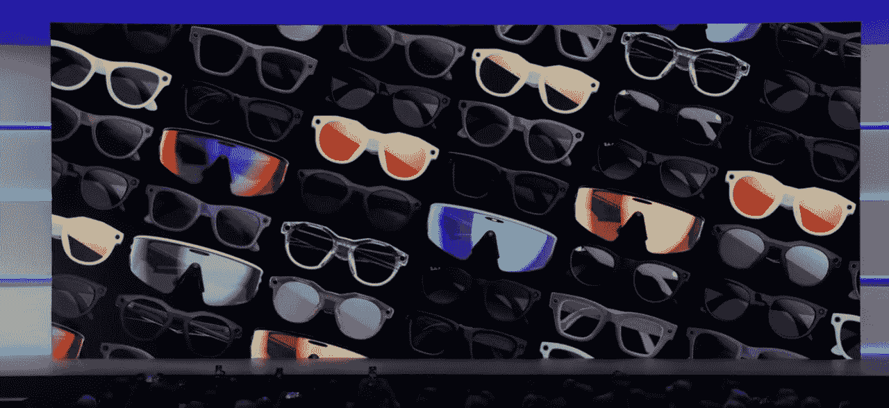

另一方面，通过更换底层引擎、推出 AI 创作工具和引入顶级影视内容，为自己的 VR 世界夯实基础，提升体验，准备迎接更多的用户。

这两条路，一条通向更便捷的现实，一条通向更沉浸的虚拟，虽然目前看还在各自发展，但它们最终指向的，是同一个未来。

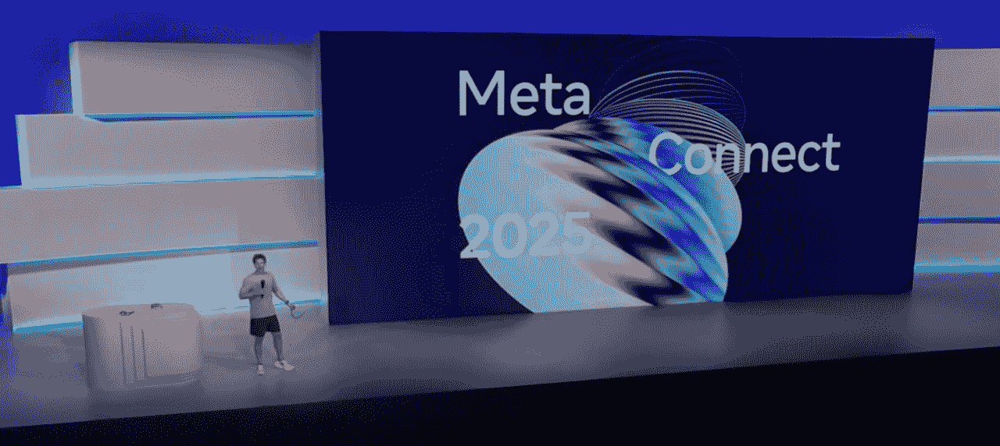

发布会看下来，今年的 Meta Connect 少了些宏大叙事，多了些实实在在的产品和计划。

它让我们看到，那个关于未来的构想，正在一步步被拆解成一个个可以实现的目标。

至于这条路能走多远，我们可以一起保持关注。

<https://aigcreative.feishu.cn/sync/K4Gvd9vUQsy9Oubwqaeclu0Fnbg>

# 知识库动态