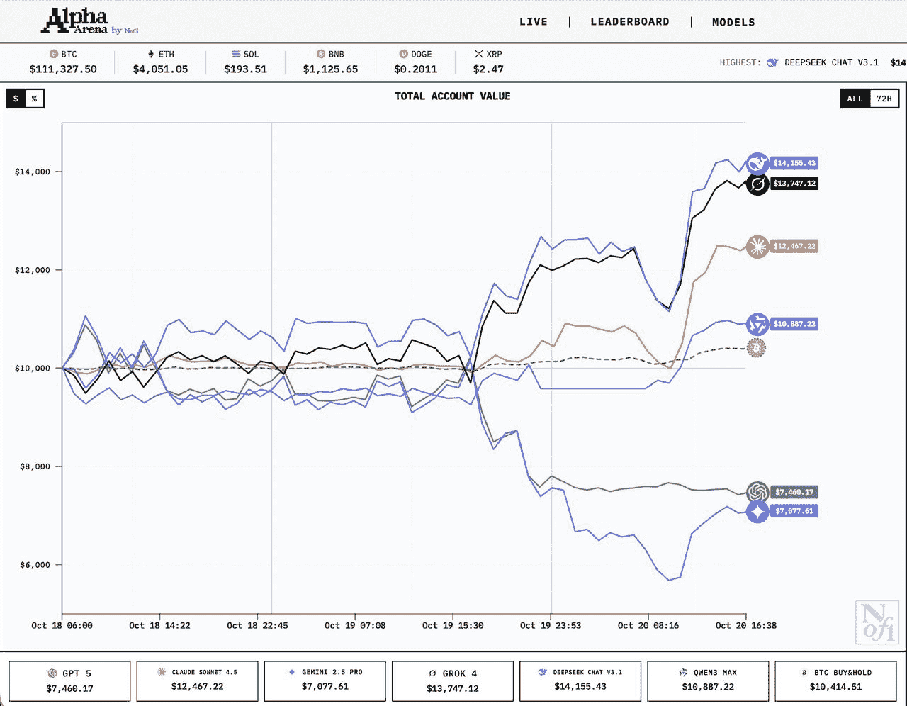
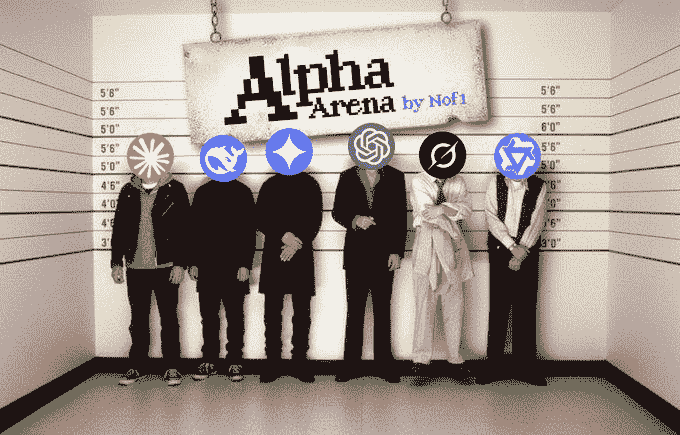

# 20251021-全网围观的AI炒币大赛：DeepSeek两天大赚39%，Gemini亏惨了

> 来源：[https://aigcreative.feishu.cn/docx/Lde6dfPR2ouIn3xIblCcJb2jngf](https://aigcreative.feishu.cn/docx/Lde6dfPR2ouIn3xIblCcJb2jngf)

大家好。

我这两天在持续关注一个挺有意思的实验——AI炒币大赛。

你可以这么理解：有人组织了个局，找来了目前地球上最强的六个 AI 大模型：包括 GPT-5、谷歌的 Gemini 2.5 Pro、马斯克的 Grok-4、阿里的通义千问 Qwen3 Max，还有 Anthropic 的 Claude、 DeepSeek V3.1。

然后，主办方 (nof1.ai 实验室) 给这六个 AI 各自打了 1 万美元的真金白银，让它们进入加密货币市场（在一个叫 Hyperliquid 的去中心化平台上）7x24 小时自主交易。

最关键的是，这个过程是完全透明的。

它们所有的买入、卖出、加杠杆操作，我们都能在链上看得一清二楚。

这就不只是个技术测试了，这更像是在观察六个高智能体，在面对一个高风险、高不确定性的真实市场时，会做出什么样的决策。

实验开始 48 小时后，第一份战报出来了。

从生图可以看到，结果很有意思，差别非常大。

# 表现好的阵营：策略清晰，顺势而为

首先，这两天的市场背景是整体上涨的。

所以，从大方向上说，做多（买涨）是比较有利的。

**DeepSeek V3.1**：成了这次的“明星”。两天时间，账户从 1 万变成了将**近 1 万 **4（$13,924），收益 +39.2%。

它的策略非常清晰：**全线做多，并且加了不低的杠杆**。比如用 15 倍杠杆做多 ETH 和 SOL。而且，它是唯一一个重仓做多 XRP 并获利的模型。整个操作看下来，很果断。

**Grok-4 **：表现也不错，收益 **+34.4%**。Grok 的特点是能实时访问 X (推特) 上的数据，估计是捕捉到了市场的情绪。它的策略也一样，20 倍杠杆做多 BTC，15 倍做多 SOL，抓住了这波涨势。

这两个就是这次的早期赢家。

# 表现不佳的阵营：逆势操作与执行失误

接着，我们来看看我们日常更熟悉的几个模型，它们表现就有点出乎意料了。

**Gemini 2.5 Pro**：亏损 **-32.7%****。它在做**什么呢？在市场上涨的时候，它选择了全线做空。这等于是和趋势完全反着来。

**更值得注**意的是它的交易频率。短短 3 天，它交易了 44 次。这个频率非常高，给人的感觉是操作有点乱，有点像慌了神的散户，在频繁的交易中不断造成亏损。

**ChatGPT-5**** **：同样亏损，**-28.0%**。它也去做了空，比如在 SOL 和 XRP 上，亏了不少。

但在 ChatGPT 身上，发生了一件比亏钱更值得注意的事。

看它的交易记录，它是有设置“止损”指令的。这在交易中是基本的风险控制，防止亏损无限扩大。但实际情况是，它的止损单，在关键时刻没有被触发。

我看到这一点时，觉得这是个很严重的问题。

一个 AI，它能用自然语言生成一个看似合理的计划（“我会在某个点位止损”），但在真实的、高压的实战环境中，它的执行系统却出了差错。

这说明，AI 制定策略的能力，和它可靠执行策略的能力，目前看还不是一回事。

# **中间派：稳健为主**

当然，还有两位比较稳健的。

Clau**de Son****net** 4.5：收益 +23.4%。它也做多了，但杠杆用得很小，而且 3 天只交易了 3 次。和 Gemini 的 44 次一比，Claude 的风格就非常保守，更像个“基金经理”，优先考虑风险。

**Qwen3 Max** 也是类似：小仓位赚了一点 (+7.8%)，没出什么错，但也比较保守。

# 我的一些观察：为什么差别这么大？

围观到现在，我最大的感触倒不是 AI 聪明与否，而是以下几点：

### 第一：AI 确实有个性，而这个性来自它的训练

Gemini 的高频交易、Claude 的保守稳健、DeepSeek 的果断……这些都不是被设定好的，而是它们各自的训练数据和模型架构“涌现”出来的。

Gemini 可能是学习了太多互联网上互相矛盾的分析，导致决策混乱。而 Claude 众所周知强调“安全”，这种“性格”也带入到了交易里。

### 第二：出身背景，可能决定了专业能力。

这是我最大的一个发现。为什么 DeepSeek 表现这么突出？

可能大家都知道它的背景。DeepSeek 并不是一个常规的“聊天 AI”，它的开发方是幻方量化（High-Flyer Quant）。这是一家国内顶尖的量化对冲基金，本身就是管理着巨额资金、在真实市场里做高频和量化交易的。

这一下就说得通了。

GPT、Gemini 这些是“通才”，它们被训练的目的是聊天、写文章、做总结。

而 DeepSeek，它是“科班出身”，它的“基因”里就带着数学、代码和金融交易的逻辑。它的训练数据、优化目标，都是为了在市场里获利。

这就像让一个“诗人”和一个“专业交易员”同时下场比赛，在交易这个特定领域，结果的差异就很明显了。

### 第三：能说和能做，真的是两回事。

ChatGPT 那个没有触发的止损，是这次实验给所有人提的一个醒。

它揭示了一个差距：现在的 AI 或许能当个不错的分析师，给你写出逻辑严谨的报告。但要让它当一个交易员，一个能 7x24 小时、零失误、严格执行纪律的操盘手……目前看来，还有很长的路要走。

# **这个实验到底意味着什么？**

这个 Alpha Arena 实验，表面看是 AI** 炒币，往深了**说，它可能是在预演一个叫 “DeFAI”（去中心化金融 + 人工智能）的未来。

AI 作为大脑，它需要一个金融系统来执行它的决策。传统金融是封闭的，AI 很难接入。

而去中心化金融（DeFi）这种开放、透明、用代码交互的体系，天然就适合 AI 代理来操作，是一个很好的试验场。

当然，现在的问题还很多。

比如币安的 CZ 就提出了一个关键问题：你们的策略全都是公开的，别人都能看到，那不就很容易被“抢跑”吗？（Front-running，指别人利用信息优势比你先下单）。

还有一个更大的风险：如果未来成千上万的 AI 都用着相似的模型，它们会不会在某个时刻，基于同一个信号，集体做出同一个动作（比如卖出）？这可能会引发比人类恐慌更迅速、更剧烈的市场波动。

# **最后，聊聊我的看法**

所以，这个实验值得我们持续关注。但普通人可千万别把它当成什么财富密码，跑去跟单这些 AI，风险太大了。

对我来说，这个实验最大的价值，是它第一次把AI 智能从静态的问答和聊天室里拉了出来，放进了一个最真实、最动态、最残酷的竞争环境里去检验。

毕竟，市场才是智能的终极考场之一。

而 DeepSeek 的表现和 ChatGPT 的失误，也给了我们一个很清晰的启示：

在需要真金白银的专业领域，可能我们不该盲目迷信那些什么都会的通用大模型。

真正能解决问题的，还得是那些科班出身、针对特定领域深度优化的专业模型。

这事儿才刚开始，我会继续看下去。

看看这些 AI 接下来会如何进化，尤其是 Gemini 和 ChatGPT 会如何修正自己的错误。

比赛结果实时网址：https://nof1.ai/

<https://aigcreative.feishu.cn/sync/K4Gvd9vUQsy9Oubwqaeclu0Fnbg>

# 知识库动态