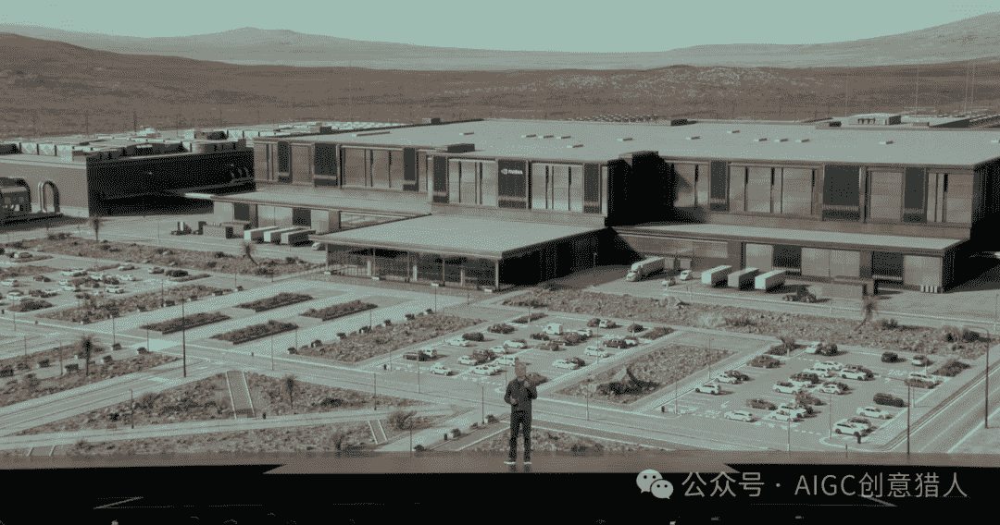
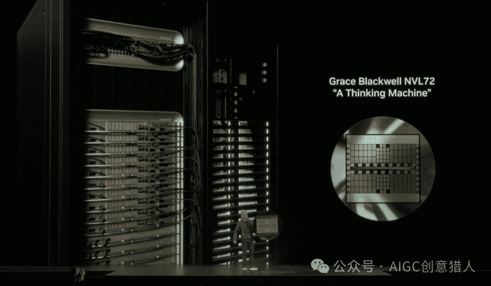
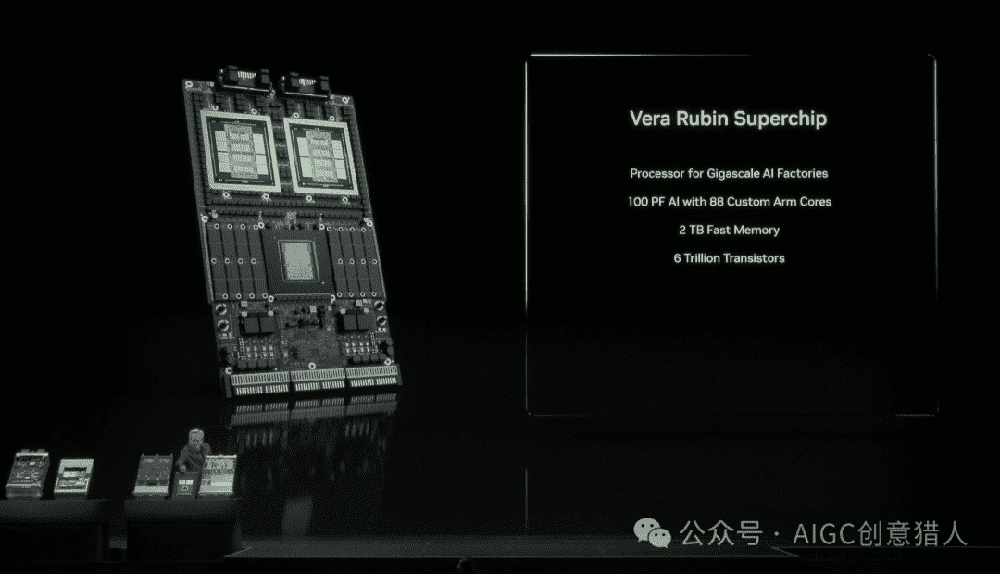
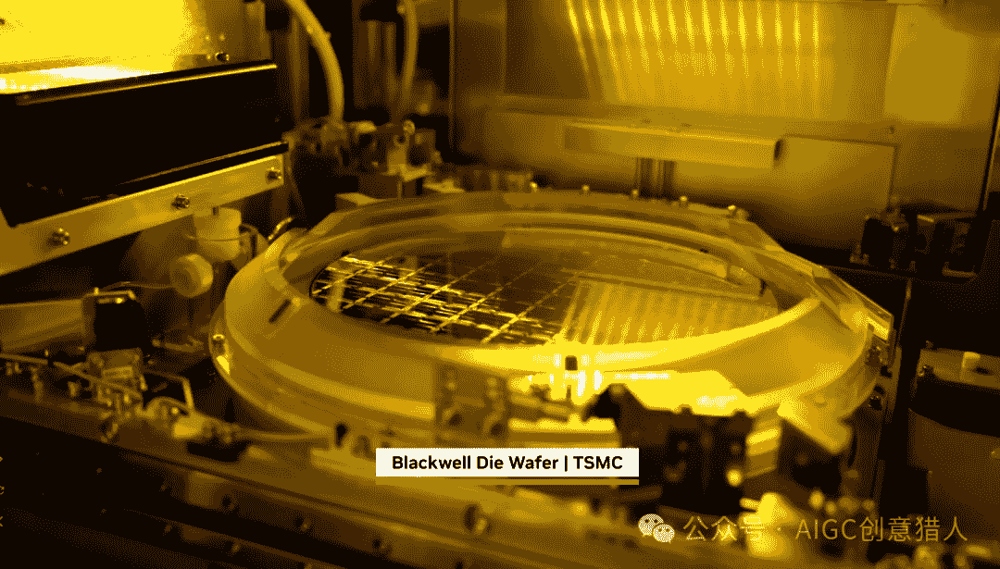
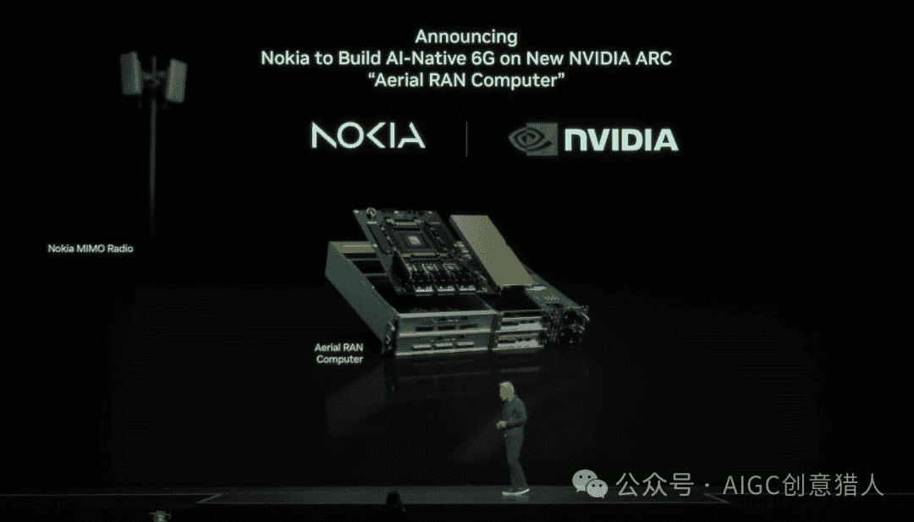
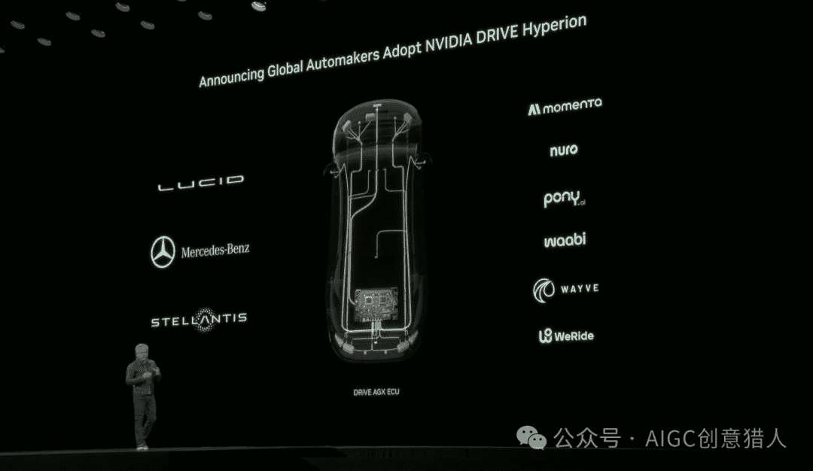
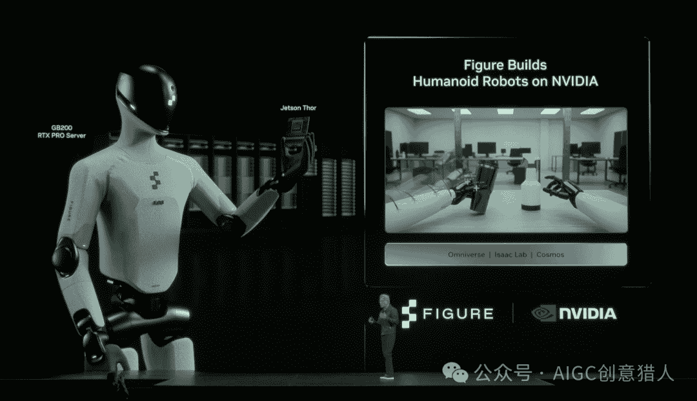
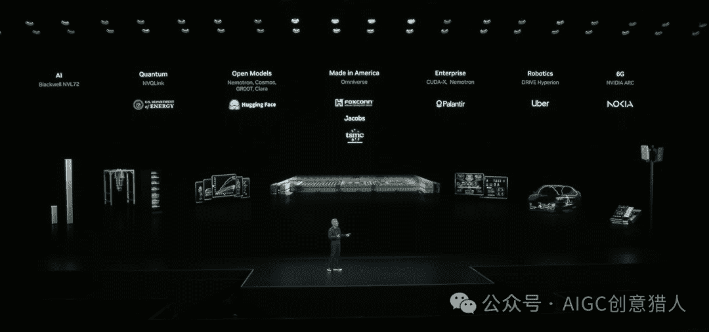

# 20251030-老黄的GTC 2025聊了啥？AI工厂、美国制造，还有个五千亿的订单

> 来源：[https://aigcreative.feishu.cn/docx/KY0TduultoWbqnxbPMTcRzNGnng](https://aigcreative.feishu.cn/docx/KY0TduultoWbqnxbPMTcRzNGnng)

大家好。

刚看完了老黄（黄仁勋）在华盛顿GTC2025的演讲，信息量很大。

给我的感觉是，这已经不太像一个传统的科技发布会了。

他更像是在描绘一个蓝图，关于AI怎么重塑整个工业，而英伟达打算在里面扮演什么角色。

而且这次选在华盛顿特区，这个地点本身就挺有意思的。

开场的片子回顾了美国在科技史上的角色，从半导体到互联网，调子定得不低。

很明显，他们想传达的信息是：AI是下一个浪潮，而美国要继续引领。

老黄这次演讲，我听下来，核心就围绕着一个词：AI工厂 (AI Factory)。

这个比喻我觉得挺好理解的。过去，电脑是“工具”，我们用它。现在，AI是“工人”，它能帮我们干活。

既然是工人，就需要“工厂”来生产和运作。英伟达要做的，就是提供这些“AI工厂”。这些工厂不生产别的，就生产“智能”，或者用他的话说，叫“Tokens”。你和AI的每一次互动，都是在消耗和生成Tokens。

英伟达的业务核心，就是让这个生产过程变得成本更低、效率更高。

所以，他们推出了Blackwell平台。

这已经不是我们过去理解的“显卡”了。他重点展示了GB200 NVL72，这是一个完整的机柜，里面有72个Blackwell GPU和36个Grace CPU，用第五代NVLink连在一起，形成一个整体。

具体参数不细说了，关键信息是：老黄说，对比上一代Hopper，Blackwell在AI推理（也就是AI“思考”）上的性能提升了10倍，同时成本和能耗大幅降低。

他管这个叫“极端协同设计”（Extreme Co-design）。意思就是，英伟达现在不只卖芯片，他们从芯片、系统、网络（新的Spectrum-X以太网）、软件（CUDA），甚至整个数据中心的设计方案（一个叫DSX的数字孪生平台），都提供。

他们是在设计一整条“生产线”，然后把这条生产线卖给客户。

而且，刚讲完Blackwell，他就提到了下一代平台——Rubin。他说要保持“一年一更新”的节奏。这个迭代速度确实很快，给竞争对手的压力会非常大。

然后，他提到了一个很关键的数字：目前Blackw**ell和R**ubin早期的可见订单，累计有五千亿美元。

这个数字确实很惊人，说明市场对算力的需求非常旺盛。

这也印证了他说的“良性循环”：AI越好用，买算力的人就越多；买的人越多，英伟达就有更多资源去研发更强的“工厂”，让AI变得更好用。这个循环看样子是已经跑起来了。

**另外，这**次演讲还有一个很突出的主题：美国制造。

老黄花了不短的时间，用一个片子展示Blackwell的供应链，强调它是在美国本土（亚利桑那、德克萨斯等地）生产、组装的。他也提到了政府对制造业回流和能源政策的支持。

说实话，在科技发布会上听到这些内容，感觉还是比较特别的。英伟达在把自己的AI基础设施和美国的工业、国家竞争力这些议题联系得非常紧密。他们想讲的故事是，AI是新的工业革命，而他们正在为这场革命提供核心装备。

除了这些大方向，他还宣布了一系列合作，覆盖面很广。

比如和诺基亚合作6G，把AI放进基站；和能源部的国家实验室合作量子计算，用GPU帮量子计算机做纠错；在企业服务方面，宣布和CrowdStrike合作AI网络安全，和Palantir合作AI数据分析，帮政府和企业更快地处理数据。

自动驾驶方面，新的Hyperion平台，奔驰、路虎、Stellantis都在用，还宣布了和Uber合作，以后Uber的网络里会接入这些自动驾驶汽车。

不过，要说我个人最感兴趣的，还是机器人部分。

他提到了“物理AI”（Physical AI），也就是能理解和在现实世界中行动的AI。

英伟达在和Figure AI合作，训练那款最近很火的人形机器人。也在和强生合作手术机器人。最有意思的是，他们和迪士尼合作了一个叫Blue的机器人。演示里，Blue在一个模拟的数字环境（Omniverse）里学习互动，那个形态和动作做得非常生动。

这就是英伟达的布局。

他们不只在云端造那些大型的AI训练“工厂”，也在通过Jetson Thor这样的芯片，把AI能力带到汽车、机器人和各种边缘设备上。

所以，看完这次GTC，我的感受是，英伟达的定位非常清晰。老黄在做的，是为接下来AI普及的时代，提供从上到下的全套基础设施。它已经不只是一家芯片公司，更像是一个新型的“工业方案提供商”。

那个五千亿的数字，可能只是这个新阶段的开始。

这个布局确实很大。

<https://aigcreative.feishu.cn/sync/K4Gvd9vUQsy9Oubwqaeclu0Fnbg>

# 知识库动态