# 20251031-最新AI趋势报告：GPT-5重夺榜首，但真正战场已经变了

> 来源：[https://aigcreative.feishu.cn/docx/Dyy2dLngUoZzONx6305cEUs5nq1](https://aigcreative.feishu.cn/docx/Dyy2dLngUoZzONx6305cEUs5nq1)

最近，我身边有朋友在聊，感觉AI的热度是不是有点降温了，好像没上半年那么“天天有新闻”了。

甚至有人在问，AI的进展是不是遇到瓶颈了？

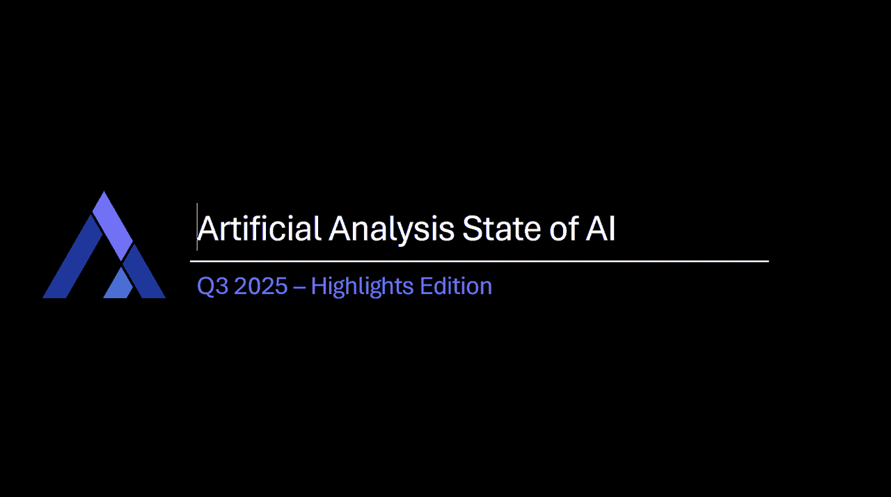

我之前也有点这种感觉，直到我仔细看了这份Artificial Analysis（AA）刚发布的2025年Q3 AI状况报告。

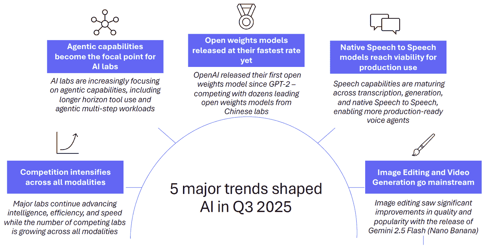

看完之后，我的看法很明确：AI的进展根本没有停滞，反而还在加速。

只是，竞争的焦点已经从“你能不能聊天”悄悄转移到了更深入的地方。

# 钱，还在大量涌入

首先，最直观的就是投资。

报告里提到，谷歌、微软这些巨头在AI基建上的资本支出非常高，比如微软在威斯康星的70亿美元数据中心，谷歌在印度的150亿美元投资。

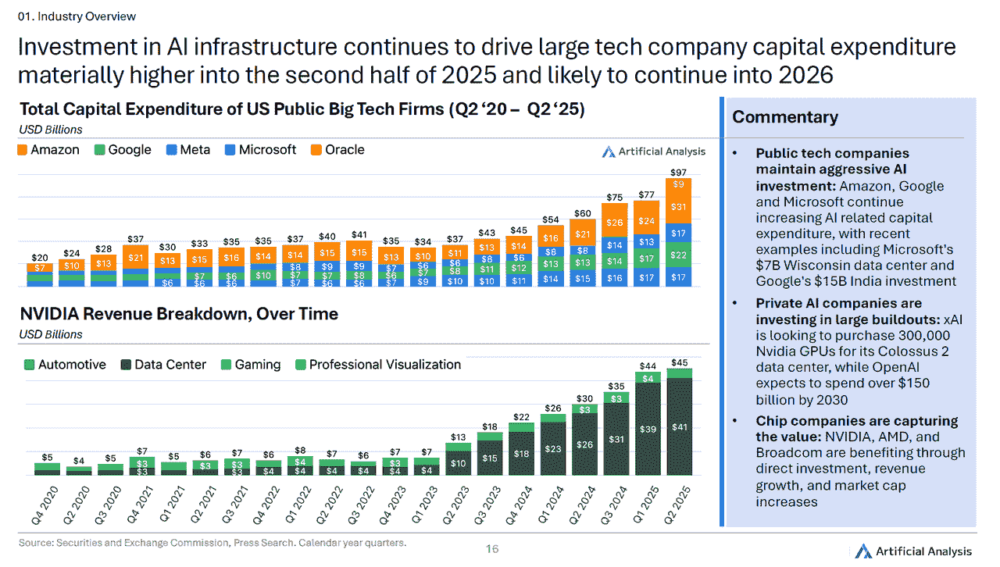

私人公司的投入规划也相当惊人。xAI（马斯克的公司）计划购买30万块Nvidia GPU，而OpenAI预计到2030年的总花费可能超过1500亿美元。

这些钱最终都流向了NVIDIA、AMD这样的芯片公司，NVIDIA依然是最大的受益者。这说明，行业巨头们都非常笃定，现在的算力还远远不够用。

# 重点转移：从“聊天”到“做事”的AI智能体

为什么需要这么多算力？因为AI的重点变了。

Q3最大的趋势是“智能体”（Agents）能力。

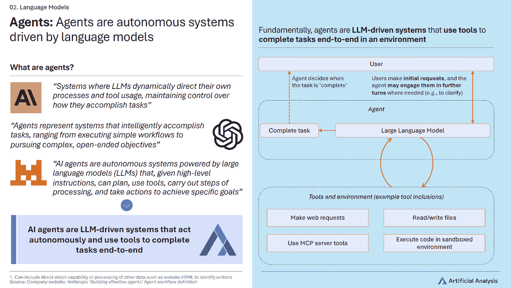

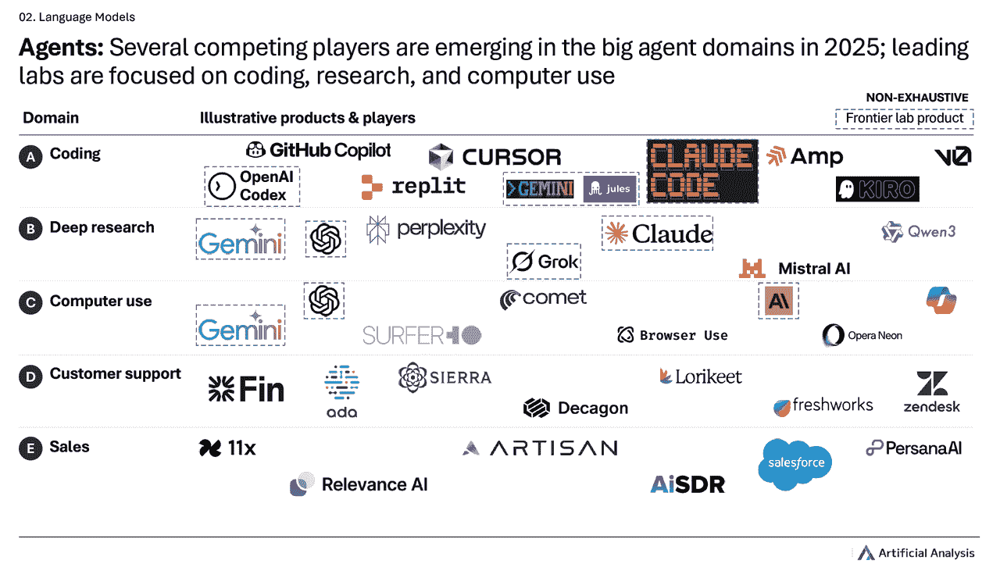

说白了，以前的AI是“聊天伴侣”，你问一句，它答一句。现在的AI，实验室希望它成为“助理”。你给一个高阶指令，比如“帮我分析这份财报，总结三个要点，并做个PPT初稿”，它自己去规划、去调用工具（比如读文件、用浏览器），最后把任务完成。

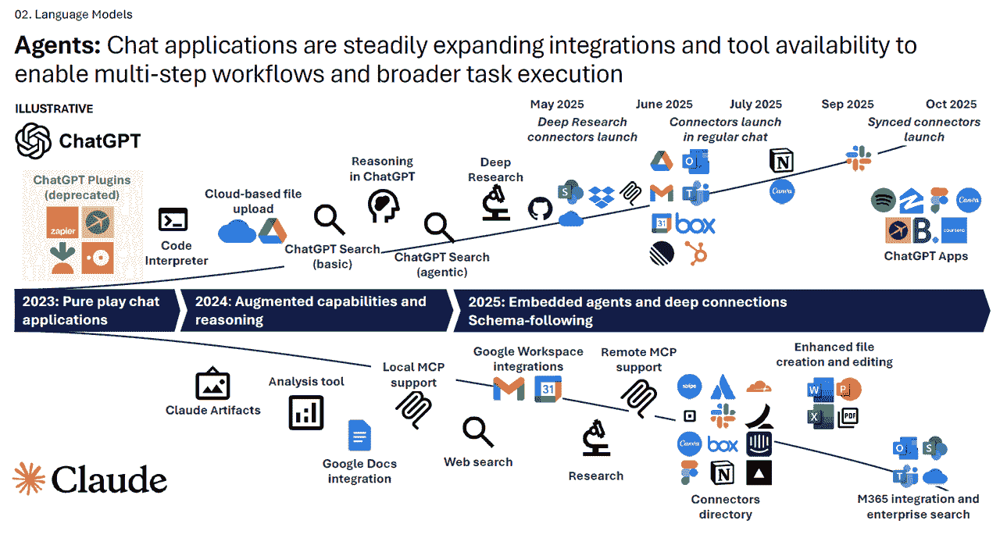

报告说，GPT-5之所以强，一个重要原因就是它能更可靠地使用工具，端到端地完成工作。

# “100倍便宜”与“20倍需求”的悖论

这就带来一个很有意思的“悖论”。

一方面，AI推理成本确实在下降。报告提到，达到GPT-4级别的智能，现在的成本比GPT-4刚发布时便宜了100倍。Q3新出的一些模型，也把中高端模型的推理价格打下来不少。

但另一方面，所有公司，包括OpenAI和谷歌自己，都在说“算力不够”。

原因是，新的应用太消耗算力了。

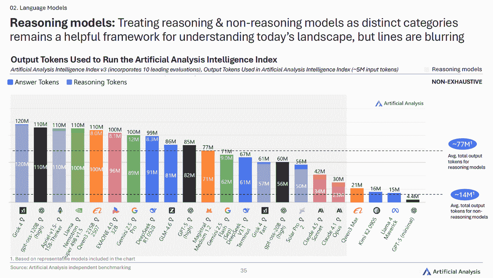

报告估算，当模型需要“思考”（reasoning）时，它产生的tokens（计算量）可能是普通聊天的10倍。而当它作为一个“智能体”去链式调用多个工具时，这个消耗可能是20倍。

我们一边享受着单次任务的降价，一边又在用这些消耗高出10倍、20倍的新功能。所以总账算下来，AI成了更耗资源的应用。

# 模型排名：GPT-5领先，但优势微弱

当然，大家最关心的还是模型排名。

根据AA的智能指数，OpenAI的GPT-5 (high)以68分的成绩回到了榜首。

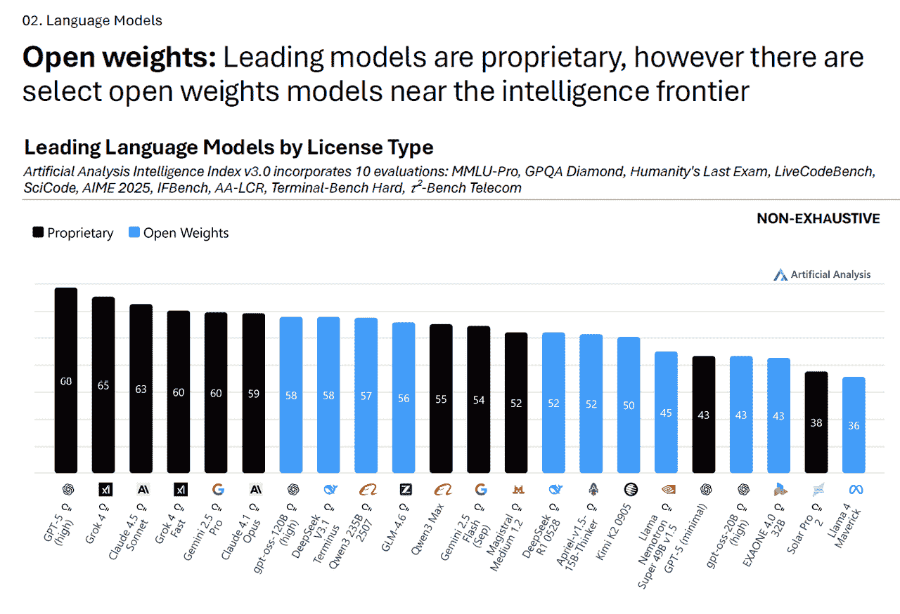

但这个领先优势并不大。xAI的Grok 4拿了65分，Anthropic的Claude 4.5（带思考功能的版本）是63分，谷歌的Gemini 2.5 Pro是60分。

前四名咬得非常紧。而且前七名还是被美国那几家头部公司包揽，领先集团的优势依然明显。不过，报告也指出，像阿里巴巴（Qwen3）、DeepSeek等其他全球玩家，也只落后几个月，追赶的速度很快。

# 换个赛道：视频生成领域的格局变化

聊完了“大脑”（LLM），再看“五官”。

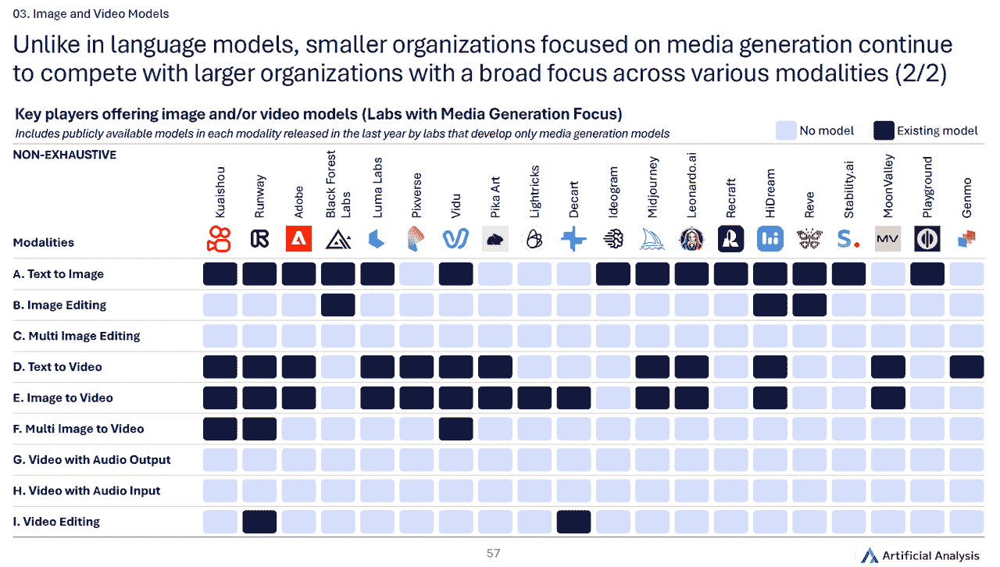

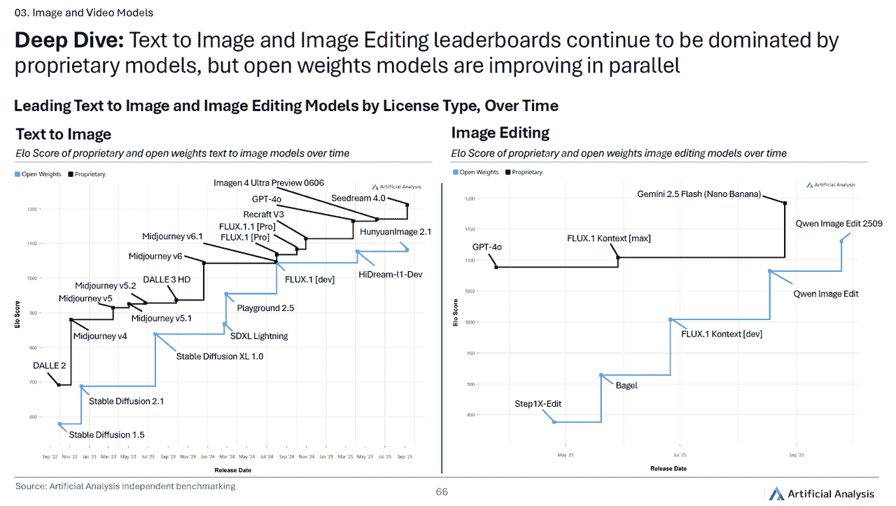

图像和视频领域，Q3的进展非常快，尤其是视频。

值得注意的是，报告提到在视频生成上，中国实验室表现突出。

快手的Kling 2.5 Turbo在文生视频和图生视频两个榜单上都排在第一位。在前十名里，西方的模型只有谷歌的Veo 3和Luma Labs的Ray 3。

这和LLM领域美国主导的格局不太一样。

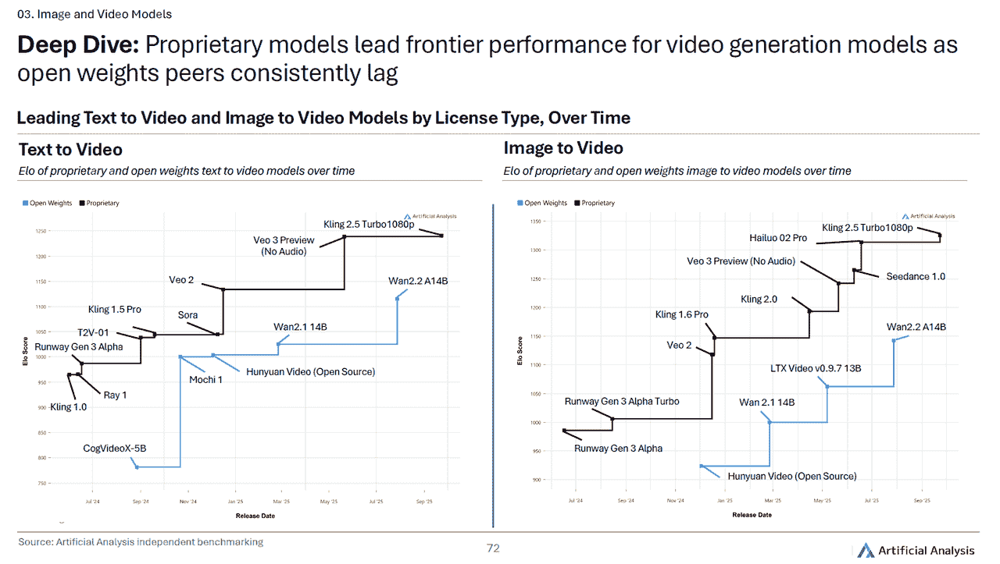

视频领域的迭代速度也快得惊人，Q1的领先者（Runway Gen 3）到Q3时排名已经掉到20名开外了。

此外，视频也开始支持“有声”了。OpenAI的Sora 2和谷歌的Veo 3都能原生支持音频生成，当然，价格也更贵。

# 语音革命：从“三段式”到“原生”对话

最后是语音领域，这可能是一个即将迎来大变革的地方。

我们现在用的语音助手，大多是“三段式”的：

1.  **语音转文本 (STT)**：把你的话变成文字。

1.  **大模型 (LLM)**：理解文字，思考答案（文字）。

1.  **文本转语音 (TTS)**：把文字答案念出来。

这个过程不仅慢，而且丢失了声音里的情绪，感觉很“机器”。

报告显示Q3的革命性进展是“原生语音到语音”（Native STS）模型。谷歌的Gemini 2.5 Native Audio是这个领域的领先者。它直接处理音频，不再需要中间转成文字，这能极大降低延迟，也让AI能理解你说话的语气。

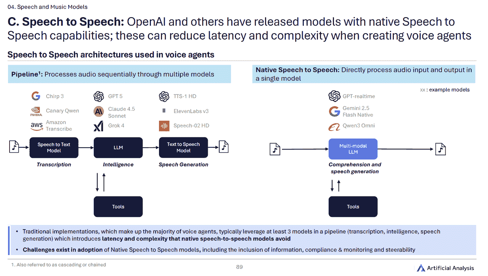

另外一个有意思的点是语音转文本的准确性。谷歌的Chirp 2最准（错误率11.6%）。而OpenAI的GPT-4o Transcribe错误率反而有21.3%。报告分析，OpenAI似乎是故意牺牲了绝对的逐字准确性，来换取更流畅、更自然的转录结果。它不想给你一篇充满“嗯、啊”的逐字稿，而是想给你一篇“润色过”的、可读的文本。

# 硬件：NVIDIA的“3倍”优势

所有这些应用，都跑在硬件上。

这个领域的故事很简单：NVIDIA依旧是主导。他们的新Blackwell B200系统已经铺开了，AA的压力测试显示，在1000个并发请求下，B200的吞吐量是H200的3倍。

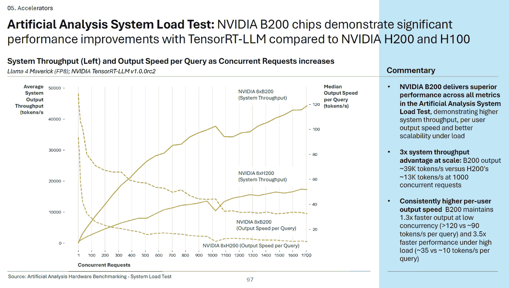

优势太明显了。行业焦点也从“单芯片”转向“整个系统”的性能。相比之下，Intel似乎放缓了脚步，停掉了Gaudi 3的后续产品。

# 总结

所以，回到最初的问题：AI慢下来了吗？

我的看法是，根本没有。

只是战场转移了。

如果说之前比的是“谁更会聊天”，那现在比的是三个新战场：

1.  **智能体****战场**：谁的模型能真的干活？

1.  **多模态****战场**：谁能率先搞定音视频的生成和理解？

1.  **基建****战场**：谁有更多的B200和更强的系统？

对我们用户来说，这意味着AI正从“玩具”变得“有用”。

而对AI公司来说，真正的竞争和军备竞赛，才刚开始。

完整报告，见链接：[Q3-2025-Artificial-Analysis-State-of-AI-Highlights-Report.pdf](https://aigcreative.feishu.cn/wiki/XAD0wevYdiZvUkkhvicc0XbCnuh)

<https://aigcreative.feishu.cn/sync/K4Gvd9vUQsy9Oubwqaeclu0Fnbg>

# 知识库动态