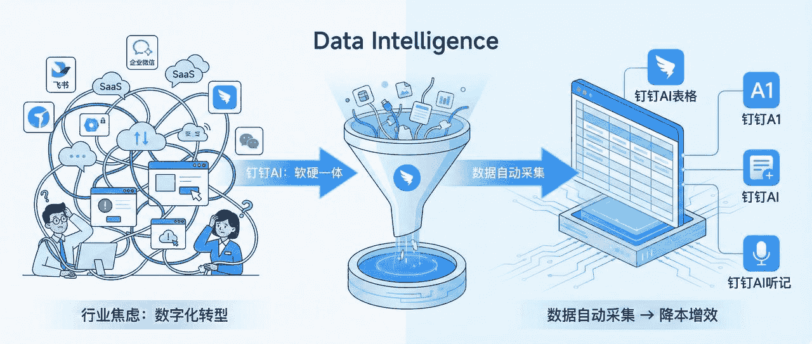
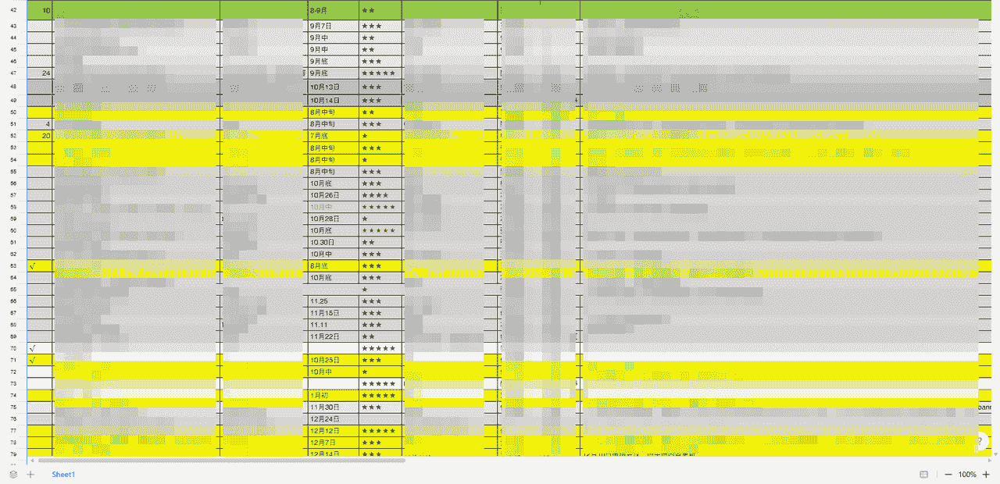
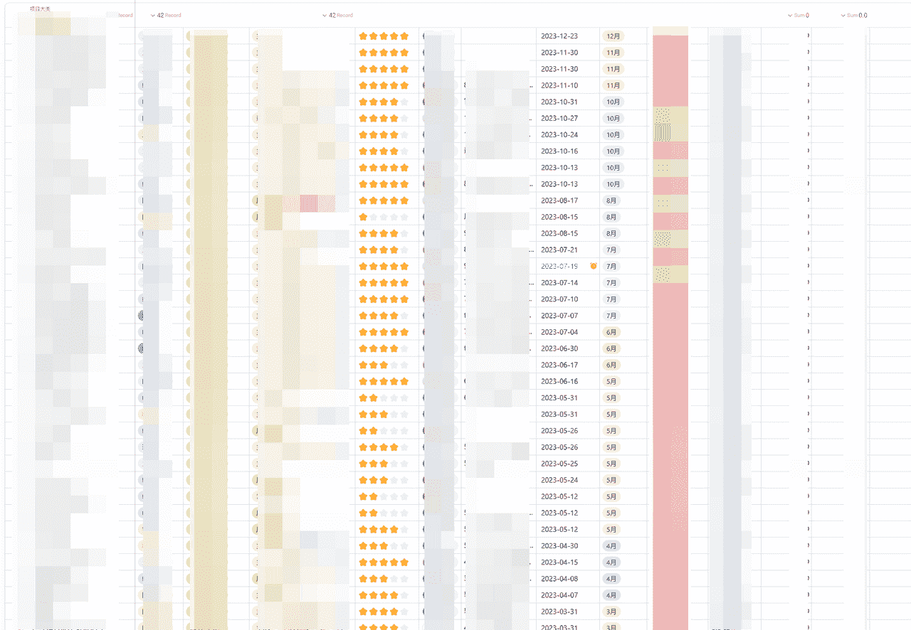
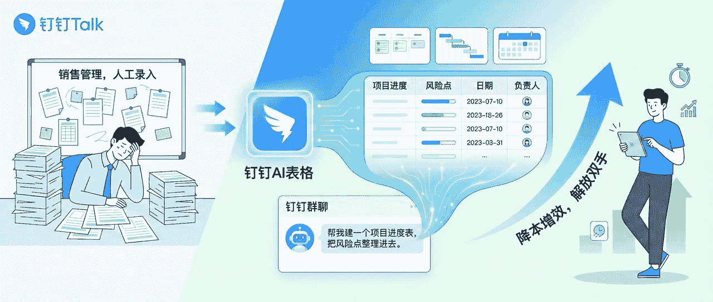
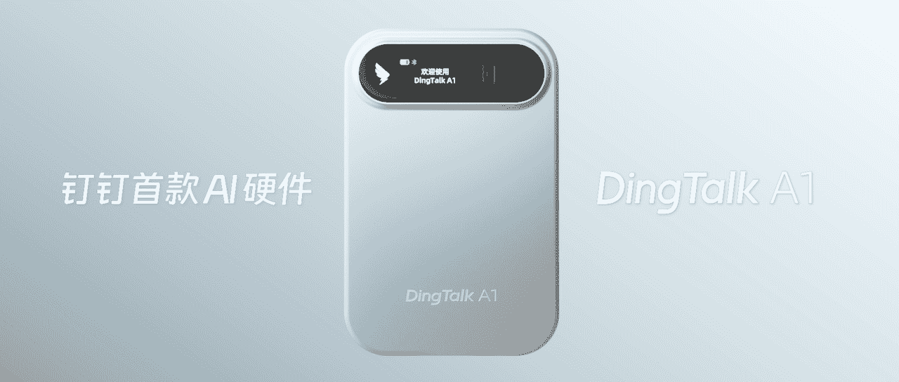
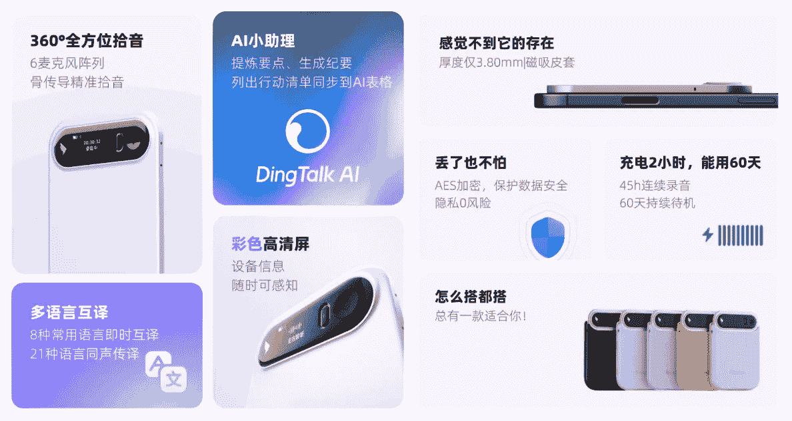
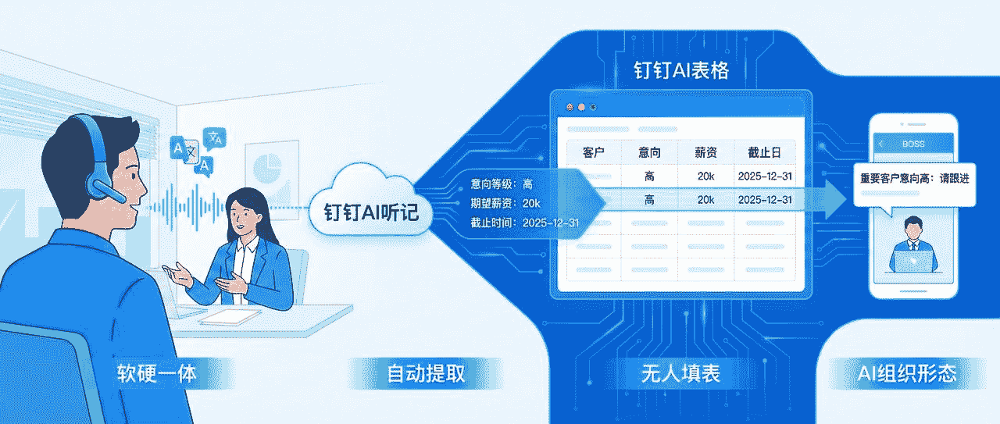
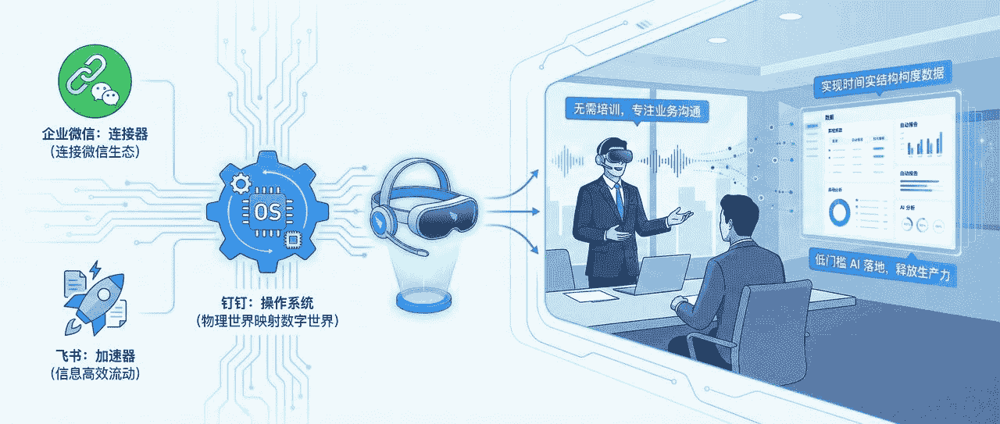
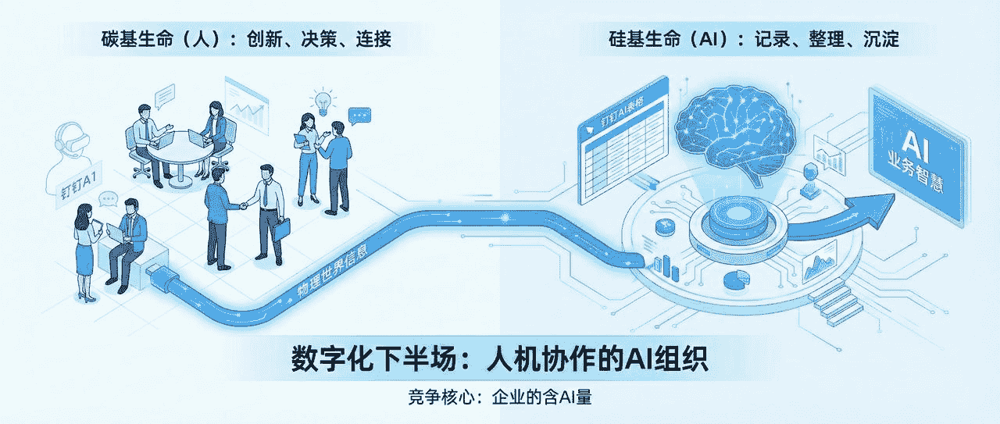
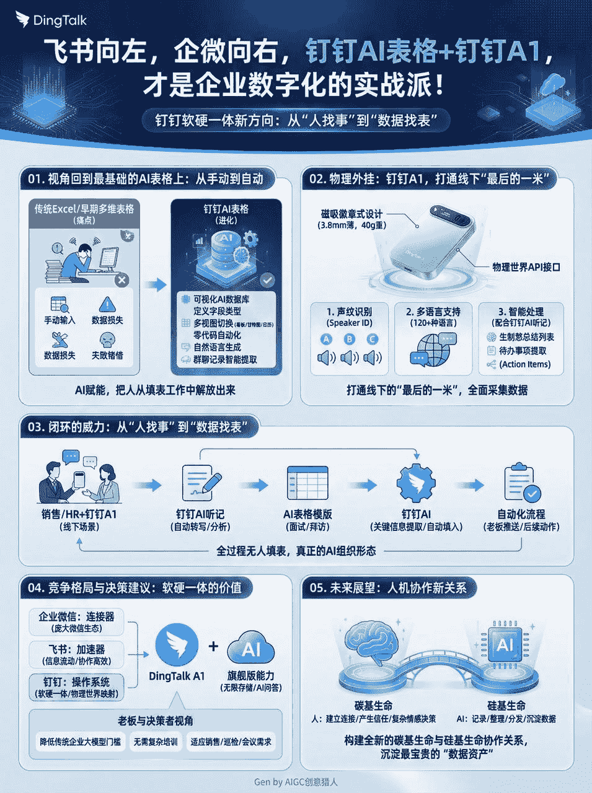

# 20251223-飞书向左，企微向右，钉钉AI表格+钉钉A1，才是企业数字化的实战派！

> 来源：[https://aigcreative.feishu.cn/docx/LxzzdaHH6oGlwQxyNH4cbCqynbc](https://aigcreative.feishu.cn/docx/LxzzdaHH6oGlwQxyNH4cbCqynbc)

**大家好**，我是创意猎人。

最近吃饭有和团队的几个同事聊天，大家有聊一个很现实的行业焦虑：咱们喊了这么多年的数字化转型，软件买了，SaaS也订阅了，为什么公司运转起来还是感觉重手重脚？甚至有了AI办公软件和ChatGPT这些大模型的加持，效率提不提升先不说，员工反而觉得工作量变大了：要学提示词，又要适应各种新系统。

**这就**引**出了我最**近**一直****在琢磨的**一个事儿：在飞书、企业🛰️和钉钉这三家大厂的博弈中，到底谁真正解决了企业降本增效的核心痛点？

今天，我想从**钉钉的AI表格、钉钉A1**和**钉钉AI听记**这三个具体产品切入，盘一盘现在的办公软件生态。

这几年，大家对办公软件的审美被**飞书文档**和**飞书多维表格****带起来了**，那种极致丝**滑的体验**确实让人上头。企业🛰️则牢牢把守着企微私域的大门，毕竟客户在哪里，生意就在哪里。

**但在这些光**鲜亮丽的能力背后，有一个最痛却最容易被忽略的环节：数据的采集。

这就是为什么，我最近在深度了解**钉钉AI**这一整套“软硬一体”的打法后，感觉风向变了。

我觉得钉钉正在尝试走一条完全不同的路，它一直在试图解决怎么让数据自动跑进钉钉AI表格里这一难题。

# 01.视角回到AI表格上

由于组织方面的历史原因，从特殊时期开始，我们采用钉钉作为团队线上协同办公软件，因此也见证了钉钉一路的发展进化历程。

记得钉钉的多维表格（旧名）一上线，我就在团队中推广使用了，简直是如获至宝！可以看看多维表格之前的用Excel进行项目管理状态，极其痛苦+不便。

在把整个项目管理表格转移到多维表格后，感觉整个世界都变得有序高效了，加上自带的数据透视、数据统计、数据看板、自动化方面等功能，把各位“表”哥、“表”姐，从水深火热的Excel表格中，解救了出来。

紧接着就是把CRM、平时依托于Excel的工作大搬家，全部转移至多维表格，大幅提升团队整体的协同效能。

**直到时间**来到今年，钉钉的多维表格升级为：AI表格，一次脱胎换骨的进化。

同时我们也看到市面上的在线表格产品很多，但无论表格设计得多么精妙，都有一个痛点：必须得是人坐在电脑前，把数据一条一条录入进去。这在实际业务中其实是个巨大的卡点。

了解销售管理工作的朋友都知道，你让销售每天跑完客户回来填表，简直比杀了他还难受。信息在录入这个环节，要么因为懒被遗漏，要么因为主观回忆出现了偏差。

这时候你再看**钉钉AI表格****，它的逻辑变了：它**已经不再是一个静态的表格，而是一个可视化的AI数据库。

它的每一列都是定义好的字段类型，支持看板、甘特图、日历这些多视图切换，但最关键的是它的零代码自动化能力。

我试过一个场景：以前统计项目进度，得在群里吼，然后人工复制粘贴。但在钉钉AI表格里，你可以利用 AI的能力直接识别群聊记录，或者用自然语言告诉它：帮我建一个项目进度表，把刚才群里提到的风险点都整理进去。

这时候，这个看似简单的表格，它具备了理解和处理信息的能力。

这其实已经在某种程度上实现了**降本增效**，把人从低价值的填表工作中解放出来。

# 02.物理外挂：钉钉A1打通线下“最后的一米”

但如果仅仅是这样，那还不够性感。

**真正让我**觉得钉钉这波操作有深度的，是它把硬件钉钉A1接入了这个闭环。

**大家别小看这个像磁吸徽**章一样的小东西，3.8mm薄，40g重，往手机背上一吸，几乎没有存在感。

在很多人眼里它可能就是个带AI功能的录音笔，但**在我的逻辑**里，它是钉钉给物理世界开的一个API接口。

它配合**钉钉AI听记**，能力非常凶残：

1.  声纹识别（Speaker ID）：多人会议里，它能精准分清谁是A，谁是B。

1.  **多语言支持**：支持120多种语言。哪怕你是跨国会议，或者对方满嘴方言，它都能转写和翻译。

1.  **智能处理**：它不是给你一堆逐字稿，而是直接生成智能摘要、提取待办事项（Action Items），甚至生成思维导图。

上面这些功能，对打工人来说是非常友好的。

# 03.闭环的威力：从“人找事”到“数据找表”

更进一步，我们把**钉钉AI表格、钉钉A1**和**钉钉AI听记**串起来，看看能发生什么化学反应。

这样一些很常见的画面：销售或者HR，带着钉钉A1去见客户、面试候选人。整个过程他们不需要拿笔记录，也不用抱着电脑敲字，就把精力全放在沟通上。

因为A1有多语言支持和声纹识别，谁在说话、说什么**语言，它**都分得清。结束后，录音自动上传到钉钉听记。

紧接着，最核心的魔法发生了。

**你不需要**人工去听那1个**小时的录音，**钉**钉AI会**根据你预设的AI表格模版（比如面试模版、客户拜访模版），自动从复杂的对话中提取关键信息——比如客户的“意向等级”、面试者的“期望薪资”、会议确定的“截止时间”——然后自动填入表格的对应位置。

甚至，通过AI表格的**自动化流程**，如果客户意向等级被标记为“高”，系统会自动推送到老板的钉钉上。

看懂了吗？在这个过程里，**没有“人”在填表**。

这才是真正的AI组织形态。

飞书和Notion这种工具，更多是在提升知识工作者（也就是坐办公室的人）的效率。

而钉钉通过软硬一体的策略，把数字化延伸到了会议室之外，延伸到了跑业务的现场，延伸到了每一个产生信息的源头。

# 04.竞争格局与决策建议

现在的竞争格局其实挺清晰的。

**企业🛰️****是连**接器，连接着庞大的🛰️生态；飞书是加速器，让信息的流动和协作更高效。

而**钉钉**现在更像是一个操作系统，通过**钉钉A1**这种硬件，配合旗舰版会员那种无限量的云存储和AI问答能力，试图把物理世界的业务动作，无损地映射到数字世界里。

对于老板和决策者来说，这背后的账很好算。

你不需要花费高昂的成本去培训员工学习复杂的数据库**逻辑，也不需**要强迫他们改变工作习惯去适应飞书迁移钉钉带来的阵痛。

你只需要给他们配备一个钉钉A1，告诉他们：去聊业务吧，剩下的交给AI。

这极大降低了传统企业使用**大模型**技术的门槛。特别是对于那些有大量销售、巡检、会议需求的团队，钉钉这套方案可能比单纯的软件协作平台更具落地价值。

# 05最后，往深聊几句

我们今天讨论**钉钉对比飞书**，或者讨论**钉钉A1评测**，表面上看是在选工具，其实是在选未来的生存方式。

在数字化转型的下半场，企业与企业的竞争，已经不再是“谁的员工更努力”的竞争，而是“谁的含AI量更高”的竞争。

**钉钉AI表格+钉钉A1**这套组合拳，本质上是在构建一种全新的碳基生命（人）与硅基生命（AI）的协作关系。

人负责在物理世界建立连接、产生信任、处理复杂的情感和决策；而 AI 负责记录、整理、分发和沉淀数据。

如果你的企业还在用“人脑”去记流水账，用“手”去搬运数据，那你不仅仅是在浪费人力成本，你是在浪费最宝贵的“数据资产”。

当对手已经开始用 AI 自动沉淀业务智慧的时候，你还在纠结表格的格式对不对，这才是最可怕的代差。

所以，别再只盯着协同效率了，去看看怎么能让你的组织真正长在AI上。

---

按照惯例，用一张图来总结今天的分享：

更多精彩内容，

我们下期见。

<https://aigcreative.feishu.cn/sync/K4Gvd9vUQsy9Oubwqaeclu0Fnbg>

# 知识库动态