# 20250118-全球1.5亿+阅读：如何在一天之内彻底重塑你的人生

> 来源：[https://aigcreative.feishu.cn/docx/Hbwwdr8b5oDxIaxrHYJcnNPNnFe](https://aigcreative.feishu.cn/docx/Hbwwdr8b5oDxIaxrHYJcnNPNnFe)

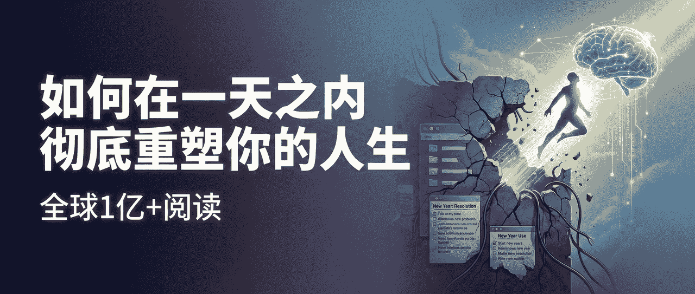

又见证了一个奇迹！

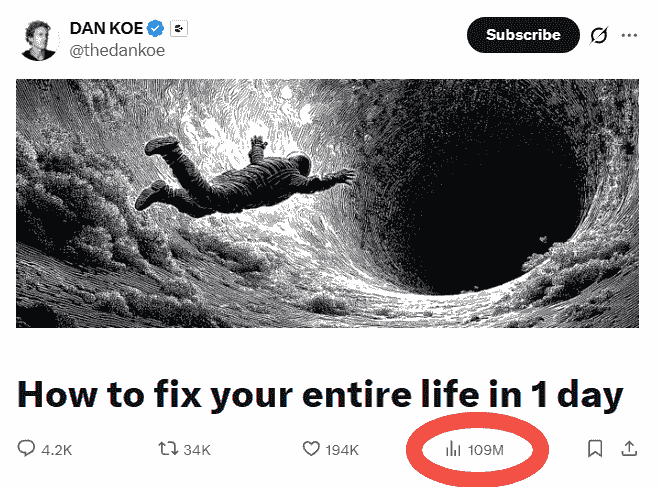

推特X@**DAN KOE**的这篇长文章在全球全网阅读量突破了1.5亿！

**它之所以**能引发如此巨大的轰动，原因很简单：它无情地撕碎了大多数人对新年决心的虚假幻想。

大多数人的改变之所以失败，是因为他们在腐烂的地基上试图建造高楼。你之所以还未过上想要的生活，根源在于你潜意识里根本就不想去那里。你现在的平庸是你为了安全感而做出的主动选择。

这篇文章提供了一套基于控制论和心理学的完整协议。它不让你依赖意志力，它教你如何重写大脑的操作系统。

读完它需要耐心。

执行它需要勇气。

建议我们都找出一个完整的周日。

按照文中的步骤，把自己彻底拆解再重组。

原文：https://x.com/thedankoe/status/2010751592346030461

以下是译文，由创意猎人翻译整理：

---

如果你和我很像，你会觉得新年决心这种东西很愚蠢。

大多数人改变生活的方式完全错了。他们制定这些决心的原因仅仅是因为其他人都在这么做。我们在这种地位游戏中制造了一种肤浅的意义，但这种行为并不符合真正改变的要求。真正的改变比说服自己今年要变得更自律或更高效要深刻得多。

如果你也是这类人，我并非为了贬低你，毕竟我的写作风格一向比较犀利。我放弃过的目标比我实现的目标多十倍。我认为这对大多数人来说都是常态。但人们试图改变生活却几乎次次惨败，这是一个不争的事实。

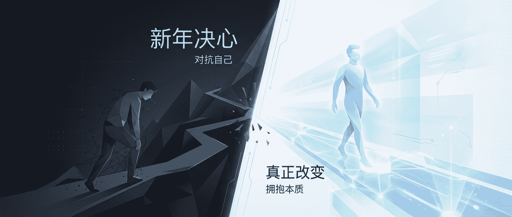

尽管我认为新年决心很愚蠢，但反思你所憎恨的生活，从而以此为跳板冲向更好的生活，这始终是明智之举。

无论你是想创业、改变体型，还是想冒险追求更有意义的生活而不至于两周后就放弃，我想分享七个你可能从未听过的关于行为改变、心理学和生产力的观点。这些观点能帮你在2026年实现目标。

这将是一篇全面的指南。

这绝非那种读完即忘的文章。

这是你需要收藏、做笔记并专门抽出时间思考的内容。

文章末尾的协议旨在深入挖掘你的心理，揭示你真正想要的生活，完成它大约需要一整天的时间，但其影响将极为深远。

我们开始吧。

# 一、你之所以没能到达想去的地方，是因为你还不是那种人

设定大目标时，人们倾向于关注成功的两个要素之一：

1.  改变你的行为以向目标迈进（这是次要的，属于二阶改变）

1.  改变你的本质，让行为自然发生（这是最重要的，属于一阶改变）

大多数人设定了一个表层目标，给自己打气，要在最初几周保持自律，然后毫无挣扎地回到老路。原因在于他们试图在腐烂的地基上建造美好的生活。

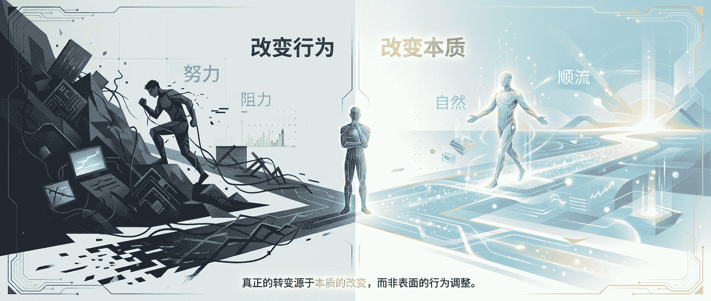

如果这听起来很抽象，我们来看个例子。

想想那些成功人士。可以是一个拥有完美体格的健美运动员，一位身价数亿的创始人兼CEO，或者一个能毫无焦虑地在人群中谈笑风生的极具魅力的家伙。

你认为健美运动员需要苦苦坚持才能吃得健康吗？CEO需要强迫自己去领导团队吗？在你看来表面上或许如此，但真相是他们无法想象自己过另一种生活。对健美运动员来说，吃垃圾食品才是一种折磨。对CEO来说，赖床不起才是痛苦，他们痛恨浪费每一秒。

对某些人来说，我自己的生活方式显得极端且自律。但在我看来，这很自然。我这么说并非为了与其他生活方式进行对比。我只是单纯享受这种生活。当我母亲劝我休息一下、出去玩玩时，我强忍着没告诉她：如果我不觉得好玩，我又怎么会做这些事呢？

下一句话听起来很简单，但令人费解的是竟有那么多人无法理解。

**如果你想在生活中得到特定的结果，你必须在达成结果很久**之前，就已经拥有了创造该结果的生活方式。

如果有人说他们想减掉30磅，我通常不信。这并非因为我认为他们没能力，而是因为有太多次这同一个人会说：等我减完肥，我就能重新开始享受生活了。我很遗憾地告诉你，如果你不能终生采纳那种让你减肥的生活方式，并找到一个比把你拉回旧习惯的引力更强的理由，你就会直接回到原点。届时你只能痛苦地承认你浪费了永远无法找回的资源：时间。

当你真正改变自己时，所有那些不能推动目标实现的习惯都会变得令人作呕，因为你深刻地意识到这些行为会累积成什么样的生活。你之所以能忍受当前的标准，是因为你尚未完全意识到它们是什么，或者它们会导致什么后果。我们将讨论如何揭示这一点，但这需要铺垫。

你说你想改变。你说你想实现财务自由和变得健康，但你的行动却背道而驰，这背后有原因。其深度远超你的想象。

# 二、你没能到达想去的地方，是因为你不想去

> 只相信行动。生活发生在事件的层面，而非言语的层面。只相信行动。

> ——阿尔弗雷德·阿德勒

如果你想改变自己，就必须理解心智是如何运作的，这样才能开始重新编程。

理解心智的第一步是明白所有行为都是目标导向的。这就是目的论。仔细一想这很明显，但当我们深究时，大多数人并不想听。

你向前迈出一步，是因为你想到达某个位置。

你挠鼻子，是因为你想止痒。

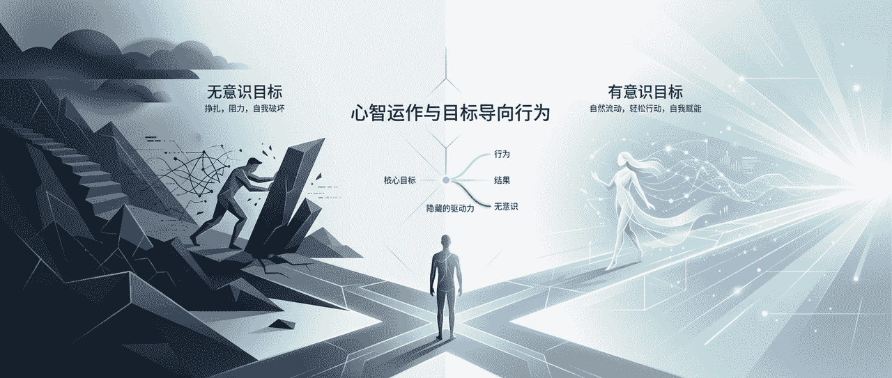

这些很显眼，但大多数时候，你的目标是无意识的。你可能没意识到，当你在大白天坐在沙发上发呆时，你其实是在下一个责任到来前消磨时间，这只是一个简单的例子。

在更深层、更复杂的无意识层面，你追求的目标可能会伤害你，但你用一种社会可接受的方式为自己的行为辩护，以免让自己看起来像个失败者。

举个例子，如果你无法停止拖延工作，你可能会用缺乏自律来辩护，但实际上你像往常一样在试图达成一个目标。在这种情况下，那个目标可能是为了保护自己免受完成工作并分享成果后可能遭遇的评判。

如果你说想辞去那份没前途的工作，却毫无理由地赖着不走，你可能会开始认为自己缺乏勇气，或者自己从来都不是一个冒险者。但真相是你在追求安全感、可预测性，以及一个借口，以免在那些认为死守一份工作就是成功的亲友面前显得像个失败者。

这里的教训是：**真正的改变需要改变你的目标。**

我指的不是设定一些表层目标，因为设定目标这种行为本身可能服务于一个正在伤害你的潜意识目标。这在生产力领域已经被说烂了。我指的是改变你的视角。因为那就是目标。目标是投射到未来的影像，它充当感知透镜，让你注意到能够帮助你实现该目标的信息、想法和资源。

现在让我们挖得更深一点，如果你不理解这一点，想走出来只会难上加难。

# 三、你没能到达想去的地方，是因为你害怕去那里

> 你要记住的重要一点是，这个想法是如何产生的、来自哪里根本不重要。你可能从未见过专业催眠师。你可能从未被正式催眠过。但如果你接受了一个想法——无论来自你自己、老师、父母、朋友、广告，还是任何其他来源——更进一步，如果你坚信这个想法是真的，它对你的控制力就如同催眠师的话语对被催眠者的控制力一样强大。

> ——麦克斯威尔·马尔茨

这就是你如何成为今天的你，以及你将如何成为明天的你。这是身份的解剖学：

1.  你想要达成一个目标

1.  你通过该目标的透镜感知现实

1.  你只注意那些允许你达成该目标的重要信息和想法（学习）

1.  你朝该目标行动并收到反馈，表明你在向其迈进

1.  你重复该行为直到它变得自动且无意识（调节）

1.  该行为成为你认为自己是谁的一部分（我是那种......的人）

1.  你捍卫自己的身份以保持心理一致性

1.  你的身份塑造新目标，循环重新开始，如果该身份不利于美好生活，这就变得非常糟糕

残酷的现实是，你必须打破第6步和第7步之间的循环，但这个过程从你是孩子时就开始了。

你有生存的目标。

你依赖父母教你如何生存。你必须顺从。鉴于大多数人的教育方式是通过奖惩，除非你采纳他们的信念和价值观，否则你会受到惩罚。在你识破这一点之前，你并没有真正在为自己思考。

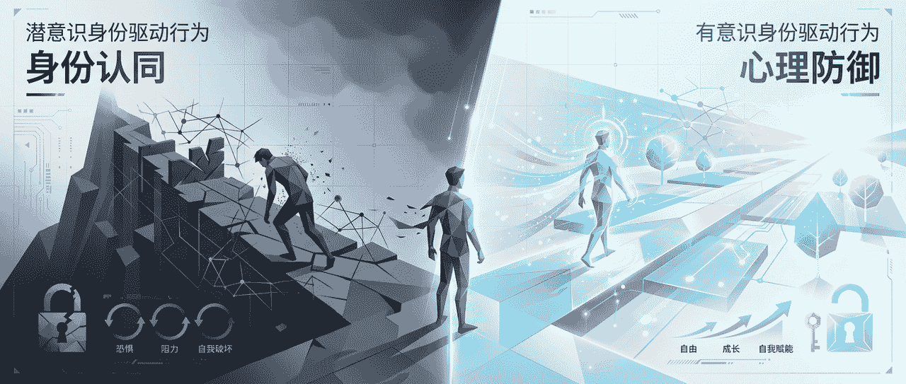

但你的父母一生也都经历了这个过程。这就是危险之处。除非你的父母打破了这种模式，否则他们就是被工业时代文化认可的成功理念所制约的产物。他们还背负着他们父母及祖辈最好和最坏的制约。

再深一层，一旦你满足了身体生存需求（这在当今世界很容易，你几乎生来就是安全的），你便开始在概念或意识形态层面寻求生存。你可能不会试图保护和繁殖你的身体，但你绝对会保护和繁殖你的思想。互联网上的观念之战显而易见，参与者是个体和群体的身份认同。

当你的身体感到受威胁时，你会进入战斗或逃跑模式。

当你的身份感到受威胁时，同样的事情会发生。

如果你通过刚才讨论的过程严重认同某种政治意识形态，当有人挑战你的信仰时，你会感到受威胁。你会切实感到压力。在情绪上，你会觉得像被人扇了一巴掌。由于大多数人不分析情绪背后的真相，你倾向于困在回音室里，加倍坚持那些伤害自己和他人的主张。

如果你在宗教家庭长大，并且没有独立思考，你会攻击那些威胁到你小圈子内心理安全的人。

当你无意识地将自己视为律师、游戏玩家或其他不会采取行动去实现更好生活的人时，同样的事情也会发生。

# 四、你想要的生活位于特定的心智层级

心智随着时间推移会经历可预测的进化阶段。

当你出生时，你就像一块小小的生存海绵，吸收你能吸收的任何信念（这些信念很大程度上由你的文化决定），以便感到安全。如果你不小心，你的心智可能会固化，这会让过上有意义的生活变得困难。

这在马斯洛需求层次、格鲁特的自我发展阶段、螺旋动力学和整合理论等模型中已有充分记录，在此我给出自我发展9个阶段的二八法则版本作为复习：

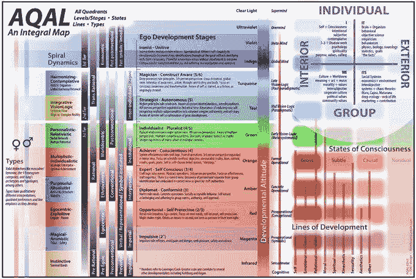

1.  **冲动型**：冲动与行动之间没有间隔。黑白思维。例如：幼儿生气时打人，因为感觉和行为是同一回事。

1.  **自我保护型**：世界是危险的，你学会了照顾自己。例如：孩子学会藏成绩单，在家务上撒谎，弄清楚成年人想听什么。

1.  **顺从型**：你即群体，群体的规则感觉就像现实本身。例如：真心无法理解为什么有人会投出与家族或群体不同的选票。

1.  **自我意识型**：你注意到自己有与外在不符的内心生活。例如：坐在教堂里，意识到你不确定自己是否相信周围人都相信的东西，但还不知道如何处理这种感觉。

1.  **尽责型**：你建立自己的原则体系并对自己负责。例如：经过仔细研究后离开家族宗教，采纳你能辩护的个人哲学，或者制定有明确里程碑的职业规划，因为你相信正确的努力产生正确的结果。

1.  **个人主义型**：你看到你的原则是由环境塑造的，开始不那么执着于它们。例如：意识到你的政治观点更多与成长环境有关而非客观真理，或注意到你雄心勃勃的职业目标实际上是为了赢得父亲的认可。

1.  **策略型**：你在与系统共事的同时，意识到自己也参与其中。例如：领导一个组织，同时积极质疑自己的盲点，或者参与政治，知道自己的观点是局部的并受自己无法完全看清的偏见影响。

1.  **建构觉知型**：你将所有框架（包括你的身份）视为有用的虚构。例如：以隐喻而非字面意义持有精神信仰，知道地图不是领土，或者带着一种温和的娱乐心态看着自己扮演创始人或思想领袖的角色。

1.  **合一型**：自我与生活之间的分离消解。例如：工作、休息和玩耍感觉像同一回事。不再有一个需要成为什么的人，只有对当下发生的作出的反应。

我想大多数阅读本文的人都在4到8级之间徘徊，这是一个巨大的差距。接近8级的人读这篇文章是为了学习或以非破坏性的方式消磨时间。接近4级的人正在真正寻求改变。你觉得自己注定要成就更多，但还没法理清一切，因为显然有很多因素在起作用。

好消息是，你处于哪个阶段并不重要，因为穿越任何阶段都遵循一个模式。

# 五、智力就是从生活中得到你想要的东西的能力

> 对智力的唯一真正测试是你是否从生活中得到了你想要的。

> ——纳瓦尔·拉维坎特

成功有一个公式。

一个成分是能动性。

一个成分是机会（很多人喜欢将其误认为是特权，因为他们缺乏其他成分）。

最后一个成分是智力。

如果你有高能动性但机会少，无论你多么可能朝目标行动，那也不是一个能结出硕果的目标。

如果你有机会和能动性但智力低，那你永远无法充分利用那个机会。

首先，我们在之前讨论过能动性。关于机会，我不能让你改变物理位置，但如果你看不到眼前丰富的数字机会，我也无话可说。

既然如此，我想重点谈谈这三个成分背景下的智力以及本文的主旨。为此，我们需要看控制论。

> 控制论（Cybernetics）来自希腊语kybernetikos，意为掌舵或擅长掌舵。

它也被称为得到你想要的东西的艺术。

所以，如果纳瓦尔对智力的定义是从生活中得到你想要的东西，理解控制论能帮你更快做到这一点。

控制论阐述了智能系统的属性：

+   拥有一个目标。

+   朝该目标行动。

+   感知你在哪里。

+   将其与目标比较。

+   根据反馈再次行动。

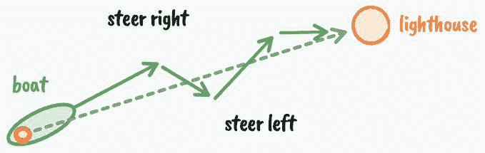

你可以根据系统迭代和坚持试错的能力来判断智力。

一艘偏离航线后修正方向驶向目的地的船。一个感知热量变化并启动的恒温器。胰腺在血糖飙升后分泌胰岛素。

这与从生活中得到你想要的东西有什么关系？

关系巨大。

行动、感知、比较以及从元视角理解系统是高智力的基础。

高智力是迭代、坚持和理解大局的能力。低智力的标志是无法从错误中学习。

低智力的人在问题上卡住而不是解决它们。他们遇到路障就退出。就像一个作家未能建立读者群就退出了，因为他们缺乏尝试新事物、实验并找出适合自己流程的能力。认为不存在一个你可以创建的有效流程是可证伪的错误，无论你的限制性信念如何，因此这就是低智力。

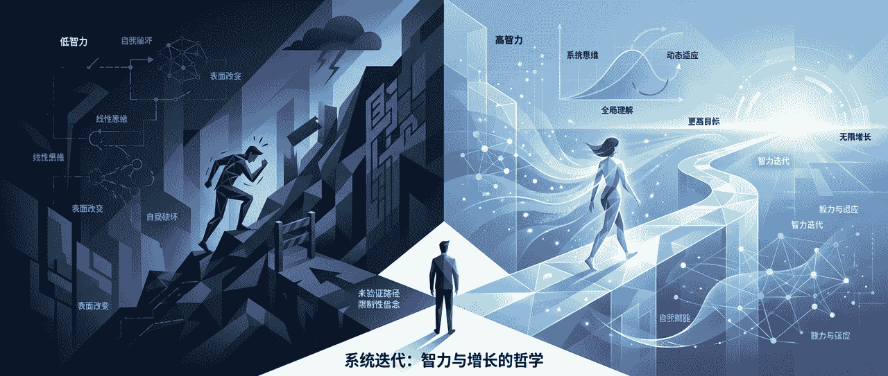

高智力是意识到任何问题都可以在足够长的时间尺度上解决。现实是你能够实现你下定决心要做的任何目标。

智力是意识到有一系列选择会导致你实现想要的目标。你理解想法是有等级的，你不能一步登天从莎草纸跳到谷歌文档。即使那个目标现在是不可能的，你也只是还没拥有实现它的资源，而这些资源可能会在未来几年内被发明出来。

当我谈论目标，并且我会继续重复这一点时，我并非从典型的自助视角出发，尽管那有时也是个有用的视角。

我是从目的论或希腊语kosmos的视角出发，即万物皆有目的。万物皆是更大整体的一部分。

目标决定你如何看世界。

目标决定你认为什么是成功或失败。

你可以试着享受旅程，但如果你追求错误的目标，你不会享受它。

你的心智是现实的操作系统。

该系统由目标组成。

对大多数人来说，这些目标是被指派给他们的。像代码行一样编程进你的心理。

上学、找工作、被冒犯、扮演受害者、65岁退休。

一条已知行不通的道路。

要变得更聪明，你必须：

+   拒绝已知路径

+   潜入未知

+   设定新的、更高的目标以扩展你的心智

+   拥抱混乱并允许成长

+   研究自然的普遍原则

+   成为深度通才

我理解这可能不是智力的传统定义，但这系列步骤会导致你大脑中产生非凡层级的连接，从而导致我们观察到的聪明人。将其与能动性结合，你就成了赢家。

这完美地引出了下一节。

# 六、如何（在一天内）启动全新的生活

我生命中最好的时期总是在我对缺乏进展感到绝对厌倦之后到来的。

你如何挖掘你的心智？

你如何意识到你的制约？

你如何获得改变生活轨迹的深刻洞察和真理？

通过简单但往往痛苦的提问行为。

很少有人这么做，你可以从他们说话或对特定话题发表看法的方式中看出来。提问就是思考，而很少有人思考。

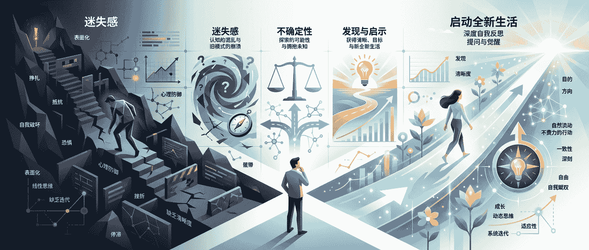

我想给你一套全面的协议，你可以每年用它来重置生活并启动一个剧烈进步的季节。这个协议帮你提出正确的问题。

这些问题涵盖宏观到微观：你想去哪里，你需要做什么才能到达那里，以及你可以立即做什么来开始推动指针指向那个现实。

这需要一整天的时间来完成，所以我建议你严格遵循协议。你需要笔、纸和开放的心态。

当我观察成功翻转身份的人的模式时，往往是在紧张局势积累之后快速发生的。具体来说，我注意到人们倾向于经历三个阶段：

1.  **失调**：他们觉得现在的这生活里容不下他们，并对缺乏进展感到极度厌倦。

1.  **不确定**：他们不知道接下来会发生什么，所以他们要么实验，要么迷失并感觉更糟。

1.  **发现**：他们发现自己想追求什么，并在6个月内取得6年的进展。

所以，我们这个协议的目标是帮你达到失调点，导航穿越不确定性，并发现你真正想要实现的是什么，以此让清晰度压倒一切，分心之事不再有分量。

该协议结构设计为一天完成。早上，你进行心理挖掘以揭示自己隐藏的动机。白天，你用中断提示自己，让自己脱离自动驾驶模式并沉思你的人生。晚上，你将洞察综合成一个方向，并从明天开始朝其移动。

我不能保证这对每个人都有效，因为我不能保证每个读到这里的人都处于人生故事的正确篇章，能让这些点产生影响。你不能把高潮放在书的开头还指望它有趣。

## 第一部分：早晨——心理挖掘——愿景与反面愿景

首先我们必须为你的心智运作创建一个新框架或感知透镜。

这就像制造一个新壳，离开旧壳，随着时间慢慢长进新壳里。起初会觉得不合身。那是好事。

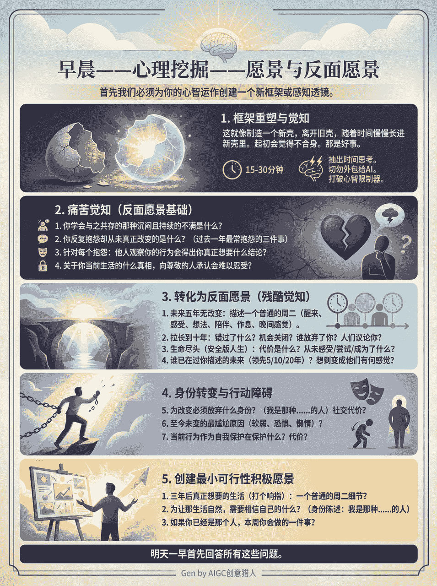

抽出15到30分钟（也就一个YouTube视频的长度，你能做到的）来思考并回答这些问题。切勿试图将此沉思外包给AI。我要你打破心智上的限制器。如果你不能立即回答，稍后再回来。

1.  你学会与之共存的那种沉闷且持续的不满是什么？不是深切的痛苦，而是你学会忍受的东西。（如果你不痛恨它，你就会容忍它）

1.  你反复抱怨却从未真正改变的是什么？写下过去一年你最常抱怨的三件事。

1.  针对每个抱怨：如果有人观察你的行为（而非言语），他们会得出结论你真正想要的是什么？

1.  关于你当前生活的什么真相，如果是向你深深尊敬的人承认，会让你难以忍受？

这些问题旨在让你意识到当前生活中的痛苦。现在，我们需要将其转化为我所说的反面愿景，即对你不想要的生活的残酷觉知。这样，你就可以利用那种负能量将努力导向积极方向，并从内在动机出发行动。

1.  如果未来五年完全没有任何改变，描述一个普通的周二。你在哪里醒来？你的身体感觉如何？你脑子里想的第一件事是什么？谁在你身边？早9点到晚6点你在做什么？晚10点你感觉如何？

1.  现在拉长到十年。你错过了什么？什么机会关闭了？谁放弃了你？当你不在房间时人们怎么议论你？

1.  你走到了生命尽头。你过的是安全版人生。你从未打破模式。代价是什么？你从未让自己去感受、尝试或成为什么？

1.  你生活中谁已经在过你刚才描述的未来？谁在同一轨迹上领先了五、十、二十年？想到变成他们你有什么感觉？

1.  为了真正改变，你必须放弃什么身份？（我是那种......的人）不再是那个人会在社交上让你付出什么代价？

1.  你至今未变的最尴尬原因是什么？那个让你听起来软弱、恐惧或懒惰，而不是理性的原因？

1.  如果你现在的行为是一种自我保护形式，你到底在保护什么？这种保护让你付出了什么代价？

如果你诚实回答了这些，并且处于人生的正确篇章，你会对目前的生活方式感到深深的不适甚至厌恶。现在，我们需要将这种能量导向积极方向。我们需要创建一个最小可行性愿景，因为你的愿景就像一个产品。它开始时不清晰，但随着时间和经验，它会变得更强、更有效。

1.  暂时忘掉实用性。如果你能打个响指，三年后过上不同的生活，不仅是现实的，更是你真正想要的？一个普通的周二看起来是怎样的？细节程度同问题5。

1.  你需要相信关于自己的什么，才能让那种生活感觉自然而非强迫？写下身份陈述：我是那种......的人。

1.  如果你已经是那个人，本周你会做的一件事是什么？

明天一早首先回答所有这些问题。

# 第二部分：全天——中断自动驾驶——打破无意识模式

写日记练习很可爱，但我们要的是真正的改变。

坦率地说，如果你不打破让你保持原状的当前无意识模式，改变就不会发生。

全天，我要你沉思你在第一部分记录的所有内容。除此之外，我不要你忘记沉思。请认真对待。做一辈子同样的事你是不会改变的。你需要有意识地强制打破模式。

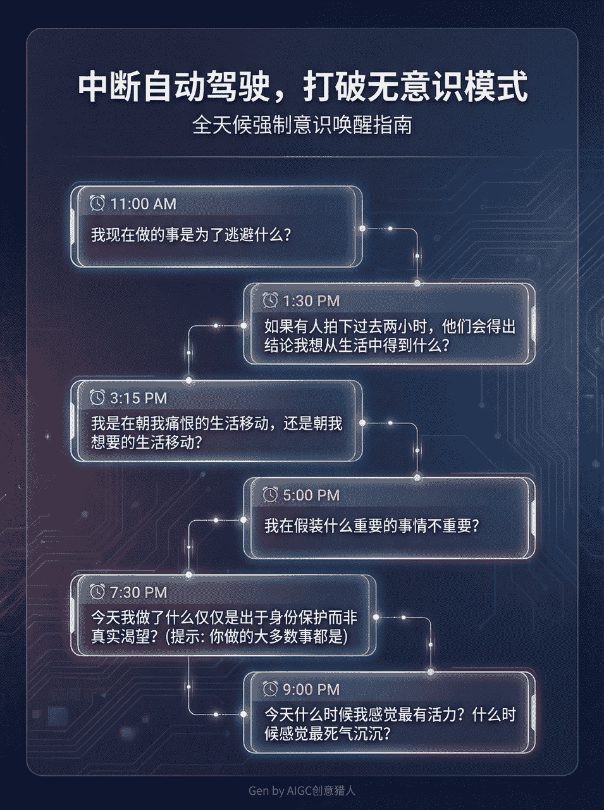

现在就花时间在手机里创建提醒或日历事件。把问题包含在提醒或事件中，这样你可以立即开始思考。

越随机、越不与你的日程冲突越好。

+   **上午11:00**：我现在做的事是为了逃避什么？

+   **下午1:30**：如果有人拍下过去两小时，他们会得出结论我想从生活中得到什么？

+   **下午3:15**：我是在朝我痛恨的生活移动，还是朝我想要的生活移动？

+   **下午5:00**：我在假装什么重要的事情不重要？

+   **晚上7:30**：今天我做了什么仅仅是出于身份保护而非真实渴望？（提示：你做的大多数事都是）

+   **晚上9:00**：今天什么时候我感觉最有活力？什么时候感觉最死气沉沉？

为了再添把火，把这些问题安排在你通勤、散步或闲逛的时间。

+   如果我不再需要人们把我看作[你在问题10中写的身份]，会有什么改变？

+   在生活的哪个部分，我在用活力交换安全？

+   我可以成为的那个人的最小版本，明天可以是怎样的？

## 第三部分：晚上——综合洞察——进入进步的季节

如果你遵循了这个过程，假如你没有获得至少一个可能改变人生轨迹的深刻洞察，我会很惊讶。

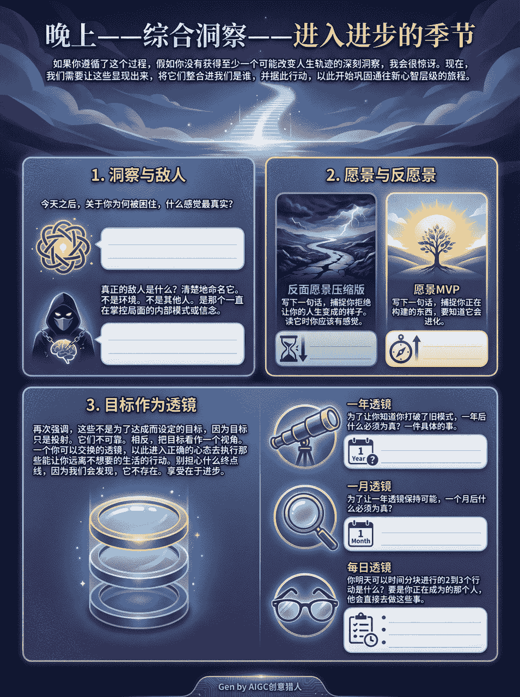

现在，我们需要让这些显现出来，将它们整合进我们是谁，并据此行动，以此开始巩固通往新心智层级的旅程。

1.  今天之后，关于你为何被困住，什么感觉最真实？

1.  真正的敌人是什么？清楚地命名它。不是环境。不是其他人。是那个一直在掌控局面的内部模式或信念。

1.  写下一句话，捕捉你拒绝让你的人生变成的样子。这是你的反面愿景压缩版。读它时你应该有感觉。

1.  写下一句话，捕捉你正在构建的东西，要知道它会进化。这是你的愿景MVP。

最后，我们需要设定目标。

再次强调，这些不是为了达成而设定的目标，因为目标只是投射。它们不可靠，让你觉得被必然会改变的东西束缚。相反，把目标看作一个视角。一个你可以交换的透镜，以此进入正确的心态去执行那些能让你远离不想要的生活的行动。别担心什么终点线，因为我们会发现，它不存在。享受在于进步。

1.  **一年透镜**：为了让你知道你打破了旧模式，一年后什么必须为真？一件具体的事。

1.  **一月透镜**：为了让一年透镜保持可能，一个月后什么必须为真？

1.  **每日透镜**：你明天可以时间分块进行的2到3个行动是什么？要是你正在成为的那个人，他会直接去做这些事。

这内容很多。

希望能帮到你。

但我们还有最后一块拼图来锁定这一切。

坚持住。

# **七、把你的人生变成一款电子游戏**

> 内在体验的最佳状态是意识中有秩序。当精神能量或注意力投入到现实目标中，且技能与行动机会相匹配时，这种情况就会发生。追求目标给意识带来秩序，因为一个人必须将注意力集中在手头的任务上，并暂时忘记其他一切。

> ——米哈里·契克森米哈赖

你现在拥有了通往美好生活的所有组件。

现在，将你所有的洞察组织成一个连贯的计划可能会有帮助。抽出一张新纸，写下这6个组件：

+   **反面愿景**：我存在的祸根是什么，或者我再也不想经历的生活是什么？

+   **愿景**：我认为我想要并能在努力过程中不断完善的理想生活是什么？

+   **1年目标**：1年后我的生活会是什么样，那是否更接近我想要的生活？

+   **1月项目**：我需要学什么？我需要获得什么技能？我可以构建什么来让我更接近1年目标？

+   **每日杠杆**：能让我的项目更接近完成的优先、推动指针的任务是什么？

+   **约束条件**：为了从头开始实现我的愿景，我不愿意牺牲什么？

为什么这如此强大？

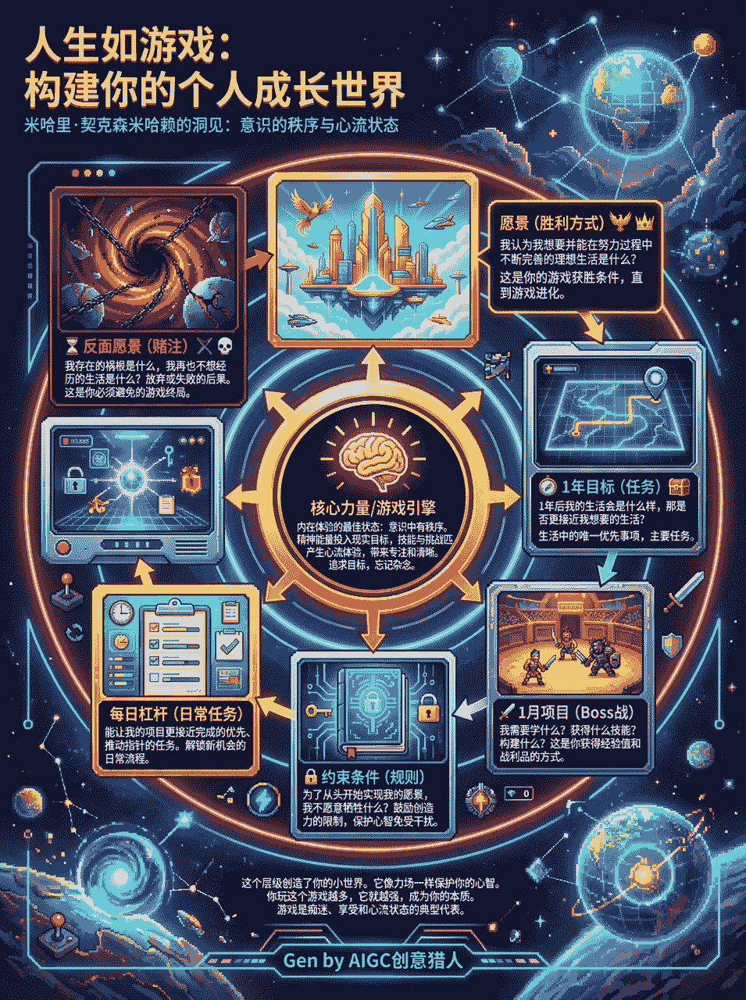

因为这些组件实际上创造了你自己的小世界。如果你注定要在人生的这个阶段追求这个目标层级，你将别无选择，只能变得痴迷。你会感到某种更伟大的东西在牵引你。你不会视其他任何东西为选项。

你把你的人生变成了一款电子游戏。

因为游戏是痴迷、享受和心流状态的典型代表。它们拥有导致专注和清晰的所有组件，所以如果我们逆向工程这些组件，我们就能活在更深层的享受、更少的分心和更多的成功状态中。

+   你的愿景是你获胜的方式。至少在游戏进化之前。

+   你的反面愿景是赌注。如果你输了或放弃会发生什么。

+   你的1年目标是任务。这是你生活中的唯一优先事项。

+   你的1月项目是Boss战。你如何获得经验值和战利品。

+   你的每日杠杆是任务。解锁新机会的日常流程。

+   你的约束条件是规则。鼓励创造力的限制。

所有这些充当一组同心圆，像力场一样，保护你的心智免受分心和闪亮物体的干扰。

你玩这个游戏越多，这股力量就越强，很快它就会成为你的本质，你也绝不愿换种活法。

---

按照惯例，用一张图来总结今天的分享：

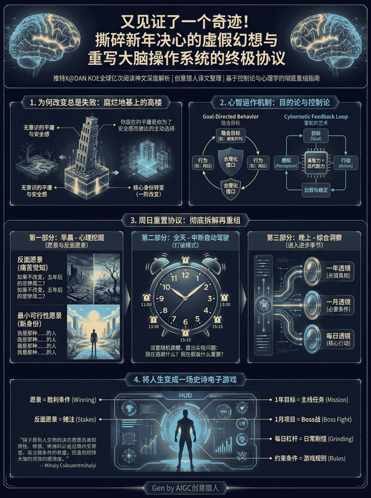