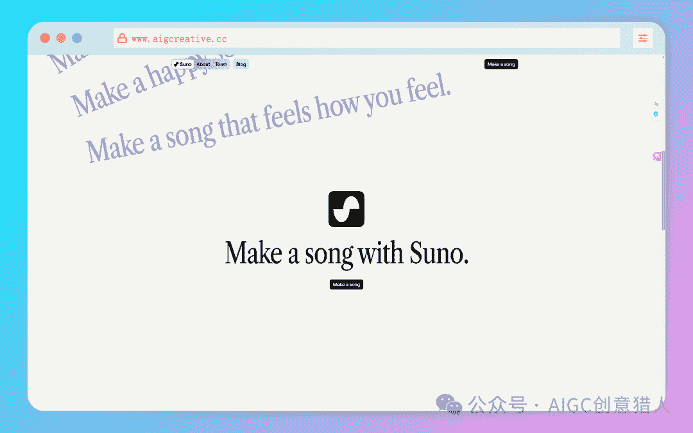
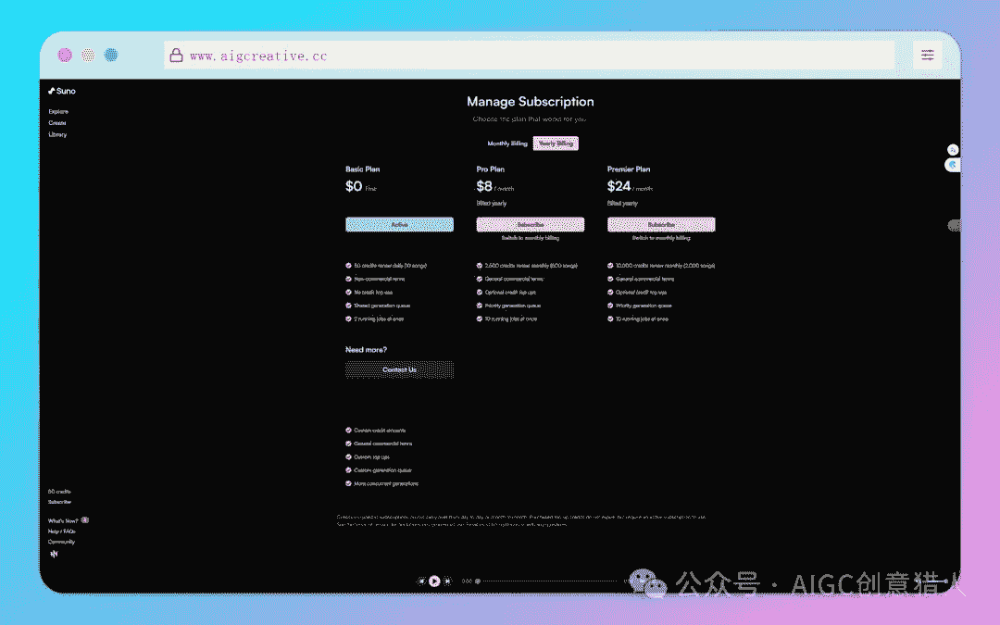
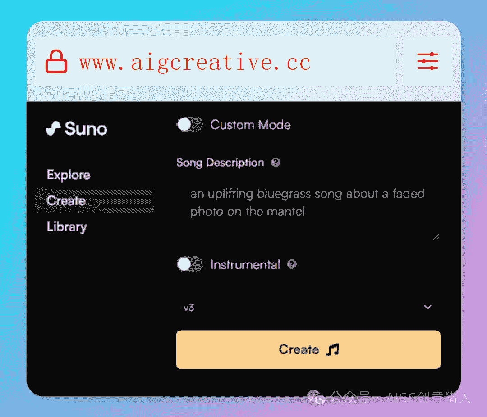
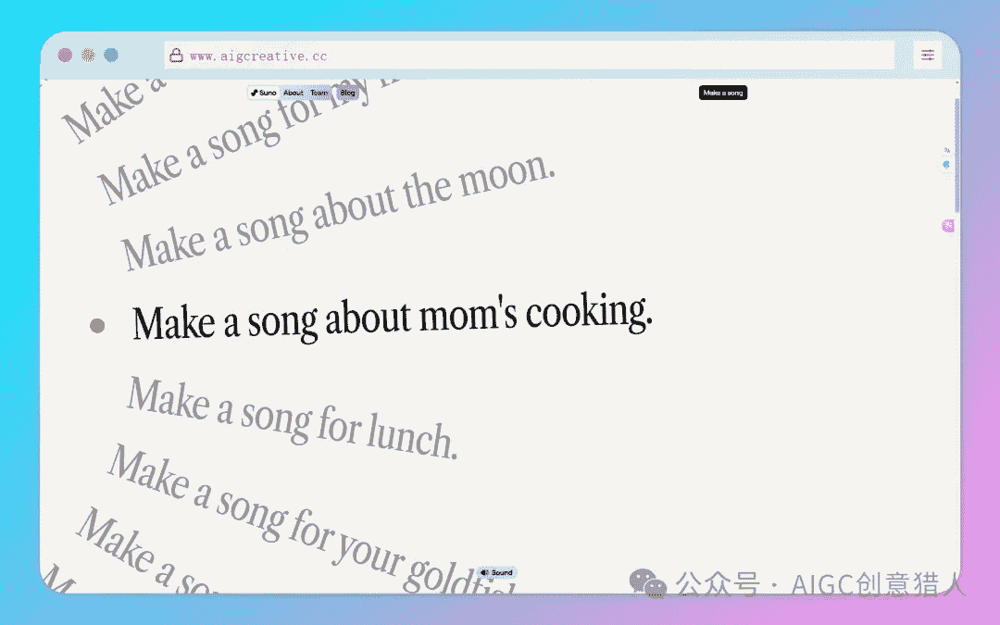

# 20240323-Suno AI音乐平台V3发布：生成式音乐创作的"ChatGPT"时刻！

> 来源：[https://aigcreative.feishu.cn/docx/BjdddfSFEo0YypxotlZcwEyunyg](https://aigcreative.feishu.cn/docx/BjdddfSFEo0YypxotlZcwEyunyg)

> 链接：https://mp.weixin.qq.com/s/rrofqvmtmM-opmmHBM0QNg

人工智能（AI）正逐渐渗透到我们生活的方方面面，而音乐创作领域也迎来了它的革命性时刻。最近，Suno AI音乐平台的V3版本正式上线，标志着AI音乐创作迈入了一个全新的纪元。

Suno AI音乐平台的发展历程颇为引人注目。去年，它凭借开源项目Bark赢得了广泛的关注，获得了超过32,000个星标。然而，它也曾因一首为《海贼王》动画25周年制作的AI音乐贺曲而备受争议。这首曲子的质量未能达到听众的期待，引发了一系列的批评和讨论。但这一切，似乎都成为了Suno AI音乐平台成长的垫脚石。

现在，随着V3版本的发布，Suno AI音乐平台展现出了令人瞩目的进步。经过多次试听和亲自尝试，我们可以感受到，AI音乐的质量已经实现了质的飞跃。V3版本的音乐作品在音质、发音清晰度以及节奏编排等方面都有了显著的提升。尽管每首音乐作品的时长限制为两分钟，但这已经比之前的版本有了长足的进步。

Suno AI音乐平台的V3版本提供了两种主要的音乐创作模式：Custom Mode和Instrumental。Custom Mode允许用户自定义歌词，而Instrumental模式则专注于生成没有歌词的纯音乐。用户每天有50积分可以免费使用，足够生成10首歌曲。对于想要更多创作机会的用户，平台也提供了付费选项，每月10美元即可获得2500积分，足够用户长时间使用。

创作音乐的第一步是编写prompt，这是一个引导AI创作的指令。

在Custom Mode中，用户需要提供歌词；而在Instrumental模式下，这一步骤可以省略。一个好的prompt应该包括音乐流派、风格、情绪、乐器选择、主题或场景以及人声描述等元素。

对于不熟悉音乐的用户来说，这可能是一项挑战。但幸运的是，AI技术在这里发挥了它的优势。用户可以通过简单的指令，让AI帮助创作出符合要求的音乐作品。

例如，用户可以这样指示AI：“请帮我创作一首描述夏日海滩的Kpop风格歌曲，整体时长不超过两分钟，歌词需要押韵，具有文学气质，副歌部分要求跨行重复。”

AI将会根据这些指令，创作出一首完整的歌曲，包括前奏、主歌、副歌、桥段和尾奏等结构。

除了创作音乐，Suno AI音乐平台还提供了一些有趣的“骚操作”。用户可以将AI生成的音乐与SVC技术结合，进行声音的分离和变换，从而创作出带有个人特色的作品。这不仅为音乐爱好者提供了一个全新的创作工具，也为专业音乐制作人提供了更多的可能性。

尽管对于一些专业歌手和制作人来说，AI音乐可能还显得有些“玩具化”，但无可否认的是，它已经达到了大多数普通人的音乐创作水平。更重要的是，AI音乐的发展是一个不可逆的趋势，它正在逐渐改变我们对音乐的认知和创作方式。

Suno AI音乐平台的V3版本，不仅仅是一个技术进步的里程碑，更是音乐创作民主化的一个缩影。它让每一个有想法的人都有可能成为音乐创作者，让音乐创作不再是少数人的专利。随着AI技术的不断进步，我们有理由相信，未来的音乐世界将会变得更加多元和精彩。

如果你对音乐创作充满热情，不妨访问Suno AI音乐平台，亲自体验一下AI音乐的魅力。无论是为了娱乐自己，还是为了探索音乐创作的新境界，Suno AI音乐平台都值得一试。让我们一起迎接AI音乐的“ChatGPT”时刻，见证音乐创作的未来。

<https://aigcreative.feishu.cn/sync/K4Gvd9vUQsy9Oubwqaeclu0Fnbg>