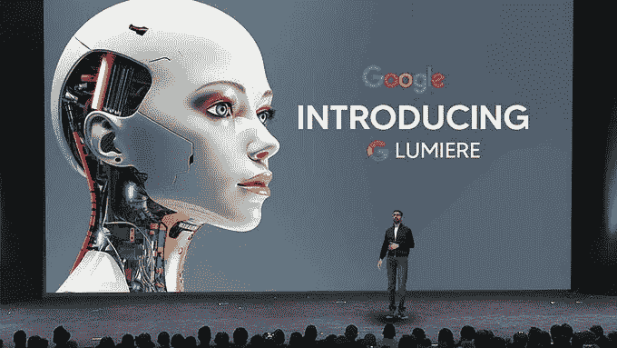
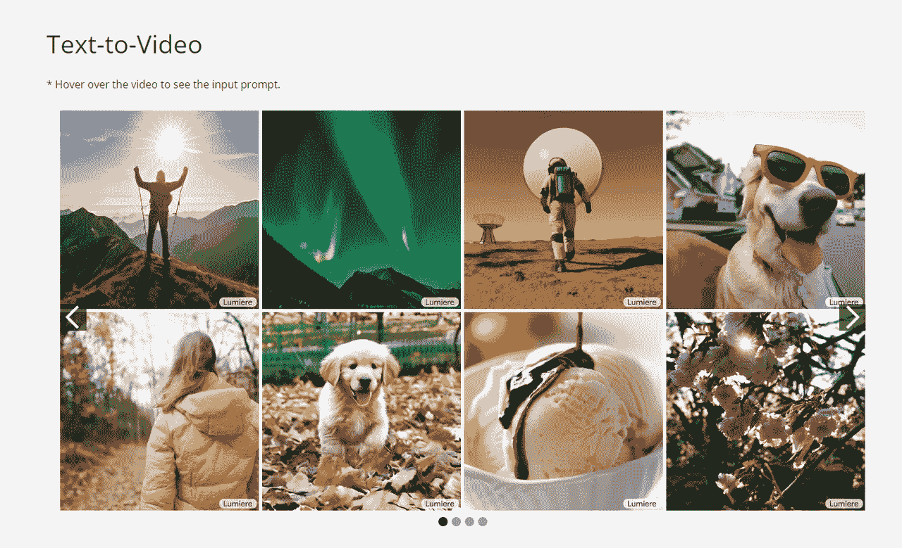
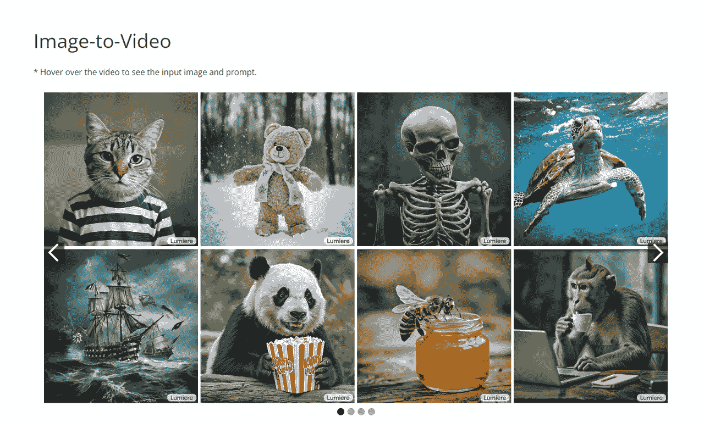
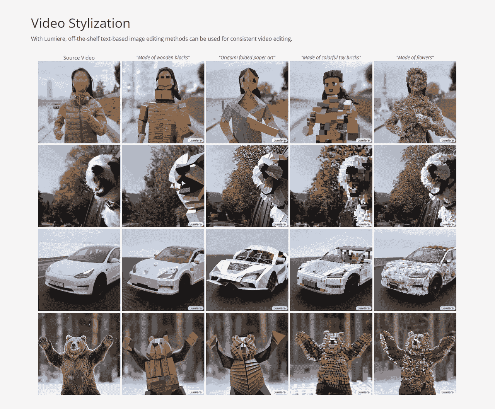
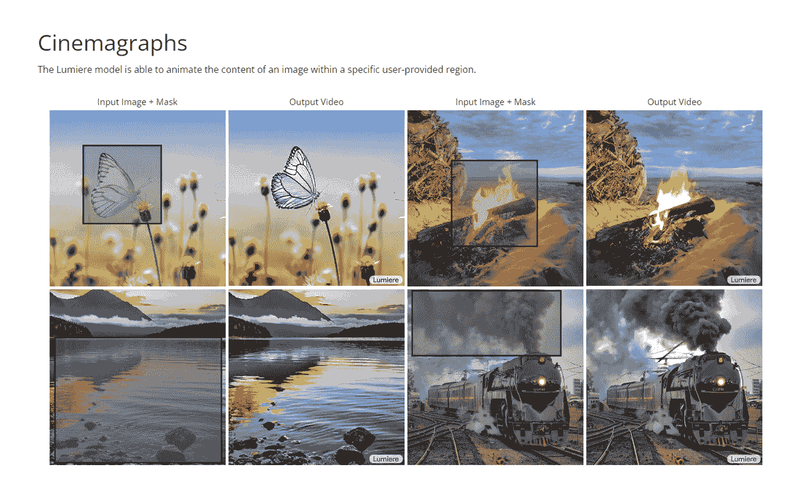
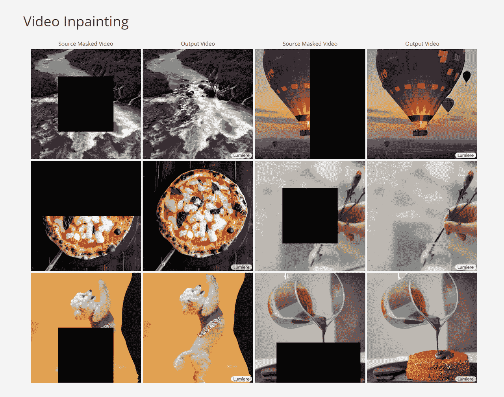
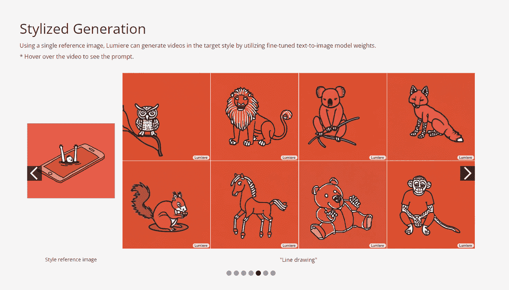
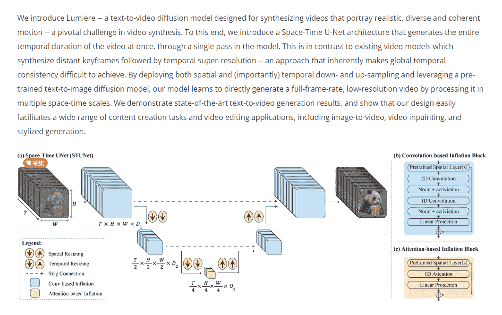

# 20240406-谷歌LUMIERE惊艳亮相，OpenAI遭遇强劲对手！

> 来源：[https://aigcreative.feishu.cn/docx/SuBWdLCPnoG3GqxmAtQcY1zhnPb](https://aigcreative.feishu.cn/docx/SuBWdLCPnoG3GqxmAtQcY1zhnPb)

今日，谷歌公司推出了一款名为LUMIERE的创新产品，这款产品以其强大的功能和出色的性能，引起了不小的关注。LUMIERE不仅在功能上与ChatGPT不相上下，更在多个方面展现出了其独特的优势和潜力。让我们一起来探索LUMIERE的七大核心功能：

# 文本转视频

文本转视频功能，为内容创作者提供了一个全新的创作平台。用户只需输入文本，LUMIERE便能将其转化为生动的视频内容。这一功能不仅极大地提高了创作效率，而且使得创意表达变得更加多元和直观。

# 图像转视频

图像转视频功能，让静态图片焕发出新的活力。用户可以轻松地将一张图片转化为动态视频，这一过程简单快捷，极大地降低了视频制作的门槛，让每个人都能成为视频创作高手。

# 视频编辑

视频编辑功能，通过简单的文本提示，用户就能对视频进行精准的编辑。这一功能的推出，使得视频剪辑变得简单易行，即便是没有专业背景的用户，也能轻松制作出专业水准的视频内容。

# 电影摄影

电影摄影功能，让用户能够在图片中选择一个点，并让LUMIERE模型为其制作动画。这种创新的电影摄影技术，让动画效果变得触手可及，为创意表达提供了更多可能性。

# 视频修复

视频修复功能，能够精准地识别并修复视频中的瑕疵，使得最终呈现的视频内容更加完美。这一功能对于那些追求高质量视频内容的创作者来说，无疑是一个强大的助手。

# 风格化视频生成

风格化视频生成功能，让用户能够使用单个参考图像，生成具有特定风格的视频。这一功能为用户提供了一个全新的个性化表达方式，使得视频内容更加丰富多彩。

# 视频内容理解与分析

LUMIERE还拥有一项独特的视频内容理解与分析能力。这项功能可以智能分析视频中的内容，提供深度的洞察和学习，帮助用户更好地理解和利用视频资料。无论是用于教育、研究还是商业分析，这一功能都能提供强大的支持，使得视频内容的价值得到最大化的挖掘。

LUMIERE的发布，标志着Google在AI技术在视频处理领域的一次重大突破。它不仅为用户提供了强大的工具，也为整个行业带来了新的发展方向。随着技术的不断进步，我们有理由相信，LUMIERE将在未来的创意产业中发挥更加重要的作用，成为人们生活和工作中不可或缺的一部分。让我们拭目以待，LUMIERE将如何改变我们的世界。

<https://aigcreative.feishu.cn/sync/K4Gvd9vUQsy9Oubwqaeclu0Fnbg>