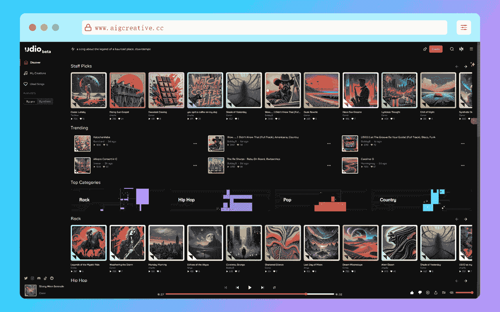

# 20240411-Suno劲敌来了：Udio，让每个人都成为音乐创作大师！

> 来源：[https://aigcreative.feishu.cn/docx/ENCMdP1GxoHC0Ixx7k7cgWM6nNh](https://aigcreative.feishu.cn/docx/ENCMdP1GxoHC0Ixx7k7cgWM6nNh)

过去，音乐创作似乎一直是那些拥有专业技能的音乐人的专利，离我们平常人很遥远。

但是，在这个人工智能技术飞速发展的时代，特别是进入了大模型发展时期，艺术创作领域似乎开始慢慢发生变化：

可以使用Midjourney等工具轻松创作一幅很有创意的艺术作品；

可以使用Sora（还未开放）等视频工具创作一部媲美好莱坞的电影;

前不久，Suno震撼发布，它让我们每个人都体验了一把自己创作音乐的乐趣！让音乐创作不再是那么遥远。

近日，一款名为Udio的文生音乐应用程序隆重推出，直击Suno！让每个人都有成为音乐创作的大师的可能！

Udio是一款全新的音乐创作和分享应用，它通过直观而强大的文本提示功能，使用户能够以自己最喜欢的风格生成令人惊叹的音乐。无论是高亢激昂的福音音乐，还是低沉沙哑的蓝调，从梦幻般的流行到流畅的说唱，Udio都能满足你的对音乐创作的需求。

### 创新的音乐创作体验

Udio应用程序以其独特的文本提示功能，为音乐创作带来了革命性的变化。用户只需输入简单的文字描述，即可生成符合个人风格和想法的音乐作品。这种直观的操作方式，极大地降低了音乐创作的门槛，让每个人都能轻松成为音乐创作者。

### 多样化的音乐风格选择

Udio平台提供了丰富的音乐风格选择，从古典到现代，从东方到西方，几乎涵盖了所有流行的音乐类型。用户可以根据自己的喜好，选择不同的音乐风格进行创作，无论是激昂的电子舞曲，还是柔和的新灵魂乐，Udio都能满足用户的多样化需求。

### 跨越语言的音乐创作

Udio的另一个创新之处在于其对多语言的支持。用户可以尝试用不同的语言创作音乐，从而拓宽了音乐创作的边界。这种跨文化的音乐创作方式，不仅丰富了音乐的表现形式，也使得音乐作品更具包容性和多样性。

### 灵活的音乐剪辑功能

Udio提供了强大的音乐剪辑工具，用户可以轻松地对音乐片段进行编辑和调整，创造出更长、更完整的音乐作品。通过添加个性化的前奏和结尾，用户的作品将更具专业感和完整性。此外，一键发布的功能，让用户的作品能够迅速与全球的Udio社区分享。

### 硬核团队：科技+艺术完美结合

Udio的团队由前Google DeepMind的顶尖人工智能研究人员和工程师组成，他们对音乐和技术的热爱将这款应用推向了新的高度。Udio得到了包括@iamwill和@common在内的领先艺术家的支持，这进一步证明了其在音乐界的潜力和影响力。

### 音乐创作的未来趋势

虽然Udio的v1模型已经具备了相当的能力，但团队仍在不断迭代和改进。他们正在努力实现更长的样本、提升音质、支持更多语言，并致力于开发下一代的可控性。Udio团队的目标是让这款应用成为音乐家和非音乐家都能使用的改变游戏规则的工具。

Suno、Udio的出现无疑为音乐产业带来了新的活力。它降低了音乐创作的门槛，让每个人都能够享受到创作音乐的乐趣。随着技术的不断进步和产品功能的不断完善，未来的音乐世界将会变得更加多元和精彩！

<https://aigcreative.feishu.cn/sync/K4Gvd9vUQsy9Oubwqaeclu0Fnbg>