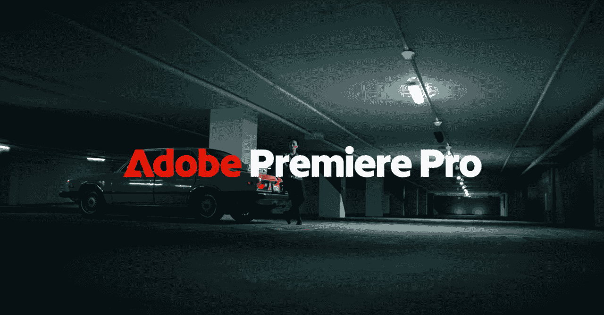
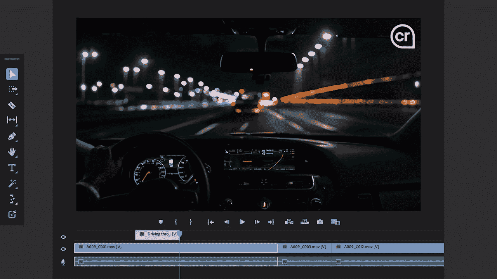
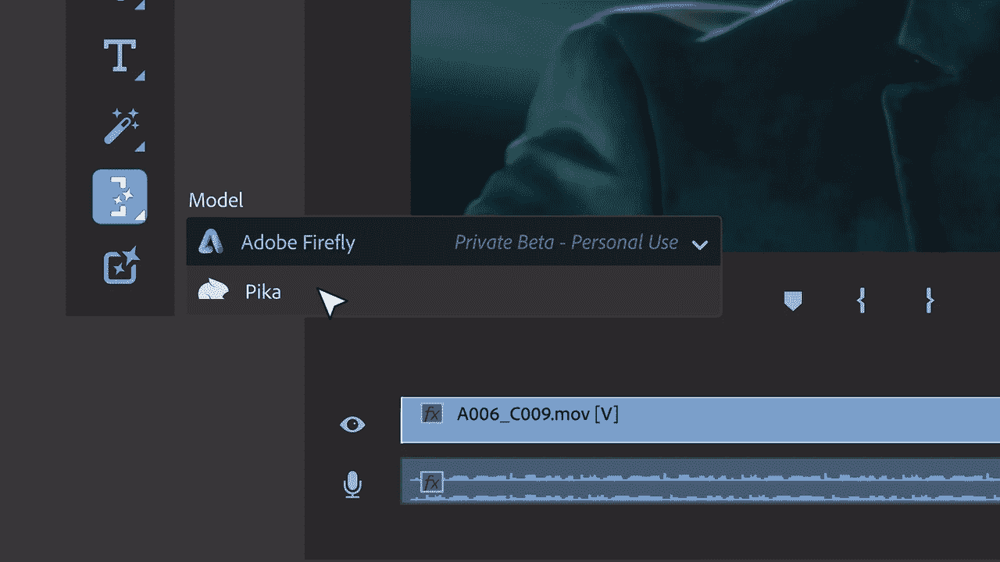
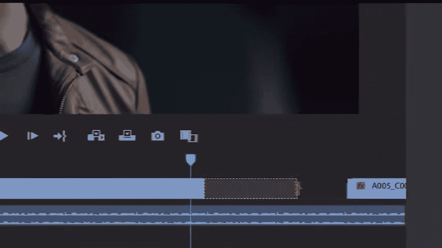
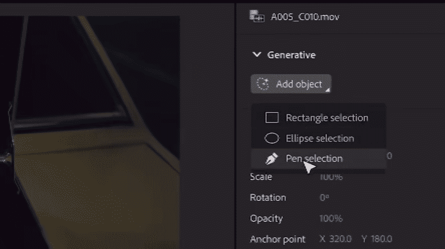
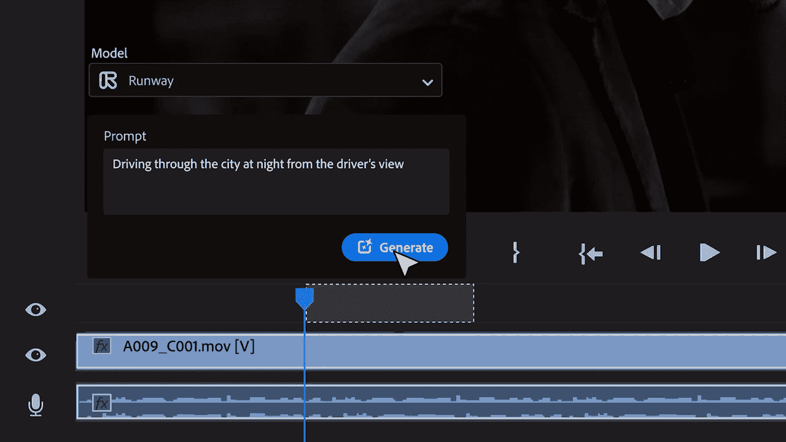

# 20240416-王者归来！Adobe Premiere Pro引入生成式AI，革新视频编辑流程！

> 来源：[https://aigcreative.feishu.cn/docx/E0qGdQXiFod8vRxBKMhcmLbIn5g](https://aigcreative.feishu.cn/docx/E0qGdQXiFod8vRxBKMhcmLbIn5g)

视频一直是最能够打动人心的叙事方式。

无论是社交媒体上的短视频，还是长篇电影，视频都能让人们通过手机轻松地连接和互动。

而在这个领域，Adobe的名字无疑是行业的标杆。

Adobe Premiere Pro、After Effects和Audition这三款软件，长期以来一直是专业视频制作的金标准。

如今，Adobe又带来了新的惊喜——将生成式AI技术融入视频编辑流程。

[Adobe相信生成式AI将成](https://www.adobe.com/creativecloud.html)为推动人类创意的新动力，其策略是在 Creative Cloud 中整合生成式AI，以便为创意专业人士提供更强大的工具和提高工作效率。

过去一年里，Premiere Pro 团队与视频制作专业人士紧密合作，探讨如何利用生成式AI解决实际工作中的问题。

专业人士们希望借助生成式AI简化繁复的工作流程，优化任务流程，并增强创作自由。

他们提出了三项核心要求：

+   AI 必须融入他们的日常工作流程，并成为他们常用工具如 Premiere Pro 的一部分。

+   其核心价值在于能够使用生成式AI快速编辑现有内容——无论是添加元素、去除干扰还是在时间线上无缝延长视频片段，都必须确保内容的一致性和精确控制。

+   能够选择不同的AI模型，以便根据不同的需求使用最合适的模型。

近日，Adobe分享了将生成式AI视频工作流程引入Premiere Pro的愿景——在 Adobe Premiere Pro 中整合生成式AI视频工作流程。

Adobe 设计了全新的工具，能够轻松地延长画面时间、添加新元素或移除不需要的对象，甚至生成所需的B卷。通过创新的界面和工作流程，专业编辑将能完成前所未有的创作，而无需离开 Premiere Pro。

先来看看视频：

## 整合第三方生成式AI模型

Adobe正在开发新的Firefly视频模型，并将其与已经发布的Firefly图像、矢量、设计和文本效果模型一起使用。

Premiere Pro长期以来拥有丰富的合作伙伴和插件生态系统，使其成为一个适应任何工作流程的灵活、可扩展工具。

为了扩展这个生态系统，Adobe也在探索如何将第三方生成式AI工具和模型整合到Premiere Pro中，如OpenAI的Sora、RunwayML和Pika。

## Generative Extend

需要额外的画面吗？这不是问题。

Generative Extend工具可以通过在剪辑的开头或结尾生成全新的画面，轻松地延长镜头时间。使用这些额外的媒体可以进行精细调整、保持镜头更长时间，或者为过渡添加几帧。只需点击并拖动，即可轻松完成编辑。

## Object Addition 和 Object Removal

全新的AI智能蒙版和跟踪工具，使得时间上连续选择移动对象变得前所未有的简单和快速。结合使用Object Addition和Object Removal工具，编辑现在可以更换镜头中的动态对象，移除不想要的物品如话筒或随意放置的咖啡杯，或者快速添加场景装饰，如一幅画或桌子上的逼真花瓶。

## Generative B-Roll

这个功能则能在寻找B-Roll镜头时节省大量时间。通过简单的文本提示，就可以生成恰到好处的视频片段，无论是难以拍摄的概念，还是难以找到的素材，或是制作计划和节奏的占位符，都能轻松应对。

## 开放式AI模型交付方法

Adobe致力于开放的平台和合作伙伴关系，以提供客户所需的AI模型。通过与OpenAI和Pika等公司的早期探索，客户将能够为他们的用例选择正确的模型。Adobe还承诺通过内容凭证提供透明度，确保消费者始终知道他们所观看的媒体使用了哪些模型。内容凭证将在Premiere Pro中得到支持，帮助从创作到编辑再到发布的整个信任链的建立。

Adobe表示：AI的力量能极大提升生产效率并降低进入新媒介工作的门槛。我们相信，创造力是人类独有的特质，因此我们期待继续与创意社区对话，共同迎接Premiere Pro步入生成式AI时代的新篇章。

<https://aigcreative.feishu.cn/sync/K4Gvd9vUQsy9Oubwqaeclu0Fnbg>