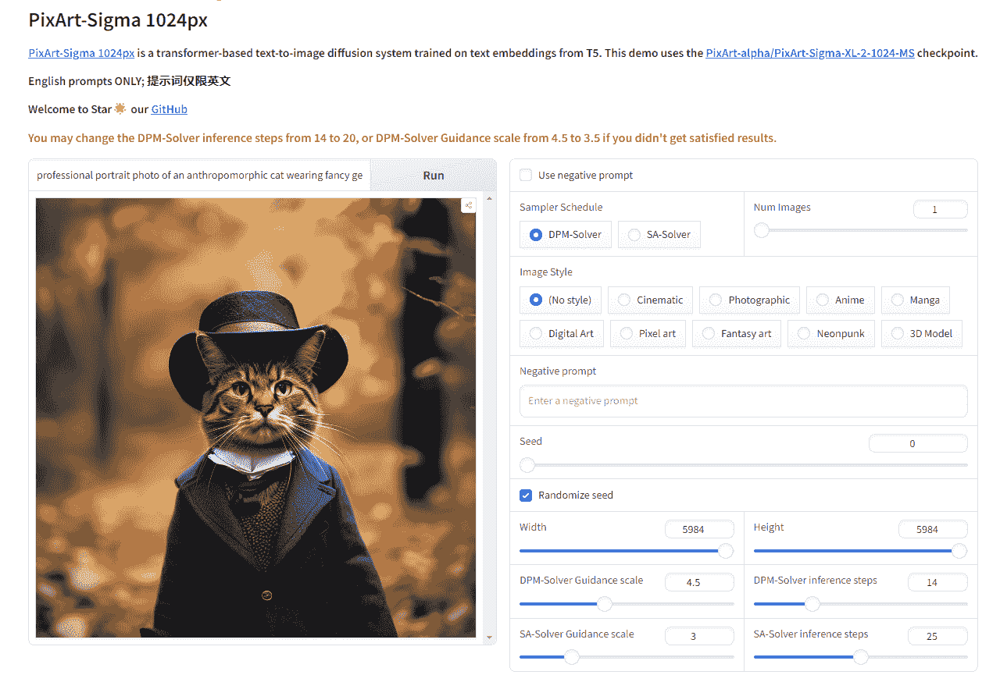
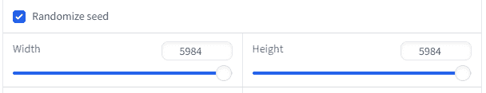
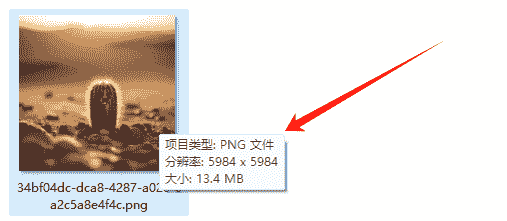
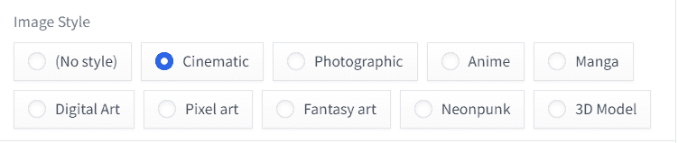

# 20240417-6K直出！PixArt-Sigma更新，文生图堪比Midjourney，附免费链接

> 来源：[https://aigcreative.feishu.cn/docx/MImMdfwyXogTqixB2d0cFIWpnDb](https://aigcreative.feishu.cn/docx/MImMdfwyXogTqixB2d0cFIWpnDb)

最近，PixArt-Sigma发布最新更新，这个基于Transformer的高质量图像生成训练框架，不仅在技术上实现了突破，更以其用户友好的特性，赢得了广泛的关注和好评。

先直接上Huggingface体验链接：https://huggingface.co/spaces/PixArt-alpha/PixArt-Sigma

交互界面非常简单，有WebUI基础的小伙伴，1分钟即可上手！

PIXART-Σ是由华为诺亚方舟实验室、大连理工和香港大学的研究团队共同开发的扩散变换模型DiT，专门用于4K分辨率的文本到图像生成。模型于24年3月发布，在基础模型PixArt-a上进行了显著改进，提供了更高保真图像和更好的文本提示对齐。PixArt-Σ生成4K图像的能力有效地支持了电影和游戏等行业高质量视觉内容的产生。

## 图像生成技术的一次重大飞跃

PixArt-Sigma此次的更新发布，标志着图像生成技术的一次重大飞跃。传统的图像生成技术往往需要复杂的编程知识和大量的时间投入，而PixArt-Sigma则通过简化训练和测试流程，无论是专业的开发者还是图像爱好者，都能轻松上手，体验到图像生成的魅力。

## 基于Transformer的核心框架

Transformer作为一种强大的深度学习模型，已经在自然语言处理等领域展现出了巨大的潜力。PixArt-Sigma将其应用于图像生成，使得生成的图像不仅质量上乘，而且风格多样，满足了不同用户的需求。

## 直接生成1K和2K高清图像，最高支持6K

直接生成1K和2K高清图像，而且出图的速度极快！

还可以将画面的尺寸直接拉满，最高支持5984*5984px分辨率，也就是6K！

看看，是真6K啊！

还有8种图片风格可以直接选择:

无论是细致入微的插画，还是宏大壮观的场景，都能通过这个框架得以完美呈现。而且还集成了LCM、DMD、ControlNet等工具，为用户提供了更多的创作自由度和控制能力。

## PixArt-Sigma：开源

开源意味着任何人都可以访问、使用和修改这个框架，这极大地促进了社区的参与和创新。用户不仅可以利用现有的资源，还可以根据自己的需求进行定制，创造出独一无二的图像作品。

尽管PixArt-Family的模型参数只有0.6B，但其生成的图像质量却出奇的高。这得益于开发团队在模型设计和训练过程中的精心优化。这样的设计不仅降低了技术门槛，也让更多人有机会参与到图像生成的行列中来。

PixArt-Sigma的发布，它让更多的人能够参与到数字艺术的创作中，享受到创作的乐趣。

随着技术的不断发展，我们有理由相信，图像生成领域将会迎来更多的惊喜和可能性。

最后再来欣赏几张PixArt-Sigma直出的创意美图：

更多AIGC领域精彩内容与进展，欢迎进群交流：

<https://aigcreative.feishu.cn/sync/K4Gvd9vUQsy9Oubwqaeclu0Fnbg>