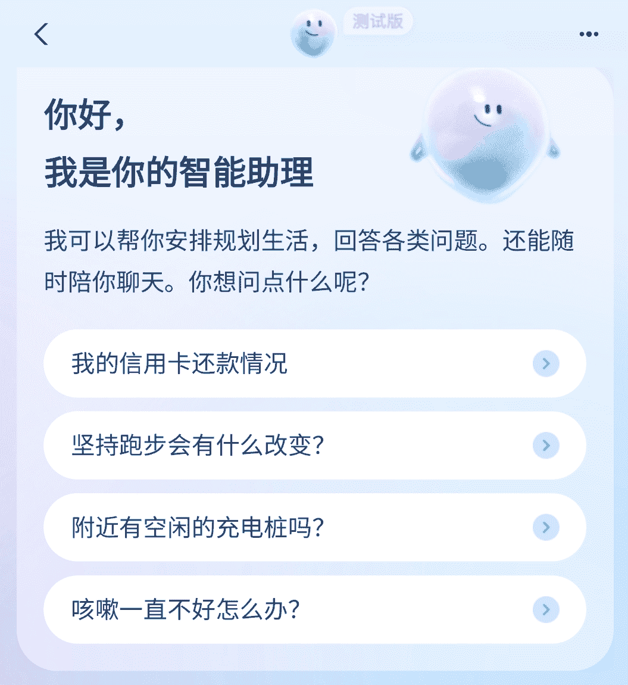
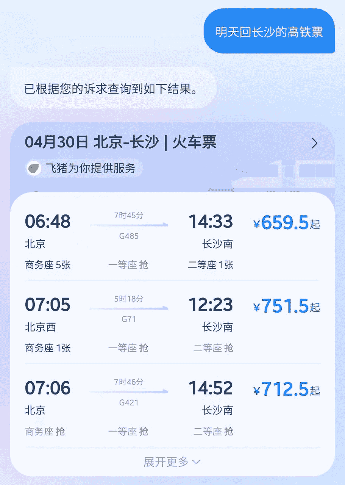
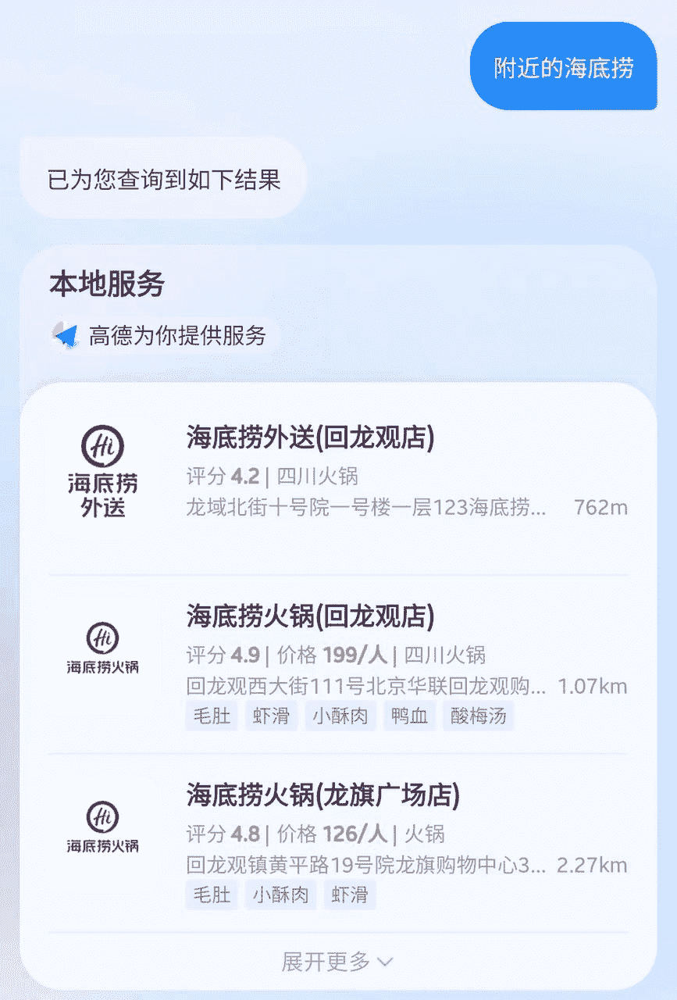

# 20240429-支付宝大升级！AI智能助理，你的“生活小秘书”来了！

> 来源：[https://aigcreative.feishu.cn/docx/OtQLdJ513o38qixs9BZcZW35nH4](https://aigcreative.feishu.cn/docx/OtQLdJ513o38qixs9BZcZW35nH4)

过去的一年，AI大模型火出天际！各大互联网巨头及新兴创业公司如同军备竞赛般发布自己的新技术、新产品。人工智能（AI）已经从科幻小说走进了我们的日常生活。

最近，国内最大的服务型超级App支付宝悄咪咪地上线了全新的办事AI产品，它不仅仅是一个聊天机器人，而是一位能够帮你处理各种生活琐事的“生活小秘书”。

### 支付宝AI智能助理：你的贴心生活助手

4月26日，支付宝在首页灰度测试了这款基于蚂蚁百灵大模型研发的办事AI产品。它不同于市面上常见的聊天型AI，而是专注于解决生活中的实际问题，如出行、健康、政务等30多项数字生活服务。这标志着AI技术在生活服务领域的应用迈出了实质性的一步。

### **一键式服务：便捷超乎想象**

使用支付宝智能助理非常简单。用户只需在支付宝首页界面持续下拉，或是点击右上角的“+”号选择“智能助理”，就能轻松唤醒这位AI小秘书。无论是文字指令还是语音命令，它都能快速响应，为你提供服务。

### **实际体验：高效且精准**

服务上线后第一时间进行了体验，实际使用的效果好的惊人。

例如，查询五一从北京回老家的火车票，只需几秒就能得到选票列表；

寻找附近的商场，也能迅速得到反馈。

在健康服务方面，智能助理不仅能推荐附近的医院，还能提供挂号服务。

此外，查询医保余额、养生知识、公积金等，都能得到快速准确的回答。

### **生活琐事，一键搞定**

支付宝智能助理的实用性远不止于此。

它还能帮你解决“吃”的问题，比如搜索附近的火锅店，提供评分、价格等信息，点击跳转至高德地图导航。

更神奇的是，它还能帮你搜寻优惠券，比如麦当劳的优惠，让你的生活更加便捷。

### **支付宝的AI之路：深耕细作**

支付宝之所以能够推出这样一款智能助理，得益于其20年的深厚积累。作为一个拥有超10亿用户及8千万商家机构的数字生活开放平台，支付宝连接了商家、机构和消费者，成为了各大垂类领域人群的“聚集地”。

支付宝的AI技术，已经在生活服务、健康医疗、金融等领域展现出了强大的服务能力。支付宝表示，办事助理未来还会基于AI技术持续升级，推出更多新功能。

这意味着，你的“生活小秘书”将会越来越聪明，越来越懂你。

<https://aigcreative.feishu.cn/sync/K4Gvd9vUQsy9Oubwqaeclu0Fnbg>