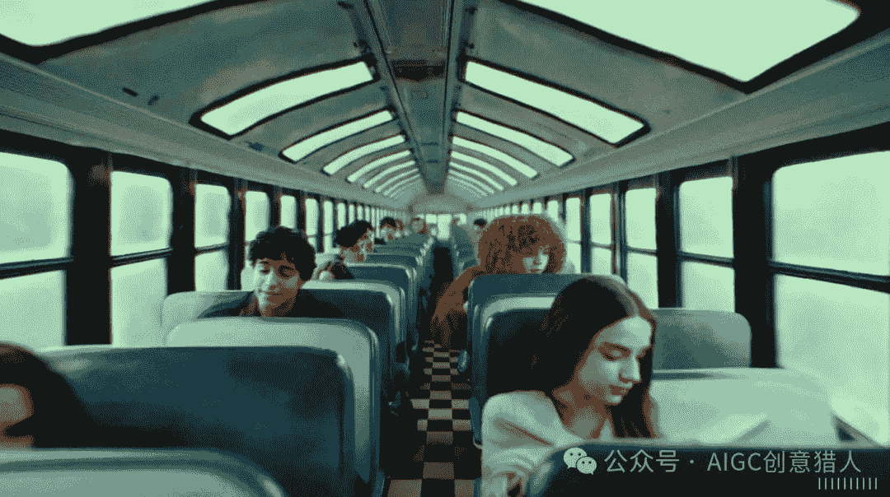
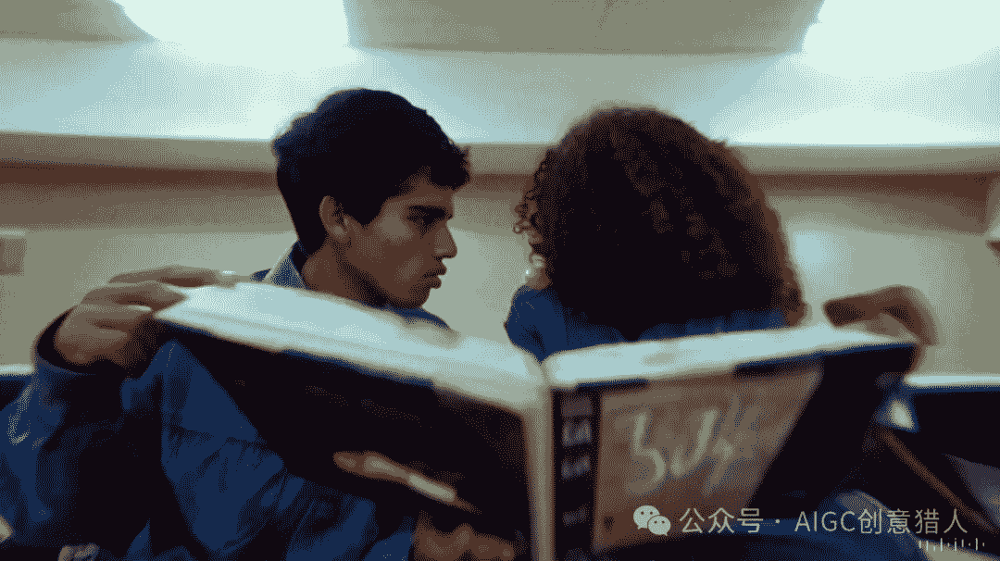
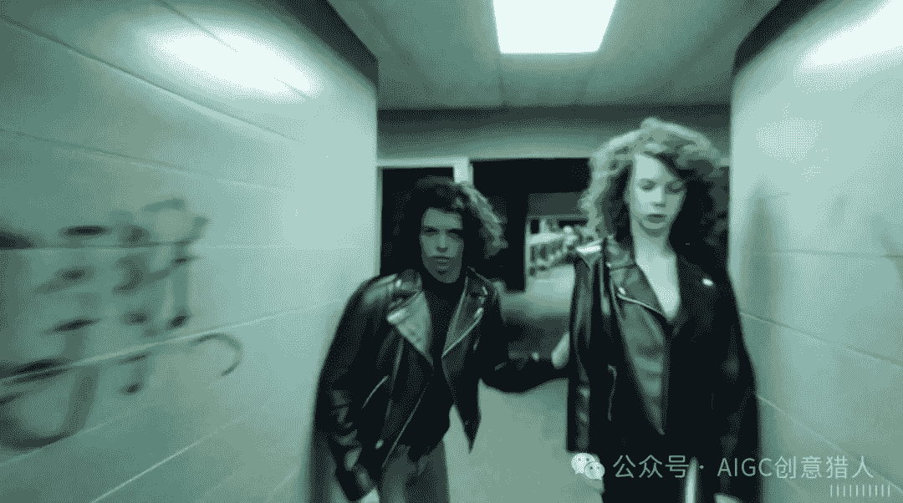
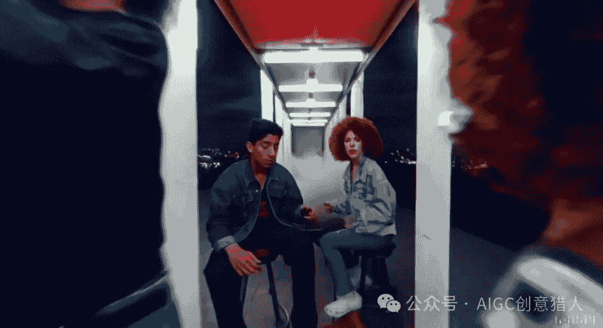
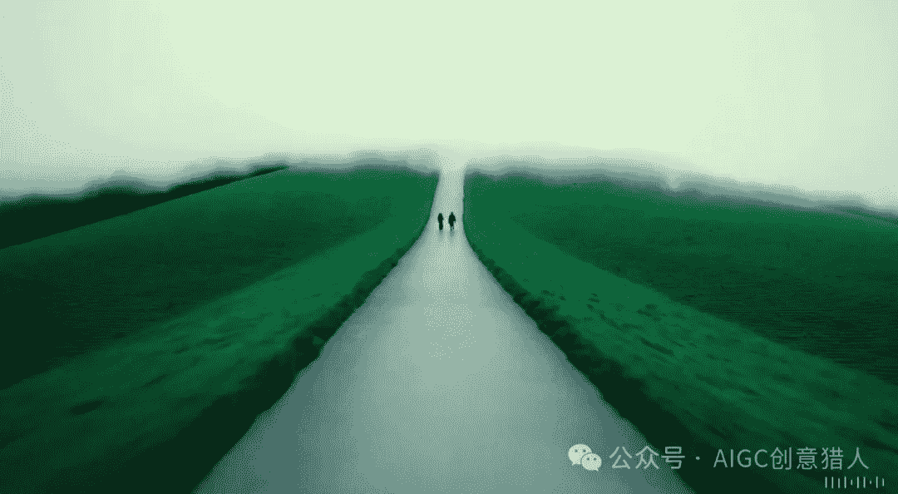

# 20240507-在真实与虚幻中穿行！艺术家使用Sora制作首个AI音乐视频，颠覆传统！

> 来源：[https://aigcreative.feishu.cn/docx/WDiddKrRsoRo7LxQS9kcaaa3nrg](https://aigcreative.feishu.cn/docx/WDiddKrRsoRo7LxQS9kcaaa3nrg)

独立流行音乐艺术家Washed Out（本名Ernest Greene）与导演Paul Trillo合作，利用OpenAI()的Sora，文本生成视频，为新歌“The Hardest Part”制作了音乐视频。

这是音乐界首次有重大艺术家与电影制作人合作，使用AI创作音乐视频。该视频由Sub Pop唱片公司发布，标志着AI在视频制作领域的潜在突破。

视频全长大约四分钟，通过快速切换展示了一对虚拟夫妇的生活片段，从80年代的高中生活到结婚、生子，再到生活的其他重要时刻。这些角色完全由Sora生成，而非真人演员扮演。Sora允许导演在没有预算和地点限制的情况下，探索角色生活的不同可能性，这在传统制作中成本会高得多。

目前尽管Sora有时会产生不一致的内容，但视频的最终效果呈现出一种梦幻般的艺术感，反映了人类记忆的模糊性。Greene和Trillo都认为，AI技术为音乐视频艺术形式的推进提供了新机会，尤其是在预算有限的情况下。他们希望AI技术能成为创作者工具箱中的另一个工具，帮助实现更大胆的创意。

Sora由OpenAI在今年2月推出，目前尚未公开，但已与导演和好莱坞高管及制片人进行了测试。OpenAI正在解决技术和知识产权方面的问题。尽管AI在音乐行业的应用存在争议，特别是在“深度伪造()”技术（使用艺术家的形象或声音的虚假视频和音频）的滥用问题上，但Sora的引入在好莱坞和其他领域引发了对其可能对工作和制作产生破坏性影响的担忧。

Greene和Trillo表示，他们使用Sora能够实现比传统实景拍摄更多的创意。Sub Pop唱片公司没有透露视频的成本，而Greene也没有为使用这项技术支付费用给OpenAI。他们曾考虑过其他创意，包括雇佣舞者和在类似于Greene新专辑封面的绿色山丘上拍摄，但由于时间和财务限制，这些想法未能实现。Trillo建议尝试使用Sora，尽管Greene最初对此持犹豫态度，但他愿意尝试。

Greene的音乐可能因讽刺性喜剧节目“Portlandia”的主题曲而被观众所熟知。他指出，他的音乐和多年来制作的视频总是从真实的情感出发，而他所见过的许多AI视频都存在所谓的“不协调谷”问题，即过于人工但又过于类似人类，令人感到不安。

尽管如此，Greene还是愿意尝试新技术。Trillo通过创建详细的文本提示，探索了视频中这对夫妇生活的不同结果。他用了大约六周的时间，从使用Sora生成的大约700个片段中编辑了55个片段，完成了视频。

Greene的新专辑“Notes From a Quiet Life”将于6月28日发布，“The Hardest Part”是该专辑的主打单曲。这标志着AI在音乐视频制作中的新应用，预示着未来可能成为音乐视频创作的新趋势。

<https://aigcreative.feishu.cn/sync/K4Gvd9vUQsy9Oubwqaeclu0Fnbg>