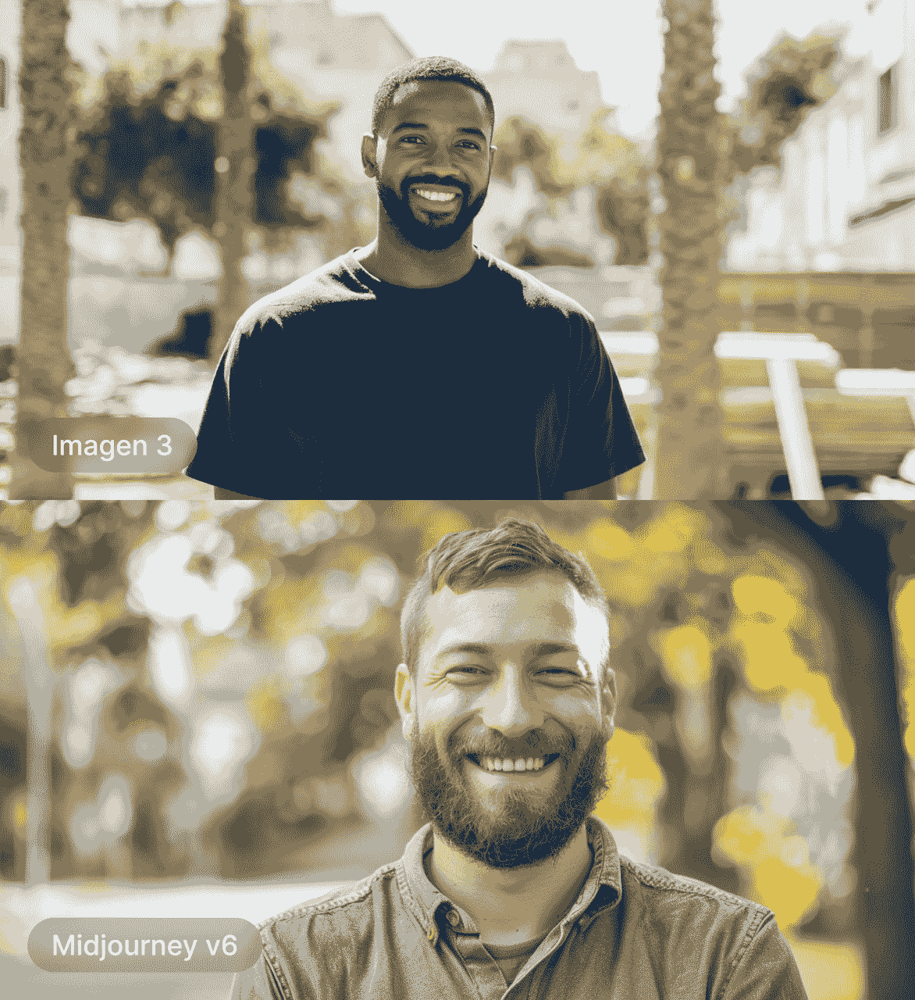
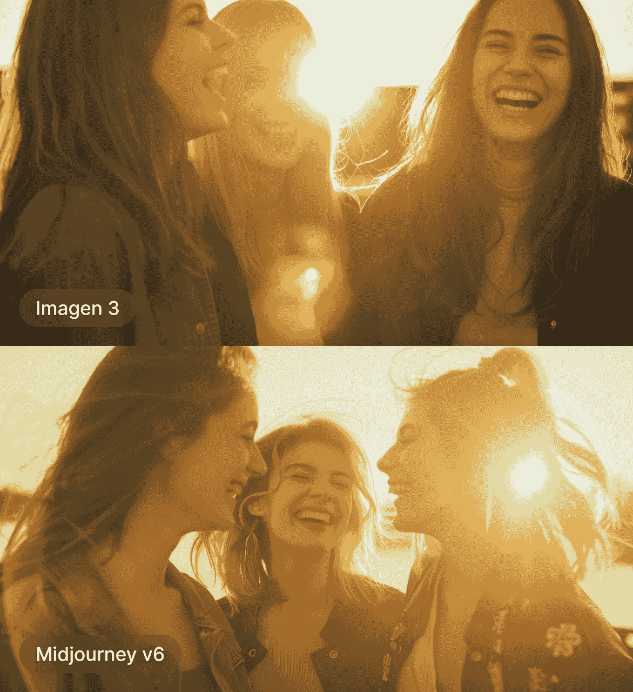
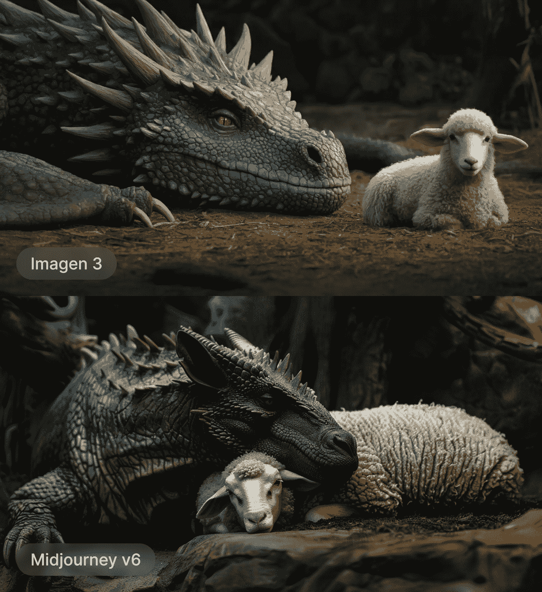
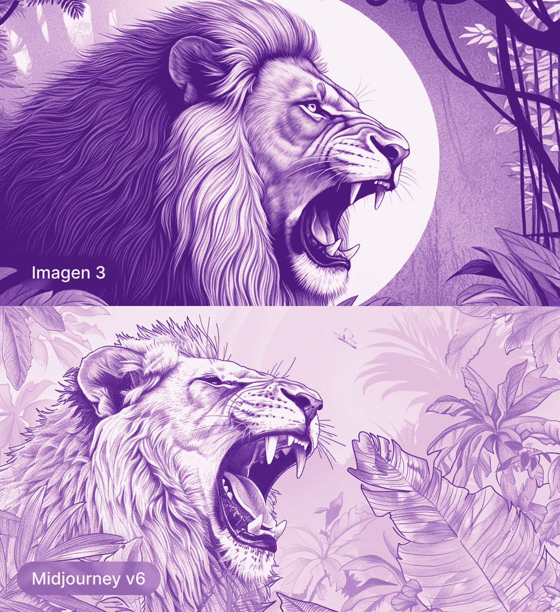
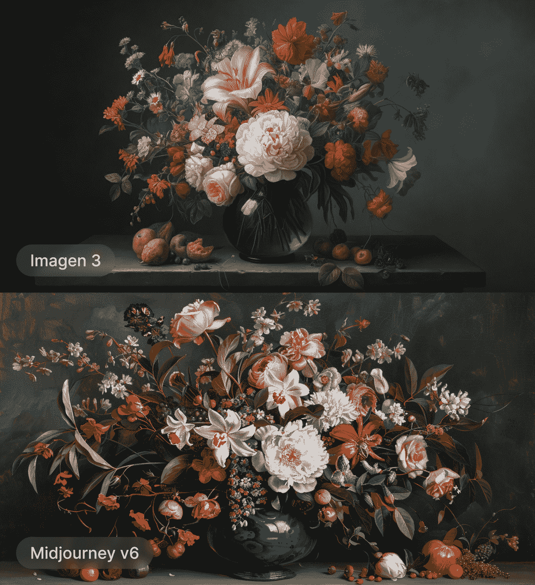
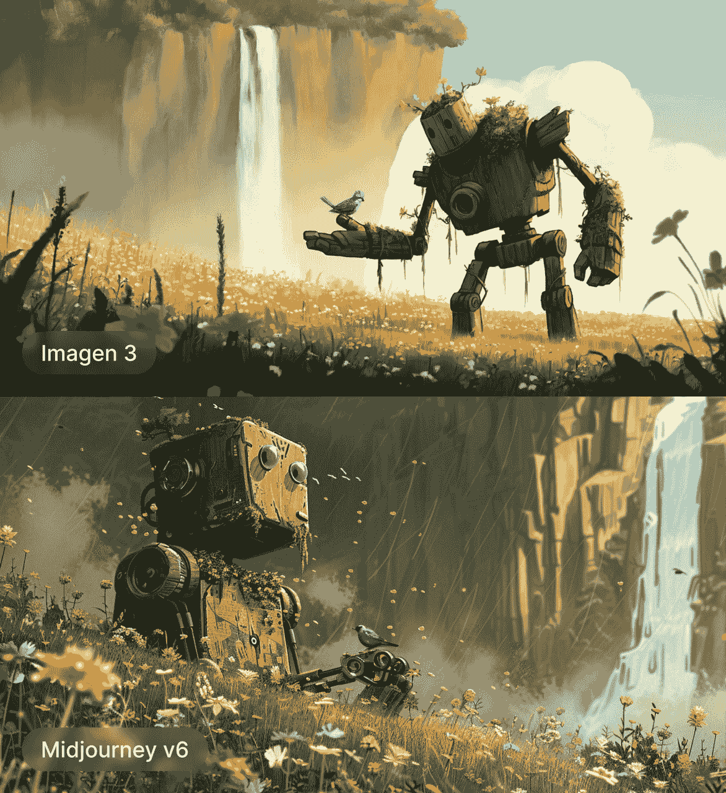
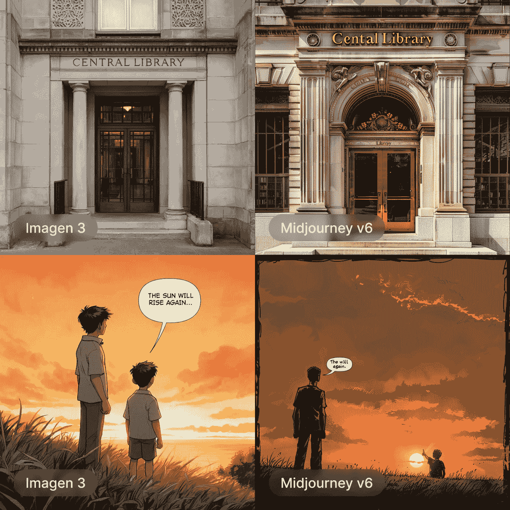
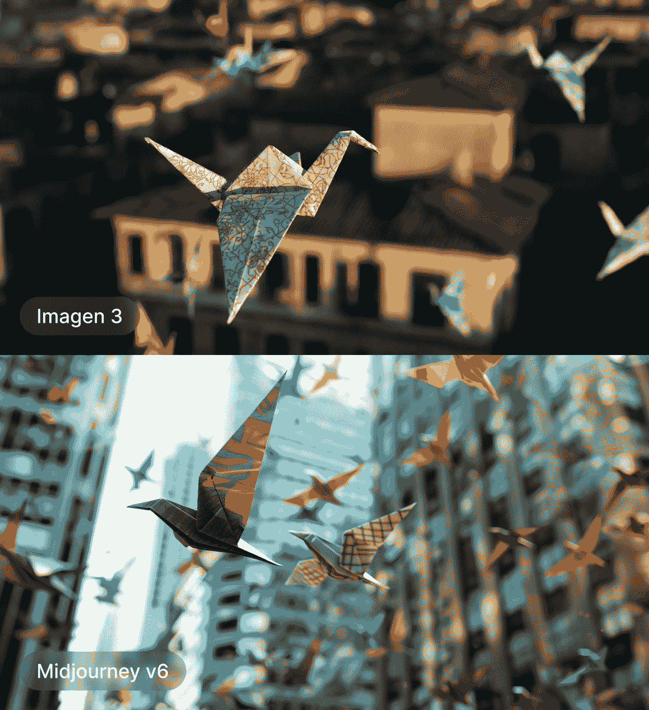
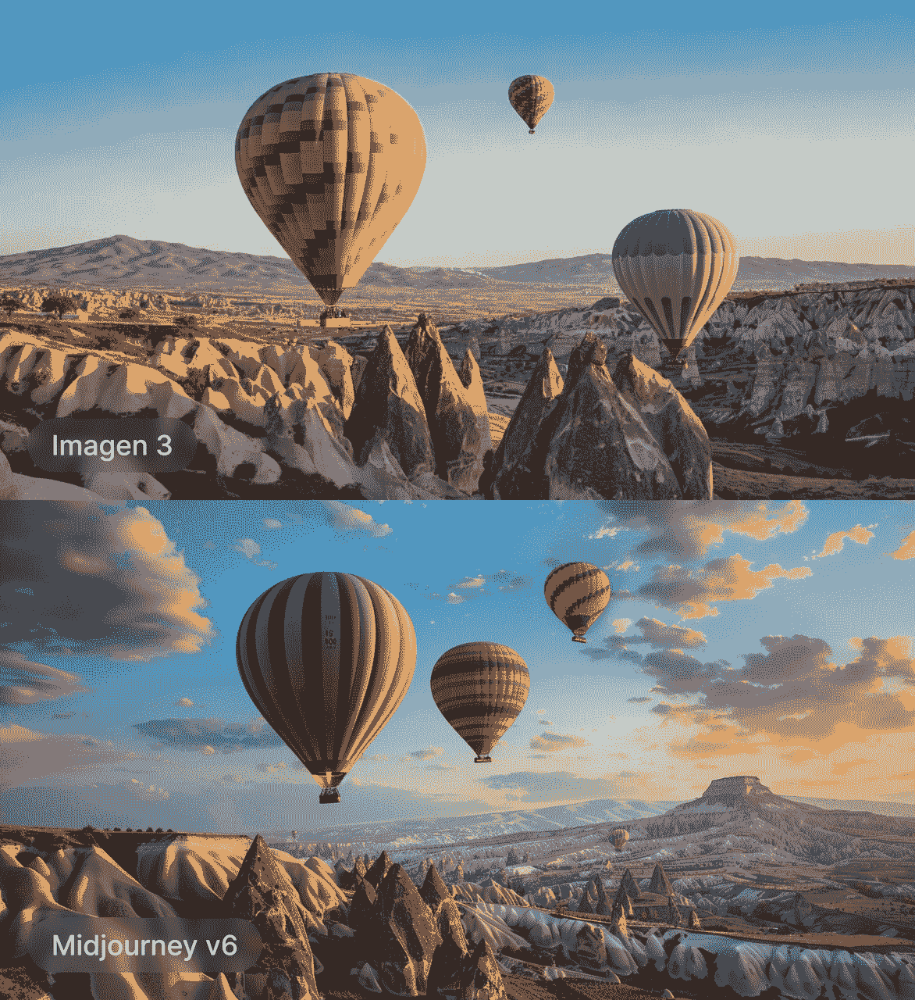

# 20240516-争夺AI文生图“铁王座”？谷歌Imagen 3与Midjourney V6效果超强对比

> 来源：[https://aigcreative.feishu.cn/docx/VfZ9dtfStorla5xrrGLcF1gGnsb](https://aigcreative.feishu.cn/docx/VfZ9dtfStorla5xrrGLcF1gGnsb)

谷歌刚刚推出了Imagen 3，DeepMind团队开发的最新的文本到图像 Gen AI 模型。

它能够生成高质量、多样化的图像，并且对自然语言提示有很好的理解能力。

该模型在安全性和责任性方面进行了创新，包括使用先进的隐私和安全技术以及水印工具，以确保生成的图像内容安全、可靠。

目前，Imagen 3 可以在： https://aitestkitchen.withgoogle.com/zh/tools/image-fx 平台上进行试用，waitlist。

X上艺术家Dogan Ural拿到了内测资格，我们来看看他的一些测试，

Imagen 3跟Midjourney V6对比出图的效果：

Prompt: Three women stand together laughing, with one woman slightly out of focus in the foreground. The sun is setting behind the women, creating a lens flare and a warm glow that highlights their hair and creates a bokeh effect in the background. The photography style is candid and captures a genuine moment of connection and happiness between friends. The warm light of golden hour lends a nostalgic and intimate feel to the image

提示：三个女人站在一起大笑，其中一位女人在前景中稍微失焦。太阳正在女性身后落下，产生镜头光晕和温暖的光芒，突出了她们的头发，并在背景中产生散景效果。摄影风格坦诚，捕捉朋友之间真实的联系和幸福的时刻。黄金时刻的温暖光线给图像带来怀旧和亲密的感觉

Prompt: Photographic portrait of a real life dragon resting peacefully in a zoo, curled up next to its pet sheep. Cinematic movie still, high quality DSLR photo

提示：现实生活中的龙在动物园里安静地休息，蜷缩在它的宠物羊旁边的照片肖像。电影剧照，高品质数码单反照片

Prompt: Detailed illustration of majestic lion roaring proudly in a dream-like jungle, purple white line art background, clipart on light violet paper texture

提示：雄伟的狮子在梦幻般的丛林中骄傲地咆哮的详细插图，紫色白线艺术背景，浅紫色纸张纹理上的剪贴画

Prompt: A large, colorful bouquet of flowers in an old blue glass vase on the table. In front is one beautiful peony flower surrounded by various other blossoms like roses, lilies, daisies, orchids, fruits, berries, green leaves. The background is dark gray. Oil painting in the style of the Dutch Golden Age

提示：桌子上的一个旧蓝色玻璃花瓶里放着一大束色彩缤纷的鲜花。前面是一朵美丽的牡丹花，周围环绕着各种其他花朵，如玫瑰、百合、雏菊、兰花、水果、浆果、绿叶。背景是深灰色。荷兰黄金时代风格的油画

Prompt: A weathered, wooden mech robot covered in flowering vines stands peacefully in a field of tall wildflowers, with a small bluebird resting on its outstretched hand. Digital cartoon, with warm colors and soft lines. A large cliff with a waterfall looms behind

提示：一个饱经风霜、覆盖着开花藤蔓的木制机械机器人安静地站在一片高高的野花田里，一只小蓝鸟停在它伸出的手上。数字卡通，色彩温暖，线条柔和。巨大的悬崖后面隐约可见瀑布

Prompt 01: A photograph of a stately library entrance with the words "Central Library" carved into the stone

Prompt 02: A single comic book panel of a boy and his father on a grassy hill, staring at the sunset. A speech bubble points from the boy's mouth and says: "The sun will rise again" Muted, late 1990s coloring style

提示01：一张庄严的图书馆入口的照片，石头上刻着“中央图书馆”的字样

提示 02：一个男孩和他的父亲在长满青草的山上凝视日落的漫画书面板。男孩嘴里吐出一个对话气泡，说道：“太阳会再次升起” 柔和的 20 世纪 90 年代末着色风格

Prompt: A close-up photo of an origami bird soaring through a cityscape, in a flock with others of different colors and patterns, casting intricate shadows on the buildings below

提示：一张特写照片，一只折纸鸟在城市景观中翱翔，与其他颜色和图案不同的鸟一起飞翔，在下面的建筑物上投射出错综复杂的阴影

Prompt: Shot in the style of DSLR camera with the polarizing filter. A photo of two hot air balloons floating over the unique rock formations in Cappadocia, Turkey. The colors and patterns on these balloons contrast beautifully against the earthy tones of the landscape below. This shot captures the sense of adventure that comes with enjoying such an experience

提示：使用偏光滤镜以单反相机的风格拍摄。两个热气球漂浮在土耳其卡帕多西亚独特岩层上的照片。这些气球上的颜色和图案与下面风景的泥土色调形成了美丽的对比。这张照片捕捉到了享受这种体验所带来的冒险感

Imagen 3 的推出标志着文本到图像生成技术的又一进步，它不仅提高了图像的生成质量，而且通过改进的提示理解和安全性创新，为用户提供了更加强大和安全的工具。

创意猎人AIGC社群也开设了MJ&AI绘画交流专区，欢迎入群沟通交流：

<https://aigcreative.feishu.cn/sync/K4Gvd9vUQsy9Oubwqaeclu0Fnbg>