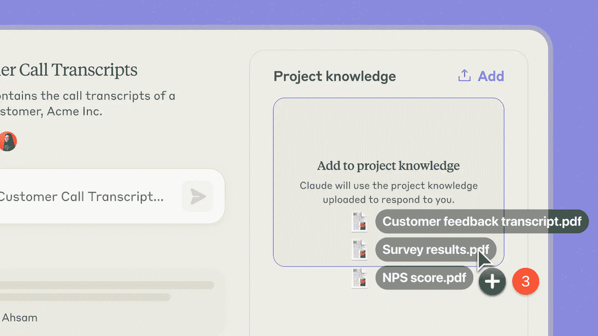
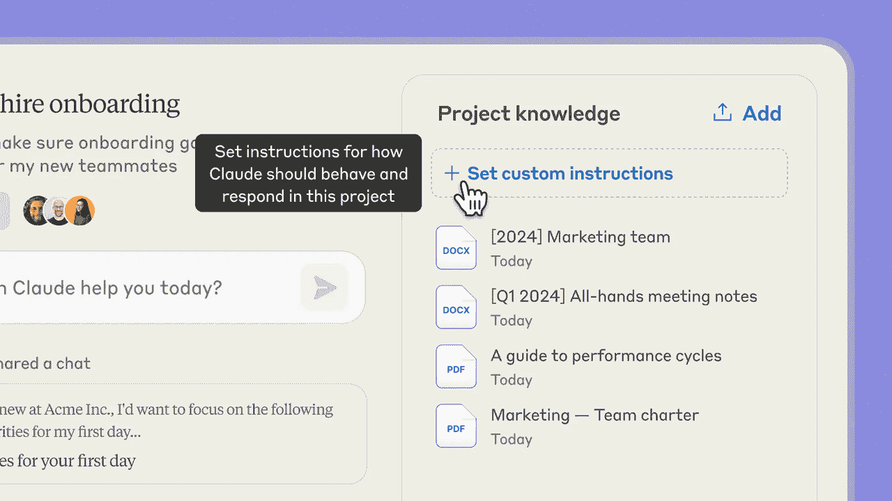
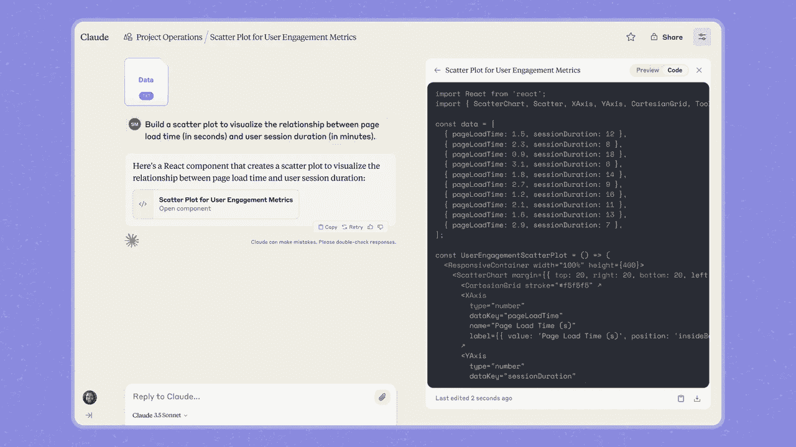
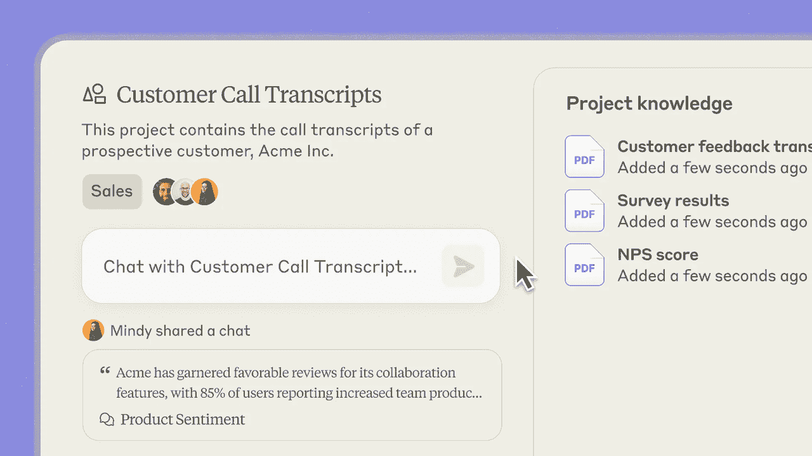

# 20240624-ChatGPT危险！Claude放大招，革新团队协作方式

> 来源：[https://aigcreative.feishu.cn/docx/FTXLdFdu4o0NIIxWiQ4cgjIlnfe](https://aigcreative.feishu.cn/docx/FTXLdFdu4o0NIIxWiQ4cgjIlnfe)

近日，Anthropic公司推出了一项名为“Claude Projects”的新功能，旨在为专业用户和团队用户带来更加高效和智能的工作方式。这一功能的推出，让大家在办公和协作上体验到了前所未有的便捷和创新。

## 打破常规，Claude让协作更智慧

Anthropic公司一直致力于开发能够真正与人类协作的AI系统，Claude就是其中的佼佼者。最新推出的“Claude Projects”功能，将用户的聊天记录和知识库汇集在一起，形成一个集中管理的项目平台。通过这个平台，团队成员可以轻松访问和共享最佳实践，提升创意生成和战略决策的能力。

项目功能不仅限于简单的聊天记录管理，它还拥有一个200K上下文窗口，相当于500页书的容量。这意味着用户可以将所有相关的文档、代码和见解添加到项目中，让Claude在提供帮助时更加精准有效。更令人兴奋的是，最新的Claude 3.5 Sonnet版本在各项性能指标上均表现出色，成为这项功能的有力支持。

## 高效协作，摆脱冷启动烦恼

每个团队都面临着一个常见问题：新成员加入时的“冷启动”问题。Claude Projects可以解决这个问题。通过将公司的内部知识（如风格指南、代码库、面试记录等）整合进来，Claude能够快速适应并提供专业级的帮助。不论是编写营销邮件还是撰写SQL查询，Claude都能轻松应对。

此外，用户还可以为每个项目定义自定义指令，进一步调整Claude的响应方式。这包括使用更正式的语气或者从特定角色或行业的角度回答问题。如此一来，团队成员可以更快上手，并且扩展他们在各类任务中的技能。

## 创意无限，与Claude共同创作

Claude Projects的另一大亮点是Artifact功能。这个功能让用户可以实时查看、编辑和构建Claude生成的内容，包括代码片段、文本文档、图形、图表和网站设计等。对于开发者来说，Artifact特别提供了更大的代码窗口和前端实时预览，大大简化了代码审查的过程。

用户只需在左侧面板上的账户菜单中加入Artifact功能预览，就可以体验到这一便捷的创作工具。Claude不仅是你的助手，更是你的创作伙伴。

## 分享即灵感，团队协作更上一层楼

Claude团队用户还可以将他们的最佳对话快照分享到团队的共享项目活动Feed中。通过这种方式，每个团队成员都能从不同的工作方式中获得灵感，提升与AI协作的技能。这样的分享机制可以在产品开发和研究等领域带来创新，利用组织内部的知识创造更高质量的输出。

North Highland是一家领先的变革和转型咨询公司，他们的员工已经切身体会到了Claude带来的效率提升。从撰写提案到分析复杂文件，Claude帮助他们以5倍的速度完成任务。技术AI项目和产品经理高级总监Luka Anic表示，Claude团队计划正在彻底改变他们的工作方式。

## Claude，让未来工作更智能

Claude Projects不仅提升了团队的工作效率，也确保了用户数据的安全性。Anthropic公司承诺，未经用户明确同意，任何在项目中共享的数据或聊天记录都不会用于训练生成模型。

未来几个月，Anthropic公司还将继续改进Claude的易用性，并扩展与流行应用程序和工具的原生集成，让Claude能处理更多类型的项目知识。让我们拭目以待，看看Claude如何继续改变我们的工作方式。