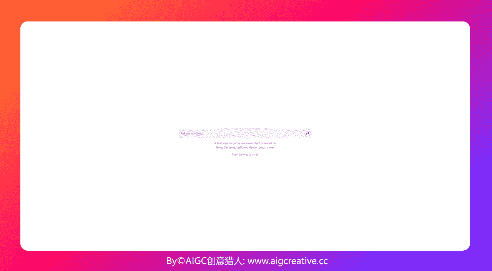
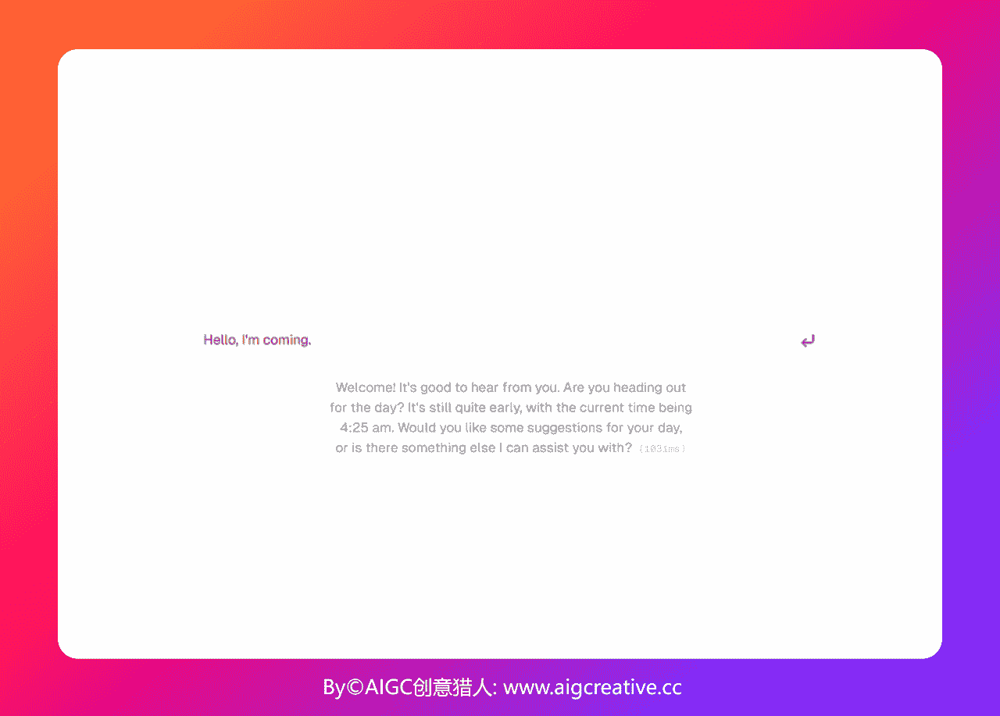

# 20240711-Swift：极简界面，极致性能！AI对话新范式！

> 来源：[https://aigcreative.feishu.cn/docx/RTmidjZc7obqnZxUZimcBr5snSh](https://aigcreative.feishu.cn/docx/RTmidjZc7obqnZxUZimcBr5snSh)

今天介绍一个开源语音助手——Swift。

不是Apple的Swift编程语言，也不是泰勒swift，是AI语音助手——Swift。

先上链接：https://swift-ai.vercel.app/

它不仅快速、高效，而且完全免费。

就这么个界面，界面简单到了极致！性能确强大到了极致。

不用打字，不用点击，直接开口说话就行！

速度不是一般的快，是很快！

Swift，这个名字听起来就像是它的表现一样迅速，由 Groq、Cartesia、VAD 和 Vercel 支持的全新 AI 助手。

Swift 背后的技术魅力在于它的响应速度和准确性。

Groq 的处理器提供了强大的计算能力，而 Cartesia 的语音识别技术则确保了 Swift 能够准确理解各种口音和语言变化。VAD（Voice Activity Detection）技术进一步提升了 Swift 的灵敏度，能够准确地识别出何时有人在说话，从而提供更加精确的交互体验。

此外，Vercel 作为 Swift 的部署平台，确保了无论是在手机上、电脑上，还是在智能家居设备上，Swift 都能够稳定、快速地运行。

这种跨平台的兼容性，让 Swift 的应用范围变得非常实用。

尽情地享受与AI的对话吧。

<https://aigcreative.feishu.cn/sync/K4Gvd9vUQsy9Oubwqaeclu0Fnbg>