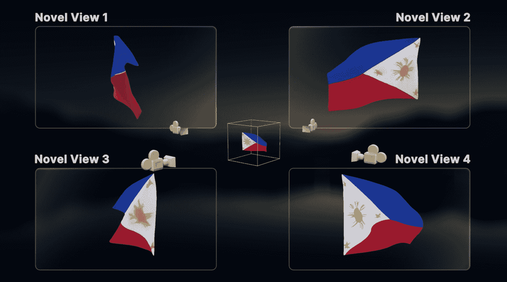
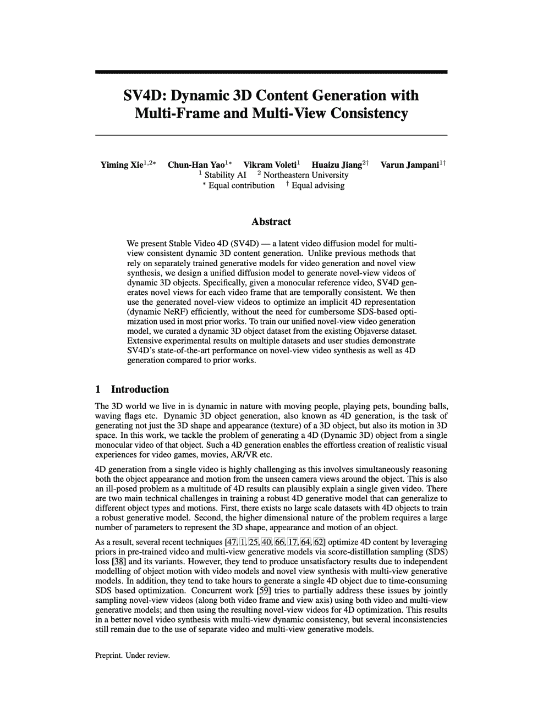
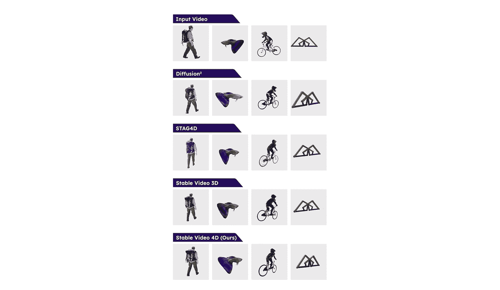
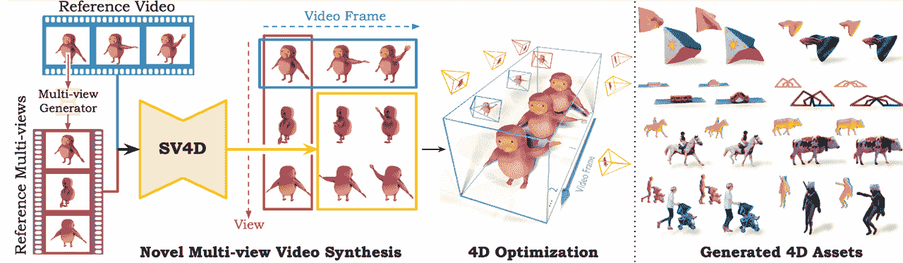

# 20240725-Stability AI推出首个动态多角度视频生成AI模型Stable Video 4D

> 来源：[https://aigcreative.feishu.cn/docx/KLoJd4MVzoYMlSxpKrBcHsqqnbc](https://aigcreative.feishu.cn/docx/KLoJd4MVzoYMlSxpKrBcHsqqnbc)

Stability AI宣布推出Stable Video 4D，这是一款视频生成模型，用户可以上传一个视频，并获得八个新角度的动态视频视图，提供了新的多样性和创意水平。

与此同时，Stability AI 还发布了一份综合技术报告，详细介绍了在开发该模型过程中所采用的方法、面临的挑战和取得的突破。

### 什么是Stable Video 4D？

简单来说，Stable Video 4D是一个人工智能模型，它能够将一个普通的视频转化为八个不同视角的视频。

这意味着，你可以从一个单一的视频素材中，获得全方位的视觉体验。但更神奇的是，这个过程只需要大约40秒就能完成5帧的生成，而整个4D优化过程也仅需20到25分钟。

### 它如何工作？

用户只需上传一个视频，并指定他们希望的3D摄像机位置。Stable Video 4D会根据这些位置生成八个不同视角的视频。

这不仅为视频制作者提供了更多的创意空间，还能帮助他们更高效地优化视频中的3D对象表现。

目前，Stable Video 4D还处于研究阶段，但其潜在的应用前景已经让许多行业感到兴奋。

游戏开发者可以利用这项技术创造出更加真实的游戏环境，视频编辑可以轻松地从不同角度展示故事，而虚拟现实制作者则可以为观众带来更加沉浸式的体验。

Stability AI的团队正在不断优化这个模型，以适应更广泛的现实世界视频。

与传统的方法相比，Stable Video 4D在生成多视角视频时，能够保持更高的一致性。这不仅确保了在多个视角和时间点上对象的外观一致，还使得4D优化框架更加轻量级，避免了复杂的评分蒸馏采样（SDS）过程。这意味着生成的视频不仅细节丰富，而且忠实于原始视频，并且在不同帧和视角之间保持一致。

Stability AI已经在Hugging Face上发布了Stable Video 4D模型，并将其作为他们首个视频到视频生成模型。他们正在积极改进这个模型，以处理更广泛的现实世界视频。随着技术的不断发展，Stable Video 4D将在未来的电影、游戏和虚拟现实领域扮演重要角色。

<https://aigcreative.feishu.cn/sync/K4Gvd9vUQsy9Oubwqaeclu0Fnbg>