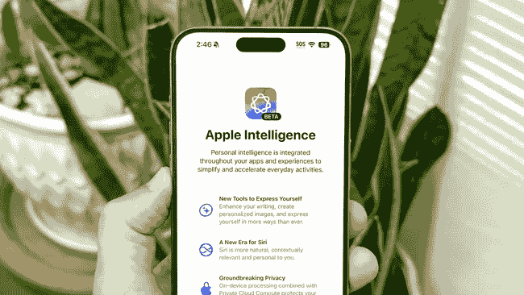
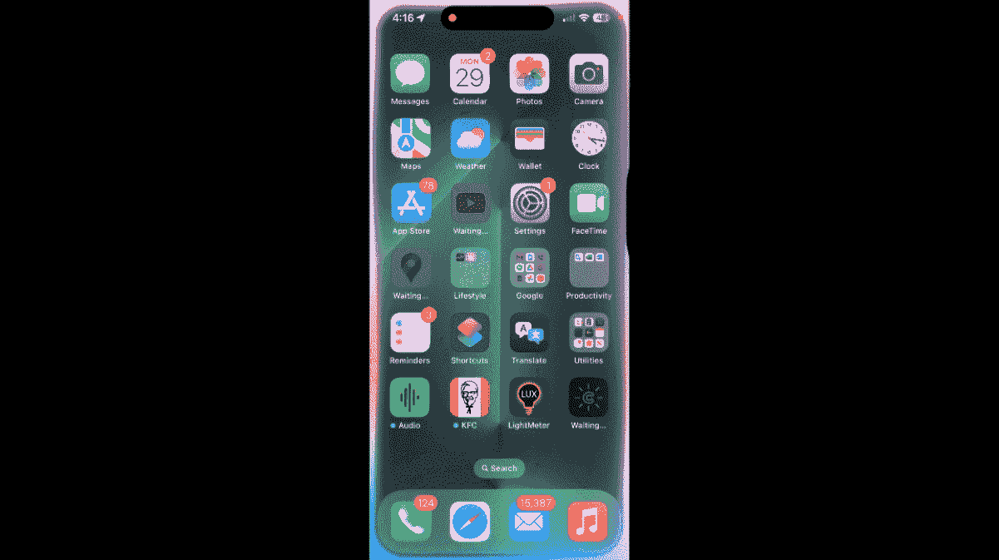
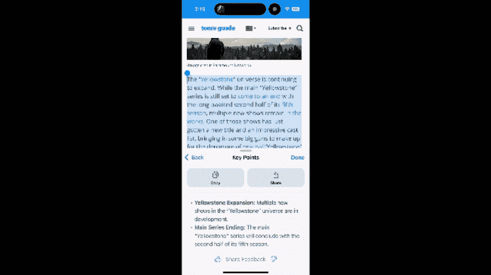
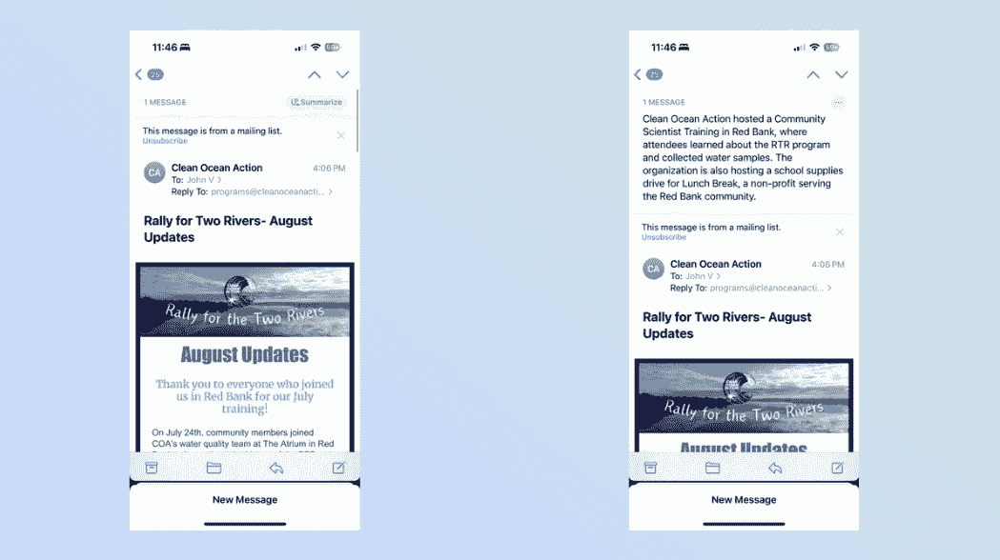
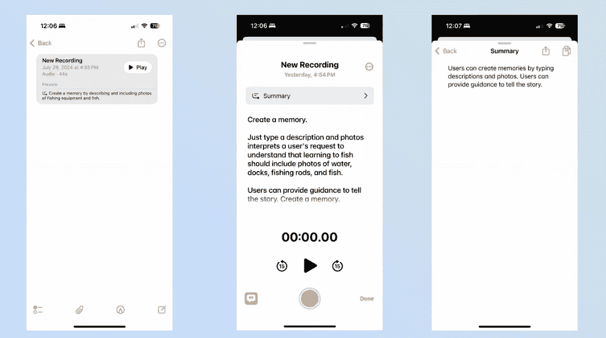
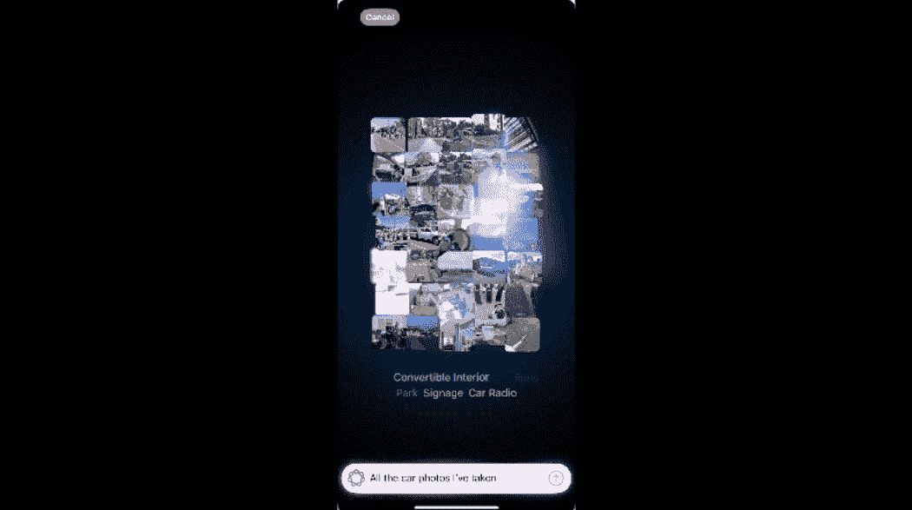
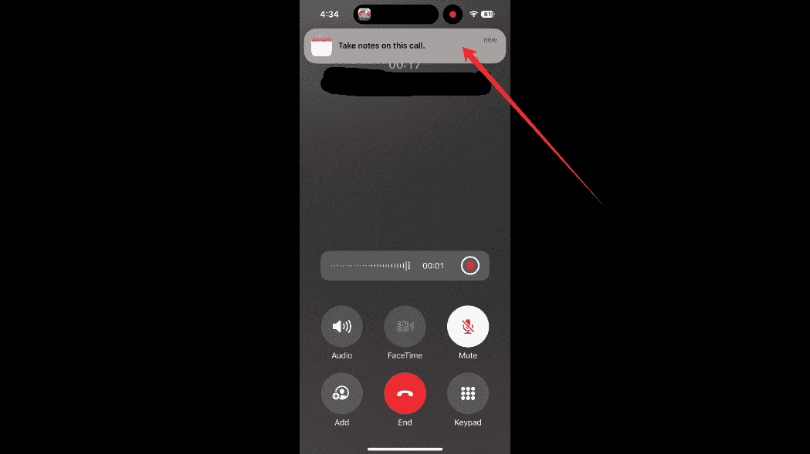
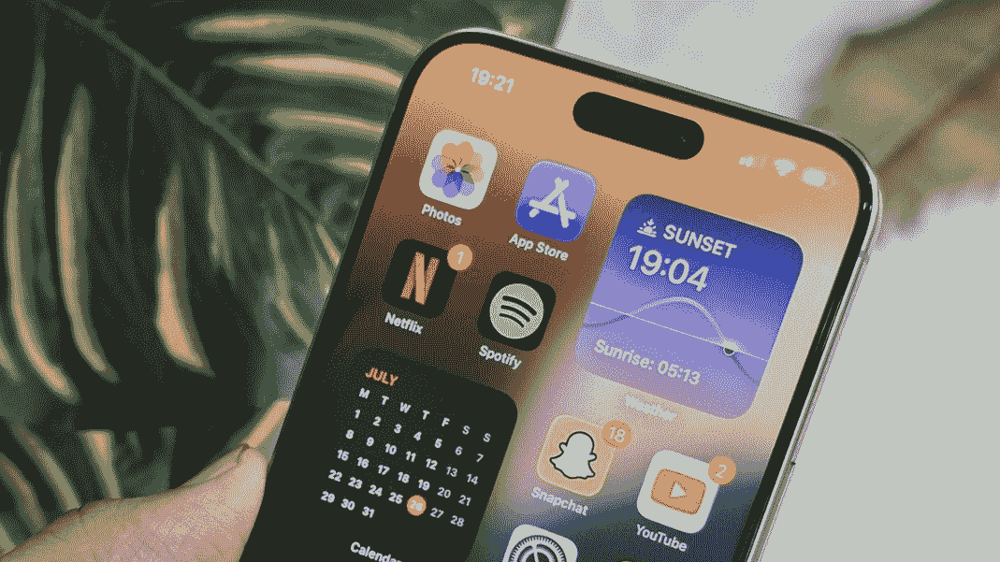

# 20240804-iPhone用户速看！智能化+人性化，iOS 18六大新功能上手体验

> 来源：[https://aigcreative.feishu.cn/docx/BBsjdhPdzo3yUVxl26tcaOV9nAc](https://aigcreative.feishu.cn/docx/BBsjdhPdzo3yUVxl26tcaOV9nAc)

苹果智能（Apple Intelligence）旨在重新定义人们使用和互动 iPhone 的方式。

虽然iOS 18还要在今年晚些时候才能正式发布，但如果你现在在iPhone 15 Pro或15 Pro Max上升级运行iOS 18开发者测试版，你就可以体验到Apple Intelligence的这些新的 AI 功能。

这些 AI 辅助功能可以做很多的事情，比如简化工作流程，让我们更方便地使用新的Siri。

以下是你在升级到iOS 18后，可以在 iPhone 上体验到的5大AI新功能：

## 更智能的 Siri 操作

随着Apple Intelligence的引入，Siri 得到了显著升级。它不仅有了新的动画效果，当在兼容的 iPhone 上呼叫时，她的语音也变得更自然，不再像机器人。

最令人印象深刻的是，Siri 的听力能力得到了增强，因为你可以在说话中途纠正自己，而它能理解你的意思，不需要重新发出语音命令。

此外，你可以随时通过双击屏幕底部的条来调出新的 Siri 键盘，输入你的问题和命令。在不便使用语音命令的情况下，这非常实用。

以下是访问 Siri 新功能的方法：

+   **Siri 键盘**：只需**双击屏幕底部的条**。

+   Siri 可以像以前一样通过语音提示“Hey Siri”或“Siri”以及**长按电源按钮**来呼出。

## 写作工具：文风切换无压力

类似于Galaxy AI的聊天助手功能，Apple Intelligence的“写作工具”可以帮助你调整写作风格——让它听起来更加正式或简洁。这些写作工具可以在每个应用中使用，只需选中突出显示文本，然后点击出现的写作工具选项即可。

除了改变写作风格，Apple Intelligence还可以将其转换为摘要、要点、列表或表格。这对于阅读长文章和整理笔记非常有用，因为苹果智能能很好地提炼出文本的要点。

以下是如何使用苹果智能的写作工具：

+   **选择你要转换的文本**，然后点击**写作工具**。

+   选择不同的写作风格，如**友好、专业或简洁**。

+   在写作工具菜单的底部，你可以选择**摘要、要点、列表和表格**来进行总结。

## 邮件中的优先级和总结功能

可能苹果自带的“邮件”App不是大家首选的电子邮件应用，但苹果智能新增的功能可能会让你重新考虑使用 iPhone 上的邮件应用。因为你可以在应用中试用新的总结功能，将那些冗长的电子邮件简化为易于理解的小摘要，突出最重要的内容。

如果你经常收到大量电子邮件，没时间逐一查看，Apple Intelligence会在收件箱顶部显示最重要的消息，标记为优先邮件。这样，你可以在这些邮件被其他邮件淹没之前优先处理。

你不需要做太多事情来使用这些新的邮件功能，因为它们会自动出现在邮件应用中，以下是你需要注意的地方：

+   当你打开邮件并选择一个收件箱时，Apple Intelligence会在**列表顶部显示优先邮件**。

+   选择一封电子邮件后，点击**右上角的菜单按钮**，就可以看到摘要。点击后会显示一个下拉菜单，提供邮件的摘要内容。

## 在备忘录中总结语音记录

在iOS 18 的备忘录应用中，你可以做很多有用的事情，比如转录语音记录，而Apple Intelligence的总结功能更是进一步提升了效率。

你可以在 iPhone 的备忘录应用中录制演讲，然后让它总结整个内容。这对于较长的录音非常有效，这样你就不必花时间浏览整个转录内容来提取最重要的细节。

以下是如何访问这个新功能：

+   一旦你在备忘录应用中附加了语音记录，你可以点击录音文件，在**顶部附近有一个按钮可以总结**。

+   在左下角有一个**聊天框图标**，你可以**切换到转录**模式查看文字内容。

## 使用照片应用创建回忆

通过向Apple Intelligence描述想要创建的内容，比如所有拍摄的汽车照片，它为生成了一个精美的剪辑。

手动完成这项工作可能会非常耗时，但Apple Intelligence会分析拍摄的所有照片和视频——

并完成了所有编辑，包括音乐和过渡效果。

这是Apple Intelligence最酷的功能之一，也是最直观的功能之一。以下是如何操作：

+   打开照片应用，然后向下滚动，直到看到**回忆**部分。点击旁边的**创建按钮**。

+   会出现一个**消息框**，询问你描述回忆内容，只需写下你想要的内容，然后按下回车键。

+   你会看到一个动画，几秒钟后，它会生成回忆供你查看。

## 录制电话并将其保存在备忘录中

有时对话会进行得太长，这时Apple Intelligence就派上用场了。你可以录制电话对话，苹果智能会在备忘录应用中转录并总结这些对话。当你激活这些功能时，通话方会听到一条提示，通知他们通话正在录音。

虽然录音功能在我的体验中表现正常，但目前似乎存在一个错误，导致Apple Intelligence无法一致地转录和总结这些录音。

+   当你在通话中时，**点击左上角的录音图标**。

+   出现一个提示，表示电话通话将被录音，同时也会通知你的通话方。

+   通话结束后，录音将**自动保存**到备忘录应用中。

iOS 18 的更新让 iPhone 更加智能化和人性化。这不仅是一次常规的系统升级，更是苹果在用户体验上迈出的巨大一步。从 Siri 的聪明升级，到写作工具的便捷，再到邮件和语音记录的实用新功能，每一项改进都充满了对用户需求的细致考量。

这些功能不仅提升了日常使用的便利性，也让用户体验更加流畅、愉快。不管你是科技发烧友还是普通用户，这次 iOS 18 的更新都值得你去尝试和探索。