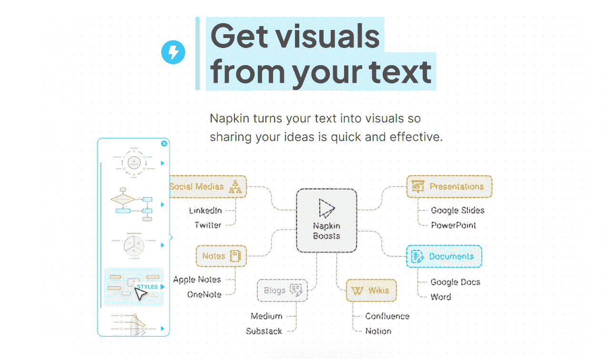
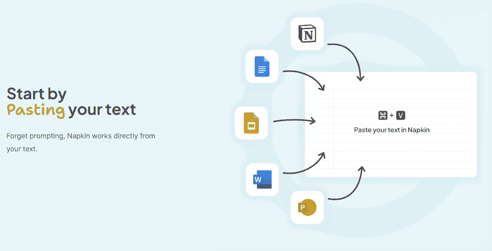
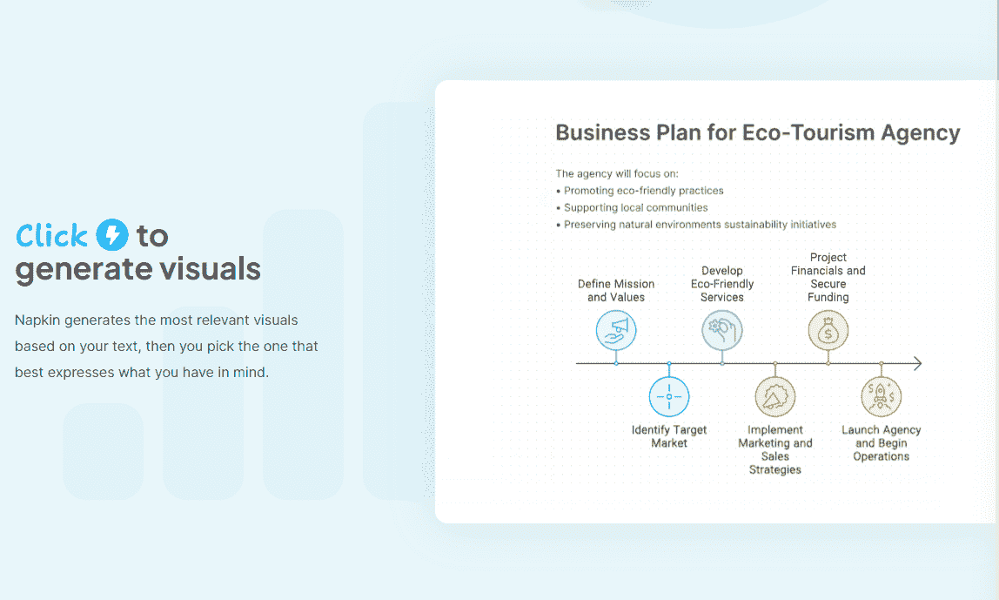
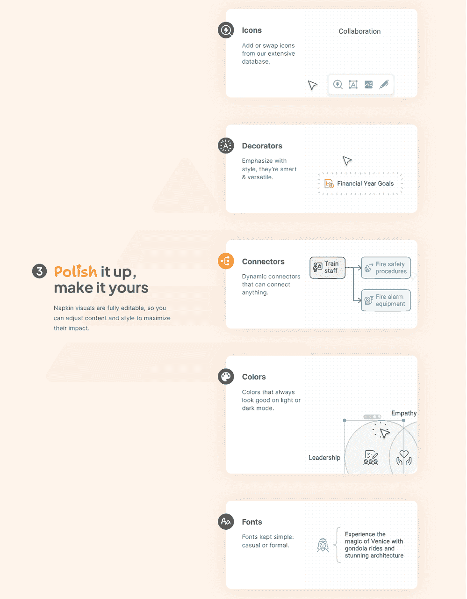
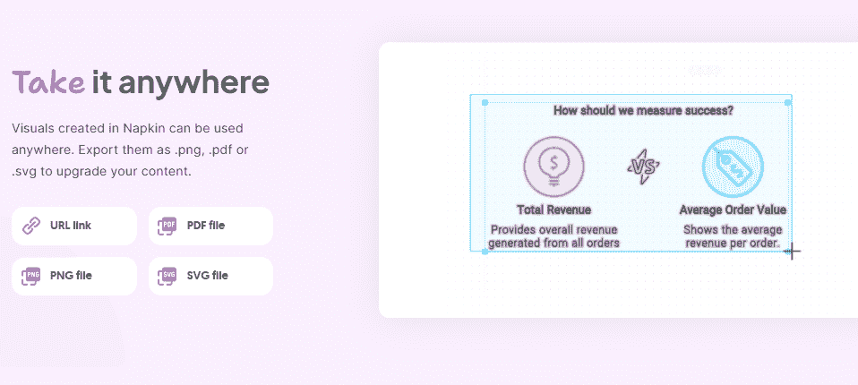
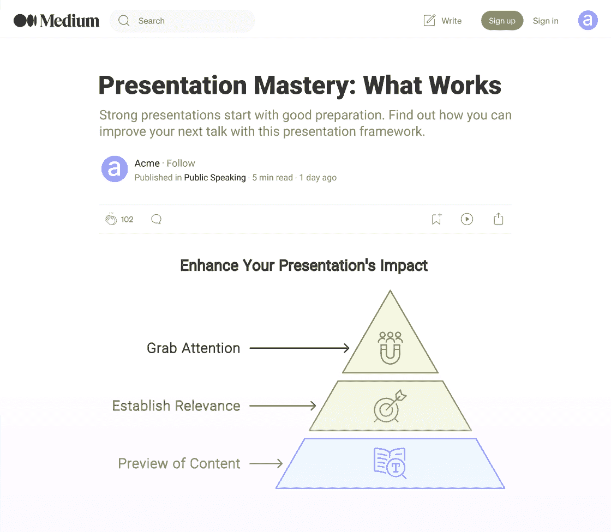
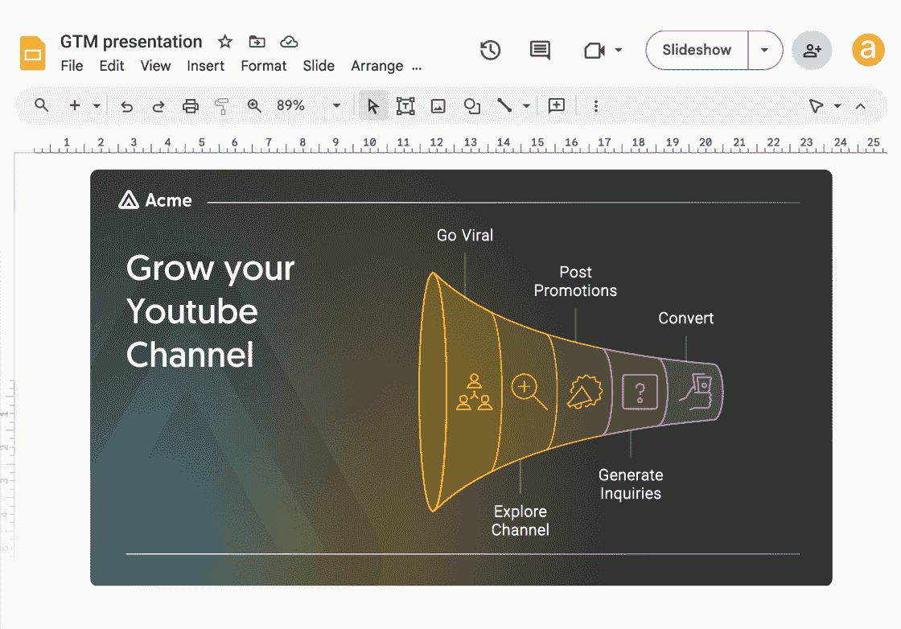
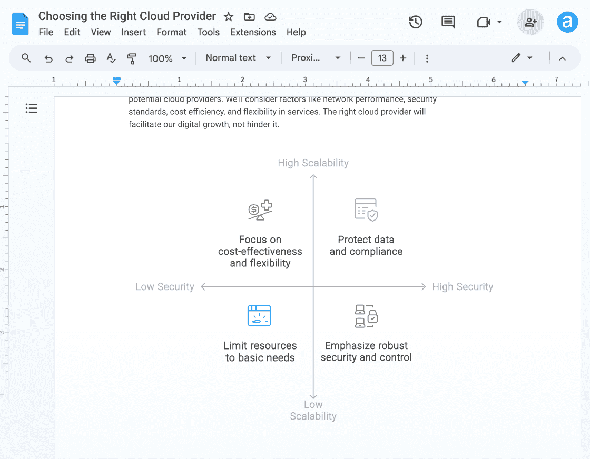
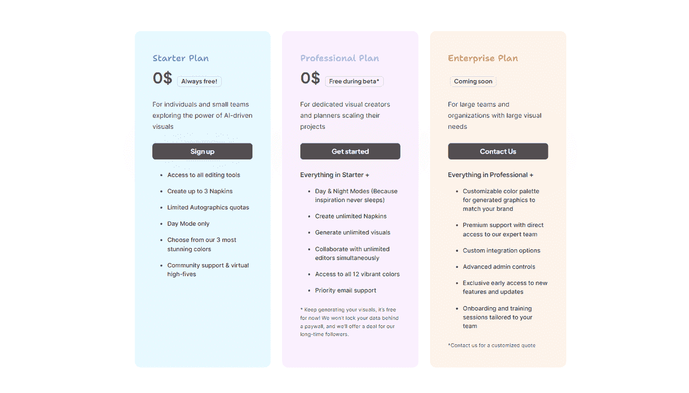
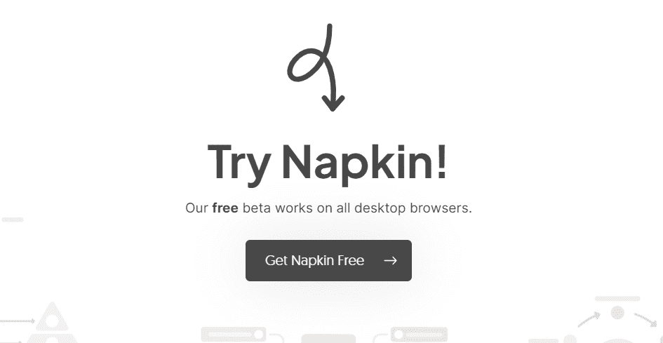

# 20240820-新思路，打工人福音！Napkin AI将文字秒变PPT！

> 来源：[https://aigcreative.feishu.cn/docx/TGCPdZGHBo7BGUxtXPBccLgrnFc](https://aigcreative.feishu.cn/docx/TGCPdZGHBo7BGUxtXPBccLgrnFc)

在这个信息爆炸的时代，如何让你的想法在众人中脱颖而出？

Napkin AI，一款非常有创意的视觉AI工具，正悄然改变我们分享和理解信息的方式。

直接上链接，小心食用：https://www.napkin.ai/

Napkin AI的工作原理简单而高效。用户只需将文本粘贴到平台上，Napkin便能自动识别文本内容，它能够将你的文字内容，瞬间转化为生动的图表、信息图、流程图等视觉元素。

比如：你刚刚敲下的一段话，下一秒就变成一幅幅吸引眼球的图像，这不再是科幻小说里的情节，而是Napkin AI带来的现实。

操作起来简单到令人难以置信。你只需将文本粘贴到Napkin AI中，点击生成，它就会根据你的文字内容，智能推荐最合适的视觉效果。然后，你可以像使用画笔一样，自由调整这些视觉元素的内容和风格，让它们完美表达你的想法。

Napkin AI的图标库、装饰元素、连接线和色彩选择，都经过精心设计，以确保在任何模式下都能保持美观。无论你需要在演讲中吸引观众，还是在社交媒体上引发讨论，Napkin AI都能助你一臂之力。

更令人兴奋的是，Napkin AI的编辑功能非常强大。你可以轻松地将这些视觉元素导出为PNG、PDF或SVG格式，用于你的电子书、社交媒体帖子，甚至是产品演示。这不仅大大节省了时间，还提高了内容的质量和吸引力。

用户反馈也是好评如潮。

从设计师到教育工作者，从内容创作者到商业发展专家，Napkin AI都为他们的工作带来了革命性的改变。它不仅提高了工作效率，还激发了他们的创造力。

Napkin AI的团队还提供了实时协作功能，允许多人同时编辑同一个项目，并通过内置的高亮工具进行有效的评论和反馈。此外，如果用户在使用过程中遇到问题，Napkin AI还集成了Intercom支持，确保用户能够得到及时的帮助。

值得一提的是，Napkin AI目前提供免费计划，虽然有一些配额和自定义功能的限制，但在测试阶段，用户可以免费享受Pro计划的全部功能。虽然Napkin AI主要面向个人使用，但它也提供了实时多人编辑和评论功能，支持团队协作。

Napkin AI是一款强大的工具，它让复杂的信息变得简单易懂，让创意的表达更加直观生动。它不仅提高了工作效率，还激发了用户的创造力，让内容创作变得更加有趣。在这个视觉为王的时代，Napkin AI无疑是每个希望提升内容吸引力的人的得力助手。

<https://aigcreative.feishu.cn/sync/K4Gvd9vUQsy9Oubwqaeclu0Fnbg>