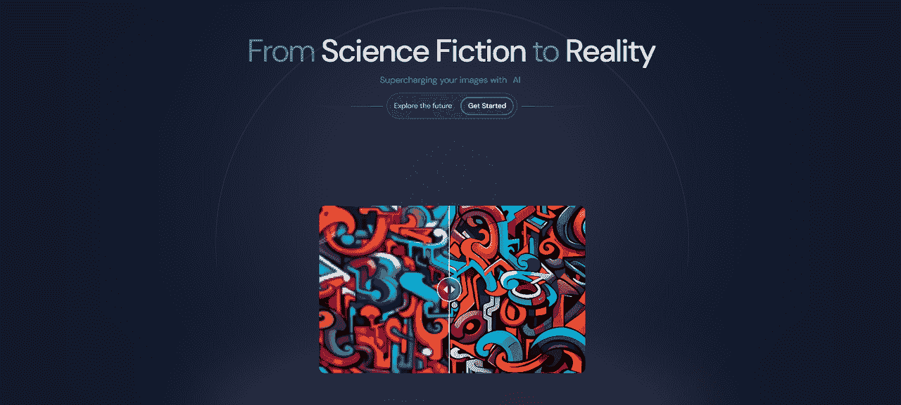
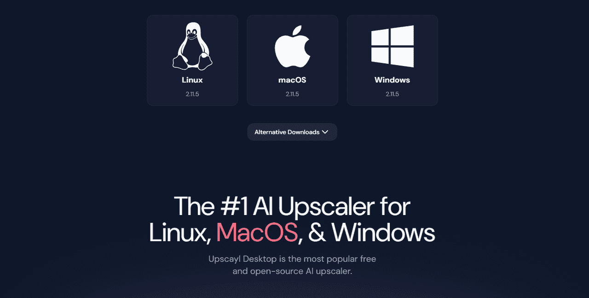
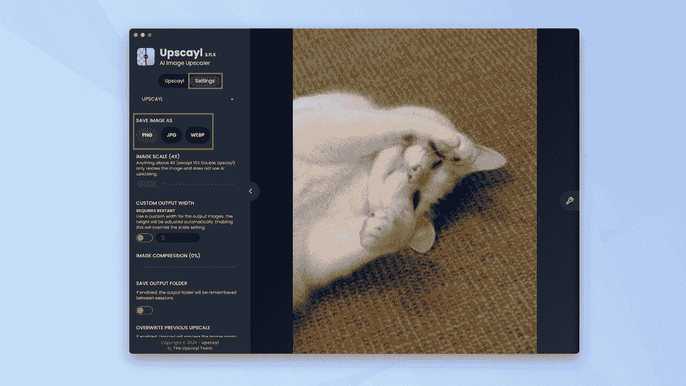
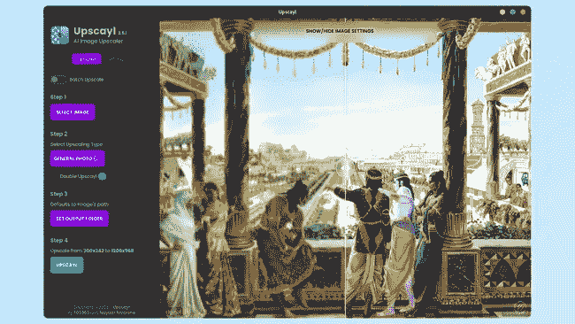

# 20240831-免费+简单+好用！这款AI神器让你的照片秒变高清

> 来源：[https://aigcreative.feishu.cn/docx/KcA4diK0goIisAxfFVdcMm4Snge](https://aigcreative.feishu.cn/docx/KcA4diK0goIisAxfFVdcMm4Snge)

你有没有遇到过这种情况：

一张珍贵的老照片，放大后却模糊得让人心烦？

或者是下载了一张好看的图片，结果分辨率低得简直惨不忍睹？

现在有一个非常简单的方法，可以让这些问题迎刃而解——

Upscayl，一个免费的AI图像放大工具。近半年，我自己也一直在用，真心好用，推荐。

**Upscayl：**

**小工具，大能量**

先上下载链接：https://upscayl.org/

Upscayl 是一款开源软件，不论你是 Windows、MacOS 还是 Linux 用户，都可以轻松下载并使用它。这款工具的特别之处在于，它并不是简单地放大图片尺寸，而是通过 AI 技术，智能地为图片增加细节和分辨率，最终呈现出更清晰、更锐利的图像效果。

虽然目前 Upscayl 只能离线使用，但它的开发者们已经在计划推出云版本，所以不久之后你可能就能在浏览器中轻松操作。而现在，下载并安装它，占用的存储空间也不算太大，唯一要注意的就是生成的高清图像可能会占用不少空间。

**一键操作**

快捷方便

使用 Upscayl 放大图像非常简单。首先，你只需选择要放大的图片，可以是 PNG、JPG、JPEG 或者 WEBP 格式。如果你有多张图片，Upscayl 还支持批量处理，省去了你一个个上传的麻烦。

接下来就是关键的放大步骤。Upscayl 提供了六种不同的 AI 模型供你选择，每种模型都有不同的特点和适用场景，比如你可以选择真实场景放大模型，或者超高清模型等。如果你不确定哪种效果最好，不妨一个个试试，找出最适合的效果。

为了满足不同的需求，Upscayl 还提供了多种放大倍数选项。如果你希望图片更清晰，可以选择“二次放大”，这会让 AI 对图片进行两次处理，效果更佳。或者你可以直接通过滑块调节放大倍数，轻松达到你想要的分辨率。

**结果令人惊艳**

放大完成后，你可以将图片保存为 PNG、JPG 或 WEBP 格式，所有操作都在一个界面中完成，简单明了。更令人称道的是，Upscayl 提供了对比功能，你可以轻松滑动查看放大前后的差异，效果一目了然。

虽然 Upscayl 还在不断完善中，但它已经展现出非凡的潜力。它的出现，无疑让图像处理变得更加简单、高效。

**不仅仅是放大，**

**更多AI图像编辑工具等你探索**

Upscayl 并不是唯一的 AI 图像编辑工具，市面上还有许多其他有趣的工具。

例如，Midjourney 最近推出了新的 AI 图像编辑器，不仅功能强大，而且操作简便。

Grok 通过 Flux 技术也能够生成令人惊艳的图像。

甚至 Google Pixel 9 的 Reimagine AI 功能也让手机照片编辑变得更加智能。

AI 技术正在以前所未有的方式改变我们的生活，尤其是在图像处理领域，各种有趣的应用层出不穷。

Upscayl 只是其中的一角，未来还会有更多令人惊叹的创新，等着我们去发现和体验。

<https://aigcreative.feishu.cn/sync/K4Gvd9vUQsy9Oubwqaeclu0Fnbg>