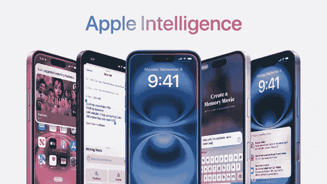
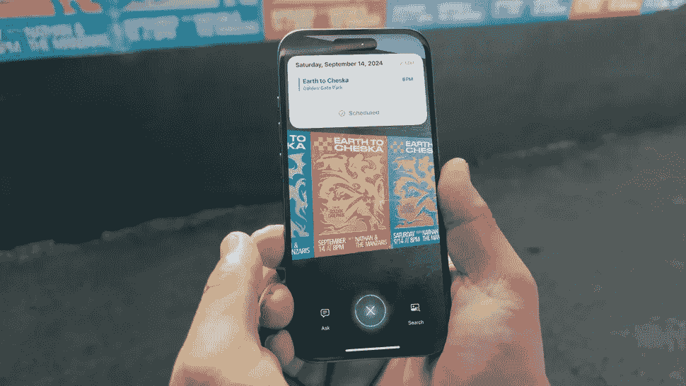
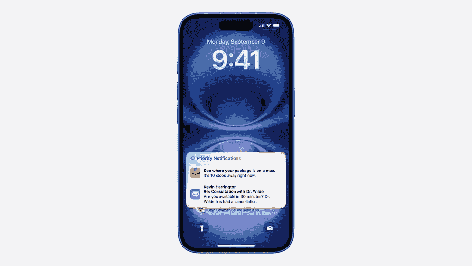
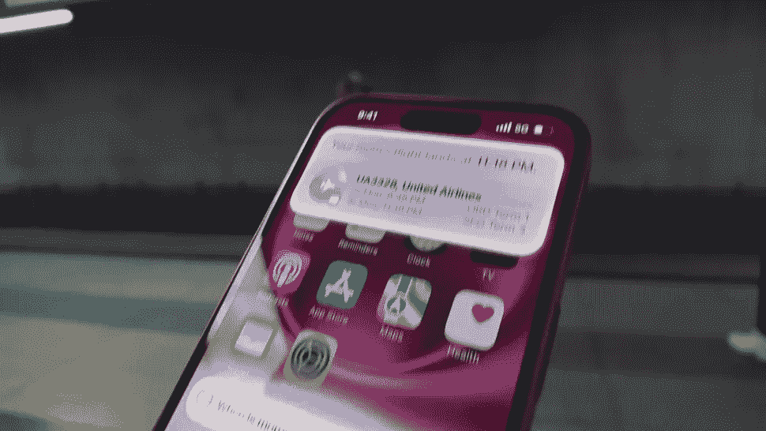

# 20240910-iPhone 16彻底颠覆AI体验，苹果这五大智能功能让你惊叹！

> 来源：[https://aigcreative.feishu.cn/docx/Docgdgn4ooylzNxnGr5cTWAznPc](https://aigcreative.feishu.cn/docx/Docgdgn4ooylzNxnGr5cTWAznPc)

苹果再次掀起AI科技热潮！

在苹果刚刚结束的“Glowtime”新品发布会上，iPhone 16系列重磅亮相，其中包括几项重点更新的AI智能功能，重新定义了手机与AI的结合。

此次，苹果不只是为手机硬件提升性能，而是全面深度的融合了Apple Intelligence（苹果智能），让AI成为用户日常生活的无形助手。以下五大智能亮点，将让iPhone 16在AI智能手机市场上暂时领先。

### 1. Apple Visual Intelligence：拍照不再只是拍照

iPhone 16的**Apple Visual Intelligence**功能让相机成为无所不能的工具。当你在街头看到一个活动海报，随手一拍，手机便自动识别并将活动信息添加到你的日历中。

不仅如此，当你拍下陌生的狗狗，iPhone还可以立刻告诉你这是什么品种。这项技术利用AI来分析图像，不仅能识别文本，还能根据照片中的位置信息和对象给出精准的信息反馈。

虽然这种功能听起来有点像谷歌的Google Lens，但苹果这次做得更为全面，甚至可以将图像与外部搜索工具，如Google Search或ChatGPT结合，提供更详细的结果。

### 2. 智能写作工具：不再为措辞烦恼

苹果的智能写作工具这次深度集成到iOS 18系统中，无论你是在聊天软件、邮件中，还是使用网页浏览器，只要涉及文本输入，AI都能帮你搞定。

从简简单单的语法修正，到复杂的段落改写，甚至能根据特定受众需求重写文章。需要写一份逻辑清晰的会议记录？AI可以将冗长的内容自动转化为简洁的要点清单。

### 3. Image Playground：Siri帮你做表情包

这次iPhone 16还带来了一个新应用——**Image Playground**。通过这个应用，你可以利用AI生成你自己或朋友的图像，甚至是个性化表情包。你只需对Siri说出自己的想法，Siri就能帮你生成图片。

不仅如此，这项AI功能还能帮你从照片库里快速找到特定的图片。比如，你记得某次聚会有人穿过一条特别的裙子，描述一下颜色或款式，AI马上帮你找到相关照片。

这不仅适用于图片，还能用于视频片段的精准定位。

### 4. 通知智能管理：内容筛选变得更轻松

每个人每天都会收到海量通知和邮件，有时候重要的信息淹没在大量垃圾消息中。

这次苹果推出的**智能通知管理功能**，将通过AI自动为你生成每条消息的摘要，让你在不打开全文的情况下就能知道内容重点。

更重要的是，AI还会根据紧急程度自动排列通知顺序，确保你不会错过最重要的信息。

### 5、Siri升级：AI助手进化成会话高手

Siri终于迎来了令人期待已久的大升级。

此次的Siri不再是一个简单的语音助手，而是能进行流畅自然对话的AI帮手。

以前Siri的交互更像是执行单个指令，现在，你可以像跟朋友聊天一样随时打断、改变话题，Siri都能无缝衔接理解你的需求。

通过引入大语言模型，Siri不仅能处理复杂的指令，还能深入理解iPhone系统和各类应用，成为真正的智能助理。

### iPhone 16再一次引领AI潮流

苹果在iPhone 16上推出的这些智能功能，不仅提升了用户的日常使用体验，还标志着手机智能化的进一步发展。Apple Intelligence的深度融合让iPhone 16不再只是一个工具，而是变成了一个能够主动帮助用户解决问题、提供建议的生活助手。

未来手机的智能程度将如何继续突破？

iPhone 16已经给我们打开了一扇未来之窗。

准备好迎接这一切了吗？

不是，

是准备好RMB了吗？

<https://aigcreative.feishu.cn/sync/K4Gvd9vUQsy9Oubwqaeclu0Fnbg>