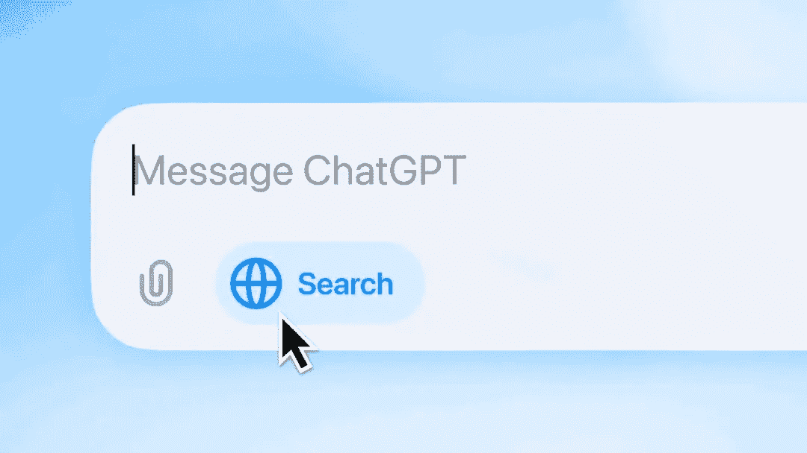
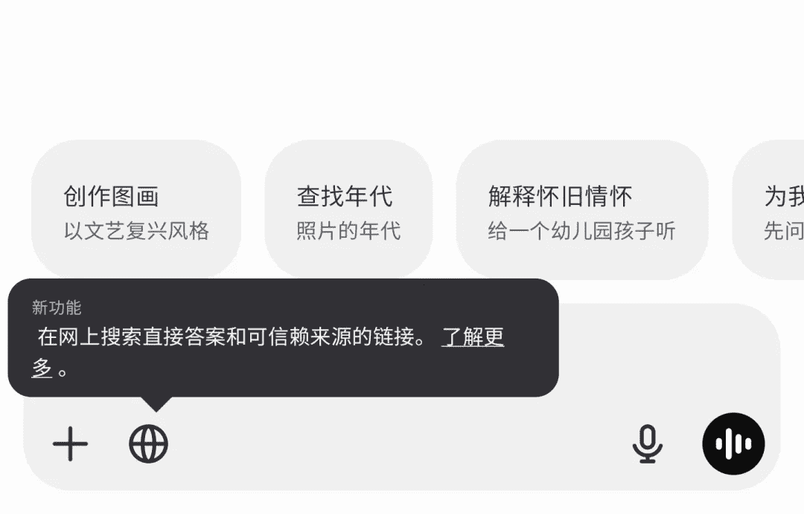
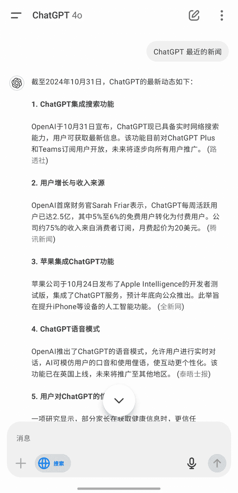
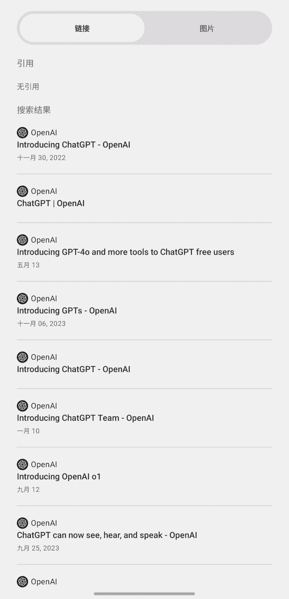
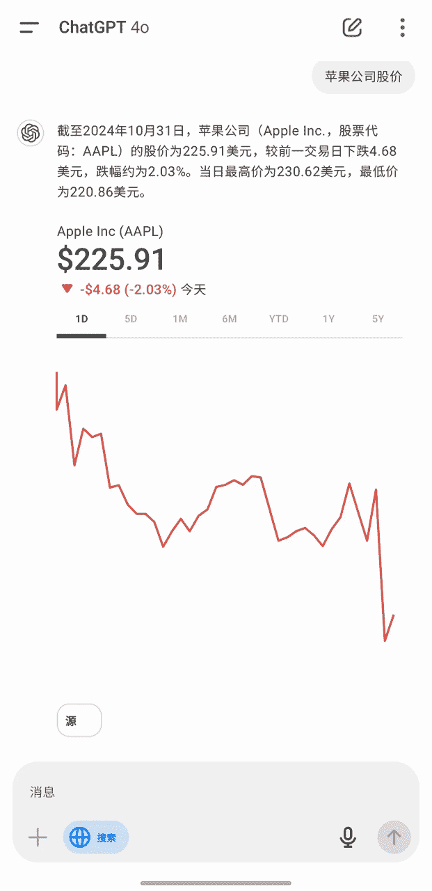
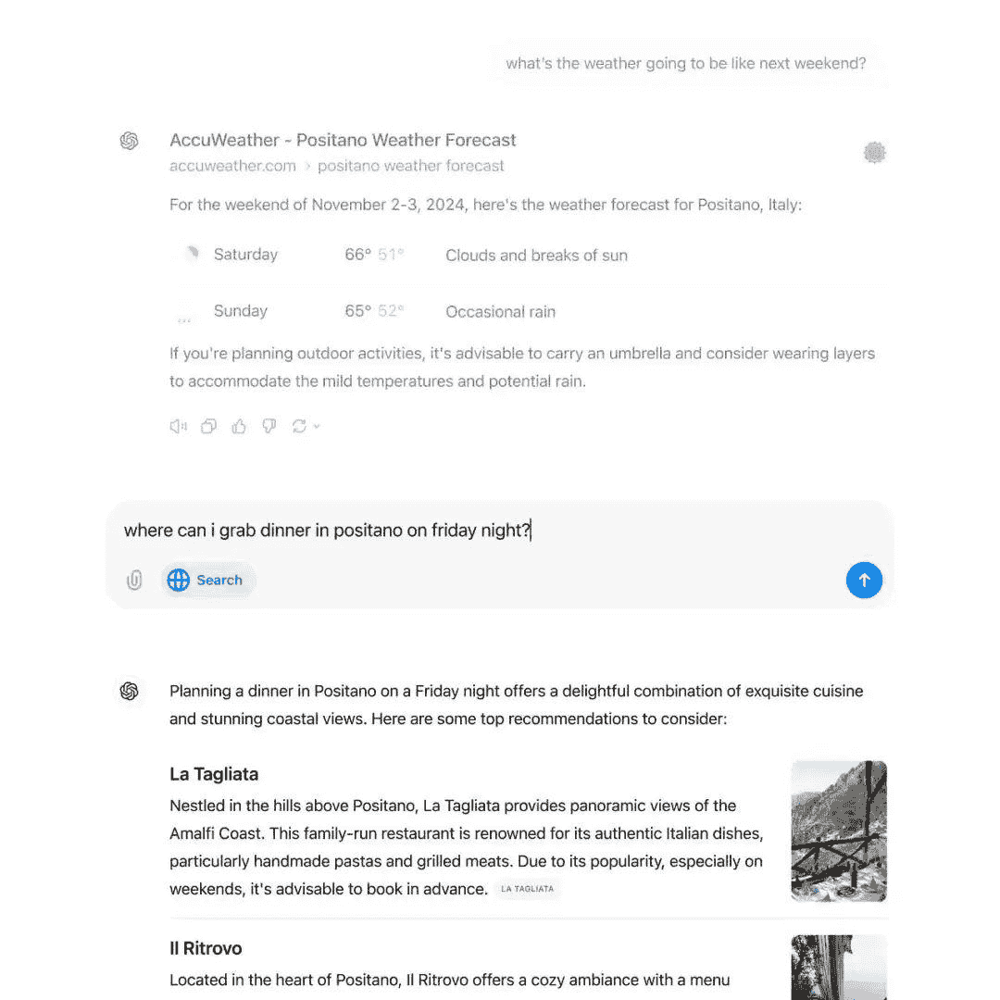
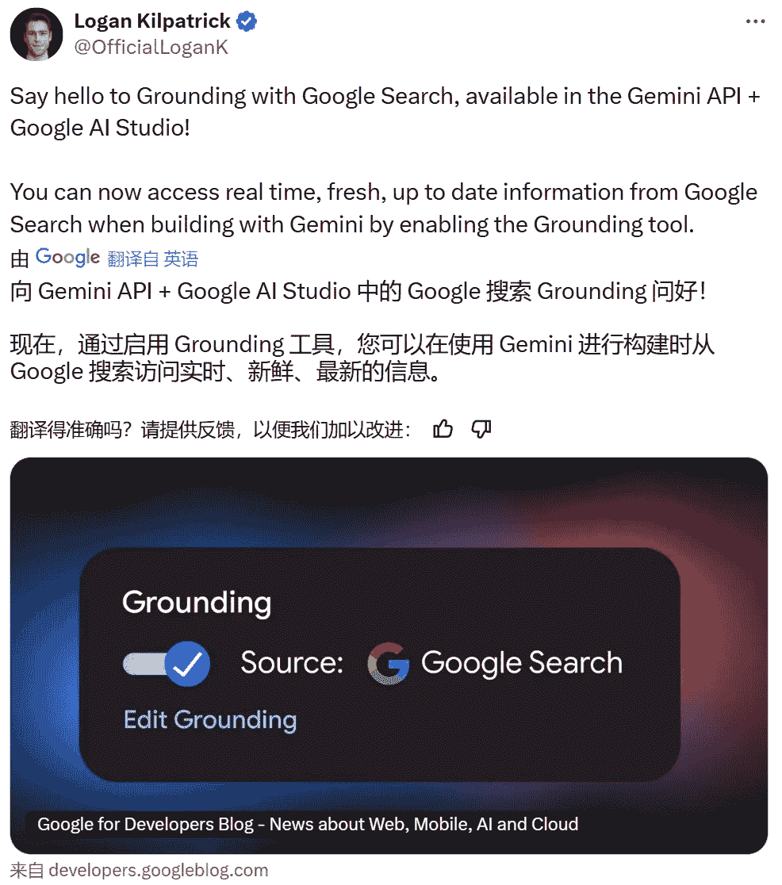

# 20241101-ChatGPT正式发布实时搜索，谷歌5分钟反击，AI搜索大战爆发

> 来源：[https://aigcreative.feishu.cn/docx/UW2AdbtGpoz6CFxvekacFQF8nYS](https://aigcreative.feishu.cn/docx/UW2AdbtGpoz6CFxvekacFQF8nYS)

> 🔗 原文链接： h[ttps://mp.weixin.q](https://mp.weixin.qq.com/s/howiEPv6FlDlb3oJm7FSDw)q.com/s/howiEPv6...

刚刚，ChatGPT升级了一项全新的“实时搜索”功能。

套个娃，搜索一下ChatGPT自己：

**还能显示内容源：**

现在，ChatGPT不再局限于既定的知识范围，而是可以连接互联网获取最新的信息，包括即时新闻、股票行情、天气、体育赛事等，变成一位“万能答案”提供者。

# **真正的“信息超市”**，ChatGPT的搜索到底有多强？

OpenAI在ChatGPT中新增的实时搜索功能，极大地拓展了这个AI助手的应用场景和智能化程度。

不同于过去受限于数据截止时间的AI回答，现在的ChatGPT会根据用户的问题判断是否需要进行网络搜索，并自动获取最实时、最准确的答案。

这意味着ChatGPT在回复你的问题时，已经变得更像是一位“活生生”的信息超市：你随时提问，它随时更新信息并回答。

目前，这项搜索功能向ChatGPT Plus和Team用户开放，并会逐步推广给更多用户，包括企业用户和教育用户。可以想象，未来的AI助手或许将成为日常信息获取的重要渠道。

# **ChatGPT不只是回答问题，****还会“看天气”“报股市”**

这项功能并不仅仅是简单地补充信息，还进一步提升了ChatGPT的体验和交互感。

通过与多家数据提供商的合作，ChatGPT可以直接展示天气预报、实时股票价格和新闻简报等内容，并以清晰的视觉呈现形式带给用户一目了然的信息体验。这让ChatGPT的回复不仅有了信息深度，也变得更加生动。

对于那些需要实时数据的用户，比如投资者、运动迷、新闻爱好者，这无疑是个振奋人心的消息。以往需要打开多个网站查找信息的情况，可能会随着ChatGPT的实时搜索功能逐渐被简化——一问即得，一手掌握。

# **未来的全能助手，****正在走向无缝衔接**

随着ChatGPT不断完善，这款AI助手正向着“全能助手”的目标迈进。从OpenAI的计划来看，实时搜索将逐步向更多用户开放，未来甚至可能成为免费的核心功能。

这一举措不仅让人们对AI助手的认知变得更加贴近现实，也或许暗示了科技巨头们在争夺“互联网入口”上的新战场。

在信息爆炸的当下，如何快速获取准确、丰富的信息是所有用户的共同需求。

而ChatGPT的这项新功能，无疑为用户提供了更高效、更便捷的选择。

# **谷歌五分钟****就反击了**

OpenAI 推出 AI 搜索业务显然触及到了搜索巨头谷歌的核心利益。

不知是否是出于巧合，几乎就在 OpenAI 宣布推出 ChatGPT 搜索的同时，谷歌也宣布了自家的 AI 搜索功能。

谷歌搜索新推出的 Grounding 功能已向 Gemini API 和 Google AI Studio 用户提供，让他们可以在使用 Gemini 时从谷歌搜索获取实时、新鲜、最新的信息。

这场 AI 搜索大战才刚刚开始。

**拭目以待。**

<https://aigcreative.feishu.cn/sync/K4Gvd9vUQsy9Oubwqaeclu0Fnbg>