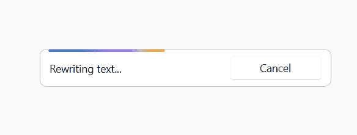
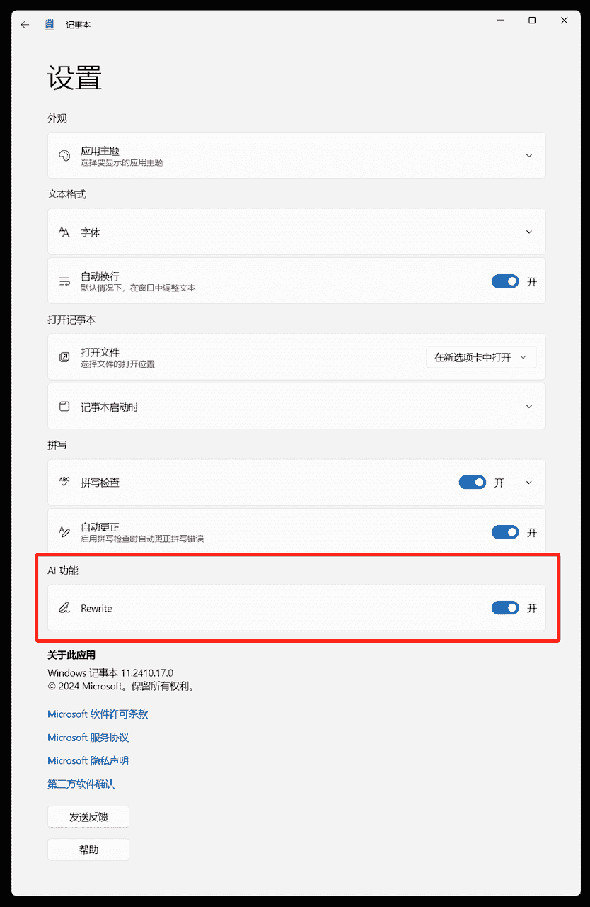
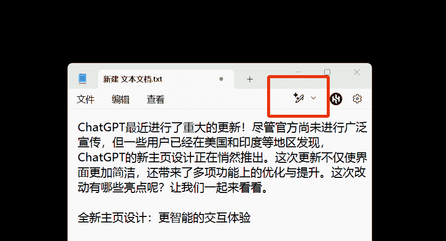
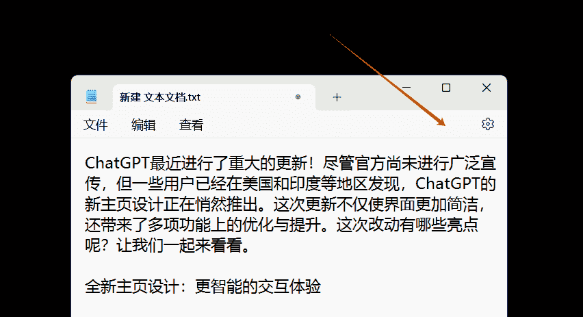
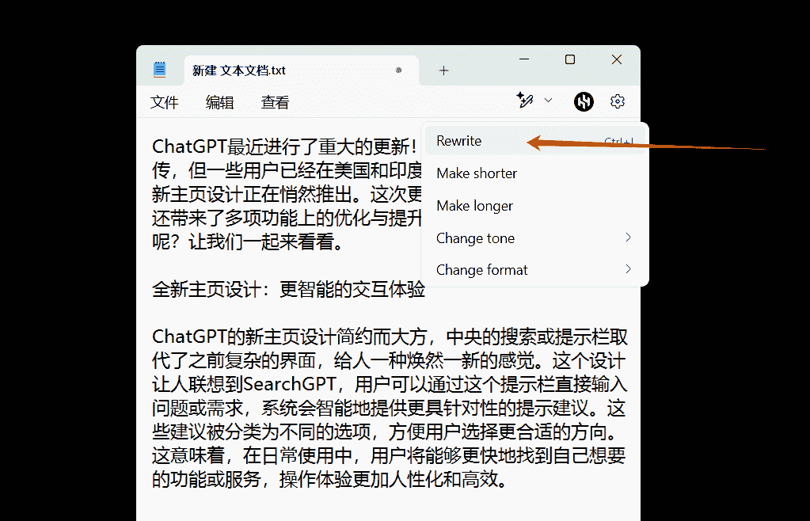
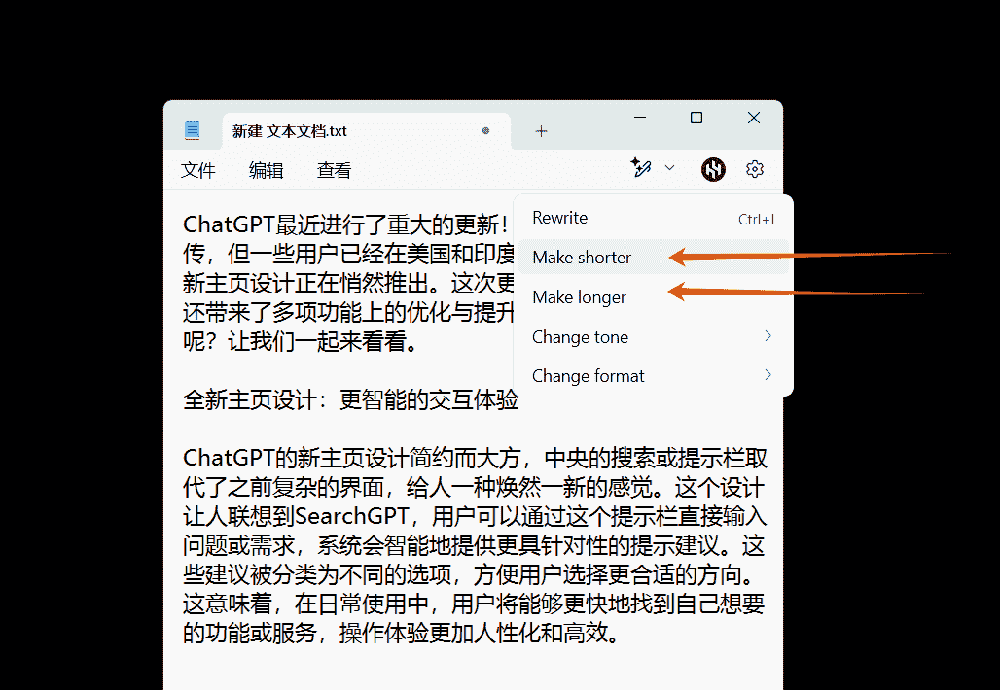
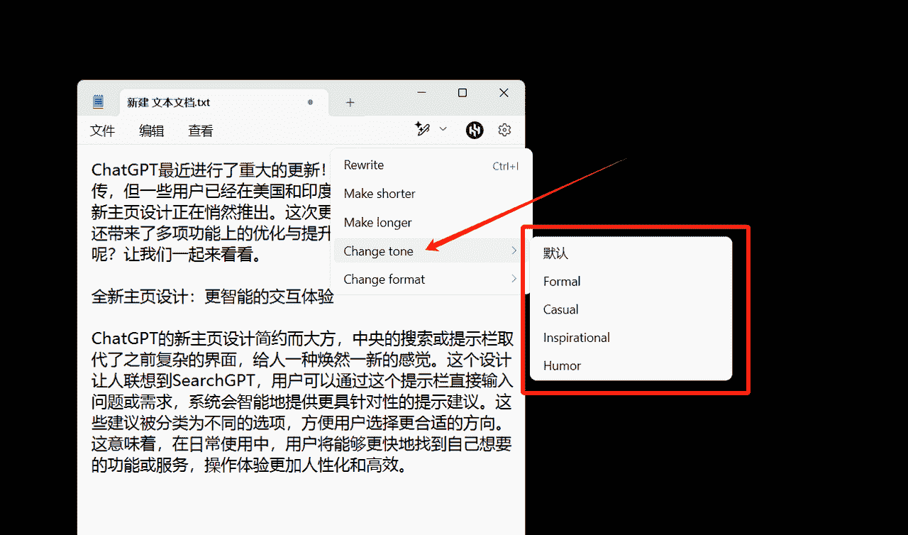
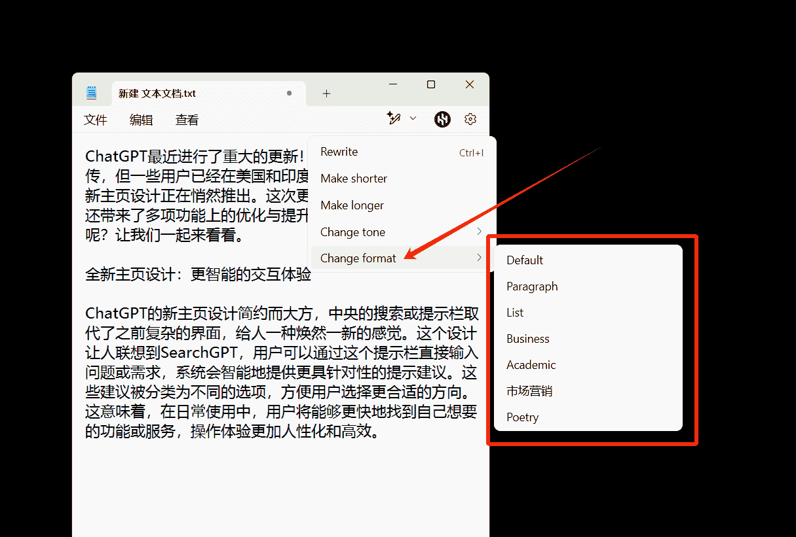

# 20241116-Windows记事本竟然也有AI能力了！小工具也有创造力

> 来源：[https://aigcreative.feishu.cn/docx/CgLhdJ3kVoLEbLxqqJocICw3nOf](https://aigcreative.feishu.cn/docx/CgLhdJ3kVoLEbLxqqJocICw3nOf)

昨天把我的电脑系统（Windows）更新了，完了发现，系统自带的记事本，也就是常用的文本文档.txt，竟然有了AI的能力！

对于这简单、万年不变、躺平的记事本应用，竟然也被微软给安排AI了，突然间具备了AI功能——Rewrite（重写），真是出乎意料。

这一更新看似低调，却让不少网友惊呼——“黑科技就在我手边”。

更重要的是，不需要梯子，直接可以使用。

# 简单设置，一键开启

AI功能打开后，在记事本编辑区的右上方，会有一个小图标，如下：

对比关闭的情况：

# 轻量级的AI操作，用起来轻便顺手

以往大家打开记事本，无非是用来快速记点内容，编辑一些简单的文本，或者写代码时临时处理文本格式。

然而，这次更新为记事本带来了AI加持的文字处理功能，瞬间让记事本从简单工具晋级为“文本高手”。

跟其他的AI写作产品一样，记事本新增的“Rewrite”选项，可以自动改写选定的文本内容，帮助用户优化表达、调整语气。

这种“触手可及”的AI功能，不需要安装复杂的软件，直接内嵌于记事本之中，轻量且高效，让日常办公更便捷。

# 简化、延展，多样操作一键完成

AI赋能下的记事本，不仅能自动重写，还支持调整文本长度。

比如，想让内容更简洁？点击“Make shorter”（简化）就能快速浓缩信息；

觉得内容不够丰富？选择“Make longer”（延展）则能自动补充细节，让文字更加饱满；

对用户而言，这就像是配备了一位私人AI协作编辑，只需简单选择操作，就能达到其他大型付费写作产品的效果。

# 语气、格式随心而变，满足不同场景需求

更有意思的是，新的记事本AI还懂得调节文本的“语气”和“格式”。

无论是正式、随意，还是幽默、激励的语气，它都能一键切换。

不少网友表示，这一功能特别适合需要撰写各种风格文案的人，比如社交媒体小编、职场白领等。更妙的是，它还能将文本格式调整成列表、商务风格、学术风格，甚至可以生成诗意表达。

对于那些需要根据场合切换文风的用户而言，这无疑是一个贴心设计。

# 微软的“隐形黑科技”，让小工具更具创造力

这次更新虽然低调，但可以看出微软在用户体验方面下了大功夫。过去，许多人可能觉得记事本仅仅是“应急工具”，很少会花心思去关注它。

如今，微软让这款原本极其基础的软件焕发出新的活力。

用小工具做大文章，让普通用户也能享受到AI带来的效率提升。

这种贴心的设计，

简洁却不简单，

真正实现了技术与人性化的结合。