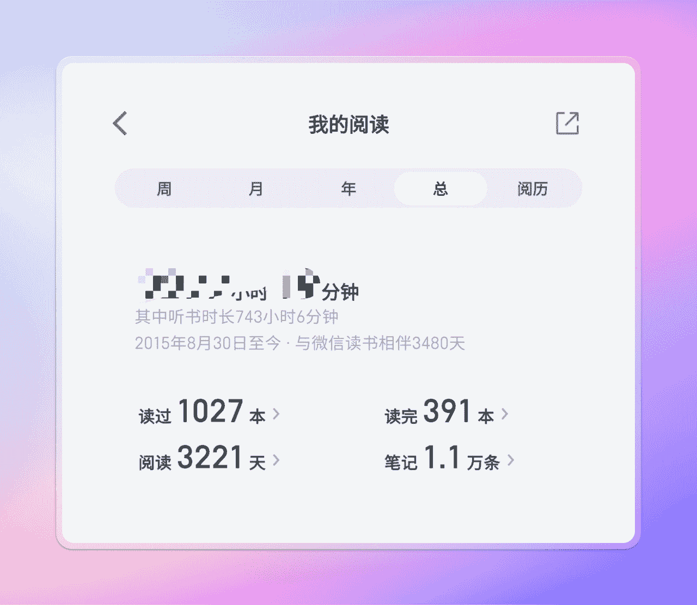
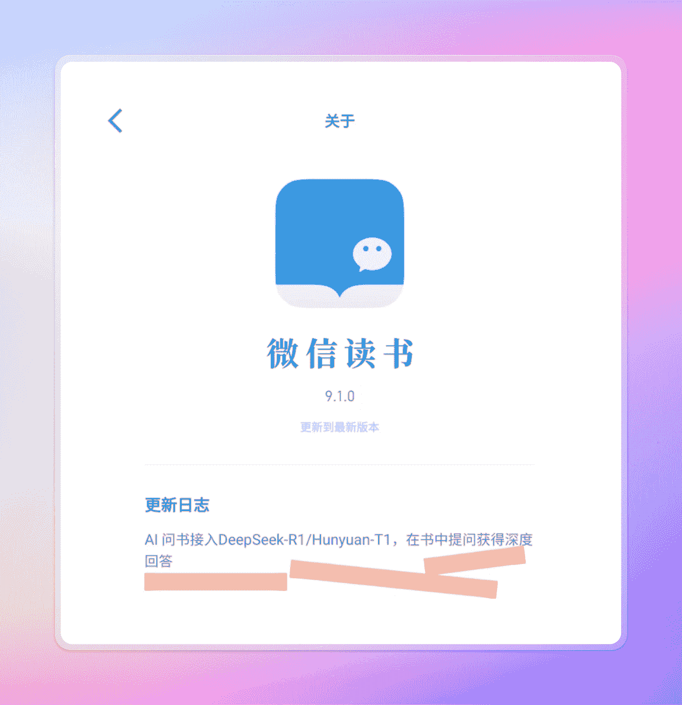
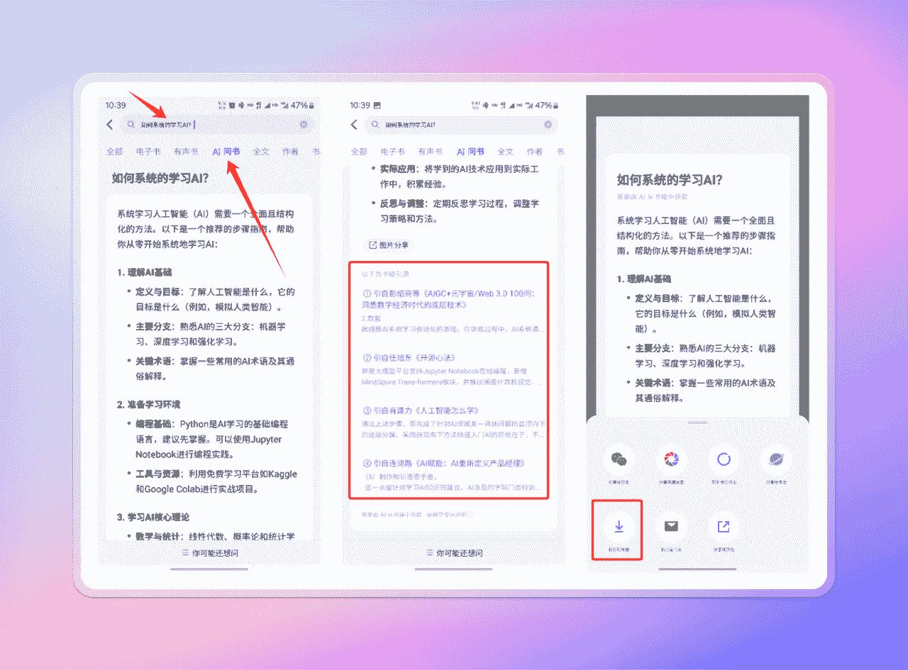
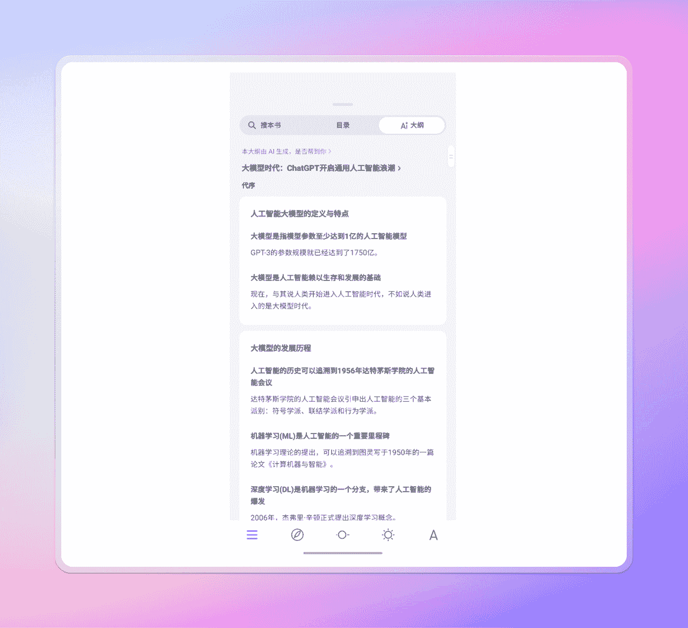
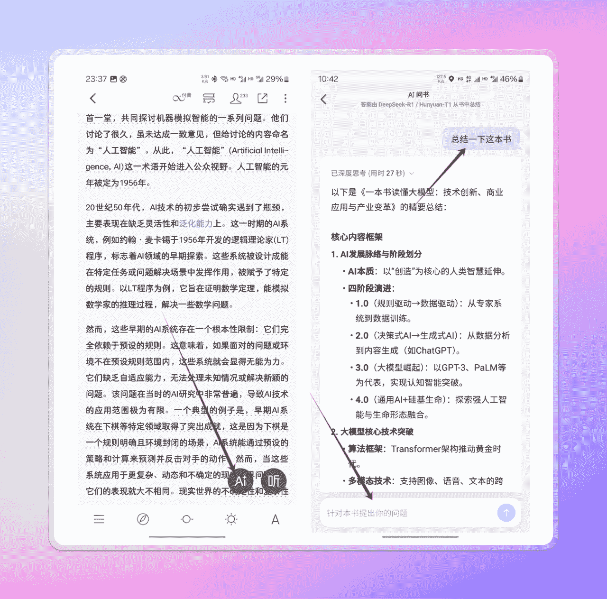
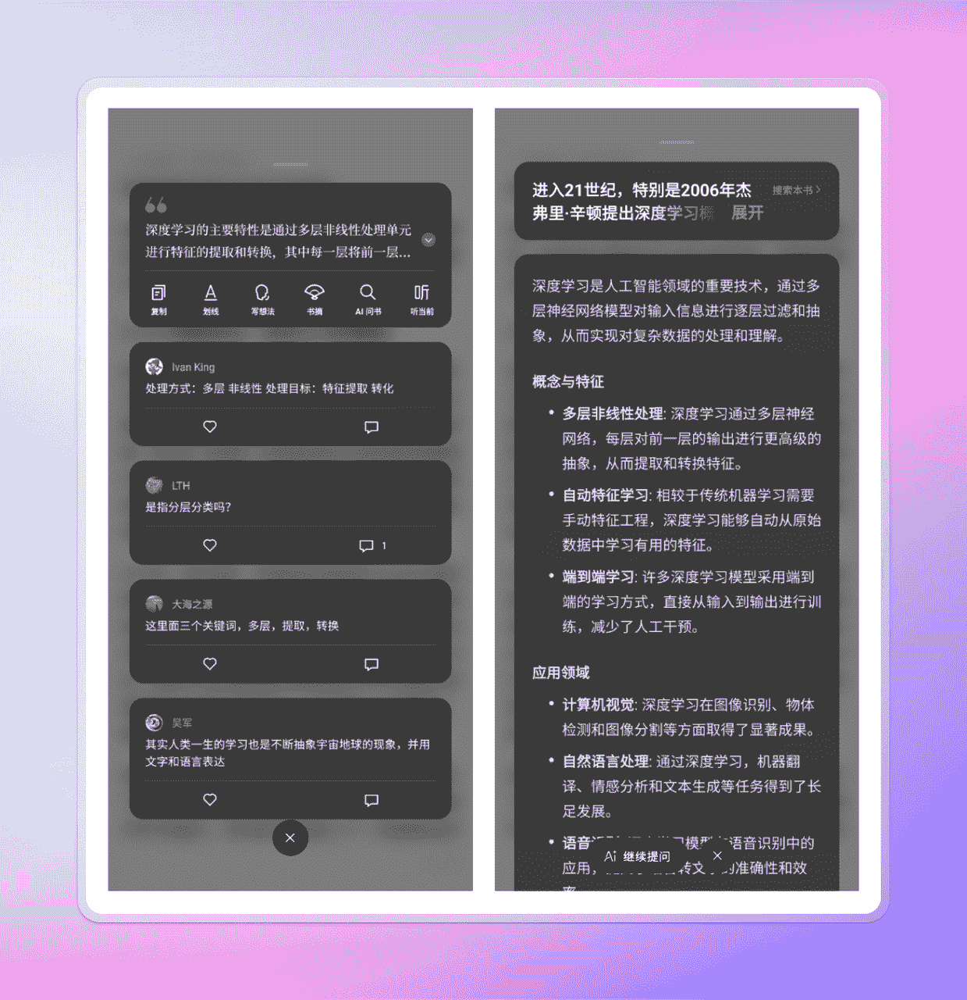

# 20250310-🛰️读书接入DeepSeek，上线「AI问书」，腾讯AI生态布局再进化

> 来源：[https://aigcreative.feishu.cn/docx/FHQ6dmdO2oeQ5fxtkAIcQ5vVnvb](https://aigcreative.feishu.cn/docx/FHQ6dmdO2oeQ5fxtkAIcQ5vVnvb)

🛰️读书一直是我最喜欢的APP，没有之一。

从发布上线开始使用到现在，一路见证着其功能、内容、生态在不断完善，可谓是将用户体验做到了极致，将电子阅读这件事做到了极致。

进入AI时代，🛰️读书APP，又能将“读书”这件事，带来什么新的体验呢？近日，🛰️读书悄然宣布接入DeepSeek，结合自家的混元大模型的能力，上线的新功能——「AI问书」，迅速成为Ai圈关注热点。

在AI加持下的🛰️读书，借助腾讯混元大模型以及DeepSeek技术，用户只需输入问题，即可获得精准的书籍内容解析、跨书籍知识关联和内容出处标注等服务。

从当前的用户反馈来看，这项功能的推出再次展现了腾讯在AI领域的前瞻性布局与强大的产品力。

## 入口在哪里？

### 入口1：首页。

在搜索框内输入你的问题后，就会出现“AI问书”的按钮，结果基于🛰️读书的书籍内容，回答有保障。回答的内容还能直接保存为图片，保存本地或者分享。

### 入口2：AI大纲。

我最喜欢的功能之一。

### 入口3：阅读页面。

### 入口2：划线。

书中的内容划线之后，

## 二、「AI问书」：更智能的阅读助手

过去，DeepSeek尽管热度持续升温，但一直存在“AI幻觉”问题，影响了其可靠性和准确性。

「AI问书」的推出，依托🛰️读书庞大的数据基础——2亿多册电子书和超过50万个👸号文章——有效解决了这一挑战。

用户提问后，AI不仅给出直接的答案，还标注清晰的书籍页码，确保信息来源可追溯。在回答时，「AI问书」还能推荐与问题相关的延伸阅读，将多个书籍的观点无缝串联。「AI问书」不仅限于电子书内容，还覆盖👸号文章和聊天记录，打造真正意义上的“随读随问”体验。

传统的🛰️读书模式下，用户主要通过阅读、划线和笔记进行知识积累，过程较为被动。而「AI问书」的出现则大幅提升了知识获取的主动性与效率。

## 三、🛰️读书的未来图景：从阅读工具到智能生态

「AI问书」不仅代表着🛰️读书功能的升级，更预示着腾讯在知识生态上的战略延展。

未来的发展趋势可能包括：

+   **社交化知识分享**：AI的解析结果可直接分享至🛰️朋友圈或社群，推动知识传播的社交化，甚至未来还可能实现多人协作标注，共建知识社区。

+   **个性化智能推荐**：结合用户阅读习惯、兴趣和聊天记录，AI有望主动推送精准匹配的书籍内容，全面升级用户的个性化阅读体验。

+   **多模态交互体验升级**：从文字问答升级到语音提问甚至AR交互（例如历史事件3D场景还原），使阅读过程更直观、更立体。

## 四、腾讯AI战略布局：构建闭环生态优势

「AI问书」的发布，进一步完善了腾讯的AI生态版图。

目前，腾讯已形成包括元宝（智能对话）、IMA知识库（办公应用）、🛰️搜索（精准信息检索）在内的全方位产品矩阵，全部接入DeepSeek技术，构筑了“提问—搜索—创作—应用”的完整AI闭环。

同时，🛰️读书拥有的海量电子书籍、👸号和视频号内容，以及🛰️独有的社交大数据，形成了其他平台难以企及的数据壁垒，有效弥补了DeepSeek在中文语料上的不足，进一步提升了腾讯大模型的准确性和可靠性。

在行业逐渐从“流量入口”向“智能入口”转变的大趋势下，腾讯凭借其庞大的社交生态与DeepSeek技术的“双引擎”布局，已然在下一代人机交互领域占据了领先优势。

<https://aigcreative.feishu.cn/sync/K4Gvd9vUQsy9Oubwqaeclu0Fnbg>

# 知识库动态