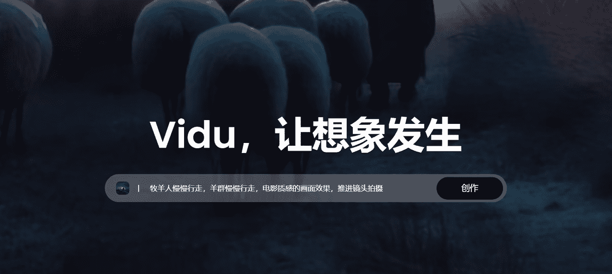
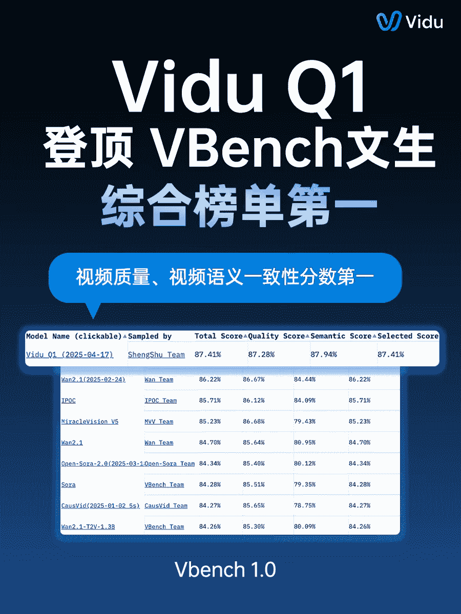
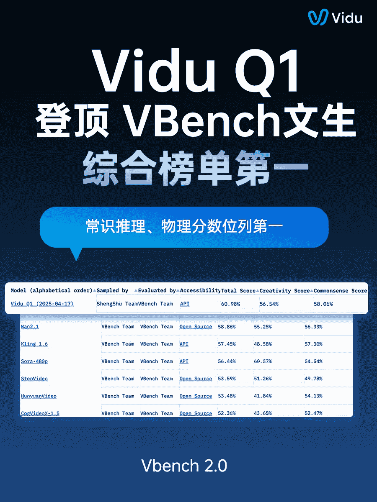
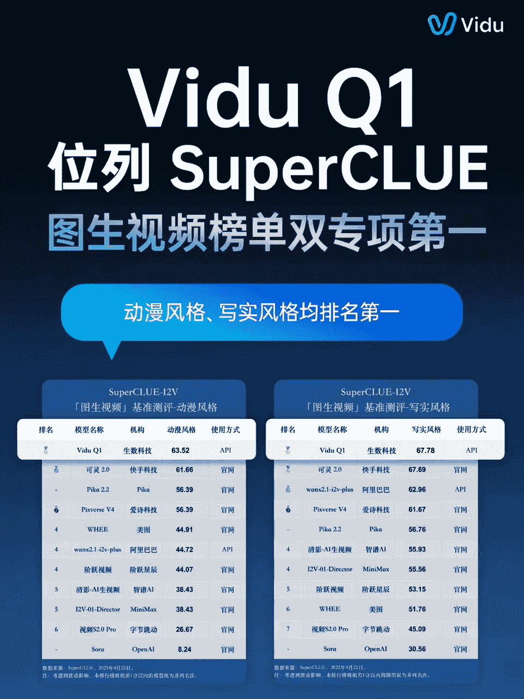

# 20240427-国产黑马Vidu Q1重塑AI高清视频赛道，飞书高效联动，成本直降90%！

> 来源：[https://aigcreative.feishu.cn/docx/JTJUdVuIOowUhPxshq8chGFbnbf](https://aigcreative.feishu.cn/docx/JTJUdVuIOowUhPxshq8chGFbnbf)

大家好，这里是**AIGC创意猎人**，我是与大家一起玩转AI的**何先森Kevin**。

要说现在AI圈什么最火？AI视频绝对是顶流！从年初Sora的“王炸”登场，到国内外各路新秀不断涌现，让人眼花缭乱。不过，光看国外“神仙打架”不过瘾，咱国产AI力量也在悄悄憋大招。

近日，由生数科技和清华大学联合研发的国产视频大模型Vidu Q1更新发布，在画质、性价比和稳定性上都来了个跨越式的大升级，甚至在最新的VBench和SuperCLUE视频大模型榜单上都拿了好几个第一！背景实力毋庸置疑。

Vidu Q1这波升级，可谓是诚意满满！精准打击了使用AI视频的内容创作者的痛点：画面不清晰，画面不连贯、贵，生成速度慢等......

光说不练假把式，实际上手跑一跑！

> 直接上网址：https://www.vidu.cn

> 或者下载手机APP: 在iOS App Store或安卓应用市场搜索“Vidu AI”。

## 首先是高清画质：

### 直上1080P，肉眼可见的提升

终于不用忍受AI视频那种“糊糊”的感觉了！

Vidu Q1主打1080p高清，提供更清晰、更稳定的视频效果，实测下来清晰度和稳定性表现相当不错，细节表现力强了很多，进步非常大，难怪敢去打榜拿第一。

为了测试Vidu Q1的潜力，设计了几个测试的静态图与`Prompt`，开始：

### 首尾帧：业界领先，转场更自然！

Vidu Q1此次重点优化了首尾帧的生成逻辑，语义理解和一致性表现出色，减少失帧，实测下来视频的连贯性和对`Prompt`的遵循度确实更好了。

> `Prompt`：电影级画面，镜头往后拉。

[vidu-video-2749904781719434.mp4](https://internal-api-drive-stream.feishu.cn/space/api/box/stream/download/all/TqIhbfLVTo4KolxTvihcUVpon6f)

> 无提示词。（也能出非常好的效果）

[vidu-video-2749944234782113.mp4](https://internal-api-drive-stream.feishu.cn/space/api/box/stream/download/all/IHrMbEVgxooSFCxX1M2c0g4nn2c)

> 无提示词。（也能出非常好的效果）

[vidu-video-2749943750806927.mp4](https://internal-api-drive-stream.feishu.cn/space/api/box/stream/download/all/A8H7btLIToQ5cTxh0lmcO4Qpn7g)

> `Prompt`：无提示词。

[vidu-video-2750592290664778.mp4](https://internal-api-drive-stream.feishu.cn/space/api/box/stream/download/all/L0Pob2KPNosGOOxSr0Hc2WwcnWd)

> `Prompt`：颜料粉末爆炸。

[vidu-video-2750598766539046.mp4](https://internal-api-drive-stream.feishu.cn/space/api/box/stream/download/all/UxrqbV4Aiog33axrCNfcz9otnGg)

> `Prompt`：手机样机的软件动效展示，依次出现手机软件的界面，界面上的元素也需要有动效。

[vidu-video-2749873027542495.mp4](https://internal-api-drive-stream.feishu.cn/space/api/box/stream/download/all/PuFXbZ7qZoJzeHxwrMHcbCzan8c)

### 图生视频：电影级的画面效果

关于图生视频的效果，我只想说：画面太稳、画质太清晰了！

> `Prompt`：保时捷汽车商业广告，镜头缓慢拉镜，一个穿黑衣服的男子从车背后走出。

[vidu-video-2749884381925991.mp4](https://internal-api-drive-stream.feishu.cn/space/api/box/stream/download/all/RTSVb9C0ooAahFx4DiAc58bPnBb)

> `Prompt`：废旧仓库，冷暖色等，男人往前走，镜头拉远

[vidu-video-2749931299694946.mp4](https://internal-api-drive-stream.feishu.cn/space/api/box/stream/download/all/RuXebXyZYo2tqcxo12dcdrjznTe)

> `Prompt`：镜头拉远，下着雨，雨落在女孩身上。

[vidu-video-2749929021269795.mp4](https://internal-api-drive-stream.feishu.cn/space/api/box/stream/download/all/SXPwbkAYOoN3kKxgHHuchl68n0b)

> `Prompt`：无提示词。

[vidu-video-2749942566428811.mp4](https://internal-api-drive-stream.feishu.cn/space/api/box/stream/download/all/VQY6bqTPQoQmb7xFCZ8cugqXnvh)

> `Prompt`：苹果公司品牌logo生产线，镜头缓慢拉近，各机械臂正在工作（喷漆、风干）

[vidu-video-2749627975956949.mp4](https://internal-api-drive-stream.feishu.cn/space/api/box/stream/download/all/ETtVbpRpJoX20Mxh8xxcz3psnbg)

### 文生视频：色彩、运镜表现力丰富

> `Prompt`: 魔法森林深处，一个由各种糖果搭建的小屋，屋顶是巧克力威化，墙壁是彩色软糖，烟囱里冒出棉花糖做的烟雾，一个姜饼小人从门口探出头来。童话绘本风格。

[vidu-video-2749947699870727.mp4](https://internal-api-drive-stream.feishu.cn/space/api/box/stream/download/all/QUh4bhyQyop1SuxGjWTcAgmdn4b)

> `Prompt`: Drone view of waves crashing against the rugged cliffs along Big Sur’s garay point beach. The crashing blue waters create white-tipped waves, while the golden light of the setting sun illuminates the rocky shore. A small island with a lighthouse sits in the distance, and green shrubbery covers the cliff’s edge. The steep drop from the road down to the beach is a dramatic feat, with the cliff’s edges jutting out over the sea. This is a view that captures the raw beauty of the coast and the rugged landscape of the Pacific Coast Highway.

[vidu-video-2749883310225637.mp4](https://internal-api-drive-stream.feishu.cn/space/api/box/stream/download/all/ICKVbqzUsoZNCbxpPW5cLZIsnDd)

> `Prompt`: 中国水墨画风格：一条墨色蛟龙在翻滚的云海中穿梭，时隐时现，背景是简笔勾勒的巍峨山峦，雨丝飘落。

[vidu-video-2749947843486791.mp4](https://internal-api-drive-stream.feishu.cn/space/api/box/stream/download/all/FHpUbUcXooNcM2xcLGbcb9CXnwd)

> `Prompt`: 动态跟踪镜头：在明亮晴朗的天空下，宝马X5在金色沙丘中疾驰，扬起沙尘；镜头从广角建立场景开始，平滑地拉近，捕捉越野的力量感和车型的流线之美。（灰尘、风向的物理呈现真的好）

[vidu-video-2749884882844153.mp4](https://internal-api-drive-stream.feishu.cn/space/api/box/stream/download/all/MHU2bLNh1oQBb9xcML6cdjPhngg)

### 动漫风格：画面稳定，更“丝滑”

对于喜欢二次元创作的朋友，Vidu Q1的动漫效果在动态过渡和运动的连贯性保持充分的一致。

> `Prompt`：一只粉色的鲸鱼漂浮在空中，正在煽动者翅膀，云轻微飘动。

[vidu-video-2749980536350293.mp4](https://internal-api-drive-stream.feishu.cn/space/api/box/stream/download/all/Ypvhbu0Apofsq7xnfQ0cKhmlnUc)

### AI音效：Vidu还能给你配音效

同时，还上线了“AI音效”功能，能根据文字描述生成匹配的音效。

还有一点特别牛，可精准控制每段音效的长短区间，精准设置每段音频出现的时间点，支持多段音效叠加，挺方便的！比如雨声、脚步声等，能快速给视频增加氛围感。

### 小结：

一轮测试下来，我对Vidu Q1的印象非常深刻，优点太耀眼：1080p高清画质大幅提升创作上限；生成效果稳定可靠，返工率大幅降低；同时支持写实、动漫、国风等多种风格，理解能力全面。

## 进阶玩法：

### 当Vidu遇上飞书，效率起飞！

就在我还在感叹Vidu Q1本身有多好用时，又发现了一个“王炸”级的用法：飞书竟然深度集成了Vidu！

这意味着你可以在飞书多维表格里，直接通过AI字段调用Vidu的能力，一键就能把表格里的文字、甚至图片直接生成视频！根本不需要自己去搞复杂的API对接。

你可能存在这个使用场景：你在飞书表格里管理着一批商品信息，包含名称、描述、图片。

现在，你只需要在表格里配置好Vidu AI字段，点一下按钮，就能批量生成对应的商品展示视频！

这里有一篇来自@阿真的喂饭级使用教程《https://mp.weixin.qq.com/s/lFVneUWI7Us_1tqAxzysKA》，可以点击查看学习。

这对于电商、市场营销等需要大量视频内容的场景来说，简直是效率神器！它直接打通了从创意构思、内容管理到视频生成、发布的全流程工作流。这波“办公+创作”的组合拳。

## 价格“卷”出新高度：

### 每秒仅需几毛钱！

Vidu Q1在价格策略上展现出极致性价比优势，其1080p视频生成成本低至每秒几毛钱（标准订阅下生成1条视频仅消耗30积分，成本不足3元）。使用API的话，更便宜！

在国内竞品中，生成720p视频单条成本高达10元，分辨率与性价比均落后；面对海外市场，Sora和谷歌Veo2生成5秒1080p视频分别需30+元和20元，而Vidu Q1成本仅为行业均价的十分之一。

Vidu通过慈善级定价策略，大幅降低创作使用门槛，成为AI视频生成领域的性价比标杆。

## 福利：

### 错峰生成模式，尽情免费薅！

如果你手上的项目不是很急，打开这个按钮，就可以享受非高峰时段的免费视频生成，简直不要太良心！

启用后，在服务器高峰时段提交的任务将在需求减少时自动处理。

如果服务器已经处于非高峰状态，视频将立即生成，并且0积分消耗，免费薅羊毛。

## 谁该立刻试试Vidu Q1？

在我看来，无论你是：

+   追求效率的内容创作者/自媒体人： 低成本、高效率地产出视频，Vidu Q1是你的不二之选。

+   需要可视化的设计师/艺术家： 快速将灵感转化为动态画面。

+   电商/市场营销人员： 借助Vidu+飞书，搭建自动化视频内容生产线。

+ 或者仅仅是对AI充满好奇的普通用户：Vidu Q1极低的门槛让你轻松体验前沿的AI视频工具。

跟其他AI视频工具差不多，Vidu Q1现在非常容易上手：

1. 直接访问官网: https://www.vidu.cn
1. 下载手机APP: 在iOS App Store或安卓应用市场搜索“Vidu AI”。
1. 飞书用户: 在你的多维表格里找到并添加“Vidu AI”字段，开启高效创作模式！

用Vidu Q1去释放你的创造力吧！

从1080P高清画质到每秒几毛钱的慈善级定价，在深度体验完Vidu Q1后，我可以说，Vidu Q1不仅在技术上交出了一份亮眼的答卷，更在价格和易用性上展现了极大的诚意，尤其与飞书的深度结合，更是打开了AI视频融入工作流的新想象空间。

当创意不再受制于渲染成本，当灵感能通过多维表格秒级转化为动态影像，这场由清华大学与生数科技引领的AI视频革命，正在为每个普通人插上影视级创作的翅膀。

AI视频创作的春天，这次真的来了！

<https://aigcreative.feishu.cn/sync/K4Gvd9vUQsy9Oubwqaeclu0Fnbg>

# 知识库动态
