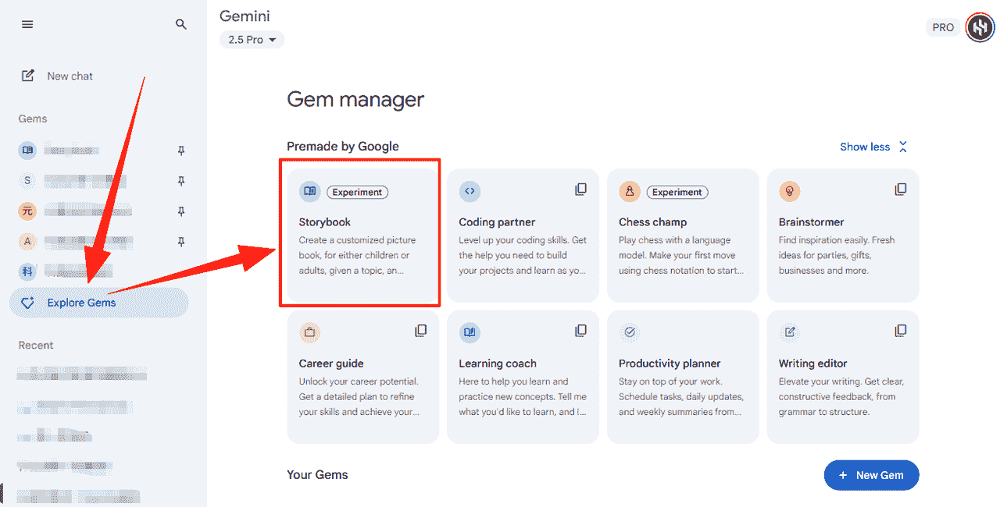
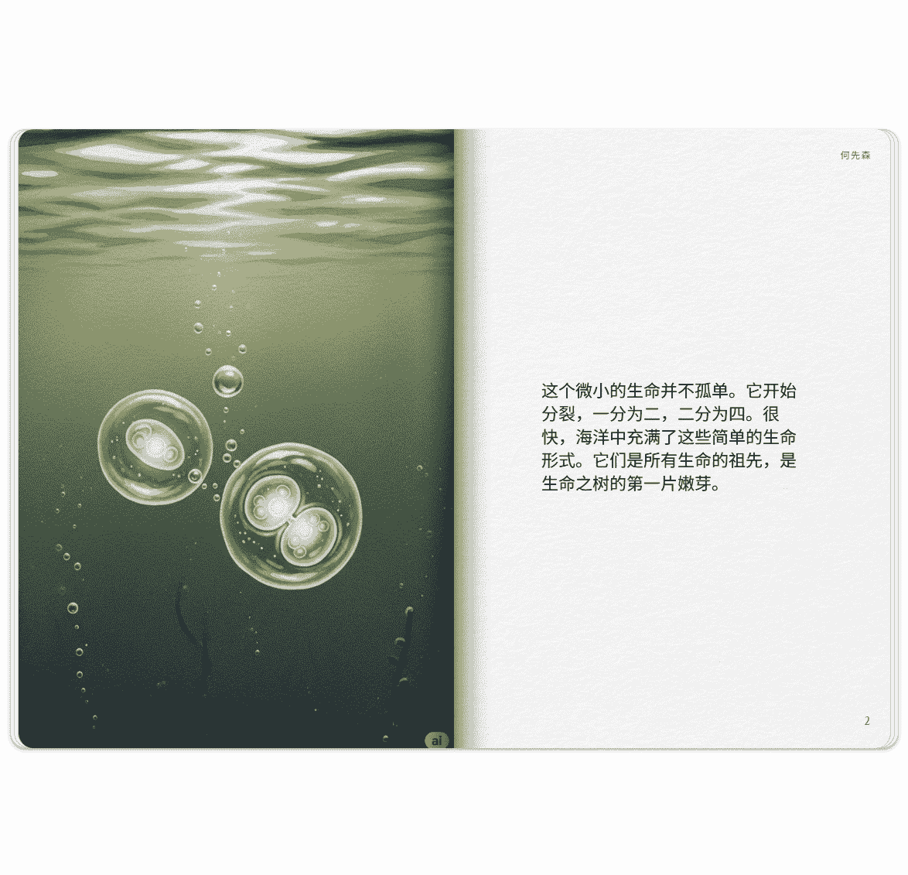

# 20250810-刚刚，这个行业的护城河，被AI推平了

> 来源：[https://aigcreative.feishu.cn/docx/EZkldLthWoZRg4xUXICcU7DonAt](https://aigcreative.feishu.cn/docx/EZkldLthWoZRg4xUXICcU7DonAt)

近日，谷歌在其核心AI模型Gemini应用中上新了一项重磅的功能——Storybook。

Storybook在Google的大模型应用Gemini网页版中，以Gems的形式存在（类似于GPTs），

链接直达：https://gemini.google.com/gem/storybook

> 比如：“生命的进化过程”

> 比如：“什么是第一性原理？”

该功能凭借其强大的内容生成能力，瞬间引发了广泛关注，并可能对儿童内容产业的现有格局构成颠覆性挑战。

这项新功能的核心在于：它能够将用户输入的任意一句话文本提示（Prompt），在极短时间内转化为一本图文并茂、配有旁白朗读的有声故事绘本。

非常的震撼，对于应用，也非常有想象空间。

#### **从概念到画面，一分钟的事**

据以上案例的功能效果来看，Gemini的这项能力已经相当成熟。用户只需下达一个指令，便能启动一场高效的自动化创意流程。

例如，当输入一个指令，要求以“宫崎骏动画风格”解释一个相对复杂的概念时，系统能在约一分钟内生成一部包含10页内容的完整绘本。其产出结果的质量令人瞩目：不仅插图风格高度统一，精准复刻了所要求的艺术风格，而且故事叙述完整，角色形象在不同页面间保持了良好的一致性。

更进一步，该功能还整合了语音合成技术，可以为故事生成充满情感的旁白配音（目前以英文为主），极大地提升了内容的沉浸感。

[卖火柴的小女孩.mp4](https://internal-api-drive-stream.feishu.cn/space/api/box/stream/download/all/P3yibpGSvoBOX4xcZ7BcaHC6nUb)

这意味着从文本构思、插画绘制到音频制作这一传统上需要多人协作、耗时数周的流程，被AI压缩到了“一分钟”之内。

目前，该功能已支持包括漫画、日式动画、3D卡通在内的多种主流艺术风格，并能处理中、英文等多种语言的输入，为个性化内容生成提供了广阔的空间。

#### **“无限故事机”对行业的深远影响**

Gemini的这一技术突破，被业界形象地称为一台“无限故事机”。它的出现，意味着内容创作的门槛被前所未有地降低，其潜在影响正迅速扩散至多个领域。

**首当其冲的是数字内容市场。**

对于市面上的儿童故事类App而言，其核心价值在于提供一个有限但精良的内容库。然而，当用户能够以近乎零成本的方式，按需生成无穷无尽、高度定制化的故事时，传统App的商业模式将面临严峻考验。

其次，冲击波正传导至更传统的童书出版及教育行业。

**对出版业而言**：一本童书的诞生是作家灵感与画师技艺的结晶。

AI如今同时扮演了这两个角色，这引发了关于创作者未来的深刻思考。人类创作者是会面临被替代的风险，还是能驾驭AI这一强大工具，探索出人机协作的全新艺术表达形式？

**对教育领域而言**：这项功能为“寓教于乐”带来了革命性的工具。

它能将任何抽象的知识点——无论是科学原理还是社会概念——转化为儿童易于理解和接受的生动故事，有望成为个性化教育和家庭辅导的强大助力。

#### **未来走向何方？**

任何颠覆性技术的诞生，都必然伴随着旧有生态的深刻变革。

尽管Gemini的绘本生成功能尚处在早期阶段，可能在故事深度和情感表达上仍有局限，但它清晰地预示了内容创作的未来范式。自动化、个性化和即时性，将成为未来内容生产的核心特征。

当创意与执行之间的壁垒被AI技术逐渐消解，它所带来的不仅是对现有产业的挑战，更是对我们如何定义“创作”、如何进行“教育”以及如何实现“沟通”的重新思考。

这场由技术驱动的变革已经到来，整个社会都需要为此做好准备。

<https://aigcreative.feishu.cn/sync/K4Gvd9vUQsy9Oubwqaeclu0Fnbg>

# 知识库动态