# 20251212-LiblibAl：一站式AI创意工坊，从生图到视频的无缝流水线

> 来源：[https://aigcreative.feishu.cn/docx/UGUWdmRE7oop5rxfOZzccJ4Gnih](https://aigcreative.feishu.cn/docx/UGUWdmRE7oop5rxfOZzccJ4Gnih)

大家好。

最近跟几个做创意设计的朋友沟通，大家都在吐槽一个事儿：现在的AI工具实在是太散了。

甲方要个图，你得开一个工具；要个动态海报，你得换个工具跑视频；要是还得加点酷炫的粒子特效，好家伙，又得切到另一个软件里折腾。这一套下来，光是会员费就得交好几份，关键是工作流割裂，心累。

**当时我就把手机掏**出来，给他们看了看我最近在LiblibAI上折腾的几个项目。他们看完都有点懵：“这都是在一个工具网站做出来的？”

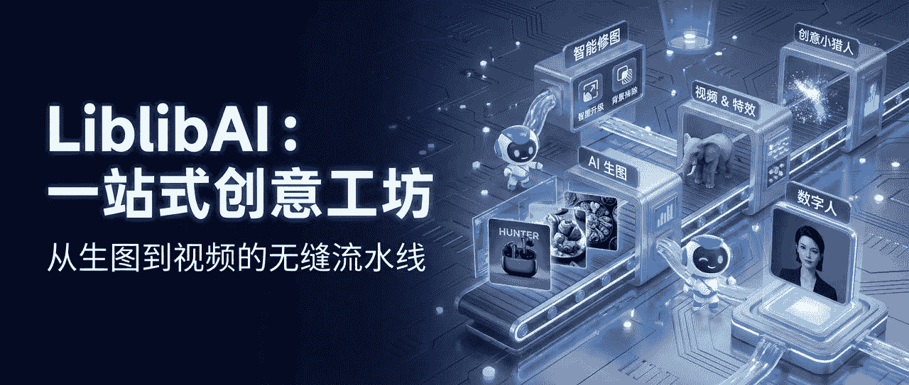

**没错，今天就直接**上干货，聊聊怎么用LiblibAI这个一站式的宝藏平台，把从做图、修图到生成视频、加特效这套流程，像流水线一样一次性搞定。

之前LiblibAI 2.0发布的时候，有做过简单的介绍，嗯，还是熟悉的配方。

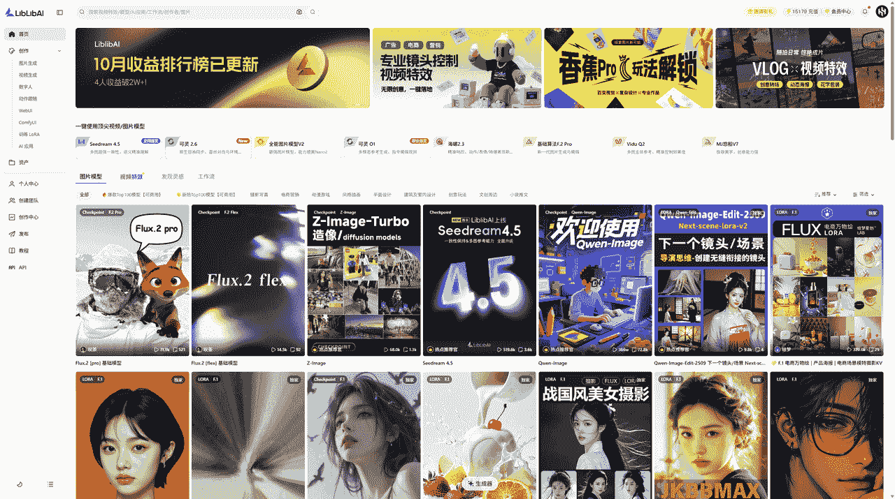

特别是他们最近搞的那个年包会员，我算了一笔账，365天畅玩可灵全系模型，还有香蕉Pro、Seedream、F.2这些大神级模型随便用，这性价比，基本上就是要把我们的创作门槛给踩平了。

LiblibAI网址入口：https://www.liblib.art

我们一起来看看，最近又有哪些好玩的玩法？连Prompt（提示词）都给你们准备好了。

# 01.尽情生图，各种模型应有尽有！

咱们先说最基础的——生图。

来到生图界面，看到底部，它把最常用目前最火**的风格模板都给你准备好了**，这也是我最喜欢LiblibAI的一点，各个设计领域、各种创意的提示词&模板，真叫一个全。

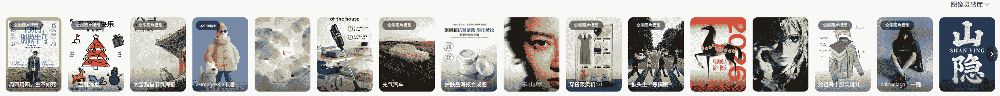

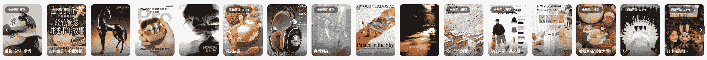

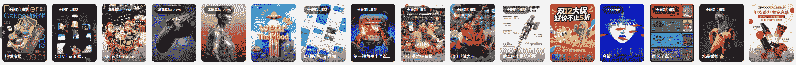

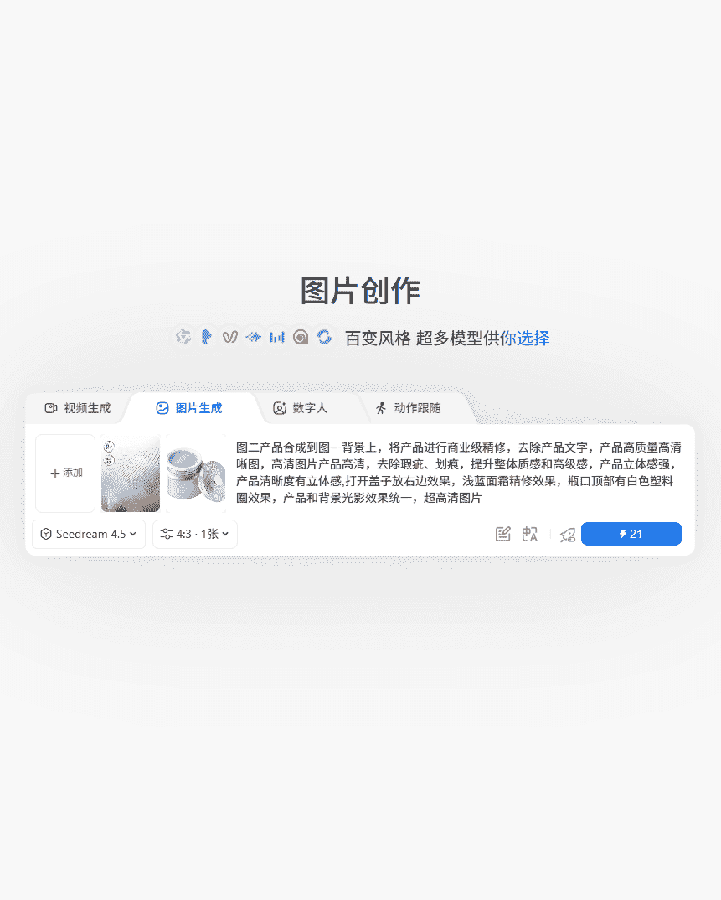

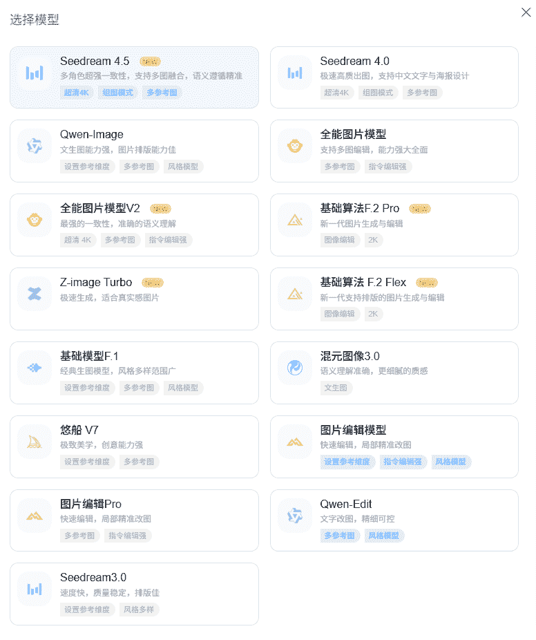

以前做个产品海报，得搭棚子、调灯光，或者是到处找参考，找别人的提示词。现在？看上哪一个效果直接一键做同款，快速使用。

**我在LiblibAI上选了最新**的Nano Banana Pro模型（即全能图片模型V2）和Seedream模型，只要把脑子里的画面描述出来，那个质感，真的绝了。

产品海报：

> Prompt：

> Style Positioning: Minimalist high-end tech product poster, clean sophisticated commercial aesthetic Core Subject & Details A hand of East Asian skin tone (hyper-realistic skin texture, natural relaxed finger posture) holding an open charging case of HUNTER Open Earbuds Pro: Charging case: Soft light beige (warm light brown) matte finish, inner lining in warm brown suede texture; Earbuds: Matching light beige open-ear design, with sleek silver-white decorative details, subtle black "HUNTER" logo printed on the earbud body. Layout & Typography (Design Specification) Background: Pure clean white (maximizing negative space for product focus); Decorative text: Large translucent light gray "Pro" (modern sans-serif font, light soft visual weight) overlaid as a background layered element; Primary text (top area): Bold black sans-serif font — "HUNTER 开放式耳机 Pro" (upper line) + "舒适新声" (lower line); Brand logo: Top right corner with the HUNTER brand logo (sleek minimalist design, consistent with high-end tech brand tone); Secondary text (bottom area): Black sans-serif text — "HUNTER 开放式耳机 Pro". Aesthetic Structure Layout logic: Hierarchical typography (primary title > decorative background text > product subject > secondary text > brand logo), balanced visual weight to center the hand & earbuds case; Color palette: Soft warm neutral tones (light beige, warm brown, light gray) + black text + brand-accented logo tone, maintaining minimalist high-end tone; Textures: Matte charging case finish, soft suede inner lining, smooth metallic luster of earbuds, realistic skin texture. Lighting & Quality Soft shadowless studio lighting (even illumination, no harsh shadows), ultra-high definition, photorealistic details, sharp focus on product textures, clean crisp visual presentation.

我的耳机，高级感满满~~

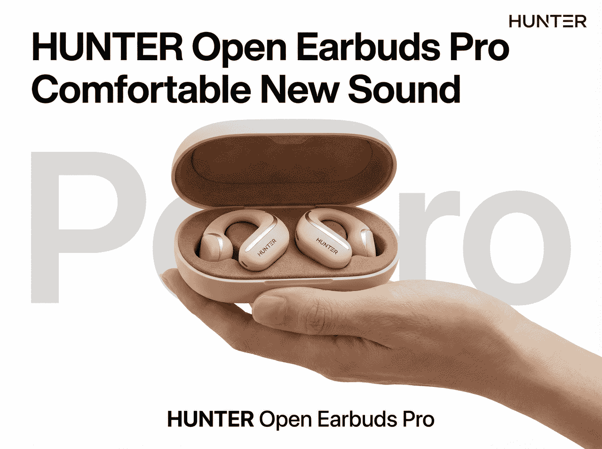

下面我们来做一些好玩的，这个城市的美食：

> Prompt：

> Hyper-realistic digital food illustration of four iconic local delicacies from {这里填入城市名}, presented together on a single large, rustic artisan serving platter. The composition flows seamlessly across the platter from left to right, showcasing a culinary journey through the city's famous flavors.

> The left side features [Signature Dish 1], with its glistening sauces and steaming ingredients gradually blending into the textures of [Signature Dish 2], then morphing into the rich, hearty elements of [Signature Dish 3], and finally transitioning into the vibrant colors and sweet details of [Signature Dish 4] on the far right. (AI should select four highly representative and diverse famous dishes from {City Name} for these slots.)

> There are no visible dividing lines or separate bowls between the food items; garnishes, sauces, spices, and ingredients blend organically along the platter to create a unified, harmonious, and incredibly appetizing panorama. The food is mouth-watering, with visible steam, rich textures, and vibrant colors ("色香味俱全"). Cinematic food photography lighting, stunning details, 8k resolution, macro textures.

长沙美食：

北京美食：

很流行的九宫格分镜：

> **Prompt: **

> Analyze the input image. Generate a cohesive 3x3 grid "Cinematic Contact She**et". Row 1 (Con**text): Extreme Long Shot (Environment), Long Shot (Full body), Medi**um Long Sho**t. Row 2 (Action): Medium Shot, Medium Close-Up, Close-Up (Face). Row 3 (Details): Extreme Close-Up (Eyes/Texture), Low Angle (Heroic), High Angle (God's view). Constraint: Ensure strict consistency: Same character, same outfit, same lighting across all 9 panels. Realistic depth of field.

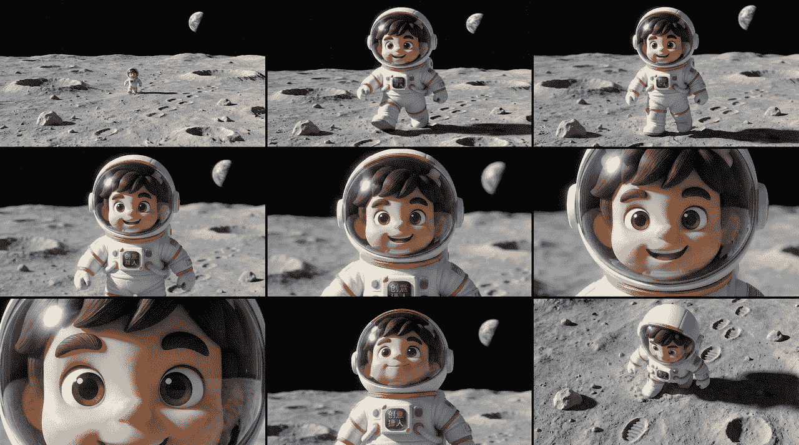

一张图，可以延伸故事剧情，这对于分镜的学习，以及短视频的制作，都非常有帮助！

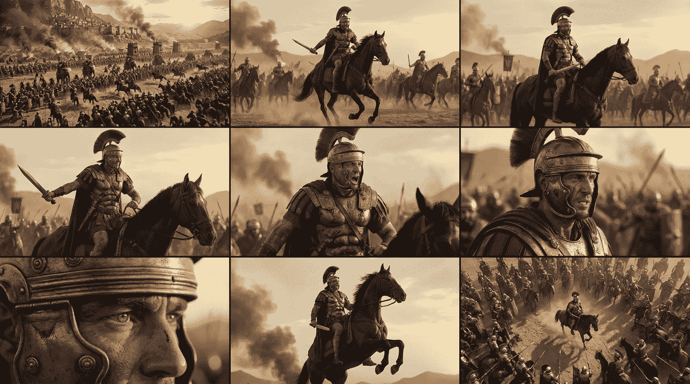

还有，最近这种虚拟的裸眼3D的效果比较火，来看看：

> 提示词来自 X @宝玉 老师：

> An enormous L-shaped glasses-free 3D LED screen situated prominently at a bustling urban intersection, designed in an iconic architectural style reminiscent of Shinjuku in Tokyo or Taikoo Li in Chengdu. The screen displays a captivating glasses-free 3D animation featuring [scene description]. The characters and objects possess striking depth and appear to break through the screen’s boundaries, extending outward or floating vividly in mid-air. Under realistic daylight conditions, these elements cast lifelike shadows onto the screen’s surface and surrounding buildings. Rich in intricate detail and vibrant colors, the animation seamlessly integrates with the urban setting and the bright sky overhead.

> scene description:

> [一头大象正把自己的鼻子伸出来]

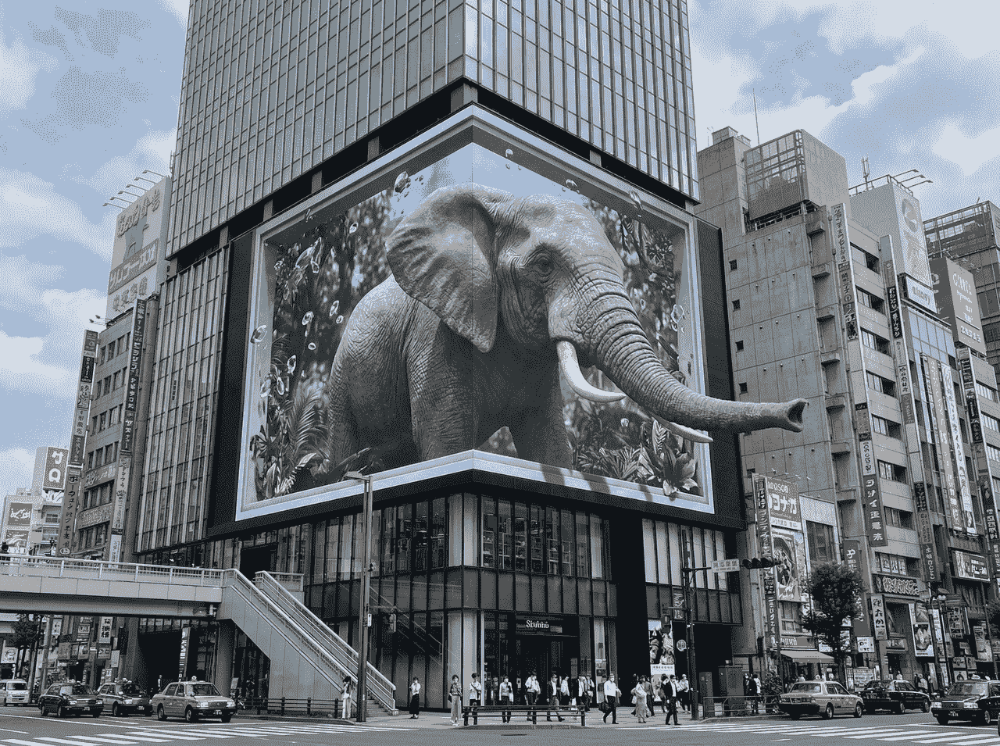

很有真实感，非常震撼，视觉效果很有冲击力。

# 02.搞定人物一致性，这个大难题

做IP设计的同学肯定懂这种痛：画一张图容易，难的是让这个角色在不同场景里长得一模一样。

这时候就得祭出**LiblibAI**上的神器——**香蕉Pro模型**。

这玩意儿简直是为IP设计而生的，请出出我的创意小猎人：

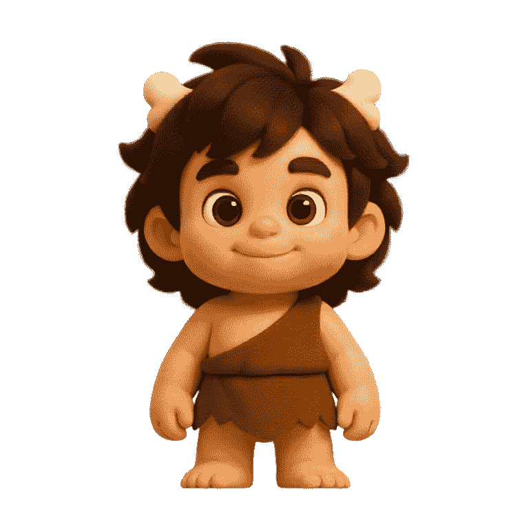

简单试下表情包，IP角色保持得很不错，完全没问题！又可以上架一套表情包了~~

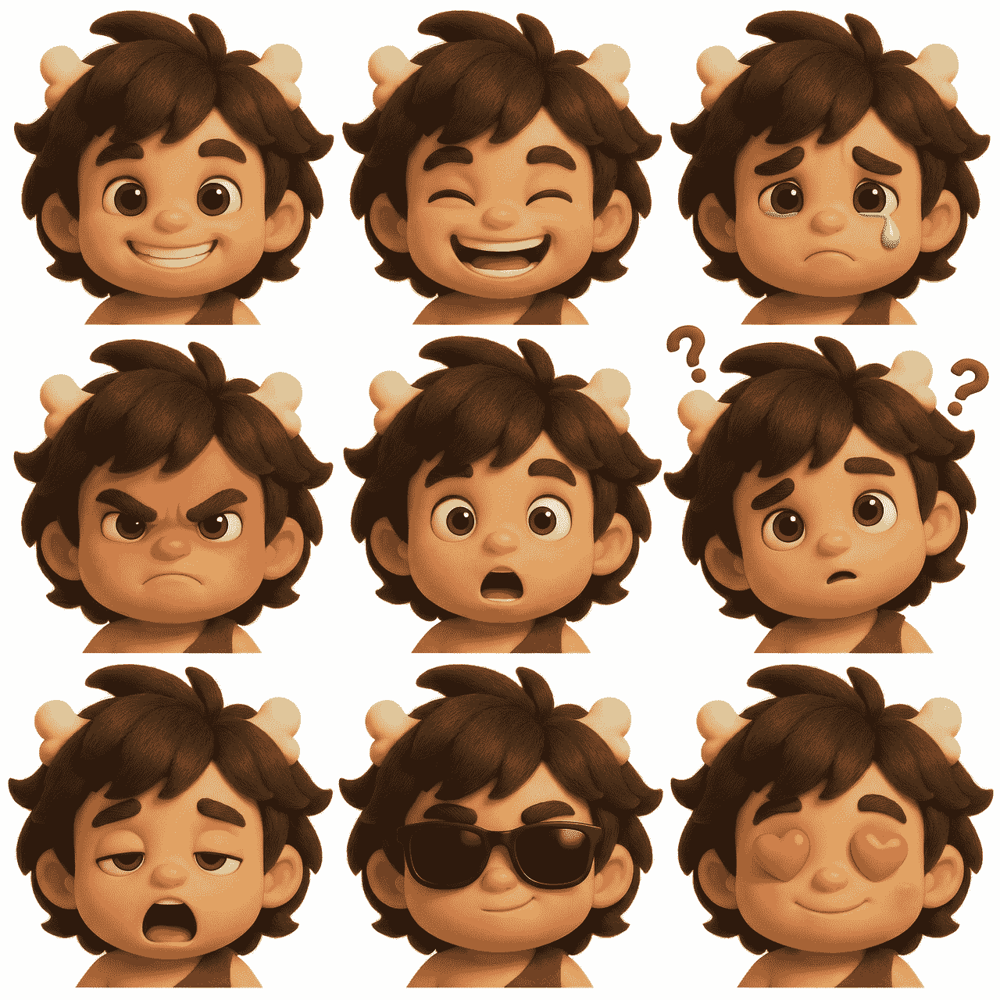

创意小猎人飞上月球了：

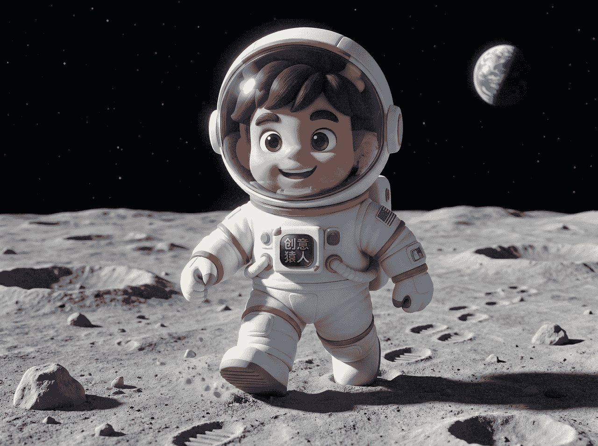

来试一下真人的效果：

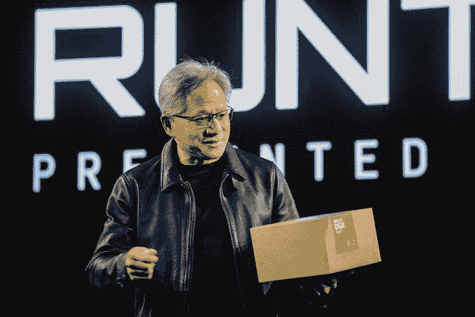

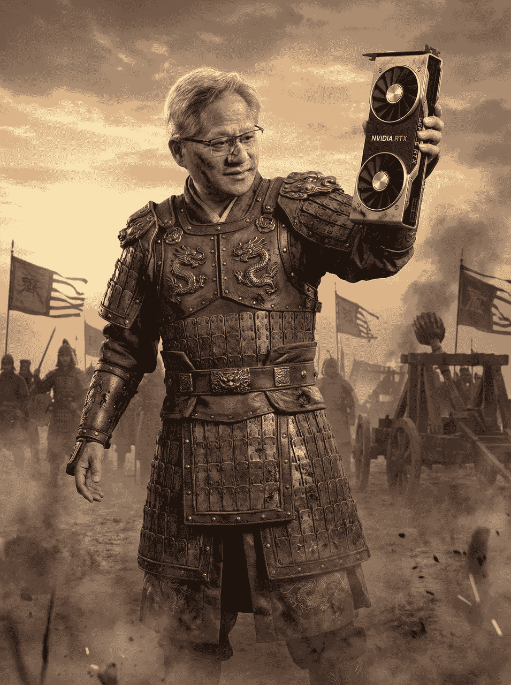

你看，不管怎么换动作、换背景，人物的一致性都保持得非常好。

# 03.让静态的图动起来

好了，图做完了，想要做成视频，让图片动起来，怎么办？

在**LiblibAI里**，你只需要点一下**视频生成**，在资产库**里添加上面生成的图片，这里**接入了可灵（Kling）全系模型，这可是现在的视频生成顶流。

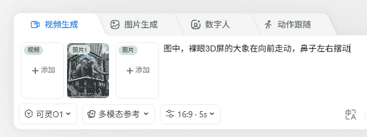

我直接把上面那个裸眼3D的大象的图扔进去，让大象动起来。看看效果：

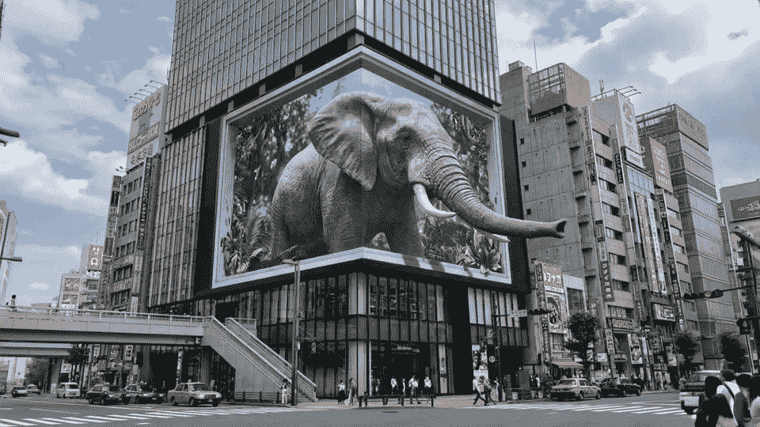

[3ffc1b9144cfedeffbcb747d977dbd31b59b2cb87bf9fced4e0fcd6e507befc4.mp4](https://internal-api-drive-stream.feishu.cn/space/api/box/stream/download/all/BcpIbb5qgoGlQRxWDg8cn889nVI)

那个动态的流畅度，完全看不出是AI生成的，也不需要复杂的关键帧设置，它自己就很懂物理规律。

还有上面的创意小猎人，这步伐可谓是相当的稳健了~~

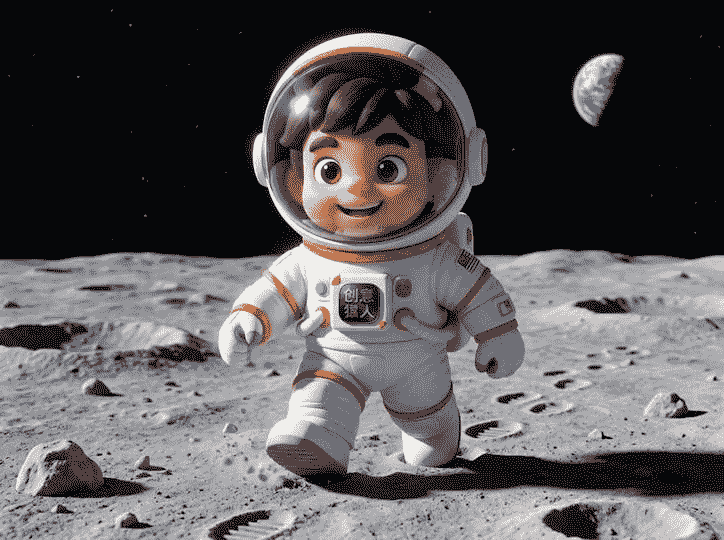

[15b37768f606afe0eeaced385ad0c0d46c1d03f6be7d24660f3c28e2c4677942.mp4](https://internal-api-drive-stream.feishu.cn/space/api/box/stream/download/all/Xl0Mb6fFgomwqcxxZpKccVUKnve)

把前面生成的九宫格分镜转成视频，高级的电影感画面就来！

[23877dc02b675b2b405409df2137c1d408438fb06d5dd30f3d85a37c47f192dc.mp4](https://internal-api-drive-stream.feishu.cn/space/api/box/stream/download/all/Tdt2b0nWMoVjVox16uRcnqIonte)

# 04.给视频加点魔法特效

这还没完。

视频生成出来了，有时候还是觉得不够味儿，缺点视觉冲击力？

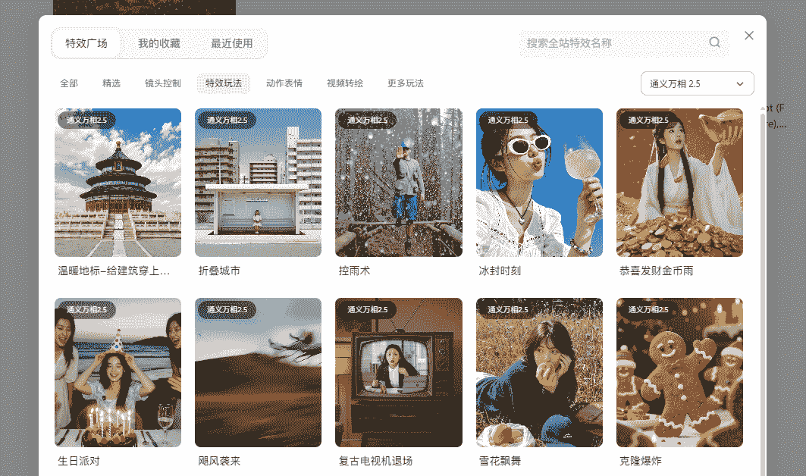

**Libl**ibAI最让我惊喜的是它不仅仅是生成，它还有视频特效功能。这不是简单的滤镜，而是真正的AI特效。比如我想我的宇航员小猎人加点“樱花消散”的粒子效果：

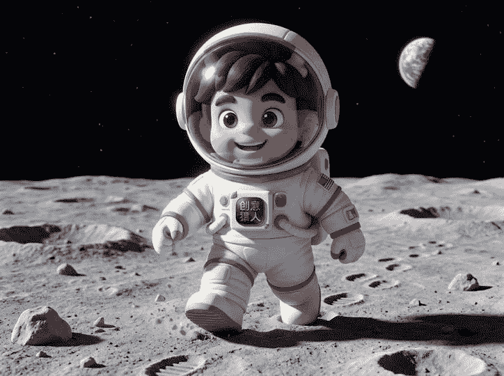

[a817c92f7a674302e7bb280b584560a3f7bf41bb7d574a588d12f4e07510fba5.mp4](https://internal-api-drive-stream.feishu.cn/space/api/box/stream/download/all/U2NQbHiI1ojXmTxNL72ctkiBnFf)

还有这种漩涡运镜的效果，这运镜不要太丝滑~~

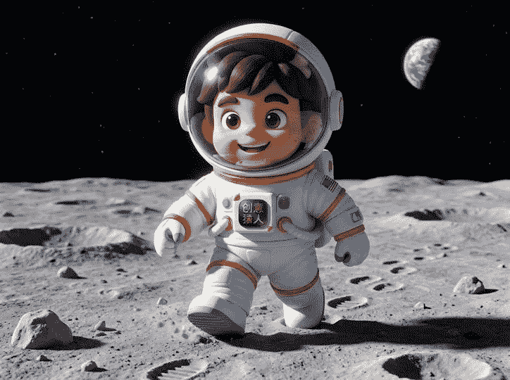

[2702950759e97e0fb4438cf414dbfbf524508506a25eecfe52155afce2621c07.mp4](https://internal-api-drive-stream.feishu.cn/space/api/box/stream/download/all/S4MdbGzRtoYD25x9sstcqznHnqg)

比北京最近马上大降温，太冷了，给大裤衩穿件毛衣试试：

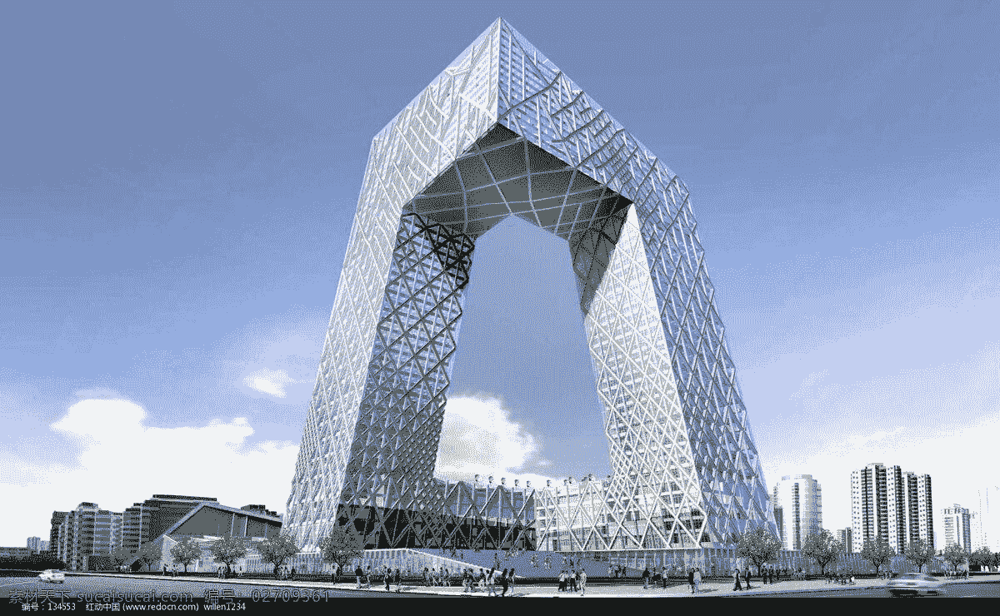

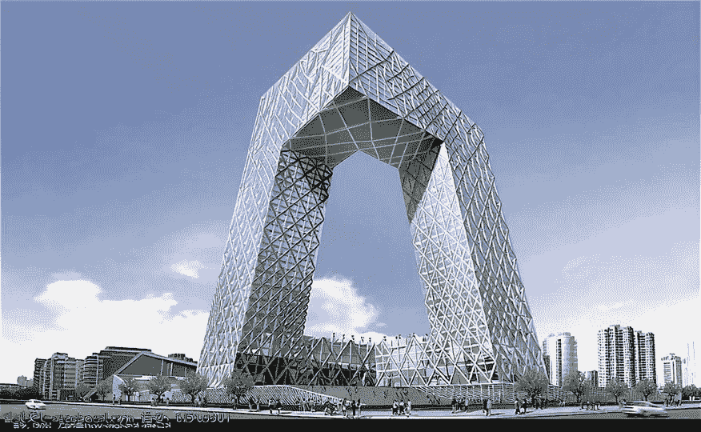

[23150afd7d91a8bf46ee844538c300b1c338d7d8ee8d7ce4887aadc01b5c89c2.mp4](https://internal-api-drive-stream.feishu.cn/space/api/box/stream/download/all/YETibDRBgogCBJxQTYZc3DH0nBf)

这一点真的太方便了，不用去到处找素材包，也不用调混合模式，点一下，大片感立马就出来了。

# 05.风格化大变身

接着咱们玩点有趣的。

用**LiblibAI**里的**F.2**或者特定风格模型进行“视频重绘”，瞬间就能打破次元壁。

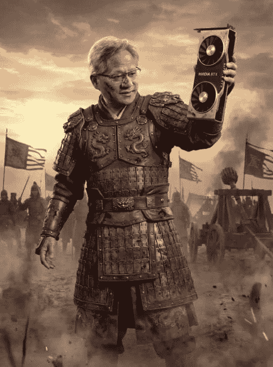

[16906fdc40e163138baab08a1f74c50779b4c17de413baef1ea14931948b7163.mp4](https://internal-api-drive-stream.feishu.cn/space/api/box/stream/download/all/U8c7boex5oOCIsx5V3SctHf6nGc)

这招用来做朋友圈爆款或者抖音短视频，吸睛率简直满分。

# 06.数字人

做数字人，对口型，操作也非常简单，上传你的数字人，或者在生成的库里面直接找相关的人物角色，输入你想要合成的文字，就能很快得到一段配好口型的数字人视频，效果很不错：

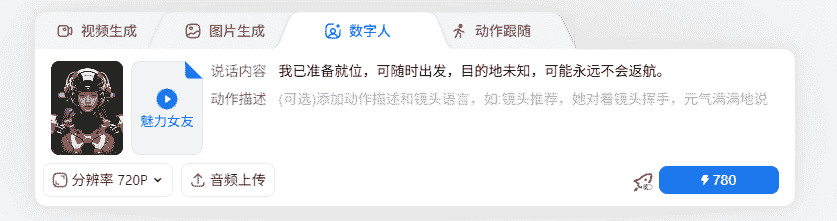

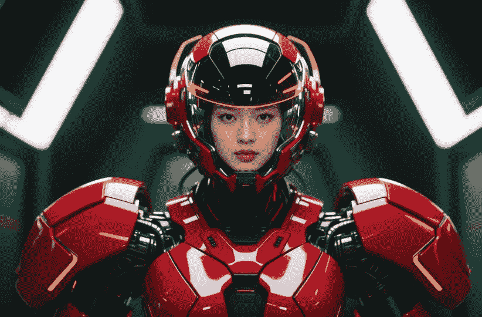

[594211485-b0f077249181662061dae51441335451a9fa02da9ad120ff4d1b6a7f3456875f_1765383572_infinitetalk (1).mp4](https://internal-api-drive-stream.feishu.cn/space/api/box/stream/download/all/SVWJbn1Awod5gkxDUz2cu462nRe)

这下真把做数字人的门槛拉低了，不需要很专业的操作，就能做出很好的效果。

# 07.AI应用，常见的工作流封装，趁手小工具

到最后还有小惊喜，点开这个AI应用，像发现了新天地，LiblibAI把常用的图像处理、电商营销常用的频次较高的工作流，全部做了梳理封装：像什么高清放大、局部重绘、智能扩图，还有换背景、换脸、产品精修等等，做的比较友好，直接上传图片就能够一键使用：

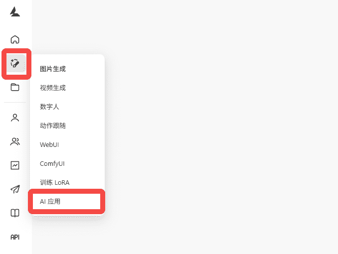

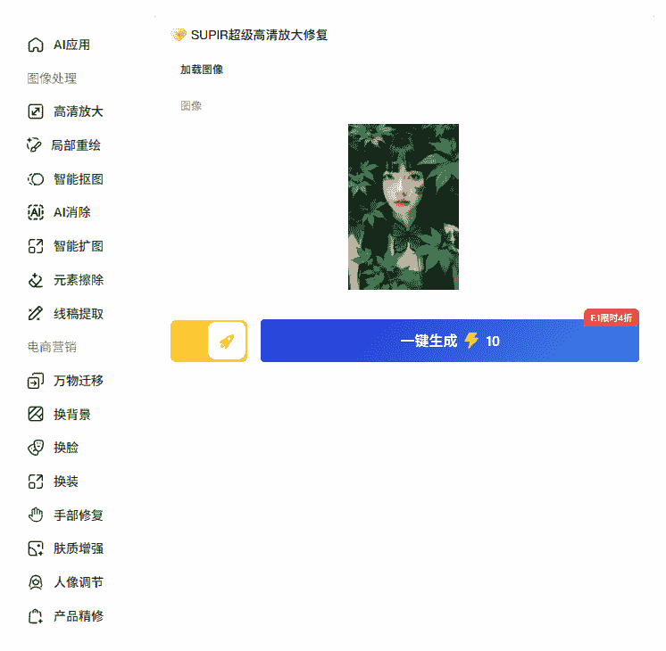

比如这个换脸，一键就可以得到效果，我只能说到这里了，违法行为可不能乱来哈：

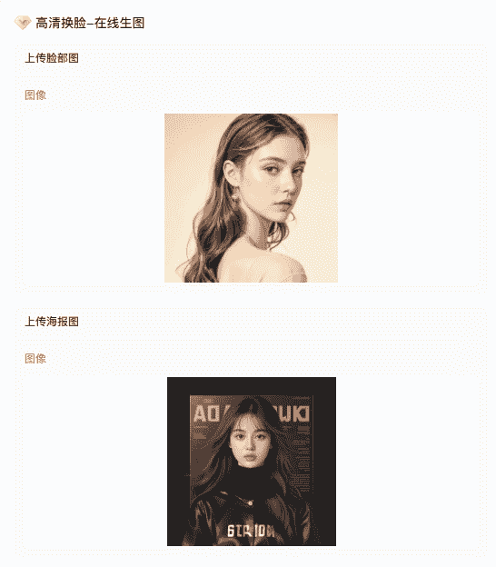

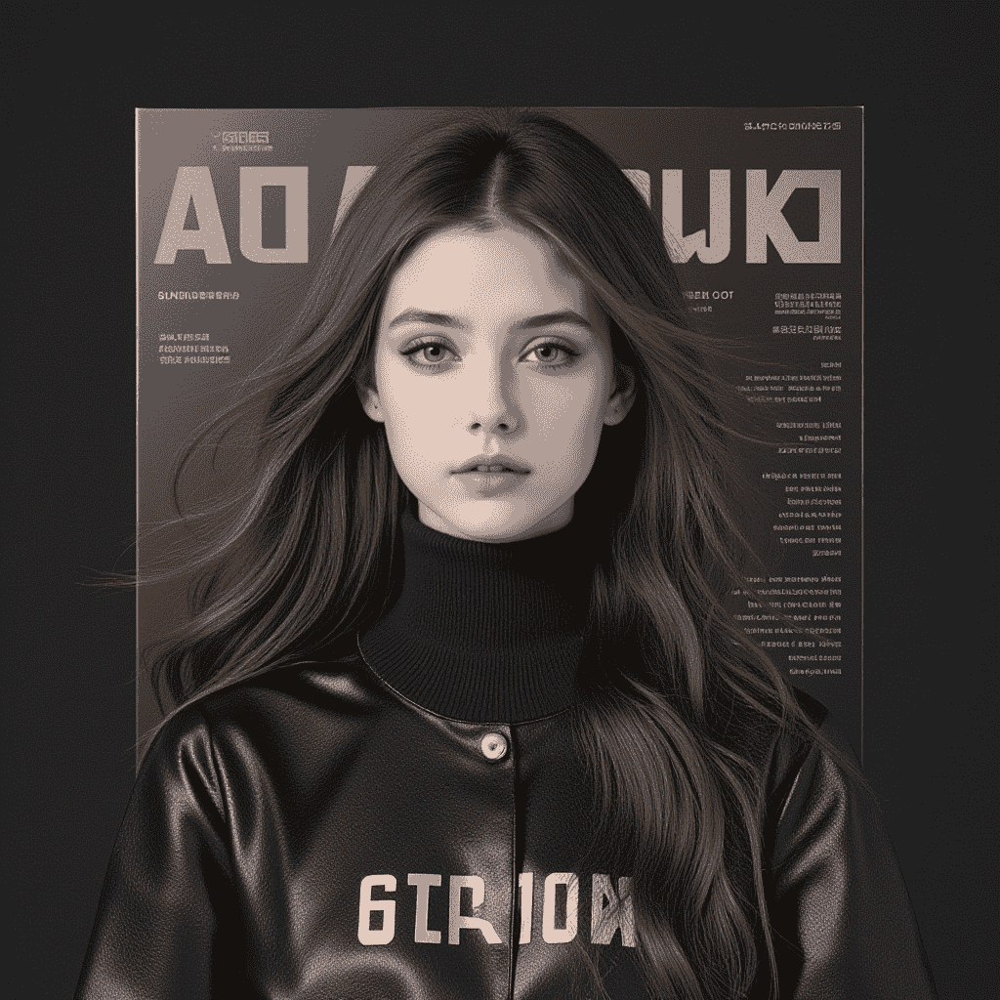

复杂主体的抠图，这抠的是真干净：

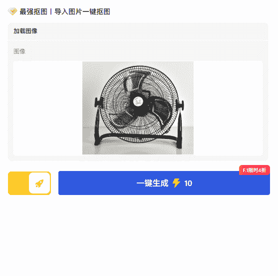

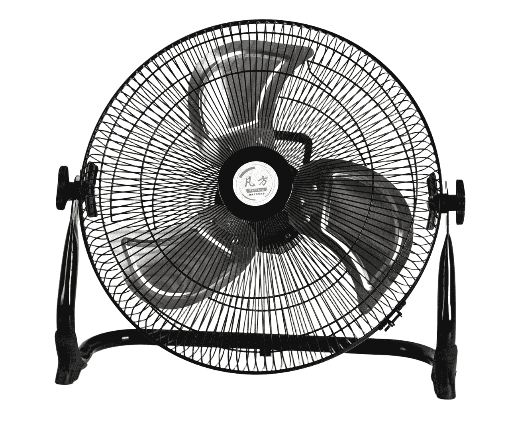

# 08.为什么我推荐LiblibAI？

说**实话，市面上大模**型很多，但能把Nano Banana Pro、Seedream、F.2、可灵全系这些顶尖硬货全部塞进一个盒子里，并且让你在一个网页里就能完成“生图-修图-动效-视频-数字人”全流程的，LiblibAI确实是独一份。

也就是两顿火锅钱，承包全年所有的AI创作需求。

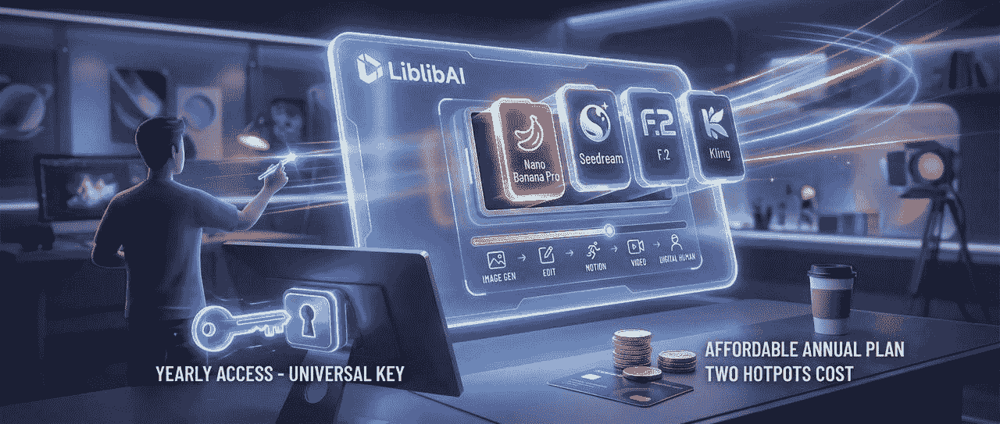

**对于咱们**这种靠创意吃饭，或者是纯粹喜欢折腾视觉的人来说，这个年包会员就像是给了你一把万能钥匙。

不管是做私单赚钱，还是自己做号涨粉，手里有这些顶级模型兜底，底气都不一样。

大家可以去试一下，那种脑子里的想法瞬间变成现实的快感，试过就回不去了。

链接我再放一次，趁现在有活动，赶紧去薅羊毛：https://www.liblib.art

按照惯例，用一张图来总结下今天的分享：

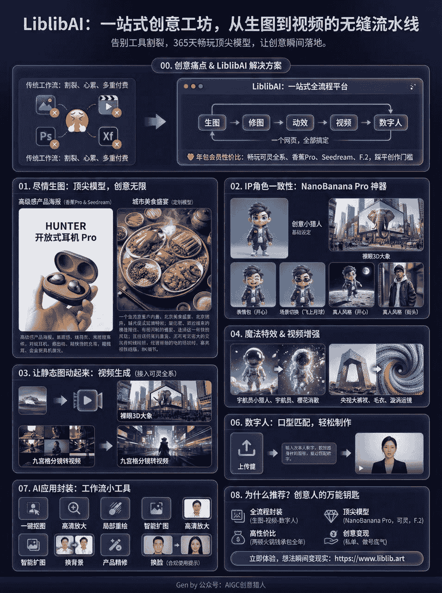

更多精彩内容，

我们下期见~~

<https://aigcreative.feishu.cn/sync/K4Gvd9vUQsy9Oubwqaeclu0Fnbg>

# 知识库动态