# 20251224-谷歌的AI生态太全面了！官方发布2025年度40项核心AI实战技巧

> 来源：[https://aigcreative.feishu.cn/docx/KybddHdDao3PH0xXwlEc7OZCn6f](https://aigcreative.feishu.cn/docx/KybddHdDao3PH0xXwlEc7OZCn6f)

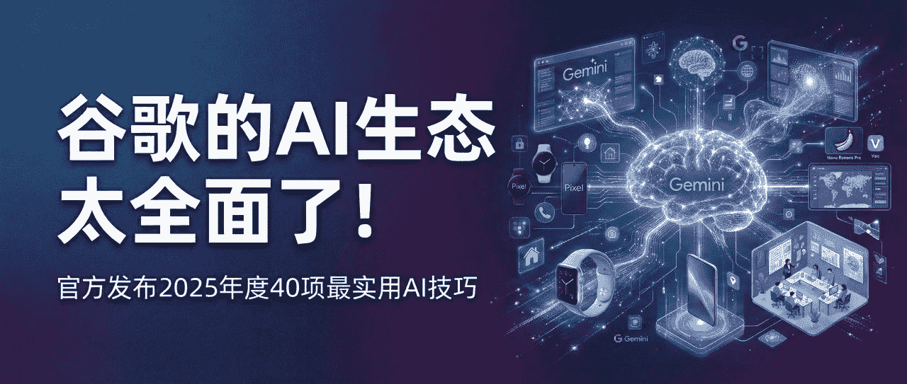

大家好，我是创意猎人。

咱们玩AIGC，最怕的不是工具不够强，而是工具更新太快，根本学不过来。

2025年是Google技术井喷的一年：Gemini 3来了，Nano Banana Pro火了，Pixel设备也进化到了第10代，多模态、智能体、智能硬件，应有尽有。

工具、功能多了是好事，但对于普通用户来说，面对琳琅满目的入口和按钮，往往会陷入选择困难症。

很多人买了会员、订阅了服务，最后只用它来定个闹钟或者搜个天气，这简直是暴殄天物。

既然工具已经武装到了牙齿，我们就要学会怎么用它们来武装自己的大脑。

**近日**，谷歌发布了《2025年度AI应用手册，40 项核心实战技巧精选》，原文：https://blog.google/technology/ai/ai-tips-2025/

我刚刚把这40个最实用的AI技巧全部扒了出来，做了翻译整理。

这些技巧覆盖了从深度学习、创意绘图到出行规划的方方面面。

不管你是只有碎片化时间的打工人，还是追求极致效率的极客，这里面一定有能帮你省下几个小时睡眠时间的神技。

下面我们一起来看看：

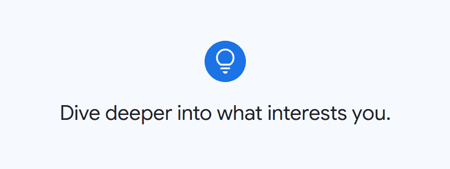

# 01.深入探索你感兴趣的领域

### 1.利用可视化拆解技术或科学主题。

> Gemini 3 是我们最新、最智能的模型，你可以在 Gemini 应用、搜索中的 AI 模式、AI Studio 等地方使用它。它非常擅长拆解复杂的主题：它可以接收你给出的任何类型的输入——从文本到视频再到代码等等——并以适合你的方式帮助你学习，比如根据一篇晦涩的研究论文生成交互式指南。

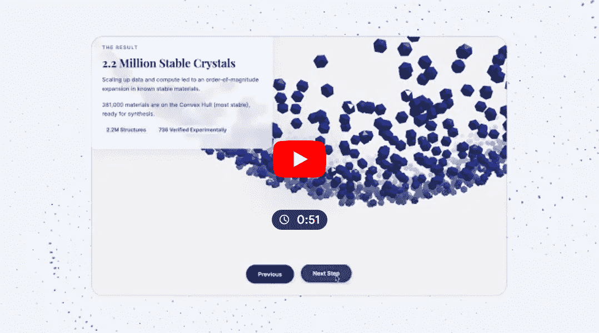

### 2.在搜索中利用 Gemini 3 获取交互式模拟体验。

> 如果你正在研究像抵押贷款这样的内容，AI 模式下的 Gemini 3 可以为你制作一个定制的交互式贷款计算器，直接在回答中创建定制的生成式用户界面，这样你就可以比较两种不同的方案，看看哪种能提供最多的长期储蓄。这得益于 Gemini 3 无与伦比的多模态理解能力和强大的代理（Agentic）编码能力。

### 3.在 NotebookLM 中选择你的研究风格。

> 当你在 NotebookLM 中工作时，你拥有多种选择：当你需要快速搜索时，选择“快速研究（Fast Research）”选项，它会迅速扫描信息，让你立即查看并导入来源。当你需要全面的简报时，选择“深度研究（Deep Research）”，它会进行深入分析以寻找高质量的来源。这一过程在后台运行，因此你可以继续手头的工作。

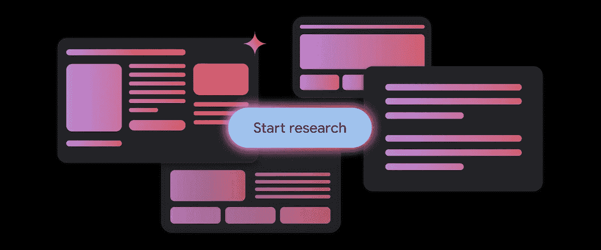

### 4.利用引导式学习获得作业辅导。

> Gemini 应用 中的 引导式学习（Guided Learning） 是一个交互式的学习伙伴，可以帮助你更深入地理解任何主题。它可以根据上传的课程材料生成学习指南，带你逐步调试有问题的代码，或者通过有用的视频和图片简单地解释某个事物（比如月球上的重力是如何作用的）。它甚至可以陪你一起做作业（但不是替你做！）。

## 5.测试你的知识储备。

> NotebookLM 可以制作抽认卡和测验，这些内容基于你的资料来源，能为学习任何主题提供更多帮助。

## 6.浏览时轻松理解复杂主题。

> Simplify 是 Google 应用 iOS 版的一项功能，它利用 AI 让网页上密集的文本变得更易于理解——而且无需离开网页。要使用它，只需在 Google 应用中选中你正在访问的网页上的任何复杂文本。点击出现的“Simplify”图标，你就会看到一个全新的、更简单的文本版本。

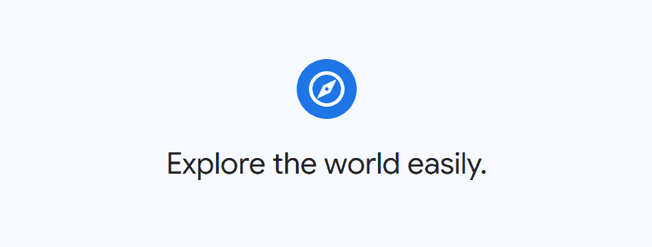

# 02.轻松探索世界

## 7.驾驶时获取 Gemini 的帮助。

> 你可以在处理多步骤问题和任务时获得帮助，例如：“这附近几英里内有价格亲民且提供素食选择的餐厅吗？……那里的停车情况如何？”接着说，“好的，我们就去那里。”你甚至可以问：“噢，顺便说一下，能帮我添加一个明天下午 5 点足球训练的日历事件吗？”你也可以询问更具体的内容，比如“那里有哪些热门菜肴？”，甚至在双手不离方向盘的情况下了解昨晚的比赛或新闻。

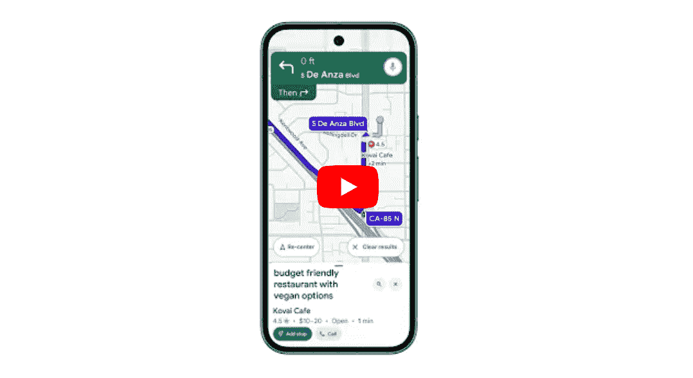

## 8.为你的下一次度假寻找超值优惠。

> 与其反复尝试不同的日期、目的地和筛选条件来寻找最优惠的价格，不如使用 Flight Deals，像和朋友聊天一样描述你想在这个时间、地点和方式旅行——Flight Deals 会搞定剩下的事情。试着搜一下：“我想在二月份休一周假。找个优惠的机票，我想直飞到一个美食多且天气暖和的城市。”你会看到符合你搜索条件的最佳特价机票，包括你以前可能没有考虑过的目的地。

## 9.在 AI 模式下用 Canvas 制定旅行计划。

> Canvas 是 AI 模式中的一个工具，为你提供了一个随时间推移组织计划和项目的空间。现在，你可以使用 Canvas 制定针对你特定需求定制的旅行计划。前往搜索中的 AI 模式，描述你正在计划的旅行类型和你正在寻找的建议，然后选择“创建 Canvas（Create Canvas）”选项。只要确保你加入了 AI 模式实验室实验 即可体验这些前沿功能。

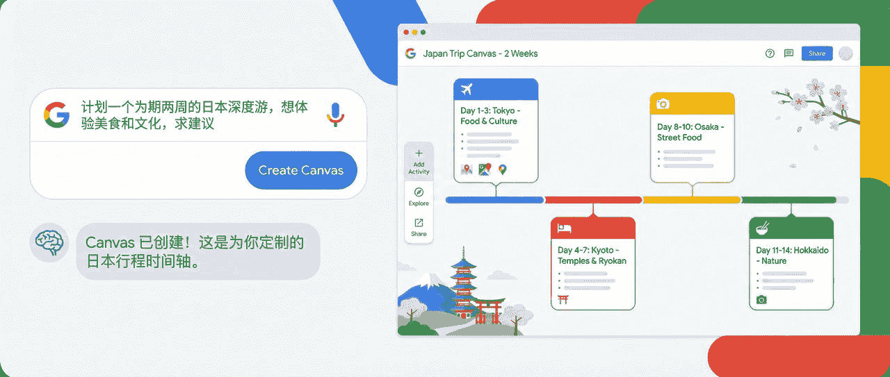

## 10.保存地点截图以制作 Google 地图列表。

> 如果你在为即将到来的旅行研究地点时，难以追踪所有旅行博客、新闻文章或社交媒体帖子的截图，你会想试试这个 Google 地图功能。它利用 Gemini 的能力在你的截图中找到地点的名称，并帮你将它们保存到一个列表中，让旅行规划变得轻而易举。

## 11.通过圈选即搜（Circle to Search）中的 AI 模式获取即时信息。

> 通过追问后续问题探索复杂主题并深挖你的初始搜索——所有这些都无需切换应用。只需长按主页按钮或导航栏，然后圈选、点击或在你想要搜索的内容上画手势。当我们的系统确定 AI 回答最有帮助时，AI 概览（AI Overview）就会出现在你的结果中。从那里，你可以通过底部搜索栏在 AI 模式下提出后续问题，并探索与你搜索相关的全网内容。

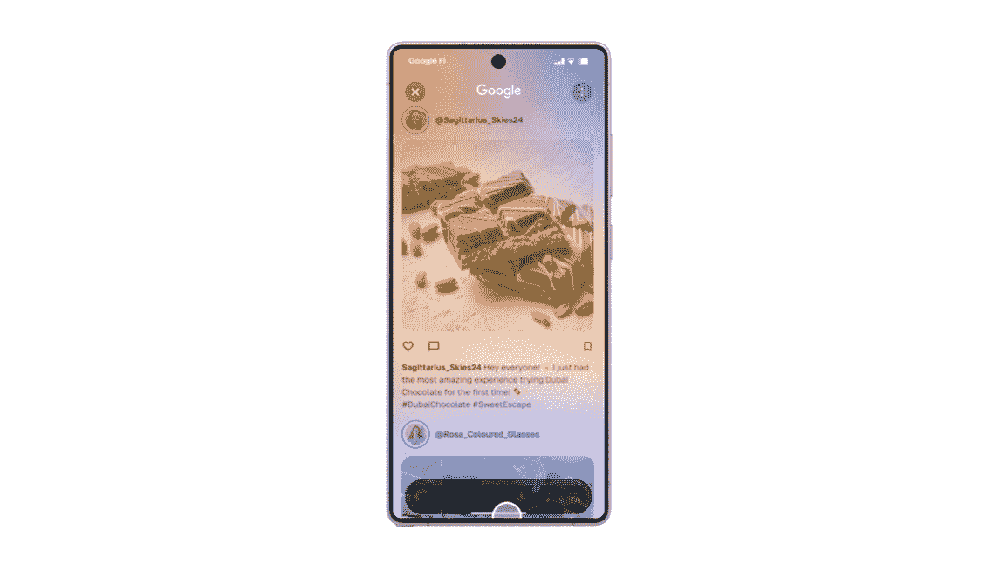

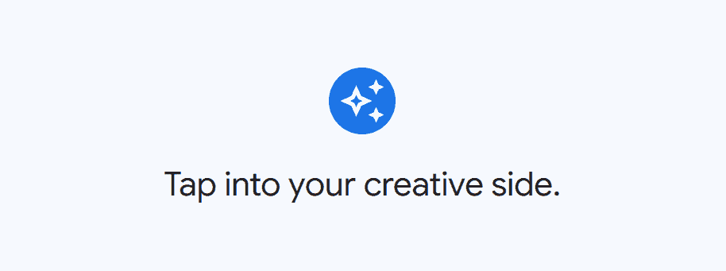

# 03.激发你的创造力

## 12.只需开口询问，即可在 Google 相册中编辑图片。

> 你可以使用自然语言来描述你想要的编辑效果，比如“擦掉栅栏”或“修复这张旧照片”。你甚至可以要求进行个性化的修复，比如去除墨镜和帽子、修正微笑等等。

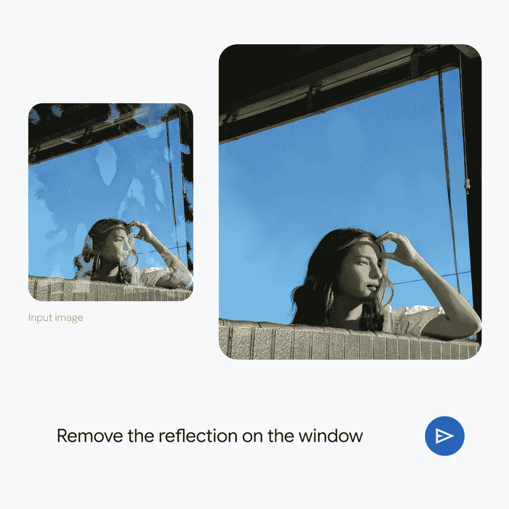

## 13.利用 AI 释放照片创意：

> 想快速将你的照片转变成值得分享的创作吗？前往 Create 标签页，直接在 Google 相册中尝试 AI 模板、Remix、照片转视频等功能。

## 14.在搜索中利用 Nano Banana 编辑图像。

> 只需在 Google 应用（Android 和 iOS）中打开智慧镜头（Lens），点击新的创作模式（寻找那个黄色香蕉图标！）。尝试一个建议的提示词，或者拍张照片并描述你想要的编辑效果。

## 15.尝试“氛围编码（Vibe coding）”。

> 试试这位 Google 员工的技巧——比如使用什么 AI 工具以及如何优化提示词。

## 16.像专家一样撰写提示词，用 Gemini 生成和编辑图像。

> 通过简单的一两句话输入，你就能用 Gemini 获得很棒的结果。但为了获得真正令人难以置信的图像和更细致的创意控制，请查看我们的指南，了解如何最大限度地利用它的能力。

## 17.一张自拍，找到你的风格。

> 如果你想使用我们的虚拟试穿工具但没有全身照，现在你可以简单地上传一张自拍，Nano Banana 就会为你生成一个全身数字版本。

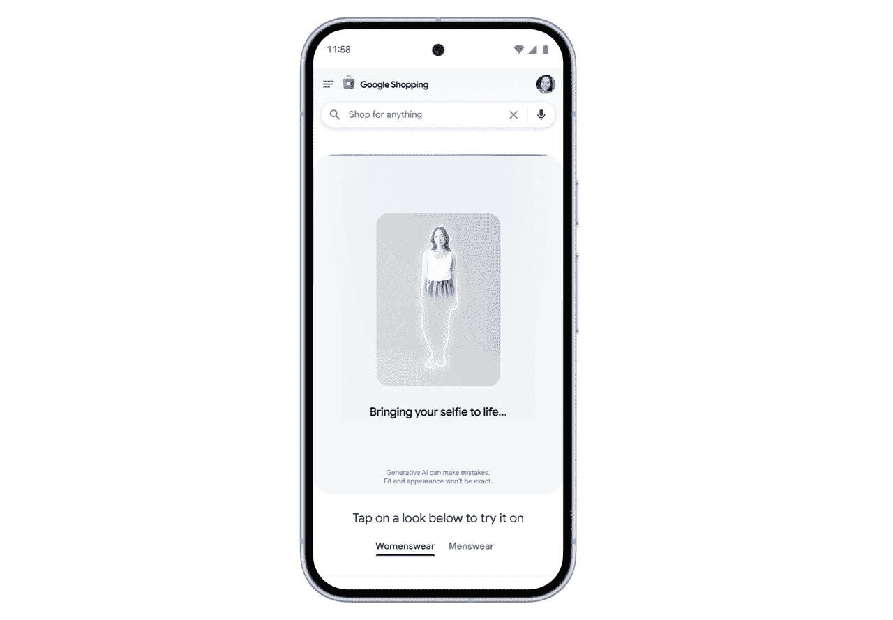

## 18.赋予照片生命并让它们动起来。

> Gemini 的照片转视频功能可以将静态图像为你制作成动画——甚至还能添加音频！

## 19.用 Google 相册回顾你的 2025 年。

> 别忘了回顾这一年！Google 相册回顾（Recap）会将你过去一年的照片和视频变成一个精彩集锦，供你欣赏和分享——而且今年，它有了新工具，你可以对其进行自定义。

## 20.用 Gemini 创作插画故事书。

> 只需描述你能想象到的任何故事，Gemini 就会生成一本独特的 10 页书，配有定制的艺术插图和音频。

## 21.利用 Flow 掌握电影制作。

> 试试我们关于用 Flow 制作任何动画的技巧，这是我们的 AI 电影制作工具，使用了我们的 AI 视频生成模型 Veo。

## 22.试试“元提示（Meta prompting）”。

> 与 Gemini 合作编写提示词，用于 Veo 等创意工具，以完善你的指令并看看它能带给你什么惊喜。

## 23.把照片变成食谱书。

> 只需拍几张你节日烘焙的照片，让 NotebookLM 把它转换成一本令人愉悦的食谱书。你可以利用 Gemini 的世界知识来描述食谱，或者上传你的笔记，NotebookLM 会搞定剩下的事情。

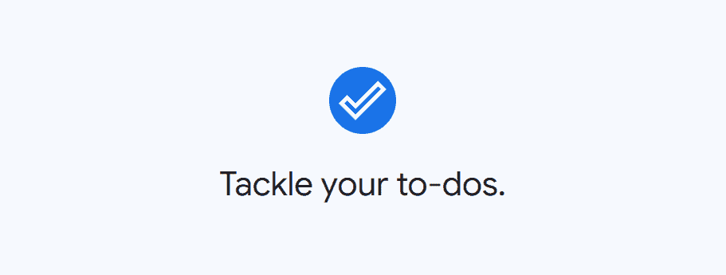

# 04.高效处理待办事项

## 24.使用单手手势——双指捏合或转动手腕——控制你的 Pixel Watch 4。

> 滚动通知、关闭通知、轻松暂停闹钟、管理计时器等等，完全无需触摸屏幕。

## 25.让搜索中的智能体 AI（Agentic AI）为你致电本地商家。

> 我们新的智能体 AI 功能可以只问你几个问题，然后拨打本地商家的电话，询问商品是否有货、是否有折扣等等。

## 26.在 Pixel Watch 4 上通过“抬手即说（Raise to Talk）”免提使用 Gemini。

> 启用该功能后，你需要做的就是把手表拿到嘴边几英寸的地方，然后开始聊天。你甚至不需要说“Hey Google”——你仍然会看到手表显示屏底部微微闪烁蓝光，这样你就知道 Gemini 正在听了。

## 27.让 Pixel 10 帮你代接留言。

> 最新款 Pixel 10 手机上的 代接留言（Take a Message） 是一种处理未接来电或拒接来电的更智能方式。它利用垃圾骚扰检测模型来判断来电是否为骚扰电话，然后还会为你创建实时转录，以及一份 AI 生成的后续步骤清单。

## 28.更轻松地创建 Google Home 自动化操作。

> 通过 Ask Home，得益于全新的 Gemini for Home 1，你可以使用自然语言创建自动化操作——例如，只需说，“创建一个在每天日落时打开门廊灯并锁上前门的自动化操作”，这就完成了。

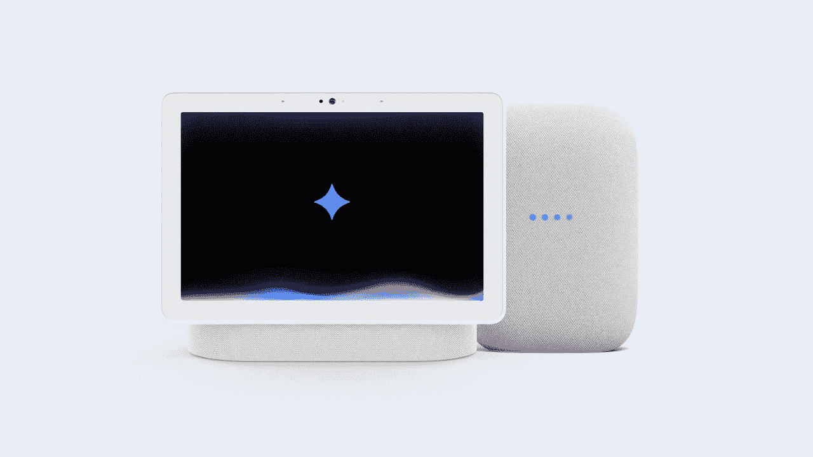

## 29.用 Gemini 安排任务。

> 通过 计划行动（Scheduled actions），你可以简化日常任务或直接从 Gemini 接收个性化更新。在对话中，要求 Gemini 在特定时间执行任务，或将你正在使用的提示词转化为重复性行动。

## 30.利用 Gemini Live 实时排查故障。

> 椅子吱吱作响？唱片机出故障了？利用 Gemini Live 的摄像头输入，你可以向 Gemini 展示你看到的实时画面并获得快速建议。只需将摄像头对准问题所在，与 Gemini 聊天找出解决方案。

## 31.在 Chrome 中使用 Gemini 解决标签页堆积问题。

> Chrome 中的 Gemini 现在可以跨多个标签页工作，因此你可以快速比较和总结多个网站上的信息，找到你需要的内容。正在跨多个标签页规划航班、酒店和度假活动？Chrome 中的 Gemini 可以帮你将这些信息整合到一个行程单中，消除旅行计划的压力。

## 32.创建并分享自定义 Gems。

> Gems 帮你根据特定需求定制 Gemini，简化任务并节省重复输入提示词的时间。也许你已经为工作流程或家庭度假制作了一个 Gem：要分享它，请在网页上打开你的 Gem 管理器，点击你创建的任何 Gem 旁边的“分享”，将你最喜欢的 Gems 变成共享资源，这样你就可以减少提示，增加创作。

### 33.开启 Pixel 的 Magic Cue 以在需要时获取相关信息。

> Magic Cue 使用 Gemini 模型主动呈现相关信息并在不同应用间建议有用的操作。这意味着它可以在你的 Gmail 中找到预订详情，关联到你的日历事件，并在天气应用中预览即将到来的旅行的天气预报。

## 34.在搜索的 AI 模式下进行对话式购物与视觉探索。

> 与其设置筛选条件并筛选商品来找到合适的东西，不如说类似“不要太宽松的直筒牛仔裤”这样的话，AI 模式会智能地提供一组相关的可购买选项来帮你获得灵感。如果你想进一步细化选项，只需搜索你的想法，比如“我想要更多及踝长度的”。

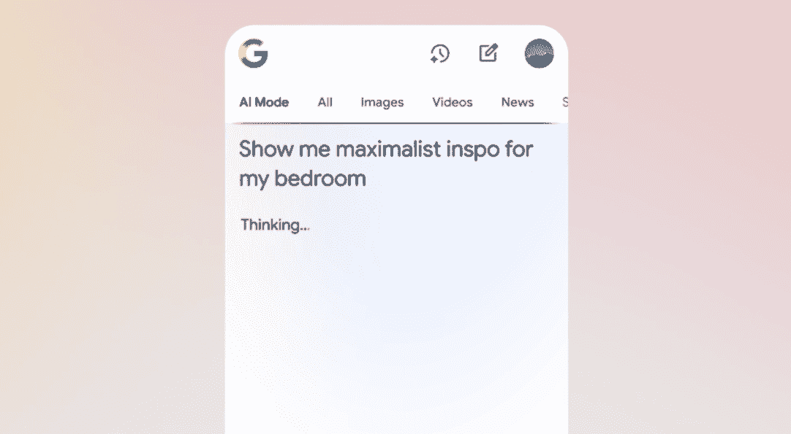

## 35.用圈选即搜（Circle to Search）边滚动边翻译。

> 今年我们更新了圈选即搜中的翻译能力，使体验更加连贯：只需长按主页按钮或导航栏启动圈选即搜，点击“翻译”图标并按下“滚动并翻译”。当你向下滚动页面，甚至切换应用时，文本将继续翻译，没有任何中断。

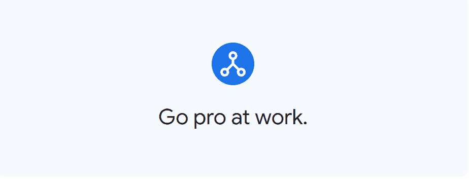

# 05.在工作中展现专业

## 36.在 Mixboard 中利用 Nano Banana Pro 制作精美的幻灯片演示。

> Mixboard 是来自 Google Labs 的一项 AI 实验，旨在帮助你探索、扩展和完善想法。它现在使用 Nano Banana Pro——我们病毒式传播的图像生成模型的最新版本——将白板上的内容转化为引人入胜的演示文稿。

## 37.将笔记和文档转化为旁白视频。

> NotebookLM 的视频概览（Video Overviews）使用 Nano Banana，因此你在视频概览的外观和感觉上拥有更多选择。视频概览有六种视觉风格可供选择：水彩、纸艺、动漫、白板、复古印刷和传承风格。你可以指定你是想要详细的解说还是关于某个主题的简短摘要。

## 38.在日历上寻找空闲时间。

> 当你回复一封关于寻找见面时间的邮件时，Gmail 会检测意图并在工具栏中显示 帮我安排（Help me schedule）按钮。选择它，Gemini 会根据你的 Google 日历和邮件上下文建议会议时间。时间建议会直接添加到你的回复中，以便对方选择最合适的时间。

## 39.让 Gemini 协助你处理 Google Sheets。

> 例如，你可以使用 AI 函数来分类用户反馈、总结产品评论或撰写个性化文案。只需在任何单元格中输入 =AI，加上你给 Gemini 的指令。Gemini 随后会在指定范围内执行你的请求。

## 40.将深度研究（Deep Research）连接到你的 Google Workspace 账号。

> Gemini 深度研究可以调用来自你 Gmail、云端硬盘和 Chat 的上下文并将其直接应用到你的研究中。这意味着你可以通过直接提取 Gmail、云端硬盘（包括文档、幻灯片、表格和 PDF）和 Google Chat 中的信息，以及来自网络的各种来源，创建更加全面的报告。

# 06.小结

40个技巧，看似很多，其实逻辑很简单：把记忆交给数据库，把执行交给Agent，把创造留给自己。

特别是看到Nano Banana Pro在Mixboard和视频生成中的表现，我更加确信，创意工作的门槛正在被无限降低，但创意的天花板正在被无限拔高。

建议大家把这篇文章收藏起来，或者直接转发给你的团队。

很多时候，我们觉得工作累，并不是工作本身难，而是我们还在用2020年的方法，去解决2025年的问题。

哪怕每天尝试一个新的小技巧，一个月后，你的工作流也会发生翻天覆地的变化。

这就是技术的魅力。

行动起来吧，别让手中的谷歌AI生态的这些神器沦为摆设。

---

按照惯例，用一张图来总结今天的分享：

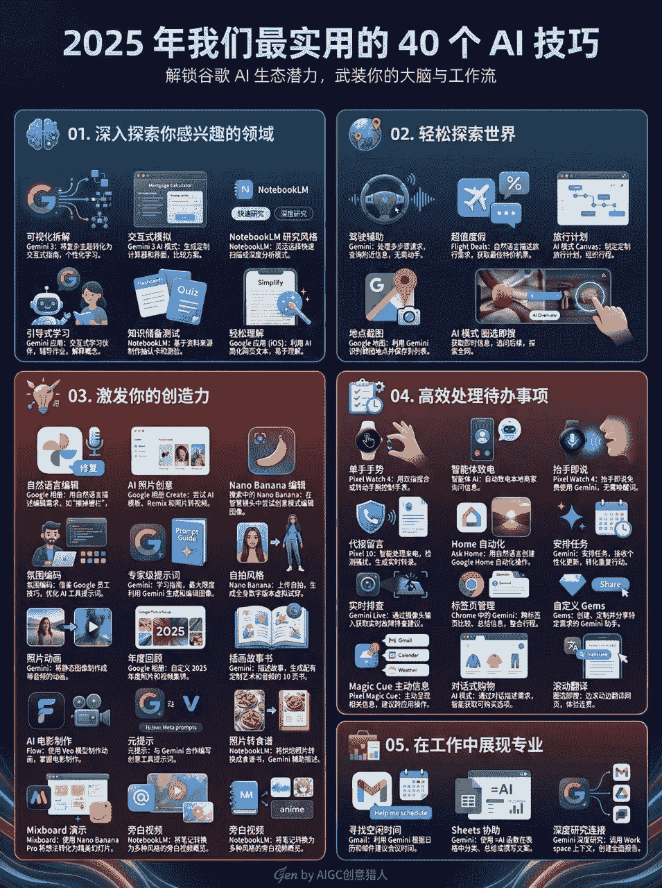

更多精彩内容，我们下期见。