# 雷军2025年度演讲（6）：小米这五年的“改变”

> 来源：[https://aigcreative.feishu.cn/docx/IxtjdYiVPo3v7Vx3nF6ctkQhnAb](https://aigcreative.feishu.cn/docx/IxtjdYiVPo3v7Vx3nF6ctkQhnAb)

2025 年 9 月 25 日晚 7 点，我在国家会议中心办了我的第六次年度演讲，今年的主题是“改变”。

在 2 个多小时的演讲和年度新品发布中，我分享了小米过去几年所经历的“改变”，以及小米造车、小米造芯背后的故事。演讲后的发布会环节，我为大家带来了年度重磅新品，小米17 系列。它是小米高端化五年的蜕变之作，也迎来了数字系列的关键变阵。全系产品力跨代升级，包含小米17、小米17 Pro、小米17 Pro Max 三款产品。

此外，还有小米平板 8 系列、小米电视S Pro Mini LED 2026、米家冰箱Pro 微冰鲜 法式560L、米家三区洗衣机Pro、Xiaomi路由器 BE10000 Pro、Xiaomi Sound 2 Max、Xiaomi 随身蓝牙音箱等一系列新产品。最后，我们推出了小米定制服务，给大家介绍了小米定制服务中心，这是为每一位独特的车主带来的精心设计。

五年来，我们历经了一场脱胎换骨的蜕变。今天**，**一个全新的小米，正坚定地站在时代面前。未来，我们将与所有勇敢的追梦者一起，继续无畏前行。愿每一个正经历改变的人，不被风雨阻挡，迎来属于自己的无限精彩！

以下是这次公开演讲全文，与你分享。

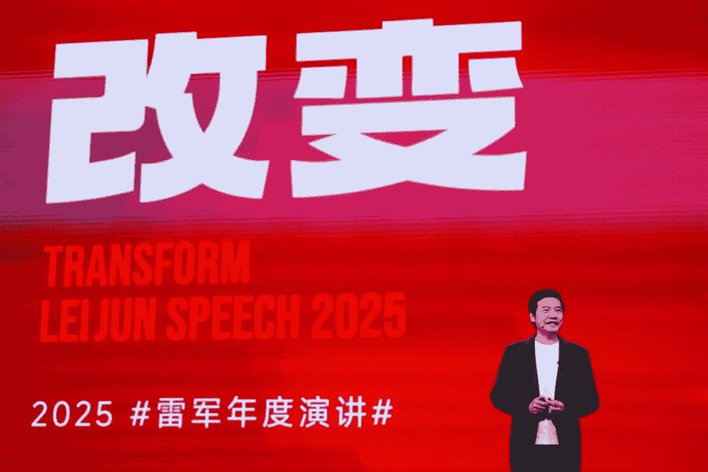

大家晚上好！欢迎大家，今天是我的第 6 次年度演讲。去年3月，我们发布了小米汽车，小米成为首家横跨手机、汽车、家电三大领域的科技公司。今年5月，我们推出了玄戒O1 芯片，小米成为中国大陆首家发布 3nm 制程旗舰芯片的公司。

在小米创办十五周年之际，小米在汽车和芯片领域连续两次重大突破，让很多人刮目相看，感觉小米好像一夜之间换了一家公司。

其实，这些改变，都来自五年前那次触及灵魂深处的大反思。

# **大反思**

## **痛苦与焦虑**

五年前，2020 年，小米迎来了自己的十周年。那时的我们，上市已经两年，年营收也突破 2000 亿，成功跻身“世界 500 强”。在很多人眼中，小米已经非常成功了。但我内心，却充满着难以言说的焦虑。

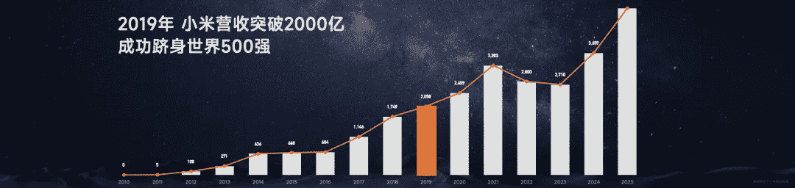

我们所处的行业，苹果、三星、华为如同几座无法逾越的大山，几乎看不到赶超的希望。是躺平认命，还是继续打拼？

创业十年，团队中很多人都累了，想停下来歇一歇。这点我完全理解，其实我自己也很累。可下一个十年，竞争只会更激烈，还有多少人愿意继续与我并肩作战呢？

更让人疲惫的是，网上充斥着各种质疑、批评，甚至是攻击。不少人对小米有偏见，固执地认为，“小米就是一家组装厂”，“小米没啥技术，就是东西便宜”，“小米只会营销，肯定走不远”等等。那段时间，我陷入了严重的内耗。

挣扎许久后，我下决心直面所有问题，找到破局之路，逆天改命。

起初，我并不知道如何解决这些问题。但幸运的是，我小时候学过围棋，学会了一种非常有效的办法，那就是：复盘。

复盘就是回答三个关键问题：“做对了什么？做错了什么？重来一遍，该怎么做？”这三个问题搞明白了，未来的路该怎么走，方向就清楚了。

于是，我们开始了漫长而深入的复盘。每次复盘会，我们找七八个人放开聊，常常一聊就是四五个小时。这样的会开了四五十次，持续了半年时间。

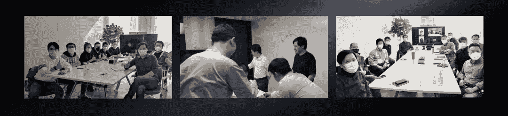

##

## 小米往哪里去？

小米创办的初心就是用互联网技术和方法做制造。经过这半年的复盘，我们坚定了下个阶段的发展道路：持续投入底层核心技术，从互联网公司走向“硬核科技公司”。并计划在未来5年里，在核心技术的研发上，投入 1000 亿元。

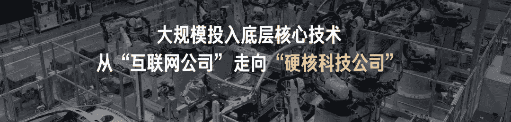

要知道，2019 年我们全年研发投入仅 75 亿，“五年千亿”，对我们来说是一个巨大的数字。

从这一刻起，小米的基因开始重塑，“技术为本”成为我们永不更改的铁律，“重新创业”的热情被完全点燃了。

## 重塑团队

随后五年，我们用创业的决心引进了大量人才，并重塑了核心管理团队。这个巨大改变，从我们高管团队的名单中就可以看出：

首先，联合创始人中还有两位，林斌和刘德，与我继续打拼。

我们积极引进外部顶尖人才，包括卢伟冰、曾学忠、王晓雁、林世伟、刘伟等一批高管。他们当中，有的直接空降高管，有的作为中层引进，一步一步成长为高管。这些引进的高管为小米的发展做出了重大贡献。

同时，我们高度重视内部培养，提拔了朱丹、屈恒、许斐、张剑慧等一批年轻高管。他们都是小米最早期员工，历经十多年磨砺，逐步成长为新一代领军人物，进入了核心管理层。

比如，工号 54 的朱丹，是小米最早期的工程师之一。如今的芯片业务就是由他负责组建的，玄戒O1 也是他带队攻克获得了成功。

# **芯片之旅**

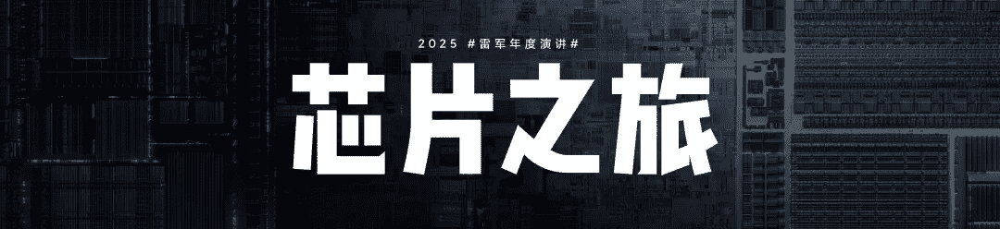

说到玄戒O1，很多朋友感到非常意外：小米怎么“突然”做出了这么厉害的芯片？芯片发布前，我们从未对外透露过，在内部也鲜有人知。接下来，我们说说芯片业务的来龙去脉。

## 松果电子

小米一直有一个“芯片梦”。

十一年前，2014 年 9 月，刚刚创业四年多的小米，全资成立了松果电子，毅然开始自研手机芯片。

经过三年努力，2017 年，“小米澎湃S1” 正式发布，搭载在一款中端机上，当年就卖了 60 万台。这个开局看上去非常不错，但我心里清楚，松果之路其实走不下去了。

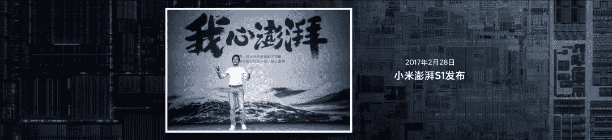

2018 年，我们做了一个艰难的决定：停掉了手机 SoC 芯片的研发，队伍缩编，继续做一些小芯片，算是保留了一点火种。

五年前那次复盘，聊到芯片话题，大家都心有余悸。要解开心结，就必须搞清楚松果到底输在哪里。我们花了很长时间研讨。

首先，切入点选错了。一个反直觉的关键结论：自研手机SoC，做中低端，完全没机会；只有做最高端，才有一线生机。这里面的原因很复杂，我就不展开讲了。当年苹果、华为也是这样突破的。

另外，自研芯片还需要手机团队的全力支持。大家想想看，手机团队为什么放着成熟的芯片不用，却要承担巨大的风险呢？如果没有完全一致的目标，和荣辱与共的决心，这事肯定干不成。而当时的松果，在管理上相对独立，跟手机团队的协同非常困难。我经常亲自协调，但依然很难解决。

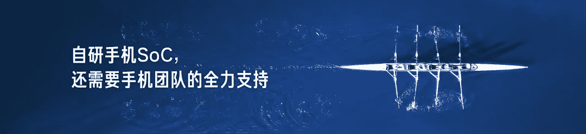

这样，松果的失败，就成了必然。

## 艰难的决策

但芯片，我们始终是绕不过去的。全球顶尖的科技巨头，最终几乎都成了芯片巨头。

我内心非常清楚，芯片是小米成功的必由之路。但如今造芯的复杂度，已经远超十年前。比如，自研手机 SoC，至少要花十年时间、至少投入五百亿。花这么多钱和这么多时间，就一定能成功吗？假如不成，我们怎么办？整个讨论过程持续了半年多，大家心里没底，一直下不了决心。

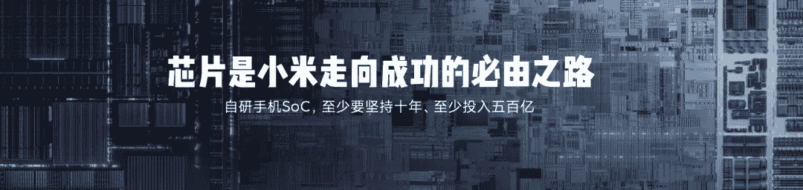

后来，我鼓励大家，“芯片，我们不干肯定输；不试试，怎么就知道我们小米就干不成呢？”

最后，2021 年初，新一轮的芯片之旅，重新开始了。

松果失败的阴影，依然笼罩在很多人心中。我们见到每位合作伙伴，都需要拼命解释，对方才能理解。费尽了周折，我们才终于重新组建了团队。

## 绝不动摇

项目进入第二年，我们遇到了更大的困难。当时，小米业务受国际经济形势和地缘政治的影响，业务出现大幅滑坡，营收骤降 15%，这是小米史上第一次。

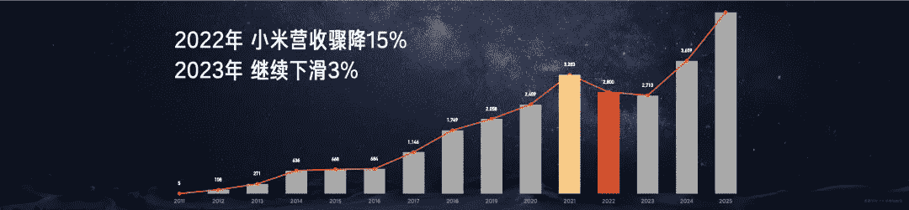

而此时，我们压力巨大，我们正同时供着“两个孩子上大学”——造车、芯片，每个都是五六百亿投入的大项目，这个压力令人窒息。

“继续干芯片，会不会把公司拖垮？”团队里逐渐出现了一些质疑的声音，内部士气有些动摇。

2022 年 5 月，我组织高管会认真讨论，现场气氛非常凝重，大家心里都清楚：如果这次放弃，小米将永远与芯片无缘了，市场也不会再给我们机会。最后，有位高管坦言：这笔账，从商业角度看，此时此刻根本算不清，只能靠创始人来判断了。我没有丝毫迟疑，当即问大家：假如现在放弃，十年后，我们会为公司账上多出几百亿而庆幸，还是为小米这家公司永远失去芯片业务而后悔？

我明确表达了自己的观点：我支持干。这笔投入绝对是值得的，退一万步，哪怕最后没有成功，也将为我们培养出一支强大的芯片研发队伍，彻底改变小米这家公司的质地。

经过充分的讨论，大家坚定了信心。

项目进入第三年，2023 年 5 月，中国芯片行业突发了一场地震，一家同行没有任何预兆，三千多人的芯片团队就解散了。我的手机瞬间被电话和信息挤爆，很多人来问，“小米芯片部门会不会关闭？”

当时，我也有点懵，不知道发生了什么。我们深知干大芯片非常难，确实是九死一生。但我们已经输过一次，这次，咬牙也要坚持！

为了稳定军心，我马上安排了芯片团队全员会。那时谣言满天飞，会议通知刚发出，同事们吓了一跳，以为我们也要解散了。我们芯片负责人朱丹，在会上传达了公司的决定后，大家长舒一口气，下定决心，一定要把芯片干成！

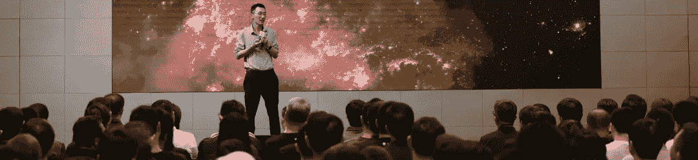

2.4 回片成功

2024 年初，芯片按计划投片了。我们的芯片采用了最先进 3nm 工艺制程，仅投片费就超过了两千万美元。

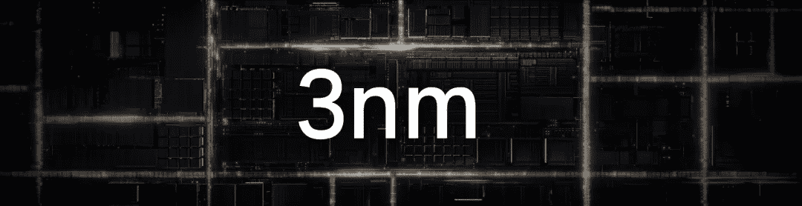

去年 5 月 22 号，第一批芯片回来了。大家非常激动，集体到机场去迎接。这么珍贵的芯片，大家就装在一个五毛钱纸袋里，拎回了实验室。

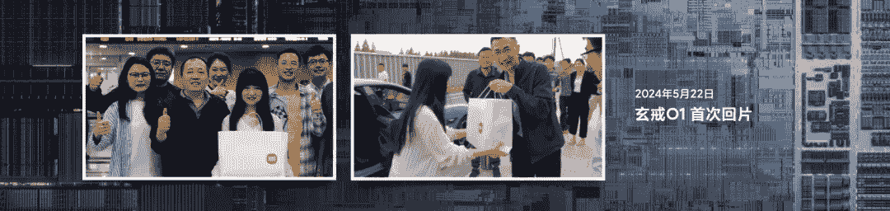

那天，我正在外地出差，每隔几分钟就看一下群里的信息，焦急等待测试的结果。假如不成功，不仅仅这两千多万美元投片费就打水漂了，整个项目都会推迟六个月。

当晚9点，系统终于点亮了。

第二天一大早，我在外地接到了朱丹用玄戒O1 打来的电话。

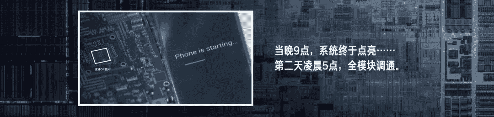

这意味着，所有模块都调通了，那一刻，百感交集……这些复杂的 3nm 旗舰芯片，一次投片就成功了，真心了不起。我们工程师确实非常牛！

## 玄戒发布

一年后，今年 5 月 22 日，玄戒O1 和搭载这颗芯片的手机平板正式发布了。

谁也没有想到，小米第一款旗舰 SoC，表现如此出色，达到了第一阵营的水平。

搭载玄戒O1 的小米15S Pro，已经上市 4 个月，媒体和用户给出了非常不错的评价。

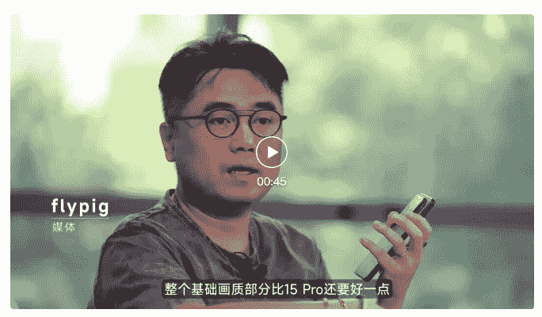

玄戒的路才刚刚开始，谈成功还为时过早，但我们肯定会继续坚持下去。回顾玄戒O1项目，失败本身不可怕，正视自己内心的恐惧，才是关键。对我们来说，难的不仅仅是技术，更难的是，经历松果惨败后，如何克服内心的恐惧，如何鼓起勇气重新开始干。

最后分享一个细节。项目启动时，我建议继续叫松果，本想着，在哪里摔倒，就在哪里爬起来。但大家坚决不同意。后来，我们取了一个新的名字——“玄戒”，代表了一个庄重的承诺：小米造芯，这一次，我们是认真的。

# **征战纽北**

接下来，我们聊聊小米汽车。

今年 6 月，小米宣布SU7 Ultra 原型车在纽北官方圈速榜总榜上排名第三，量产车位列全球量产电动车榜首。这个消息迅速震撼了全球汽车工业。很多人都好奇，小米一家手机公司造车，一个汽车行业的新兵，咋就这么生猛呢？

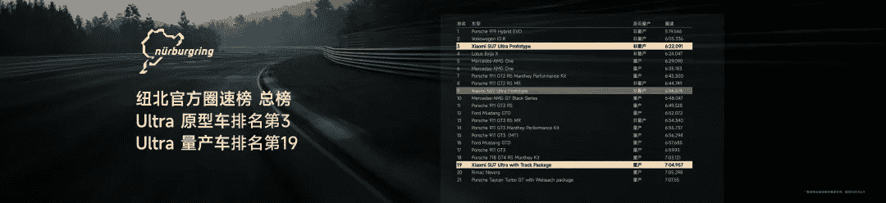

故事要从四年前讲起。

## **阿灿的故事**

米粉朋友们都熟悉一个人——阿灿，他是小米汽车首席测试车手、动态性能工程负责人。

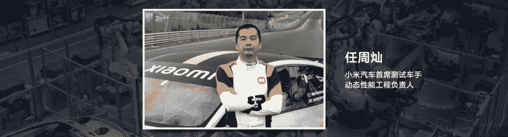

他出生在浙江诸暨，他老家边上有个修车厂，他的童年就在这个修车厂里度过。大学时候，天天泡在汽车论坛当版主。大学毕业后，成为了一名汽车底盘工程师。为了把底盘做好，他开始苦练赛车，居然还拿了好几个赛车冠军。他对造车的痴迷，可见一斑。

4 年前，小米宣布造车时，满屏的弹幕都是“干翻特斯拉”。

他的一位同事准备加入，他马上问：“能不能带我一起去？”为了表达决心，他甚至说，“小米在哪造车，我就举家搬到哪里”。

就这样，小米聚集了一大群热爱汽车、野心勃勃的工程师，他们都渴望干出点惊天动地的大事情。

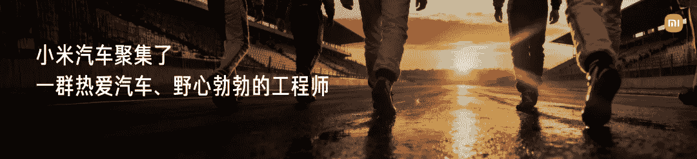

## Ultra立项

这么多优秀的工程师聚在一起，能整出点什么事情呢？2021 年 9 月，小米汽车首次全员会，就宣布了一个宏大计划：对标保时捷和特斯拉，打造全球最强的纯电性能车。

一开始造车，就敢提出这样夸张的目标，真是“初生牛犊不怕虎”。当然，做全球最强，困难非常多，比如，当时市场上没有合适的高功率电机，我们就横下心来，自己组建团队自己干，这就是后来的小米 V8s 超级电机，甚至连生产都是自己干的。

经过几个月论证，12 月，Ultra 项目正式立项。

然而，春节刚过，项目又被取消了……

不知大家是否还记得？2022 年春节后，我们开了长达 21 天的会议。当时，SU7 开发到了最关键的阶段，而且，我们刚开始造车，能力和资源严重不足，为了确保 SU7 成功，我们只能忍痛把 Ultra 项目先砍掉。大家都挺沮丧的。

谁也没想到，到了 5 月，Ultra 项目又被“捞”了回来。

那次会议，我们在线上开的，也开了好几天。为了活跃会议气氛，我给每位同事寄了瓶红酒。有位工程师举着酒杯提议：“保时捷是我们心中的神，我们能不能造辆车，在纽北赛道上直接挑战呢？”这个想法瞬间点燃全场。

**开着亲手打造的车，在**纽北赛道上驰骋，超越保时捷。这就是很多汽车工程师们的终极梦想。

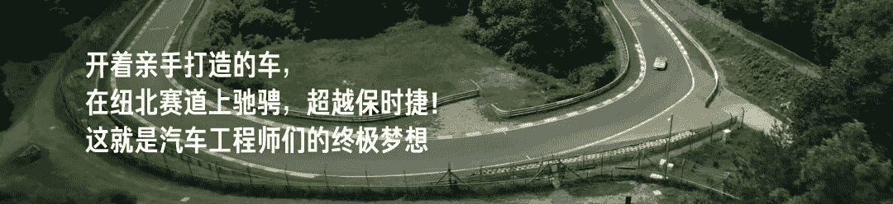

当时 SU7 项目已经取得了突破进展，压力没有几个月前那么大，大家决定咬牙重启 Ultra 项目。

消息一公布，工程团队沸腾了，阿灿更是激动得跳了起来。Ultra 就是一群工程师的追梦之旅，大家热火朝天干起来了。

## 挑战纽北

然而，困难接踵而至，我说一个大家最想不到的难题。

2023 年 8 月，我们首次联系纽北官方，对方很快回复了，之后再无音讯。我们连发 20 封邮件，如石沉大海。直到三个多月后的圣诞节前夕，才收到第二封邮件，终于答应接待我们。

2024 年元旦刚过，项目组同事立即赶到了纽北，当时大雪纷飞。

见面后，对方问的第一个问题：“一家中国手机厂商，为什么要来纽北？”

我们详细介绍了 Ultra 的方案，这份雄心打动了他们。

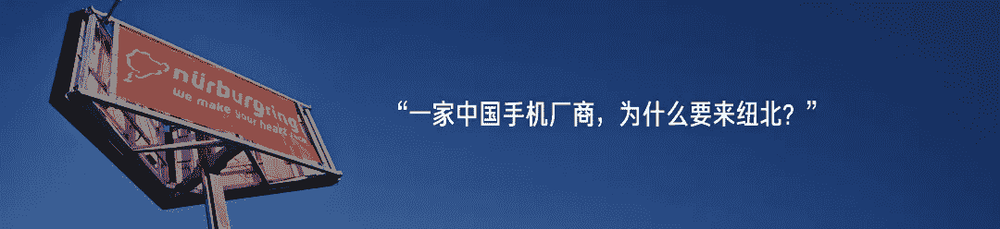

尽管小米刚刚造车，尽管赛道档期非常紧张，纽北官方仍为我们尽力争取，在纽北测试的同行们也给了很大的支持，最后排到 10 月初。为了保证有足够的时间，我们定了连续两天的包场，就是 10 月 9 日和 10 日。

我们做好了所有的准备，期待 Ultra 的精彩表现。没想到，10 月 9 日那天，全天下雨。看天气预报，第二天还有机会。同事们兴致很高，仍然在互相打气。

为了见证这个重要的时刻， 10 月10 日一大早，我就赶到了纽北，从早晨 7 点开始就守在赛道边。结果，看了一天雨……

后来的故事大家都知道了，一波五折，10 月 28 日，我们终于获得了 10 分钟的机会，只能跑一圈。正是这一圈，Ultra 原型车创下纪录，让世界首次见证了小米汽车的实力。

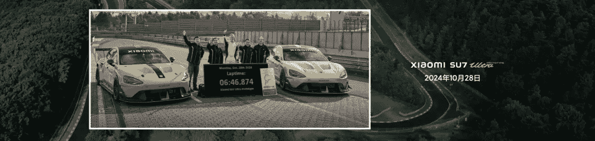

Ultra ，让我真心感慨，**只有发自内心的热爱，百折不挠的坚持，才能创造奇迹，如果**不是工程师们发自内心的热爱和向往，如果不是我们始终坚持不肯放弃，就绝无可能诞生这样的传奇。

今年 4 月 1 号，Ultra 量产版正式冲击纽北。这一次，天气不错，我们只用了四圈，就留下了两项震撼人心的成绩。

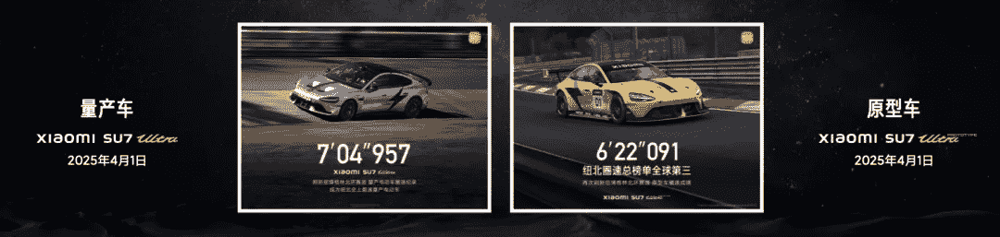

回顾 Ultra 这三年的历程，经过了太多的波折，但最后的结果远超了大家的想象。网上有句话，我非常喜欢，分享给大家，“你只管努力，其他的，交给天意。”

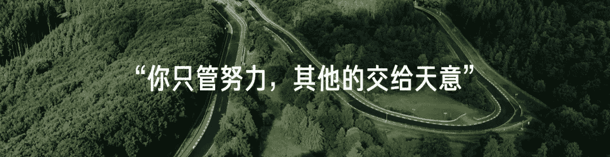

唯一遗憾的是阿灿。去年 10 月，为了确保成功，他把唯一一圈的机会让给纽北本地车手 David。今年也很遗憾，他个人没有跑出理想的个人圈速。大家知道，在纽北官方圈速榜上，还没有任何中国车手的名字。但他相信，终有一天，他会在纽北官方圈速榜上写下自己的名字。

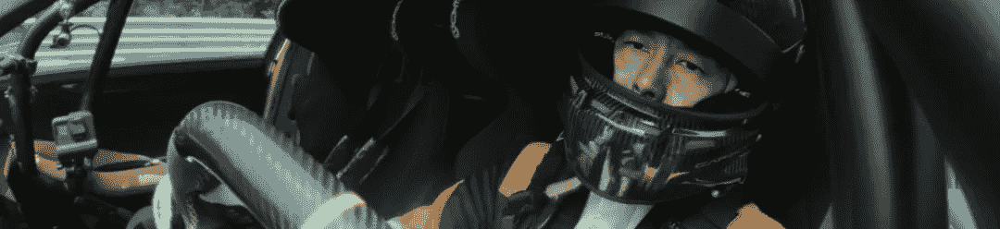

凭实力赢得尊重，小米在纽北的一系列成绩，正悄然改变全球汽车工业对中国汽车的印象。

小米SU7 系列，首战就获得了令人瞩目的成绩，成为近一年 20 万以上最畅销轿车，所有车型销量第八，并登顶保值率榜首。

# **再次突破**

小米YU7 今年 6 月发布，创造了更惊人的成绩：3 分钟大定超过 20 万辆。这个数字震撼了整个汽车工业，甚至因太过惊人，引来不少质疑。于是我们在第二天下午 4 点直接公布了锁单数据：18 个小时内锁单 24 万台。小米汽车为啥能够再次获得巨大的成功呢？我们说说小米YU7 背后的故事。

## 最后的底牌

很多人可能不知道，YU7 项目刚开始，就背负着巨大的压力。

那是 2022 年的夏天，SU7 开发最关键的阶段。SU7 是一款纯电轿车，几乎所有人都不看好。除了特斯拉，从来还没有纯电轿车能卖得动。假如 SU7 不成功，YU7 就是我们最后的底牌，它必须承担起“力挽狂澜”的使命。

## 做一辆怎样的 SUV？

那时候，正值理想L9 发布，“彩电、冰箱、大沙发”的设计获得了现象级成功，理想开创了大空间增程SUV的新赛道。不少车厂摸着理想过河，也都取得了不错的反响。

YU7，作为小米汽车最后的底牌，该怎么做呢？ 是走自己的路，还是和大家一样“抄作业”？

这可能是小米汽车至今最激烈的争论。会议室里，火药味很浓，大家不得不制定了一条“君子协定”：实在吵不下去了，就相互“拉黑 24 小时”，冷静一天后，再接着吵。吵着吵着，我们观点就清楚了：理想这类大空间 SUV，各家车企一哄而上，很快就会有几十款上市，市场竞争会非常激烈；而且，多孩家庭也没那么多，市场需求的总量是有限的。我们也做一辆同样的车，肯定没前途。

而且，我们和大量用户交流后发现，哪怕他们选择 SUV，大多数时候，仍然是一个人开。

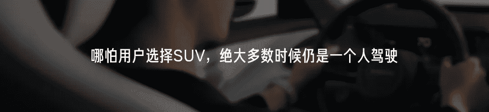

于是，我们有了一个大胆的想法：走一条不同的路，为驾驶者设计一辆好看好开的 SUV，同时兼顾家庭日常使用。这就是运动型 SUV。

论证过程中，有同事还是非常担心：国内市场这么卷，SUV 不拼超大空间，真的卖得动吗？

研发团队用详细方案证明，小米YU7 内部空间绝对不亚于 Model Y，这说明空间肯定是够用的。

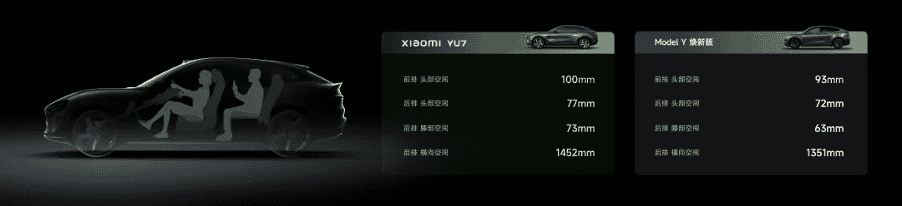

就这样，小米YU7，一款不一样的 SUV，正式立项了。

##  “最强标准版”的来历

从第一天开始，小米YU7 就带着破釜沉舟的决心，投入巨大，力求把每个细节做到完美。

我举一个例子，原来规划的标准版，续航 620 公里，对纯电 SUV 来说，已经非常不错，也比 Model Y 好不少。

但去年年底，几次长途实测，我还是觉得不太够。很多人买 SUV 就是为了长途旅行，我们如何才能消除用户的里程焦虑呢？想大改已经来不及了。

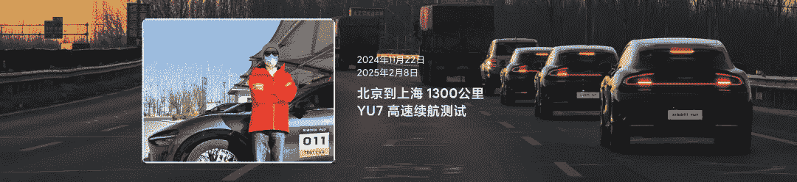

后来想了一个最简单直接的办法，砍掉 620 公里的版本，把 835 公里长续航 Pro 版换个名字，就叫“标准版”。

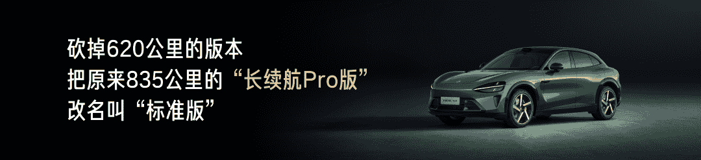

这相当于续航增加了 200 多公里，但定价不变。和 Model Y 一比，竞争力实在是太强了。方案一提出，负责采购的同事们差点“哭晕在厕所”。

就这样，“最强标准版”登场了。小米YU7 发布会上，我反复强调：这个标准版不是入门版、不是丐版、更不是阉割版，相当于别家的 Pro 版、Max版。这真不是吹牛，这个标准版确实是我们以前规划的长续航 Pro 版。

## 写给用户的情书

小米SU7 发布会前，我请教了很多媒体朋友，他们几乎都不看好。这次 小米YU7，我又问了媒体朋友们的意见，他们都非常看好。反而，我压力更大了。

这款“不一样”的 SUV，真的能被大家接受吗？

我们内心依然有点忐忑，但我坚信，我们为 YU7 倾注的无数心血，一定会赢得很多人的共鸣。

我在小米YU7 发布会结尾时说：“YU7 为谁设计的？是为那些无法容忍平庸的人，那些始终走在时代前列的人。也是为那些双肩扛着责任、内心仍有远方的人；那些清晨送孩子上学、顺路也给自己买束花的妈妈；那些周末带着全家去露营、也在后备箱中为自己留一套钓具的爸爸。那些在柴米油盐的烟火气中、内心仍有星辰大海的人。”

“小米YU7，就是小米工程师们写给所有热爱生活的人，一封最深情、最硬核的情书。”

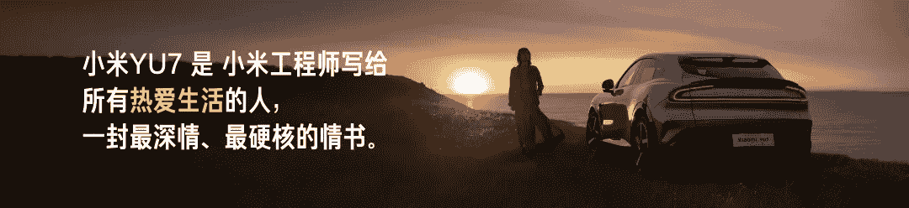

YU7上市后的表现，充分说明了，3 年前大胆“冒险”的决策，过去 3 年的所有努力，都是值得的。

一位 YU7 车主告诉我：他家宝宝出生后，他成了别人眼里的奶爸，专门买辆六座大空间SUV。有一天晚上下班，他突然感到很失落，独自在车上待了半个小时。在忙碌的工作与幸福的家庭生活中，他好像慢慢失去了自我。一年多来，他为每一位家人都费尽了心力，唯独没有给自己买过任何一件东西，哪怕一件 T 恤。看完发布会，他被深深打动了，当晚就说服家人，给自己买了一辆 YU7。

也许，小米YU7 的奇迹就来自这里。

## 4.5 改变的力量

从“最后的底牌”，到全新的奇迹。小米YU7 给我们的启示，就是：遭遇难题，不妨换个思路，大胆去尝试，就会有不一样的结果。

从SU7 、SU7 Ultra，再到 YU7，小米汽车用一系列扎实的成绩，改变了人们对一家手机公司造车的质疑。

同时，中国汽车行业，也正在经历巨大的改变，在高端汽车市场上，国产车已全面崛起。

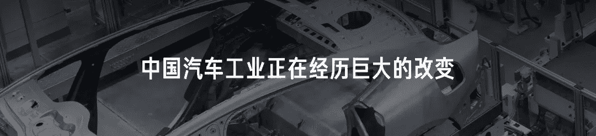

# **陈年新事**

这几年小米经历的深刻改变，其实也悄然改变了许多人，比如，我的好朋友——陈年。他是凡客的创始人，经常来我的直播间“蹭流量”。提前声明一下：他没有付过我一分钱的广告费，如果大家对凡客有意见，直接骂他，千万别找我。

## 小米SU7发布会

去年小米SU7 发布，是我三年造车交出的第一份答卷，对我非常重要，我特地邀请陈年来参加。

他说，来不了。他正在大连写小说，已经闭关一年多了，除了偶尔出去吃饭，几乎不出门。

我有些惊讶，确实有段时间没见到他了。

他还告诉我，凡客当年创业，摊子搞得太大，欠了十多个亿。后来每天早上醒来，一睁眼想的就是还债，就这样，还了整整十年时间。三年前，终于全部还清，他也彻底累了。

我说，我懂。

没想到发布会那天，他还是来了。当晚不少朋友一起聚餐，气氛很热烈，唯独他格外安静，没怎么说话。

## 只要你想，一定能改变

半年后，陈年突然约我聊聊。我们约的是第二天晚上九点。

见面后我才知道，他是一大早特地从杭州坐火车赶来的。我一时没反应过来：杭州？他不是在大连写书吗？他这才告诉我，去年三月看完发布会之后，受了很大触动。

四月份，他把整个公司搬到杭州，自己带队全面转型直播电商。我随口问了一句：“整个公司搬杭州，搬了多少人？”他说：“三四个人。”我一下子理解了他当时的状态，那个曾经一万多人的凡客，其实已经归零了。

我印象中的陈年，书生气很重，我有些担心，他干得了直播电商吗？何况，陈年兄弟这个年纪了，还能从零开始吗？

他很有信心，告诉我，就是发布会的那晚，仿佛心里有什么沉寂很久的东西，突然被点燃了。他觉得，雷军可以改变自己，跨行造车，他也行。

我脑子里立刻冒出这样的一句话：果然，55 岁，正是闯的年纪。

今年年初，他又来找我，很高兴地说：凡客已经做到了抖音男装前三。据说，还经常排第一。

陈年，我认识了二十八年的朋友，这一次，我是真心佩服。

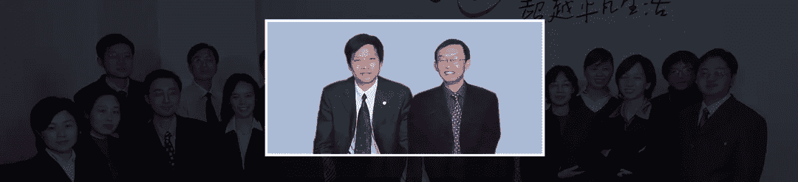

过去五年，无论是对小米，还是对我个人，都是一场彻底的蜕变！

我们，从一家互联网公司，坚定地迈向了智能制造的新战场；

我们，从手机和消费电子出发，开创“人车家全生态”的崭新局面；

这一路的改变，远不止于造车、芯片和高端化，重要的是，我们用五年脚踏实地的努力，重塑了小米的骨骼与灵魂。

5 年来，我最大的感受就是：从迷茫到蜕变，有时隔着万水千山，有时只隔了一层窗户纸。

只要持续努力、不断成长，每个人、每个团队，都有机会“逆天改命”。

<https://aigcreative.feishu.cn/sync/K4Gvd9vUQsy9Oubwqaeclu0Fnbg>

# 知识库动态