# 雷军2021年度演讲（2）：最好的投资，就是投资自己

> 来源：[https://aigcreative.feishu.cn/docx/GSX0dl1P4oWmKlxNG0NcS9KenXd](https://aigcreative.feishu.cn/docx/GSX0dl1P4oWmKlxNG0NcS9KenXd)

> 🔗 原文链接： h[ttps://mp.weixin.q](https://mp.weixin.qq.com/s/kGKdp-EgjzrnZgHiwyVsxQ)q.com/s/kGKdp-Eg...

2020是小米创办的十周年，去年我们内部认真地做了大量的反思总结，最后统一思想，抱着重新创业的决心开启了新十年的征程。

今年是我们新十年的第一年，也是我们小米手机发布的第十年，我们小米手机是2011年8月16号发布的。

如果你仔细观察小米，你会显著地发现在过去的一年里，小米变化很大。小米在一步一步地成长，一步一步地长大。

前几天，《财富》杂志世界500强的清单出来以后，小米第三次入选，这一次排在338名，而且一下子就进步了84名。

**还**有一个更大的好消息，就是前不久国际知名的几家调研公司的数据表明，小米手机的销量第一次超过了苹果，跻身全球第二。

这个消息传来的时候，我们大家都特别特别兴奋。

此时此刻，我想借这个场合感谢我们小米全球各地的将士们奋力拼搏，当然也要感谢十年来全球米粉对小米不离不弃的支持。

站在这里，我脑海里浮现七年前最难忘的一幕，就是在2014年首届世界互联网大会乌镇峰会上。

当时的小米刚刚做了三年手机，创造了一个小小的奇迹，我们仅三年时间从一个创业公司就变成了中国第一、世界第三，当时我们意气风发。

在这个峰会上，主持人问我说小米长期战略是什么样的？我脱口而出：

5—10年小米要变成全球第一。

当时的全球第一是苹果，现场的朋友高级副总裁布鲁斯·塞维尔接着就说：

“It's easy to say, it's much more difficult to do。 （说起来容易，做起来难多了） ”他这句话一讲，引起了现场观众哄堂大笑，场面非常得尴尬。

真的没有想到仅仅七年后的今天，小米在手机销量上就击败了苹果，成为了全球第二。

**而**且我们全球的市场份额达到了惊人的17%，这17%就意味着全球今天的消费者买手机，每六个人至少有一个人买的是小米手机。

这个报告还显示我们在第二季度市场份额的增速高达86.6%，年轻的小米正在高速地成长。

我还有更多的好消息跟大家分享，比如说我们小米在多达22个国家排到了世界第一位，尤其是在欧洲发达市场，小米的市场份额超过25%，第一次登顶欧洲第一。

调研公司还跟我说，这是中国公司第一次达到这样的成就。

**一家中国公司的手机，能在欧洲这样的发达市场里面**拿下第一名的位置，还是有史以来第一次。

大家听到这么多的好消息都特别高兴，觉得全球第一唾手可得。

在这里，我还是需要跟大家讲实话：

不要低估世界级巨头的实力。我们小米还是一个非常年轻的公司，我们需要非常冷静地看到差距，继续夯实基础，稳打稳扎。

当前小米的任务：真正站稳全球第二。

小米的梦想就是让全球的每个人都能享受科技带来的美好生活。

**这条路注定了很漫长、很坎坷，我和小米的全体同学们都会拼尽**全力去证明：小米的梦想是一定可以实现！

去年我办了第一场演讲，这是我人生的第一场演讲。

今年我想再办一次演讲，主题就是“我的梦想我的选择”。

**我想跟大家聊一聊，我们在追寻梦想的路上都经历**了什么样的困难，都做了多少个艰难的决定。

# 1、**上市破发，之后股价跌到三分之一****，雷军被投资者当小学生一样训**

谈到这个话题，我觉得小米是一家上市公司，我们先从上市说起。

**谈到上市，我们做的第一个重大的决定就是要**不要上市、在哪里上市、用什么价钱上市？

2018年年初，经过反复讨论，我们最后确定了在香港上市。定什么价呢？

那个时候资本市场对小米特别看好，投行给出了17-22块港币的估值，几乎所有的创业者都会毫不犹豫地选择定得高一点、定得贵一点。

**而我们呢？毫不犹豫地选择了最低价，因为我们真诚地希望我们小米**的股票能够像我们的产品一样，价格厚道。

我们的愿望是如此得美好而朴素，而现实让我们有点失望。

2018年7月9号，万众瞩目的小米IPO来了。

一般的IPO的仪式观礼人数都只有几十人，这一次观礼人数超过了600人，因为这是香港首家同股不同权的上市公司，也是当时全球第三大规模的科技股IPO。

所以当时大家都特别挤兑，希望一开盘股价暴涨，皆大欢喜。

就在这么一种氛围里面开盘了，结果呢？破发了 （股市交易价钱低于IPO的定价） ，这就意味着所有IPO的投资者都亏了，这对于IPO来说是非常难看的一件事情。

**当**时我们心里特别得难受，等仪式结束以后还有很多媒体堵在门口，我们几个人谁也不愿意面对这个局面，心里特别难受，我们就躲到了港交所的一个杂物间。

然后有一个同事问我们在干什么？我跟林斌很尴尬地笑了笑。

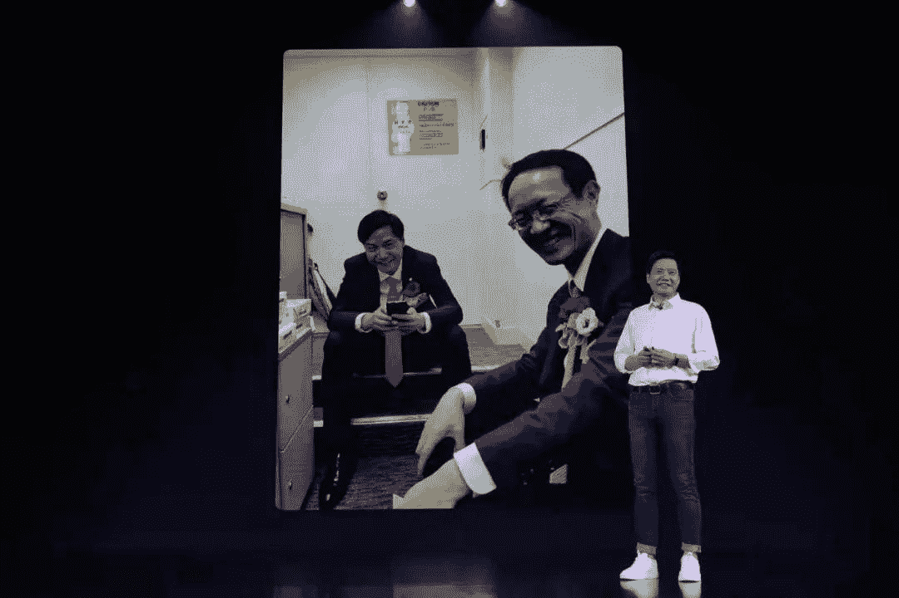

总之，那天真的是很难受，但我们还是按计划举办了当天晚上的内部答谢宴。

在这个会上我忍不住说：

**“对不起大家了，今天我们破发了，但是我们会努力工作，**一定要让IPO的投资者至少赚一倍。 ”

其实我知道我绝对不应该对股价做任何的明示暗示或者类似的承诺，但是那天真的很憋屈，所以忍不住就说了。

当天晚上我喝了很多酒，只记得我跟每一个小米的同事说：我们真的得好好干，绝对不能亏别人的钱。

第二天我特地去买了一条破洞牛仔裤，我从来没有穿过破洞牛仔裤，但是我那天刻意去买了一破洞牛仔裤，为什么呢？

**我**是要用这个仪式来让我记住破发的这一天，我还特别发了一条🧣，虽然小米已经上市了，但是革命尚未成功，同志仍需努力。

第二天，幸福来得太容易，我们小米的股票很快就涨回来了，然后一路就涨到了24块。大家都挺高兴的。

正当我们踌躇满志的时候，中美贸易战升级了，小米的股价就掉头向下，接着开始了一年多时间的“跌跌不休”，跌到了2019年9月2号，跌到了多少呢？

跌到了8.28，我们的股价从24块跌到了8块钱，跌到了三分之一，跟IPO价比已经腰斩了。

当时跌到几乎所有人都快崩溃了，甚至有人认为还会跌到4块钱，在那段时间里，我特别不愿意见投资者，我见他们我说什么呢？

**有**一个投资者执意要见我，一坐下来只寒喧了几句，他就毫不客气地说，你们怎么让我赔了这么多的钱？我真的不知道你们怎么干的。

接着从小米的战略到小米的产品，再到小米的管理，把我当小学生一样训了一个多小时吧。

不瞒大家说，我当时的衬衣都湿了，会后我一个人坐在会议室里坐了很久，那一刻特别得绝望。

所以，在那段时间，我无数次地问我自己：

**我们如此努力地工作，我们小米的收入和市场份额都在不断**地增长，为什么资本市场就是不认可我们呢？

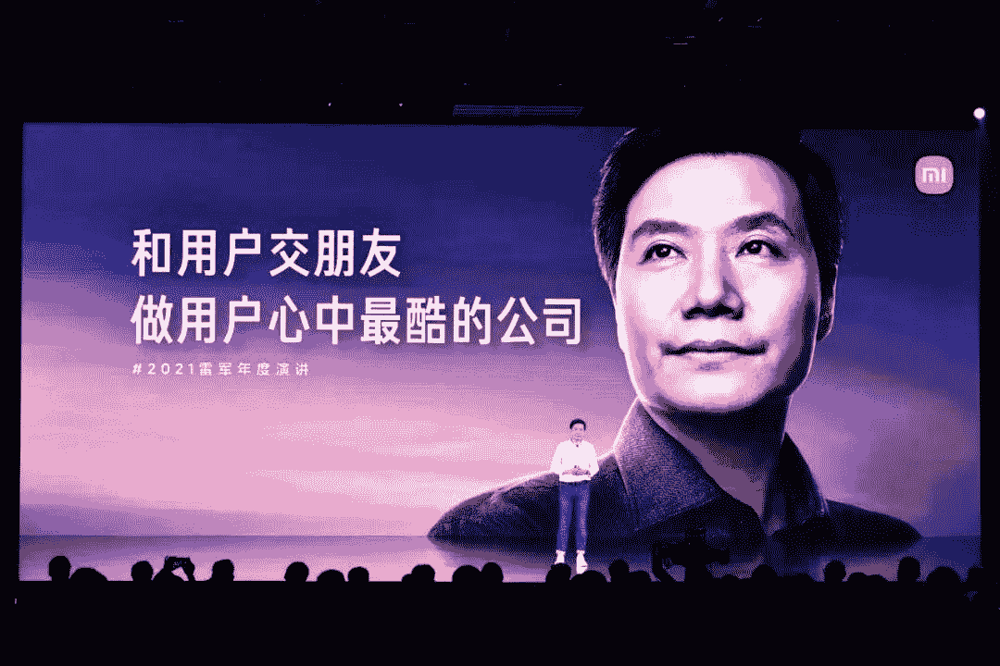

我实在有点想不通，所以就这么一个问题，我问了自己很多很多次。

接着，我又问了一个更关键的问题：如果我是投资者，我会不会买自己的股票呢？

**我**是一个很自信的人，我一直坚信“最好的投资，就是投资自己”。如果我们自己都不相信自己的话，我们怎么说服别人相信自己呢？

当然，在那个大崩盘的时候，要真金白银买自己的股票，我觉得对我们每个人来说都是灵魂拷问吧。

我鼓起勇气提出了这个想法，在董事会的支持下，我们一把掏了36个亿的真金白银，在均价9.35港币买了大量小米的股票。

今天回头看，我们抄到底了，但是在那个时候需要巨大的勇气，因为抄得不好你就抄到半山腰了。

本来大家就把我骂得半死，如果这次我又弄砸了的话，后果真的不堪设想。

所以在那个时间，相信自己成了我最大的安慰吧。

**苦心人，天不负。 **

虽然小米业务一步一步地成长，我们的股价也开始反转，也开始慢慢地成长。

到了2020年7月10号，就是我们上市两周年的第二天，我们的股价终于回到了17块。我长舒了一口气，我跟大家开玩笑说，从此我可以抬头挺胸、重新做人了。

接着小米的股价一路高歌，到了今年1月4号，小米的股价达到了34块。

**当年在庆功晚宴上我们吹过的牛终于兑现了，那一刻破**发给我造成的心理阴影也终于烟消云散了。

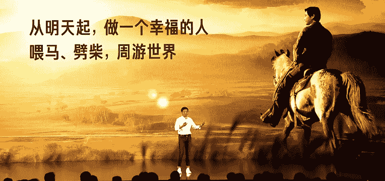

我跟同志们认真地说，我再也不用关心股价了，那些股票软件对我来说也没用了。

从明天起，做一个幸福的人，喂马、劈柴，周游世界。

# 2、**越是压力巨大，越要押注研发**，聚焦精力打磨产品，等待用户反馈

有人说你们的股价怎么又回来了呢？

**其**实这几年越是在股价低迷的时候，越是在压力巨大的时候，我们做了一个非常重要的决定，就是进一步加大研发投资，进一步聚焦做好产品。

而且我们还提出了一个新的目标，就是突破高端。

小米手机在刚起步的时候，其实我们就是从高端入手的，小米手机的第一代就是那个时代最高端的智能手机。

后来我们出了面向大众市场的红米手机，这个产品系列非常成功，它在全球范围里推动了智能手机的大规模普及和移动互联网的发展。

在这个巨大的成功背后，谁也没想到这个成功同时也极大地稀释了小米品牌。

**再加上我们自身的实力不足，小米就被很多人误**解成只做中低端，所以突破高端迫在眉睫。

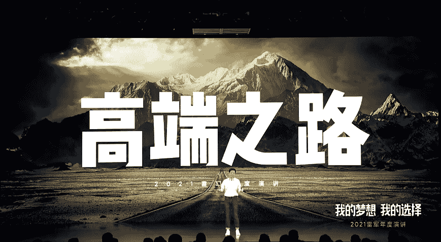

我们三年前重启了高端之路，我们做的第一款高端是什么呢？

小米10，当时我们决定不惜代价死磕体验，并且要细心打磨所有的细节。

我们就是这样来做小米10系列的，整个产品线一下子投入多达十亿人民币。

等产品做好以后，我们做了一个简单的测算，当时4G升5G原材料大幅度飙升，再加上高昂的研发费用，小米10要想不亏钱一定要满足两个条件：

首先定价要过4000，接着至少卖200万台以上。

一看到这个结果，大家都傻了，压力巨大。

我们小米做了这么多年，我们小米的旗舰手机定价都在3000以内，一下子要定到4000块钱，是不是疯了？米粉能接受吗？

**所以我们整个团队通宵达旦在想办法**，一方面在打磨细节，一方面在想怎么办。

我今天都想得起来当时我们讨论的问题，比如说我们怎么破圈，我们怎么影响商务人群，我们怎么做才能显高端。

甚至我们是不是应该找一个跑车品牌搞一个联名？想了各种稀奇古怪的问题。

说实话，我觉得当时也找不到答案，我觉得同行的这些方法拿给我们用未必用得了。

**我也懵了好长一段时间，我后来想出来，我觉得我们小米**只能走小米的路——相信米粉，依靠米粉。

我为什么这么说呢？

因为我在想，在中国正在使用小米手机的人一亿多人，有没有2%的用户愿意相信我们，给我们一次机会呢？

**我觉得只要我们认认真真把产品做好，做出一款米粉认可的高端手机，**就一定会有2%的人愿意给我们一次机会。

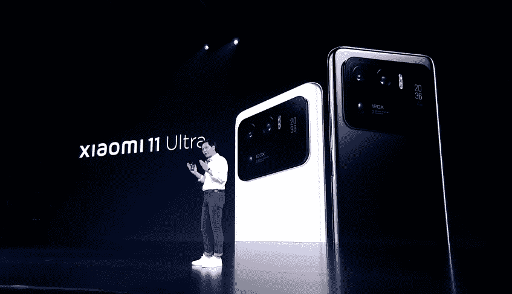

当我把这个道理跟同事们讲清楚以后，大家的担心全部放下来了。

**我们就聚焦所有的精力打磨产品，我们坚**信只要把产品做好了，它就一定能卖得出去。

我们就这样把精力全部放在做产品上，然后也在忐忑不安地一边很激动，一边又很紧张等待着产品的发布会，等待着发布之后用户的反馈。

# 3、**相信米粉、依靠米粉****，才能生存**

2020年1月份，一场突如其来的疫情打乱了这一切，整个世界仿佛都停摆了。

**那**段时间我每天都在想，倾注了无数心血的小米10怎么办呢，是推迟还是取消？难道我们高端之路的第一仗，就这么输了吗？

在那段时间，每天都开很长时间的电话会。到了2月初，我们下定了决心按原计划执行。

这个原计划就是2月13号发布。

到了2月13号，我们克服了重重困难，小米10按时发布了。

**还**记得去年2月13号吗，整个发布会的观众席上空无一人，我戴着口罩走向舞台的时候，我心里都极其忐忑不安。

我担心我自己的状态，我更担心这种直播发布会的效果。

可是当我走到舞台的中央，当灯光亮起来的时候，那一刹那，仿佛千百万米粉就在眼前，仿佛大家的欢呼声此起彼伏就在耳边。

那一天我特别特别激动地给大家介绍小米10，而发布会也空前成功。

第二天小米10首发，一分钟就破了两亿元的销售额，卖疯了。

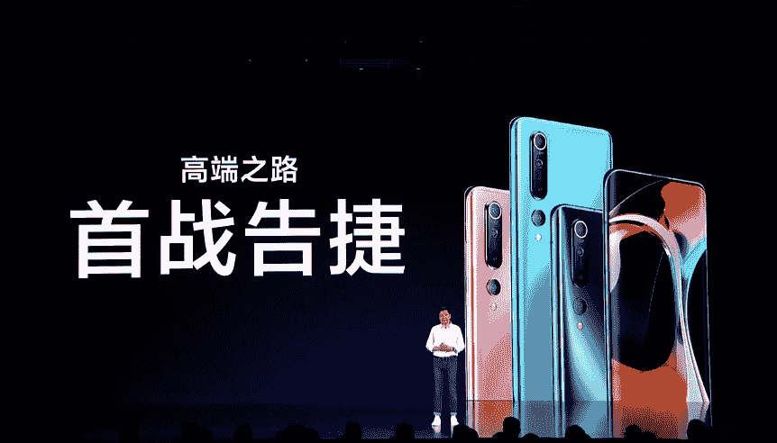

我们去年的发布会，当时还戴着口罩，整个现场空无一人。

这个发布会是全行业疫情后的第一场发布会，为全行业的复产复工打开了局面，趟出了一条路。

**可是到今天为止，可能大家已经习惯了直播发布会，但是在**当时小米是这种直播发布会形式的开创者。

小米10系列首战告捷，当初我们计划卖出200万台。

到今天为止，我们统计了一下，小米10系列一共卖出了577万台，我们小米10S还在持续地热销中。

一个计划卖出200万台的产品最终卖了将近600万台，这里面的秘诀在哪里呢？

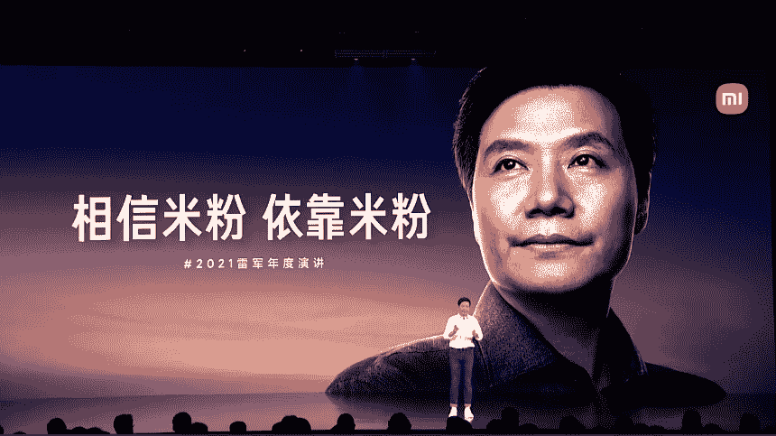

这里面的秘诀是：

**小**米走高端之路需要继续坚持小米模式；需要相信米粉，依靠米粉，认认真真做感动人心、价格厚道的好产品。我们的高端之路就一定可以成功。

小米10大胜以后，我们内部士气大涨，大家希望能够乘胜追击。

所以在内部讨论的时候，大家说影像技术是全行业的技术制高点。

当时我们相机部负责人朱丹就说这一次我们能不能放个大招，我们能不能把相机的传感器直接整到手机上，这样就可以大比分地领先对手，能够拿到全球影像技术的第一名。

他这个想法是非常非常夸张的，我们设计部的负责人立刻就急了：

这样做出来的手机会不会像相机一样厚，这么厚的手机能卖得出去吗？大家的争论极为激烈。

经过反复讨论以后，我们就达成了一个共识：

**我们为影像的发烧友专门做一款手机，主**攻相机，一定要把影像技术做到全球第一。

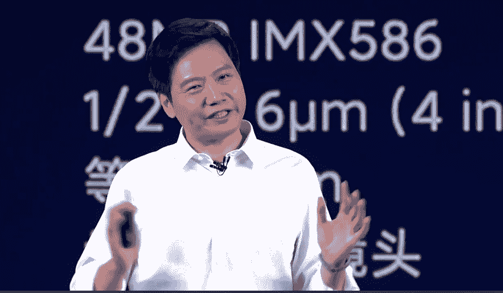

当下了这个决心以后，这个产品的名字我们就命名成Ultra，为什么叫Ultra呢？Ultra就是极致，就是巅峰。

所以我们这个项目立项以后，相机部提前18个月花了大量的精力专门定制了一个GN2的传感器，这个传感器的底大得吓人，将近1英寸，它已经到了接近相机的标准。

**当**这个产品的原型拿出来以后，我们一试拍，效果非常惊艳，已经可以媲美索尼黑卡的效果了，所以这个效果是特别特别得出色。

但是相机的凸起也特别夸张，当时我们的设计部一筹莫展。

后来我们尝试了各种各样的设计方案，最后找到了一个大家都能接受的方案：

就是在这么凸起的相机边上加了一个小屏幕，是不是一下子看起来舒服了很多。

这个改进后的产品原型后，我们内部的调研有不少同事还特别喜欢。

后来，小米就集中精力打磨产品。

到了3月底，这一款产品正式发布。

在发布会上，我讲完以后心里还是特别特别得紧张，但是发布完以后效果特别特别得好，我觉得主要的原因还是Ultra这个产品太强了。

**它有多强呢？它的拍照以大比分领先同行，**获得了DXOMARK评分的总分第一名。

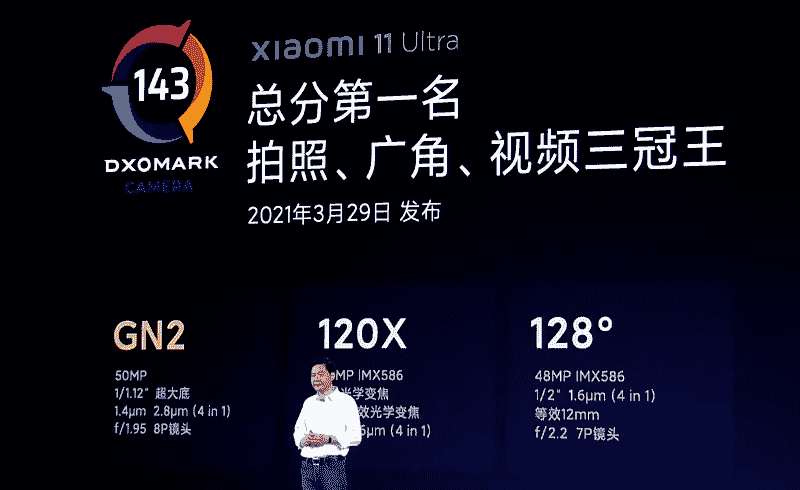

这一次的总分第一名霸榜了122天，我一直担心的设计问题反而米粉们都特别喜欢，说这个设计有个性，这个设计有辨识度，这个设计好看。

我当时在想，只要这个影像做好了，可能消费者因为如此强大的功能，就能接受它的设计了。

**这件事情在我们内部大家都特别特别得高兴，而且这一**款产品在全球范围内也引起了巨大的轰动。

我专门还看了一下当时有不少国际上的科技博主给予了高度评价。

我觉得Ultra这个产品取得了这样强烈的反响很重要的一个原因是什么呢？

是我们在追求极致的影像体验里面不惜代价、不管不顾，哪怕有些地方不完美，但是我们也拼了。

**就是因为在攀登科技高峰的过程中，你总会遇到各种各样的**困难和问题，我们需要下功夫一起来解决。

这个产品首发以后，预订量也非常非常得惊人。

当然后来我们又掉到了坑里了，Ultra这个产品特别复杂，当时时间又比较紧张，而用户对我们的期望值特别特别高，我们有些细节没有达到用户的预期，然后被用户骂惨了。

后来我们意识到做这样的高端旗舰的话，我们要继续像小米10一样，打磨每一个细节。

我们立刻成立了一个专门的团队然后又打磨了四个月，在核心体验上已经有了显著的提升。待会儿我们MIUI的负责人金凡会专题跟大家汇报。

**小**米的高端之路其实现在才刚刚开始，我们会不惜代价地持续投入，我始终坚信只要相信米粉，依靠米粉，小米的高端之路就一定会成功。

# 4、**美国将小米列入“涉军清单”****，小米起诉，赢了**

就在我们业务欣欣向荣，就在我们不断地冲刺高端市场的过程之中。

谁也没想到飞来横祸，发生了一件什么事情呢？

1月15号美国把我们列入了DoD清单。

可能很多消费者都不了解DoD清单，DoD清单就是美国国防部认可的“中国军方拥有或控制的中国企业清单”，简称“涉军清单”。

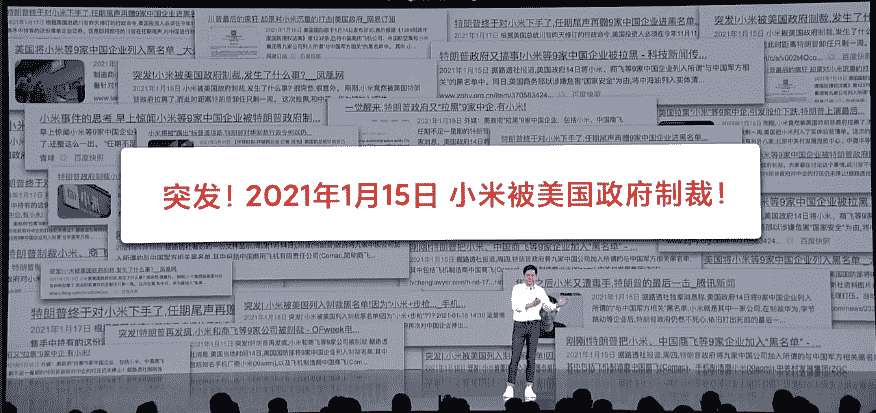

**进**入这个清单以后，处罚就是禁止美国投资者投资。而且对小米这样的正在拓展国际业务的公司来说，也是一个巨大的障碍。

当这个事情出来以后，股市一开盘股市暴跌，一度跌幅超过30%，后面几天连续跌，一直跌到21块，一共跌掉3000亿的市值，所以对我们小米也是重创。

我们第一次遇到这样的事情，我们也很懵，不知道该怎么办？怎么也想不明白小米怎么就成为了一家“涉军企业”？

当时网上有很多段子，他们说你看，有陆军、海军、空军，今天又多了雷军，所以你们涉军。

我们当时的压力巨大，但是还是非常非常得自信。

**因为我们是在海外上市的公众公司，我们的信息**也高度透明，我们坚信我们不是涉军公司。

所以我们立刻发布公告：小米并非“涉军企业”，坚决反对美国国防部的无理制裁。

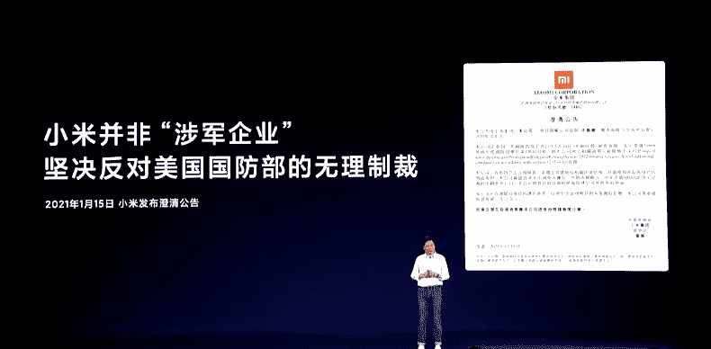

公告以后，我们联系美国国防部，他们说他们的保密机构，根本就不搭理你。

这个时候怎么办呢？要么认了，要么起诉美国政府。

但是DoD清单不一样，DoD清单首先一个中国公司起诉美国政府胜算本来就不大，加上DoD清单从来没有过成功案例。

**我们还有点担心，万一起诉美国政府失败，美国政府**会不会打击报复，然后招致更强的打击呢？

所以我们内部的意见也分歧很大，后来我们去请教了很多律师，也请教了很多国际关系的专家，大家也是众说纷纭，分歧很大。

最后我们做了一个艰难而重要的决定，直接起诉美国政府，用堂堂正正的方式来捍卫合法的权益。

**我们起诉以后，美国国防部不得不公布了原因，当我们**大家看到这个原因以后，大家都忍不住笑了。

主要的原因就是2019年我获得了由中国工信部等部门评选的“优秀中国特色社会主义事业建设者”的荣誉称号，因为工信部是中国军民融合的推动部门，所以小米涉军。

看到这样的理由以后，我们的律师在法庭上就问， 说你们知道这个名单有500个人获奖吗？

** 你们知道老干妈的老板、七匹狼的老板也在服装之**列，难道做服装、做辣椒酱 也涉军 吗？

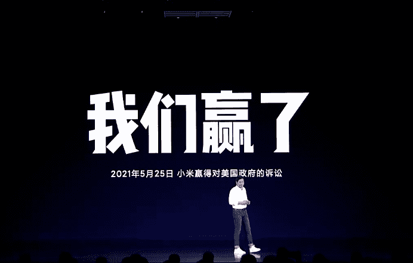

经过多轮交锋以后，5月25号我们赢了。

**在小米胜诉的影响，后来又有几家中国公司起**诉成功，所以，这件事情是史无前例的成功。

# 5、**金山旧缘，情义无价**

我已经给大家讲过多个关于公司的艰难决定，其实我也想讲一个关于我个人的艰难决定。

过去的十年，我和小米已经高度绑定了，可能很多人不知道我还有另外一个身份，就是金山的董事长。

我是怎么成了金山的董事长呢？这主要来自于一个不理智的决定吧。

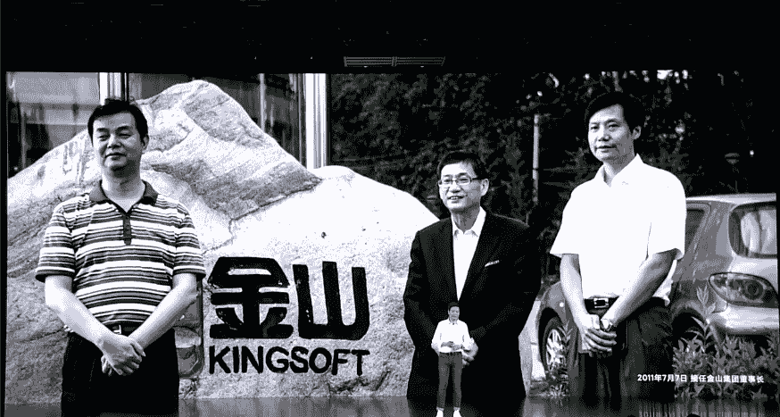

2011年我们小米已经创办了一年多时间，那个时候我们正在紧锣密鼓地开发小米手机第一代，非常非常忙。

**金山的两位老板张旋龙、求伯君来找我，当时金**山遭遇了巨大的危机，他们希望我重回金山。

可是在那个时候我们小米已经创办了一年多，我怎么可能重回金山呢？

但是他们了解我对金山的感情，我参与了整个金山的创业过程，从22岁干到38岁，金山几乎是我的整个青春，所以我对金山的感情特别特别深。

他们就跟我说如果没时间没关系，你兼职干就行，只要你接就行，而且每次一聊四五个小时。

说实话，一方面小米手机发布在即，理智告诉我千万不要感情用事，小米只有全力以赴专心才能干好。

**但另外一方面两位大哥20多年的情义，金**山兄弟的前途让我扔下不管我也于心不忍。

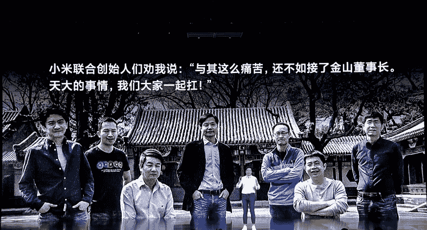

那段时间我特别特别得痛苦，痛苦了很长时间，我们小米的几位联合创始人忍不住劝我：

与其这么痛苦，还不如直接就接了呗，天大的事情我们大家一起扛。

大家想一想他们是小米的创始人，他们肯定希望我把精力集中在小米业务上。

但他们了解我的性格，也了解我对金山的感情，才会给了我这样毫无保留的支持，当时我特别特别感动。

就是在这帮兄弟们的支持下，2011年7月7号我正式接任了金山的董事长，接手以后，所有的事件扑面而来，那一段时间忙得晕头转向的。

**幸**亏金山的兄弟们也特别给力，大家团结一心共度困难，一步一步我们的金山就从困境里走出来，也一步一步恢复了生机。

今年是金山软件的33周年，也是我接任董事长十周年。

整个金山发生了脱胎换骨的变化，整个收入从不足十亿到现在合并收入121亿，增长了11倍。

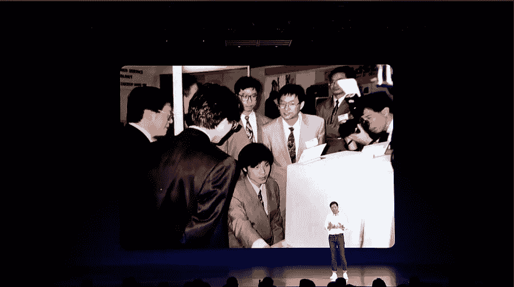

所以今天回想起来，十年过去了，我特别特别得欣慰，在兄弟们的帮助下，没有辜负金山吧。

**所**以今天看起来当初不理智的决定背后默默影响我的其实就是四个字，情义无价。在过去十年里，我们对待用户、对待员工、对待合作伙伴，我们始终如此。

# 6、**小米下一个目标：****3年时间，拿下全球第一**

马上就是8月16号，小米手机发布十周年。

**此时此刻，面对数以亿计的米粉，感慨万千，真诚感谢大家一路**同行，感谢大家见证了小米这十年的成长。

从小米第一代到今天的小米11，从MIX 1到MIX 3，这13款手机就构成了小米过去的十年。

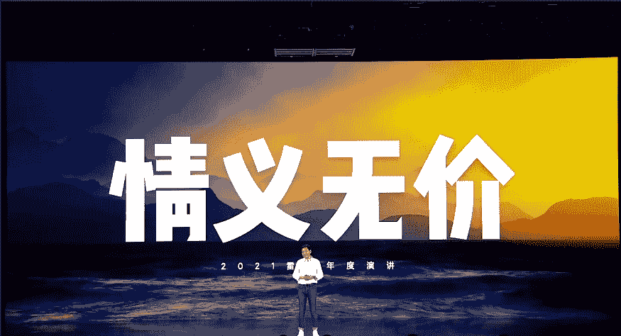

经常有米粉跟我说，他拥有这13款手机，当时我很震惊，我觉得在小米内部可能也很少人收集齐。

后来我自己去翻了一下我的收藏，我非常高兴得跟大家分享一下照片，就是我把它们收集齐了。

**这里面还有不少版本是特别工程版，没有正**式上市的，我相信大家可能不一定都见过。

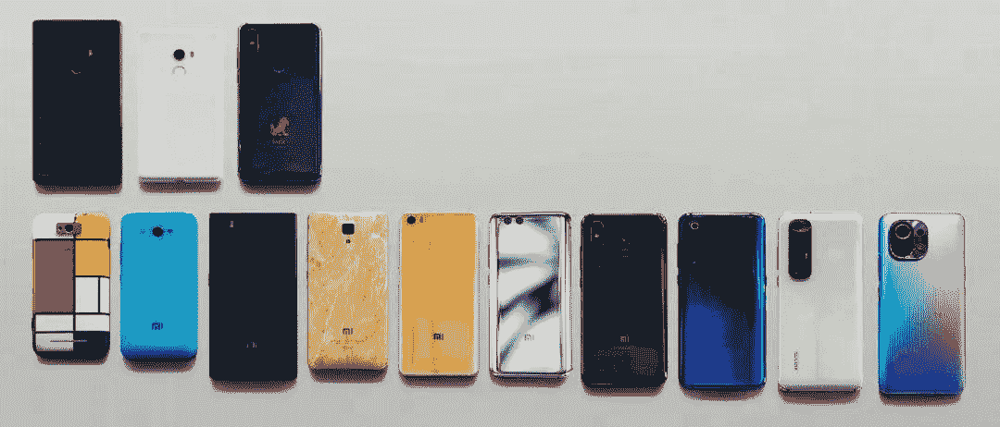

2020年6月，我请了几天假去云南徒步，过去特别忙，几乎没有休假过。

我当时是在香格里拉的一个国家森林公园里面徒步，偶遇了一个年轻人，他叫姚聪，27岁，是华能集团的一个风电工程师，他在山上工作，工作20天，休息10天。

当时我戴着帽子眼镜，我想在森林公园里应该没有人认识我。他过来跟我打招呼的时候，我也没有意识到他认识我，所以我们就聊了一路。

在聊的过程中，我注意他用的是小米8透明探索版，我也装作没看见，我们就一直走了十公里，在要分开的时候，他跟我说，雷总，我们能不能合个影。

他说他不好意思打扰我，所以就没有跟我说他认出我来了。

**他**说他特别特别喜欢小米，每次小米发旗舰，他都打电话给当地的代理商留一台最好的，等他从山上下来的时候去取。

我就问他，我说在山上工作会不会很枯燥？他说风电事业非常有意义，所以他很喜欢。

他买得起任何品牌的手机，他也用过别的品牌的手机，但是最后他还是坚决地选了小米。

我问他为什么？他说，“因为小米不一样，小米的理念不是赚很多钱，小米选择了一条更艰难但是更有意义的路。”

他很认真地看着我说：“我也是一个有追求的人，所以我更喜欢小米。”

他这番话在我心里引起了轩然大波，我知道世界各地有千千万万像姚聪这样的米粉十年来一直默默地支持我们，相信我们。

正是这些信任，才让我们克服了重重的困难，走到了今天的世界500强，走到了今天的全球第二。

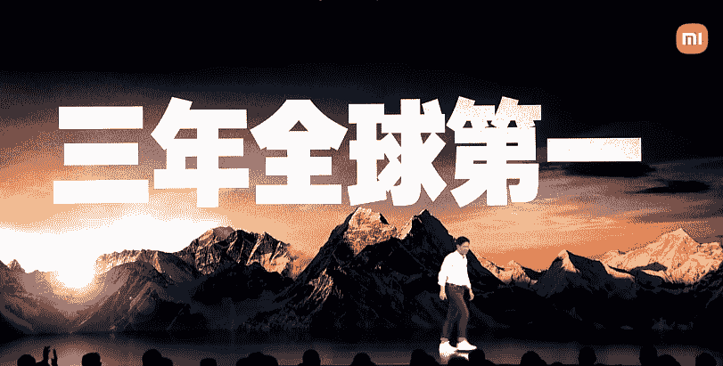

**也正是因为这些信任，让我有勇气在这里告诉大家我们**下一个目标——三年时间，拿下全球第一。

我觉得此时此刻如果我们不告诉大家这样的目标的话，大家可能会觉得我们会胆怯。其实我们内心一直有颗伟大的心。

小米创业11年来，我们担心过失败，担心过自己的能力能不能跟上公司的发展，也担心过体力和精力，但是每当遭遇巨大危机的时候，我都会毫不犹豫地挺身而出。

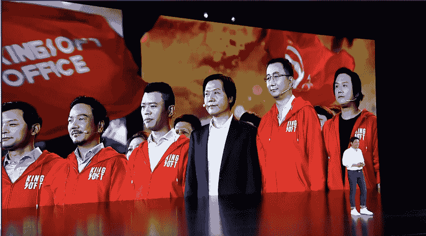

在我们这个演讲的预热片里，我说了这样的几句话：

**我不是天才，也不是什么劳模，更不是什么战神。我只是一个普**通的工程师，追求梦想，做自己热爱的事业！

讲到这里，今天我关于“梦想与选择”的演讲，也要到此结束了，感谢大家。

<https://aigcreative.feishu.cn/sync/K4Gvd9vUQsy9Oubwqaeclu0Fnbg>