# 吴晓波：预见2023，勇敢者的方法论（演讲全文）

> 来源：[https://aigcreative.feishu.cn/docx/YO72dx0AYoIDhLx6crjcA6ofnph](https://aigcreative.feishu.cn/docx/YO72dx0AYoIDhLx6crjcA6ofnph)

> 🔗 原文链接： h[ttps://mp.weixin.q](https://mp.weixin.qq.com/s/pWFyJSC8p4jxRqHkw2ugFQ)q.com/s/pWFyJSC8...

# **01****-****遇见2022：勇敢者的方法论**

大家好，每天听见吴晓波，我是吴晓波。欢迎大家来参加今年的年终秀。

感谢杭州市，这是第二次在家乡开年终秀，我的中学浙大附中就在两三百米远的地方，站在这儿特别亲切，也特别安心。

再过不到30个小时，我们就要告别这个让我们终身难忘、一言难尽的2022年。今年的主题叫作“发光吧，勇敢者”，在这个特别困难的一年，让我们认真思考和理解，何谓勇敢，2022年哪些人是勇敢的，他们留给我们怎样的启迪和勇气。

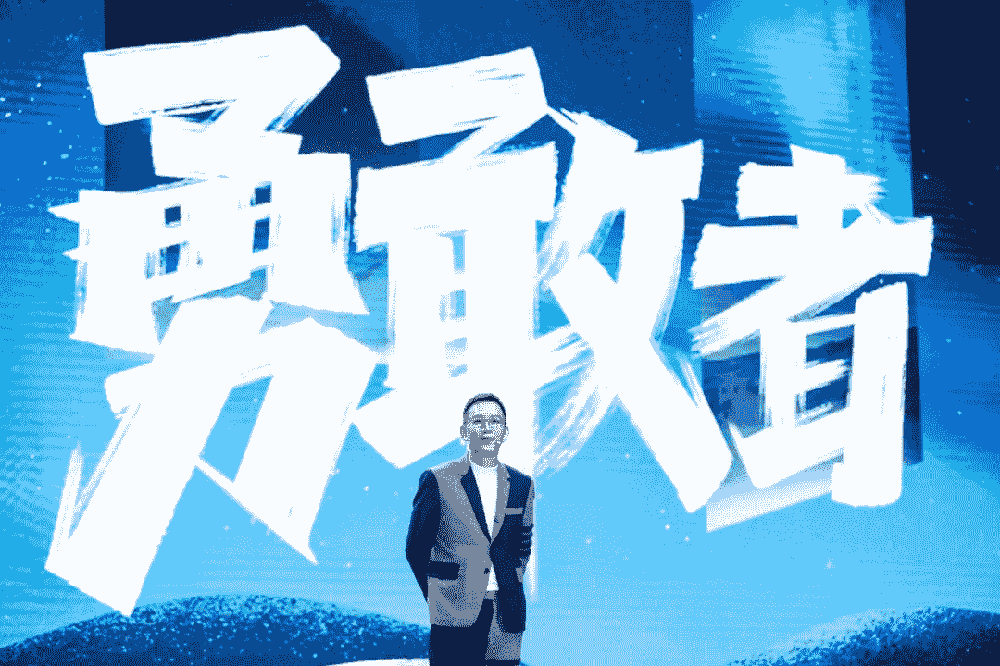

2022年的国民偶像是谁？我会选一个人，苏东坡。他生活在所谓的百年盛世，但他这一生很倒霉，因为一个“乌台诗案”差点丧命。一生颠沛流离，辗转过许多城市，最穷的一次是在黄州当一个叫团练副使的闲差，因为养不起一家妻小，朋友给他在城东面申请了一块地种，这块地就叫东坡。

林语堂说，“他是一个无可救药的乐天派”，虽然生活在不断折磨他，但是他总是非常乐天。他写过一首《定风波》，竹杖芒鞋轻胜马，一蓑烟雨任平生，回首向来萧瑟处，也无风雨也无晴。我们很多同学都读过这首词。什么情况写的？他说：“沙湖道中遇雨，雨具先去，同行皆狼狈，余独不觉。已而遂晴，故作此词。”

天都下雨了，雨伞都没带，所以淋成了一个落汤鸡。大家都觉得很倒霉、很沮丧，只有苏先生觉得“一蓑烟雨任平生，也无风雨也无晴”。

我们没有办法拒绝风雨，怎么办呢？调整心态，调整行为，直面让我们狼狈的人生。

回看2022年，中国经济也是“道中遇雨”。

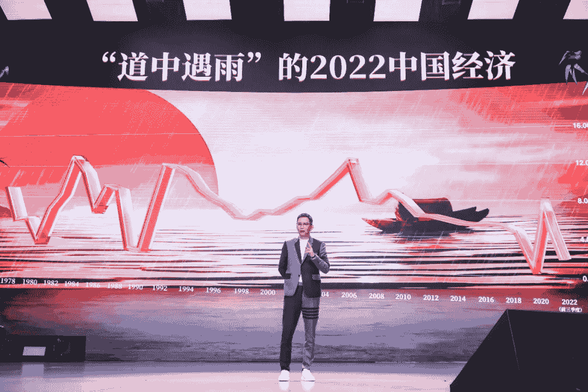

在过去44年里，高速增长是中国经济的一种基本现象。1978年到2022年，GDP增速最低是2020年，只有2.2%。但那是一个光荣的2.2%，因为2020年是全球疫情暴发的一年，而中国是全球十大经济体中唯一一个保持正增长的。

今年不一样，对来到现场的三千多人、直播间的上百万人来说，2022年可能不堪回首。

第一，2022年中国经济增速预计低于周边的国家，包括越南、马来西亚、菲律宾、印度尼西亚、印度，甚至巴基斯坦和孟加拉国。

第二，中国的人口自然增长率首次出现零增长。2021年我们的人口净增长48万，今年的自然增长率大概率归于零。这意味什么？意味着依靠劳动密集型增长的经济模式、经典意义上的人口红利在即将过去的2022年正式终结。

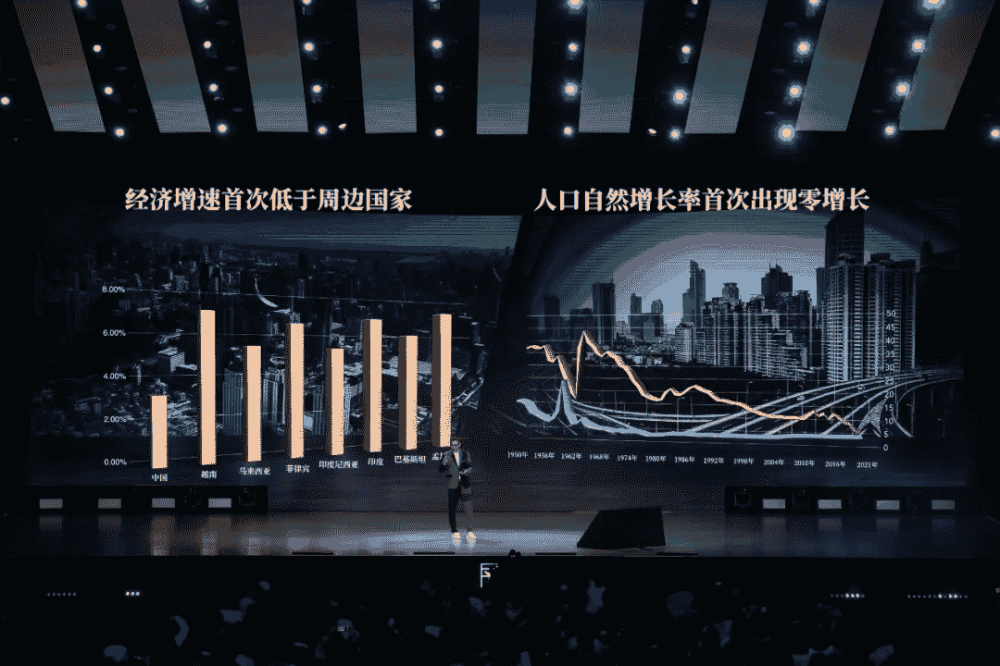

第三，中美科技脱钩成为发展隐患。特别是8月份，美国通过《芯片科技法案》，开始对中国的芯片等高科技产业进行全面阻击。很多出口外贸型的中国制造工厂，在美国合作伙伴的要求下，把先进的生产线迁移到东南亚和印度。美国在制造业领域摆脱对中国的依赖，将是一个中长期现象。

第四，正常企业经营遭到频繁打断。我们看这一张照片，可能属于全中国所有的城市，整条马路空空荡荡。今年很多月份，企业的正常经营、人们的生活遭到了频繁的干扰。

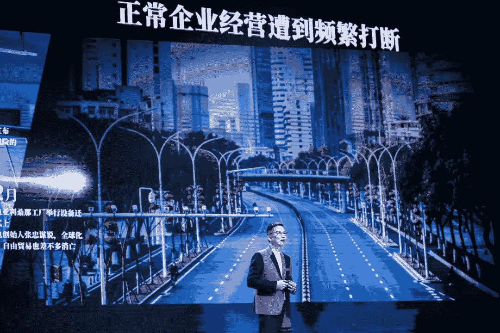

《财富》有篇文章说2022年的全球政治经济状态叫“冰与火”。在欧洲地区，俄乌冲突的爆发造成整个欧洲和东北亚的巨大震动。美国今年通胀率最高到过9.1%，为了应对国内的通货膨胀，美联储七次加息。现在美国的联邦基金利率区间是4.25%—4.5%，超过了今天国内的企业贷款利率。美国的持续加息造成了全球货币的巨大动荡。

这是冰的一面，火的那一面怎么样？就在12月，神舟14号航天飞船上带回来一些水稻种子，它们在太空中被培育了一百多天时间，从种子发芽到开花结籽，这是人类第一次在太空进行水稻的培育。也是12月份，美国国家实验室宣布实现核聚变的净能量增益，这是一个历史性的突破。

去年年终秀我和大家说，2022年我们需要“先站住，再站高；先活着，再活好”。但确实没有想到今年要活着会那么难。

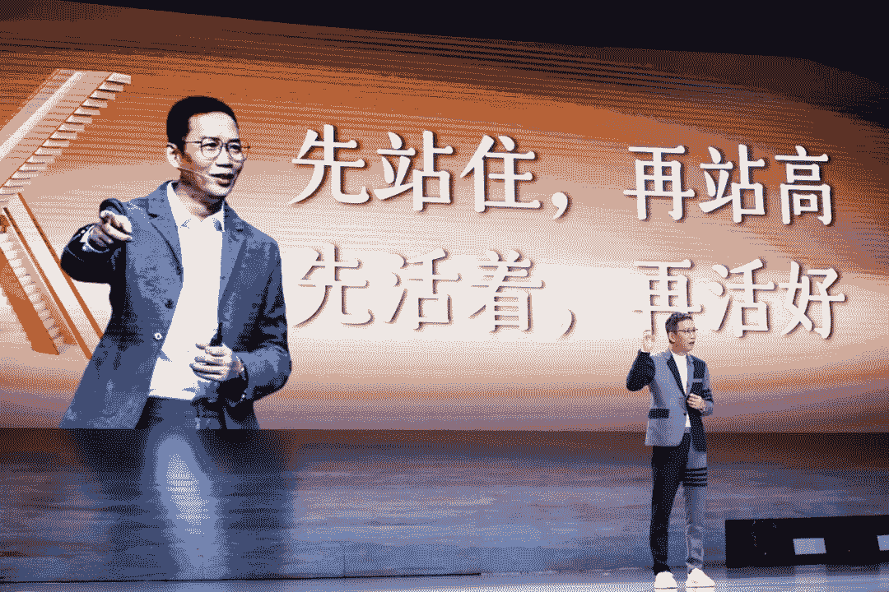

我写过一本书叫《激荡30年》，研究了高速发展时期的中国企业。在这本书中，我说“商业是一场关于幸存者的游戏”，2022年我们对此有更深切的体会。

两千多年前，苏格拉底在爱琴海边思考人类哲学的时候，他就思考过勇敢的意义，他说：“勇敢是关于希望和害怕的知识。”

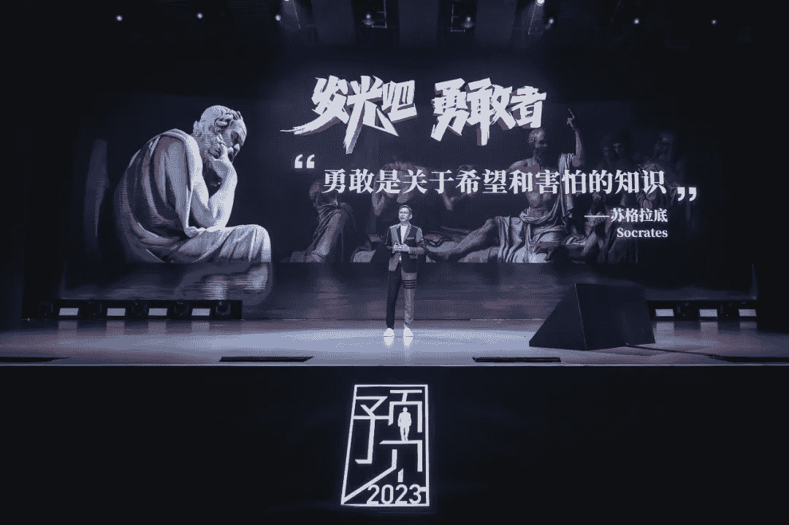

我在大学读到苏格拉底时，并没有很深的体会。我们会觉得勇敢就是一往无前，无所畏惧，视死如归。但经历了2022年，我们突然发觉勇敢并不是那么单纯，我们会害怕，会有屈辱感、无力感。我们理性面对害怕、无力感、屈辱感时，内心仍然热烈着、澎湃着希望。这时我们才能对自己说，我是一个勇敢者。这是我对勇敢的新理解。

在2022年，勇敢者们能活到今天有什么方法呢？我给大家总结了几个方法论：

## **勇敢者的方法论一**

> **天如果总是不亮，那就摸黑生存，****一旦看到了曙光，那就立刻起飞。**

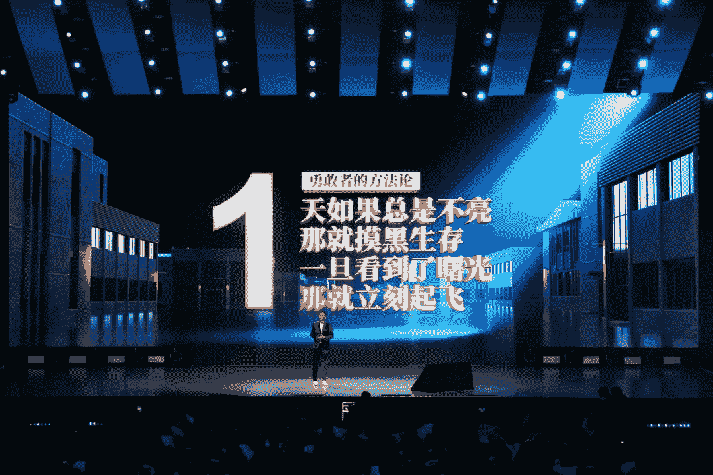

我有一个朋友，北京大学国发院的周其仁教授，今年6月份的时候，他到广东佛山去做企业调研。去一个工厂里，见到整个工厂空空荡荡，只有一个老板在。周教授就问他，你为什么不回家？老板说等订单。他给工人每人每天发30块钱，让他们待在家里，等订单下来了，就发个短信让工人马上来上班。

一个人孤独地在生产线边上等待订单，是千千万万中国企业家的2022年。

今年8月份，我的两个同事到义乌做调研。他们回来转述，很多义乌小老板说：“只要饭能送到房间里，只要网线不断，我们就还在做生意。”

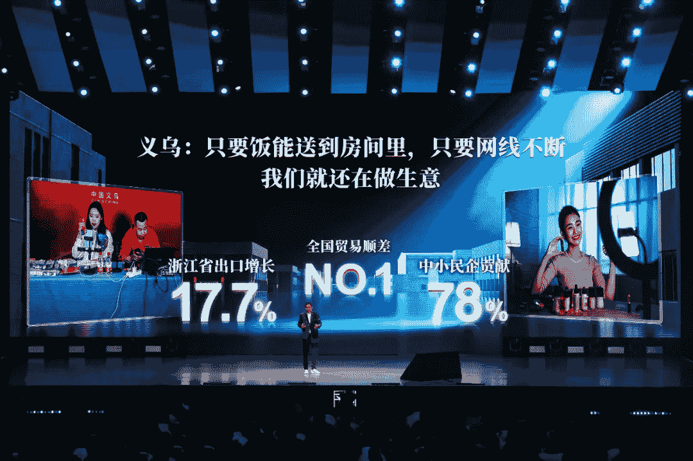

中国的外贸形势不容乐观，但是今年1—3季度浙江省出口增长17.7%，全国贸易顺差No.1。这个成绩靠谁获得的？就靠这些义乌的中小老板们，民营企业贡献了浙江省出口增长的78%。

有一个短视频，我今年大概看了100次，一个00后的小姑娘，在直播间里卖锅，哭着卖，不停卖。“锅不会累的。”她说。我们希望这个小姑娘在2023年，把全世界的锅都卖掉。

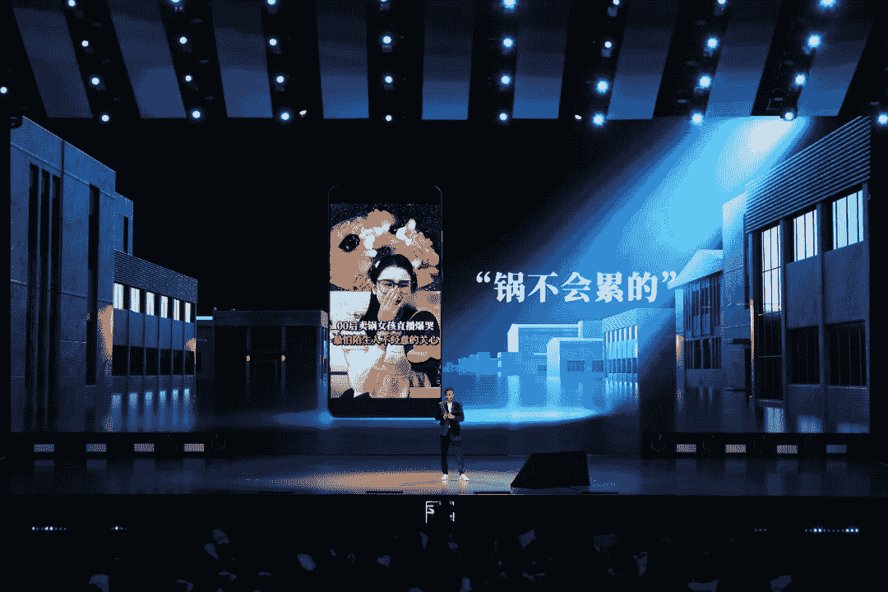

对于勇敢者来说，我们可以卑微如小丑，我们可以一个人孤独地站在生产线边，我们可以吃着房间里简陋的中餐或者晚餐，我们可以在直播间里哭着卖锅，但是我们不可扭曲如懦夫。

12月7日，“新十条”发布后，我们看到浙江、江苏、广东和四川的成百上千的企业家包机出国抢订单。经济正在慢慢复苏，我们度过了最最困难的一个时期。

## **勇敢者的方法论二**

> 乐观是一种天赋， 悲观是一种能力。

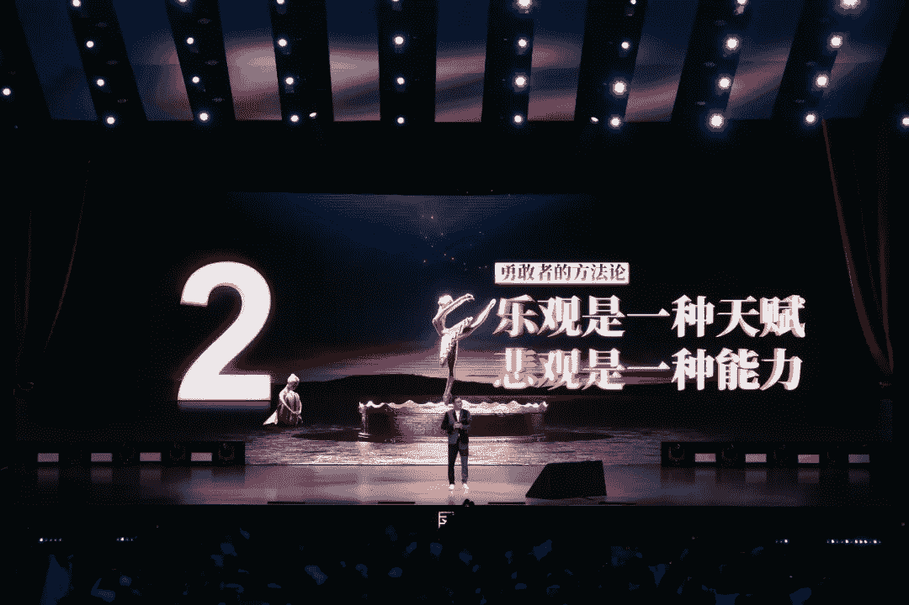

什么是企业家精神？企业家精神就是一个硬币的两面，一面叫乐观，敢于创新。熊彼特说创新是当我们面对山呼海啸般的不确定的时候，仍然敢于挑战所有的不确定性。所以企业家天生就是乐观派。

但这只是企业家精神硬币的一面。另一面叫什么呢？叫作悲观。我们时时觉得危机会降临，觉得企业最多只能活18个月，觉得冬天一定会到来，觉得企业一定会死的。当我们面对这些悲观情绪的时候，仍然可以培养起向死而生的勇气，建构起向死而生的能力。2022年，越来越多的企业家朋友们应该意识到了，悲观是一种新的能力。

这两年我去了很多次景德镇，它有一个陶溪区文创街区，是一个用旧工业厂房改造的文创街区，清华美院帮他们做的设计，非常时尚。

在景德镇有1.8万个景漂，来自全国各地的陶瓷匠人都聚集在景德镇，租一个小房子，做各种各样的陶瓷艺术品。每年景德镇接待游客五千多万人，在文创街区里面一年要举办180场策展活动，也就是平均每两天就有一场新的策展活动，所以前几年我每次去景德镇文创街区，那里都非常热闹。

今年我又去了，看到的景象是空空荡荡，所有的房间都着关门，所有的策展空间里面空无一人。

景德镇死了吗？没有死。虽然遭到了很多的挫折，但景德镇干了一件事——他们建了一个直播基地，跟全中国很多直播平台达成战略合作。

今天我们在网上买景德镇瓷器，质量有好有坏，但是没有假货。只要看到景德镇瓷器，都是在景德镇当地生产出来的。今年通过直播，几千家的景德镇瓷器企业在网上卖掉了70亿的货。文创街区本来靠什么赚钱呢？靠卖街铺、靠物业的租金。但我今年去的时候，他们告诉我：吴老师，我们今年物业的收入只占到整个文创街区收入的9%。还有84%的收入，来自产品销售。悲观，在景德镇变成了一种新生的能力。

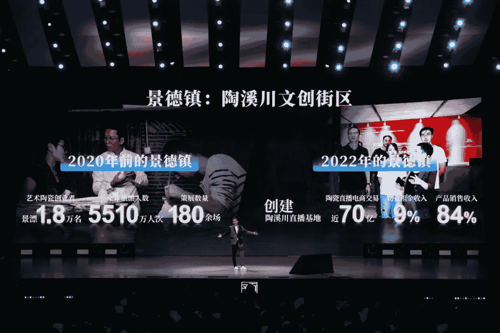

同样是在2022年，陶瓷行业建构了一个工业互联网平台，“中国陶瓷工业互联网平台”，现在已经有3000多家陶瓷产业链上下游企业入驻了。

我们继续说陶瓷。这位朋友叫黄建平，他做了30多年的陶瓷。景德镇做的是艺术陶瓷，黄建平做的是建筑陶瓷，建筑陶瓷的市场规模是艺术陶瓷的20倍。我去他的企业马可波罗控股参观，他很自豪地带我去了一个博物馆——中国建筑陶瓷博物馆。今年房地产行业下滑，建筑陶瓷行业遭遇30年来前所未见的寒冬。但是这家企业还在发展，靠什么呢？靠在悲观中萌发出的创新能力。

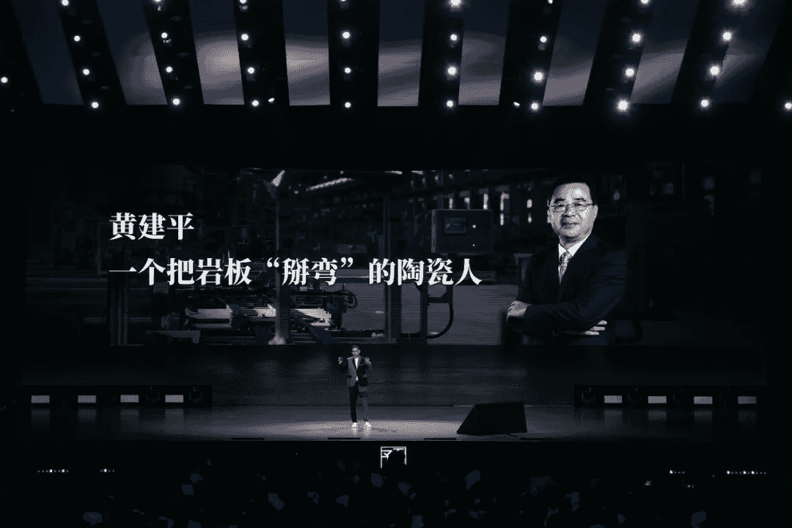

黄建平把两块“板”放在我面前，一块是天然大理石，一块是岩板。天然大理石不可重生，采一块少一块，岩板是建筑陶瓷工业化生产的，他让我猜猜哪块是大理石，但是我根本分辨不出来。大理石的硬度是莫氏4级，岩板比它还硬，有莫氏6级，大理石的厚度是10毫米以上，岩板最薄可以做到3毫米；天然大理石每平方米要超过1万块，而工业化生产的岩板只有1/10的价格。这个技术是2006年欧洲人发明的，2020年引入中国。

那我们中国人做了件什么事呢？我们把它做成曲面了。今天，中国的建筑陶瓷行业制造的岩板，最大的弯曲度可以达到180度，我们在宾馆、酒店看到的“大理石柱”，未来可能99%不是大理石了，而是中国建筑做的曲面岩板。

从景德镇到中国陶瓷工业互联网平台，到马可波罗这样的企业，我们看到在一个最悲观的情境中，仍然有人凿出了希望的微光。

2022年，我无数次回想起汤因比的一句话，这位英国历史学家说：“文明总是在异常困难而非异常优越的环境中降生的，挑战越大，刺激越强。”

## **勇敢者的方法论三**

> **在萧条中发现下一支“口红”。**

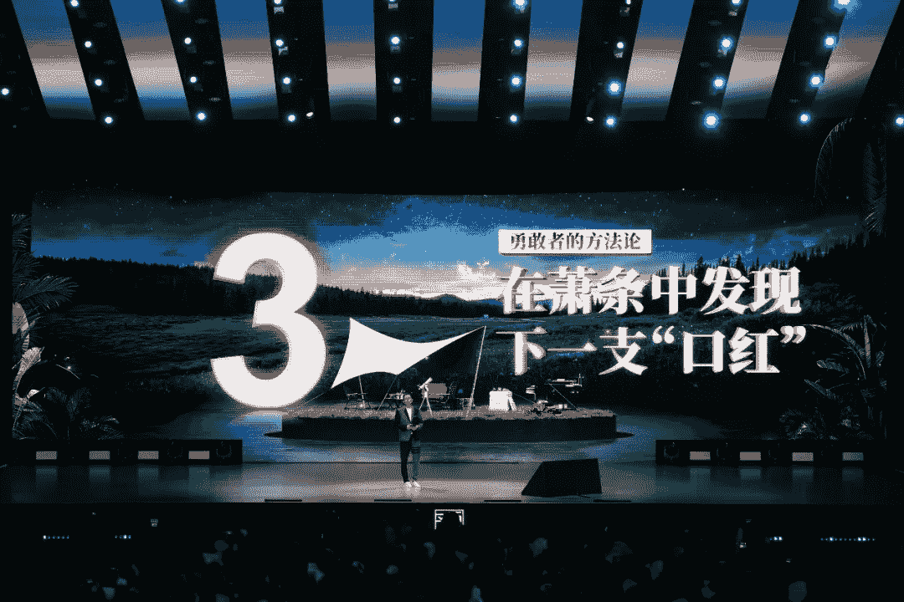

经济学里有一个名词叫“口红效应”，经济越差，口红卖得越好，为什么？因为经济很差，消费能力普遍下降，但还是有消费欲望，大家就会购买口红一类比较廉价的消费品安慰和取悦自己。所以在下行的、萧条的经济环境中，仍然有一些“口红产品”，将会成创新的机会点。

我这里有一些数据，可能也让大家挺吃惊的。在一片萧条的2022年，中国市场的露营桌椅、露营车和天幕的销售增长了200%，香薰条销售增加了133.3%，空气炸锅增长了161%，游戏电视增长了210%，超薄平嵌冰箱增长了117%，陆地冲浪板3000%，路亚垂钓220%，划船机100%。

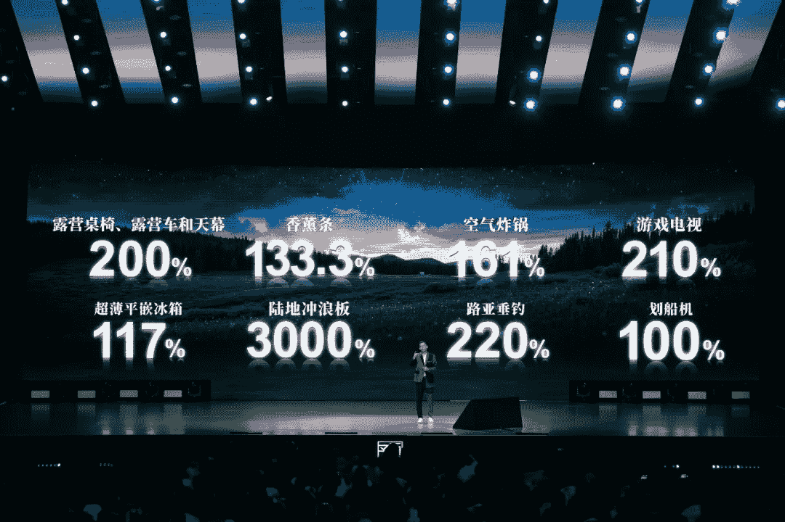

经济很难，产业很差，口袋里没有钱，但是仍然有这样的“口红产品”保持了百分之几十、几百甚至上千的增长，甚至在一个产品的背后还有很多周边产品。

今年露营很火，一家人开车到杭州、上海、成都的城郊去露营，露营的时候要干什么呢？要带毛毯，带冲澡神器，要带露营的手压咖啡机、充气床垫，BBQ的时候还要有三脚架、便携式的卡式炉。一个小小的露营产业，就有很多产品和周边产品的诞生。

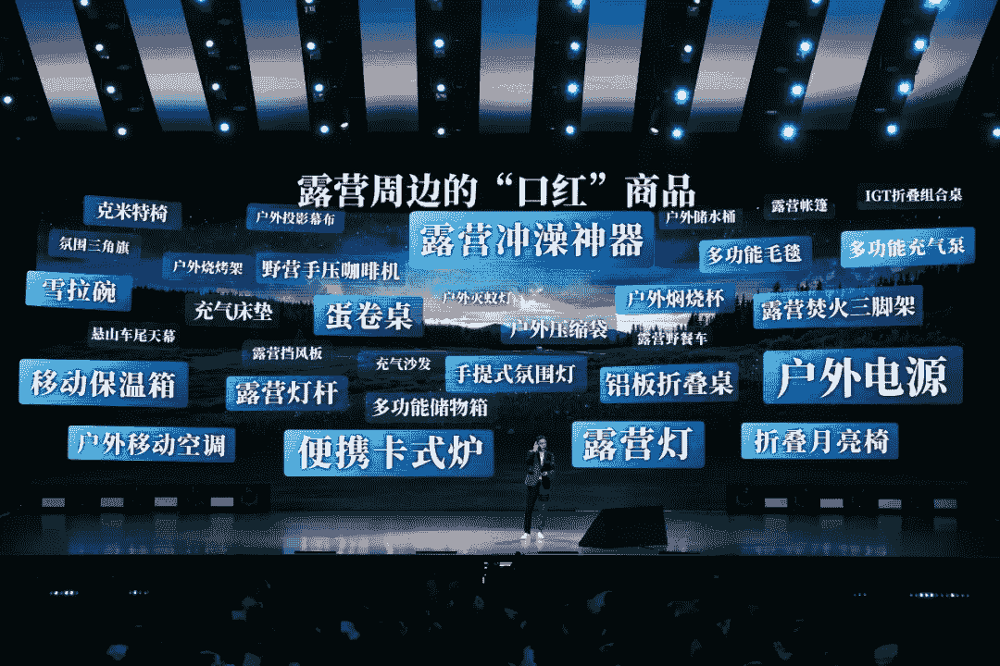

今年，我们看到一个景象，“减压经济”正成为中国消费品产业的一个透气口。00后的同学流行一句话：“你可以摸鱼，但是你不能真的菜。”很多人天天说我要躺平、我要摆烂、我要摸鱼，但是实际上呢？我还是要站起来，我还是要寻找机会，我不能真的躺在那边摆烂，没有人会同情。

所以我们需要减压，减轻自己的压力。我们就看到了这些产品，什么减压球、尖叫鸡、毛绒玩具、宠物经济甚至塔罗牌、剧本杀，在2022年，这些产品都构成中国产业经济一个重要的创新和消费的主题，叫作“减压”。我们需要这么一个透气口，这个透气口的背后就是无数新的商业机会的诞生。

## 勇敢者的**方法论四**

> 越卷的生意，越应该“工具迭代”。

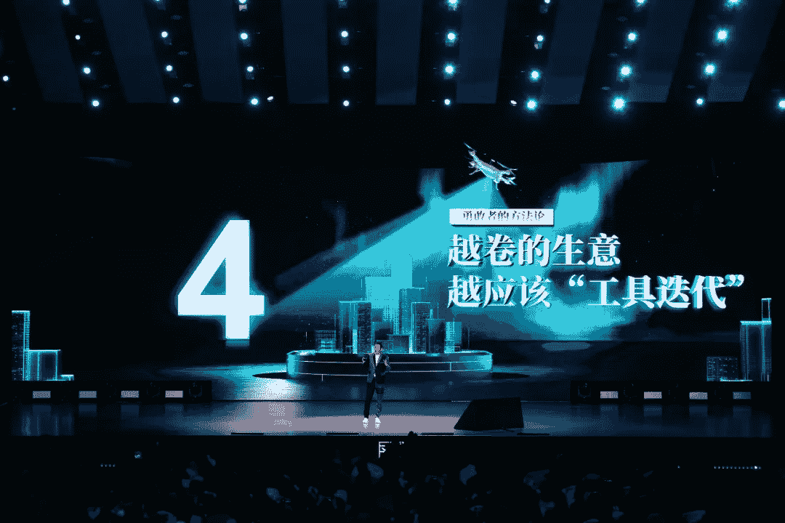

自2020年起，我们看到互联网工具在中国的各行各业都被广泛应用。我们的手机中新增的每个App都是一个新的工具迭代。但是大家往往有一种误解，就是互联网工具都是那些科技公司推出的，所以这些工具首先就应该被那些科技公司应用。错，越传统的行业，竞争越激烈的行业，越是红海的行业，越需要进行工具迭代。

我今年在郑州调研一家企业，做火锅配料的。2019年的时候，它有一千家店，2022年的时候老板和我说，吴老师，我们这三年开了九千家店，疫情管控期间，大家都在家里，很多人就买火锅配料到家里吃，所以我们呈现了逆势增长。

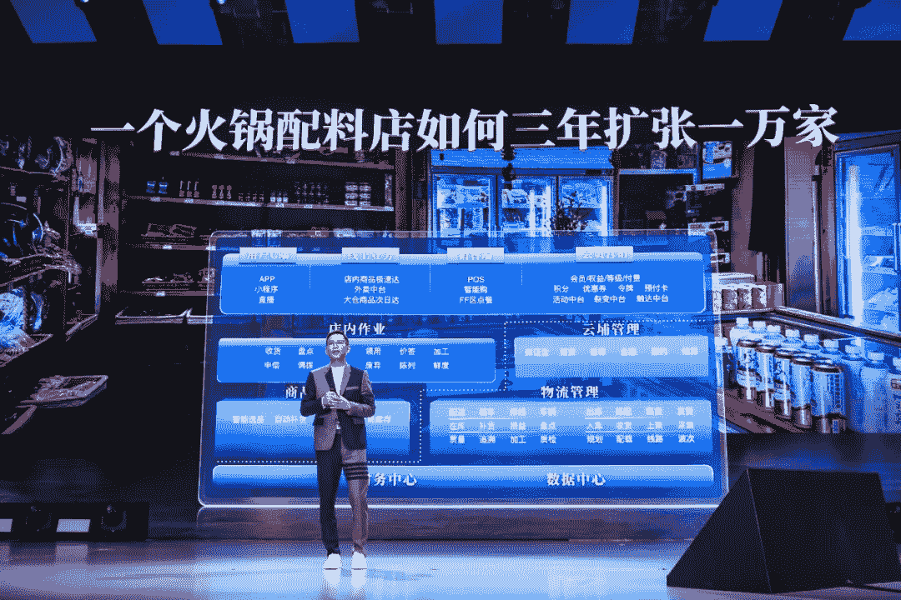

各位，火锅配料店是不是特别传统？他却能够在三年里，做到每年开三千家店，就靠一个东西，叫作工具。他建构了一个数据中台，火锅配料店的原材料都是农副产品，每一件农副产品，从加工到仓储到配送，到全中国每一家火锅连锁店，到每一个消费者的餐桌，他通过数据链路来打通。所以说，是工具让这家特别传统的、特别卷的火锅配料店在三年里实现了近万家门店的扩张。

今年出现了一个小行业的蓬勃发展，叫作飞盘。大家玩过飞盘没有？今天来到现场的同学，每个人拿到的伴手礼包里都有一个飞盘。我们去调研一家叫艾克的企业，全中国每两个飞盘中就有一个是它做的，是一家特别小的企业。飞盘并不是一个高科技行业，它就是个塑料片。但是这个塑料片麻烦在哪里呢？它需要定制。

我们向这家企业定制了五千个飞盘，上面印了我们这次年终秀的主题——发光吧，勇敢者。每只飞盘的颜色、大小都不一样。所以，这家企业的生意虽然很多，但是很多订单都有定制需求，一年有几千个定制款，订单怎么管？

传统的做法是做个ERP，但时间上就会来不及。再传统的行业都有四个部门，生产、库存、采购、销售，四个业务部门，当所有数据没有办法被整合的时候，每天来两千个订单，不同的定制要求，怎么解决？

这家企业干了一件事，把这四个订单表单放到了线上表单中，那个表单叫作企业🛰️。如此一来，所有的生产、库存、采购、销售，每一个业务单元的人都可以在同一个表单上面发现正在发生的业务动态。仅仅这么小小的工具迭代，四张表单变成线上表单，使得这家企业的信息传递效率提高了2倍，信息的准确率达到了几乎100%。

再来看一个特别大的行业，汽车。汽车是被称为制造业皇冠上的明珠。传统的燃油车有几万个零部件，到了新能源汽车，零部件减少至一万个左右，但是多了许多大大小小的芯片。怎么能够把这一万多个零部件和许多芯片聚集到一个信息化的平台上，提高生产的效率呢？

我们在调研过程中发现，中国的新能源汽车前十强企业都在使用企业🛰️，通过企业🛰️的文档和会议提高效率。你知道这些公司在这个平台上每天开多少次在线会议？光极氪一家，每天有两千次在线会议，至少形成两千个文档，一年形成六七十万个文档。不光内部效率，还打通了供应链，甚至取消经销商，直接服务每一位车主。如果没有企业🛰️这样的互联网工具，你无法想象如何进行如此大规模的协同和制造。

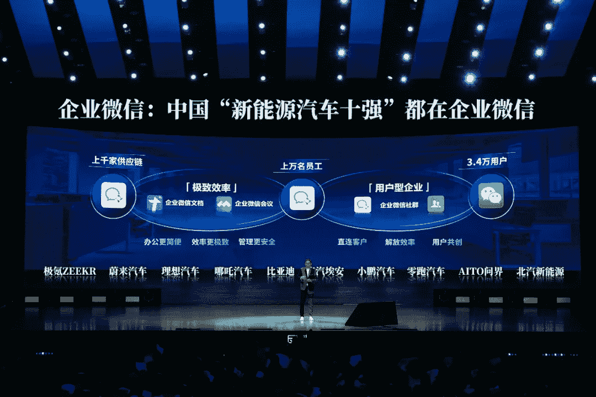

所以，正是这些工具，给我们带来了很多新的变革。分众传媒传统工作方法就是在电梯里装个屏幕，你有广告就让它播放。如果仅仅这样的话，分众传媒做的就是一个特别传统的行业。

但是今年我们在分众传媒调研的时候，发现其实一个屏的背后，有40多个营销工具，帮助分众这家企业实现千楼千面、实时监控、智能追投和追踪转化，让这家传统企业通过工具迭代一新。

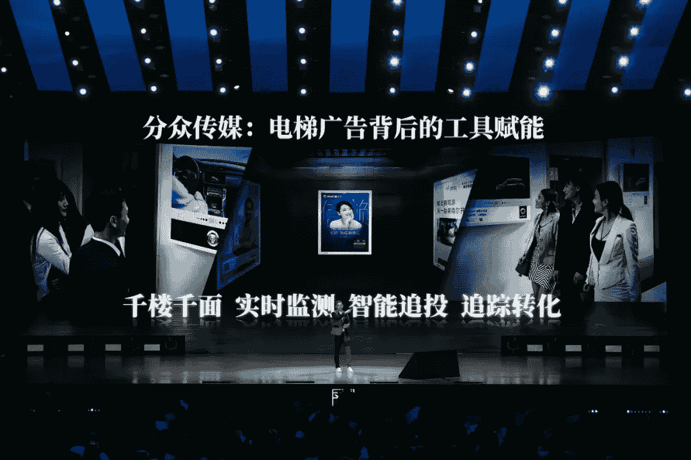

我们再来看一个更传统的行业——浆纸行业。从纸浆到一张成品纸，你很难想象这是一个万亿规模的产业。建发是我们很多年的合作伙伴，它旗下建发股份的浆纸集团，深耕浆纸产业供应链行业30年。在中国贸易流通领域纸张销量、纸浆进口量和销量全国第一。

这些年他们做了一件事，建构了浆纸产业互联网平台，把全世界30多个国家和地区的上中下游上万家企业资源整合到一起，通过数字化手段打造“纸源网”和“浆易通”两个平台，以此打通“纸张”和“纸浆”产业全链条通路，使二者实现生态互联，形成完整的浆纸产业生态闭环，极大地提高了这个行业的交易效率。

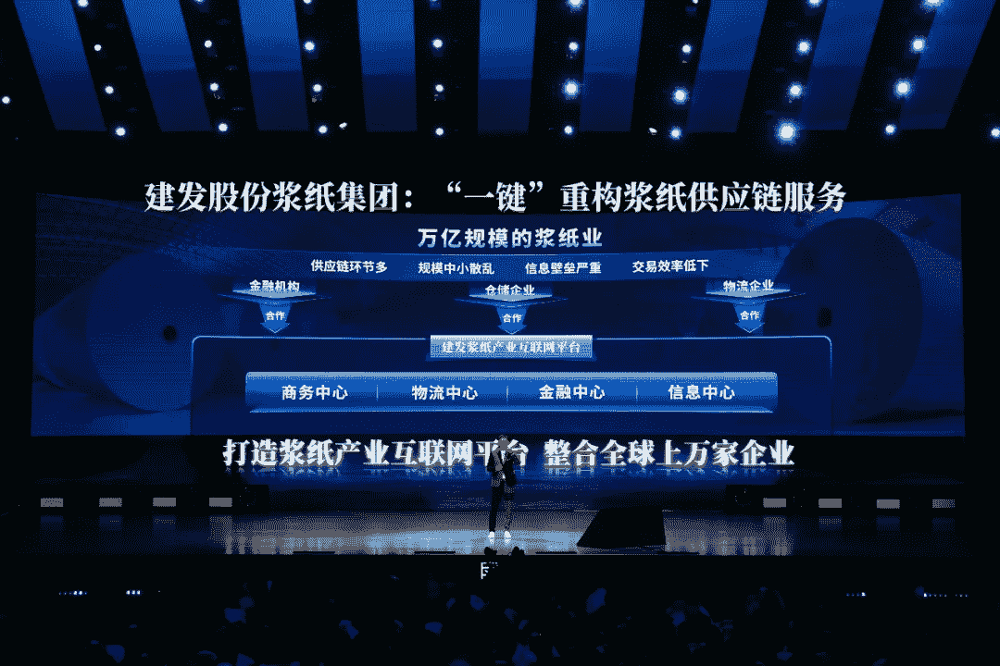

今天，这个中国特别传统的浆纸行业，在工具革命的迭代下，完成了大规模的效率提升。

中国现在有多少这样的工具？我有一个朋友在广东创业做研究院，专门研究这件事。他知道我年终秀要讲这个，和我说：“吴老师，我给你提供一张表格，2022年中国营销技术生态图。”拿到这张图，吓了一跳，朋友们，中国今天有着全世界最多的营销工具，多达2200多种，更重要的是，这2200多种营销工具中有80%的基础应用是免费的。

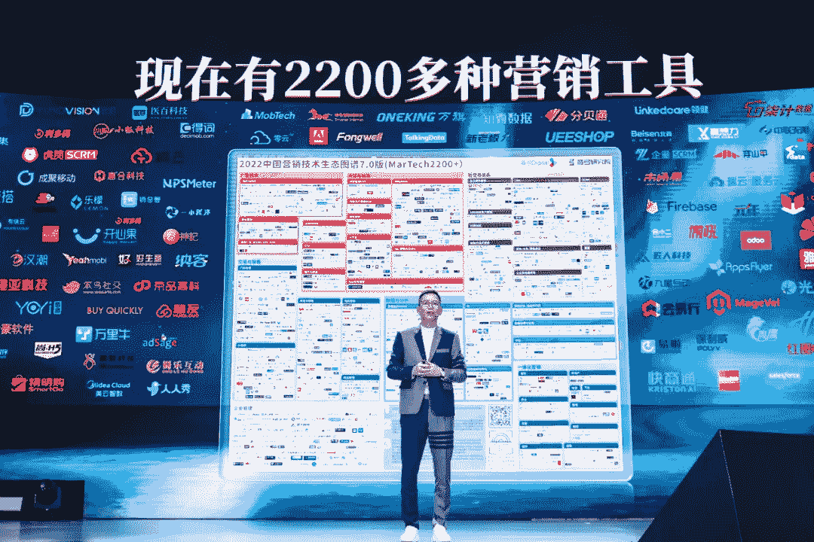

所以在2022年末，我们都要问自己一个问题：我这个行业很卷，我这个行业很红海，我这个行业很传统，所以我应该使用什么先进的营销工具，才能够帮助我提高效率？

今天看我们年终秀的朋友，不管是来到现场的朋友，还是在直播间里的朋友，如果你想了解这2200多个营销工具，你可以加我的学习助理，我把整个图谱都送给你。

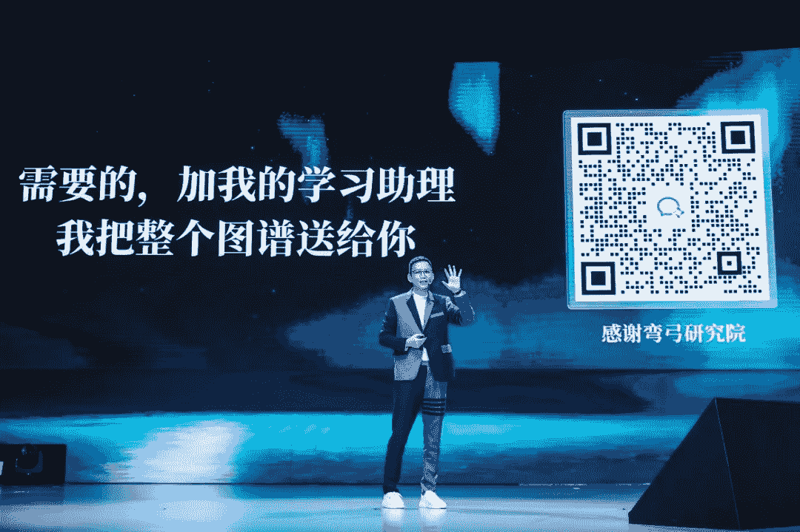

## **勇敢者的方法论五**

> **换一个姿势奔跑。**

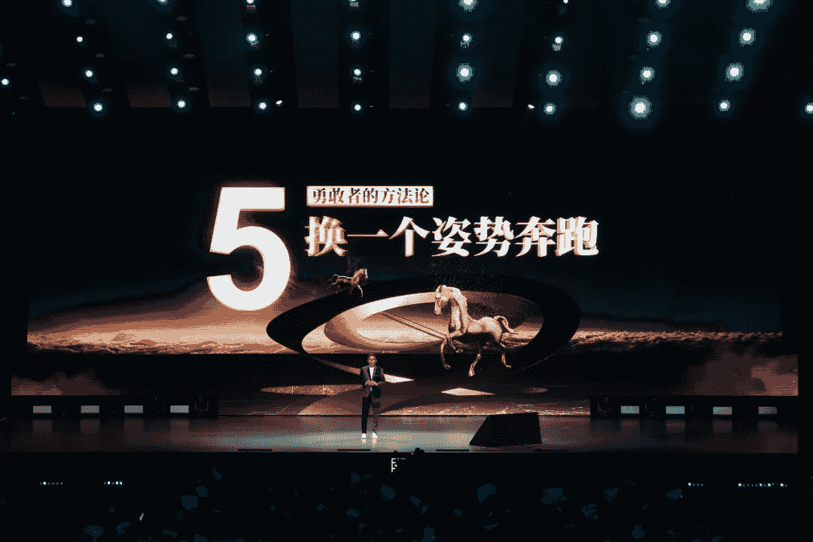

有一张图，展现了同一家美国公司在中国的两种命运，这个企业叫作沃尔玛，全球最大的零售连锁企业。

沃尔玛进入中国很早，在1996年，它当年就两个产品，一个是购物广场店，一个是山姆会员店。1996年至今的很多年里，沃尔玛广场店每年新增20家，最多时开到过420家店。

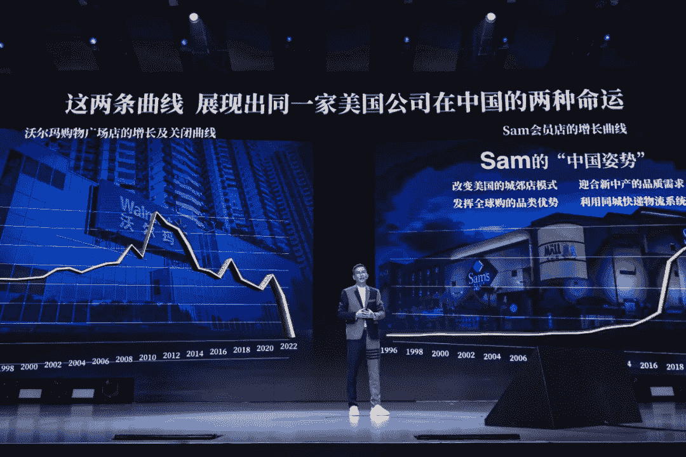

山姆店就很倒霉，1996年开始每年新增一家店，到2019年时，才开了20多家店。

但就在过去3年里，沃尔玛广场店平均每年关店20家，山姆店却每年增加5—7家。为什么同一家美国公司的两个产品，在过去3年里会有如此不同的命运？因为广场店没有变，而山姆店换了一个姿势奔跑。

在美国和欧洲所有的山姆店，都是开在城郊接合部，但在过去3年里，很多中国的山姆店都开在市中心，然后山姆店用了全球先进的供应链，迎合了今天中国新中产对美好商品的购买能力。

更关键的是，它运用了中国的同城快递物流系统。这个系统只有中国有，美国没有、欧洲没有、日本没有，所以我们看到山姆店在过去3年里，因为换了一个姿势奔跑，实现了逆袭的增长。

很多同学知道，我们这些年一直在推动新国货运动。2015年时，我写过一篇文章《去日本买只马桶盖》，2015年以后，我们看到新国货在中国实现了高速增长。

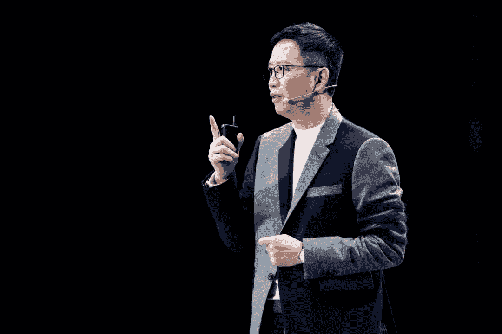

2019年时，我发现了一个新现象，随着中国年轻消费者的文化自信转移到我们的国货自信，中国的国货产品不但实现了销量和市场规模的增长，同时在价格和品牌上，跟全球的国际品牌能够进行对标。

所以在2019年，我们看到像奶粉、洗发水、运动鞋等这些行业中，中国公司的品牌定价和品牌力，在全球都实现了一次全面的超越。

如今三年过去了，这个趋势仍然在发生。包括运动鞋、洗发水、奶粉等行业，比如飞鹤婴幼儿奶粉的市占率从2019年的13.1%，上升至2022年的20.1%。中国的奶粉行业自三聚氰胺事件以后，花了十多年时间，进行了一次质量上的反扑和成长。

2019年时，国产奶粉占中国整个奶粉市场的比重为40%，今年已达到60%，这是一个好消息。当一个行业领头企业达到20%的市占率，以及国产奶粉达到60%的比重时，意味着一个增长周期结束了。同时，中国的人口红利也结束了。

所以，2015年以后，这些在存量市场获得了很大成功的中国新国货企业，都面临一个新的挑战，叫“换一个姿势奔跑”。

我们看奶粉企业是怎么奔跑的，它需要寻找到第二条新的增长曲线。第一增长曲线是婴幼儿奶粉，第二增长曲线就是给我喝的奶粉——成人配方奶粉。

2022年，中国的成人奶粉品类在电商平台搜索上涨了319%。我们看到这家从婴幼儿奶粉成长起来的企业，做了一个新产品——爱本高端奶粉，实现了它的第二曲线增长。

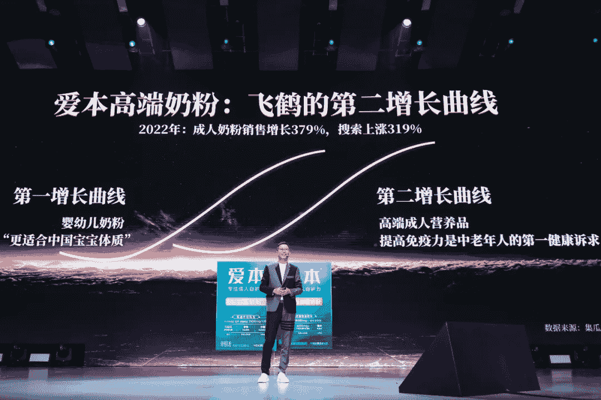

每天下午我在办公室会喝一杯爱本奶粉，我也没有想到，20多年前给女儿泡奶粉，现在给自己泡奶粉。今年，“免疫力”的提高，是直播间里，以及来到年终秀现场的朋友们的第一健康诉求。

所以，这些企业发现了新的诉求、新的客户，就如彼得·德鲁克所说：“企业唯一的使命是创造客户，用‘由外而内’的视角审视我们的事业。”

有些客户给我们带来第一增长曲线，但到某些时刻，我们需要寻找第二增长曲线，再去创造和发现新的客户，“由外而内”地来提高企业的增长和竞争力。这是在2022年，企业仍然能保持高速增长的一个基本法则，就是你需要换一个姿势来奔跑。

## **勇敢者的方法论六**

> **去下沉市场，感受上升热浪。**

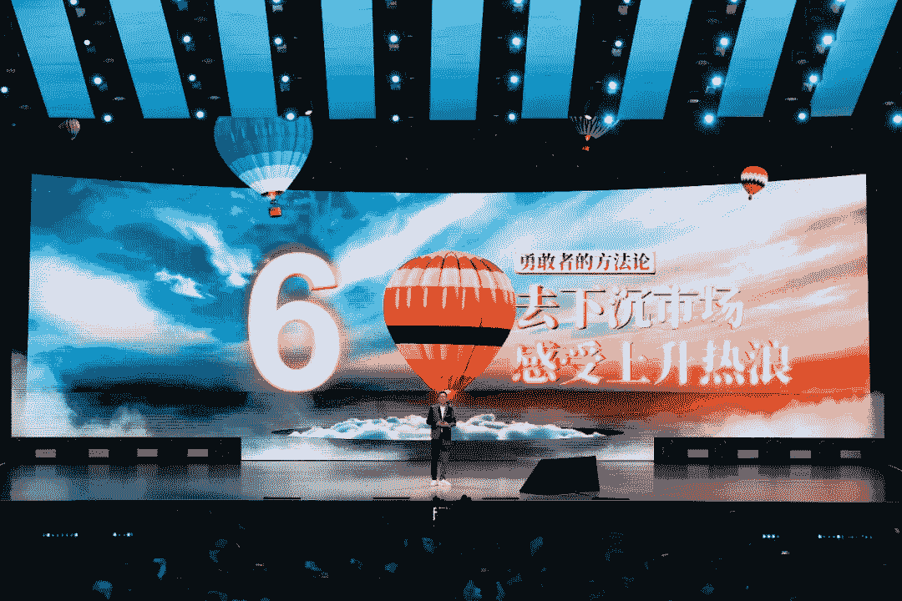

2022年如果没有一些影响，我本来要去拍一个纪录片，叫作《神奇的县》，我连这些县都找好了。中国有很多神奇的县。生产了全国40%的小提琴的河南确山县，生产了全国35%的汉服的山东曹县等等。

中国有很多像确山、曹县这样的县，县域经济总量占到全国的40%，原来我们都会忽略，眼睛只盯着一线城市、新一线城市、二线城市。

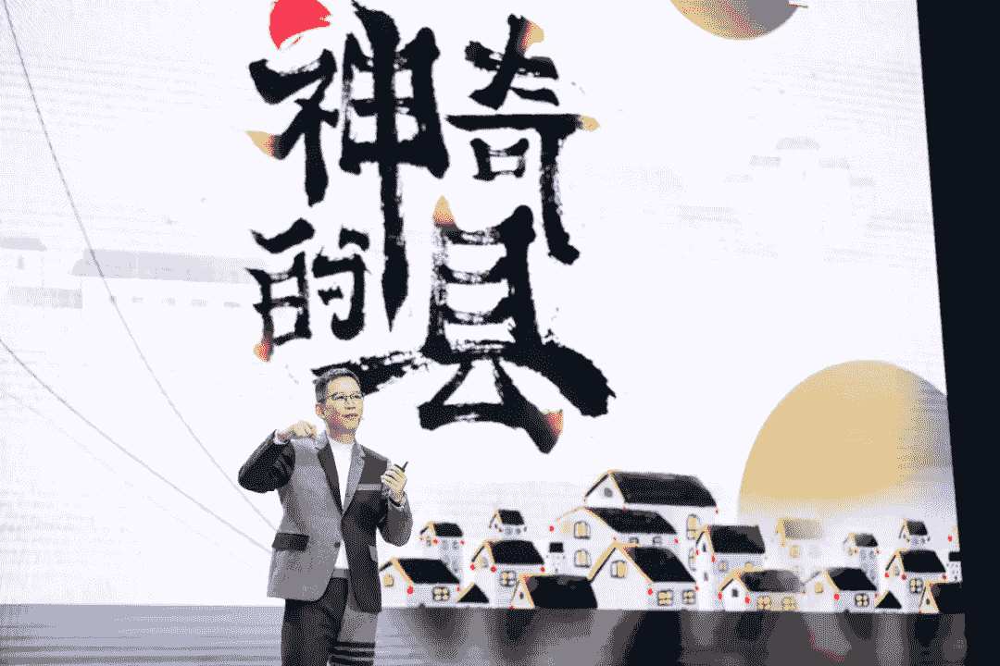

我们频道每年会做一份新中产白皮书，今年发现了非常多数据上的变化。在我们调研的10万人群中，当问一二线城市生活的人们，未来你要去哪里生活？我看到数据非常吃惊，今天中国在一线和新一线城市的新中产人群，5个人里有1个人说计划未来定居到二三线及以下城市。

当我们问生活在一线、新一线、二线、三线、四线、五线的人群，未来你们的消费会增长吗？一线城市的新中产回答“未来消费预期增长”的只占25.9%，而五线城市新中产的这一数据为45.8%，超出一倍左右。

这两年新国货消费很猛烈，你会发觉，三四线城市的新国货消费增速为45.79%，比一二线城市的22.43%足足高了一倍。

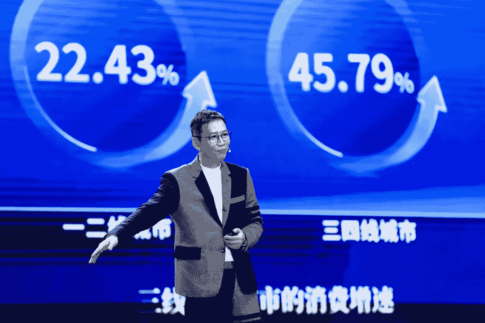

这是我们在2022年发现的新景象，我认为这个趋势将贯穿未来的一个经济周期。人们将从一二线城市下沉到三四线以下，因为那里的居住、生活成本比较低，所以人们对未来的消费增长有更高的预期。同时，对新国货有更多的购买热情和消费能力。

有一个品牌这两年跟我们合作很多，叫冰泉牙膏。2021年、2022年，我们和东方卫视做了一个大型新国货综艺节目叫《国货潮起来》，冰泉牙膏是我们两年的赞助商了。

刷牙这件事情，对很多60后、70后来讲，主要是保持口腔清洁。但我们调研时发现，21%的都市95后一天刷3次牙，中午也刷牙，刷牙这件事变成了快乐经济、好心情经济，变成了社交产品。

冰泉是2020年创立的一个品牌，它抓住了这个风口，把快乐因子注入到牙膏里。

所以这两年在一二线城市，它是一款年轻人喜欢的爆品。今年年初，一个70后，在日化行业做了二十多年的连续创业者，冰泉牙膏的创始人程英奇背着背包来找我，他说：吴老师，一二线城市今年很难，但我发现一个变化，批发市场很火，三四五线以下的批发市场今年突然间火起来了，我要布局批发市场。

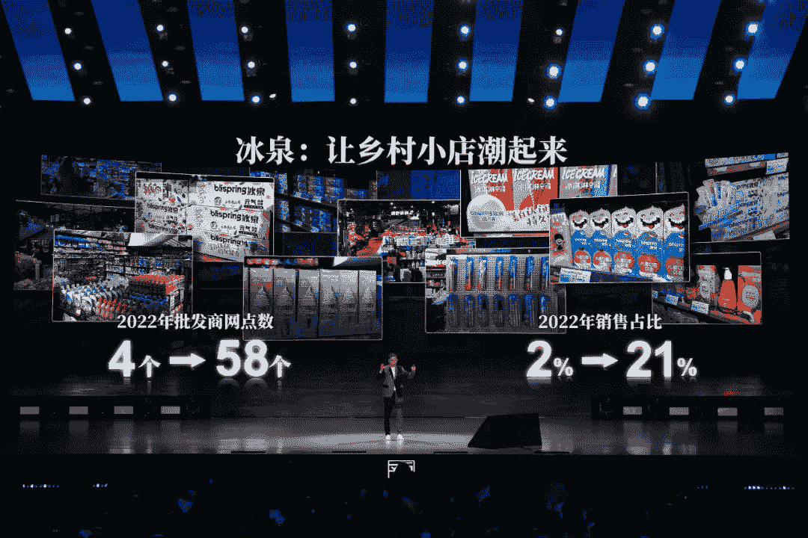

年底时，我问他怎么样了，这个过去一两年在一二线城市很火的牙膏，把它的批发网点从4个增加到了58个，2022年它在三线以下城市的销售占比从2%提高到了21%。

今天所有在做新国货创新和创业的企业，如果在前面几年，你在中国的一线、新一线城市完成了你的品牌建设、技术定位和产品创新。记住， 赶快在2023年把你在都市所形成的能力迅速赋能到三四五线城市，去下沉市场感受正在蓬勃向上的热浪。我们在今年看到很多像冰泉这样的企业，通过在下沉市场的拓展，在2022年获得了正增长。

再次送给大家一个礼物，送给大家《2022年新中产白皮书·消费篇》，这是我们今年对10万人级的新中产调研后得出的数据。在这份新中产白皮书中，你会发现在2022年如此萧条的经济中，仍然出现了很多新的消费动态和消费的可能性。今天把电子版送给现场朋友和直播间的朋友们。

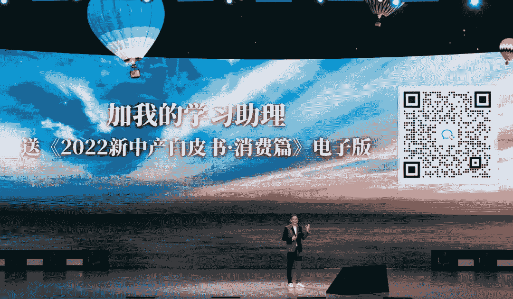

## **勇敢者的方法论七**

> **在风雪中，当一个“抱薪者”。**

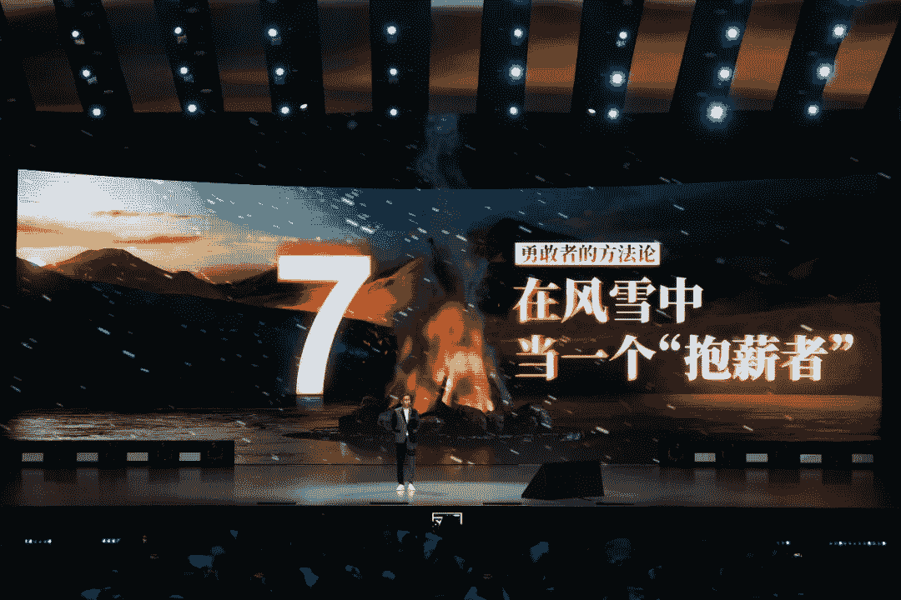

有人说，不可使抱薪者冻毙于风雪中。在如此困难的市场环境中，我们仍然发现了人间的温暖。

今年上海最难时，有一个韩国的面包品牌，在自己的员工培训中心烤了一批面包，卖给了周边的上海市民，因为违规生产被罚款58.5万元。

大家还记得这是什么品牌吗？巴黎贝甜。然后上海人民把他们家的面包店买空了。特别牛的一件事，我们不能让这样的抱薪者冻毙于风雪中，我们要让所有的人间真情，获得在感情上和商业上应有的回报。

12月7日，疫情放开以来，退烧药变得很难买，我在网上看到全中国第一家免费向市民发放布洛芬的，是一家郑州的企业，叫作禧康大药房，一家并不太大的企业，在整个郑州也就8家连锁店，老板每天在店门口放200粒布洛芬，8个店1600粒，每个人领2粒。

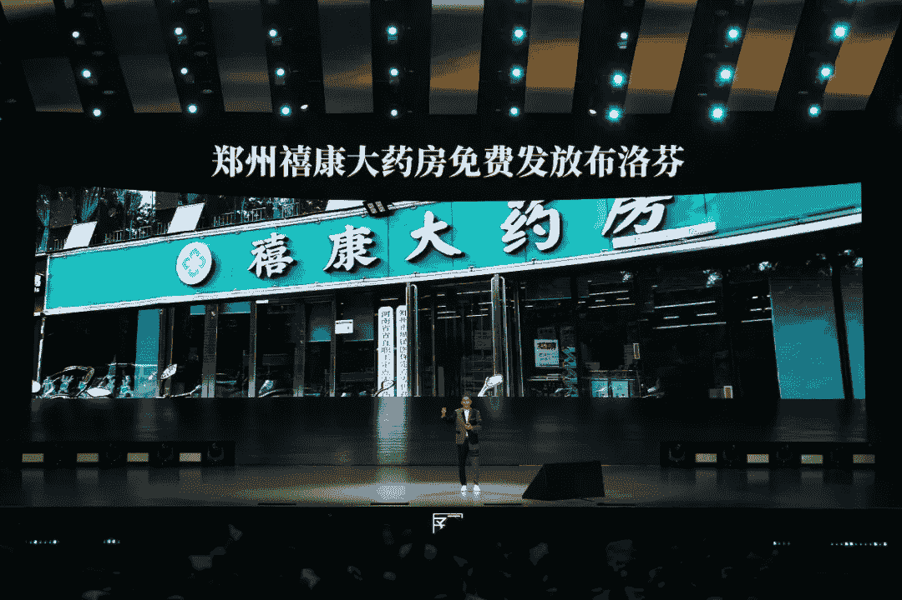

1600粒布洛芬多少钱？但在最困难的时候，它可以救800个人。这些平凡的创业者，在最艰难的时候，让我们感觉到商业是温暖的，让我们感觉到中国的经济发展是因为有那么多的抱薪者共同存在，让这个国家仍然有很大的温暖感和同情感。

我有一个朋友叫丁力业，他是做商业地产的，全中国最大的商业地产公司——印力集团，在全国有150多个店，最大的34万方，最小的8万方，在全国51个城市，1200万平方米，4000多名员工。

我问：“丁总，今年150家店你关了几家？有几家店开不了？”他不肯说，但他跟我讲：“晓波，有一件事我得跟你讲，我们公司有4000多名员工，我没有裁一个人。”最惨不过丁力业，今年那么难的时候，没有裁一名员工。

8月份，我去广东，调研一家企业叫比音勒芬，在全国有一千多家连锁店。老板叫谢秉政，他跟我讲：吴老师，我们今年也很难，但我们今年还是正增长，然后不裁员、不减薪，准时发放年终奖。

这个屏太小了，我没有办法把所有不裁员的企业名单都打在这个屏幕上，但我希望现场的所有朋友们，直播间的朋友们，给如此艰难的2022年所有不裁员的企业家们一次掌声。感谢他们，在如此困难的时候，让我们感受到了商业的温情，让我们感受到了共同担当的勇气。

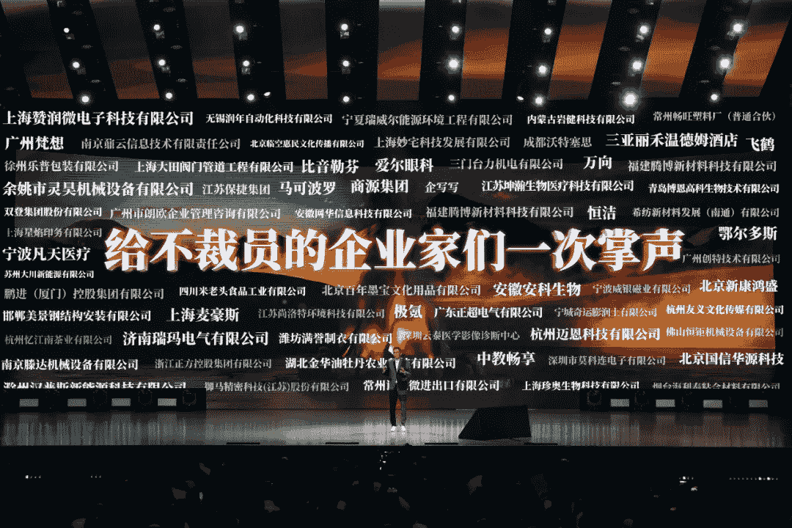

丘吉尔说：“勇气很有理由被当作人类德性之首，因为这种德性保证了所有其余德性。”我想正是在艰难的2022年，让我们重新去思考苏格拉底的那句话——勇敢是关于希望和害怕的勇气。

在2022年，我们害怕过、无力过、绝望过，但正是这些害怕、无力、受屈辱和绝望，让我们认清了这个时代，让我们认清了自己。

所以，当我们每个人刚才喊出“滚蛋吧，2022年”的时候，我们并不仅仅是宣泄情绪，我们是认清了2022年以后，用理性的告别，请它滚蛋。

所以，当我们面向即将到来的2023年时，我要对每一位朋友说：愿你有一双婴儿眼，仍保有天真和温柔；愿你有一颗少年心，仍相信勇敢和自由；愿你有一股中年力，仍愿在风雨中争斗；愿你我都是一个平凡的勇敢者。

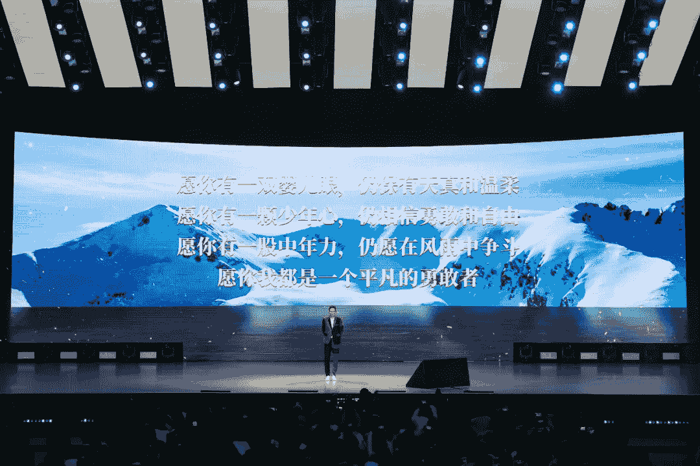

# **02****-**预见2023：找到信心的那根引线

我每年都会去看很多企业，今年跑了46家，其中大部分属于制造业。

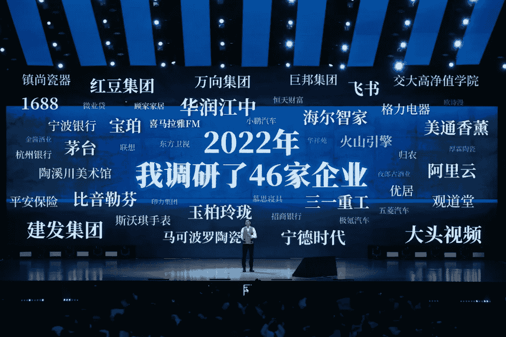

今年4月份，在整个经济环境特别困难的时候，我也缺少信心。所以我想，得出去，去找那些有信心的人。中国的信心藏在哪里呢？就在产业一线。那些还在生产和工作的人，就是今天中国最有信心的人。

所以从4月开始，我发起了一个项目——“走进标杆工厂”，我们今年去了万向、格力、慕思、三一重工、华润江中、极氪汽车、顾家家居。

在2023年，我还会继续走进标杆工厂，争取每个月都能去一家，去火热的生产一线看中国经济的现状。争取到明年的12月30号，也就是下一次年终秀，我能把在工厂看到的景象跟大家做个汇报。你们愿意去的工厂，只要我能够打开那个工厂的门，就一定带大家去。

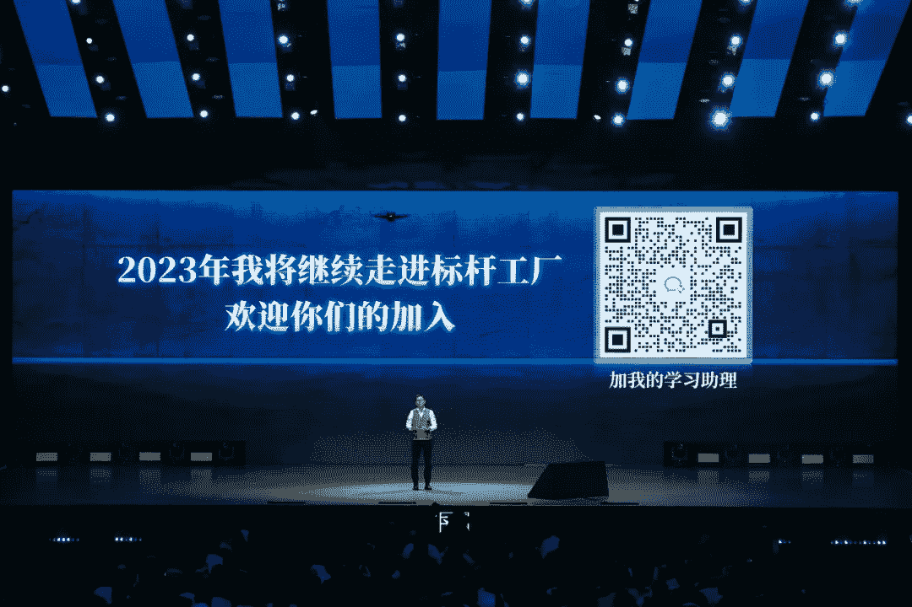

长按图片扫码 ▲ 添加学习助理

一年前，我们曾经这样预见2022：K型时代，抗疫常态；消费待振，亮点模糊；供应链战争决胜负；赋能平台，各擅其强；专精特新，智能竞赛；移动协同，办公革命；后浪前浪，各占沙滩；金融服务，迭代理性。这些事情都一一缓慢地发生了。

我们看到2022年，统领整个年份的是最前面的8个字：“K型时代，抗疫常态”。很多企业的迭代、很多周期性的变革都遭到了干扰，我们希望2023年一切能回到正常态，能够重新回到经济发展的基本面上去。

跟以前一样，每一年的年终秀我都会邀请50位经济学者，对他们做一次关于新一年的信心调查，感谢这些朋友们。

比较一下会发现，去年的此时此刻，我们请50个经济学者对2022年进行判断的时候，在宏观经济预期方面，罕见地出现了“333”的分布，即向好的、持中的、看衰的都占30%左右，但是在刚刚完成的对2023年的信心调查中，有82%的学者都认为2023年的经济会向好。

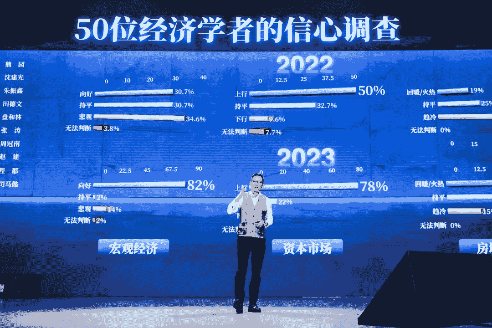

在资本市场的预测方面，我们看到，认为2023年资本市场会上行的观点占78%，认为持平的占到22%，也就是“持平+上行”占100%，这是极其罕见的。

关于一言难尽的房地产行业，在去年的信心调查中，有55.8%的学者认为房地产将趋冷，而今年的结果显示，认为房地产会回暖和向上的预测占41%，房地产会持平的预测占44%，即有85%的学者认为2023年的房地产市场会进入正常或上行的轨道。

这三组数据，值得一次热烈掌声。希望我的这50位朋友的预言能够自我实现，希望我们在2023年能过上好日子。

在全球经济的信心调查中，我们调查了两个维度：中美关系和全球化信心。关于中美关系的调查，学者们的观点和2022年持平，认为对抗趋缓的观点占百分之五十几，认为会发生激烈对抗的观点占百分之二十几，这两组数据与去年基本差不多。但在关于全球化的看法方面，去年此刻认为全球化会维持现状的观点占到57%，但在今年，没有信心的人超过了一半，占51%。

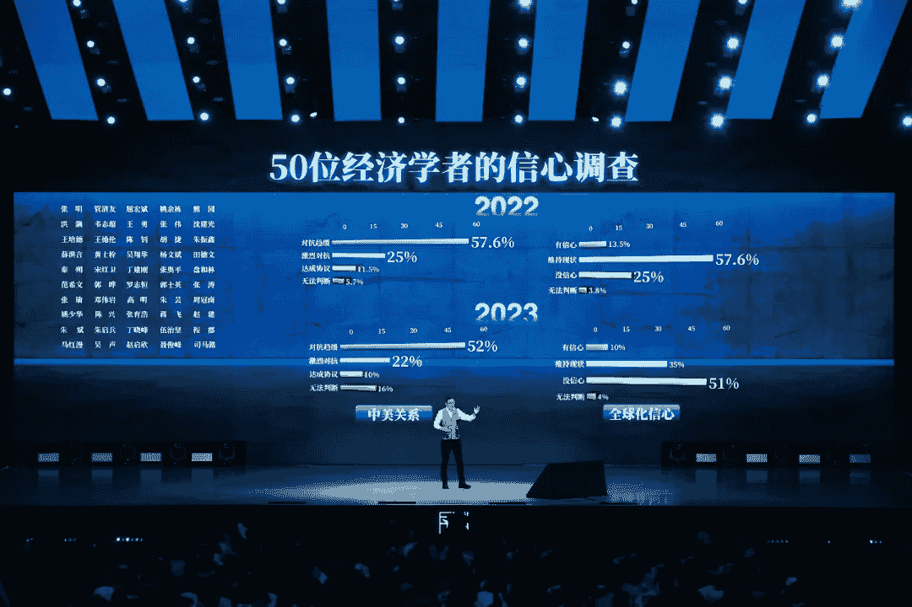

通过这些数据，我们能看到，前三组关于国内经济的角度——宏观经济、资本市场和房地产，基本80%以上的学者看好明年，而关于中美关系和全球化，在学者们的判断中，仍然没有变得很乐观。

2022年美联储为了应对美国的通货膨胀，进行了7次加息，今天美国的经济已经进入到一个非常刚性化的状态，不出意外的话，2023年美国经济大概率会进入到衰退阶段，这意味着全球的经济环境可能比2022年更加动荡，也意味着我们2023年的外贸可能无法指望。大规模的信心将来源于本国市场，来自国内的产业升级、消费复苏和城市经济活力的重新驱动。

所以，在2023年最重要的事情是什么呢？就是不能再折腾我们的企业家了，把他们折腾坏了，那就真没人折腾经济了。

接着来看我们对2023年的八个预见，我们认为未来可能会发生的事情：

## **预见一****：****双核时代，各自爬山**

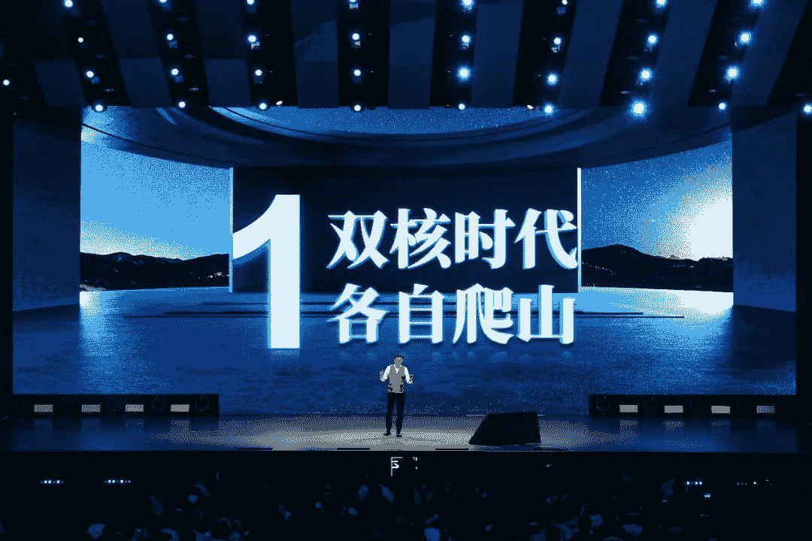

在全球政治经济界，第一个把中国和美国联系起来分析的学者是一个英国人，名叫尼尔·弗格森。2009年，他把China和America结合在一起发明了一个英文单词，Chimerica，“中美国”。Chimerica这个词曾经入选《纽约时报》的2009年度流行词。2009年，也就是中国汽车产销量超过美国的那一年。但是Chimerica真正地进入到实质性的阶段，则是最近这三年的事。

里夫金是美国的一个未来学家，他在今年年初出版了一本书叫作《韧性时代》，他也帮助美国的共和党做了一份非常厚的报告，叫作《美国韧性3.0基础设施转型报告（2020-2040）》。在这份报告中，他写了一句话：“在新兴的韧性时代，投资16万亿美元，部署和管理智能数字化、零排放的韧性基础设施，建设二十一世纪的美国经济。”

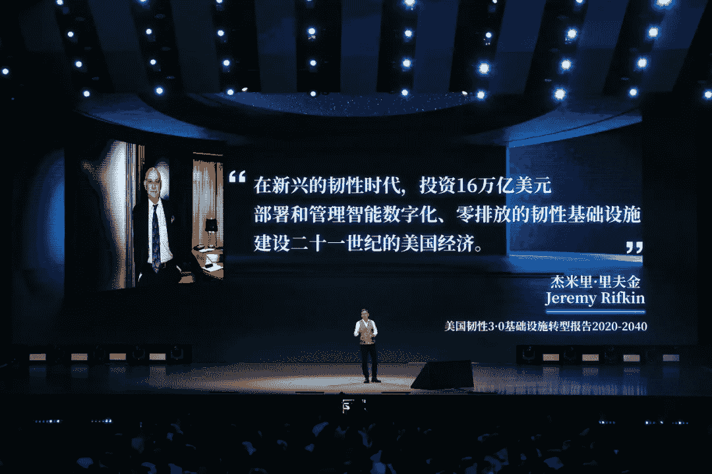

我们把这句话里的两块换掉，把“投资16万亿美金”换成“投资多少万亿人民币”，把“建设二十一世纪的美国经济”换成“建设二十一世纪的中国经济”，有违和感吗？没有。

这意味着什么？意味着自工业革命以来，中国作为一个后发的发展中国家，在二十一世纪的今天，我们终于和美国站在了机会对等的发展道路上。朋友们，这是过去100年中国近现代史上从来没有发生过的事情，也是我们在座的各位——无论你是60后、70后、80后、90后，还是00后——我们这几代人的光荣和使命。Chimerica，一个真正意义上的产业对峙的双核时代已经到来了。

今年，我和全球最大的对冲基金——桥水基金的创始人瑞·达利欧有过一次对话，今年他出版了《原则2》，在这本书中他用了两个章节来讨论全球化背景下的中国经济。他提出中美未来博弈有六大战场——贸易战、技术战、资本战、文化战、自我交战的战争和战争。

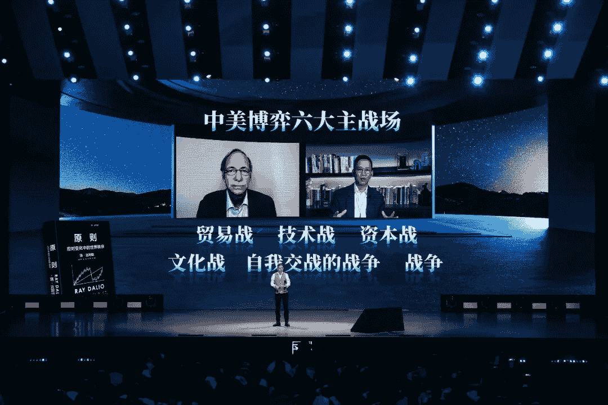

在对话中，我问了达利欧一个问题：这六大战场，如果只选一项的话，你觉得最值得关注哪一项？达利欧迟疑了两秒钟，说“War”。我想今天中美的一个共识，就是面向未来的双核时代，我们需要在避免War的前提下，让两国在贸易、技术、资本、文化领域进行一次真正意义上的博弈和融合。

那么在今天这个时刻，中美产业经济分别有哪些数据值得我们对比研究？我这里收集了一些截至2022年10月的数据。

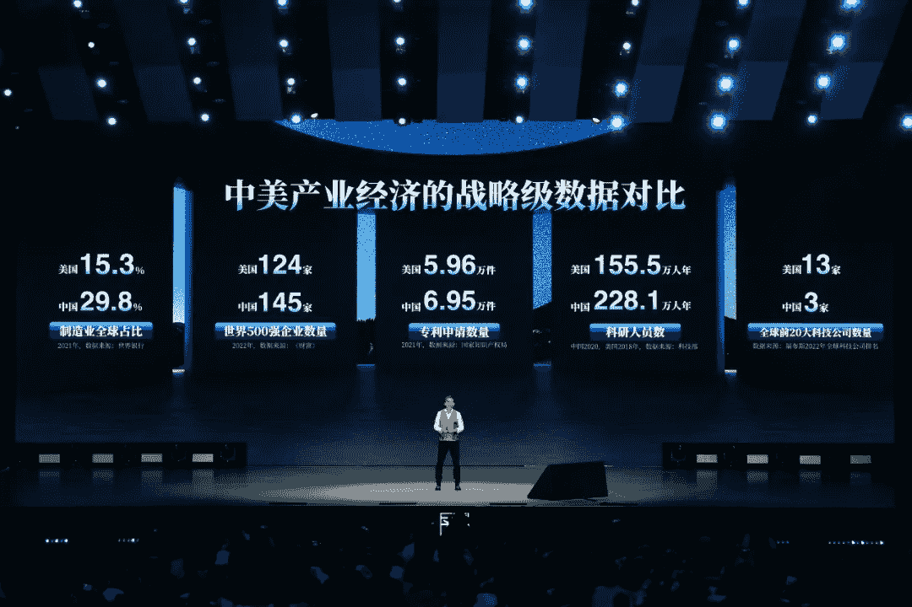

首先看制造业。今天中国在全球制造业中的占比是29.8%，美国是15.3%，所以里夫金提出建立美国韧性3.0时代，要构建新的基础设施，以及在制造业领域摆脱全球产业对中国的依赖，是它的一个战略目标。

我们再来看世界500强，中国进入榜单的有145家，美国有124家，我们已经超过美国21家。在专利申请方面，中国每年是6.95万件，美国是5.96万件。在科研人员数上，中国是228.1万人年，美国是155.5万人年。从这些数据我们都可以看出，中国的产业经济处于一个相对领先的优势状态。但是看全球前20大科技公司，美国处于绝对领先，它有13家公司，中国是3家。

接下去看看2022年中国向美国出口商品的变化。我们看到有些商品在减少，比如家具、药品、陶瓷产品、光学仪器等，均处于下行的状态。但是也有些商品出口还在增加，比如说钢铁制品、纺织制品、机电产品、汽车及零部件、铝制品和鞋类，仍然处于增长的通道中。

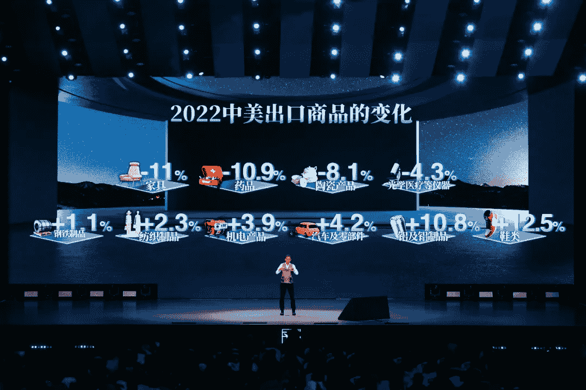

所以，虽然是双核时代，但是中美经济的互相博弈和互通交融是并行的。

中国国内也正在全面加速国产替代。政策要求，到2027年，央企和国企要完成100%的信创替代。所以这两年我们也看到一些企业，例如飞算，利用算力、软件开发能力和数据机器人的能力，通过很多原创技术，帮助这些国企、央企和其他大型企业在未来5年内完成信创国产化替代和竞争力的打造。

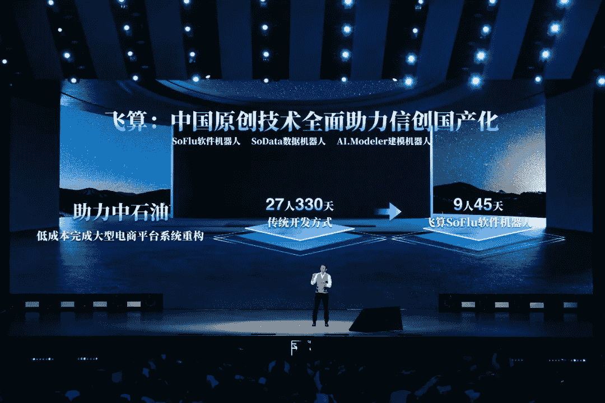

我们再来看一个特别大的行业，云计算。有人说在未来的产业经济中，大数据将替代石油，成为第一生产要素。如果大数据是石油的话，那么云是什么呢？云就是我们的电力系统，会构建所有产业经济的基本面。

美国咨询公司Gartner评过一份榜单，关于云计算的9大核心技术能力，包括韧性、计算、存储、网络、安全、软件基础设施等9个重要的指标，我们把它们叫作铁人九项。

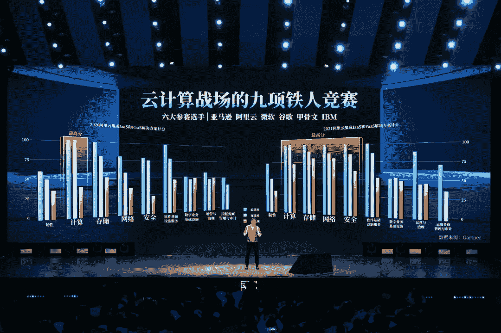

Gartner研究了6家企业，5家是美国企业，1家是中国企业。在过去的很多年里，铁人九项比赛基本上是美国公司排在前面，但从2021年的数据看，中国公司居然有4项得到了最高分，计算、存储、网络、安全。

我去阿里云调研的时候也非常吃惊，这是为什么？因为过去三年里中国经历了非常复杂的社会治理，庞大的企业和社会治理数据被喂到了那个计算体系里面。所以过去三年，是中国云计算的能力获得巨大发展的年份。

我们再来看另一组数据，云原生。云原生是什么？就跟电力一样，大规模的电力系统，需要发电机、输配电、低压电器、开关，这些东西构成了整个电力世界的基础设施。云也一样，在整个云计算行业中，有一些像输配电、开关、电线这样的基础应用。其中有148项是核心应用。在这148项核心应用中，由中国互联网公司发起的有37项，占到了25%，其中阿里云发起的有13项。

这两组数据告诉我们一个事实，未来的双核时代，不是一个谁战胜谁的过程，而是一个在博弈中不断融合的过程。

中国公司要在未来的新经济、韧性3.0基础设施时代形成自己的建构能力，我们只能干一件事，就是在这些基础设施方面，充分发挥中国的原创，让这个全球势力地图没有办法拒绝我们。

所以双核时代是一个共生、共融、共进的时代。而在这个过程中，我们看到中国公司，特别是中国这些互联网平台公司，正在发挥他们的创新能力。

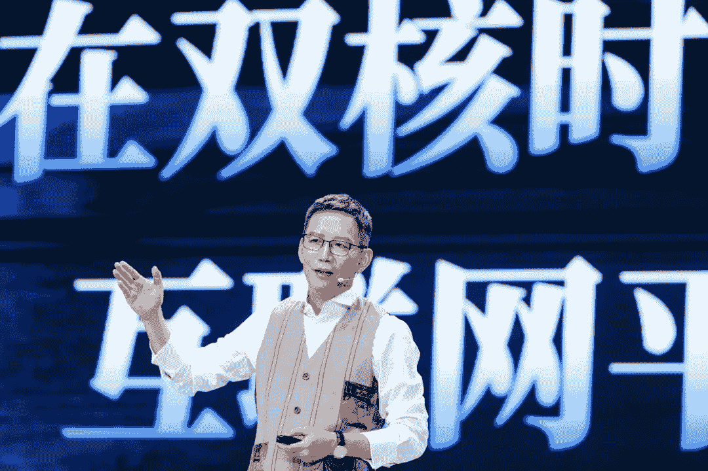

2008年的时候，微软提出过一个概念，让房间里所有的墙都成为屏幕，每一堵墙都是人机交互的界面。但是当时很难实现，因为当每一堵墙都是屏幕的时候，这个屏幕背后一定要有处理器。

今年，阿里云发布了一个产品叫CIPU，云基础设施处理器。CIPU时代到来的时候，就能实现微软在2008年提出的那个理想，所有的屏幕背后都不再需要一个物理的处理器，所有的处理器都在云端。

我在阿里云的实验室看到这个产品的时候，真的非常激动。这意味着什么？意味着在云计算能力、软硬件结合实现可能的时候，中国的互联网公司有可能创新出下一代的操作系统——无影。

我觉得在2023年我们需要重新反思很多事情，在过去两年里我们有很多产业上的误读，有很多产业上的纠结，我们被一些舆论带到了一种负面的、一种对峙的情绪当中。

当我们回看双核时代的时候，我们要重新思考这些中国的互联网公司，阿里、腾讯、字节、京东、美团……我们在这些互联网平台公司看到了，在新型基础设施的建构方面，每一家公司都在非常努力地进行创新和投入，砸进去很多钱。

朋友们，未来是看不见的。但如果没有那么多的钱砸进去，没有那么多的人砸进去，中国不可能建构一个韧性时代的基础设施。

所以我们希望在2023年，一个新的社会治理周期到来的时候，我们的政府部门、舆论界、学界，能够重新定义和理解互联网平台公司在中国当前以及未来10年、20年的产业经济中具有的创新价值。

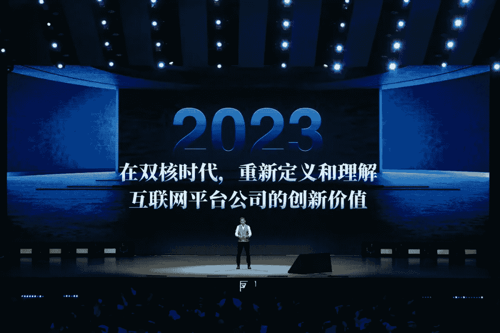

它们的存在，并不仅仅是为了跟几个菜贩子争夺那个菜市场，它们承担着中国产业经济在双核时代面向未来进行种种试错和创新的责任。这些责任，我认为100%都将压在那些民营互联网平台公司的身上。我们希望2023年，能够有一个重新的定义和一个重新的理解。

## **预见二****：****智能工厂，雨后春笋**

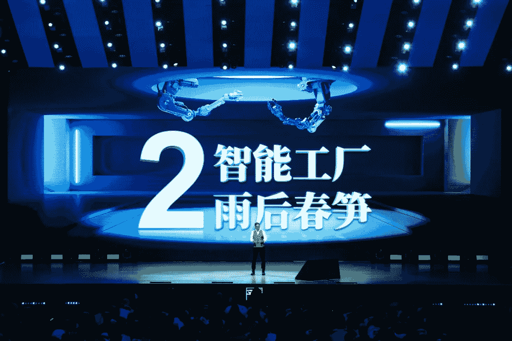

2018年，达沃斯论坛开始评选全世界工业4.0工厂。至今发布7批名单，评选了全球114家“灯塔工厂”，中国占42家，占比超过三分之一。中国制造业在全球制造业的占比也接近30%。这就是为什么我要带大家去看标杆工厂，它们代表了中国经济的基本盘。跟中国相比，美国和印度是9家。

和大家分享一些数据，海尔在青岛有一家灯塔工厂，叫作洗衣机互联工厂。一台洗衣机从一块钢板到生产线，最后变成了一台洗衣机。需要多长时间？1天？10个小时？8个小时？3个小时？两个小时？答案是38分钟。而且这条生产线可以生产800元的洗衣机，也可以生产15000元的洗衣机。

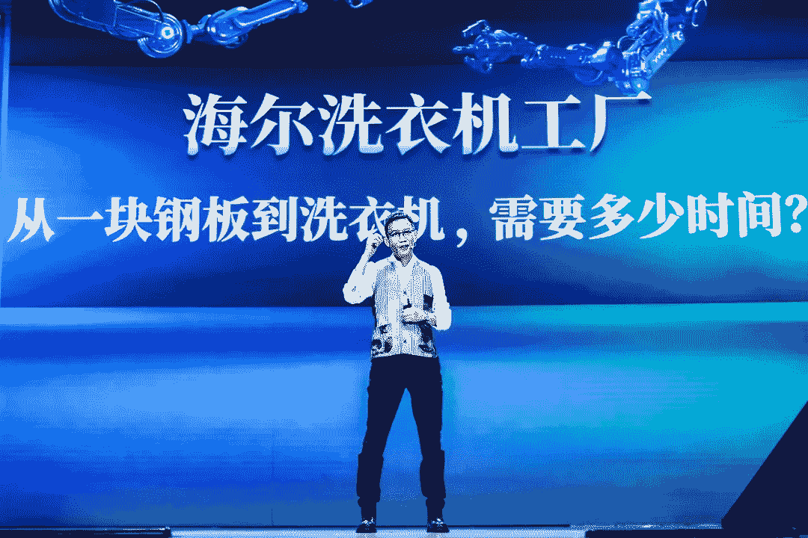

三年前我去的时候，这个工厂有一个操作台叫人机协作台，一块钢板打完孔之后，需要人和机器协同作业。今年10月份的时候，人机协作台已经没有一个人了。钢板在移动的过程中，能够完成零部件的安装。大规模的人工智能和算力嵌入到了灯塔工厂中。

三一重工是中国最大的重型装备企业，做桩机、水泥搅拌机、起重机。一家重工企业长什么样？印象里是“傻大笨重”，到处都是人。在三一重工，我问他们，你们的科技人员和蓝领工人的数据比是怎么样的呢？

他们给了我三组数据：2017年底，三一重工研发人员2744人，一线蓝领工人9683人。2022年底，研发人员是12251人，一线蓝领工人14576人。他们跟我讲，吴老师，2025年你再来，研发人员将达到30000人，蓝领工人3000人。你很难想象，一家重型装备企业，科技人员和蓝领工人的比是10∶1。

广东有一家企业，慕思寝具。他们年产360万+张床垫需要多少人？1000人？500人？300人？只需要50人。

去格力见董姐姐，今年已经是第8次，第一次去是1998年。中国今天能够生产最好的空调，卡塔尔世界杯主会场的空调，是格力生产的。但这不是关键，今天它发生的变化是什么？4年前，董姐姐带我去看空调的生产模具，那时格力已经能够生产所有空调的模具。但是，生产模具的机床90%还是国外引进的。今年11月份去，再一次到他们的模具工厂，机床70%完成了国产化的替代。

从海尔、三一重工、慕思、格力，可以看到什么？巨国效应带来规模化创新。除中国以外，没有一个国家需要生产这么多家电和床垫，我们庞大的城市化发展和人口红利，让我们能够生产全世界最大的泵车，全世界最深的桩机，全世界规模最大的空调厂、冰箱厂、洗衣机厂、手机厂。巨国效应还推动了生产线的革命，我们不但能够生产电器，我们还能够生产铸铁，能够生产模具，能够生产芯片，能够生产机床。这是过去不到10年时间里面发生的景象。

美国管理学家迭戈·寇明说：“一个经济体的强弱，不取决于引入先进科技的速度，而取决于使用先进科技的深度。”中国智能工厂为什么能让软硬件技术实现深度应用，因为经济体足够庞大，足够复杂，具有足够的战略纵深。这个国家的发展，给了在座每一位创造了产业深度和广度的可能性。

## **预见三****：****能源战场，换道超越**

过去很多年我们讲弯道超越，在遇到产业周期或者经济危机周期时，我们通过弯道来实现超越。40多年来我们都在搞弯道超越，但在今天有一些产业出现了“换道超越”的现象。

2022年哀鸿遍野，如果说唯一一个产业有亮点，那就是新能源产业，由四个部门构成：风电、光伏、储能、新能源汽车。这是2022年的数据，中国的风电装机容量增长了16.9%，光伏发电新增并网容量增加了105.8%，电力储能装机规模增加了36%，新能源汽车销量增长了110%。

这大概是除了口红经济以外，演讲中最亮眼的一个数据，中国今天在新能源产业巨大的投入和创新，给2023年以后的中国经济带来了巨大的想象力。

我在1990年走进产业经济，一开始当工业记者，后来当财经作家，到今天为止我还是一个记者，每天在看企业。1990年，中国汽车产量是50万辆，到了2009年，中国的汽车产量达到了1379万辆，那年中国的汽车产销量超过了美国，成为全球第一。

在2021年，中国的汽车产量达到了2608万辆，美国、日本、印度、韩国加在一起，还比我们少120万辆。但这个数据仅仅叫作弯道超越。什么叫作换道超越？是在2022年全球每卖出10辆新能源汽车的时候，中国的新能源汽车能占到6辆；中国每卖出10辆乘用车，新能源汽车占到3辆。

在2022年，比亚迪超越特斯拉，成为了全球销量第一的新能源汽车公司。

我们常常讲的高端车是指燃油车里的BBA：宝马、奔驰、奥迪。2022年，这三家企业在中国地区全部推出了新能源汽车。有一家中国公司，30万元以上的高端纯电汽车的销售量超过宝马、奔驰、奥迪的总和，这家公司叫作极氪。

去年9月我曾去过极氪，极氪的总裁叫安聪慧，那时候极氪001还没上线，他带我试驾。我坐进车里，问他的第一个问题是：这辆车百公里加速是多少？他回答我：燃油车百公里加速一般是8—12秒，但这辆车是3.8秒。他讲3.8秒的时候，我的第一个动作就是去抓扶手，但车开了，我没有任何感觉。在那一瞬间，我知道一个新的时代到来了。

这家企业的母公司叫作吉利，吉利的创始人叫李书福，是我一个很多年的朋友。30年前李书福是做摩托车的，后来他要做汽车。有一次部委领导去吉利调研，李书福跟这个领导说：我们想做汽车。领导回应说：你不要做汽车，都是国有企业在做。但李书福当年讲了句很牛的话，他说：领导，请你给我一次失败的机会。到了2009年，全球金融危机爆发的时候，吉利收购了欧洲豪华车品牌沃尔沃，所以我们今天看到的极氪是建立在吉利近30年造车能力和沃尔沃近100年的造车能力之上的。

一个公司怎么能够源源不断地做汽车？它需要有一个造车的架构。全世界一些非常先进的汽车公司，丰田、大众、通用在过去的几十年里都形成了源源不断地能够生产车型的架构能力。全世界第一个纯电车的架构是2020年由吉利发布的，叫作浩瀚。你今天看到的极氪有两款车型，001和009，极氪今年推出的是009MPV，是全世界第一款原生纯电豪华MPV，但是在这个架构上，已经生产出多款新能源汽车了。

这就跟我们中国公司做云计算一样，从最底层再往上形成自己的架构能力。极氪在欧洲有两千人的技术中心，在杭州湾投了一百多亿，有一个最先进的5G智慧工厂。

如果我说未来的全球新能源汽车市场是属于中国人的，你们信不信？在风能、光伏、储电、新能源汽车等方面，我们已经实现了一次勇敢的换道超越。在即将到来的2023年，我们将看到这个趋势持续进行。所以投入新能源产业，就是投入了未来十年的一个朝阳行业。

## **预见四：****隐形冠军，赶超德国**

2023年还可能发生的事情是中国的隐形冠军超越德国。

“隐形冠军”这个词是德国管理学家赫尔曼·西蒙提出的。1980年，他还是个年轻的学者。有一次，一个美国的管理学家碰到西蒙，问了一个问题：1986年的联邦德国经济总量只有美国的1/3，但是联邦德国的出口贸易超过了美国，为什么？西蒙回答不出来，于是他回去做调研。调研结果令人大吃一惊，原来支撑德国成为全球第一出口大国的并不是西门子、博世、蒂森克虏伯这些巨型企业，而是一批隐形冠军企业。

西蒙用三个标准来定义隐形冠军：第一，在细分行业全球数一数二；第二，企业销售额在10亿美元以下；第三，企业不广为人所知，行业以外就是路人甲、路人乙，但在行业内就是王者。

德国有多少家隐形冠军呢？西蒙算了一下，有2700家。他在书里说：“雄心、专精、全球化，便是‘隐形冠军’成功的秘诀。”今年我和西蒙有过一次对话，我问他，你觉得在未来两三年内中国隐形冠军的数量有可能超过德国吗？他不回答，只说“下一个问题”。

回过头来，我们看看中国制造业的金字塔。最上面的是不断增加的灯塔工厂，代表全球工业4.0产业智能化的最高水平。如今我国有42家，但未来一定会越来越多。第二层是8997家国家级的专精特新小巨人，如果中国的隐形冠军可能超过德国，那么大部分都将诞生在这些企业里面。还有6万多家省级专精特新企业，14万家地市级的专精特新企业，再往下有400个产业园集群基地，再往下还有数以600万计的中小工厂。

这是中国的底牌，是中国经济在2023年以后不可能被击垮的基本盘，制造业仍然是中国产业经济的唯一命门，产业互联网、产业智能化是中国经济面向未来最大的核心竞争力所在。

今年我还干了一件让我特别高兴的事，我们890新商学和浙江大学管理学院成立了一家专精特新研究中心。这个中心成立以后做的第一件事是在有关部门的支持下，对三千多家国家级专精特新企业发问卷调查。问卷调查有5个分析维度、16个变量、163个题项，三千多份问卷发下去之后，我们收到了1122份有效样本。

我希望明年的时候，我和教授朋友们能够为大家全面地展示我们对这一千多家企业的学术调研，应该会有一本书写出来，这本书会告诉赫尔曼·西蒙，中国的隐形冠军，真的已经比德国多了。

从现有的数据，我们看到了中国隐形冠军的几个特点：

1. 创业者素质大提升。在1122个样本企业中，100%是民营企业。95.8%的创业者是大专及大专以上学历，其中40%是研究生以上学历。

2. 产业集群抱团发力。48%的企业集中在20个制造型城市带。

3. 应用驱动国产替代。44%的公司从事国产化替代的研发和制造。

4. 资本赋能加速孵化。这个特点也是中国隐形冠军和德国隐形冠军最大的区别。德国的2700多家隐形冠军，在西蒙总结的数据中，有80%都是不为人所知的家族企业，但是中国这一轮隐形冠军的崛起得到了资本市场的呼应。今天中国A股市场的五千多家企业中，专精特新企业超过一千家，占全部A股上市公司的20%。在北交所上市的公司中，41%是专精特新企业。所以，为什么中国的公司会比德国跑得更快？因为我们有一个庞大的制造业基础流量，同时我们在资本市场上有更多的加速和赋能机制。

现场的朋友、直播间的朋友，如果你是做制造业的，如果你对专精特新感兴趣，我们和浙大组建的这家专精特新研究中心有一份《专精特新上市公司发展报告》。电子版送给大家，希望这份报告对于做制造业的朋友有所帮助。

长按图片扫码 ▲ 添加学习助理

## **预见五****：****长期主义，率先复苏**

经历了最近3年之后，我们发现，中国产业经济的投机主义时代已经结束了，泡沫消失了。从2023年开始，未来的市场将永久属于长期主义者。我们在2022年看到，在风云突变的产业变革时期，那些坚持了产业基本盘，坚持了产品优先，坚持了价值链优先的企业，在2023年成为了大潮退去后的坚挺者和幸存者。

我们上半场讲到过一家企业，不减薪、不裁员、准时发放年终奖，就是比音勒芬。这是一家20年前创建的企业，营收和利润一直在增长。今年那么难，比音勒芬2022年前三季度营收增长13%，利润增长24.9%。这家企业在特别传统的服装行业，20年以来却有一条波澜不惊的增长曲线，因为它做对了三件事，这也是所有想在中国地区成为长期主义者的三个法宝。

第一，专注一个赛道。从20年前，比音勒芬就专注高尔夫服装。20年前高尔夫在中国是一个很小众的运动，比音勒芬赞助了国家队，把高尔夫变成一种生活方式，伴随着中国高尔夫产业的发展，做到了高尔夫服装品类第一。

第二，专注技术。做有功能性的服装。露天打高尔夫，要防紫外线、要吸汗，所以一件高尔夫服装的背后，从面料到染色，到后整理，需要种种技术创新。比音勒芬有125项专利，参与制订了10个国家及行业的标准。

第三，专注审美。服装除了满足基本穿着需求，也是一种身份、审美、趣味的诉求。这两年，比音勒芬与苏绣和故宫合作，不断进行产品的迭代。

在中国，一家企业要成为一个长期主义者，做到这三条，在2023年以后就会成为中国商业世界的幸存者。

另外一个长期主义的坚持者京东，也是一家创业20年的公司。2003年非典的时候，在中关村开店的刘强东把线下店全部关掉，搞线上店，搞出了京东。早期京东主营3C产品和家电。

在中国地区，所有制造商和渠道商是相爱相杀的欢喜冤家，谁也离不开谁，但要么店大欺客，要么客大欺店。家电行业的张瑞敏讲过一句话：“我的利润像刀片一样薄。”那时发生了两件事，第一件事，产能过剩，家电企业打价格战。第二件事，两个巨型的线下零售连锁企业，国美和苏宁出现。国美和苏宁通过庞大的线下渠道，和制造业企业形成博弈关系，使企业的利润像刀片一样薄。

当京东开始做线上平台的时候，其实它很有可能成为下一个国美和苏宁。因为渠道通吃，且线上的通吃能力更强，流量通吃，环境通吃。所以稍有不慎，超级平台和制造业企业就会相爱相杀。但在过去的十多年里，二十年前发生的景象，在中国居然没出现。

从2013年开始，中国主要的家电品牌，曾经像刀片一样的利润从7%提高到了15%。靠两件事：第一件事，美的、海尔、格力、海信、TCL等家电企业自己争气，开发出高品质的产品；第二件事，超级平台和家电企业形成了良性的互动关系。

为了建构这个关系，刘强东提出了两个理论，一个叫“三毛五理论”，如果有机会赚一元钱的话，三毛给合作伙伴，团队员工拿三毛五，剩下的三毛五留给公司发展。在传统家电连锁的时候，家电企业的线下渠道成本有15个百分点，库存周转要87天。从2018年起京东渠道成本只需要8个点，减少了7个点，库存周转从87天减少到最少31天。

你会发现，那些家电企业能够有资金去建设全世界最先进的智能工厂和灯塔工厂，是因为他们赚钱了。赚钱的原因，第一是自身的技术和产品、品牌在迭代。第二是家电企业和线上零售平台形成了一种良好的合作关系，共同“熨平”了产业增长的波动周期。

除了“三毛五理论”以外，还有一个“十节甘蔗理论”也很有意思。京东把一个家电的价值链条分成十段，前五段是企业的创意、设计、研发、制造、定价，后五段是营销、交易、仓储、配送、售后。

在每一节甘蔗背后，都形成了一个智能化的全链路能力，平台帮助生产商进行数据的挖掘，进行效率的提升，进行智能化解决方案的赋能，然后让企业能够专注在研发和制造环节中。

从“三毛五理论”到“十节甘蔗理论”，京东的长期主义帮助了中国的消费品公司，形成了长期主义者的土壤。所以，我们前面讲，为什么在2023年需要重新定义和理解互联网平台公司的创新价值？京东从它的角度给了我们新的启发。

所以，就好像稻盛和夫在《活法》中说的，长期主义者的“活法”就三件事：乐观地设想、悲观地计划、坚定地执行。一个真正的属于长期主义者的时代即将在2023年到来。

## **预见六****：****数字人大战直播间**

在谈全球数字人产业发展的时候，不得不提两个“人”，索菲亚和Lil Miquela。2017年10月，索菲亚成为全球第一个获得国籍的数字人。2018年，《时代周刊》评选的“2018全球25大网红”中，Lil Miquela作为唯一一个数字人，赫然在列。

到了2021年以后，中国出现了兰LAN、花西子、洛天依、AYAYI、柳夜熙等大批数字人。

而在2021年4月，英伟达举办的GTC大会中，有14秒的时间，CEO黄仁勋是以虚拟人的形象出现。与索菲亚、Lil Miquela这类有明显虚拟特征的数字人相比，“数字黄仁勋”过于逼真，直到8月自曝之前都无人发现。

彼时，英伟达做“数字黄仁勋”，需要3D建模，这14秒，每一秒都要花几万美金。如今16个月过去了，中国互联网公司通过2.5D技术及强大的算法能力，生产出来的数字人都日趋逼真，而价格最便宜的只需2000元，最贵的也不过8000元。2023年中国互联网公司带给大家的科技普惠，是让我们都能拥有一个自己的数字人。

我在2020年年终秀时说，每一家公司都可能需要一个直播间。今天我在预见2023年终秀上说，每一家公司都可能需要一个数字人，你可以用它来做本地生活、做客服、做品牌直播、做短视频等等。

## **预见七****：****M型社会悄然来袭**

2006年，日本管理学家大前研一出版了一本名为《M型社会》的书。他在书中有一个判断，从1990年到2006年，日本经济失速的这16年里，社会正逐渐形成一种M型双峰结构，高收入人群和低收入人群各居两端，并且贫富差距不断拉大，而位于中间的中产阶层向下塌陷，如同M型一般。

《M型社会》中提到，每个人每年的收入可分为通过打工得到的职务性收入和通过理财得到的财产性收入。日本中产阶层出现塌陷的原因就在于1990年到2006年这16年里，人们的职务性收入增长出现停滞，家庭的所有财富波动发生在财产性收入上。

而2023年以后，中国也很可能发生这样的情况。

具体来看，大前研一对M型社会有四个判断依据：少子老年化、高储蓄率、长期货币增发、阶层板结。2022年，这四个依据正在中国社会发生。首先是少子老年化，2006年日本65岁以上人口占比20.2%，2021年上海65岁以上人口占比26.9%。2006年日本家庭平均储蓄率与2022年的中国家庭平均储蓄率也相差无几，前者34%，后者36%。与此同时，中国的长期货币增发比日本严重得多。2002—2022年，中国M2增长1396%，而日本1986年—2006年M2增长为73%。

未来几年，如果职务性收入停滞，则意味着财产性收入的增加与否，决定了我们能否继续跻身新中产或高收入人群。

然而，与日本、美国相比，中国高净值家庭的财产性收入非常畸形。

中植基金鑫理财的调研数据显示，中国高净值家庭房屋资产占比60%，日本是35%，美国25%；而保险类资产我们只有4%，日本和美国都是24%；股票、基金等权益资产在中国高净值家庭的资产配比中仅占3%，日本是10%，美国是35%。也就是说，中国高净值家庭出现了房屋资产占比过高，保险类资产、股票、基金等权益资产配置过低的情况。

从大前研一对M型社会的解读，结合鑫理财提供的数据，我们可以看出优化资产结构是2023年高净值家庭的第一任务。

具体实施办法，中植基金鑫理财提出了一种新的理念：打理人生的三笔钱。

第一笔钱，人生保障的钱，就是基金、养老FOF这类。第三笔叫灵活取用的钱，指根据投资周期可以日常取用的。最关键是中间那笔，投资增值的钱，我们要了解个人风险偏好和投资金额，在M型社会到来之后，重新学习家庭理财新技巧和新的可能性，对资产结构、房产、保险和基金股票重新进行结构性配置。

朋友们，2023年以后，可能是新一轮的财富保卫战时期。

## **预见八****：****树根经济，信心中国**

1978年，中国开始支持个体经营，年广久被称为第一代民营企业家。他有个外号叫傻子，创立了一个瓜子品牌，叫作傻子瓜子。

从傻子瓜子开始，民营经济被称为草根经济。何为草根经济？是指民营企业在成长过程中经得起蹂躏，给点阳光就灿烂，给点雨露就发芽。如今在一些论坛中，很多学者谈到民营企业，仍说它们是草根经济。

在2023年即将到来的时候，我必须非常认真地告诉全中国所有的朋友们，中国民营企业不再是草根，“给点阳光就灿烂”“给点雨露就发芽”的草根时期结束了，它们正在成为下半场中国的“树根经济”。

为什么是“树根”？中国制造业500强中，民营企业362家，占到了72.4%；中国新经济500强中，民营企业422家，占比84.4%；中国A股上市公司五千多家，民营企业3168家，占到63%。东南五省，福建省、浙江省、江苏省、广东省、山东省，民营经济占GDP比重全部超过50%。

如果说今天的民营经济仍是草根经济，那么中国经济怎么可能发展为“中美双核”？怎么可能有产业升级，有灯塔工厂？

因此，民营经济如今就是中国经济的树根。在2023年，面对经济的复苏，我们必须要说“民企强，则中国强，民营企业有信心，中国经济有信心”。

2010年，我给80岁的吴敬琏老师写了一本书叫《吴敬琏传》。在最后审稿阶段，我请吴老师帮我写一行字。第二天他把字发给我，吴老师在《吴敬琏传》的扉页上写道：呼唤法治的市场经济。2023年，我们要继续大声呼唤法治的市场经济。

在告别2022年，迎来2023年的时候，希望那50位经济学家的预言会实现，城市、产业、中国和全球的贸易流通会复苏，中国经济会回到长期基本面，我们会迎来一个阳光灿烂的2023年。

作为走过2022年的“幸存者”，面对新的一年，我们仍看到了这个国家产业经济持续发展的可能性和巨大的成长空间。我们只是缺了一个东西，好运气。所以在2023年即将到来之际，让我们一起走好运。

<https://aigcreative.feishu.cn/sync/K4Gvd9vUQsy9Oubwqaeclu0Fnbg>