# 吴晓波：预见2022，影响我们的六个周期（演讲全文）

> 来源：[https://aigcreative.feishu.cn/docx/Z6v3d80F9oVJqNx6pDScwg3mnEd](https://aigcreative.feishu.cn/docx/Z6v3d80F9oVJqNx6pDScwg3mnEd)

> 🔗 原文链接：https://mp.weixin.qq.com/s/mf_5I6jXHubGfDI7P5iblw

我是吴晓波，欢迎大家来到我的年终秀。

每年的12月30日，我们都会选一个城市，邀请一批朋友，大家聚在一起，聊一聊今年发生的事情，展望一下即将到来的明年，把每年的倒数第二天，留给理性的自己。

今年有一点意外。2021年充满着种种的打断、异常和意外。所以今年来到现场的，只有极少数的朋友，而更多的朋友们，现在在线上观看我们的云端年终秀。我临上台前，有一位同学给我发了一条🛰️，他说吴老师，我今年只能在家里看你的直播了，他是一个西安人。今天西安还在封城，让我们祝福这座伟大的城市，能够抵抗住这一次的磨难，请现场的朋友们，给他们一点掌声和一点勇气。

意外会磨炼我们每一个人的意志，让我们寻找新的可能性。虽然我们的工作和生活，遭遇了打断、异常和意外，但是我们一定会看到2022年的第一天，太阳照常升起，我们开始新的生活和新的工作。

同时这些意外，也在我们非常平凡的生活中，提供了新的记忆节点。我想若干年后，当我再回望这段时光，一定会想起2021年的年终秀是线上举办的。你看，我们做了这么多次年终秀，因为疫情，今年的这场年终秀意外地被凸显出来。

今年年终秀的主题叫做“周期之魅”，有不少同学这两天问了我一个类似的问题：吴老师，在充满变化的2021年，你为什么不谈谈当下，而要谈周期呢？

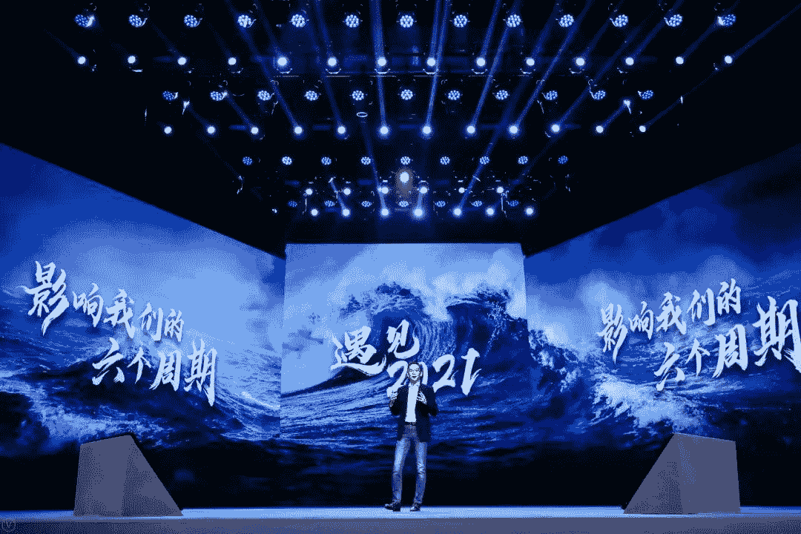

我觉得每一个人的生命，一个国家的经济发展，都像是一场长途跋涉。如果我们到达一个平原，那是一片我们非常熟悉的区域，我们闲庭信步、摘花折柳，所有的预言、所有的理想都可能会自我实现。而我们进入一个未知的峡谷，对地形非常陌生，还遇到了非常恶劣的天气，刮风下雨，偶尔还能听到几声狼叫。这时候你该怎么办？

你要做两件事。第一件事，抬头看，寻找那颗北极星，找到方向；第二件事，打开一张地图，搞清楚自己身处何处，前方有可能会遇见谁。

2021年，我们的生活就像闯进了一个凶险的历史峡谷，我们目睹了很多陌生的场景，遭遇了很多刮风下雨的天气。我们也在想，有没有这样一张地图呢？如果有这样一张峡谷的地图，告诉我们出口在哪里，未来一年、两年、三年，我们该怎么行走，那该多好啊。

有人说，吴老师，你有地图吗？卖给我一张。

我想，如果有这张地图，它应该是由确定性和不确定性共同编织而成的。

早在一百年前，大概1920年代，科学界曾经发生过一场非常重要的争论。19世纪到20世纪初，我们把它叫做“科学时代”，人类开始利用电，开始探寻宇宙的秘密、生物的科学。然后我们认为，客观世界的一切，都可以被各种公式所确定和理解。

但是1927年，有一个26岁的物理学家，就是照片上的年轻人，叫海森堡，他第一次提出了“不确定性原理”。

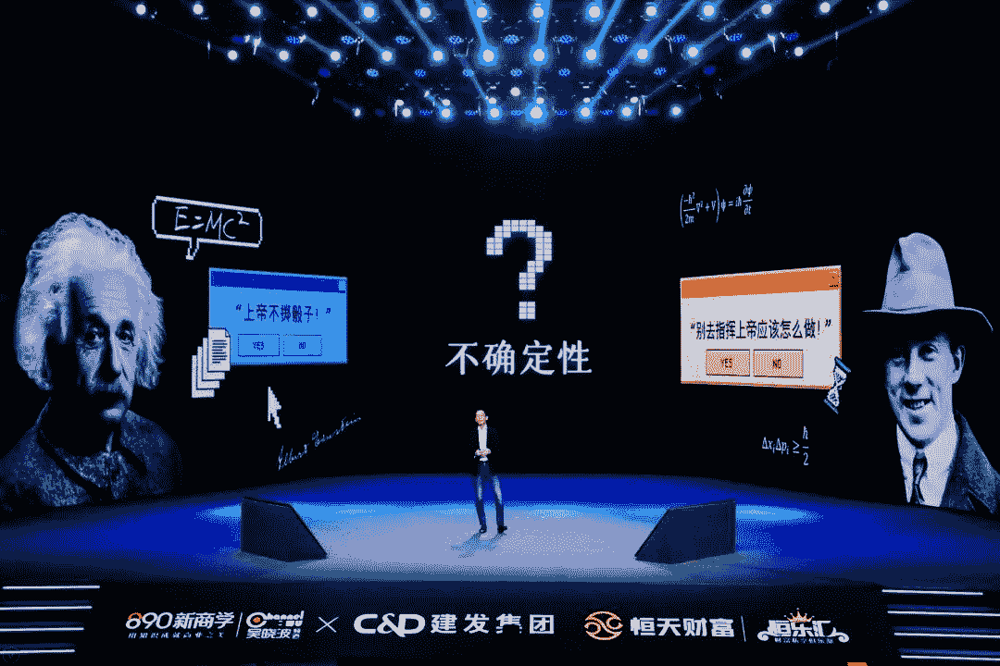

他当年提出不确定性原理的时候，引起了巨大的反对浪潮。最大的反对者就是这个人，著名的物理学家爱因斯坦。宇宙运行难道还有什么不确定性吗，难道上帝会掷骰子吗？而海森堡的老师玻尔回应：你别去指挥上帝应该怎么做！

也许就是从那个时候开始，我们意识到历史的周期和规律，既有其必然性，也有其偶然性和不确定性，就好像我们今天在一个历史的峡谷中走向未来一样。

我们研究周期，既要研究它的确定性和可能性，又要警惕种种不确定性的发生。这是我们今天这场年终秀，用“周期”来进行思考的一个最重要的起点。

跟去年和前年一样，做这场年终秀之前，我们在吴晓波频道里面发起了一个征集：用三个字来形容你即将告别的2021年。

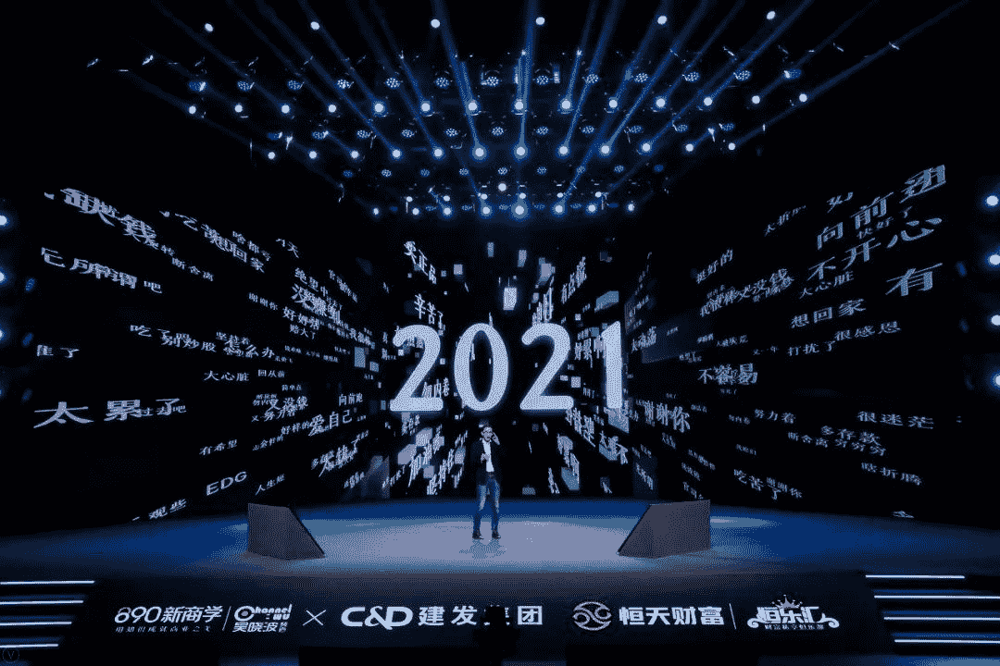

当然也收到了很多很多的答案，有说“太累了”“太难了”“大心脏”“无所谓”“回从前”“要努力”，还有“EDG”。什么是EDG，大家知道吗？今年的英雄联盟比赛中，获得冠军的队伍，是我们中国的EDG。所以这位同学的年度关键词是“EDG”。

如果用三个字来告别2021年，我们从中看到的，是各种迷茫和不确定。

现场和正在看直播的很多同学，如果你来观看我的年终秀，我想你一定是热爱商业的人吧。在商业世界中，如果有所谓的“天地人”的话，“人”指的就是我们自身，我们每个人的个人成长；“地”应该就是我们所从事的大大小小的事业，我们所在的产业；而“天”就是周期，周期是天，浩浩荡荡，顺之者昌，逆之者亡。

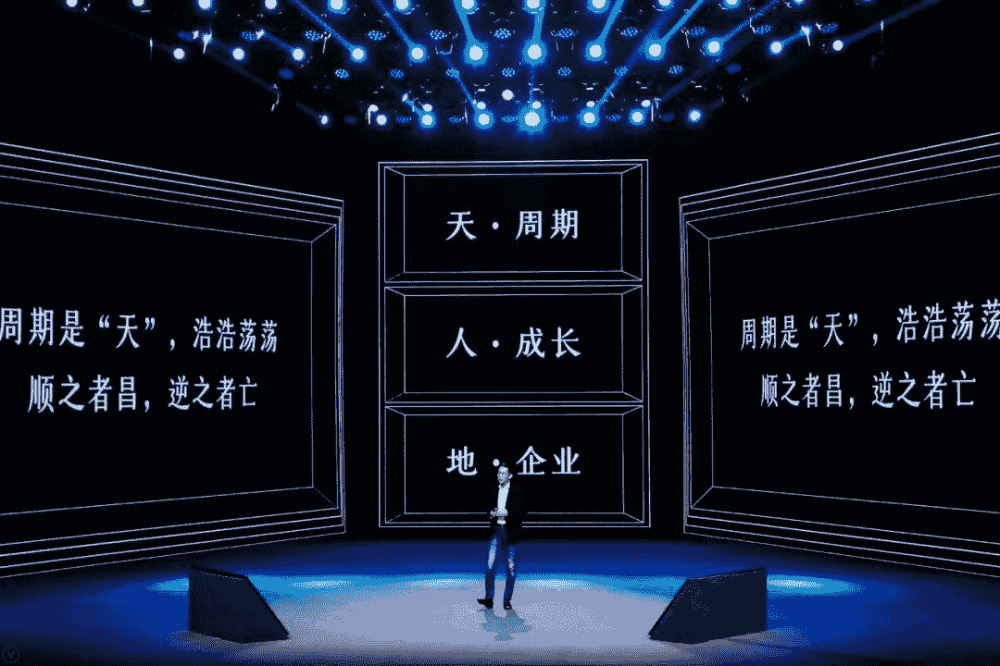

我们今天就来研究一下我们头顶上的六片天——2021年，我们所经历的六个“周期之魅”。

## 周期一：百年现代化周期

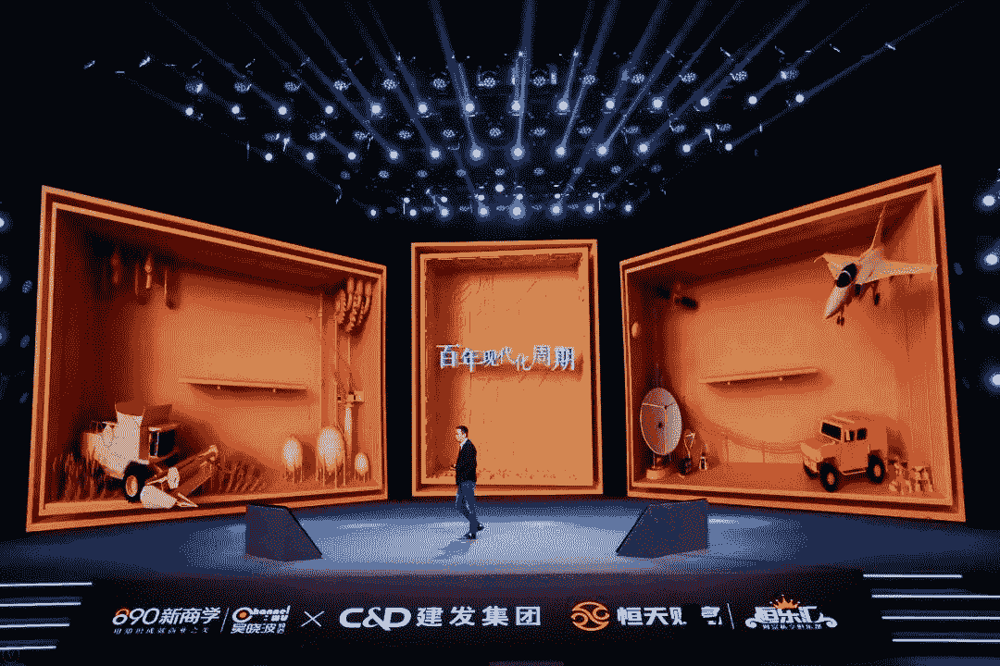

第一个周期，是百年现代化周期。

这个人是罗纳德·科斯，1991年诺贝尔经济学奖得主，他在去世前写的最后一本书叫做《变革中国》，研究中国1978年以后的改革开放，他在书中得出结论，1978年以来中国的改革开放是二战后人类历史上最成功的经济改革运动。这是一个美国经济学家对三十多年中国经济改革的一个基本判断。

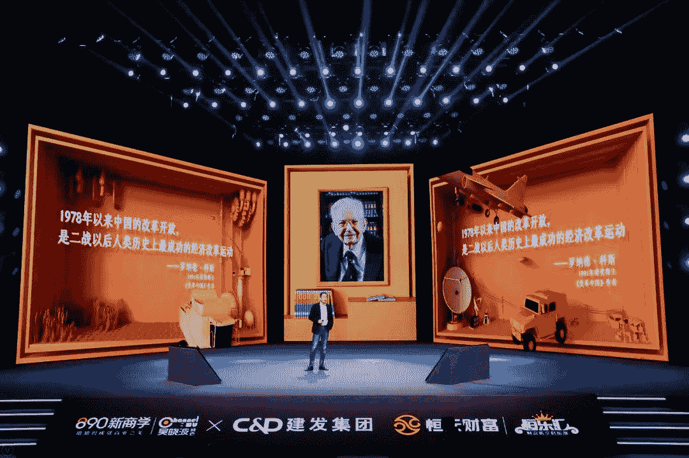

如果我们再拉长一点来看，本轮经济改革，在中国的现代化史上到底扮演了怎样的角色？我们这一代人在中华民族祖祖辈辈的发展历程上，到底做出了怎样的贡献和作为呢？

我和我的同事做了这么一张图表，从1820年开始算起，到2021年的今天，再到预测的未来，中国和美国占全球GDP比重的变化图。

1820年，中国的经济总量在全球占比达到33%，三分之一是咱们家的，如果历史停留在那一刻是多么美好。而美国当年在全球经济中的占比是2%，存在巨大的落差。

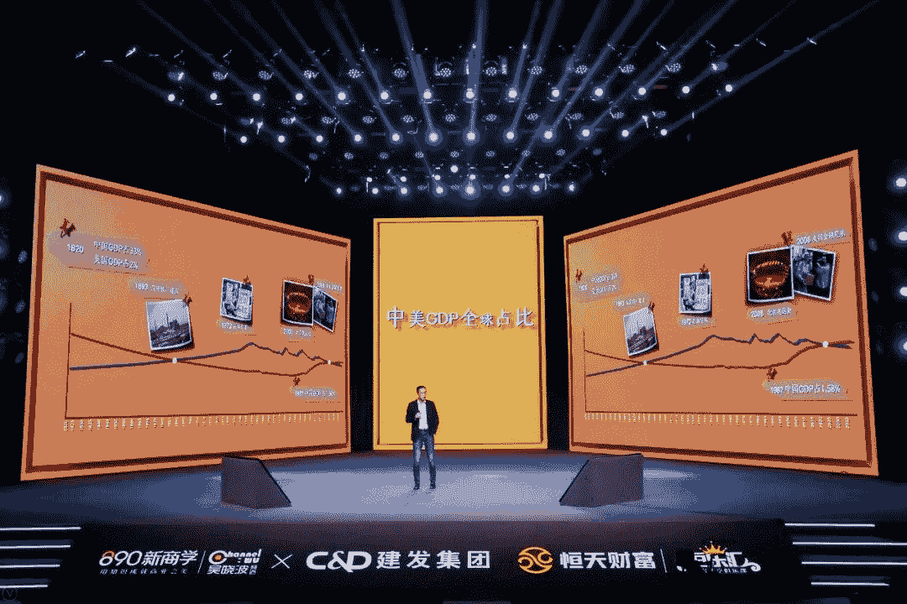

但是你知道，人类其实在那个时候已经进入工业革命了，1776年瓦特改良了蒸汽机，1776年亚当·斯密出版了《国富论》，1776年杰斐逊等人发表了《独立宣言》，现代文明已经在欧洲和美国大地上熊熊燃起。那我们呢？是一个占全球33% GDP的最大农业国。

然后历史开始转折，接着你看到美国的曲线大幅上升，中国开始大幅下降。到1890年代末的时候，美国超越了中国，成为全球第一大经济体。接着它继续往上升，经历一战、二战，中国继续往下行。这条曲线的最低点在1987年，中国那一年的GDP占全球比重只有1.58%，低于1820年美国的水平。

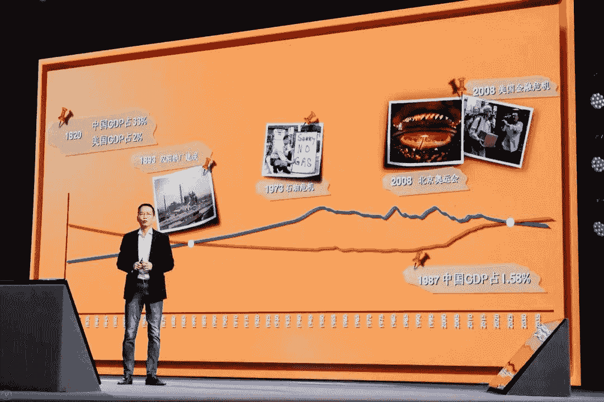

但是，接着我们看到中国的曲线开始非常顽强地往上走，到今天我们举办这场年终秀的时候，中国的经济总量是美国的70%。如果中国的经济增长曲线继续往前走的话，应该在2028年左右，超过美国，重新成为全球第一大经济体。无论你在哪里，为这个国家，为我们自己鼓一鼓掌。

今年难不难？2021年特别难。今天在场的企投会同学，我问他们怎么样？有人说吴老师，2020年是没生意做，2021年有生意做，但是没钱赚。

2022年会怎么样呢？我们今天会讨论整个周期。

如果我们把眼光放到200年的尺度上看的话，只要你认为这张图是真实存在的，是你相信的，在一个现代化周期中，我们就知道该如何安放我们的肉体、我们的精力、我们的资金和我们的产业。

面对中国经济的高速崛起，你会发觉，全世界的眼睛都盯着中国。一个经济只占全球百分之一点几的需要被援助的贫穷国家，突然成为全球第二大经济体，而且很可能在十年之内成为全球第一大经济体，怎么完成的呢？我们发现很多西方学者开始研究这个问题。

比如说在过去的将近一百年时间里面，我们看到了这些观点。

美国人费正清提出了“冲击反应理论”，他说中国的现代化是一次农耕文明国家被欧美的西方文明冲击，被打了以后怎么办？爬起来，把鼻血抹掉，你怎么打我的？我学你的技术、学你的制度、学你的治理模式，甚至学你怎么穿衣服。然后呢？通过冲击—反应来重新建构我们的能力。

另一个美国学者彭慕兰写了一本《大分流》，他意识到，可能中国未来的现代化道路有自己的文明、审美和价值观体系，历史有可能会出现一个分流。

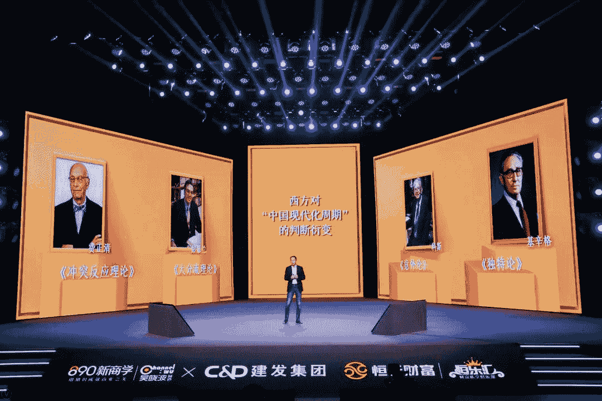

基辛格写了一本书叫做《论中国》，这位老政治家今天还活着，1971年中美邦交破冰就是从他开始的，从1971年到今天，他的访华次数难以尽数。他提出了关于中国发展的“独特论”，中国经济发展跟西方不一样，会非常独特。

我们再看科斯的“意外论”，他认为中国改革开放是二战后最成功的经济改革运动，但很可能是“人类行为的意外后果”。

而在今天，我们看到很多西方经济学家、政治家提出更激烈的关于中国的看法。

我想这些都是西方人的看法，那我们自己，我们在2021年的今天，要走出这个历史峡谷，要走向未来8年到10年，我们会问自己一些问题：如果我们成为全球第一大经济体，那么我们是不是市场趋势的开拓者？我们是不是核心技术的拥有者？我们是不是文化潮流的引领者，货币话语权的决定者？甚至，我们是不是人类命运的思考者？

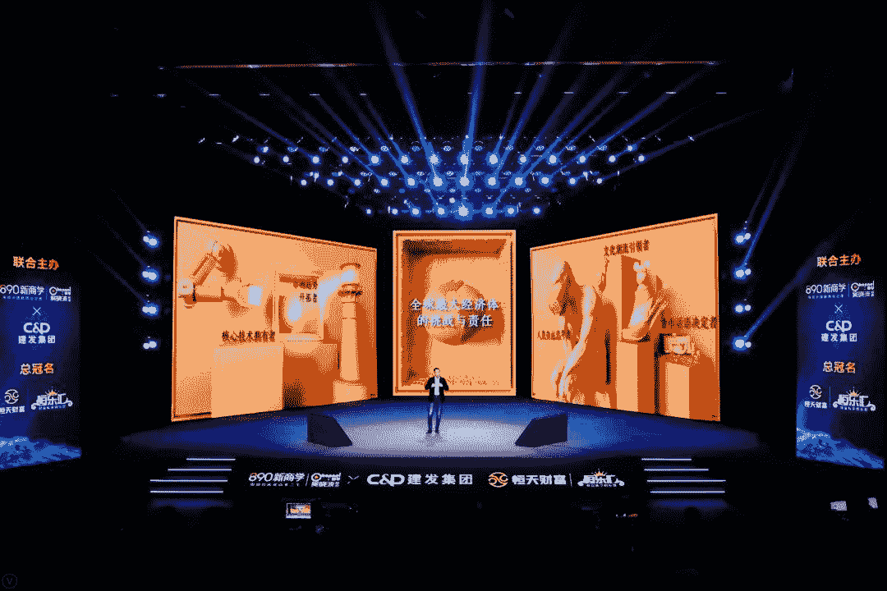

我想这些问题是我们这一代人所面临的最让我们好奇、最性感，也是最艰难的问题。

我在2013年的时候写过一本《历代经济变革得失》，在那本书中我讲到一句话：

> 在看得见的未来，中国的经济改革很可能是一次以自由市场化为取向，以维持“统一文化”为边界，在新型治理模型中寻找平衡的非西方式改革。这次变革的时间长度，很可能超过我们这一代人的生命长度。

所以，我们如果从百年现代化历史角度来看的话，需要对中国这一轮经济改革运动有足够的信心和足够的忍耐力。

## 周期二：互联网周期

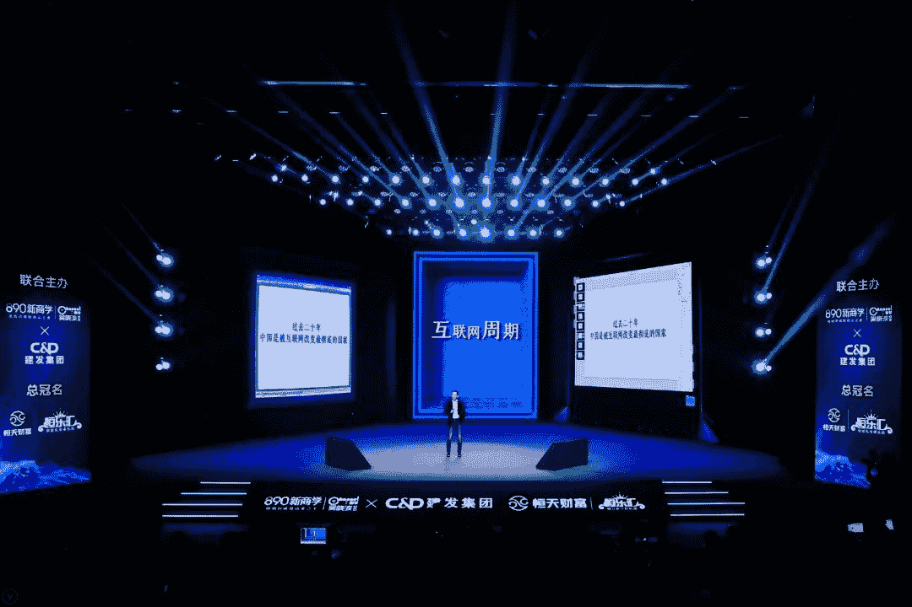

我们接着来看影响我们的第二个周期，互联网周期。

如果我说在过去二十年里，中国是被互联网改变得最彻底的国家，大家同意不同意？

我们有很多的模式，比如说改革开放前二十年，没有形成一个完备的金字塔式的零售模型，后来我们通过互联网、电商把它穿越了。二十年里我们没有形成完备的信用卡体系，接着我们用支付宝、🛰️支付把它穿越了。

互联网给中国的产业经济，无论是实体产业、服务产业还是金融产业，创造了一个巨大的机会，1998年以后，二十多年来，互联网改造了我们的每一个产业，包括今天这场直播，就是被互联网改变、被疫情改变的产物。

但是，我再问一个问题，到2021年的今天，中国的互联网经济如果有一个关键词，它是什么？我觉得就是四个字，叫做“高度饱和”。

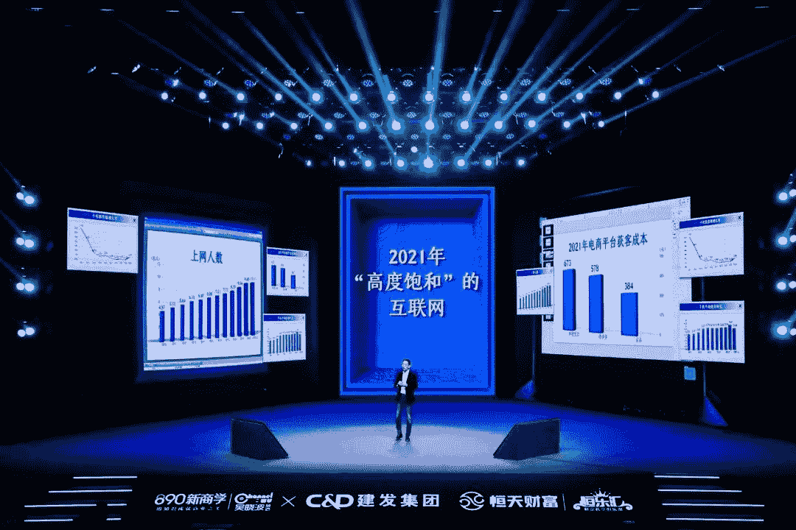

我给大家提供几个数据，中国的手机销售增速从2015年开始就已经停滞了。2021年中国人每天在手机上花费的时间将近5小时，朋友们，还可能再多吗？很困难了。

互联网电商平台，今年第三季度阿里的获客成本，673元/人；拼多多，578元/人；京东，384元/人。网民人数超过10亿，全中国人口14亿，10亿人都上网了，高度饱和的互联网。

原来我们想象互联网公司是做什么？叫虚拟经济，一幢大楼里几百号人，就能做出一个全球的互联网平台。今天，我给大家找了几个数字：中国最大的三家电器公司，格力8万人，美的17万人，海尔10万人；汽车公司一汽12万人；饮料公司娃哈哈3万人；服装企业雅戈尔5万人；服装连锁企业海澜之家2万人。

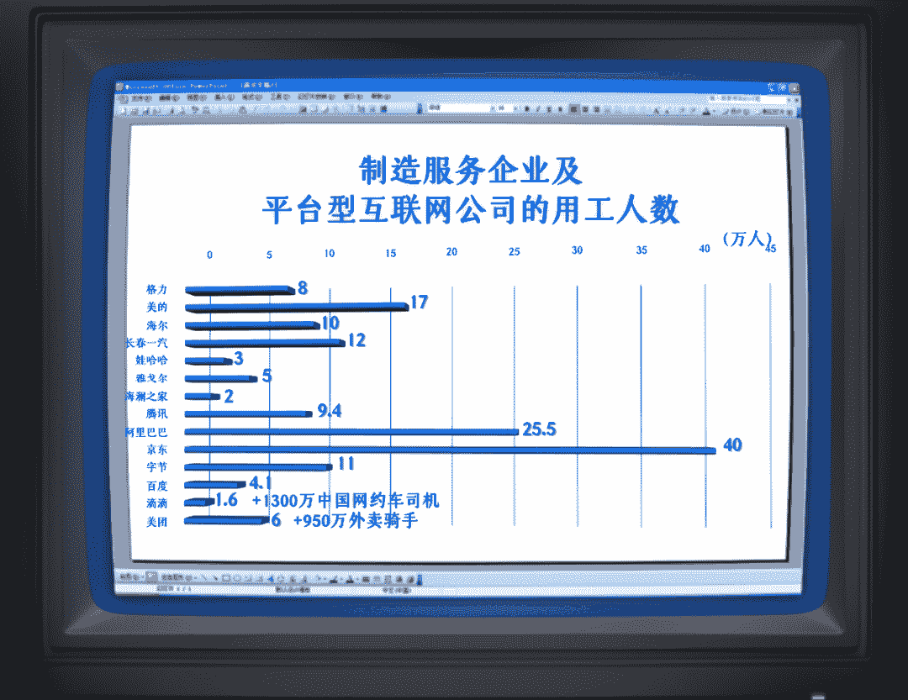

再看互联网公司，腾讯9.4万人，阿里巴巴25.5万人，京东40万人，字节跳动11万人，百度4.1万人，滴滴1.6万人——但是它连接了1300万网约车司机，美团6万人——连接了950万外卖骑手。

它们已经由一个所谓的虚拟经济、高科技企业变成了一个劳动密集型、码农密集型的产业。所以，从劳动力成本来讲，也已经饱和了。

同时这些公司在过去二十年里，在各个领域，从信息分发到电商到支付到线上线下各类服务，形成了它们的垄断能力。所以我们看到2021年，互联网公司涉及的违反《反垄断法》的案件就有86起。

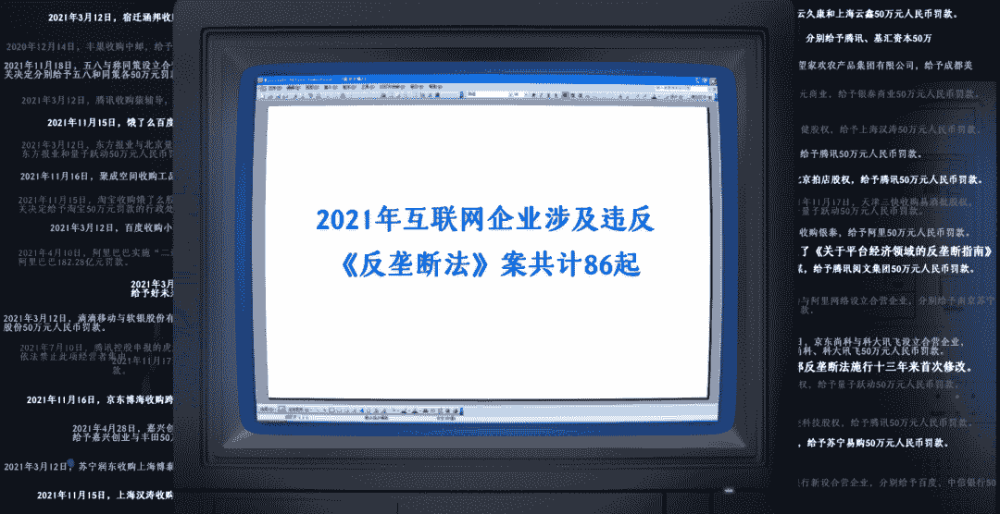

在这样的背景下，我们看到了2021年它们的股票表现都很差。截至12月27日，阿里巴巴今年跌了50%，百度跌了34%，拼多多跌了68%，腾讯跌了20%，美团跌了23%。

我们再来看这组数据，谷歌涨了69%，微软涨了54%，亚马逊涨了4%，苹果涨了36%，Facebook涨了27%。这可能是自有互联网以来，中美两个国家在资本市场上表现反差最大的时期。

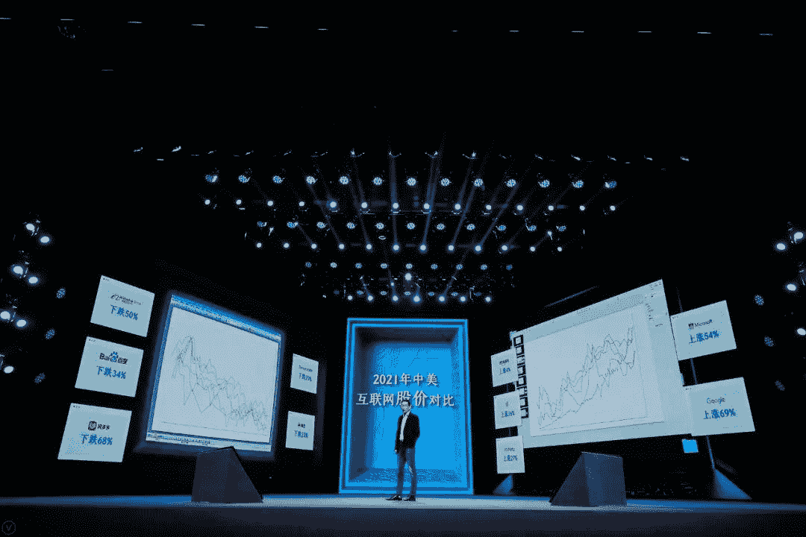

为什么会这样？这是饱和了。不是商业模式不够先进，不是这些互联网公司账上没钱，不是技术不够好，是我们在服务的人口，就只有10亿网民，我们的上网时长就5小时。但在全球市场，网民46亿。

除非我们的消费互联网在未来能够像美国一样，变成全球用户使用的平台，否则的话，一方面成长受到挤压，另一方面反垄断受到挤压，两项加持，就是今天这样的一个场面。

大家记得吗？2019年，美团的王兴曾经讲过一句话，他说：“今年可能是过去十年里最差的一年，但却是未来十年最好的一年。”很不幸，王兴同学当年真的发现了一个周期的规律。

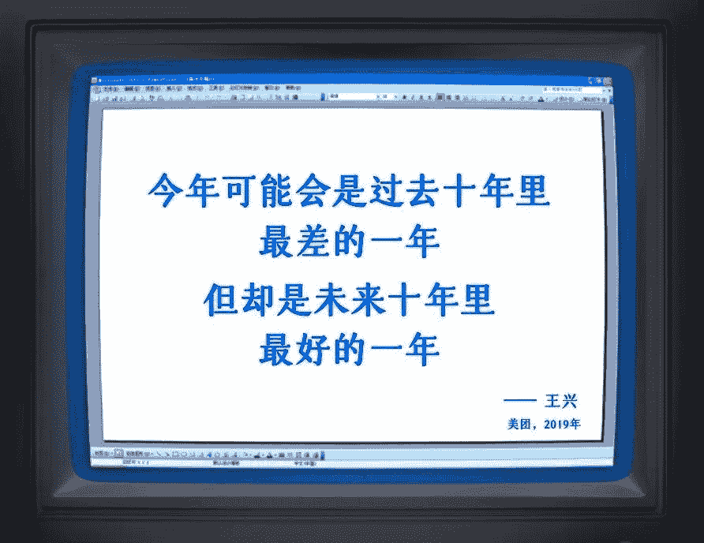

所以在未来我们会看到，在既有的技术和模式环境下，消费互联网的红利周期已经结束，开放、封闭、再开放、再封闭、再开放，人性、利益、制度与技术的博弈将贯穿未来相当长一段时间。

## 周期三：房地产周期

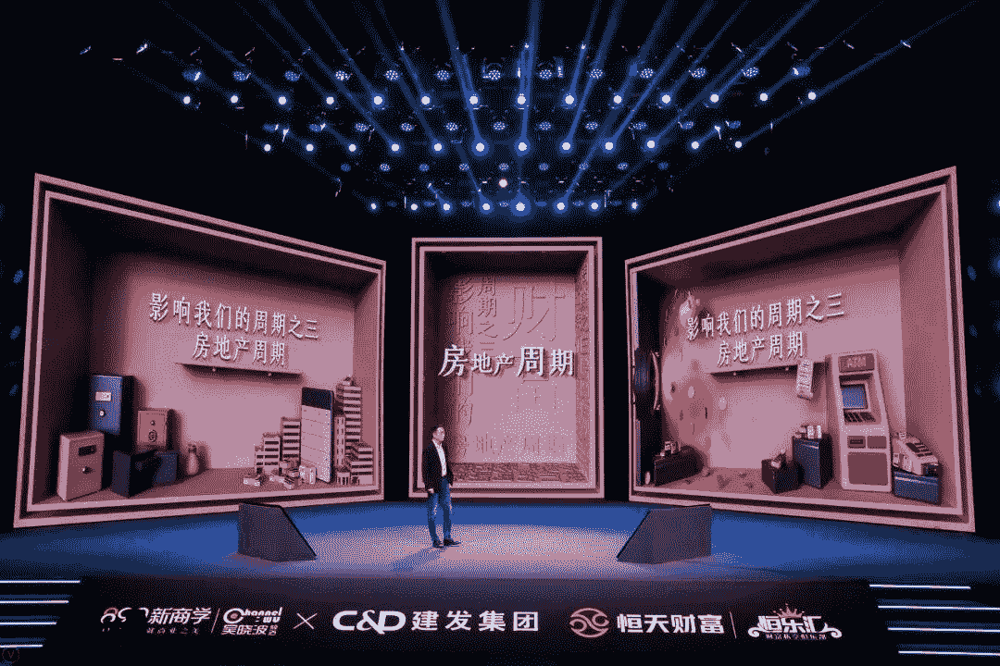

我们再来看影响我们的第三个周期，房地产周期。

有一家公司叫做树根互联，他们会统计一项特别的数据，叫挖掘机指数。这家公司很有意思，它是三一重工投资的，从2009年开始，他们就在三一卖出去的各种房地产用的重型工具上，如挖掘机、水泥搅拌机、打桩机等安装了传感器。到今天，全中国有70多万台工程机械装了他们家的传感器和平台，于是便有了“挖掘机指数”。

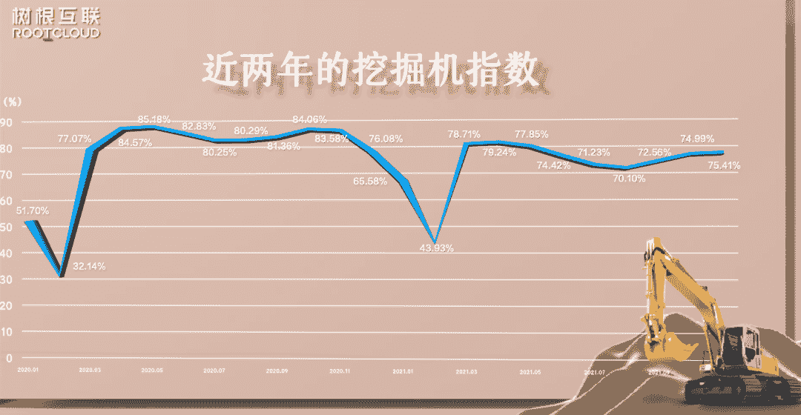

现在，中国哪个城市、哪个工地在动工，树根互联都知道。通过挖掘机指数，我们发现中国在相当长的一段时间里，都是全世界最大的工地。

这个工地有多大？

过去这些年，中国每年的房屋新开工面积22.44亿平方米。这相当于一个加拿大或者一个英国的住宅存量总和，0.6个德国的住宅存量总和。从这个角度上说，我们每年在建一个加拿大，或者一个英国，或者0.6个德国。

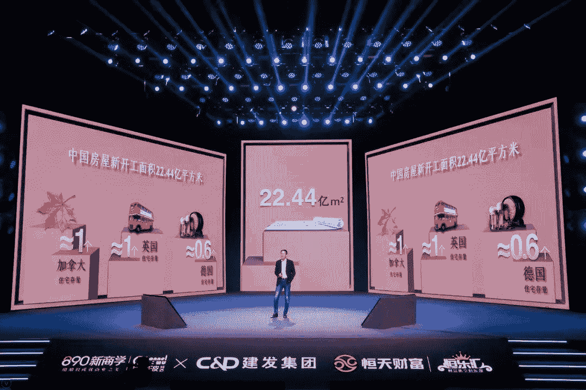

很巧的是，中国的互联网是1998年左右起来的，中国房地产运动也是1998年开始的。所以，我们说1998年以后，中国的产业周期叫做“三驾马车一张网”——出口、消费、投资、互联网，这四样影响了过去二十年里每一个产业、每一个财富的波动。

今天为什么很难？因为“三驾马车一张网”的动力和红利都在消失。这就是我们2021年所面临的产业周期变革的残酷性和重大的不确定性。

那么大开工的面积，从1998年一直建到今天，状况有什么变化？

1978年的时候，中国城镇居民的人均住房面积只有6.7平方米，三口之家将将20平方米，惨不惨？所以要建房子。

到了我们开始搞房地产改革的1998年，人均住房面积是18.7平方米，也不多，三口之家不到60平方米，所以要买房子。

但是到了2016年，我们的人均住房面积达到了36.6平方米，三口之家，平均能有100平方米的住房。

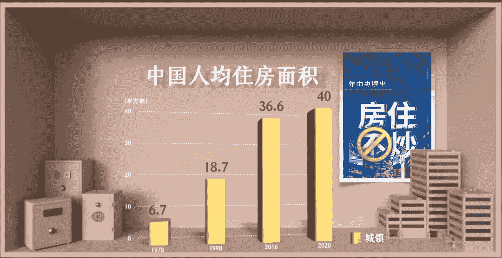

于是，在2016年年底的中央经济工作会议上明确提出了一个词，这个词就像达摩克利斯之剑一样悬在房地产的头上，叫做“房住不炒”。2016年以后，这是一项被长期执行的房地产政策。

中国的房屋保有量很大，这对我们每个人的资产到底意味着什么？

我们最近做了一个调查，看看今天的北京、上海，有多少家庭资产超过千万元？北京有29.4万户，上海有25.5万户。北京的千万资产家庭，其49.3%的资产是北京的一套房子。上海的千万资产家庭，其42.7%的资产是在上海的一套房子。房产在我们的家庭资产中占比已经非常高了。

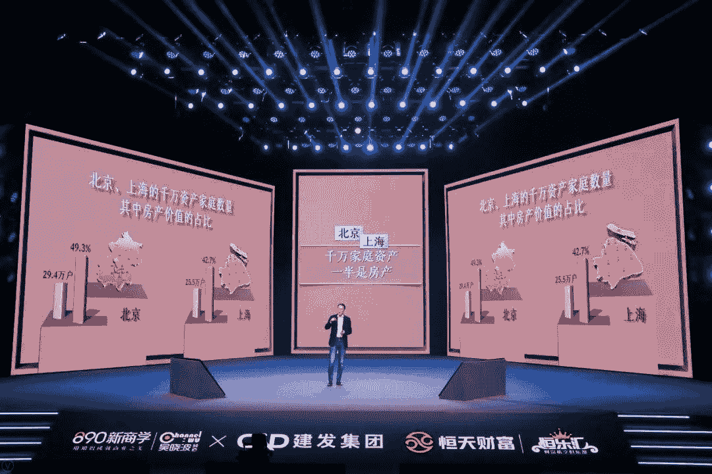

自2016年以后，随着人均住房面积不断增加，随着房产在总资产中的比例越来越高，国家开始对房地产行业进行大规模的调控。到今天，很多一二线城市的人已经很难把房产作为资产增长最重要的配置标的。

如果你的家庭在一二线城市已经有两套房子，建议大家千万不要买第三套房子作为资产配置。第一，“房住不炒”；第二，房产的投资回报率和七八年前相比，已经大幅下降了。

我还向胡润要了一个数据，他是从1999年开始，在中国做“百富榜”。

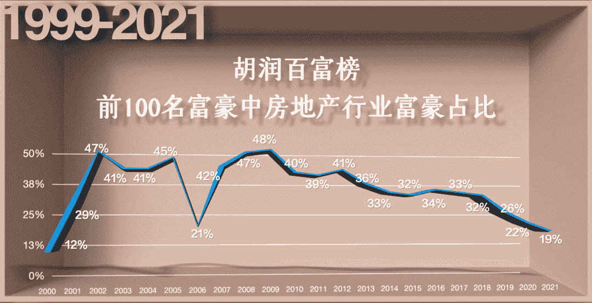

请看，中国从1998年开始住房制度改革，仅仅4年后，在2002年，中国大陆最有钱的100个人里，已经有47个是房地产开发商了。在那之后的相当长一段时间里，百富榜上到有1/3到一半都是房地产开发商，前十大富豪里有6个是房地产开发商。

可到了2021年，胡润百富榜上房地产开发商只有19个了，前十大富豪中已经没有房地产开发商了。也就是说，即便在中国最顶级的财富阶层，房产的增值效率也开始大幅度下降。

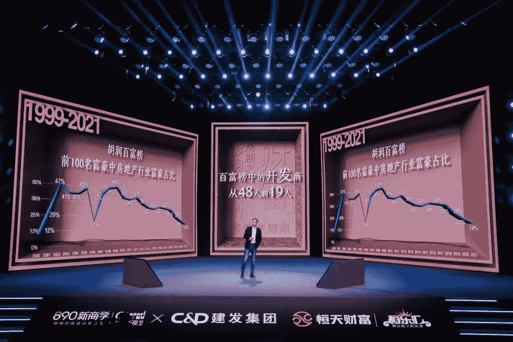

2021年，房地产原有的周期性调控规律开始失效了。

在过去，每当房地产调控开始，很多房企便会通过银行贷款、夹层资金、商票、债券来和国家政策进行对赌，大规模囤地，希望某一天房地产调控突然松绑。

自1998年以后的20多年里，这一招屡试不爽，房地产行业呈现非常明显的反周期操作效应。但在近两年，这一现象突然消失了。于是我们看到不少大型房地产公司，直到今天仍然面临种种债务违约的风险。

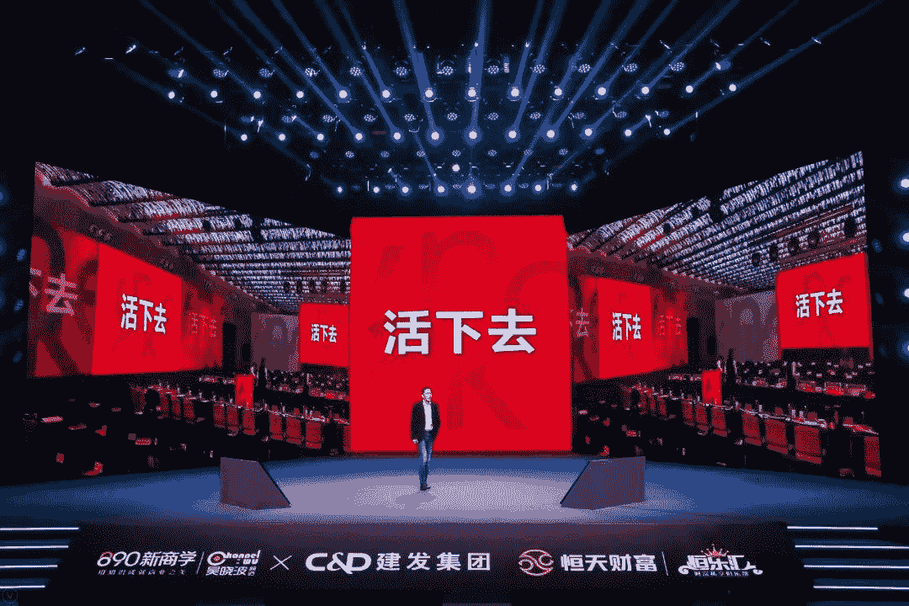

这张图是中国曾经爆发性最好的行业当下面临的三个字。2018年秋季万科年会，郁亮同学挂出了三个字——“活下去”，我想这是房地产开发商所面临的最最困难和最最真实的场景，房地产的黄金时代真的已经结束了。

# 周期四：新国货周期

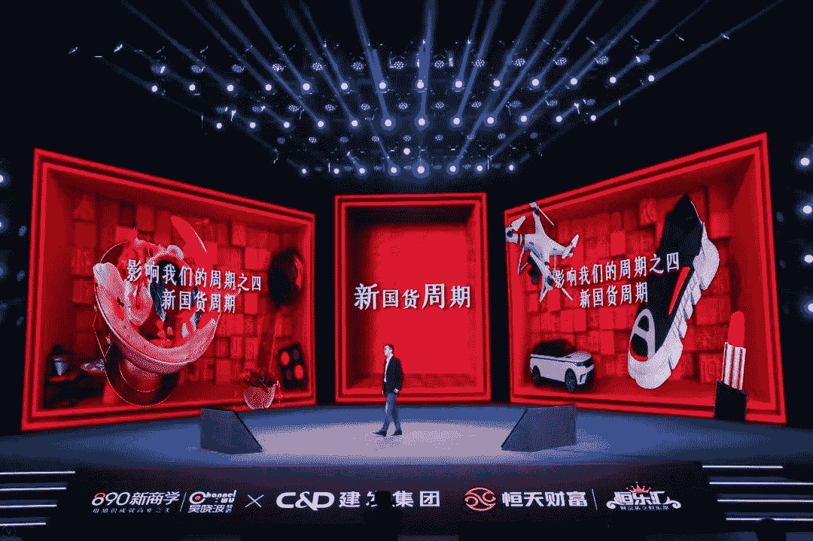

我们接下来看影响我们的第四个周期，新国货周期。

你们知道，上海黄浦江边的江滩为什么叫外滩么？上海是1842年开埠的，开埠以后，洋人就在黄浦江西岸的江滩上建了很多商业大楼，那块江滩是在原来上海县城的外面，因此叫外滩。外滩得名的第二个原因是那里都是外国人、外国品牌、外国银行。甚至改革开放以后，特别是2000年以后，在外滩一眼望过去依然是来自全世界的大牌。

直到2021年，有一家福建的茶企华祥苑，在外滩边租了1000平方米的空间，打造了一个新国货的空间。所以各位如果以后到外滩去，就可以看到我们新国货的品牌力量了。

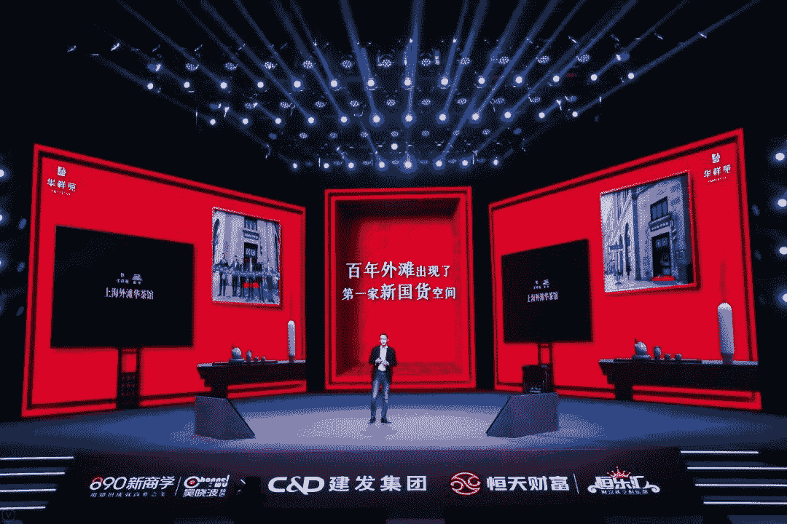

这几张照片是一家法国的奢侈品公司今年做的广告，引起了非常大的争议。我在年终秀前找了一个日化行业的专家，询问这家奢侈品公司在中国的生意有多大。他说在中国的生意占到它全球营业额的20%—30%。

于是我就在想，一家法国公司在中国赚走那么多利润，它为什么要辱华呢？它想走吗？它可想留在这儿了。那它为什么会登这样的照片呢？因为这些照片中姑娘们的造型，可能是西方人心目中的亚洲女性之美。但我们中国人不那么想，我们有自己的美学，你这些照片就是在丑化我们。

因此，这家法国公司最大的问题是“不知华”。它必须要知道今天为它贡献70亿人民币营收的消费者，他们认为的亚洲之美、中国之美是什么。

中国人已经拒绝由外国人来定义的中国之美，只有我们自己认定的中国之美才是真的中国美。这是本轮新国货运动在文化方面最大的变化——中国人自己开始掌握中国的商业美学和审美能力。

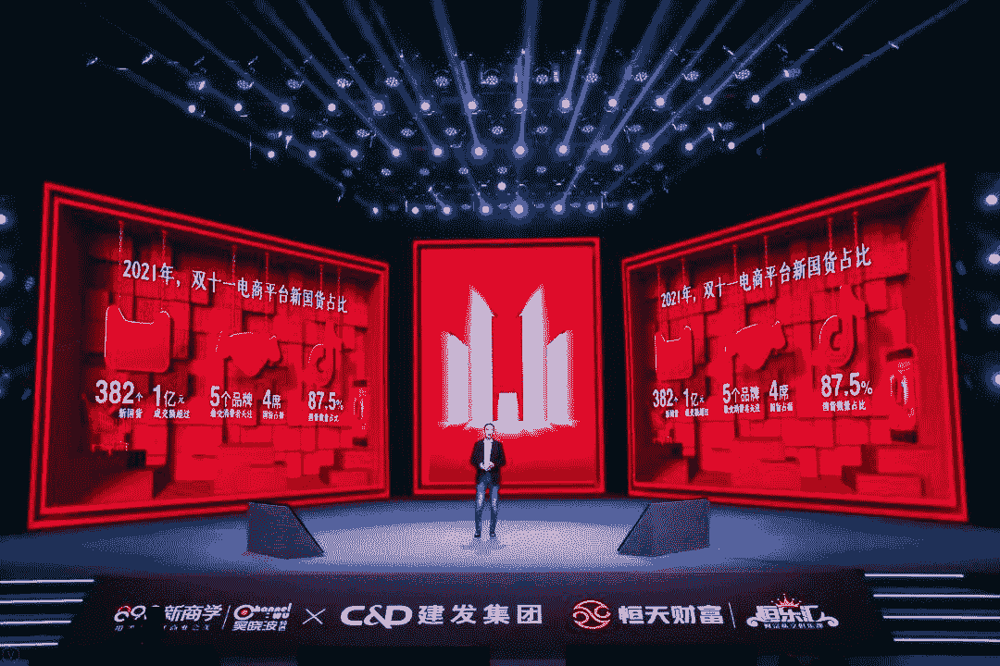

在今年“双11”电商平台上，我们看到了这些数据，不禁要为新国货来一点掌声，真的特别的不容易。在淘宝、天猫平台上有382个新国货交易量超过了1亿元；在京东平台上最受消费者欢迎的5个品牌中，有4个是新国货。在抖音电商平台上，新国货数量占比达到了87.5%。

我们每年会出一本新国货白皮书，今年的白皮书里有一项数据调查，问一些90后和00后，两个品质、价格差不多商品摆在你面前，一个是欧美产品，一个是新国货，你会选择谁？90后消费者里，有70%会选择新国货，00后更厉害，有80%会选择新国货。

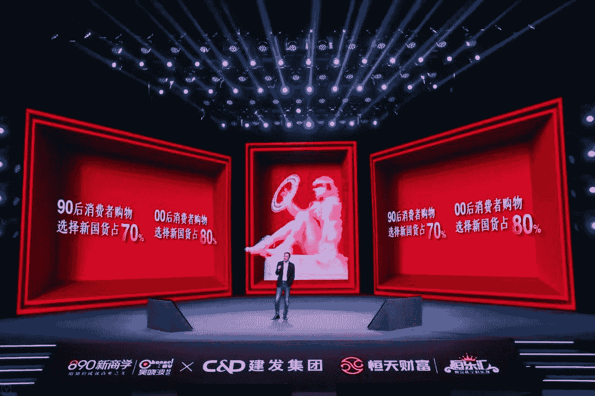

我们再来看一个案例，我的朋友江南春，是电梯广告龙头分众传媒的创始人。现在有一句话：“双微一抖一分众”，因为线下空间里电梯场景特别重要。前些天我在上海和他交流，我问他近些年到分众来投广告的人群有没有变化。他说有变化，这两年国货越来越多。

今天的直播是由两个平台支持的：腾讯视频、芒果TV。芒果是一个年轻人特别喜欢的综艺平台，他们今年做了一个App叫“小芒”，这是一个关于新潮国货的内容电商平台，销售的商品主要是芒果TV综艺中出现的各种各样的物件。

一个以综艺节目见长的互联网媒体平台，也开始试图为新国货赋能，在新国货浪潮中出自己的一份力。越来越多的人意识到新国货已成为中国消费品市场最重要的一股力量。

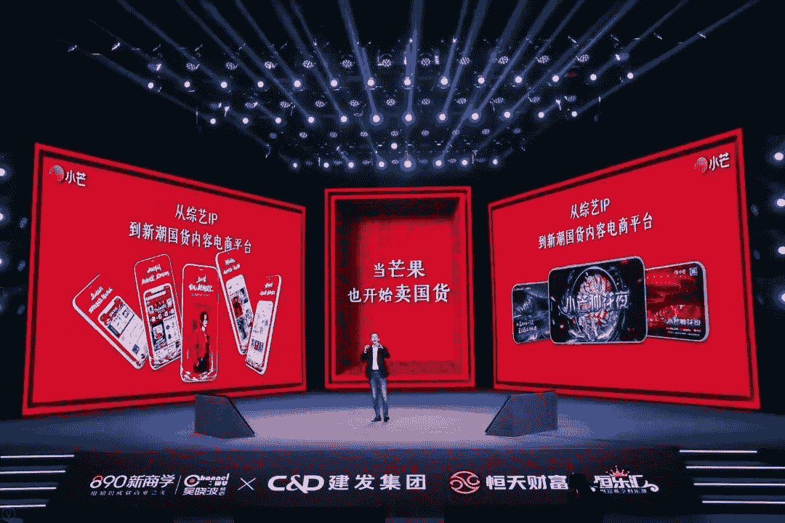

我在做企业研究时发现，其实发扬国货并不是我们这一代人才开始的事业。1842年上海开埠后来了很多洋布、洋灯、洋车、洋船，之后便出现了中国第一代民族企业家，他们做做国产布、国产面粉、国产电扇、国产自行车，这是第一轮国货运动。

到了改革开放之后的1980年代，在食品、饮料、服装、家电、汽车领域又涌现出很多国货品牌，这是第二轮。咱们今天在做的新国货创业，是百年现代化史上的第三轮新国货运动。

第一轮、第二轮国货运动中，所有国货的活路无外乎两条：一是性价比优势，同样的产品质量，价格比洋货便宜；二是爱国情感，用喊口号的方式希望大家来买国货，潜台词是你不买就是不爱国。

第三轮新国货运动，这两条都改变了。我们不再依赖于性价比优势来获取市场份额，现在很多新国货产品，是同样的产品质量，但价格并不比洋货便宜。此外，新国货不再需要喊爱国的口号，我们自己已经能够定义审美标准，消费者爱穿谁的鞋都行，你穿国鞋很好，穿日本鞋、美国鞋也没问题，企业并不会出来说你这是不爱国。

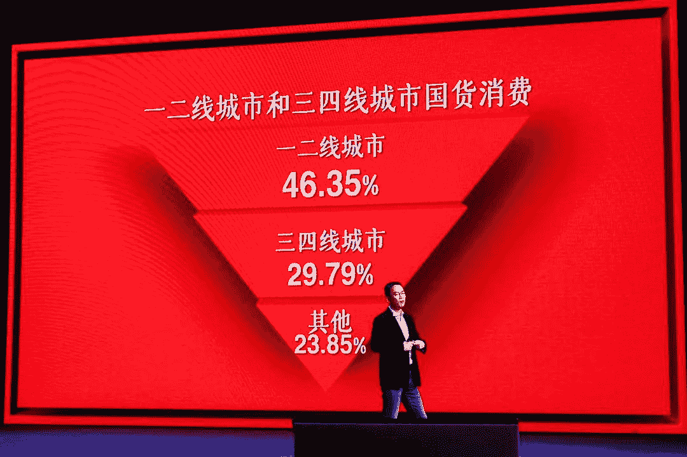

在2021年总的新国货消费中，一二线城市的占比达到了46.35%，三四线城市占到29.79%，其他的是23.85%。这组数据说明了什么？我们常常讲两个词：流行、时尚。流行和时尚是从中心城市发生，由上往下传播的。这几个数据告诉我们，国货消费已经成为了2021年中国消费品市场的“时尚”和“流行”，这是我们在新国货运动中看到的前所未有的景象。

今年，我还参加了一个有关新国货的综艺节目，做了八期的主持人，挺开心的，跟我搭档的是一个1989年出生的脱口秀演员，来到现场的都是一些90后和00后。这个节目居然还获得过全国同时段收视率的第一名。

我发觉那么多年轻人，他们是发自内心地喜爱国货，因为这就是他们的生活方式、生活主张的一部分。所以我想对很多正在创业的朋友们说，未来十年只有极少数的创业机会是确定的，新国货创业肯定是其中之一。

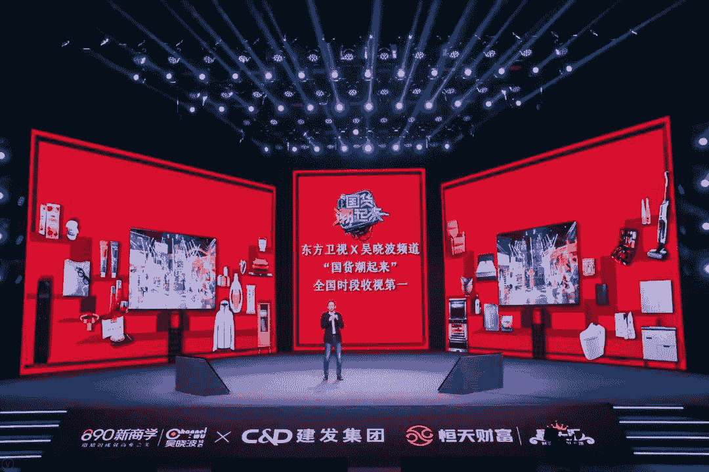

2016年，我们发布了第一份新国货报告，当时我们就认识到经济增长会带来国家自信，国家自信会带来文化自信，文化自信会催生国货自信。五年过去了，当年的这句话一点一点变成了今天商业世界的现实。

# 周期五：产业智能周期

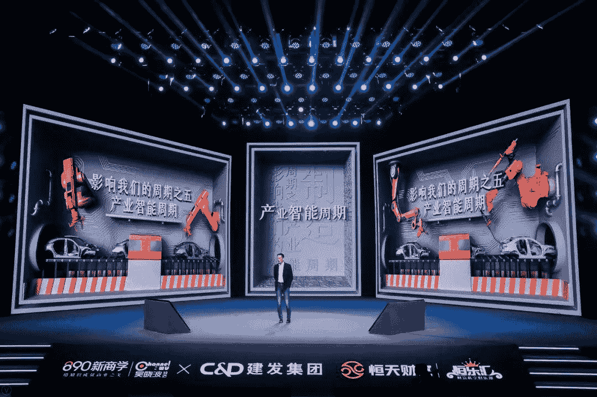

再来看影响我们第五个周期，产业智能周期。

这两年我跑了很多智能企业。

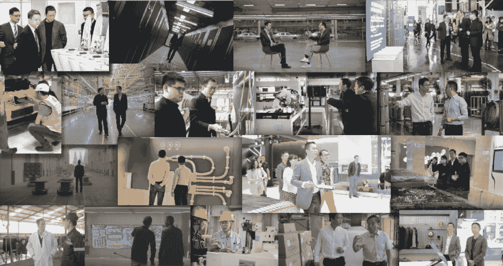

我是1990年大学毕业进入职场的，干的第一份工作叫做工业记者，就开始跑企业。从1990年到后来的20年里，我去过中国绝大部分的著名企业，无论是在长三角的、东北地区的、华北地区的、华南地区的，去过很多。

各位同学如果看过我的书，看过我的《大败局》，里面20家企业绝大部分都是实体企业，只有一个互联网企业，叫瀛海威；如果看过我的《激荡30年》，里面也写了很多实体企业。

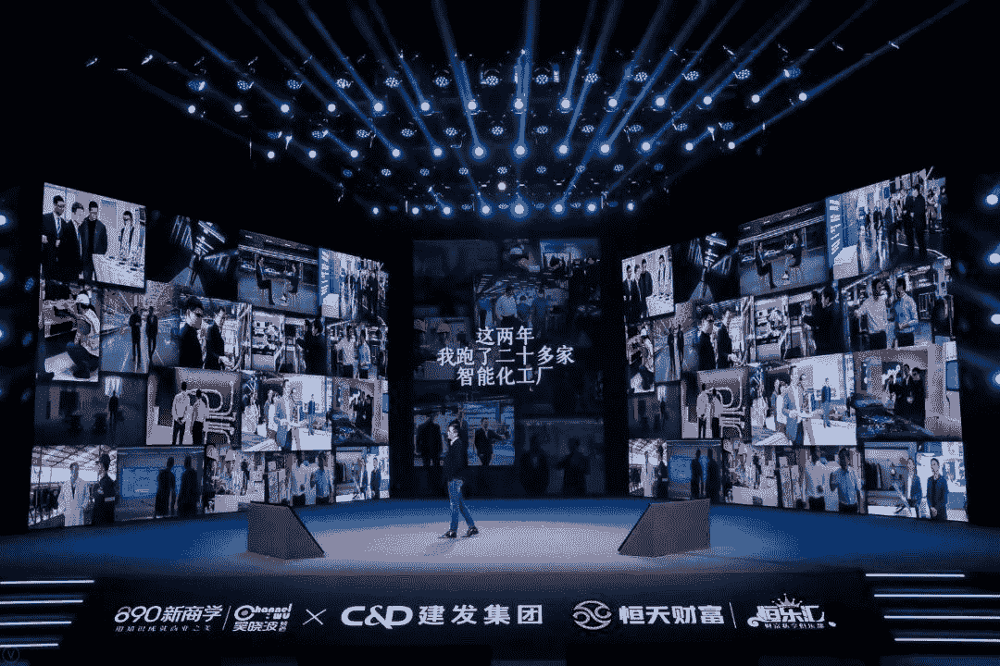

到了2010年以后，我突然发觉自己跑工厂跑得少了，开始跑互联网企业。特别是2011年马化腾邀请我写《腾讯传》，写这本书花了我6年时间。那6年里我又跑了很多互联网公司，因为需要做比较研究，我发觉互联网公司的整个运营模式，他们对生态的理解、对产品的理解、对质量的理解跟制造企业很不一样。

比如对制造企业来说，什么叫质量呢？

大家都记得张瑞敏砸冰箱的照片，一个冰箱不合格，砸了，不能出厂，这叫做质量意识。

而互联网公司做一个产品，一开始不知道合不合格，先扔给你用，用完之后你觉得不好，你告诉我，我保证两个礼拜完成一次迭代。

当年，在我看来这是完全不可想象的一件事情，产品都不知道是不是合格的，就拿给人家看。

互联网公司会认为这就是我对产品的理解。

一个互联网公司产品的质量不是几个码农，也不是张小龙、丁磊们在房间里定义出来的，它是一个由工程师、程序员和消费者互动产生的结果，它的质量是会成长的，当年我觉得这是一件好性感的事情。

跑了近十年的互联网企业，从2017年、2018年开始，我又开始跑工厂了，比如我又重新走进了钢铁厂，走进了羽绒服厂，走进了养牛场，走进了中药企业。

我为什么重新回去呢？因为突然发觉历史的动力，生产力新的增长极好像重新回到了工厂。

这就是我们今天看到的，一个新的产业智能周期的到来。

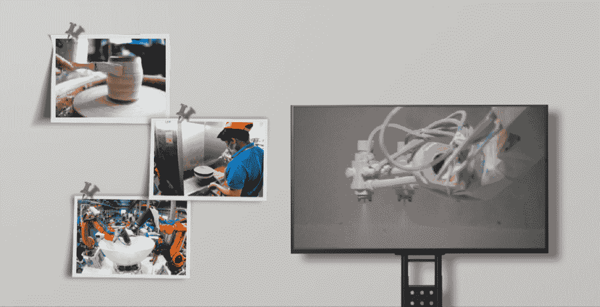

这张图是我在一家陶瓷工厂拍摄的，做卫浴马桶的。

一个机械手在喷一个马桶坐便器，我看到这个场景时，非常感慨。

坐便器是高岭土做的，上面需要涂釉。最早怎么涂呢，最早就是用手涂的，十多年前开始用喷枪。

这个工种叫做施釉工。施釉工特别辛苦，他天天要和这些粉尘打交道。所以，每一年因为施釉，中国会有近千人患上尘肺，大家知道尘肺是不可逆的，一旦染上终生就是尘肺病人了。

但是，当我看到这个机器手的时候，当陶瓷工厂的总裁跟我说“吴老师，今天我们这个陶瓷工厂一年做80万个坐便器，已经没有一个施釉工”的时候，你猜我是怎么想的？

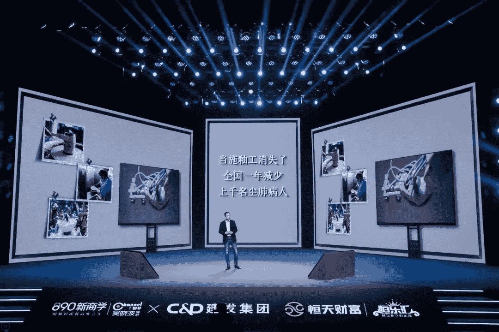

我觉得产业智能变革除了给我们带来生产效率的提高，除了带来产品质量的提升以外，更重要的是：再造了中国工业文明的人文环境。

我前几年曾经拍过一个纪录片，叫做《我的诗篇》。

这个纪录片得过上海国际电影节的最佳纪录片，是中国所有纪录片里第一个得上海国际电影节金爵奖的纪录片。

这个纪录片描写的是几个中国的工人诗人，他们是诗人，他们是工人，他们在一线当着搬运工、施釉工、车床工，到了夜深人静时，他们写诗歌。

其中有一个在深圳的工人诗人叫做唐以洪，他写过一首诗，给我留下了非常深的印象，叫做《我写过断指》。

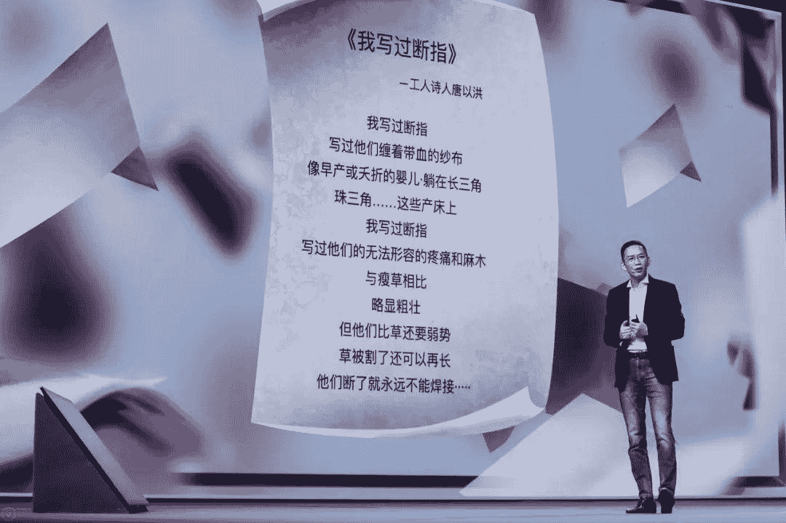

我在陶瓷工厂里看到施釉工的消失，我在钢铁厂、在珠三角的很多机械工厂里看到很多机器手的出现，我真的又想起唐以洪的《断指》。

我觉得产业智能化使得我们对工人的定义发生了变化，原来需要很多产业工人、搬运工。有了码垛机器人，就不需要搬运工了。原来有很多施釉工，有了施釉机器人就不需要施釉工了。

那我们需要谁呢，我们需要懂编程的工程师，我们需要懂设备维修的工程师，我们需要懂生产线流程管理的工程师。

那些可能断指的、可能患上尘肺的产业工人，他们通过知识的迭代成为了新的生产线上的工程师和技术工人。朋友们，产业智能化在今天除了给我们带来生产效率和设备提升以外，更重要的是它开始尊重我们每一个工人，通过技术变革的方式来尊重我们的上千万产业工人。

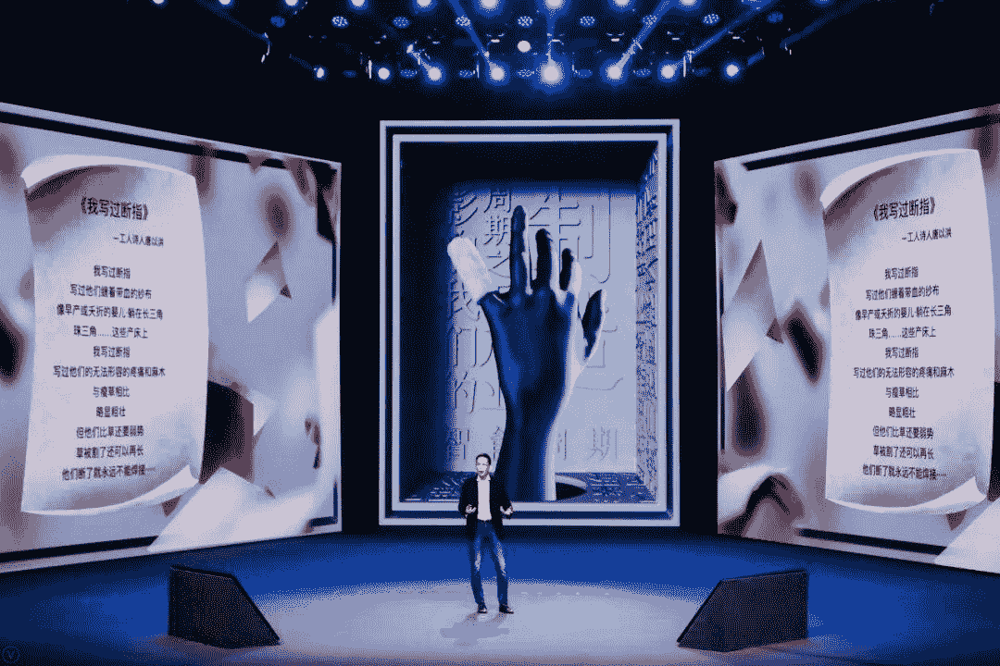

今年去的最后一家工厂，是两个礼拜前，我去江西南昌，看一家“中国最美工厂”。工信部曾经给中国的几家工厂颁过一个牌子，叫做“中国最美工厂”，其中有一家是中药厂。

各位原来去看过中药厂吗？中药厂就是几个缸，几个晒场，几个老先生在那儿几蒸几晒，几个包装工包装完之后，一包包卖给你。

我去的中药工厂，是中国中药产业第一家全球智能工厂，拥有最先进的提纯设备、无人车间，十多亿产值的工厂里用工不到50人，所有的生产线设备都进行了全自动化的流程制造和全自动化的灌装、运输、码垛。

当我走在华润江中智能工厂里，真觉得恍若隔世，我觉得智能产业改造了钢铁厂，改造了服装厂，改造了冰箱、空调、洗衣机厂。今天又在深刻地改造，我们认为一个非常非常传统的行业——中药产业。

我想这个浪潮正在席卷每一个行业。在“中国最美工厂”、全球第一家智能工厂生产的产品叫做参灵草。大家看到这个数据，在过去四年里中国航天宇航员喝的唯一一个滋补品就是这个。

它里面最重要的成分叫做冬虫夏草。全中国有资格加工冬虫夏草的企业不多，其中一家叫做华润江中。冬虫夏草最大的问题是重金属含量，当有了这些先进的提纯专利技术后，能够把冬虫夏草里常见的重金属去除掉，通过中国顶级的中医药师进行配比，它需要有国医的传承，需要有专业的中药技术，同时，它需要有智能化的产业变革。

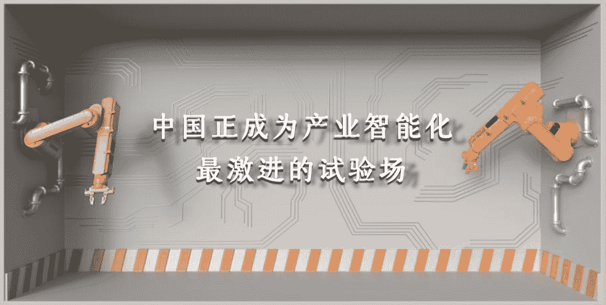

今天的中国正成为产业智能化最激进的一个试验场，每一个行业都在被产业智能化所改造。

# 周期六：新能源周期

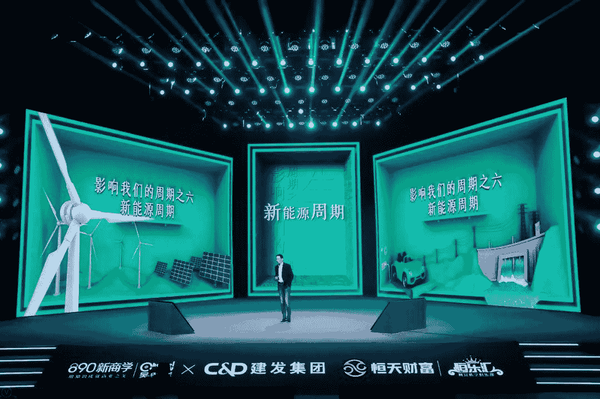

我们接着再来看第六个周期，新能源周期。

这张PPT漂亮吧，我们今天的PPT很漂亮，几个做PPT的朋友们今天在后台，早上碰到他们时，眼睛像兔子一样红着，掌声感谢他们，但这也是我们今年年终秀最残酷的一张PPT。

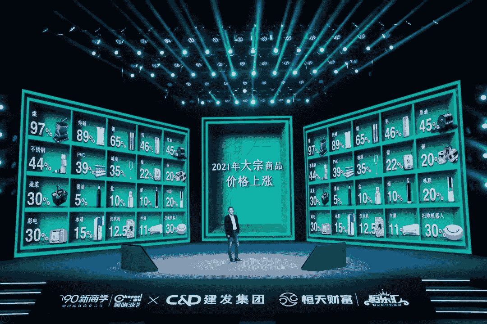

在这张PPT中，我们看到了2021年几乎所有的商品价格都在上涨，大宗商品几乎涨疯了。

我们看到煤涨了97%，纯碱涨了89%，锡涨了65%，铝涨了46%，原油涨了45%，不锈钢涨了44%，PVC涨了39%，玻璃涨了35%，镍涨了22%，铜涨了20%。

我们企投会有一个同学，前两天在深圳机场碰到我，碰到我第一句话说：“吴老师，你的年终秀在线上举办了。”我说是的，受疫情的影响。这位同学姓杨，来自江苏的一家企业，他过去几年每年带着20多个高管来参加我们的年终秀。他说对不起，今年我只能在家里给你加油，看你的年终秀。他现在应该在工厂里看我的年终秀。

我就问他，今年你们企业怎么样，他们家做储能的，储能做得好不好。

他回答说新能源产业发展很快，生意很好，但是没有钱赚。

为什么呢？储能电池里有一个原材料叫做碳酸锂，去年三季度碳酸锂的市场价格是1吨4万块钱，到了我跟他在深圳机场遇见时，4万块钱/吨涨到了28万/吨，涨了不是百分之几，是涨了6倍，利润都被这些上游的材料吃了。

他还在做生意，他在深圳签了一个很大的数据中心订单，他说明年会好的，给他加油！

除了这些，还有什么在涨价呢？蔬菜涨了30%，酱油涨了5%，盐涨了10%，醋涨了10%，味精涨了20%，接着彩电30%，冰箱15%，洗衣机12.5%，空调11%，扫地机器人30%。

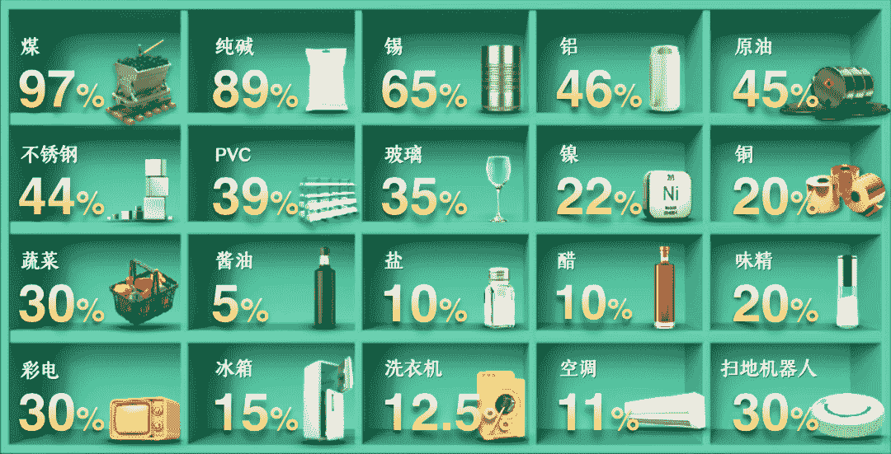

那么漂亮的PPT，是最残酷的PPT。

为什么？中国已经连续11年是全球第一制造业大国。去年以来，中国是全球疫情控制得最好的国家，全球中低端制造业产品需要中国大量供给，然而我们的很多原材料是需要进口的。

中国今天消耗了全世界54%的煤炭、59%的铁矿石、16%的石油、33%的大豆，我们消耗着全世界那么多的能源。

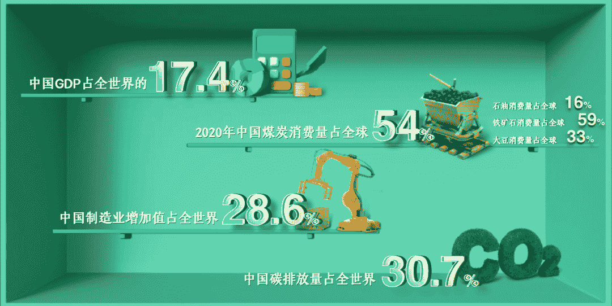

所以，我们生产什么，什么便宜，我们买什么，什么贵。这个问题必须要解决。

因为今天中国GDP占了全球17.4%，我们的碳排放量占到全球30.7%。

所以要改变中国人卖什么、什么便宜，买什么、什么贵，有两个办法：一是提高我们的产品智能化能力、产品质量能力、品牌能力、核心技术能力。二是降低二次能源消耗。

我们看到中央政府提出来，2030年要实现碳达峰，2060年要实现碳中和。

为了达到这两个目标，对新能源每年的投入将占到GDP的3%，未来30年至少投入100万亿。

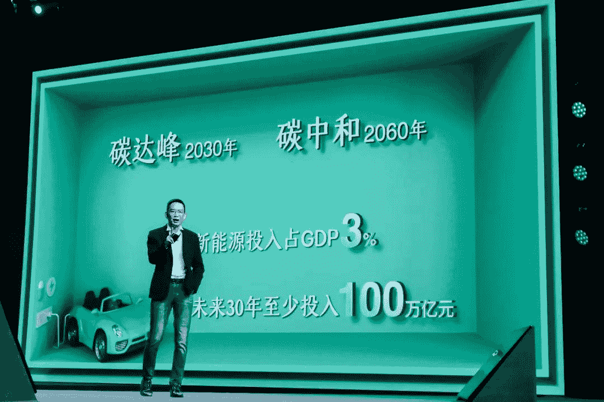

什么是100万亿，2020年中国的GDP就是100万亿，未来30年要进行大规模的投资。

这几个数据，前面几个表格告诉我们什么呢，告诉我们中国的能源产业已经进入到了一个长达30年的新周期，所有在制造业领域中的企业都得问自己一个问题：我跟碳达峰、碳中和有什么关系？

前两天去南京调研，碰到一个企业家朋友，差不多跟我同岁，叫做石俊峰，大学里学的是化学，毕业之后到南京一家汽车工厂当技术员，后来当上了这家汽车工厂研究所的所长。

2001年他下海，两年后自己创业做了一家叫龙蟠科技的企业，做什么呢，做润滑油。

润滑油这个行业中巨头环绕，壳牌、BP、中石化、中石油，这些企业不是大，是超大，是世界500强的前20位。

我们这位石同学冲到那个行业里混，干了十多年，干到了民营企业润滑油市场占有率第一，挺厉害的，干到了第一。

干到第一的时候，倒霉的事情就发生了，新能源汽车起来了。大家知道润滑油用在哪里？最主要是发动机里，消耗量最大的是汽车发动机油。

所以石俊峰说我就做到民营润滑油第一名时很成功了，突然发觉汽车发动机未来将会“不见了”，怎么办呢？他就决定，继续把自己的有机化工专业能力和新能源做个挂钩。

六七年前，他们开始研究一个产品叫做磷酸铁锂，新能源电池中的正极材料。一个电池占到新能源汽车成本的40%，正极材料占到整个新能源车成本的17%—18%，占比特别高。

在他研究磷酸铁锂的时候，中国和欧美的新能源汽车，电池的正极材料大部分用的是三元锂，很多人嘲笑他说：“兄弟，方向错了，都在做三元锂，你搞啥磷酸铁锂？”

2020年，特斯拉宣布，它未来的电池将使用磷酸铁锂，然后石俊峰的春天就来了。

我们在石俊峰这个案例中看到，所有的行业都可能出现这样的景象：

人在半途时，突然这个行业消失了，突然你的技术优势被取代掉了。你怎么办？你需要寻找企业的第二增长曲线。而我们今天所讨论的这些新国货周期、产业智能周期、新能源周期，在这些周期里就埋伏着企业成长的第二和第三增长曲线。

这六大周期，在2021年都处在一个发展的中间阶段，或者说一个转折时刻。我们看到互联网周期和房地产周期出现了它的转折时刻。新国货周期进入爆发的时刻，新能源周期才刚刚起步，产业智能周期中，中国已经成为全球最激进的一个试验场。

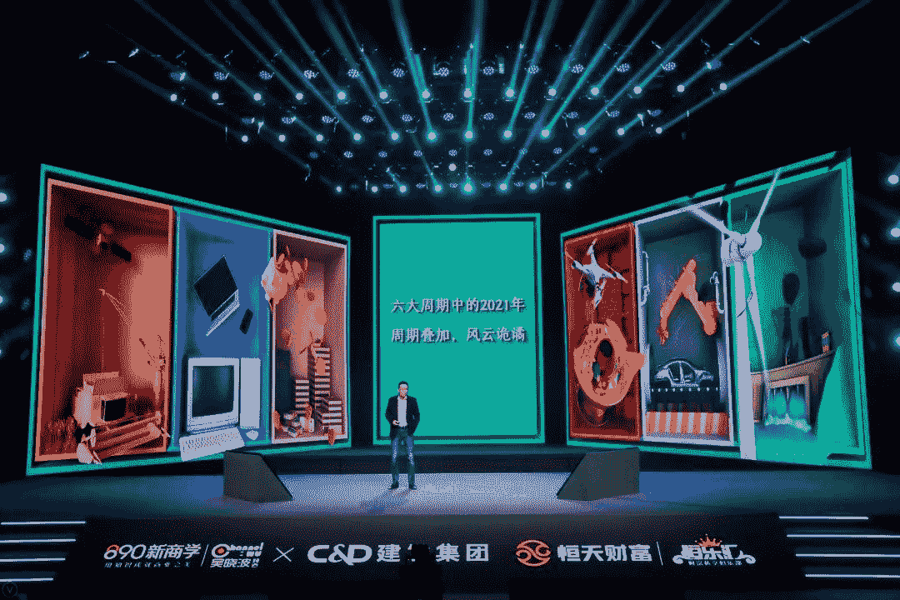

在座的同学，在看直播的同学，我们要问自己的问题是：我们跟这些周期有什么关系？

去年以来的疫情，把很多产业周期 节 奏 打乱了。在今天这样的环境下，我们仍然要思考：被打断的周期如何续上，在被打断之后，有没有可能产生新的周期迭变？

我们每一个人都是周期的“奴隶”，同时我们也是周期的“主人”。我们被周期驱赶和改变，同时我们在周期中发掘财富之泉。

所以我们必须要在顺应中转型，在抵抗中成长。2022年，让我们一起创造面向未来的、迷人的“周期之魅”。

我的演讲结束了，谢谢大家！

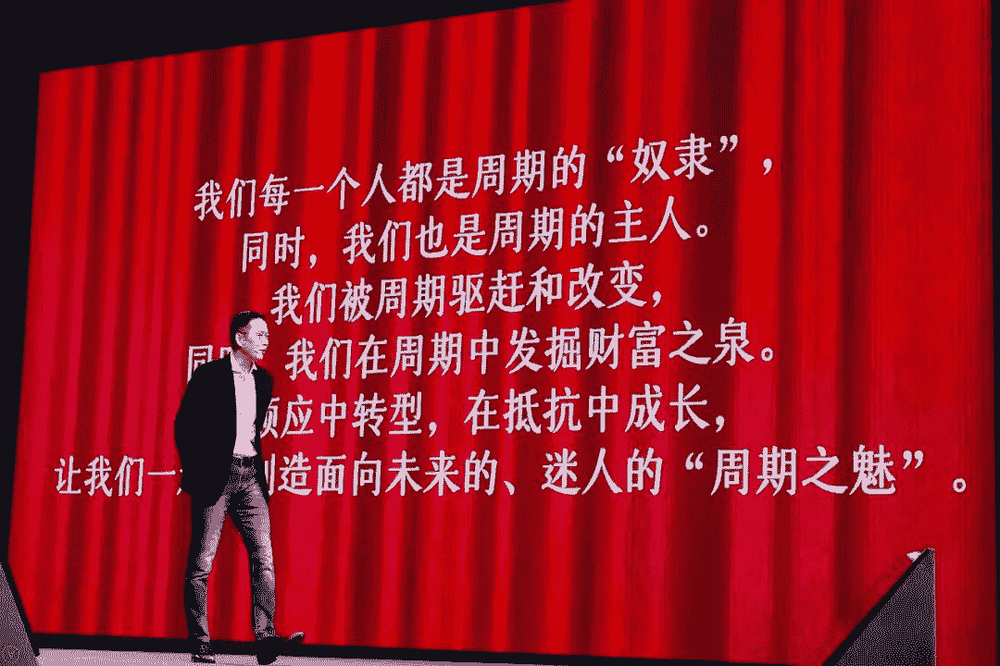

`https://aigcreative.feishu.cn/sync/K4Gvd9vUQsy9Oubwqaeclu0Fnbg`
