# 吴晓波：预见2020（演讲全文）

> 来源：[https://aigcreative.feishu.cn/docx/ULyCdiZ2foxotYx57QmcAwJ2nVg](https://aigcreative.feishu.cn/docx/ULyCdiZ2foxotYx57QmcAwJ2nVg)

> 🔗 原文链接： h[ttps://mp.weixin.q](https://mp.weixin.qq.com/s/g53Oq8zlt4upmNUFwELOeg)q.com/s/g53Oq8zl...

我们越是向前走，越会有更多不得不选择和割舍的道路。

我是吴晓波，很高兴见到大家。 让我们一起来海边，拾起信心。

2019年就快结束了，今天下午我在这里彩排的时候，有个小朋友拿着一本书冲进来说，吴晓波叔叔帮我签个名。

我写到“吴晓波 2019年12月”的时候，心里一阵触动，再过二十几个小时，此生不会再有机会签下这样一个年份了。 时间是一个特别深情的家伙，也是一个特别无情的家伙。

2019年快过去了，大家过得好不好？

有的人豪情万丈，有的人强颜欢笑，其实2019年过得好不好，我感觉最关键的那个字是“过”。 写作《百年孤独》的马尔克斯曾讲过一段话：

> 生活不是我们活过的日子， 而是我们记住的日子，我们为了讲述而在记忆中重现的日子。

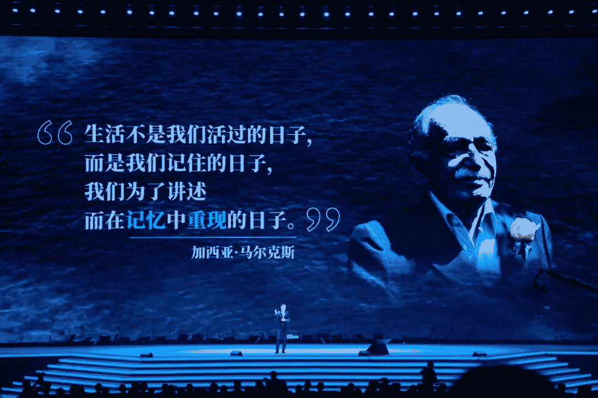

2019年，你过得好不好？ 听到这个问题的时候，问问自己2019年有没有做一点有意义的事情，一件过了若干年以后你回想起来仍然能够微笑并怀念的事情。 留在记忆里的那个人或者场景，就是2019年对我们真正的意义。

今年我做了一个节目叫《地标70年》，在中国找12个地标，我要用脚重新走一遍。

最北，我到了北大荒，最南到了深圳、东莞，最西到了宜宾、西安。 我重新回到了历史的时空中，观察这个地标在过去10年、40年、70年，发生了什么变化。

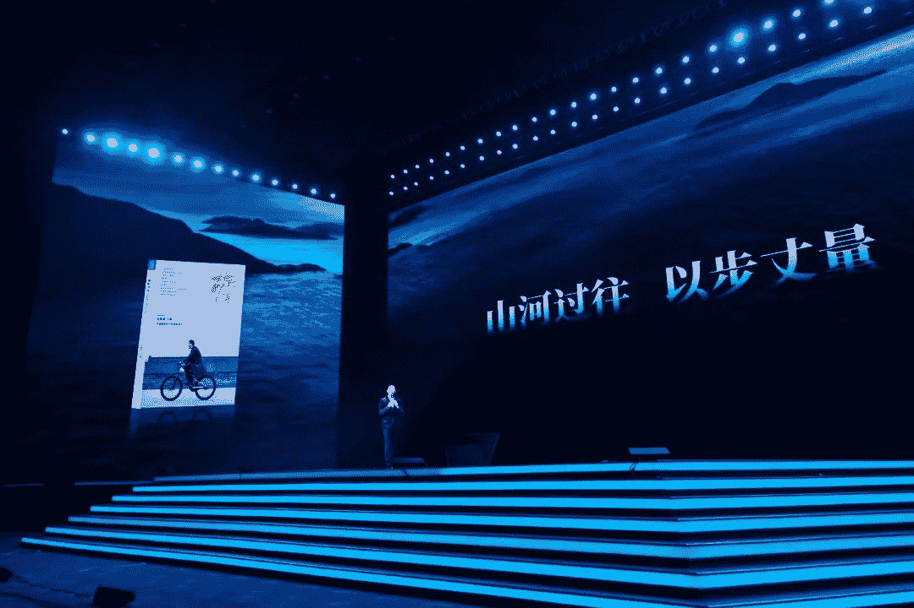

今**天**我们希望来到海边重拾信心，我不是经济学家，是以一个记者的身份告诉大家，我对2019年产业经济正在发生的变化的一些看法。我向大家承诺， 我讲的每一个关于产业的案例都是我用脚走出来的，我去工厂、下车间、进实验室，用脚、用笔、用手告诉大家我对2019年、对未来的看法。

今年 的 中国经济怎么样呢？ 先给大家看一张图，这张图叫做康德拉季耶夫宏观波动周期，是一个俄罗斯经济学家提出来的，描述了一个国家经济成长的长波段经济规律。

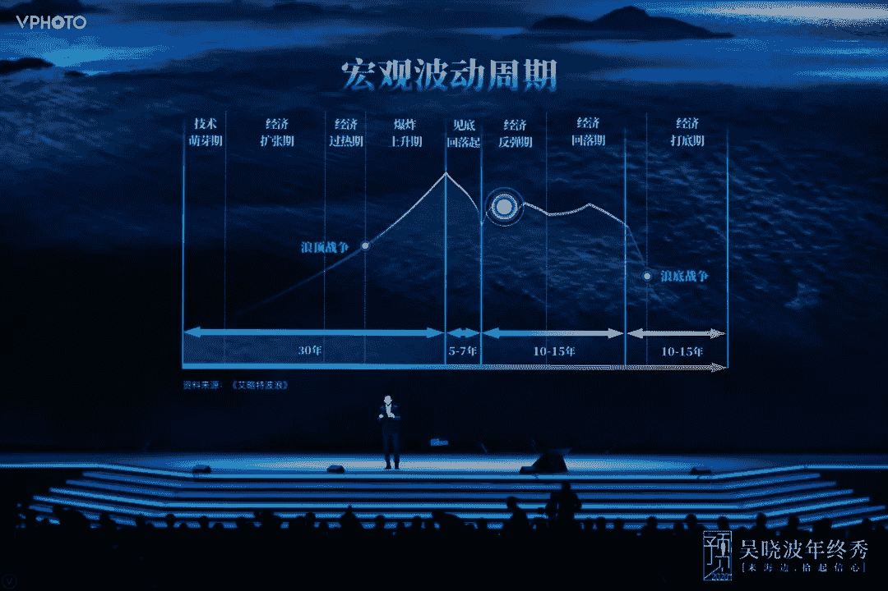

他说，当一个国家的经济发展正式启动时，会进入一个狂飙的成长时期，然后进入焦灼期，最后会进入挣扎的浪底阶段，这个周期长达60年，我们处于哪个年份、哪个阶段，决定了我们跟这个时代和这个国家的财富及产业的关系。

中国改革开放始于一个非常非常低的经济发展起点，那一年中国的人均GDP只有156美元。 假设1978年有两个姑娘，一个在北京饭店当营业员，另外一个在美国随便一家餐厅端盘子，她们工作一年的收入相差58倍。

这样你就会明白，为什么在1970年代末、1980年代初，那么多姑娘要出国去端盘子。 因为在那里，你端1年的盘子，相当于在国内工作58年。

而此后，我们进入了经济狂飙时期，经历了二战以来全世界所有经济体中最长波段的经济发展期。

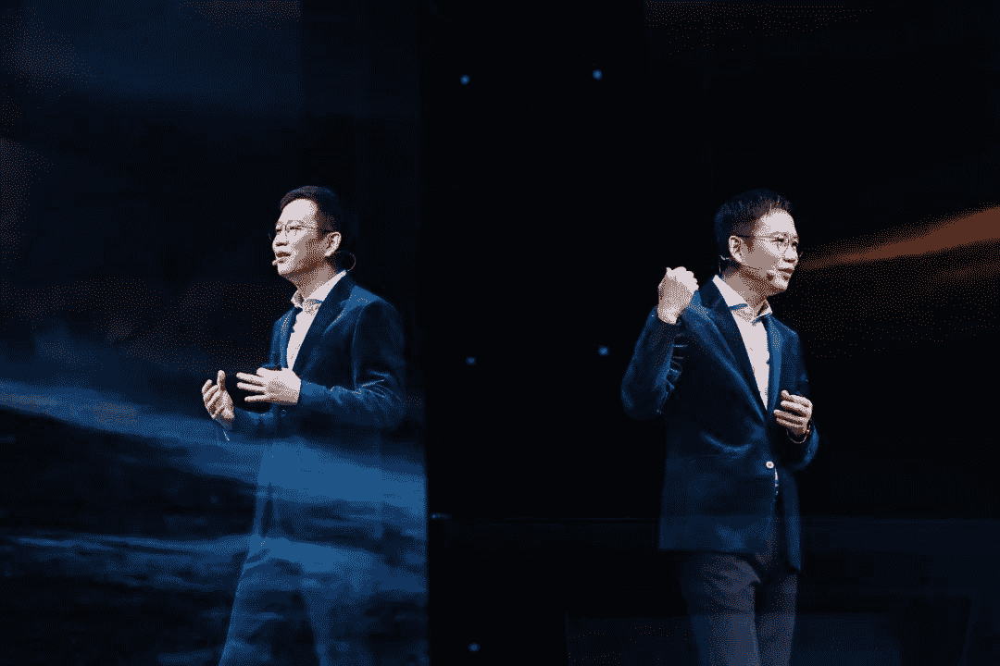

2008年，中国改革开放30周年的时候，我写了一本书《激荡三十年》。 在满天烟花中，我们看到了大国崛起。也是 在那一年，全球爆发次贷危机，中国的外贸出现了明显下滑，投资和消费成了经济主要驱动力 。

今天，中国经济在这个节点上，进入到一个反弹期，2019年最大的悬念是这条曲线可以延续多少年，这是需要通过我们的努力来认真回答的问题。

接下来用30秒的时间，和大家回顾刚刚过去的奇迹般的中国崛起历程。

1978年，中国是全球第11大经济体，此后，这个国家就像一个攀登者飞速蹿升。 你们看这张图的时候心跳有没有稍微快一点？ 我们的人生，我们的努力组成了这张图上那些数据的变化。 我们是不是该给自己，给这个时代，给这个国家一点掌声？

30秒很短，我们是用41年慢慢成为了全球第二大经济体。

我们不妨再做一些有趣的比较，1978年到2019年中国和美国的蓝领工人相比，美国蓝领工人的年薪增长了多少倍？ 3倍。 中国呢？ 一个中国蓝领工人41年里年薪增长了150倍。

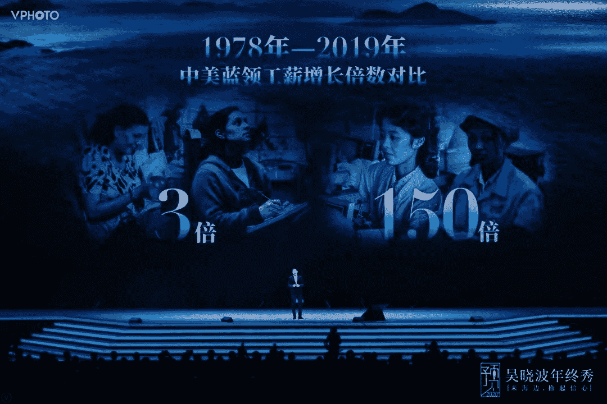

很多朋友知道我喜欢买房子，这个爱好最近已经改了。 1998年，中国开启城市化运动和商品房改革，如果你有1000万，同时在纽约和上海买套房子，那么到2019年它们的投资效率比怎么样？ 纽约的房子涨了2.4倍，上海的房子涨了14.2倍。

朋友们，这个叫什么？ 这个叫做国家经济发展给每个人的机遇，无论对于一个蓝领工人还是一个喜欢买房子的人，都是巨大的红利。

2009年有一个年度流行词是“Chimerica”——中美国。 这是多年来第一次，美国和中国作为两大经济体出现在同一个英语单词里。 一年之后，中国的经济总量将超过日本，成为全球第二大经济体。

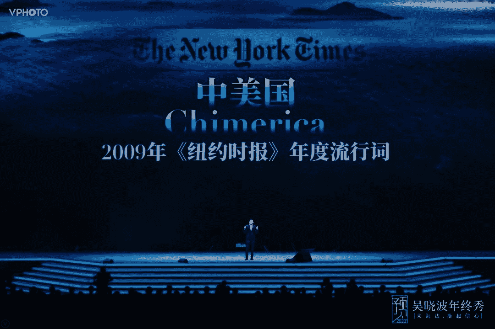

其实，很早以前就有人把中国和美国放在一起做研究，他是美国人费正清，他的婚礼就在老北京的四合院里举办。 那个时代他是一个“中国通”，1948年出版了一本书叫做《美国与中国》。

我们发现在他眼里，中国好像是在黄河中逆向行驶的一艘船，而且是一艘木船，而美国是太平洋上的一艘军舰，所以中国和美国，是一组反差非常大的对照体。

但是到了半个世纪以后，Chimerica这个词出现的时候，我们发现中国在西方人的眼中，在世界的眼中发生了非常大的变化。

发明这个词的是英国人尼尔·弗格森，他曾经五次来到中国，游历了北京、上海、深圳、西安，还去过一个地方——延安。 2010年，他写下了这句话：

> 走在尘土飞扬的中国大街上，我突然意识到，西方主宰世界的500年已接近尾声。

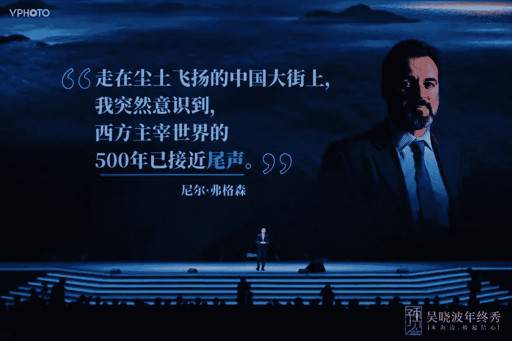

这是历史学家对中国经济崛起的一个观察，我们仅仅看到了30年、50年，看到了产业经济，但一个历史学家是按500年的尺度，来描写我们刚才看到的过程。

2018年，中美之间的贸易出现状况时，我重新翻出尼尔·弗格森当年写的这本书，发觉这一切并不是突然发生的。 在2009年Chimerica成为年度流行词的那一刻，就已经开始发生，中美之间从经济到文化都将发生改变。

我们所处的时期，对中国而言是41年的改革开放，对中国而言是70年的崛起复兴，对中国而言是100年的现代化发展史。 历史学家若从一个更久远的视角来看，这是一段长达500年的中西方对峙。

我们每个人都生活在自己的城市，过着自己的生活，但是如果在历史时空来看的话，我们是处在一段特别宏大的历史阶段中。

在这样的背景下，我走过的12个地方都是这个历史阶段的注脚。 今年也是我人生中出差最多的一年，共计89次。 这些经历让我希望用第一线的视野，用所看到的景象来描述2019年。

我们需要回答以下几个问题：

# **第一个问题**

我去了东莞的厚街，这个地方以两个产业驰名。 其一是做鞋，厚街生产了中国25%的高端女鞋，占到全世界10%的高端女鞋生产份额。 几年前我去的时候，他们带我去参观厚街一家制鞋工厂，有5万工人； 这次故地重游，只剩2千人。

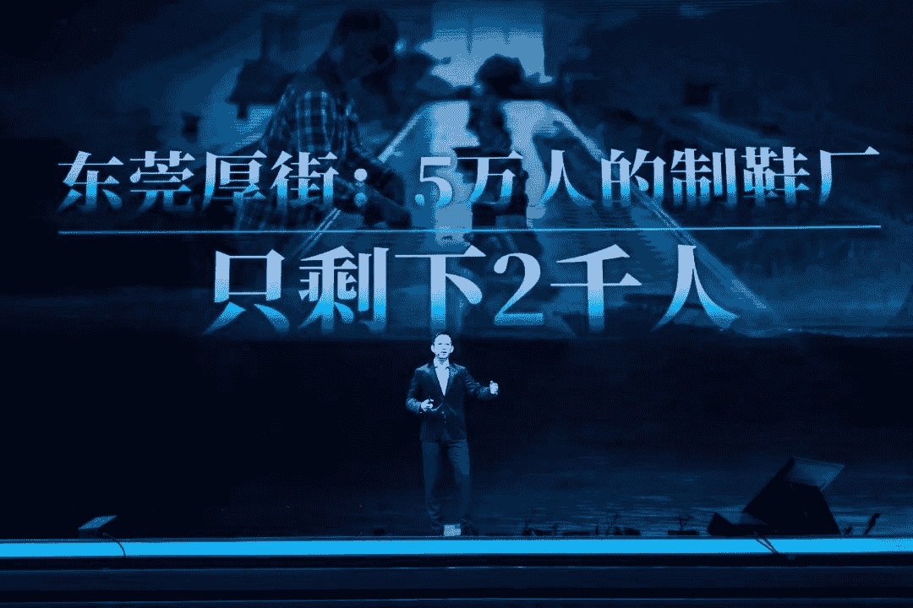

我遇到一个江西小伙子，他20多年前到广东时一无所有，经过自己的奋斗，买了房子，娶了老婆，生了孩子，办了一个小小的印刷厂，专门为厚街服装、女鞋工厂做配套。 他自认为已是一个地地道道的厚街人，带我去厚街的小店里吃当地的濑粉。

一边吃，他一边问我： 吴老师，我是不是应该去越南？ 我所配套的工厂都去越南了。

2017年-2019年，中国的服装行业减产了200亿件服装，平均为每个地球人少做了三件衣服。 是我们这几年不穿衣服了吗？ 还是买的衣服变少？

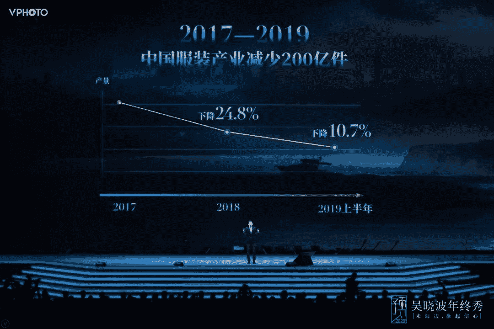

不是，只是这个产业和我在厚街看到女鞋厂一样飘走了，当年怎么飘来，现在又怎么飘走。 它飘去了那些土地成本更便宜的国家，那些劳动力成本更便宜的国家，那些税收更优惠的国家，那些允许任意破坏环境的国家。

今天的中国，这四大成本优势都已经丧失。

在今年雇一个纺织工人，意大利的老板需要花16.8万元，中国的老板要花费将近10万元，但在柬埔寨的老板，可以用同等价格雇佣3个人，在越南可以雇3.5个人，在缅甸可以雇6个人。

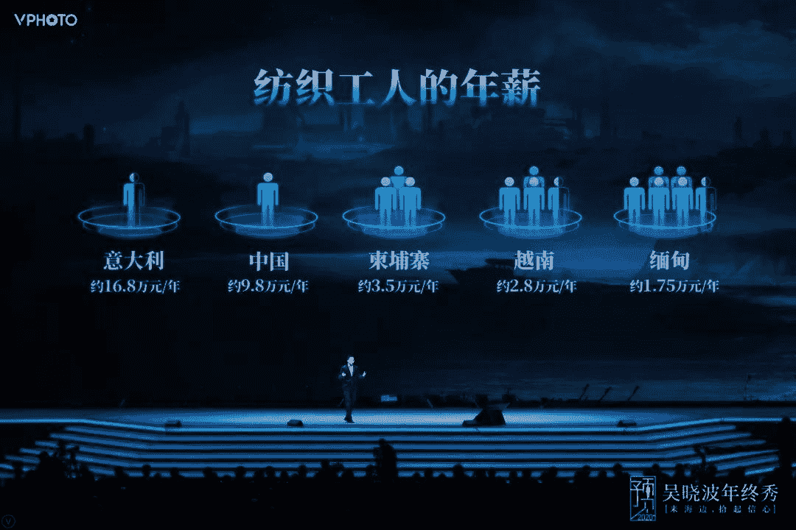

如果你的工厂在一个劳动密集型的产业里，朋友们，你的迁移并不是在2019年发生。 其实在2008年《劳动合同法》施行以后，在华南地区就可以看到这些产业腾笼换鸟、慢慢迁移的过程。 中国制造业的劳动密集型产业的转移并不是在今天才发生，它是一个过程，而且在未来5到10年内还会持续发生。

在厚街还有另外一个驰名产业是家居，中国有一些非常著名的家居公司都在厚街。 家居公司在内需和外贸方面遇到了两种情况。

今年做家居的内需好不好？ 不太好。 因为房地产市场不太好，老百姓就没有理由去买家居，今年的中国家居行业普遍下滑了10%到30%，但是生意还是有的。 毕竟中国每年还在营建超过15亿平方米的房子，还有3%—4%的存量房产需要新的装修。

比内需更难的是做外贸。 我到厚街去，几乎所有做外贸的床垫企业在2019年都很难。 大家猜一下，2019年美国对中国床垫企业的关税增加了多少？ 30%？ 100%？ 300%？ 都不对，最高增加1731%，所以今天做外贸很困难。

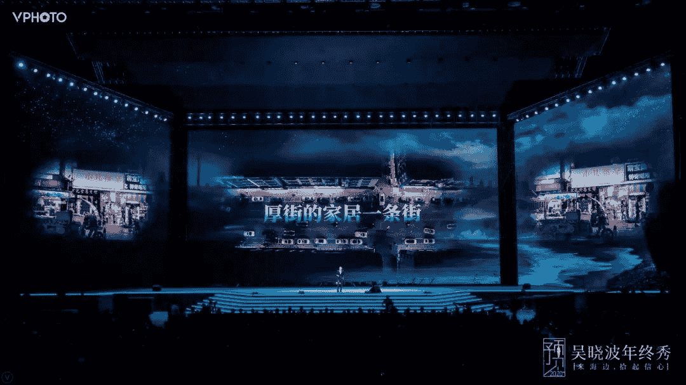

但如果你是一个高品质的，品牌力比较强的企业，情况反而还不错。 我们在厚街看到一个叫慕思的企业，从去年开始投资了几十亿，在厚街建造了全世界最先进的寝具数字工厂。

我到那个工厂调研，请慕思老板给我列一张清单——花费几十亿建设的寝具数字工厂里，那些设备分别是由谁提供的。

在他给我的清单上，工厂的信息化系统是三家公司做的，一家美国公司，两家德国公司； 20多条生产线上的设备，大概由7-8家公司提供，它们来自美国、德国、法国、瑞士等国； 整套现场管理方案，是请日本的一个专家团队来做的。

我问他，这个工厂里，我们中国公司提供的设备是哪个？

他指给我看，就是前面的管道线、铁轨线，那些是由中国公司提供。

当时我就在想，未来我根本不担心，作为全球最大的制造业国家和消费品国家，我们一定会有全世界最先进的寝具数字工厂，全世界最先进的跑鞋、冰箱、空调数字工厂，你们说对不对？ 因为全世界的消费品制造在中国。

未来十年，中国制造的核心能力、我们的战场在什么地方？ 在这张清单上： 有没有中国公司可以为这些企业提供信息化解决方案，能不能提供他们在生产线上所需要的各种设备？

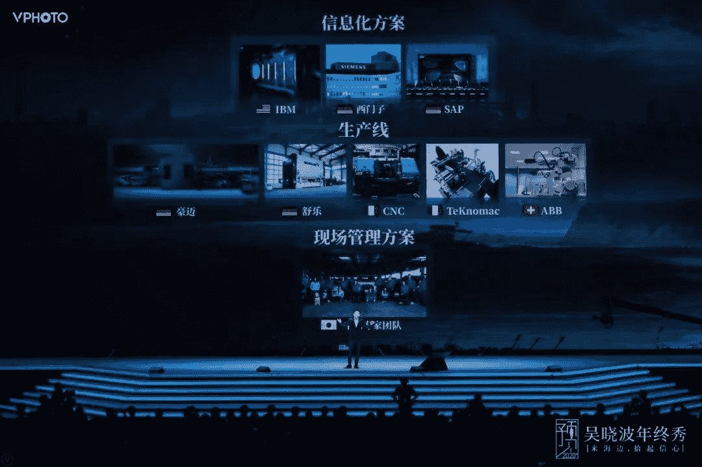

我今年去的第一家工厂，是福建泉州的安踏。 我记得很清楚，那是正月十一，安踏丁总陪我去的缝纫车间。 安踏所有的跑鞋都经过一个缝纫系统，必须通过人机协作来进行缝纫。 他告诉我，三年前这种机器全是日本生产，而今天安踏有一半的高速缝纫机是由一家宁波公司生产的。

所以，你问我中国制造业正在发生什么事情？ 答案是那些劳动密集型的产能正在持续加速离场，同时中国车间的生产线上，正在发生巨大的变化。

在解决方案和设备层面上，如同我在慕思投资几十亿的寝具数字工厂里所看到的景象，我们必须承认，中国是一个制造业大国，但这个世界上还有一些强国，设备的强国、精密仪器的强国。 和欧美的制造业设备强国相比，我们仍然存在若干年差距。 希望在未来的车间里，我们能够看到这些替代。

2018年以来，我常常被问到一个问题： 中国改革开放40多年，为什么到这两年中美之间才发生这样的摩擦呢？

这里有一条“微笑曲线”，可以非常清晰地告诉大家答案。

迈克尔·波特说，任何一个产业都有一条价值链，上游、中游、下游，每一家企业——无论是做袜子还是做电器——都在价值链的某一端。 在很长一段时间里，微笑曲线的两端，一端是研发，一端是品牌，被欧美制造强国把持。

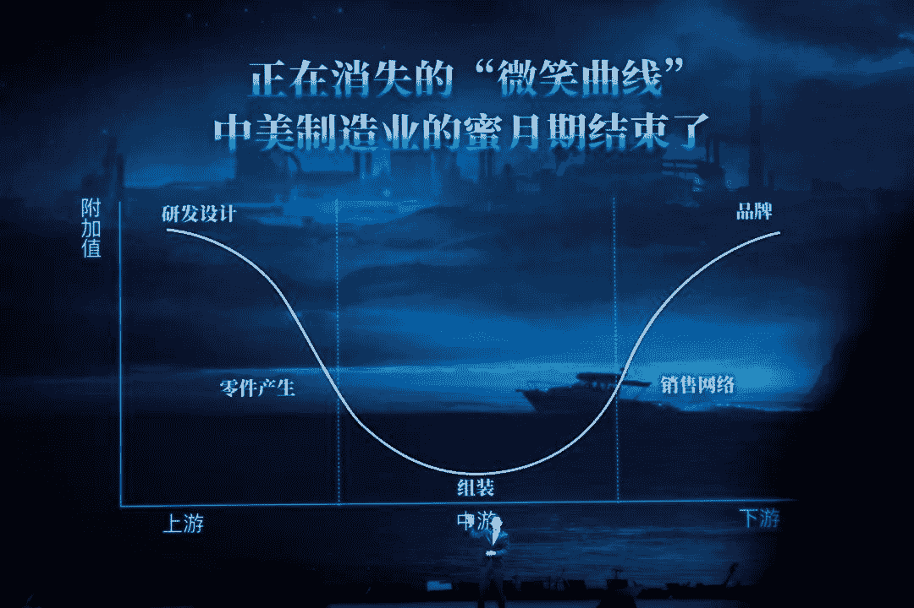

中国在哪里？ 中国在微笑曲线的底部，我们通过各种各样的成本优势，成为了这些欧美品牌的代工厂。

到了2019年，中国公司还甘于在底部吗？ 越来越多的中国公司像华为一样开始搞研发，掌握自己的核心技术，越来越多的中国公司开始掌握自己的品牌。 当中国公司从微笑曲线底部向两端拓进的时候，意味着这条维持了40年中美产业蜜月期的长阶段微笑曲线已经被瓦解，越来越多的中国公司希望有自己的核心技术和品牌。

2019年，我们有没有看到一些变革的景象呢？

我今年去了齐齐哈尔的飞鹤奶粉。 奶粉行业在十年前，发生过一个天崩地裂的事件 ，中国新中产父母的主要应对方式，就是拒绝国产，打死也要海淘奶粉。 万亿的海淘市场，排在第一位的产品就是奶粉。

但在过去十年里，中国奶粉行业发生了非常大的变化，所有食品中唯一一个用药品标准来检测和监控的就是奶粉行业。 而且在中国市场上排名第一的奶粉已经是一个中国品牌，叫做飞鹤。

在中国市场上，一个细分品类里，你的市场占有率排在第一，并不是一件特别困难的事情，你可以通过价格战的方式、通过规模化的方式做到这一点。 但是，我们在飞鹤看到一个有趣的景象，图中左边是国外奶粉大牌，这罐三段奶粉每克0.36元。 飞鹤也有三段奶粉，每克0.44元。

这说明什么？ 说明当今中国的80后、90后妈妈们，她们更相信产品本身。 只要你这个产品符合中国宝宝的体质，通过口碑传播，她们愿意为中国的产品买单。

这样的景象并不仅仅发生在奶粉行业。

今年我还去了广州，一家大家都很熟悉的日化公司——立白。 曾经很长一段时间里，最受中国消费者欢迎的洗涤剂品牌是宝洁的汰渍。 但是从2017年开始，中国洗涤剂市场销量领先的品牌变成了中国品牌立白。 更要紧的是在同样一个品类中，中国立白的零售价已经超过了汰渍的零售价，这在20年前是绝不可想象的事情。

1998年，我曾经去当时中国最大的彩电公司长虹做调研。 直到今天我还记得这样的场景： 我面前摆了两台电视，一台是日本品牌，一台是长虹，董事长倪润峰跟我说，我们的生命线是什么？ 我们的电视机和这台日本电视机的性能、功能完全一样，但是价格便宜三分之一。 我把这个细节写进了《激荡三十年》。

20年之后，今天我们看到了中国制造业的另外一种核心优势，它们不仅在中国获得了市场占有率第一，同时它们在性能、价格上跟国际品牌形成了对峙的能力。 战胜远远谈不上，但是我们已经形成了对峙的能力。

我们甚至在一些很小的品类也做到了。 我今年去了烟台的一家葡萄酿酒生产企业张裕，他们生产15年窖藏白兰地的价格，和全世界马爹利、轩尼诗的价格不相上下，甚至有所超过。

30年前有人提出了这个公式： 中国制造的核心优势，一个是成本优势，一个是规模优势。 我们要做全世界最大的手机工厂、洗衣机工厂、牛仔裤工厂，通过成本优势加规模优势形成中国制造的核心优势。

但是，这个公式已经终结了。

今天我们在中国看到了另外一个公式，叫“新中国制造”： 必须要有好的品质，必须要有核心技术，同时为十几亿消费者中的某一个圈层做服务。 高品质、核心技术和圈层消费，成为了新中国制造的核心能力。

**总结一下，2019年，我们在中国的制**造业看到的景象是： “落后产能离场加速，智能突围投入坚决，品牌升级红利凸现，基础技术亟待破题。”

# **第二个问题**

我想先给大家看一组数据。2011年，中国移动互联网用户是4.3亿，现在是11.4亿，在短短的八年时间里，增长了7亿人，这就是移动互联网给中国公司带来的巨大红利。

但是，到了2017年底的时候，中国移动互联网人口已经达到了10.8亿，2018年11.3亿，2019年是11.4亿。这意味着什么？这意味着从2017年四季度开始，中国移动互联网的红利就已经吃完了。很多人说2019年我们并没有看到互联网发生很多变化，那是因为，它已经是一个停滞的产业了。

这11亿多人，大家都很愿意把时间花费在手机上。2019年中国人平均每天在手机上花多长时间？5个小时。

这5个小时是怎么分配的？

2015年，通讯加社交占用了45%的时间，一半的时间是在即时通讯和社交，22%的时间是在音视频领域；2019年，发生了翻天覆地的变化，我们在音视频上花的时间是49%，在通讯和社交上花的时间是19%，刚好反过来了。

2019年，我们看到的第一个景象是互联网移动人口增长的停滞，流量时代彻底结束，第二个景象是音视频为王。

第三个数据，随着流量时代的结束，流量变得越来越贵。2015年，淘宝获得一个新增用户要花166元，京东142元，今天淘宝要花536元，京东是757元。2016年异军突起的拼多多，面向“下沉市场”，获得一个用户要花10块钱，到2018年第四季度，连拼多多获得一个用户都需要花143元。可见获得一个用户是多么困难，多么贵重的一件事。

而我们每一个消费者去使用这些平台的成本也变得很贵。比如在淘宝开店，以前是零成本，平台上汇集了跨越地域的消费者。但今天在淘宝开店的小店平均需要支付的流量成本占比在20%左右。

今年股价表现优异的美团，大家听完演讲以后在美团上点一个夜宵，可以半小时就送到你手上，这种效率在全世界都很罕见。但是为了达成这次送餐，餐饮店需向美团支付22%的服务费。大家听完演讲以后打滴滴，很方便，还没有出门就可以通过滴滴联系到司机，但是司机需要支付给滴滴20%的中介费用。

我不知道中国互联网从业者看到这两个数据，心里是什么想法。因为在十多年前，当互联网进入这个国家时，这些创业者向我们承诺说，当你们把自己的消费行为和生意搬到互联网上的时候，以非常低的成本获得各种服务，以非常低的成本完成你的生意，将进入公平、透明的世界。

现在互联网进入中国20年了，这些承诺有部分实现了，例如很多服务变得更加快捷，变得更加即时，但是也有很多承诺，我认为可能永远都无法承兑了。

各位也不要沮丧，当这两件事情同时出现的时候，意味着什么？意味着新的挑战者会出现，意味着新的工具、新的能力会让这些成本下降。中国互联网经历20年到达了它的巅峰时刻，一群当年的屠龙少年，纷纷变成了巨龙。今后一定会有越来越多的年轻人，成为能够改变现状的未来创业者。

2019年，中国的互联网世界的格局也发生了非常大的变化。这张图片中，左边是所谓的BAT时代，中国市值排在前十的互联网公司；右边是今年排名前十的互联网公司，是所谓ATMJ时代，中国互联网就是ATM机啊。

今天如果有90后、00后的同学问：前面已经有一堆巨人，而我现在可能还在美国读书，那么未来十年如果我回国创业，还有机会吗？

朋友们，机会有的是。对比十年前，今年的十大互联网公司有五家是新的，有的诞生在2010年，有的诞生在2012年，还有一家诞生在2015年。很可能现在坐在台下的年轻人，你们未来会拥有一家超过几百亿乃至上千亿市值的公司。

今天的互联网世界格局是“头部恒强，中部塌陷，长尾崛起”。那些垄断性企业对流量的控制，对分发的控制已经变成了一种新的寡头能力。在头部的压迫下，中部的公司在2019年日子过得非常困难，但是尾部有细分的品类和服务在持续创新。

今年中国的互联网有两条最大的长尾，一男一女。女的叫薇娅，男的叫李佳琦，他们在今年的双十一分别实现了近30亿的成交额。30亿是什么概念呢？

薇娅今年单是服装就能卖20亿-30亿。中国有11家女装上市公司，这11家上市公司中，有7家年营业额在18亿-25亿。而一个叫薇娅的姑娘一年所产生的服装销售额，基本上相当于中国一家女装上市公司的年营业额。所以在流量变得越来越珍贵的时候，谁成为了终极节点？是那些有个性的、勤奋的、有专业能力的人。

其实我更愿意推荐这个姑娘，她的名字叫“秋枫”。今年9月，《地标70年》去采访薇娅，当时她已经很火了。访谈结束后，我对编导说，走，咱们去一个地方，杭州四季青服装市场。

中国四大服装市场中，规模最大的就是杭州四季青。我去的时候是下午4点，四季青的档口面积约两米乘两米，鼎盛时期一个档口一年租金80万。那天，我问老板现在档口的年租金多少钱，他们告诉我是25万。从80万降到了25万。摊主基本都是90后的女生，十个女生中九个女生在玩手机，还有一个女生，就像秋枫这样的一个女生，在不停地对着手机试穿衣服，做直播。

今天的四季青服装市场，大概有200多个像秋枫这样的女生。这个景象非常“2019”——生意惨淡，所有人都觉得新的世界正在对所谓的传统业进行变革和颠覆。人们该怎么办？有的人就开始刷手机、吐槽、报怨，只有少数人来到了现场，参与到新的浪潮中。

秋枫的妈妈25年前来杭州，一个外地女孩，一无所有，买了一台缝纫机，就摆摊缝衣服，钱多了以后租档口。当年她摆摊的时候秋枫只有6岁，女儿大学毕业后回来接替妈妈的事业。

但是，当这一代姑娘站在档口前面的时候，世界变了，那么她也要让自己变成一个档口，让自己变成流量节点。每天做6个小时的直播，最少一天卖20件衣服，最多一天是卖400件。

这就是互联网世界看到的新景象 “BAT格局落幕，ATMJ四强争霸，视频统治流量，人成终极节点”。

# **第三个问题**

很长时间里，这在中国是一个问题。中国的有钱人为什么而消费呢？2001年，有部电影《大腕》，里面有一个标准答案：只买贵的，不买对的。

我对这段话有自己的一番解读。为什么在2001年那段时期，中国的成功人士信奉“只买贵的，不买对的”？因为他们不知道什么是对的，而且他们不屑于知道什么是对的。人生之于他们，最重要的事情是摆脱贫困，是把每一分钱掰成两半来赚钱，四处奔波着谈生意谈合同。哪有时间了解全世界最好的表是什么表，最好的西装是什么西装，最好的车是什么车？

所以，他们跑进表店的时候就直接说，请你告诉我哪个表最贵。花时间了解产品是一件耻辱的事情，因为大家都在忙着赚钱。那我为什么要买最贵的表呢？就是为了把袖口捋起来告诉别人，我买了全世界最贵的表。仅仅是为了炫耀，所以好不好不重要，只有贵的才重要，因为所有人都知道它的贵。

但是到了今天，这波人已经不见了。今天出现了新中产，他们非常勤奋地创业，而且他们对自己可好了。

吴晓波频道发布的《2019年新中产白皮书》中，调查了一个问题：你买一个奢侈品是为什么？结果显示，12.5%为了送人，23%为了匹配自己的身份，最多的一项占比——多达60%的人，是为了愉悦自己，让自己快乐。

当这种新的消费价值观产生的时候，李成儒（《大腕》演员）所呈现的那种消费取向就随风而去了。

由此可见，今天中国的消费升级，本质上是一种心理升级，那些消费者的购物目的，是为了对自己更好一点，是美好生活物质化的证明。品质、场景、心情成为了新中产最愿意为之买单的一些因素，消费形态发生了巨大的变化。

当大家愿意为场景、为心情、为品质买单的时候，有一个名词“性价比”消失了，出现了一个新名词——“颜价比”，好看变得非常重要。

革命性的变化，并不是每时每刻都在每个行业发生的。当我们去购买一个产品的时候，企业之间的竞争，依靠的是90%的颜值加上10%的微创新。大部分时候发生的不是革命，是一步一步非常微小的改良。

例如，今天的小熊酸奶机，除了可以做酸奶，还可以做米酒，纳豆、泡菜。和之前的酸奶机相比，它并不是突然发生革命性变化，而是逐步进化的产物。

首先是长得更好看，因为有了更好的工业设计，有了更好的材质，然后是更多微小功能的迭代。所以我们看到，越来越多的消费者去购买产品时，非常偏爱长得好看，同时满足细小功能的产品。

这些产品都不具备革命性，也没有什么重大发明专利，但是它被今天的消费者所喜欢。因为它满足了你的某一个消费的场景，一个特别细分的场景。

总结一下，今天新中产消费者愿意为什么买单？ “消费越来越随便，小众圈层即一切，审美颜值是正义，我只信任你推荐”。

# **第四个问题**

今天来了很多创业者，你们觉得2019还好吗？不好，我们要说真话。

中国创业市场最令人心潮澎湃的时期，是2014—2016年。2014年，国家提出了“双创”，移动互联网让旧世界大规模地崩溃了，全国立刻冒出很多的联合创业空间，涌现出无数的创业者。吴晓波频道创办在2014年5月8日，对，我也是在那个高点凑热闹的人。

我写了一篇文章《骑到新世界的背上》，因为我写的那些专栏，所属的报纸已经不见了，越来越多人在手机上看新闻，于是我就做了吴晓波频道。我们要骑到新世界的背上，新世界是一条恶龙，大概率会把我们摔下来，但是新世界的疆域非常明晰地展现在我们面前，我们必须冲进去。那是最近十年中国创业的黄金时代。

现在，旧世界向新世界迁移的流量革命已经结束，依托于移动互联网的窗口已经关闭，但是新的窗口还没有打开，所以我们看到创业热情大幅度下降，投资者LP、GP的热情和中国2000多家风险投资公司的热情也在下滑。数据显示，今年几乎所有的风险投资公司的募资量都减少了50%，所投的钱也减少了50%。

创业出现很多大的雷区，我们整理了2019年十大创业雷区，包括影视文创、少儿编程教育、大数据爬虫业务、互联网家装等等。它们几乎都是2015年以后所谓的巨大风口。正是这一个又一个的风口，无数年轻人的青春、热情，无数投资人的金钱都砸进这里。

我今年策划《地标70年》时，特地挑选了深南大道、中关村和杭州梦想小镇这三个地方，因为这是中国创业者最为聚集的三个地方。我亲自跑去这几个地方，只想知道一个答案——创业者还在吗？

我去了中关村创业大街，那里有一家车库咖啡。我在车库咖啡里见到了两拨人，第一拨是一个青岛小伙子，他说我有一个非常好的创业项目在青岛，也在当地请教了很多人，但没人给我答案。有人说到北京去，去找车库咖啡，那里会有人帮助你。

第二拨人是两个中国人民大学的姑娘，一个95年，一个97年。她们认为中国西北地区中小学生的师资力量非常薄弱，所以希望将北京的教育资源，输入西北贫困山区的学校。就为了这么一个念想，一个姑娘休学一年，另一个姑娘还在工作，组建了创业团队在车库咖啡讨论，到底怎么帮助西北的中小学完善它们的教育。

我去了宜宾，中国的四五线城市。在那里遇见一个小伙子，他一年前在深圳，一年后回到家乡。他的家族是做燃面的，他回来创业就开了燃面店。

我还去了景德镇，中国最早的工业城市，农耕文明时期的工业城市。景德镇在1980年代的时候生产的是中国日用型的陶瓷，当年50%的日用搪瓷杯在景德镇生产。景德镇最繁华的时候，有十家国有瓷厂，其中有一家牛气哄哄地叫“宇宙瓷厂”。但是现在，景德镇的十大瓷厂全关闭了，有些厂房干脆改造成了酒店。

当十大瓷厂破产的时候，景德镇已经不再是中国日用瓷的中心，但景德镇没落了吗？并没有。

这里出现了2000多个以80后为主力的艺术家，他们在做艺术瓷。我们今年年终秀的伴手礼中，有一个“预见杯”，就是我在景德镇找年轻匠人订购的，使用的是一种景德镇传承千年的独门技术，叫做玲珑瓷。我们看到，这些年轻的创业者，已经在用传统技术进行新的创业。

如果我们回顾中国这四十年改革开放的历史，中国经济的发展靠的是谁？就是一群人想要摆脱现有生活和工作秩序，把自己的生命投入到商业创造中去的人。无数的年轻人前赴后继地创业，是中国的经济走到今天的根本动力。

我也想简单分析一下这40多年中，存在的几种不同创业哲学。50后、60后创业者，他们没有任何专业背景，更没有读过商学院——中国1998年才有MBA，他们很多人连小学都没有毕业。那代人创业，有三样东西：胆大、勤奋、好运气。

70后、80后的创业发生了变化，当他们进入盛年筹划创业时，商品市场已然成熟，市场经济开始慢慢出现，所以这一批创业者，大部分受过良好的学历教育。他们所做的工作是，市场需要什么，我就生产什么，你喜欢什么我帮你生产什么。

今天现场来了很多90后，还有玩直播的00后，这批年轻人，是天生全球化的一代，他们创业为了什么？不是为了满足别人的需要，是为了满足自己的需要。

他们用这些产品在社交、在互联网环境下呼唤那些和他有同样需要的人。他们所做任何一件事，从来没有想过要满足在座的各位，他们首先想到的是满足自己，使自己快乐。就像他们购物是为了愉悦自己，创业也是为了愉悦自己。

所以，中国的40年来，创业哲学都发生了巨大的变化，我们今天要适应这一代人对商业、金钱、自我和团队的理解。

我去了中关村，那是中国创业的标志性区域。我在晚上11点的时候到了那里，等到了凌晨一点的时候，发现还有很多窗口亮着灯。

朋友们，今年中国的创业形势好不好？不好。但是我要告诉大家，创业在中国并没有停滞，创业者仍然在努力。

2019年我们看到的景象是 “创业趋于理性，热情仍未燃尽，自我实现驱动，八零九零全新”。

今年，我最喜欢的是这张照片。今年9月，男篮在自己家门口被人打得满地找牙，据说那几天最高兴是中国男足。但是我看到了易建联发的微博挺感动的，让我觉得男篮跟男足不一样。他说：

> 如果不能在失败的时候站在一起， 我觉得未来也不能走向成功。

今天的我们，并不是刚刚开始出发的一代人，并不是一个刚刚开始出发的国家，我们已经成了全球第二大经济体。1978年，中国的人均GDP是156美元，2019年，我们的GDP即将超过10000美元。

中国已经变成了越来越具有纵深感的国家，我们很多企业的前面已经没有领跑者了。中国的家电工厂已经没有领跑者了，中国的文化公司也没有领跑者了，甚至我们这一场年终秀也没有领跑者。

**所**以，我们必须要学会自主式创新。 我们越是向前走越会有更多不得不选择和割舍的道路，但只要那个初心还在鲜活跳动，一切便都会峰回路转，春暖花开。

<https://aigcreative.feishu.cn/sync/K4Gvd9vUQsy9Oubwqaeclu0Fnbg>