# 吴晓波：预见2018（演讲全文）

> 来源：[https://aigcreative.feishu.cn/docx/XoxEdaVLgo7aldxsp9bc3CZfnSb](https://aigcreative.feishu.cn/docx/XoxEdaVLgo7aldxsp9bc3CZfnSb)

> 🔗 原文链接：https://mp.weixin.qq.com/s/f5q_6LImbHMHJwtrYwRF-Q

一年前，在上海喜玛拉雅大观舞台举行的年终秀上，当时我提出了八个预测，今天我们回过头来看看，已经实现了哪些？以及，我将对2018年的趋势做出八个预测。

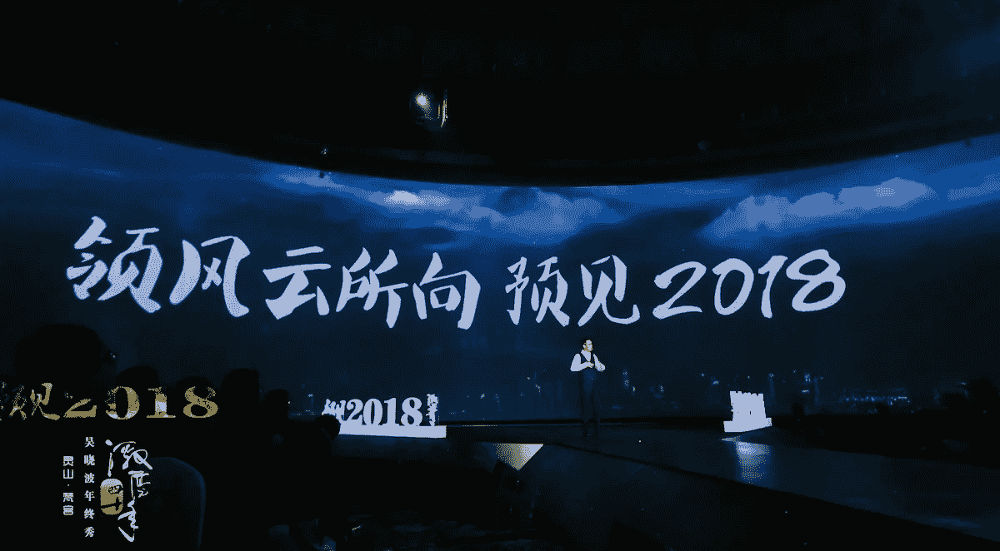

## 复盘2017

### 1. 新锐中产渐成主流，工匠精神再造国货。

我们非常荣幸地看到了中国新中产的崛起。在今天的中国，无论是生产一瓶水，还是生产一件衬衫，如果有人说 “ 得屌丝者得天下 ” ，你们还信吗？这是一个已经慢慢被边缘化的种族。

中国 2.4 亿的新中产，这是一群享受精致生活的人，在座的各位已成为推动中国经济消费的主力人群。

当他们站在舞台中央时，“ 崇洋媚外 ” 这个词已经不存在了。 你别跟我说 “ 伦敦人喝什么茶 ” “纽约人开什么车 ” ，我们更相信中国市场上本土消费者的力量，以及全世界所有的商品都在卖向中国，而要卖给中国人，还必须会讲中国话。

所以，在今天无论是外资资本或中国本土资本，都面临一个问题，就是要重新塑造每一个商品，它可能是一个茶杯垫子、一双皮鞋、一个音箱、一本书等等。新中产崛起的背后， 2017 年我们可以清晰地看到一个景象 —— 工匠精神重新回来了。

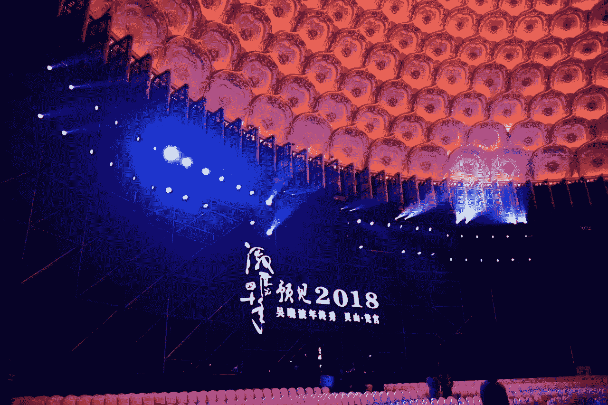

吴伯凡老师也讲到，无论这个国家的种族之间怎么样互相陌生，亦或互相难以理解，但你必须要用工匠精神去做好每一个商品。因为有人开始愿意为工匠精神买单了。

2017 年 5 月，我请了 200 个中国的新工匠在无锡灵山小镇拈花湾，开了两天的 “ 新匠人养成营 ” ，我非常高兴地看到， 90% 是 80 后、 90 后， 年轻人重新回到小产品本身去创造产品。

在这个意义上，中国所有的驰名商标，所有的百亿企业，所有的三十年、五十年、百年公司，全部烟消云散。我们只相信一件事情，那就是你能否做出一件符合我审美的好商品。

### 2. 跨境并购倍级增长，人工智能穿透产业。

这也变成了事实。 在 2017 年，人民币是全世界最野蛮的并购货币。

2016 年 4 月，我和 100 多位企业家去德国汉诺威工业博览会。德国的企业家看着我们，疑惑 “ 你们来干什么 ”“ 你们跟工业 4.0 有什么关系 ” ？

2017 年 4 月再次去，已是完全不一样。因为在整个 2016 年，中国资本对德国资本的并购增加了 8 倍之多。 我们大概收购了超过 100 家德国的隐形冠军，甚至 2017 年年初，德国联邦政府出台了相关法律，非欧盟国家对德国公司的并购需要报备政府，非欧盟国家主要指向中国。

跨国并购出现了倍级增长，但倍级增长背后我们也看到了巨大隐患，在接下来的预见 2018 中，我会跟大家讲这个点，人工智能开始穿透产业。

### 3. 资本市场频繁换壳，理财恐慌持续蔓延。

我说对了半句，理财的恐慌持续蔓延，如果你手上有 100 万，你会问 “ 我该怎么办 ” ，如果你手上有 1000 万、 1 亿，依旧会问 “ 我该投什么 ” 。在公开市场找不到好的资产标的物，构成了今天中产阶级最大的恐慌。

资本市场频繁换壳并没有发生，在 2017 年我们看到的是， 2016 年中国所有的资本都去买好的资产，好资产在哪？在公开市场上，在产业经济中。这些好资产，资本怎么能尽快将其兑现，如果是一家转型非常成功的服装公司，就去买一家上市公司，把资产装上去。这是 2016 年可能看到的景象。

但一年后的 2017 年，这并没有发生，为什么没有发生呢？如果发现服装行业一家成功转型的公司，想买壳将它装进去。那你别干了，我来干，我直接让它上市就行了。 2017 年我们看到的景象是， 整个 IPO 市场出现了量级的增长。

在 2015 年、 2016 年买了一堆壳的公司，全部把壳砸自己手里了。上周，新三板的一家公司，其市值最高曾达 1300 亿，如今只剩下了 1%-2% 的市值，被证监会严令退市。它手上有无数壳，曾被称为 “ 壳王 ” 。这是一件值得鼓掌的好事。

### 4. 新兴垄断挑战公平。

今天讨论这个问题，心情仍然非常沉重，我有时候做梦时会想，如果有一天中国 BAT 加上美国谷歌、微软、苹果、Facebook、推特， 8 家公司找一个小镇开一个会， 世界会怎么样？会非常不太平。

因为 2017 年，全世界出现的 500 家独角兽公司中，有 300 家是这 8 家公司投资的，他们不但控制了我们的时间，控制了我们的社交，甚至在某种意义上即将控制我们的未来。可能在人类历史上，都从来没有看到过那么大规模的来自于市场竞争所产生的新型垄断。整个行业都不知道怎么对付它们，甚至整个法制都不知怎么对付它们。

新型垄断挑战公平，这个在 2016 年底我们看到的景象，一年后的今天，非常抱歉地告诉大家， 垄断还在加剧，公平继续遭到挑战。 不知道明年这样的景象有没有可能得到缓解，但从这一年的情况来看，我非常不乐观。

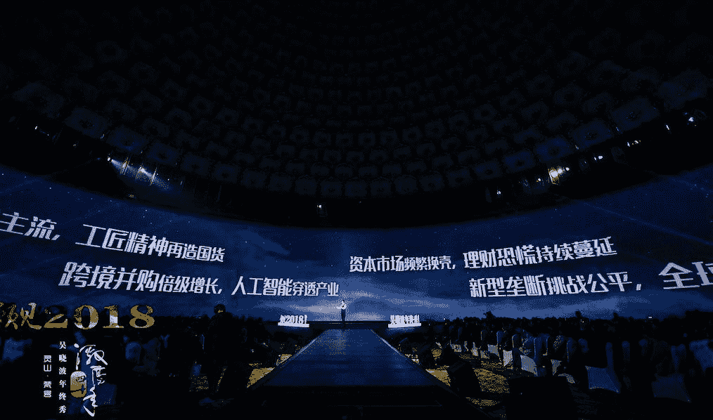

### 5. 全球通缩政经动荡。

去年，我们看到的是，每一个国家都跟中国一样产能过剩，中国好一点是因为有新兴的中产阶级存在，欧洲、美国、日本已经没有任何机会了，因为它们国家中产阶级的发展已到顶点了，这就是唯一的区别。

中国的需求端新中产的出现，推动了整个中国产业经济变革的可能性。所以 2016 年底我们看到全球通缩的景象，在今天仍然没有得到改变，各个国家的领导人都在干两件事， 第一件事在自己国家的边上加紧盖篱笆墙，第二件事是加紧印货币。

这就是我们看到的 2017 年的景象。

到了 2018 年，我们也对 2018 年的趋势做一个小小的预测，看看明年这时，到底说对了哪些，说错了哪些，说漏了哪些。

## 预见2018的八个预测

### 1-美国挖坑全球竞填

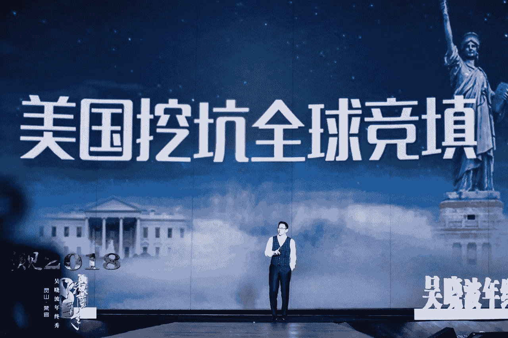

今天美国的总统是特朗普。 要是十年前有人跟我说，特朗普会成为美国总统，我一定以为他疯了。但一年过去了，事实上，特朗普很可能成为第二个里根。至少他干了两件靠谱的事： 第一、修复中美关系， 从中国拿走了 2000 多亿美金的订单； 第二、推出了美国历史上最大的减税计划。

今天是全球化社会，税收是什么？第一，税收是一个国家竞争能力的获取，第二是国家跟另外一个国家进行竞争的能力。为什么很多人把企业搬到新加坡去，为什么在开曼群岛办一个企业？因为免税。

今天全世界最大的经济体，在自己国家挖了一个大坑，要两样东西，第一是人才，第二是资金。这是过去两个月发生的景象，这件事情会成为 2018 年全球最重要的国家之间的竞争。每一个国家都问在自己，美国挖了一个大坑，希望把人才和资本引过去，那我们怎么办？我们只能干一件事， 咱家也挖坑。

给大家看一张世界地图，颜色浅的是税交得少的，颜色深的是“万税”国家，大家可以看看全世界税负最高的地区有哪些。

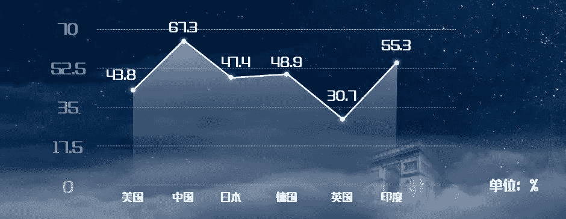

（2017年世界各国企业总税负对比图）

2018 年，随着全世界第一大经济体美国所得税开始下降，全世界的第三大经济体日本也开始战略性减税，我们希望全世界第二大经济体也减税。

### 2-买好资产投穷国家

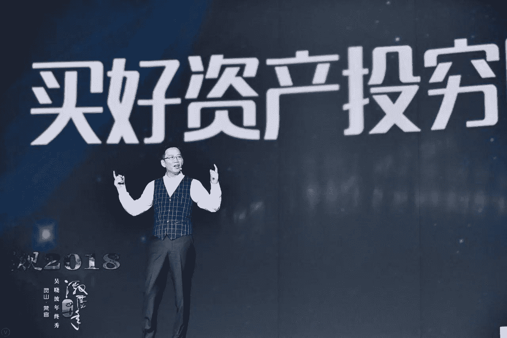

今天全世界最大的泡沫是什么？人民币，中国的经济总量只有美国的一半多一点， 人民币的发行总量却超过了美元发行量 。有泡沫是好事，问题是有泡沫以后怎么办？

三十年前，日本跟现在的中国一样，也有泡沫。日本当年的泡沫大到什么地步，大到东京地区土地价值总和相当于美国国土面积所有土地价值总和，加上纽交所所有上市公司市值总和。

当泡沫很大时，日本人特别嗨，认为自己很快会成为第一大经济体，要把美国的好东西买走，买了美国最高的楼、最好的棕榈滩、最大的电影院以及俱乐部。美国人特别高兴，因为日本人用泡沫买了美国人的泡沫。

三十年过去了，中国人非常感谢日本人带给我们的教训。 我们不能拿泡沫去买人家的泡沫，那是傻子才干的事。我们拿泡沫买别人家最好的东西，即买好资产投穷国家。

（2002-2017年中国对外投资增长图）

什么叫买好资产呢？ 2002-2017 年这 15 年间，中国对外投资额增加了将近 20 倍（ 18 倍多一点），但为什么 2016 到 2017 年时，出现了陡状的下降？就是因为在 2017 年，有几个人犯了日本人三十年前犯过的错，去买楼、买海滩、买酒店、买电影院、买足球俱乐部。 这些都是非标资产，都是泡沫。

中国人以非常土豪的姿态，甚至比日本人当年更土豪的姿态去买这些泡沫，傻不？为什么出现陡状下滑，因为 2017 年政府把这些傻人请回来了。

最大的问题在于，如果他们拿自己的钱去买这些当然 无 所谓，但他们在中国地区的银行大规模举债，拿大家的钱去买人家的泡沫，这不可以。

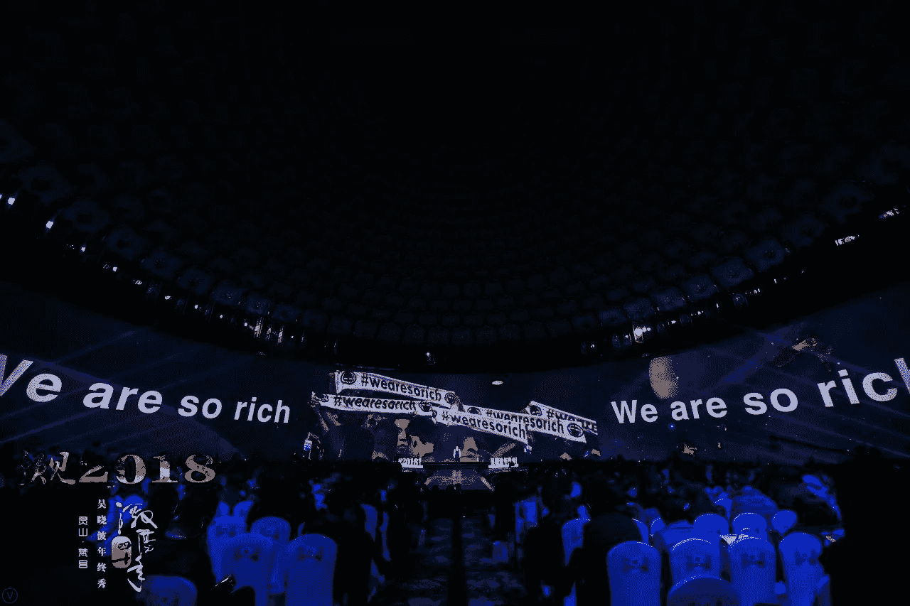

那要去买什么？要去买别人的机器人公司、医药公司，要去买别人最好的资产。所以，在 2017 年度的这次调控后， 2018 年我们会看到，跨国并购会继续加大， 但资本将趋于理性化。

那什么又是投穷国家？我们当年也是穷国家，现在稍微有点钱。穷有时候是一个优势，意味着这是一个后发展国家，有机会。

前两天有个 90 后同学，跟我说，他从新加坡留学回国，在他爸爸的服装厂工作，他爸爸派他去缅甸办服装厂，他不知道该不该去。

我跟他讲，缅甸今天的人均 GDP 相当于中国的 1982 、 1983 年，缅甸曾经是南亚地区最大的粮仓，有非常好的生产水稻的平原，缅甸有 1 亿左右人口，那里的人民非常温顺。缅甸有孟加拉湾最好的海港，中国的石油管道从缅甸通到昆明。

这么一个一亿人口的南亚国家，拥有广袤粮田、资源的国家，给它 20 年的和平，它会怎么样？会成为南亚地区非常繁荣的国家，二战之前的 1940 年，曾经的首都仰光就是当时南亚地区经济最发达的城市。

这位同学的爸爸为何要把服装厂从广东搬到缅甸，因为在今天的缅甸， 1 块钱人民币能买 3 个玉米，缅甸女工的月均工资仅为东莞女工的十分之一，你说该不该搬去？

这就是今天发生的景象，这些后发展国家就是三十年前的中国，只要给它以和平， 中国的很多经济模式，管理经验，产业能力，都可以通过“一带一路”的方式进行输出。

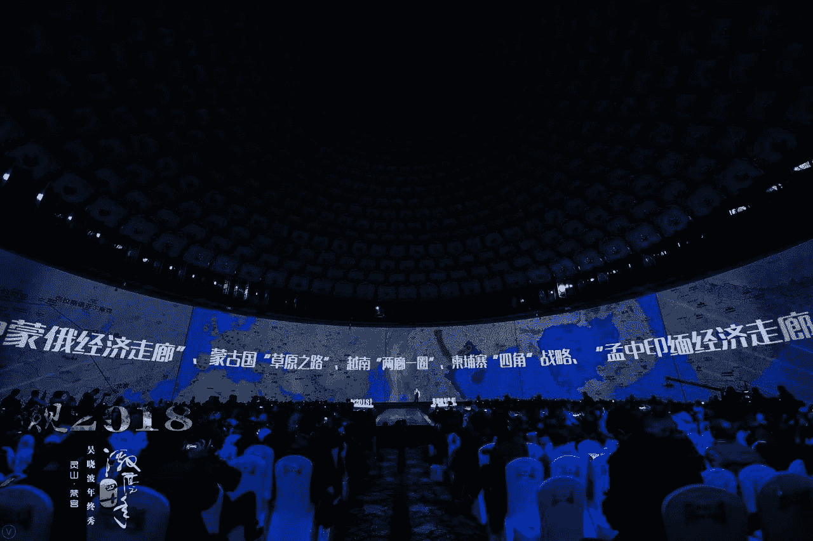

中蒙俄经济走廊，蒙古国“草原之路”，越南的 “ 两廊一圈 ” ，柬埔寨的“四角战略，孟中印缅经济走廊。中国周边的这些国家和地区比起中国，经济落后了十年、二十年乃至三十年，但这些国家正在出现新的商业机会。

所以在2018年，“一带一路”战略和中国国内的产业转型、消费升级，将形成一种呼应性关系。它会变得越来越真实，在中国经济发展和转型过程中，我们仍然会看到货币适当泡沫化，仍然有很多中产阶级在中国买不到好资产，出现理财恐慌。而其中一部分人以及这个国家，正以国家能力的方式，将慢慢形成中的人民币泡沫去干一件事情，用它去“淹没”全世界。

### 3-大城聚能中部崛起

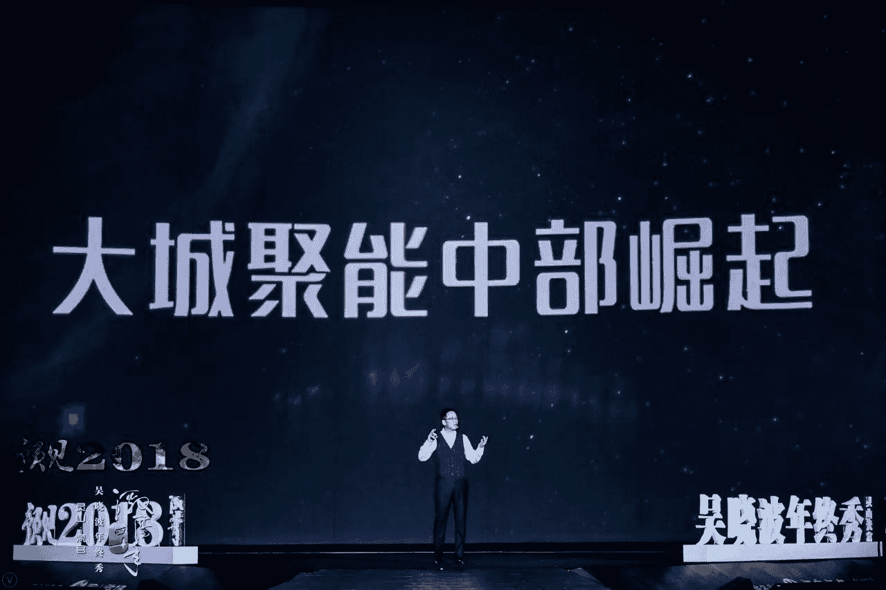

我刚写完的《激荡十年，水大鱼大》中有很多数据，其中一个数据特别惊人，今天中国高铁的里程数，已经占到了全球高铁里程数的 70% ，是中国十年前的 186 倍。

高铁里程数增长改变了人流、商品流、资本流，所造成的最大的影响是中部崛起。 中国容忍非均衡， 1980 年代开始到 2000 年的 20 年时间里，有一个国家发展战略叫东南沿海优先发展战略，大量人口、优秀人才跑到沿海地区，而中部地区没有人。

我曾经有一年到贵州去，当地一个官员沮丧地说，每年培养出很多人考进北大、清华、复旦，考进以后都不回贵阳，因为北京、上海有大量机会。但今年，我建议你回老家贵阳， 2017 年贵阳是全中国省会城市中经济增长最快的城市，是今天全中国最大的云存储基地，是今天所有省会城市中 PM2.5 正数第三的省会城市。

今天中国出现了一些城市群，乌鲁木齐、西安、成渝、昆明、深广、武汉、厦门、郑州、青岛、合肥。 中国未来 5-10 年内，会出现这些以千万级人口为基础的超级城市群，而其中很多将来自于中部地区。

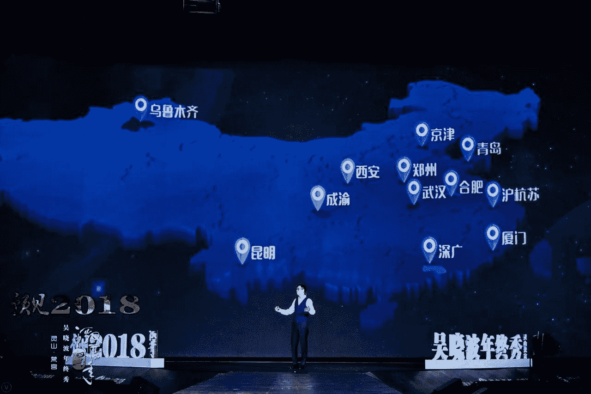

每一个企业和城市之间的关系，需要被重新定义，中国东南沿海所形成的产业和中部地区正在形成的产业优势，将形成 T 级化的结构模型。 2017 年中国人口主要吸引城市 60 强中，一半以上是中部城市。

中部崛起，中部能力的提升，东南沿海向中部地区进行产业转型，在 2018 年将呈现非常显著的特征。来自于中部城市的企业家，不必再羡慕东部的这些企业以及投资经营环境，互联网已经把信息抹平了，高铁已经把城市与城市、区域与区域之间的距离，物流的距离和人口流动的距离压扁了。中部地区的产业优势和能力以及后发效应，在未来几年里，将成为中国经济发展非常重要的一个特征。

### 4-屌丝谢幕，零售再造

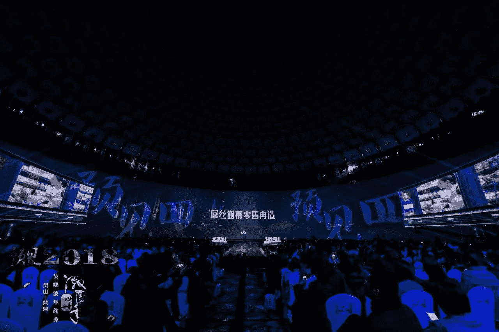

新中产在中国消费市场的能力，在 2018 年仍然会得到爆发式的增长。 2016 年 10 月，有人提出了一个概念 —— 新零售。 2017 年，新零售将会被得到最大的讨论。

2017 年 10 月，吴晓波频道曾在杭州举办过千人转型之战大课，当时讨论非常激烈，到底有没有新零售？到底什么是新零售？

当时我演讲时，我说最高兴的事情是我们已经遗忘了很多年，认为它已经处于产业鄙视链最底端的行业，零售行业、夫妻店、 7-11 、 24 小时便利店、百货店，在今天成为了中国商业界最值得投资的标的物，出现了很多新的品牌。

我们来看这个陡状增长的曲线， 2015 年、 2016 年、 2017 年，整个中国百货行业出现了高速增长，甚至在 2017 年的风险投资案例中，对大型零售超市的并购案已经发生了很多起，而且都是中国排在前几位的互联网公司展开的并购。

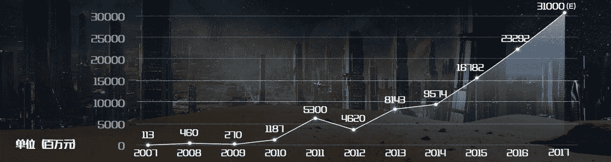

（中国百货零售业增长图）

为什么发生这种景象？很简单，因为人是真实的。今天的 80 后、 90 后、 00 后，他们能够在网上买的东西，绝对不会到线下来买。但第二个问题是， 他们会不会到线下来买？一定会， 因为每个人都需要谈恋爱，都需要放松自己的情绪，都希望有一场邂逅，都愿意在线下欢笑一次，流一次眼泪。

所以，所有线下空间存在的理由只有一条，就是它没有办法在线上简单地完成。这时候线下空间，吴声老师所提出的场景革命就开始发生了。如果所有的线下店、购物中心、超市， 仅仅能够满足购物的便利性，在未来绝大部分将没有存在的理由。

它只存在一种可能性，即满足人的体验性，当人的体验、情感和购物之间形成一种新的粘连时， 在中国地区将发生全世界最为激进、规模最大的一次零售革命。

我们今天在这里可以做一个预言，在互联网领域中所看到的中国地区的商业模式创新，在未来的两三年内，将同样被拷贝到线下零售产业，这也是为什么零售行业出现陡状增长，以及那些夫妻店在今天都变得很值钱的原因。

2017 年只是在这方面完成了一次理念的梳理，非常像 2015 年我们对互联网 + 的那场争论一样。今天我们不再讨论互联网 + ，所有的模式都已经非常清晰了。

2018 年，我们会看到越来越多的新零售模式，很可能出现的景象是，上一个屏里出现的新零售新模式会在一两年内死亡，它们有可能会从先驱变成先烈，我不知道。新的好奇，会在零售行业发生。

### 5-机器人重构制造业

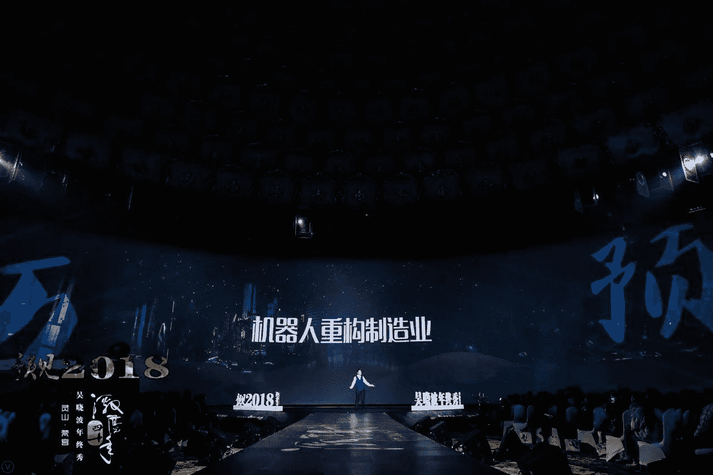

有个台湾人，在过去十几年中，他开创的企业，在中国靠人口红利，成为赚钱最多的制造企业，他叫郭台铭。中国美的员工 11 万，海尔 6 万多，而郭台铭在中国雇了 130 万员工。

三年前，他曾说，我们打算在未来五年内，用一百万机器人替代生产线上 50% 的产能。为什么？因为中国的劳动力成本不断抬高，当库克请他生产手机时，其价格还在往下压，中国的手机行业已经饱和， IPAD 、苹果电脑也在饱和。这边是劳动力成本上升，那边是终端品牌商对其压价， 只有一个办法 —— 告别中国人口劳动红利。

2017 年富士康集团生产线机器人增加了 4 万台，到了 4 万台， 40 万台就很快被实现了。在过去的几年里，以机器人为代表的工业 4.0 或生产线的智能化革命，在未来的 2018 年、 2019 年，会成为非常蓬勃的景象。

我给大家看一张脸，这是 2017 年的 10 月，沙特阿拉伯给这个叫索菲亚的人办了一张公民的护照， 这是人类历史上第一个机器人公民。

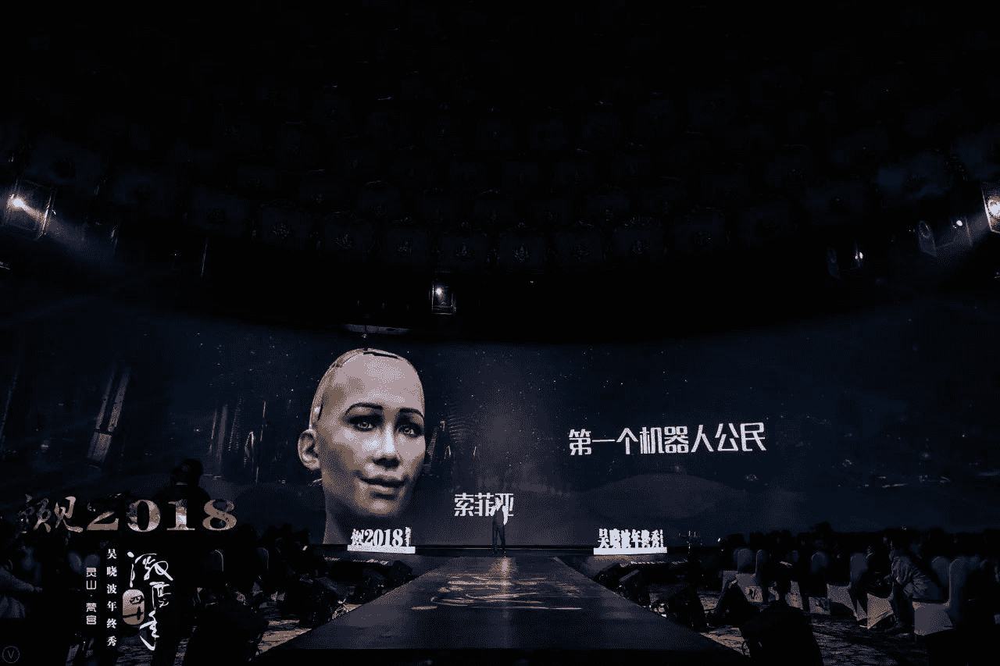

有一个好消息告诉大家，生产索菲亚的这家公司中，有中国人的基金，所以索菲亚身上流着一部分中国人的血液。中国今天是全世界做机器人最激进的国家，甚至很多产业界的朋友说，出现了泡沫。

2015 年，中国只有 458 家机器人公司， 2017 年 9 月，达到 6666 家。四年时间，增加了十几倍，巨大的泡沫。但泡沫背后，也呈现出一个景象，中国的各种机器人，从服务机器人到工业机器人，到异形机器人，都在出现无数的创新。

（中国机器人公司增长图）

中国每一次产业变革，都是这番景象，二十多年来，我看到中国从饮料行业、到保健品行业、到家电行业、到互联网行业，到 O2O 行业，到 P2P 行业，到今天的机器人行业，是同一番景象，无数的牺牲者，大把的现金，最后烧出一个新天地。

机器人跟我们每一个行业有关。我的老东家是新华社，已经有机器人在写稿了，刚才刘加隆说到招商银行已经有机器人在做投顾了，吴声老师什么时候被克隆出来也很难说。

这两年，大家有没有发觉一个景象，我们脑子里每天被很多新观念轰炸，AR、VR、基因、区块链、比特币 …… 怎么识别它们？拿手机把它拍下来，叫期望值曲线，这个曲线告诉我们，人类历史上任何一个新技术的出现，从一个人的大脑离开，经过实验室的阶段，经过产业、资本投资，最后成为我们日常生活中非常普遍的工具和技术，不是直线发展的过程，是曲线发展的过程。

我写过一本书叫《大败局》，2000 年出版，当时腾讯才创办了一年多，阿里巴巴才创办了三个月，当时中国已经出现了第一家失败的互联网企业，瀛海威，2000 年已经出现了互联网泡沫的一个破灭。

任何一个技术，都经历了技术启动，期望值高峰，然后幻灭，低谷，再接着领悟的爬坡，开始不断地盘整，最后效率的饱和，变成日常生活中经常看到的东西。

大家看期望值曲线就是 2017 年底，此时此刻年终秀时，这些数据所处在的一个状态，很多东西已经没有机会了，今天做一个云服务公司没有机会了，因为阿里云和腾讯云跟你说，我们的云服务只要 1 元钱，你已经没有机会了。

这一边已经进入到非常惨烈的状态了，大家得记住这一边，如果 2018 年有人跟你谈无人驾驶、人工智能、区块链、人类永生。记住，他们一半以上都是骗子，大规模的泡沫和骗子存在的地方，你要知道人人跟你谈人工智能，中国地区每年人工智能行业毕业生加在一起 300 个人，没有那么多的人才供给，都处在一个泡沫阶段，但是这个泡沫代表了什么？代表着技术的未来。通过这张图，我们对今天所处在的技术变革的现阶段会有更清醒的认识。

## 6-5G商用想象物联

2018 年，有一件事情肯定会发生，5G 的商用标准会被公布。我们今天的手机都用 4G，5G 的速度是 4G 的 20 倍。5G 的流量运转速度是 4G 的几十倍。意味着在过去几年里，智能手机发展到今天，已经进入到了饱和期。

100 个人里 97 个人有手机，2017 年的手机产量跟 2016 年相比，基本上是没有任何增加。怎么办呢？我们今天买手机，马路上看到手机广告，它没有跟你讲这个手机怎么好，就跟你讲这个手机拍照拍得很漂亮、很清楚，你认为它是在卖手机还是在卖照相机？

（2010-2017智能手机增长销量图）

因为手机的核心能力部分芯片能力部分在 4G 环境下已经走到极致了，手机制造商只能告诉你，我用陶瓷做外壳，手机的摄像镜头像素是 1200 万，是 2000 万。整个行业已经饱和了，亟待一次技术的变革。2018 年，整个手机行业会面临一次毁灭性的重整。

当 5G 商用出现时，它将改变社会，当传输速度增长 20 倍时，你在网上手机上看一部电影，几乎不需要任何成本。远程视频、电话会议直播，都没有问题。你直接控制 2000 公里以外的机器人，实时性不再成为问题，无人驾驶汽车的语音识别和场景识别也不再成为问题了。

所以，5G 商用的背后，是一个去中心化的万物互联时代的开始。也许，到 2018 年的某一天，有专家会说，2018 年是人类万物互联的元年。

2017 年，高通芯片一个月的生产产能是 1 亿只左右，也就是说每一年大概有 12 亿台设备被互联起来。随着 5G 商用，各种新的应用空间和想象将被重新发现。当这些事情发生时，会面临什么问题？有一些看上去已经死掉的行业，比如衬衫、冰箱、空调、洗衣机，将重新全面复活。这是在 2018 年有可能出现的新的端倪。

## 7-上市提速，创业降温

2015 年、2016 年、2017 年，中国上市公司数量持续增长，2018 年更多好的健康的公司通过 IPO 直接上市的可能性会越来越大。这对所有做实体的企业家是一个巨大的好消息，做好的公司，跟投机告别。

（2015-2017中国上市公司数量增长图）

但同时我认为在 2018 年会出现的一个景象是，已经烧了三年烈火的创业热潮有可能降温。

四个原因：第一、专业门槛越来越高。2013 年，广东省共青团请我去讲课，跟我讲了一个数据，100 个大学本科生创业，97 个在送外卖。你爸妈花了钱让你读化学、英语、物理，但你跑去送外卖。今天我给你 100 万，让你开外卖公司，你敢开吗？那些基于商业模式创新的移动互联网，互联网的创业，已经彻底结束了，TMT 时代彻底地结束了。

第二、流量成本陡增。所有的创业更加基于商业和内容的生产能力，管清友说人会变得越来越贵，是那些有野心的专业能力的人会变得越来越贵，专业门槛在提高，流量成本越来越高。所以你无论在线下开零售店，还是在网上开淘宝店，流量成本已经变得越来越高了。

第三、技术替代模式。第四、风险投资务实。

所以基于这四个原因，2018 年所有创业的人，要把心更踏实下来，跟中国产业经济每一个行业所发生的景象一样，创业也需要冷静，需要去泡沫。

## 8-足球街舞文娱狂欢

2018 年可能是很多男生要彻夜难眠的日子，因为俄罗斯世界杯要举办了，韩国要举办冬奥会。所以很多姑娘们要很伤心，要自己出去玩了。足球、体育产业，2018 年会迎来一个好的春天。

同时，今年有一个嘻哈热，2018 年的嘻哈会变成一个更具有运动性的产品，叫街舞。2018 年我们除了看老太太在跳小苹果以外，旁边肯定有一帮人歪戴了一个帽子在跳街舞。不要感到很吃惊，2018 年一定会看到这样的景象，因为所有的视频网站和电视台全部在放街舞的真人秀节目。文化娱乐行业未来仍然是创业和资本投资最好的领域之一。

以上是我对 2018 年的简单预测，我们即将进入新的一年。2017 年我们告别所有的过去，有时候会有一点小遗憾，有时候会有小确幸，有时候会有小惊喜。但无论如何，我们的生命再也不可能踏进 2017 年的河流了，我们永远地告别了 2017 年。

但在告别的同时，我们看到了一个新的更辽阔的时间正在展开。2018 年，让我们一起重新定义美好生活。

`https://aigcreative.feishu.cn/sync/K4Gvd9vUQsy9Oubwqaeclu0Fnbg`
