# 吴晓波：预见2016（演讲全文）

> 来源：[https://aigcreative.feishu.cn/docx/VvQPdBOFxoA308xo5t1cFoVlnUd](https://aigcreative.feishu.cn/docx/VvQPdBOFxoA308xo5t1cFoVlnUd)

> 🔗 原文链接： h[ttps://mp.weixin.q](https://mp.weixin.qq.com/s/jbNa51zrz45vbZ1Msdch9w)q.com/s/jbNa51zr...

**今天**的中国是一个特别有趣的商业国家，我们的钱和投资主权掌握在60后、70后手上，创业主权掌握在80后手上，消费主权掌握在90后手上，娱乐主权掌握在00后手上。 这是“五世同堂，各得其乐”的年代。

本文根据吴晓波频道年终秀现场演讲整理

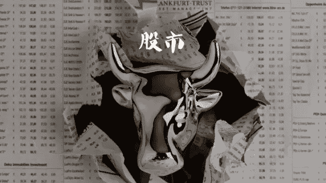

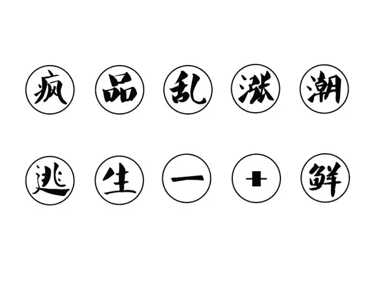

据说一个国家的股市是这个国家经济的晴雨表，这句话在我国好像不太适用。 中国的股市是一个国家经济的变压器。 2015年，实体经济并不好，但是它的表现并不像上证指数的走势一样跌宕起伏。今年的股市表现，实际上是虚弱的实体经济和强大的国家意志之间的一次激烈博弈。

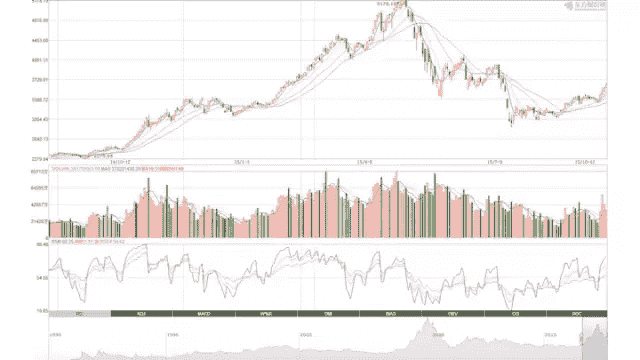

上证指数从2014年10月的2200点，仅8个月就翻番攻到5100点，再掉头千股跌停，然后再强制趋稳，这是财富重新分配的“山谷图形”，也是某些中产家庭资产的“坟墓曲线”。

在2015年，中国改革的倒逼特征，仍然非常明显， 股市通过一场外科手术结束了暴跌暴涨，而种种制度性的利好也在危机中被释放出来。

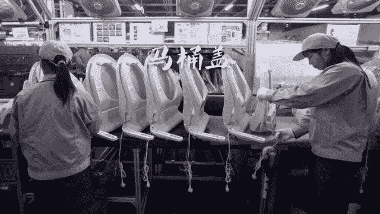

2月份我带20多个蓝狮子高管到日本开年会，回来的时候他们疯狂购物，在那霸机场堆了一个小山。于是，我在回来的飞机上写了一篇文章叫做《去日本买只马桶盖》，文章写完发布后当周有252万点击量，然后面临了一个非常大的讨论和争议。

它的背后是什么呢？ 其实是我们的实体经济企业家对自我的一次理性拷问。

实**体经济在2015年经历了重大挫折，企业家们第一次非常谦虚地**思考，互联网和消费升级对我们意味着什么。所以， 2015年其实是中国实体经济“互联网+”开始的一年， 也是中国中高端制造业开始进行自我革命的一年。

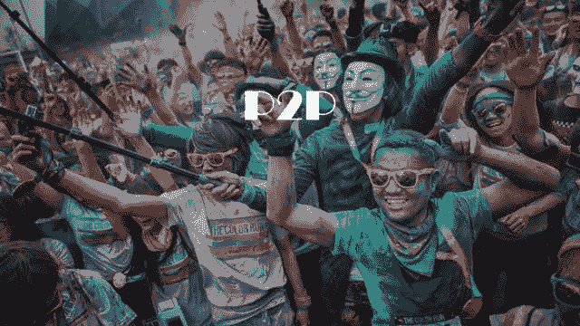

“乱”是贬义词，也可能是一个褒义词，它说明在某一个领域中，人在冲进去，资本在冲进去，新的模式在诞生，但新的危险也在聚集。最近几年，中国有些产业出现了以千亿资本为规模的乱象，比如四年前的团购大战，两年前的O2O大战，今年就是P2P大战。

从2014年7月份开始，每个月大概有100家P2P公司成立，到现在累积总数已经超过3800多家，贷款余额8000亿左右，400万中国消费者参与其中。 P2P在2015年的狂飙式发展是一个现象级事件， 它说明一个非常僵硬、长期被国有资本控制的金融体系遭受到了3000多家大大小小民营机构的冲击。同时，因为监管的缺失，它也是2015年最混乱、亟待制度性建设的行业。

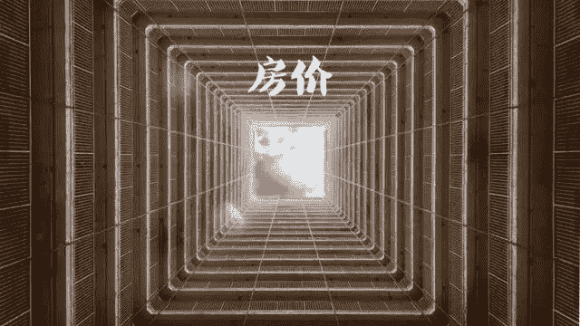

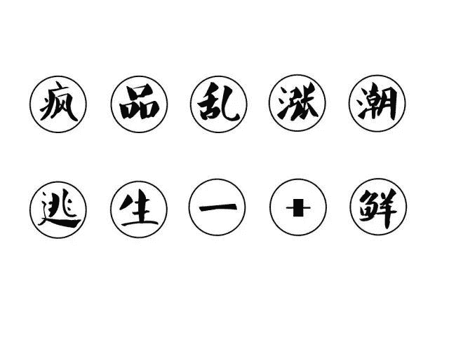

今年特别是下半年以后，房价突然开始成规模性地上涨了，我认为代表了三个意义：

第一，由于整个政府对资产泡沫的内在需求性以及股票市场大规模跌荡， 房地产特别是中心城市房地产重新成为中国中产阶级投资的重要战场， 中心城市不动产投资性价值在2015年被重新发掘。

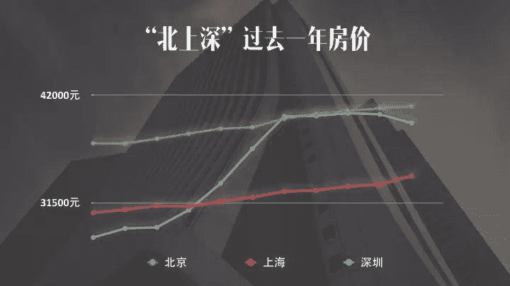

第二，城市化进入到中期后，中央政府提出“城镇化”概念。但今年景象刚刚相反，人口、资本都在往超大型城市迅猛聚集， 2015年中国城市化进入到了非常矛盾的十字路口。

第**三，相当长的时间里面，中国实体经济、资本市场**起起伏伏，但有一个数据一直在稳定增长，就是城市土地出让金价格。 今年下半年不动产上涨，一方面是居民投资的避险性需求，另一方面则是政府有力推动的结果。

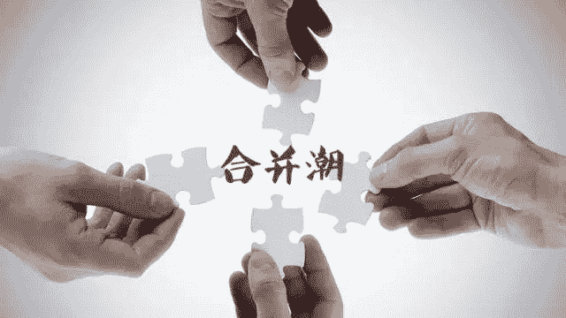

产业经济学上说，一个行业萌芽和爆发增长的时候，群雄并起，拼命**厮杀。但成熟了、外延发展红利被吃**光时， 企业一定会通过并购的方式来保卫利益，这也就意味着这个行业的转折点到来了。

O2O领域从三年前开始出现大规模战争，到今年我们看到了快的与滴滴合并，携程与去哪儿合并，美团与大众点评合并，赶集与58合并，这些百亿级并购说明“互联网+信息服务”和O2O领域已经进入行业的成熟期， 互联网对传统服务行业的战争，不再会有大的商业机会诞生。

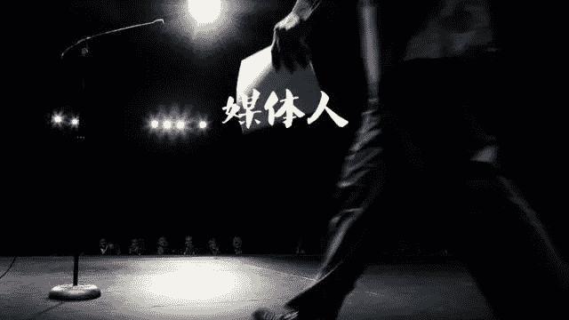

今年所有的行业里，最恐慌的是媒体行业，传统媒体遭受到史无前例、也很可能是不可逆的一次冲击。我的一位老同学，1990年大学毕业以后跑到了南方，花了13年时间把一份杂志由民工杂志变成了中国最好的政经杂志，然后他在上海花了12年做了中国最好的财经日报，今年6月份他也离开了这个日报。当时我很感慨，写了一篇《最后一只“看门狗”也走了》。

最近我们看到很多媒体消亡，很多优秀的媒体人要么永远离开媒体行业，要么成为新媒体人。在这个意义上， 2015年是中国媒体革命非常剧烈的一年，旧世界崩溃的声音非常响亮。 我们举办这一场年终秀，本身就是新媒体的一个尝试，现场、爱奇艺视频前以及全国500个咖啡馆看直播的每一个年轻的朋友，其实都是这一场媒体变革的参与者。

有观点认为：2015年后中国经济将进入长期衰退的通道。我不能认同这样的观点，我认为只要两件事在发生着，中国经济一定不会崩溃。第一，当我们离开这个会场走到马路上，举目仍然可以看到脚手架，这说明中国的城市化进程还在继续。第二，你冲进任何一家咖啡馆， 如果你看到年轻人还在谈创业，这个国家就有希望。

中国现在每年有260万80后、90后创业，今年全国举办了30万场创业沙龙，还有1000多个城市的3200个创业空间，中国仍然是一个创业天堂。

同时我们还看到一些值得担忧的事情，每年几百万年轻人构筑中国创业长城，但效率不是很高。有机构在广东调研，发现广东大学生创业，70%在送外卖；另外社科院数据显示，大学生创业三年内的失败率达到了97%。 这两个数据说明，未来几年如何提高创业者的创业效率，是值得关注的话题。

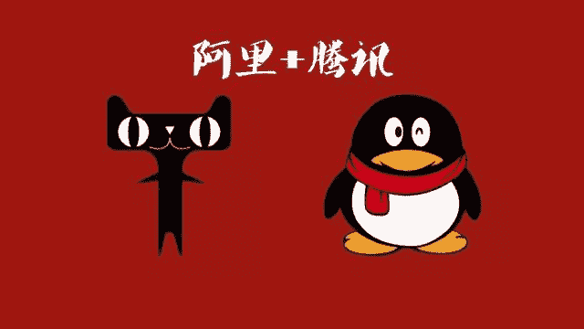

2015年有人看似要一统天下了，一只猫还有一只企鹅，分别从电子商务和社交两个领域逐**渐控制了我们的信息和交易。他们两家都是巨大的上市公司，手**握的现金有上百亿美金。 2015年，两家企业进行了大规模的参股、并购等行为，下面这个图大概仅仅是他们今年并购的五分之一。

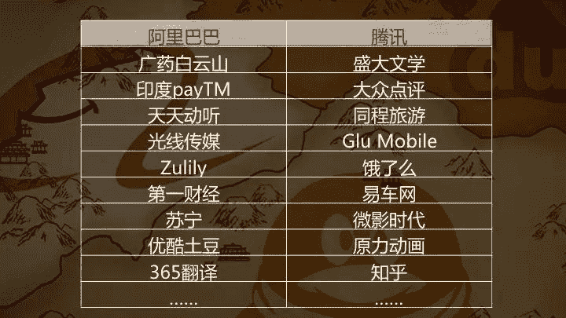

中国人现在用的最多的10个移动客户端里面有8个，要么是属于阿里系的，要么是属于腾讯系的，而如果在三年前，他们两家加在一起的数据应该不超过4个。

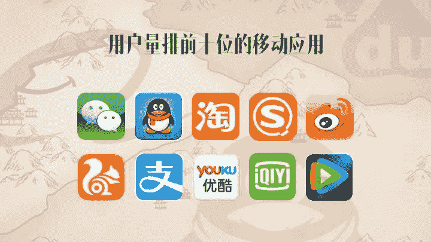

今天，摆在中小型企业面前的问题，是 如何与帝国级别的阿里、腾讯处理竞合关系，如何进行一个突围式的创新。

还**有一个问题在2015**年也被认认真真端到了台面上，这是所有人，包括政府、学界、中小企业、甚至阿里腾讯自己都要思考的，那就是 如何面对垄断的诞生。

“互联网+”在今年真正成为了实体企业家认认真真、心悦诚服思考的问题，那就是如何利用信息化革命的思维、模式、工具对内改造所有的生产要素，对外改善我们和消费者之间的关系。

怎么来完成这次转型，是2015年非常重要的话题，今年吴晓波频道在深圳、上海、佛山各举办了千人级的转型之战课程。我们请到一些传统行业出身的企业家，开洗衣店的、做家居的、开百货店的等等，他们在两年内进行了卓有成效的转型，我们把他们叫做转型家。这种交流在2015年刚刚开始， 在未来的五年内，每一个传统企业的当家人都要让自己变成一个转型家。

小鲜肉大概是2015年被使用非常频繁的名词之一。我在2014年12月才知道鹿晗，今年2月份我写过一篇文章《知道鹿晗的请举手》，之后每次出去演讲都会做这样一个调查，最初知道的比例不到15%，如今，已经很多人都知道鹿晗，甚至知道TFboys。

今天的中国是一个特别有趣的商业国家，我们的钱和投资主权掌握在60后、70后手上，**创业主权掌握在80后手上，消费主权掌握在90**后手上，娱乐主权掌握在00后手上。 这是“五世同堂，各得其乐”的年代，消费的层次非常丰富，变革的可能性变得非常不确定性。

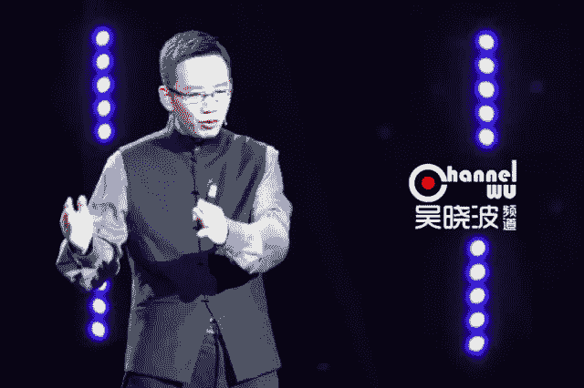

**

我认出风暴而激动如大海**。

**我舒展开来又蜷缩回去，**

**我挣脱自身， 独自**

**置身于伟大的风暴中。**

**——里尔克《旗帜》**

## **1****-中国新中产消费的元年**

2015年，吴晓波频道做过的、最冒险的一件事，就是反屌丝和反对屌丝经济，这跟很多互联网思维的说法是相反的，很多人认为，互联网经济就是“得屌丝者得天下”。

10**月份瑞信曾经发布一个数据，当今中国有成熟购买能力的**消费者是8亿人，其中6亿人是屌丝，另外2亿人中的一大半，也就是1亿以上属于中产阶级。这些人是在最近几年才渐渐成为了中国主流消费的人群。 消费升级的可能性，是因为在需求端，出现了亿级中产消费阶层，2016年将是新中产消费的元年。

所以当今中国所有的商品供应者、创业者，当你开始进行商业活动的时候，你首先要问自己一个问题：你是为谁服务，整个大市场已经被瓦解掉了。现在整个中国消费人群分成两批，一批是屌丝经济，一部分是中产经济。中产经济和屌丝经济最大的区别我认为有三条：

第一，这一波是 **理性 **消费者。

第二，他比较相信 **品质 **，他不太相信价廉物美。

第三， **圈层 **化。

这可能是中国消费升级最大的一个福音，我觉得这是2016年我们即将看到的一个景象。

## **2****-金融商业时代的开始**

过去的36年是产业商业时代，中国的创业者、企业家通过做出版社、家电、冰箱等等赚钱，所获得的利润大部分是由产业盈余产生的利润。

到了2015年，经过了资本市场的市场化、多元化改革及激烈的资本泡沫期以后， 我们将进入一个新的金融商业时代。 互联网金融、保险、理财产品等各种资产组合会大幅提升家庭理财的水平。

对企业**而言，尽快地让**自己的公司、产品及服务证券化，是一个趋势，并购将成为企业发展的重要方式之一，另外还有新三板和战略新兴板，明年底我们来参加“年终秀”，新三板可能会超过8000家。 股权投资，应该会成为中国中产阶层最重要的财富增长的点，从此，中国会出现非常庞大的阶层， 叫做食利阶层 。我们每一个人都要给自己上一个新的金融课，因为整个市场将发生非常大的变化。

## **3****-社群经济将大行其道**

中国经历了三个大的经济型态的演进，从计划经济到商品经济，再到市场经济，如今可能出现了新的型态。

从计划经济到1980年代的商品经济，是劳动效率的提高。1992年以后搞市场经济，是通过大规模的市场营销运动来获得利润，在互联网前时代它是一个商品通过营销找到人的过程，而即将到来的社群经济是从人到物的过程。今天什么叫社群经济？社群经济在现场我们有一千人，在全国有一百万人，这群人聚集起来以后，我们再来问自己需要一个什么商品。社群经济的崛起，这可能是2016年即将开始的非常重要的事件。

马化腾说未来的互联网是什么，左边内容，**右边连接， 我愿意在中间加一个**东西，叫做价值观。 社群就是因为价值观而有了区隔群，当这些价值观被确认之后会出现无数的商业模式。 社群经济就等于“圈层+电商” ，这样的概念在几年前根本没有出现，因为整个支付、商业模式没有形成。所以，2016年将看到的非常重要的事情是，社群经济将成为一种新的看上去每一个都非常小而美的商业实验。

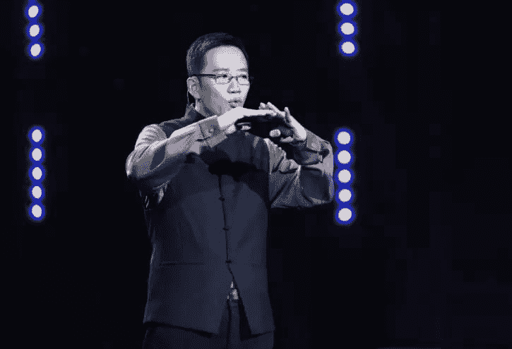

## **4****-体育营销将热浪扑人**

体育经济是体验经济的一种。2016年有两个非常重大的体育项目将举行，第一个是奥运会，第二个是2018年世界杯预选赛。而恒大刚刚绝杀了墨西哥的美洲队。

2015年无数的资本跑到全世界购买最好的体育资源和体育公司。所以，随着整个中产阶级的崛起，人们的精神消费将极大的丰富，而精神消费中体育将成为刚需。所以2016年的体育产业将进入到爆发时期。

## **5****-传统企业将加速淘汰**

我今年到很多地方，都听到实体经济非常困难**，这样的困难不是结束了，而是刚刚开始。 未来五**年的“十三五”规划期中，传统制造业和传统服务业企业中的80%的人将集体被淘汰。 中国未来创业者是替代式的变革，是一个新的人、新的商业模式、新的资本对旧的人、旧的商业模式和旧的资本的一次革命性替代。

11月份中央提了一个新概念， **供给侧改革 **，这是1992年以后第一次重新把注意力由需求端放到了供给端。中国不是商品不够，不是没有购买力，但是为什么商品卖不掉？原因是供给、需求错配。怎么办？在需求端推动没有用，要把落后的产能加速淘汰，然后用大量资本扶持具有创新能力的中小企业。

中国经济没有崩溃掉，中国的改革信心没有丧失掉， 未来是理性创业，野蛮成长时代将在2016年结束。 那些讲概念、玩花样，做题材的创业者将离开中国产业的下半场。各位如果我们有一个好的商品，有一个好的产品，有一个好的服务，你一定在中国可以找到一个好的资本和好的消费者帮助你走的很远。

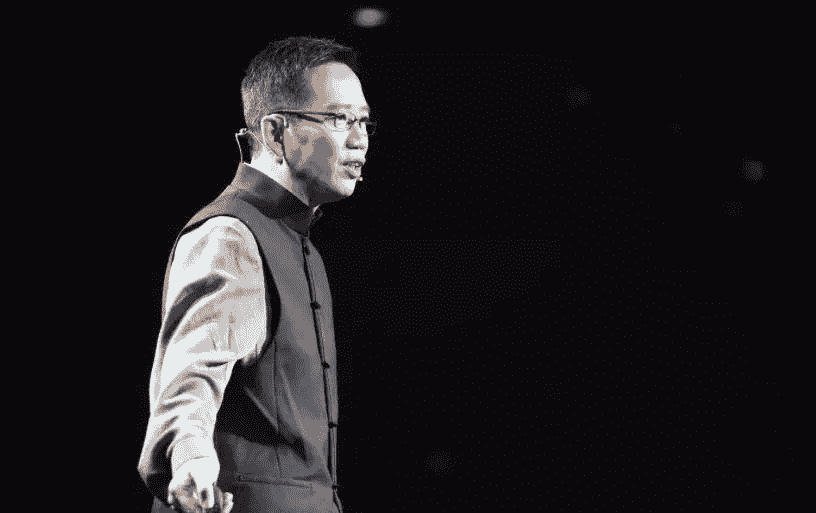

## **6****-跨境电商将破解TPP**

从1998年开始，中国完成了从内贸型经济转向外贸型经济，外贸老板经历了黄金十年，但是从2008年以后中国的外贸经济垮掉了， 2015年宏观数据里面最难看的就是外贸数据。

从今年开始我们看到了产业层面发生了变革，3月份国务院批复杭州成为唯一跨境电商综合实验区，因为杭州有阿里巴巴。过去一年里面，我们看到在商务部，在杭州市，在阿里巴巴这些企业的努力之下，我们形成了一个新的跨境电商的平台。这次杭州跨境电商综合试点，所有的政府部门的服务全部在一个窗口进行，这个改革实验基本已经完成。当所有的信息在一个窗口出现的时候，就代表着我们 未来的外贸平台将涉足到交易的内部，大数据将是交易平台的新驱动力。

**2016年有可能成为中国制造重新出**发的一年， 如果跨境电商平台的规模能达到2000亿，三年内中国的外贸经济将焕然一新， TPP这样基于政府层面的合作框架将被中国几十万家的企业像蚂蚁一样吃掉。

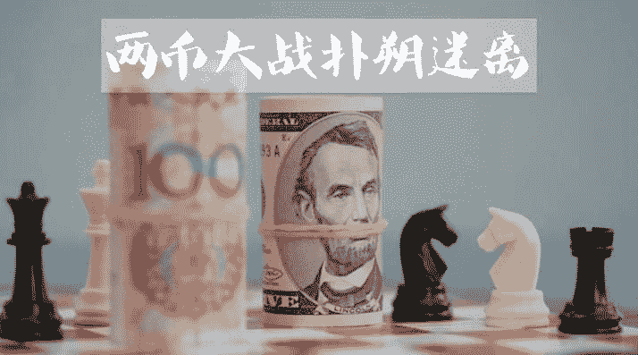

## **7****-两币大战扑朔迷离**

在全球货币纷纷对美元大幅贬值的大环境下，2014年，人民币对美元贬值2%，2015年为约4.5%，在全球范围内还是相对比较坚挺的货币。但是这个月底，美联储将考虑要不要加息，97%的经济学家说加息是大概率事件。那么 2016年，人民币和美元之间的竞争关系将变得非常敏感和非常的尖锐。 随着我们的跨境电商战略实施，中国外贸可能在未来几年内得到复苏机会，而美元升值会让之间的博弈非常不确定。

人民币资产的配置和美元资产的配置是一个我们需要重新学习的问题，我们一方面要享受中国经济成长所带来的福利，同时我们也要学习享受人民币在全球范围内跟美国博弈所带来的福利。

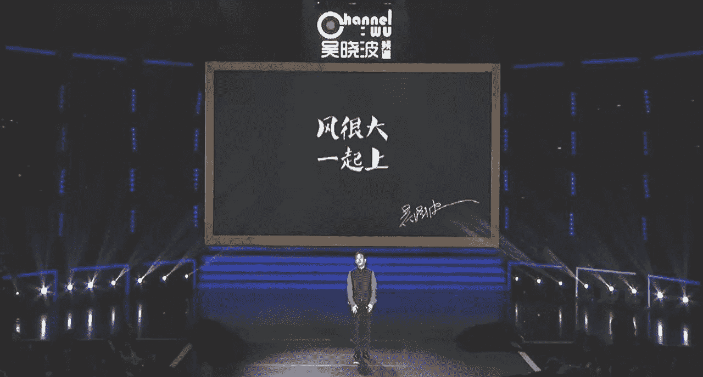

## **8****-可穿戴技术方兴未艾**

互联网经**济很长时间被叫做虚拟经济，但今年互联网经济已经**不再是虚拟经济，它首先冲击的是购物，然后冲击了服务，再接着冲击了金融，最后冲击了实体经济。互联网非常鲜明的、阶段性的对整个产业经济形成了碾压，并将从一个虚拟经济变成一个新的实体经济。我们在2016年会看到硬件革命，今年我们发现有很多的企业在进行这方面的实验。移动应用会大规模地丰富， 可穿戴设备在2016、2017年的某一个时间点以某种方式最终改变了我们所有的商业生态。

2016年，我们面临着重重困难，中国经济有可能继续在下滑的通道里面——我们所谓叫做新常态的通道里面，广大的传统制造工厂、服务企业的苦日子远远没有到头，甚至仍然暗无天日。

但是我们同时看到了新型的中产阶级已经崛起， 新的消费能力正在诞生，无论内贸还是外贸都存在着种种可能的变革性， 所以我们说风非常大，就如里尔克的那句诗歌： 我认出风暴而激动如大海/ 我舒展开来又蜷缩回去/ 我挣脱自身， 独自/置身于伟大的风暴中。

<https://aigcreative.feishu.cn/sync/K4Gvd9vUQsy9Oubwqaeclu0Fnbg>