# 王煜全前哨大会2025：下一个10年，只有2类人

> 来源：[https://aigcreative.feishu.cn/docx/LCAidtktsopV2Mx9pFbcHjD7n2e](https://aigcreative.feishu.cn/docx/LCAidtktsopV2Mx9pFbcHjD7n2e)

> 链接： [https://mp.weixin.](https://mp.weixin.qq.com/s/eHhEKo9UqP9TJa5IjCwPqA)qq.com/s/eHhEKo9U...

> 来源：👸号：笔记侠

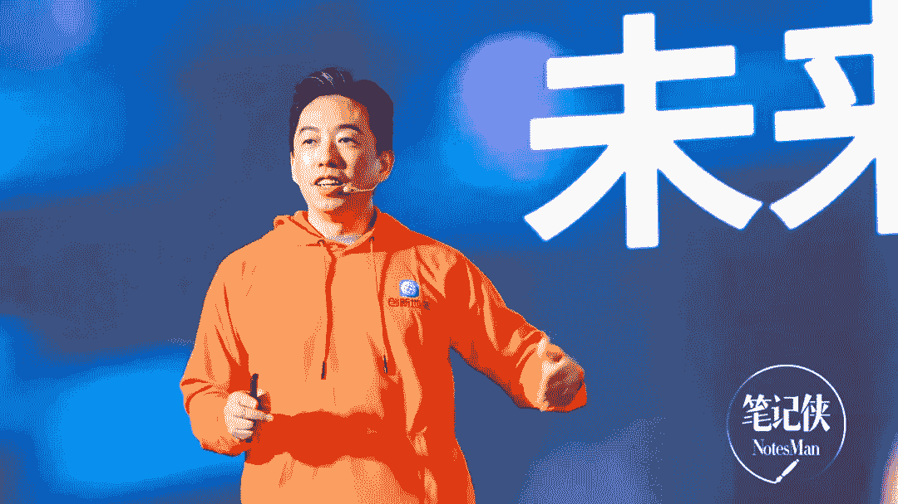

---

**内容来源：** 2025年11月15日，2025前哨大会。

**分享嘉宾：** 王煜全，科技投资人、AI创业者、全球科技创新产业专家。

**高级笔记达人** | 李云 明月

**责编** | 柒 **排版** | 拾零

第 9280 篇深度好文：18204 字 | 46 分钟 阅读

## 商业趋势

**笔记君说：**

“三个码农，干十个码农的活。”这已不是未来预言，而是当下正在发生的现实。

美国七巨头 （苹果、 微软 、谷歌母公司Alphabet、亚马逊、英伟达、特斯拉和Meta） 利润暴涨的同时，大规模裁员的消息不绝于耳——AI带来的效率革命，其残酷性正直接体现在就业市场的结构性变革上。

我们仿佛正站在一场由AI引发的“物种大灭绝”前夜。

历史告诉我们，每一次大灭绝之后，必然伴随新物种的大繁荣。

当AlphaFold摘得诺贝尔奖桂冠，当AI Agent的能力以月为单位飞速进化，真正的核心问题浮出水面：在这场颠覆中，我们是成为被动的旁观者，还是主动的进化者？

人类百万年的进化史，第一次从“被动随机”转向“自主引导”。这要求我们不仅要会用AI工具，更要深刻理解AI如何重塑产业生态 （“人工智能+”） 、优化决策模式 （认知智能） 、并催生从“产品交易”到“交互服务”的全新商业模式。

本文根据王煜全2025前哨大会整理，内容有所删减，希望对你有所启发。

大家好，我是王煜全，欢迎来到 2025前哨大会，今天我们的话题是“刻意进化 ” 。

首先我们需要面对一个真实的问题： AI的到来，对我们产生了非常深刻的影响。

好消息是 AI将带来一场技术革命，不仅渗透到我们的生活，而且渗透到我们的工作当中，我们的工作越来越多地运用AI。

坏消息是革命也有巨大代价，在提升效率的同时要注意到效率提升不够快，可能就会被淘汰。

那未来到底是什么样的？我们需要认真对它做探讨。

## 一、认知破局：看懂时代巨变的“韵脚”

看清历史，需要具备足够宏大的视角。

我们非常推崇马克 ·吐温的那句名言：“历史不会重复，但会押韵。”

### 1. 先有大灭绝，后有大繁荣

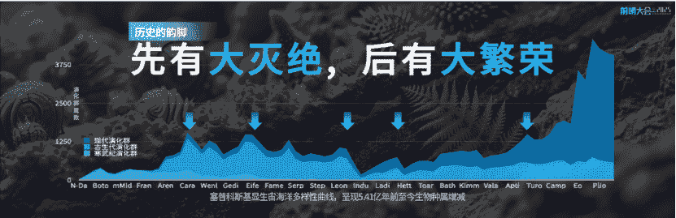

我们都知道，在生物历史上曾发生过五次被称为 “大灭绝”的事件。

结果发现一个有趣的现象：每次大灭绝都会导致 80%-90%的物种灭绝，但当灭绝事件结束后，若能度过这场灾难和危机，物种在灭绝后的1000万年内基本上都能恢复到先前的物种丰富程度。

这意味着灭绝之后是大繁荣。

**首先，生态位会被填满。** 当自然环境保持稳定时，任何一个空白的生态位最终都会被生物占据。只要给予足够长的时间，无论是生物、动物还是植物，都会遍布各个角落。

**其次，会出现巨变。** 无论是小行星撞击地球，还是火山爆发，或是氧气含量过高或过低，总之会引发一系列严重的灾变。

以恐龙灭绝为例。小行星撞击地球，导致太空中弥漫着大量粉尘，这种污染使阳光无法穿透，地球连续三年不见阳光，进而导致地面植物大量死亡。

随着氧气急剧减少，恐龙这类庞大身躯的生物无法得到足够的能量和氧气，最终无法支撑而灭绝。

**第三，另一个物种繁荣。** 在恐龙灭绝后的 1000万年，一个原本相对弱小的动物群体——哺乳动物，它们随着恐龙的灭绝，获得了成长的空间，实现了大规模的繁荣，体型也变得越来越大。

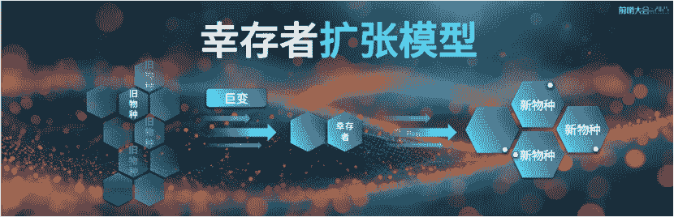

**第四，占领生态位。** 众所周知，所有这些灵长类动物之所以能够繁荣昌盛，正是因为它们迅速扩张，占据了曾被恐龙统治的生态位，从而塑造了我们今天所见的这个世界。

**事实上，技术变革也是如此。**

当技术冲击来临时，物种灭绝的速度与新生物种扩散的速度，若以曲线模拟，它们非常相似。

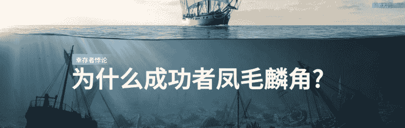

我们不禁问：既然已知晓自然界会发生大灭绝，而人类历史上也经历了诸多技术进步，尤其是自工业革命以来，技术革命的速度不断加快，为何我们仍难以把握其规律？

事实上，大多数情况下，我们很多人不能成为赢家，我们不是幸存者。

### 2. 未来的赢家，必须成功通过“三重洗礼”

想成为赢家，首先解决的是：谁才能成为幸存者？而要成为幸存者，则需要明确生物幸存者与技术幸存者之间的区别。

#### ① 生物幸存者与技术幸存者区别

在生物层面和技术层面，这两者有明显的不同。

#### 第一，生物幸存者

生物成为幸存者的关键在于其淘汰因素，主要来自外部环境。所以，要成为幸存者，必须具备更强的环境适应能力。

以哺乳动物为例，在恐龙时代，哺乳动物想要成为幸存者，只能卑微地生活在山洞中，昼伏夜出，小心翼翼地隐藏自己，否则稍有不慎就会被恐龙捕食。

#### 第二，技术幸存者

在技术社会中，有一个显著特点， 当新技术出现时，旧技术会彻底被淘汰。

也就是说，如果你停留在旧技术阵营，将没有生存的机会，注定会被淘汰。

真正的幸存者是那些在新技术出现时迅速崛起的新企业中的一员。因此，你首先要站在新技术这一边。

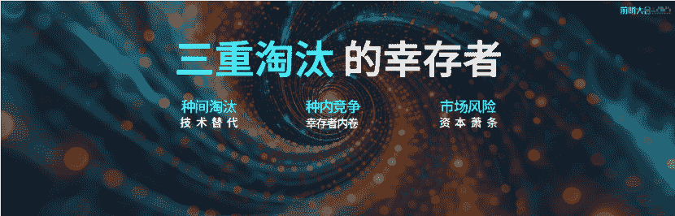

#### ② 三重淘汰的幸存者

生存不是一次过关，而是连续闯关 。

幸存者要经历三重洗礼， 我们以汽车产业为例。下图为汽车产业变革过程中的数据表现。

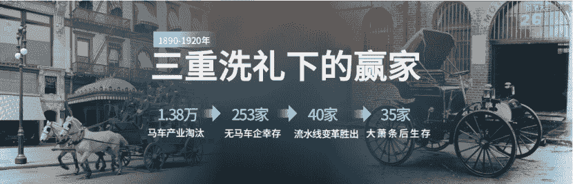

第一重洗礼，源自物种间的竞争。

掌握了新技术的新物种必须淘汰那些固守旧技术的旧物种，这构成了完整的物种间竞争，正如汽车取代马车的历史。

在工业革命早期，尤其是在流水线问世之前，汽车尚未形成行业，只有马车构成了一个复杂的产业体系。当时马车作坊的数量多达 1.38万家，原因在于生产效率普遍低下，大多是小作坊式的生产模式。

**第二重洗礼，是物种内竞争。**

随后，汽车行业兴起，从奔驰开始，众多企业学会了造车，尽管当时涌现出 200多家企业，但它们全是新兴企业，这些企业完全是新技术催生的产物。

那这些新兴企业是否都能存活下来？答案是否定的。最终的胜出者不仅拥有新技术，还具备新理念和新模式。

我们一直强调，技术如同坦克，但关键在于打出闪电战。新技术是造汽车，而新模式，即闪电战，便是流水线。

之后， 1913年福特推出流水线模式，一方面加速了马车产业的淘汰，另一方面也导致大量未能迅速采用流水线的汽车企业被压缩。

观察时间表可见，企业数量从 253家减至40家，这便是我们所说的第二重洗礼，即种内竞争。

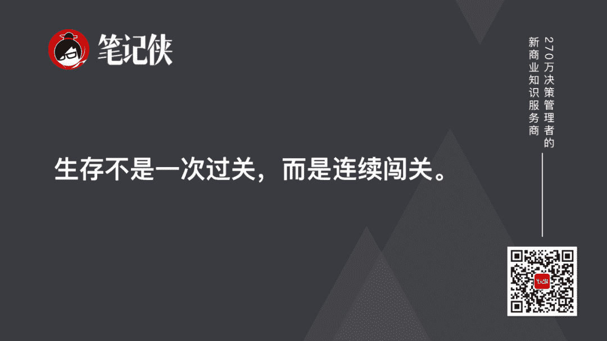

**第三重洗礼，是金融风险考验。**

当人们意识到流水线可大规模制造新产品时，资本市场便出现了问题，对未来的过高预期导致了追涨杀跌的“郁金香花球事件 ” 。最终， 1929年股市崩盘，只有在大萧条中幸存的企业才拥有未来。

表面上看， 40家企业中有35家存活下来，但存活的质量各异，有的勉强维持，有的资金充裕。若继续追溯，便会发现并购新潮流的出现，最终仅剩几家巨头，如通用、福特等胜出。

所以，技术革命总会伴随资本泡沫，只有抵御住泡沫破裂的冲击，才能笑到最后。每一次技术革命都遵循这个规律， AI时代也不例外。

综上所述，每次技术革命，尤其是大的技术革命都可见到三重洗礼。这与大模型、自动驾驶相似，这正是回顾历史的原因。

### 3. 你的选择：相信概率还是规律？

#### ① 生物进化是概率

我们知道，基因突变都有可能发生，物竞天择，老天爷会选择那些能存活下来的个体。

老子曾言 “天地不仁，以万物为刍狗”，意即天地对万物并无情感，所有发生之事皆不在意，最终总会有赢家。

所以，生物进化这是一个概率事件。

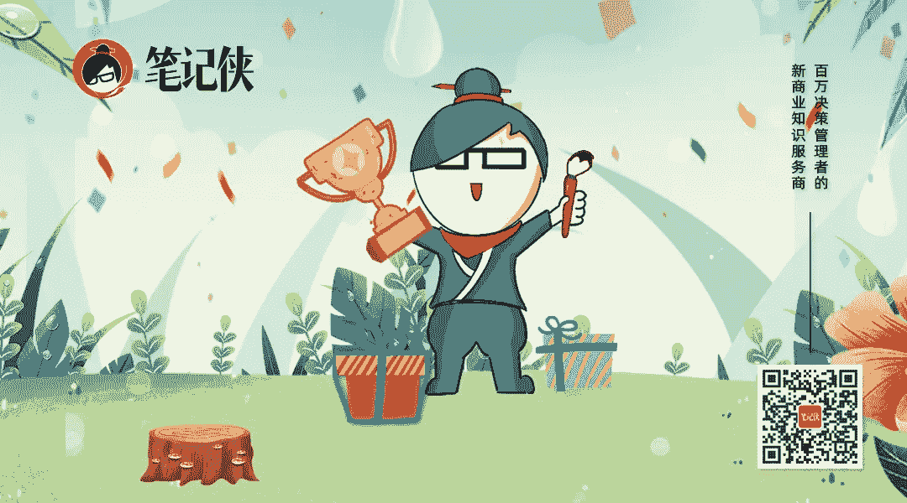

#### ② 人类选择讲规律

人类不是这样，不愿意随机行事、成为自然选择的一部分，希望所有的行动都有所方向。

在自然界所有动物中，唯有人类能总结规律，并按规律去办事。

我们生而为人，需要发挥作为人最优秀的品质。

#### ③ 新范式：刻意进化

人类进化不是生物进化、自然进化，不是物竞天择、适者生存，而是主动适应技术发展方向，这种属于技术与文化的双向选择。

文化是可以传播的，当他人文化更能适应技术并获 得 更大利益时，我们应向其学习，这是人的特性。

所以，我们强调 “刻意进化”。

成功不能靠自然选择，必须主动刻意进化。

一旦知道未来是什么，就很容易获益。因此，你需具备强大的内心定力，坚定的相信自己，让时间去证明一切。

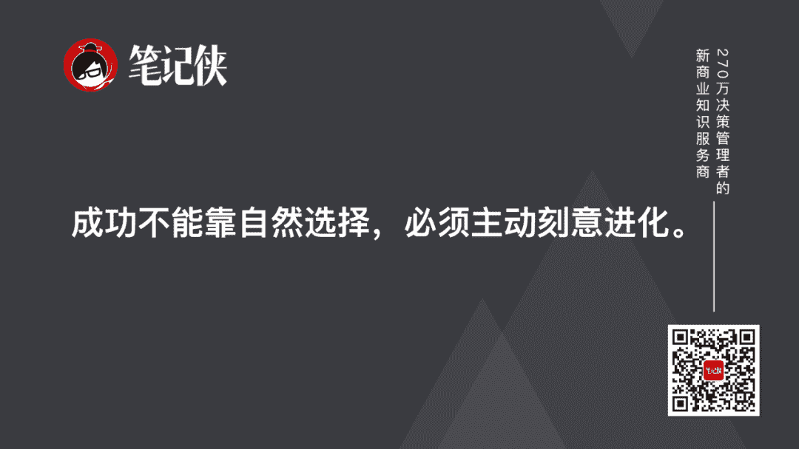

### 4. “行为隔离”：拒绝进化，就被 淘 汰

#### ① 新物种的形成：行为隔离

科学家发现，新物种的形成关键在于生殖隔离，而生殖隔离通常在于地理隔离，因为一旦隔离会导致不同种群无法交配，新物种便应运而生。

有研究表明，生殖隔离并不总是依赖物理隔离来实现，另一种重要方式是行为隔离。

以海豚为例，两个外表相似的海豚种群，因行为习性不同 ——有的偏好浅海，有的偏爱深海，随着时间的推移，逐渐演变为两个完全无法交配的种群。

我为什么要说这个？因为我们认为，未来一段时间人类可能出现物种分化：拥抱 AI的人和反对拥抱AI的人。

目前，仍有不少学校禁止学生使用 AI。因为一旦学生使用AI，老师的权威会受到挑战。当学生没有AI辅助时，老师说什么都是对的；但学生一旦拥有AI，老师的错误立刻就能被揪出来。

#### ② “现代 阿米什人 ”对技 术的隔离

随着人工智能的进步，你会发现，使用人工智能与不使用人工智能之间的差异越来越大。

这种差异究竟有多大？大到有一天，就像历史上曾出现的那样，有两拨人完全泾渭分明 。

以阿米什人为例。在美国纽约州及新泽西的一些地区，居住着一群被称为“阿米什人 ” 的人群。

这些人早在 100多年前就迁居到美国，但他们相对传统且保守，认为先进科技对他们有害，因此禁止使用任何先进科技。

迄今为止，他们仅能接受照明灯和收音机，其他如电视、电器等一概不用，互联网更是无从谈起。

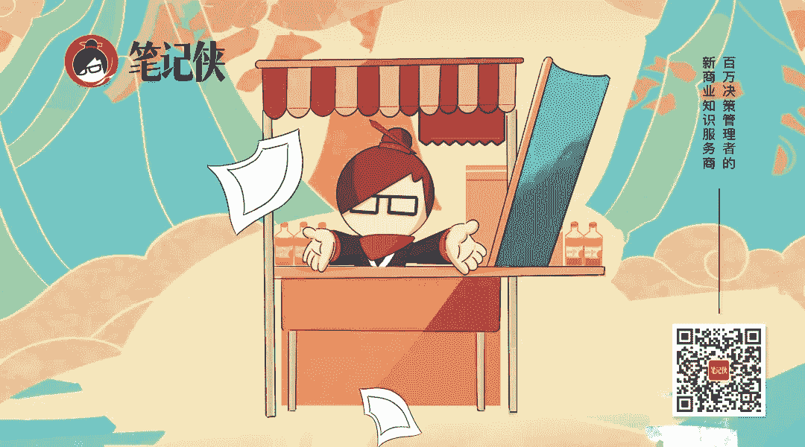

尽管如此，这些人依然生活得很好。他们靠向纽约出售所谓的原生态鸡蛋和鸡等农产品维持生计。虽然他们能生存，但实际上已成为现代社会的依附者。

那么，未来是否会有越来越多的人因与人工智能的背离，导致被现代社会隔离？这种情况并非不可能。在某些地方甚至可能出现，甚至有人会刻意提倡这样做，从而成为现代的“阿米什 人 ” 。

我们接着说，阿米什人与外界通婚也极为困难。因为他们从小在那种环境下成长，难以接受现代社会的冲击。反之，现代社会的人要适应他们的生活环境也几乎不可能。

所以，尽管属于同一种族，我们称之为 “生殖隔离”，并非形成两个不同的种族，彼此无法繁衍后代，而是理念上的不认同，导致通婚行为几乎不可能。印度种姓制度就是一个例子，尽管都是同一人种，却无通婚。

未来，理念差异是否会导致不通婚？就像中医好坏之争，似乎差点造成这种不通婚现象。

因此，我认为，人工智能未来可能更严重。

简单说，**当你使用人工智能时，** 你会迅速进化成新物种，而不使用的人则会陷入困境，甚至在交流上都会出现障碍。

使用人工智能的人会大量依赖其支持，视野和覆盖范围更广；而不使用人工智能的人则会认为，人工智能存在幻觉，其言论不完全可信。

所以，我们强调必须成为适应新环境的新物种。

#### ③ 新物种 AI：历史性机遇，填补生态位

当大规模灭绝事件发生后，最大的机遇并非仅仅是幸存者的爆发式增长，而是新物种对历史上空缺生态位的填补。

这一现象在每个物种灭绝的时代都会发生，是灭绝之后的必然结果。

正如上面讲的，因为恐龙的灭绝，哺乳动物得以进入海洋成为鲸鱼，登陆成为大象，并在各个环境中演化出千变万化的形态，最终形成一个能够覆盖各个生态位的多样化群落。

我们认为技术发展也会遵循同样的规律，当技术导致许多传统企业消亡后，必然会出现大量补位的机会。

此外，技术进步还有一个显著特点，即它不仅填补原有的生态位，还会创造许多全新的生态位和机会。

这意味着，你不仅有可能成为一个成功的企业，还有可能在自己的生态环境中构建一个新的生态环境，然后在其间成为主导者，拥有最大的话语权，成为规则的制定者。

未来，你会发现，当新企业占据了一个新的生态位并进行生态化扩张时，它将制定规则，其他企业必须遵从其规则。

## 二、行动指南：从“幸存”到“引领”的进化路径

### 1. 企业幸存者的规律

#### ① 新物种的种类

我们预测科技和人工智能到来后，行业会产生哪些新物种？概括而言，主要有两种情况：

第一种是，当你掌握了相关技能后，能够在他人出现时，提前识别出这个潜在的 “新物种”，即未来的成功者。

第二种是，当前尚未出现此类新物种，而你有机会去创造它，那么你本身可能就成为这个“新物种 ” 。

因此，通过洞察规律来把握未来显得至关重要。

#### ② 幸存者的规律

幸存者规律是普遍存在的，以共享单车为例。

具体如下图所示：

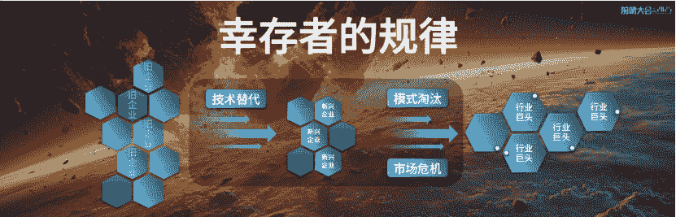

**第一，技术替代。**

共享单车模式替代了传统的自行车购买方式，致使当时专注高端自行车制造公司 受到 市场冲击，新模式迅速取代了旧模式。

**第二，模式淘汰。**

企业间的竞争无处不在，无论是种群间还是种群内的竞争都十分普遍。在众多共享单车企业中，最终存活下来的寥寥无几。

**第三，市场危机。**

共享单车市场规模庞大，但相对于整个经济体系和市场而言，其体量仍然较小，且并非由重大技术革命引发，所以，没有引发市场危机。

我们说，真正的技 术革 命 需要通用技术的支撑，即能够在各行各业广泛应用的技术，而人工智能 （ AI ） 便是 典型的通用技术。

因此，在 当 前市场环境下，我们必须对 AI股市崩盘保持警惕。

### 2. 幸存者实现的路径

我们要成为一个成功的企业家，必须掌握幸存者的规律。

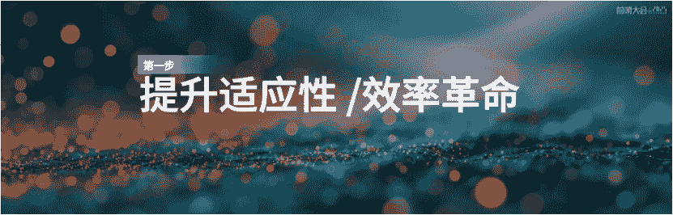

#### 第一步，学会用技术实现节能增效，及时引入新技术。

这一步叫提升适应性，也叫效率革命。

提升适应性意味着在新技术初期都会经历一个节能增效阶段，此时必须充分利用技术提升性能。

**首先，是马力。**

工业革命起源于英国纺织厂，纺织厂引入机械动力后，便开始衡量动力大小，随之出现了 “马力”这一单位，英文为“horse power”，意指设备输出的动力相当于一匹马的力量。

若设备功率为 1马力，表示这台设备动力是1个 “ horse power ” ，如果为10马力，则表示拥有10个 “ horse power ” ，它是衡量设备输出功率的大小单位。

但人是输出不了马力的，人比马弱得多。所以，工业革命带来的重要模式创新之一便是工厂。

工厂的职能就是，把用马力计量的生产工具串联起来，从原型到加上各种零部件，最后到成品，整个过程的驱动力都是用马力来计算，而不是人力。所有这些马力叠加，最终形成产品，这正是工业革命的精髓。

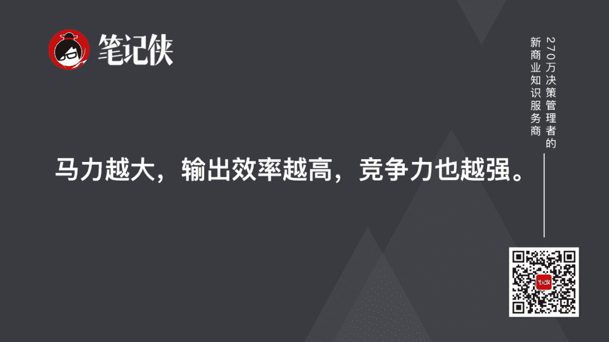

马力越大，输出效率越高，竞争力也越强。

**其次，是人力。**

现在，人工智能有了不起的进步，开始能够替代人力参与到企业的管理、分析、销售等环节。

以 IT公司为例，如果原来1个人完成1人的活，这叫 “ human power ” ，即“一人力”，如果能干10个 的 人活，即 “十人力”。

现在因为 AI人工智能，3个人就能完成10人的工作，甚至1个人完成10人的工作。显然，拥有“十人力”者将击败“一人力”者。

未来一段时间，人力提升将迅速影响每个人。那些仅能完成 “一人力”工作的人将被淘汰。

所以，对我们而言，生存的第一件事必然是节能增效。

#### 第二步，避免被淘汰，找到新模式，形成新物种。

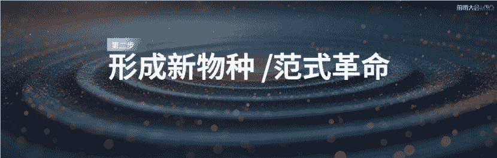

如果仅仅依靠节能增效是不够的，尽管 IT七巨头 （苹 果、微软 、谷歌母公司Alphabet、亚马逊、英伟达、特斯拉和Meta） 能够通过AI节省成本，但它们的竞争力并非仅仅在于省钱。

因此，必须寻找新的竞争力，这便是范式革命。正如我们所说的引入坦克，但核心在于打出闪电战，展现你的特色和竞争优势。

因此，单纯省钱是不足够的，必须要有更深层次的考量。

有以下 3个思路：

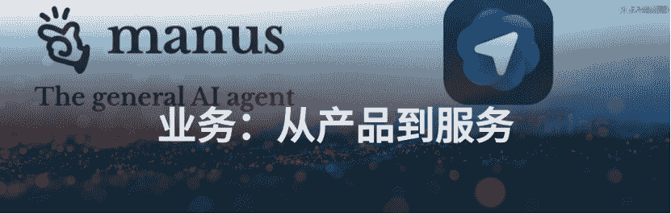

**首先，是业务。**

目前，人工智能并未广泛应用于服务领域，但今年，我们已经明显看到了服务领域的曙光。

今年被许多人称为 “agent元年”，agent（ 智能体 ）的作用是能够学会所有技能，不再仅输出单一技能，而是能完成一整个工作。

今年将逐渐形成一道分水岭：一种是以 Manus为代表的通用型agent，完成一些难度不高的工作；另一种则是专用型agent的崛起，它们专注于特定领域的工作。

两者目标一致，即完成任务。所以， 我们认为未来完成任务的环节将被称为服务。

过去，是将人工智能应用打包成 “软件即服务” （Software as a Service） 。但现在情况发生了逆转，不再是“软件即服务”，而是“服务即软件” （Service as Software） 。

比如汽车领域。很多人认为汽车是完整的产品，但我要的其实不是汽车，而是出行服务。

没有人能提供出行服务，所以只能卖给我一辆车，让我自己驾驶。结果，我还得找停车位，还得保养车辆，这就是工业革命时代的困境。

在未来，我提供的不再是汽车，而是服务。你不需要拥有汽车，你需要的是自动驾驶出租车的服务，随时随地，我都能将你从 A点送到B点。

因此，交通出行服务化才是今天这场电动车之争的终局。

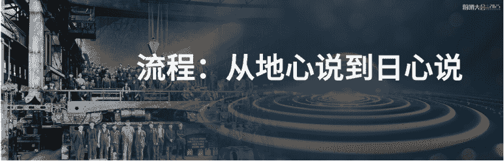

## 其次，是流程。

在流程方面，我们习惯了现有的模式，为什么要引入人工智能来提升效率？即便提升了效率，若仍以人为核心，我们称之为 “以人为本”，那么这种以人为核心的流程也将被打破。

未来你会发现，人在流程中反而成为了阻碍因素。只有去除人的因素，流程才能顺畅。

正如工业革命时期所发生的那样，纺织厂中的工人被排除在流程之外，机器自行完成生产，人只需旁观：机器正常运行时，人无需干预；机器出现故障时，人只需进行简单的修复。

因此，人的角色转变为旁观者、监督者和辅助者，尤其现在对人的要求更高，需要具备主动性，成为系统思考者，思考如何改进流程。

总体而言，流程将趋向自动化，甚至未来会实现自主化，即各个智能体能够相互通讯时，它们可以自主交流、协作完成任务。

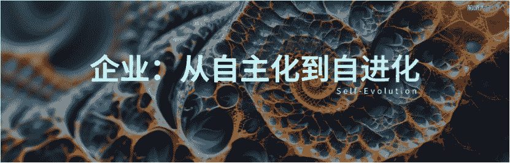

## 第三，是企业。企业要从自主走向自进化。

目前，中国的自动化水平有待提升。自动化首先要求所有事物数据化和量化，然后交由智能体处理，完成自动化任务，进而迈向自主化。

最终我们要实现的是自进化，即系统能够自我进化，这样的企业才有未来。

从周期角度来看，我们将进入一个快速自进化的周期。

理念的更新至关重要，正如自然界在大灾变后千万年趋于稳定，新增物种数量回落至普通水平，机会减少。

只有在剧烈变化的时期，新物种大量涌现，前提是形成新理念并跟上其步伐。

未来十年至二十年，基于 AI 的理念将充分到位并广泛应用于各行各业，之后可能会迎来一段稳定期，你或许能成为生态中的霸主，长久生存。

## 3.最大的商机，藏在“服务平权”里

### ① 这个时代的使命是服务平权

上一个时代的核心是物质平权。每个人都可以拥有一辆车，可能富人拥有的是劳斯莱斯，穷人开的是捷达。

任正非曾说 “最好的车是捷达”，因为规模生产带来的改进的积累，契合莱特定律——生产规模越大，改进越多，工程能力越强，产品越优质。

虽然劳斯莱斯前身是生产飞机发动机的企业，但捷达的发动机、传动系统等核心部分并不逊色，实现了 “你有车，我有车，核心部分却不相上下”的物质平权。

过去，优质的医疗保健、家教、管家等服务只有富人才能享有，甚至富人的寿命普遍更长。凭什么富人比穷人活得长，这个时代就应该消灭这种不平等。

这个时代的使命是服务平权，因为我们终于有了新的满足能力 ——人工智能。它能学会专家级经验，再以两种策略提供服务：一是高价供给富人，二是低价普惠于大众。就像福特T型车比兰博基尼这样的跑车更成功，前者让福特成为当时的世界首富。

所以， “给大众提供服务”才是未来的趋势，要让以前富人才用得起的服务卖给穷人。

这时候你会发现，这个标的非常好找。你想想，现在有哪些东西是富人都愿意用，但穷人都用不起的？

比如，很多公司高管都配有秘书，他为什么要配秘书？把不想干或者干不过来的事交给秘书干。

但是 “秘书”不想要秘书吗？如果能给秘书都配秘书，这样的服务范围是不是比给高管配秘书要大得多了。

在两年前我都讲过 ——要干掉每个公司的前台。对公司来说，前台没有意义，而前台没有成就感，也没有职业上升的通道，工作多年也学不到有用的经验，没有意义。

怎么办？用人工智能来干。反过来想，每个公司都可以拥有人工智能前台，再小的公司也需要有个前台，就成了普惠。

所以，机会好不好找？盯着富人就行了。

我们刚从硅谷考察美国的长寿科技，发现现在最爱投资长寿科技就是富人，除了他有钱，最主要的原因是他也想长寿。他想第一时间用到长寿的成果，所以去投资。

现在大家都在用人工智能做 PPT，而且水平很高。但我有个朋友却认为这件事注定不会大，因为富人不用做PPT。

盯着一个富人不干的事能有多大？但你盯着一个富人在干，穷人也想干但得不到的事就一定巨大。

所以，这个时代，你要找到一个领域，用人工智能重新定义这个领域，把它的旧观念都改写掉，这就是未来，这就是新物种。

### ② “行为上网”，重塑互联网格局

前几年语音交互硬件也曾流星一样闪耀过，今年就轮到 AI 眼镜了，但这回可能真的站住了，而不是像一颗流星一样，因为真的形成产业了。这背后的机会是构筑人和物理世界的信息层。

这不得不说很多人有远见的，尤其是西方的公司，他们对未来的思考和布局非常值得我们学习。

扎克伯格最成功的是 VR 头显，但他现在的重心在眼镜上了。

在扎克伯格看来，人不可能永远被眼前的东西挡着，现在VR的虚拟世界非常有想象力，未来可能做得很大，但你主要是和真实的世界交互，所以头显不会成为主流，但你可以戴眼镜。

为了在自然环境中与物理世界互动的时候有更多参考，以后人人都要戴眼镜。

从进化来看，我们的躯体是几百万年进化的结果，但文字、语言等人类文明只花了一万年就诞生了。这一万年太短，我们的生理结构没发生任何改变。

这具 “旧躯体”如今要面对的最大新情况，就是社交人数的爆发式增长。一万年前的部落时代，每个部落最多150人，部落间几乎没有交往，根本不需要应对大量社交。

而现在，人们的社交范围遍布全球，接触的人越来越多。人脑能储存上百万张人脸，只要见过就能认出对方 “面熟”，但储存人脸的区域和记忆名字的机制是脱节的。所以几乎所有人都会遇到“见过面却叫不出名字”的情况。

如果人工智能能帮我们解决这个问题 ——识别对方身份、回忆相遇场景，甚至呈现对方的生日、兴趣偏好、朋友圈动态等背景信息，社交互动会顺畅很多。这就是尚未充分开发的“人工智能辅助社交”，它将成为下一个重要方向，还能推动社交网络实现不可估量的进步。

互联网发展至今可分为两代：第一代是传统互联网，核心是 “内容上网”，比如早期的网页浏览； 下一代 的无线互联网不只是内容的移动化，核心是 “行为上 网 ”——用户的行为可跟踪、可分析、可传递，能衍生更多价值。

第一代社交网络以 Facebook 为代表，依托传统互联网；但无线互联网时代，虽有美团、滴滴这类基于行为的应用，却没出现真正的“行为社交网络”。

而社交的核心本就该围绕行为展开，所以未来 “行为社交+人工智能”的组合，大概率会成为新的社交形态，甚至有机会颠覆Facebook、🛰️这类现有平台，掌握这个规律就能抢占先机。

再看扎克伯格的野心，其实和这个趋势不谋而合。传统互联网时代，人们和互联网交互的核心门户是谷歌，这让谷歌长期保持高估值，也让扎克伯格一直眼馋。

移动时代到来后，人们需要随时随地和互联网交互，但早期很多专家反对手机上网，觉得走路看网页会 “撞树”。

可现实是，移动时代的核心需求根本不是 “看内容”，而是“用互联网数据辅助现实行动”——比如给眼前的现实场景做标注、做补充。

这正是扎克伯格的发力点。国内也有带显示功能的智能眼镜，但大多把内容投在视野正中间，核心是 “展示内容”；而扎克伯格的设计是把内容投在侧边，目的是给眼前的现实事物做“角注”。就像游戏里角色的血量条在头顶而非身上，侧边标注不会遮挡现实，还能补充信息。

他的终极目标，是让人和世界、万物之间多一层 “信息标注层”——比如看到一个人，侧边就能显示他的身份、相遇场景等信息，不影响面对面交互，还能辅助沟通。这种“标注世界”的模式，在人工智能时代实现的可能性非常大。

Facebook的AI眼镜能否成功仍有很大悬念，毕竟擅长硬件的苹果也将推出同类产品。

### ③ 手机不会消失，终端智能将会大规模兴起

前段时间， 马斯克预测五年内手机会消失，但我并不认同。手机是身边最便携的 “核心算力载体”，未来人们对算力的需求会越来越高，总不能天天背着电脑出门，揣着手机才是最优选择。

这也意味着，一个 20年前流行过的概念会重新走红——“body are a network （身体局域网） ”。简单说，就是围绕身体，把所有软硬件整合起来形成小网络，让它们互相协同。

而这个网络的中心，非手机莫属。现在很多人的手机已经会通过蓝牙实时连接多个设备，我最多时连过 5个，未来这会是常态，5个可能只是起点。

这些设备的分工很清晰：蓝牙技术成熟，负责设备间的连接传递；手机承担主要算力，毕竟如果让眼镜具备手机级算力，重量根本无法承受；眼镜等设备则专注于数据采集和交互，保持轻巧便携。

所以五年后，手机被拿出来的频率会越来越低 ——因为交互不再依赖手机屏幕，但手机绝对不会消失。核心原因是APP不可能消失，每个APP都积累了各自领域的行业数据，能提供专业智能服务 。

未来我们不用再费力翻找手机里十几个屏幕的 APP，而是通过眼镜这类设备的语音交互直接调用，不用手动打开。这种语音调用的方式现在已经在推进，未来两年内大概率会普及。

未来两年，终端智能一定会大规模兴起，核心前提是手机 APP的支持。这些APP都不是通用的，而是聚焦特定领域的专用工具，这也契合当下人工智能的发展逻辑——现在不可能实现AGI （通用人工智能） ，只会落地“领域智能”。

领域智能是用特定领域的数据训练而成，能给出该领域最优的专家级建议，甚至超越人类专家，但跨领域就失效，需重新训练。

每个 APP 都 具备这种领域智能输出能力，比如美团专注餐饮相关服务，其他 APP也各有专攻，处理不同场景问题。

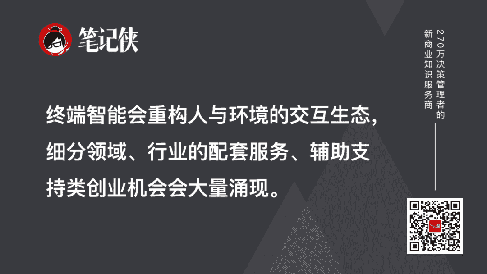

这些 APP的能力会被一个“智能助手 （agent） ”整合，再与用户交互，就像每个人都有专属秘书，这种“智能助手分层”的模式已经在部分程序中落地，未来两年会更普及。

这也意味着，仅靠智能眼镜不够，必须搭配手机的算力和海量专用 APP——这正是苹果的优势。如果明年下半年苹果推出的智能眼镜表现出色，扎克伯格的AI眼镜大概率会失去竞争力。

不过大方向没错，若不打算做硬件，反而有很多机会： 终端智能会重构人与环境的交互生态，细分领域、行业的配套服务、辅助支持类创业机会会大量涌现。

另外，手机存储了我们海量的行为习惯数据，基于这些数据， AI能提供极具个性化的服务。比如针对飞行出行，AI可辅助管理机票折扣、里程积累，这种精准服务能让提供者成为赢家。

上一个时代的核心是互联网的内容智能化；而接下来，核心会是无线互联网的 “行为智能化”。国外已提出“大行动模型 （large action model） ”，但我们可以更超前，落地“大行为模型 （large behavior model） ”——通过连续监测用户行动，预测后续行为。

行为预测的商业价值早已显现：比如美国车企会把汽车分期付款数据分享给大宗消费品公司，这些公司提前两个月推广冰箱等产品，等用户三年车贷还清、有了闲钱，就容易促成购买。

而人工智能时代的复杂行为预测，会让这种精准对接更高效。

人工智能红利正在逐步扩散，第一波受益者是 OpenAI、Anthropic这类大模型企业；第二波轮到有用户、有数据的企业，哪怕是Palantir、SAP、Intuit （国外做账企业） 这类偏传统的公司，靠AI优化服务也能盈利；下一波的赚钱机会，会落到有用户且手握行为数据的企业身上。

## 三、赢家心法：定义未来的规则制定者

### 1.把握机会，成为规则制定者

我觉得我们非常幸运，因为我们有机会成为规则制定者，这是真正让人最兴奋的。

中国的过去 40年是向全世界学习致敬的40年，我们有机会学会适应人家的规则，未来40年我们有机会制定规则。

但是制定规则一定要从更宏观、从更全球的角度去讲，因为你要别人遵守你的规则，你不能说我是中国规则，请你听我的，这叫霸权。

那未来如何做好领导者？这我认为是中国最大的挑战。

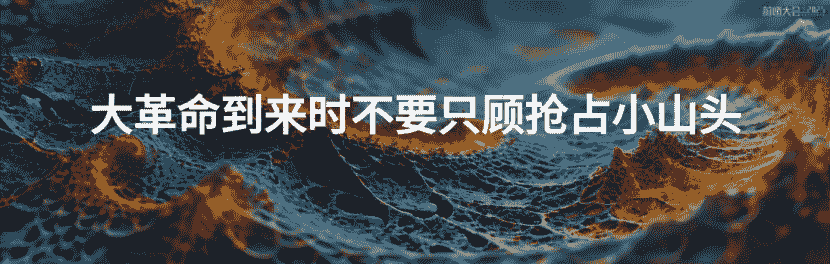

当然，有一个前提需要明确：在一场大革命到来之际，不应只着眼于抢占那些微不足道的小山头。

具体怎么做？具体如图所示：

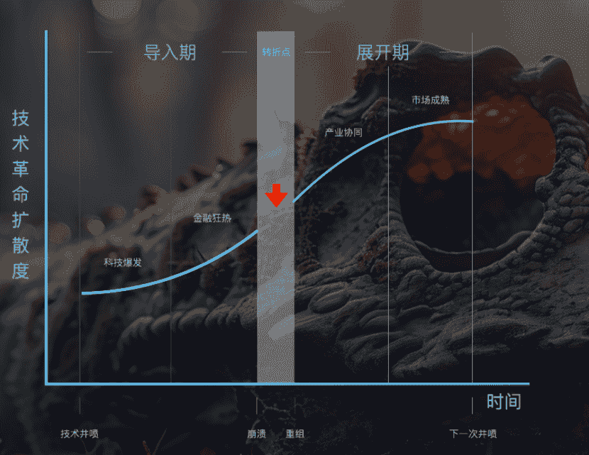

#### 第一，导入期

在导入期，几乎每一轮的疯狂投资都源自于技术创新。这是因为技术发展需要新的基础设施支持。

正如我们所见，这一轮的创新焦点是 AI，其基础设施是GPU计算中心。从这个角度来看，我们有理由相信，只要 投入大量资金购买大量 GPU，如果公司破产，那么GPU仍然会保留并且使算力成本下降 。

但事实上，核心的问题在于 它 GPU的更新速度太快了， 以英伟达为例。每年都有小更新，两年一大更新，三五年后，老旧的 GPU 就没多大用了， 这无疑会带来麻烦。

因此，我们承认这个未来存在泡沫，但在我看来，当前所见的优质泡沫将促成未来的大规模发展，并进入展开期。

#### 第二，崩溃期

在进入展开期前，有个前提条件，即你必须成功避开中间那段所谓的崩溃期。

一旦度过崩溃重组期，你将立足于那些崩溃后留下的优质泡沫所形成的廉价基础设施，从而实现更快速的发展。

因此，避开这一问题是关键所在。

#### 第三，展开期

一旦你进入快速发展期，其特点便是抢占不同的生态位。

虽然大家都在做人工智能，但如今人工智能领域已经开始分化。比如，你专注于自动驾驶，我致力于语音交互，他则投身于专业行业，如医学数据的解读等。

这种分化至关重要。

每个领域最终都会涌现出赢家，关键在于你是否最早进入该领域，甚至是否最早将该领域琢磨透彻，并为其树立新的思路、思想和观念。

### 2.深耕领域，深刻理解“约束满足”

现在大家应该明白了，仅仅生存其实并不复杂，只需先运用技术，再找到合适的模式即可。

然而，到了扩张阶段，情况就变得复杂了。

我们引入一个概念，即 “约束满足”。

#### ① 定义：什么叫 “约束满足”？

约束满足，通常被称为约束满足问题，即数学中常需解决的问题类型。

比如，在有限数量的外卖小哥情况下，如何尽可能快地将所有包裹送达每位收件人，这就是一个典型的有限条件下的最优满足问题。

此类问题往往没有完美的最优解，只能寻求一个尽可能好的解决方案，而这正是现实中的常态。

#### ② 最优解：现实世界的 “约束满足”

现实世界本质上是一个不断求解“约束满足 ” 问题的过程。

什么是“约束满足 ” 问题？你需要了解，比如当前的约束是什么？你这个领域的具体约束有哪些？你如何更有效地去满足这些约束？以及利用现有技术实现更优的满足方案。

比如，交通出行一直是一个典型的约束问题。

过去的满足方式，由于没有人能够将周围的人送到各个目的地，解决办法就是制造车辆，让人们自行驾驶。如果能大规模造车，使每个人都拥有一辆车，那么出行问题就自行解决了，这在当时的约束条件下是最优的解决方案。

然而，现在情况有所不同。

首先，会经历了一个过渡阶段，即确保每个人都能有车，但许多人拥有大量闲暇时间，自己并不常用车，同时也有时间服务于他人，于是出现了 Uber，这是一种更优的约束满足方式。

其次，你不需要拥有车，我提供车辆和服务，互相帮助，这样一段时间后，依然会不够完善，因为 Uber司机数量有限，且司机也需要休息。

那么未来的解决方案是什么呢？答案是自动驾驶，街道上始终有自动驾驶车辆在运行，谁需要就谁来使用。

你会发现，约束条件在不断变化，满足方式也在随之演变。

因此，在第三阶段，若要成为行业霸主，就必须找到一个特定领域，深刻理解该领域的约束条件，并掌握如何在领域内改写这些约束条件，包括提出更优的满足方案，这才是最重要的事情。

### 3.搭建护城河，规模化实现“工程解”

#### ① 企业 “约束满足”：追求工程解

这是什么意思呢？它指的是并非局限于实验室或小批量的产品，而是需要广泛适用才行。

如果你不上规模是没有意义的，规模决定了一切。

在汽车领域，人们往往更仰视跑车、超跑，而鄙视普通家用车，认为家用车缺乏技术含量。

以兰博基尼为例，这个闻名遐迩的品牌，全球全年销量仅 3000多台。而家用车品牌，以丰田为例，它是销量最高的品牌，年销量可达1000万台，其他品牌也大多在几百万台的水平。

相比之下，一个品牌若只卖千台，而另一个品牌卖百万台，谁的利润更高不言而喻。

所以，当车企向电动化转型时，那些跑车厂商由于规模太小，无法投入足够的研发费用，会难以转型。

这就是未来的挑战，我们称之为 “工程解”。

此外，我们要记住一个概念，即工程＞技术＞科技。

坦白说，我们大多数人对这一概念存在误解。具体而言，我们往往过度重视科学，至少也会重视技术，却忽视了真正关键的因素 ——工程。

我们讲，工业革命以来的普遍规律是规模化，而规模化又是通过什么实现的？答案是工程。

当然，工程背后需要技术支持，技术背后则需要科学原理支撑，这一点是对的，但最终能否通过工程化实现才是最关键的一环。

哪怕再好的科学，再牛的技术，没有工程化实现能力就没有意义。

#### ② 自然界 “约束满足”：DNA和RNA

在自然界中，我们常说物竞天择，适者生存。那么，适者是如何适应环境的呢？这其实是一种工程化的适应。如果没有工程能力，物种是无法适应的。

为什么只有具备工程能力才能实现规模化适应？因为单个生物的生存并无太大意义，能否拥有无数后代才有意义。

这就是工程能力的重要性。

所有生物体在自然界中生存，都面临一个限制满足问题 ——只有有机体才能与环境互动，具备适应性。

然而，有机体的脆弱性使其在环境中长期生存成为难题。这就是生命体面临的所谓 “ 约束满足 ”问题 。

生命体是如何解决这一问题的呢？其解决方案非常巧妙。

首先，生命体需要能够自我复制，且每次复制都保持一致。因此，生命体拥有一个复制信号信息的密码本，即 DNA。

其次，生命体还需要在自然界中适应环境，生存下去。生命体将 DNA转化为RNA，编码成蛋白质，形成身体结构，与环境互动。

因此，生命体拥有两套系统：一套模拟系统用于适应环境，另一套数字系统用于保证遗传的连续性。

这两套系统巧妙结合，形成了 DNA、RNA和蛋白质的完整体系。从生物学角度看，这种限制满足的工程解决方案在每个细胞中都被广泛应用。

#### ③ AI“约束满足”：专家经验规模化复制

AI时代，我们需要做的一件事就是研究AI时代的约束满足情况。那AI时代的约束满足我们看到的是什么？

其实，很多是继承自过去的。也就是说，工业革命已经使我们的许多需求得到了满足，但其方式是通过提供产品。这种方式的好处在于普惠性，能够大规模生产，人人都能获得这些产品。

然而，现在问题来了：仅仅通过提供产品的方式真的是好的满足方式吗？显然不是。

以前我们别无选择，只能实现规模生产，现在，情况有了改观，专家经验终于可以规模化复制了。

因此，我们不再需要将产品直接交给你，而是通过产品作为载体，为你提供规模化的服务。

现在，每个人手中几乎都有一部外观相似的手机，但手机里提供的服务却可以是个性化的。也就是说，手机本身并不重要，它只是服务的载体。

未来，越来越多的硬件将成为服务的载体，以提供个性化的、持续的服务，帮助每个人解决他们实实在在的需求和问题。

这就是这个时代约束满足的最优解，当然，其前提是达到最大规模化。

## 四、不同领域有自己的“刻意进化”方向

### 1. 教育服务，从掌握技能到找到热爱

现在很多 AI教育公司做得不错，国际排名也靠前，核心思路是：孩子不会某道题，AI扫描识别后，用同类题型反复训练，直到孩子掌握。

但问题恰恰在这里。孩子自己主动寻找解题方法、最终攻克难题的过程，正是之前提到的 “hermesis”——一种逆境锻炼。

这种锻炼会带来“内啡肽”奖励，完成高难度任务时的成就感尤其强烈。就像很多人热爱体育运动，追求的不只是奖金，更是攻克难关的满足感，难度越高，成就感越强，这是人的天性乐趣。

而 AI直接帮孩子找答案、逼他训练的模式，看似解决了眼前的解题问题，实则剥夺了这种成就感。表面是战术上的帮助，本质上会让孩子丧失对这个领域的热爱，得不偿失。

未来真正需要的教育，核心在于两点：

其一，培养孩子对某个领域的热爱。

未来所有可重复、标准化的工作，AI（比如OpenAI，月费仅20美金）都能更高效完成，孩子再去掌握这些意义不大。真正有价值的，是AI做不了的——基于热爱的创造。

实现这一点，需要有人能伴随孩子成长：懂教育、能和孩子顺畅互动，持续跟踪他的兴趣点。当孩子对某件事感兴趣时，不是直接提供帮助，而是给出适配的挑战。比如孩子喜欢数学，就给一道“努力就能解决”的难题，让他在克服挑战中自己分泌内啡肽，这种内在满足感远胜于外部激励。

家长很难同时做到“懂教育”“当知心伙伴”这两件事，但 AI可以。AI没有自我执念，能耐心陪孩子沟通，精准捕捉他的需求和特征，恰到好处地提供挑战，反而能赢得孩子的认可。

其二，培养孩子的综合能力。

这个时代不再需要单一的专业技能，综合能力才是核心竞争力。就像刘邦能当皇帝，不是因为他比韩信会带兵、比萧何会管后勤，而是因为他懂得“带将”——整合各方能力的综合素养。

过去的教育思路是“先学单兵作战（单项技能），再学管理（综合能力）”，但中间的层级技能早已无用。正确的做法是让孩子“从小就学当元帅”，直接锻炼综合能力。

AI工具降低了做事的门槛，孩子和我们在工具使用上基本站在同一起跑线。不用怕孩子“不懂”，他们的能力远比我们想象中强，过去是环境约束了他们，现在可以用AI打破这些障碍，让孩子从小去做更复杂、更有想象力的“大事”。越能做成这类事，孩子的成就感越强，综合能力也会在实践中自然提升。

说到底，我们的教育需要重新改写，核心不是教会孩子做小事、解难题，而是用 AI辅助，帮孩子找到热爱、锻炼综合能力，这才是未来的核心竞争力。

### 2. 中国全球化

我们很幸运能身处三大浪潮的叠加期：一是人工智能带来的智能革命；二是工业革命的终极高潮——工业制造的全球化覆盖，工业革命的核心是规模化，而规模化的尽头就是全球化，这一点只有中国能实现；三是数字化机遇，如今全球进入数字时代，一切都可量化、可分析。

结合这三大浪潮，有两个关键判断愈发准确：过去40年中国经济是本土驱动的高速发展，而未来40年，中国企业的海外收入总和可能会等同于本国GDP，形成“影子中国”。

周其仁老师也提到，要关注“中国人的经济”而非仅局限于“中国经济”——前者会像40年前的改革开放那样高速增长，毕竟当前海外收入基数低，要达到中国本土经济的体量，未来40年中国企业的海外收入必将持续高速增长。

但全球化的核心挑战是效率与平衡，如何快速覆盖全球市场？美国多年来推行“glocal（全球+本土）”理念，却始终没解决核心问题——派不懂本土的人经营会失败，强调本土化又容易导致海外团队与总部离心。

早年不少外企靠港台人衔接中国市场与海外总部，反而让港台人成为大陆员工的晋升天花板，进一步阻碍了全球化推进。

而中国企业如今有了新解法——“Digilocal（数字化+本土化）”。全球已全面线上化、数字化，借助抖音、Tiktok等平台，企业可搭建数字化平台，结合人工智能agent技术，对各国本土数字化营销数据进行分析、统计和推广，实现中央统一管理。

目前多数中国出海企业还存在误区，只关注产品本身、一味追求销量，却忽略了效率才是全球化成功的关键。

中国制造当前的核心挑战是智能化升级。如今全球经济和企业的竞争力重心已从硬件转向智能水平，缺乏足够智能的硬件，就如同没有灵魂的躯壳。

最典型的例子是人形机器人。它能完成复杂动作，但至今没有可适配的应用场景。核心原因是它不够“聪明”，无法真正理解环境，也不能与人类（自主行为体）自如互动。这种互动需要物理AI（physical AI）技术支撑，还需建立能理解并预判其他自主行为体下一步动作的系统，而目前这套系统尚未成型。

人类能轻松为他人提供服务，源于大脑右侧的天然功能——无需理性分析或心理学知识，就能直觉性读懂对方的意图和喜怒哀乐。但机器人没有这样的“天然能力”，目前还未被设计成能理解人类意图的形态，这也是其难以落地应用的关键。

机器人作为新兴领域，暂时难以落地尚可理解，但大量传统制造领域已面临迫切的升级需求。以汽车行业为例，若不向智能制造、自动驾驶方向转型，未来将难以立足。

对中国制造而言，能否为硬件赋予“智能灵魂”，实现全面智能化升级，是未来必须攻克的重大课题。

每个领域都有机会，但得有野心：用 AI判断领域的约束满足条件，创造新观念、新打法，成为该领域霸主。要是成不了霸主，哪怕最早进入，只做战术级的事，也容易被替代。

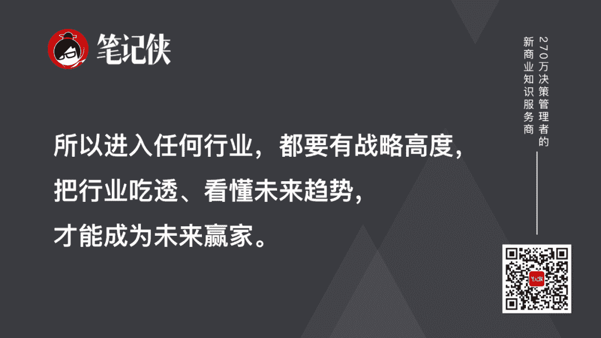

所以进入任何行业，都要有战略高度，把行业吃透、看懂未来趋势，才能成为未来赢家。

我们要培养科技产业的觉知，也就是对科技产业的理解。科技产业的发展有规律，这种规律能通过培养形成直觉，凭直觉做出的下意识判断往往是对的。

未来的赢家，关键是给普通人提供一套新的感觉系统。按这个方向设计，赢面会大很多。

## 五、穿越新周期，构建新生态

成为头部才能定义产业和规则，这一点至关重要。

而前提是要有长期意识，大多数人容易被短期波动影响，但这些冲击的长期影响往往有限，就像疫情如今已没留下太多痕迹。不妨多问自己：这件事2年后还重要吗？多数答案是否定的，大可忽略。

### 1. 长期趋势，新基建竞争

长期判断里，人工智能未来大概率形成中美两大阵营，且各自向外延伸：美国会联合欧洲、日韩、澳大利亚，中国则依托“一带一路”联动第三世界国家。

未来的中美之争，核心就是全球AI新基建的争夺，关键看各国用的是中美的大模型、靠的是中美的基础设施。

### 2. 长期趋势，“稳定币”不稳定

AI的兴起与数字货币主流化看似无关，实则未来可能汇合，带来金融层面的大变化。

数字货币在未来两年会持续得到支持，因为特朗普特别支持数字货币，这将造就一大波美国巨富。稳定币也受到特朗普的支持，稳定币还能助力购买国债。

当数字货币主流化以后，那个主流平台就开始活跃起来了，Robinhood等平台要推动证券数字化，实现7×24小时交易。

交易平台数字化，数字货币主流化之后，稳定币将形成主要的交易货币，带来的后果是金融的流动性大增了，而且没有刹车机制了。

比如前段时间美股大跌的时候，比特币也跟着跌了，因为比特币已经进入主流了，和美国股市已经同涨同跌了，这个趋势已经非常明显了，但是比特币的跌幅比股市跌幅大多了，因为普遍加了杠杆，而且还没受到监管。

表面看，稳定币的价值是稳定的，因为锚定的是美元，但它最大问题是它的流动性比美元高多，因为它的结算更有效、更高效，而且它结算成本更低，所以它周转就更快。

再加上 Robinhood这样的平台越来越成为主流平台，将来交易量越来越大，成为主流平台以后，你会发现没有时间去思考。

现在的稳定币发行量大概到了3500亿，我们认为大概两三年时间，即到28、29年时候会突破到1万亿。

它的流动性极强，相当于给股市注入20万亿资金。流动性足够强，加上有加杠杆的空间，足以动摇股市。

现在只差一个导火索，导火索就是人工智能有了基本的结果，在这些利好的支配下，形成了过度追捧，以为明天就会实现美好的未来，其实是对未来的预期严重高估。加上美联储进入降息周期，特朗普也可能换上支持降息的美联储主席，释放大量资金。

### 3. 穿越周期，幸存者的繁荣

这几件事的综合叠加之下，预计在2029年前后会有一次特别大的动荡。

但这个波动期可能很短，因为从互联网泡沫到2008年的金融危机中，美国已经懂得如何应对，一定会大把撒钱，来维持金融的信用不让其崩溃。这意味着躲不过去就会损失惨重，躲过去了就会大赚一笔。

今天的终极结论：第一，拥抱新技术，才能击败老对手；第二，形成新模式、新理念，在特定领域扎根，成长为该领域的新物种；第三，务必防范2029年的风险，熬过风险就能通过并购加速扩张，没熬过要么被淘汰，要么被别人并购，再无未来。

只要能穿越这场风暴，未来会迎来各行各业的大繁荣。到那时，你会成为行业赢家和规则定义者，更要搭建生态，让整个行业生态共同繁荣。

如果你不是做生态的，在生态里也有自己逆袭的机会。

我们都听过UPS创始人Jim Casey的故事，那时他是11岁就辍学创业的小孩子，干的是送信的差事，当他预感到汽车来了之后送信的差事就会没了，但送包裹是能干的，于是第一个引进了福特车，把后备箱改装成了货箱，变成送货公司。

其中的核心逻辑，本来送货是汽车的后端业务，有汽车就可以给别人送东西，但慢慢地变成主导者，做成了货运行业，成了货运快递行业的主导者，这时就不再依赖于车，而随时可以买不同的车满足我的服务，这就是配套的逆袭，重新定义一个新的行业。

未来有个有趣的可能：AI领域中，不少先给行业做配套的角色，或许会逆袭成为主导者。比如交通出行行业，当自动驾驶出租车（RobotTAXI）普及后，会构建起全新的产业生态。

想探索这类未来趋势，建议多用大模型亲自尝试，能快速找到体感和体验，但大模型并非完美，人的经验也很重要，两者需要互补。

比如我想到的“移动电商”，就是大模型没完全覆盖的方向：睡前刷购物软件下单，第二天商品会送到车里，车玻璃可切换不透明状态，方便在车内试穿，合适留存、不合适由车辆带回退货，真正实现“移动中的电商”。

健身行业也有创新空间。很多人健身只是为了健康指标，却觉得过程枯燥，反而喜欢打游戏。其实可以把健身运动量转化为VR游戏——花半小时打游戏，就能完成当天健身任务。

未来的想象空间巨大，但核心是“刻意进化”：先想透底层逻辑，确定定向的大方向，再根据实际情况调整细节，这才是未来成功者的关键。

### 4. 个人的刻意进化指南

每个人都要做到这几点：一是拥抱AI，善用新技术；二是“勤于懒惰”，把“想偷懒、让AI服务自己”的需求变成机会；三是持续预测未来，让行动向预测方向靠拢，最终促成预测落地。

好奇心是人类发展的核心动力。人类和其他动物不同，能终身保持好奇心，这份“长不大”的特质正是优势。要多向孩子学习、保持好奇心，因为AI能帮我们解决问题，而发现问题的关键就在于好奇心。

总结来说，这个时代要手握AI这一“新武器”，在各个行业创造新打法、占领新边疆，形成新思想和生态，才能立足。

今天就到这里，谢谢大家。

<https://aigcreative.feishu.cn/sync/K4Gvd9vUQsy9Oubwqaeclu0Fnbg>

# 知识库动态
