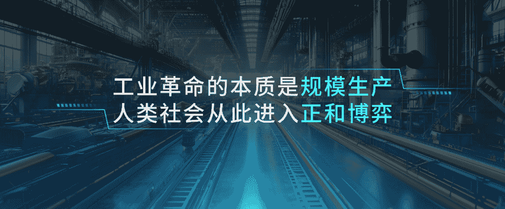
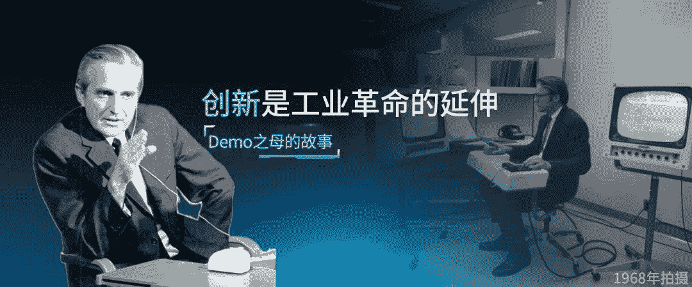

# 王煜全前哨大会2024：历史的韵脚，看懂未来

> 来源：[https://aigcreative.feishu.cn/docx/W8J0dKImmoGJa0xU3jZc5advnqg](https://aigcreative.feishu.cn/docx/W8J0dKImmoGJa0xU3jZc5advnqg)

> 原文链接： [https://mp.weixin.](https://mp.weixin.qq.com/s/18HCBN4Q4cA_8I0YMhHoAw)qq.com/s/18HCBN4Q...

** **

11月9日，王煜全年度个人演讲“前哨大会2024”如约而至，在这个信息碎片化的时代，为观众带来4小时的深度思考，带领大家一起关注历史、思考未来。

2016年，在同一个场地，王老师在当年的科技特训营上预言，英伟达将成为未来的芯片巨头，尽管当时英伟达还名不见经传。

今年，美国总统大选，特朗普和哈里斯的民意调查结果势均力敌，但王老师却明确指出，最终特朗普可能会以较大优势获胜。事实证明，预测还算准确。

今年，很多人感叹环境艰难，能留在牌桌上已属不易。

所以，在这个时代，看懂未来尤为重要。 为此，王老师提出了“历史的韵脚”，在历史转折期，简单总结过去无法看清未来，只有从更宏大的视角审视，才能真正理解未来的走向。

下面是此次前哨大会2024的要点，以飨各位粉丝朋友！

---

## 1 . 在科技革命面前，普通人有什么机会？

20世纪初，一个名叫Jim Casey的小伙子，曾在城市中承担传递信息的工作，后来他用福特的T型车从事包裹传递的业务。后来，他的公司改名为UPS，成为了全球知名的包裹运输公司，至今仍是世界五百强企业之一。

## **2 . 科技革命中最该焦虑的不是**年轻人，而是墨守成规、使用旧技术的人。

在科技发展的浪潮中，普通人同样能够抓住机遇，利用现代科技创造新的业务、改变世界。我们不需要担心被人工智能等技术淘汰，而应该积极拥抱这些技术，让它们成为我们赋能的工具。

## 3 . 技术革命往往会降低门槛，为更多人带来新职业机会

塞缪尔·斯莱特，被称为美国工业革命之父。十岁时便进入纺织厂工作，21岁便前往美国帮助当地纺织厂解决运转问题。因为，他实际上已经在纺织厂工作了11年，对纺织机械了如指掌。

普通人也能改变世界，根本原因在于，技术革命降低了使用技术的门槛。

## 4 . 在技术变革面前，我们都该做回一个七岁孩子！

这个时代，我们应该感到兴奋，同时也应该有归零的心态，像第一次进入纺织厂的童工那样，睁着大眼睛看着周围的设备轰鸣作响，创造出巨大财富。

##  5 . 规模生产才是工业革命的精髓。

人们常说工业革命之父是瓦特，因为他发明了蒸汽机。但英国当时的巨富之一阿克莱特才体现了工业革命的精髓——规模生产。1765年，他建造了大型纺织系统，以水力为动力来源，实现了纺织业的规模生产。

## 6 . 一切为了规模化生产，哪怕对工人好一些。

19世纪30年代法国作家狄更斯访问了美国的一个纺织小镇，洛厄尔，他惊叹于当地的鸟语花香与生活和谐，工人在厂区里生活无忧。但其实，这是因为机器的生产效率远远大于人，如果由于人的不愉快和罢工致设备停转，得不偿失。

## 7 . 工业革命改变了财富的产生方式，人类从此进入正和博弈。

工业革命彻底改变了全世界的造富规则，之前想成为巨富就要进行战争或掠夺，之后企业家通过工厂的规模化生产，再将产品销往全球，从而积累巨额财富。

## 8 . 美国成为了规模生产的集大成者

福特通过流水线实现了T型车的大规模生产，新车售价仅为360美元，工人只需工作72天就能买得起一辆车。美国利维特小镇的房子采用标准化制造方式，满足了大量购房需求。人们买了房子后，需要填充各种家电和家具，进一步带来了经济的振兴。

**美国的优势在于，规模的生产、规模的市场**覆盖和规模的消费，共同推动了经济的繁荣。

## 9 . 美国的繁荣让平民文化走向全球

安迪·沃霍尔提出工业革命的价值在于广泛推广和让普罗大众受益。随着美国经济的发展，欧洲人对美国的看法也逐渐改变，美国文化成为了美国企业全球化的润滑剂。

## 10 . 文化输出离不开先进科技的加持

日本的经验值得借鉴，他们注重与当地文化的融合和沟通，利用自身的技术优势和文化影响力，将产品和服务推向全球。现在，类似TikTok和黑神话悟空这样的科技产品和服务，才会是中国文化得以认同的载体。

## 11 . 数字革命即将修成正果

如果说工业革命的精髓在于产品的规模化供应，那么现在我们正处在一个重要的相似转折点上，也就是服务规模化时代的起点。

数字革命是服务规模化的基础，起步于1950年代。计算机产业的鼻祖道格拉斯·恩格尔巴特发明了包括图形界面、鼠标操作系统等现在大家习以为常的技术。后来，乔布斯看到了这些技术，并将其用于自己的苹果2电脑上。

## 12 . 没有商业化的科技都是耍流氓

道格拉斯·恩格尔巴特发明了图形界面和鼠标，却成就了乔布斯苹果2的辉煌。晶体管之父威廉·肖克利创办了研究院，但八名叛逃者却成立了仙童半导体公司，成为了硅谷的起源。

后来，美国出台拜杜法案，由高校进行科研，由小型科技公司进行产品转化。

## 13 . 爆发前夜，一切就绪，只欠大模型

PC让经验数字化，互联网使数字化经验得以广泛传播，无线互联网让人们能够随时随地接入互联网，而大数据为人工智能的训练提供了丰富的素材，使得人工智能系统能够不断学习和优化。

## 14 . 人工智能来自大力出奇迹，但不止于此

2022年11月30日，OpenAI推出GPT-3.5模型，使图灵测试变得不再重要，这一切来自于大力出奇迹，但未来会怎么样？

---

**“我们幸运地经历了一个半科技革命周期**，这让我们能够以前瞻性的视角预判未来”

**下半场，王煜全告诉大家：站在新的变革起点，要把握住这次智能革命**的脉搏，必须看懂人类社会的底层的规律。

## 1. 人类进化的独特路径：文化与技术的双向选择

人类进化并非简单的物竞天择，而是文化和技术的双向选择。从学会使用工具到发展农业、工业，技术进步推动文化变革，而文化认同又反过来选择和塑造技术。这种双向作用力，让人类进化持续加速，超越了自然选择的限制。

## 2. 技术与文化作用规律：四大要素抓住变革趋势

人类进化是技术和文化双向选择的独特过程。从原始社会到农业社会再到工业社会，先进技术、制胜策略、会用技术人才和赢家集团的互动推动了人类文明的进步。

## 3. 科技革命的规律：从工业革命到数字革命

工业革命的核心是规模化生产，其制胜策略在于规模化的市场、负债和消费。数字革命则更进一步，实现了专家经验和服务的规模化提供，并通过持续服务建立深厚的用户关系。

工业革命强调规模化物质生产，而数字革命则关注规模化、个性化、持续性的服务提供。

## **4. 微观尺度下的科技规律 **

每一次技术革命都遵循类似的路径：通用技术+配套技术→新模式→行业示范→跨行业扩散。

目前，数字革命正处于即将进入展开期的关键阶段，人工智能的示范性应用正在快速涌现，各个行业都将迎来跟随式应用的爆发。

## 5. 工业革命的启示：制胜策略比先进技术更重要

工业革命的成功并非仅仅依靠先进技术，更在于规模化生产、市场覆盖和消费的制胜策略。福特发明了汽车，UPS则利用汽车实现高效物流加入赢家行列。

同样，在人工智能时代，理解如何利用技术、制定制胜策略才是关键。

## 6. 数字革命的本质：规模化、个性化、持续化的服务

数字革命的核心在于提供规模化、个性化和持续化的服务。与工业革命不同，数字革命将生产和消费合二为一，并强调持续服务的价值。这为我们带来了前所未有的机遇，也要求我们重新思考商业模式和竞争策略。

## **7. 数字革命的下一阶段 **

数字革命的下一阶段将聚焦于专家经验和服务的规模化提供。与工业革命时代的规模化生产和销售不同，数字革命的服务提供是生产和消费的实时统一。持续服务能力将成为关键竞争力，因为它能带来更深层次的用户理解和个性化服务。

## **8. 普通人的技术窗口期来了 **

数字革命的核心在于满足用户的服务需求。当前，数字革命正处于中间阶段，即将进入展开期。

这意味着通用技术与配套技术结合，将催生新的商业模式，并在各行业广泛应用。

未来两年，终端智能和行动智能将迎来大爆发，手机将成为更懂你的智能助手。

## **9. 通用人工智能的误区 **

不要过度迷信通用人工智能。当前的人工智能仍然是领域智能，而非通用智能。人机结合才是未来长期内的最优方案。我们应该关注领域智能的应用，而非追求虚无缥缈的通用人工智能。

## 10. 智能服务的四大衡量标准

未来的智能服务需要具备个性化、专家级、可持续和普惠四大特征。以AI为例，目前的AI内容生成服务还不具备持续性和普惠性，因此真正的机会在于AI生成服务，它能够提供持续的、个性化的内容输出。

## 11. 领域智能下最关键的三个技术

当前，人工智能作为通用技术，其配套技术（百万级token、AI代理、行动能力）正在快速成熟。这意味着各行各业的应用即将迎来爆发式增长，为普通人提供了大量机会。

## 12. 低垂的果实：替代不专业的自我服务

数字革命将用专业的服务替代不专业的自我服务，这将带来巨大的市场机会。例如，健康管理、教育、个人助理等领域都将迎来爆发式增长。

## 13. 预知人工智能未来的时间表： 终端智能和行动智能

未来两年，终端智能和行动智能将迎来爆发式增长。手机将变得更加“懂你”，并能够代理完成各种任务。这将带来全新的商业模式和用户体验，也为创业者提供了巨大的机会。

## 14. 未来五年的挑战：跨越裂谷，实现规模化应用

未来五年，人工智能将面临跨越裂谷的挑战，即如何将成功的示范应用推广到更广泛的领域。这需要技术创新、商业模式创新和产业生态的共同努力。

## 15. 未来十年的机遇：新巨头的诞生和产业生态的重塑

未来十年，将诞生一批基于人工智能的新巨头，并重塑整个产业生态。这将带来巨大的投资机会和职业发展机会。

<https://aigcreative.feishu.cn/sync/K4Gvd9vUQsy9Oubwqaeclu0Fnbg>