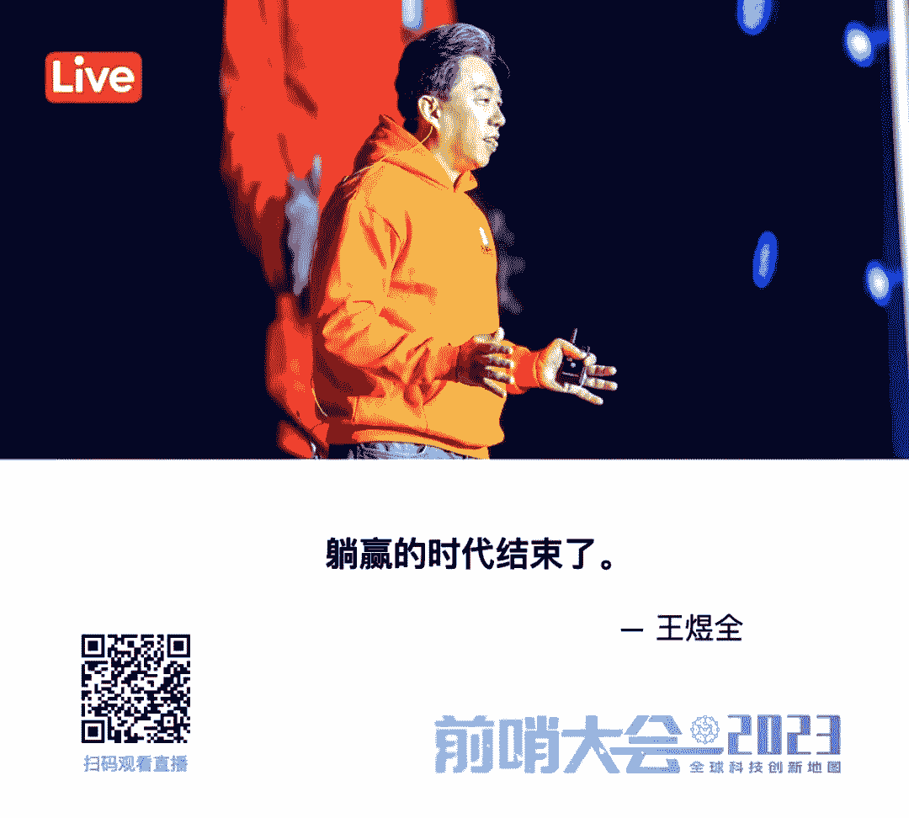
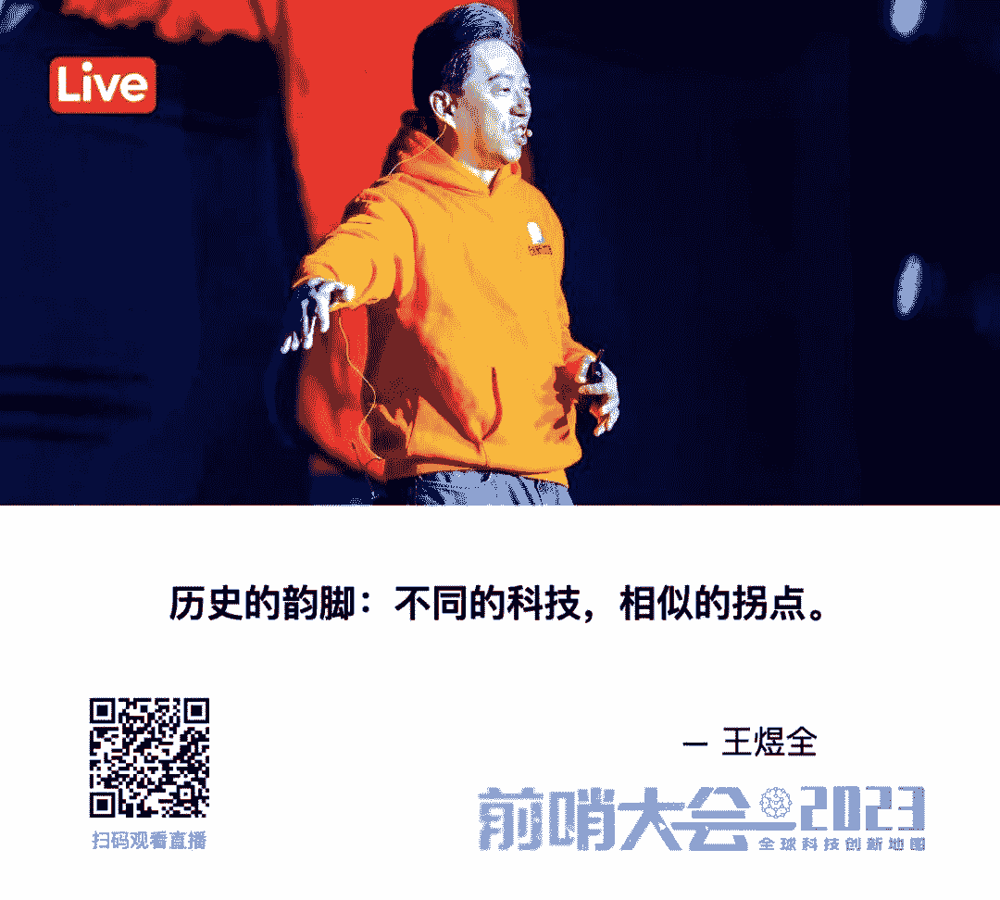
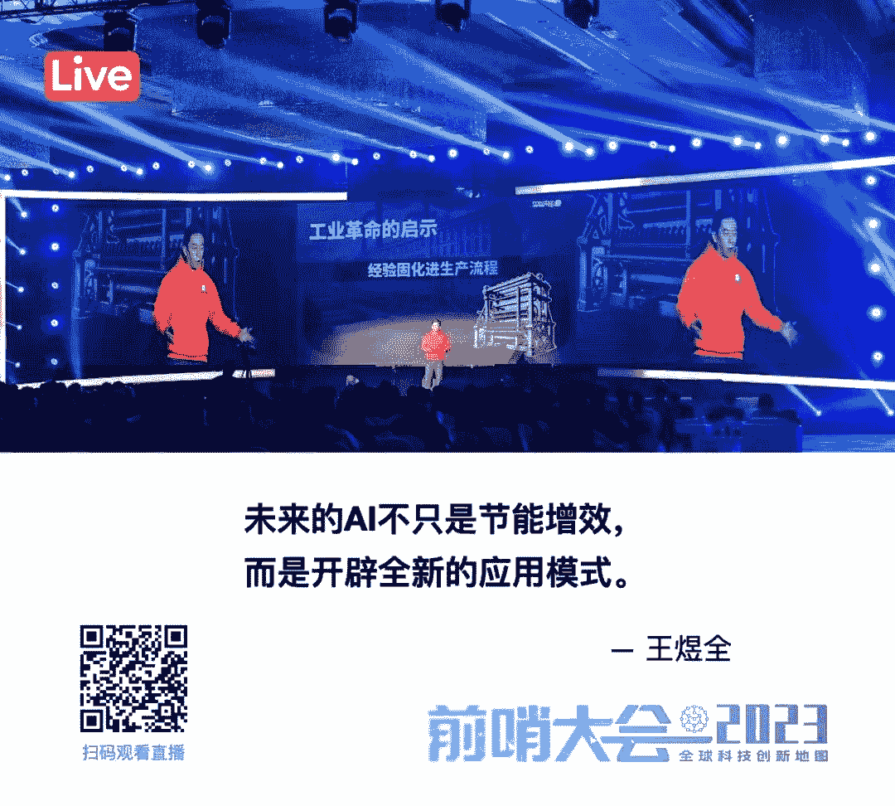
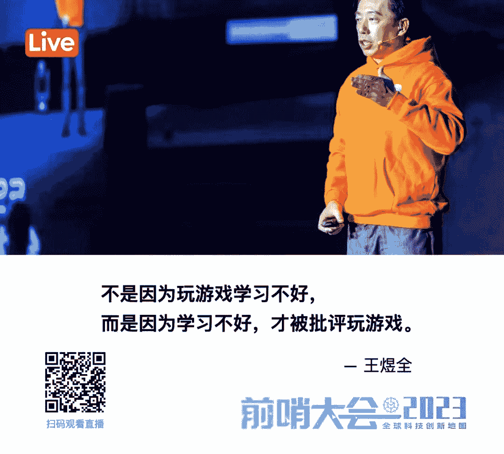
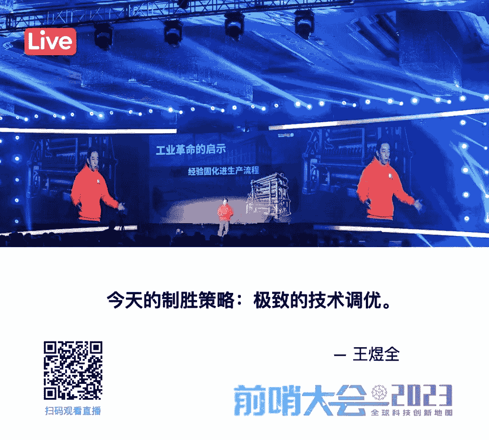
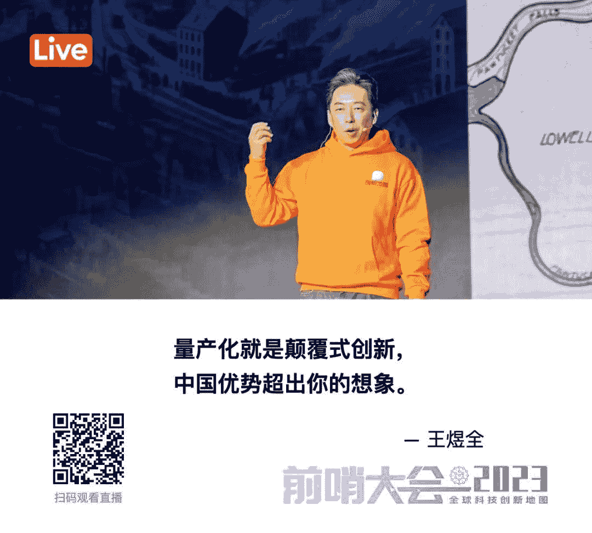
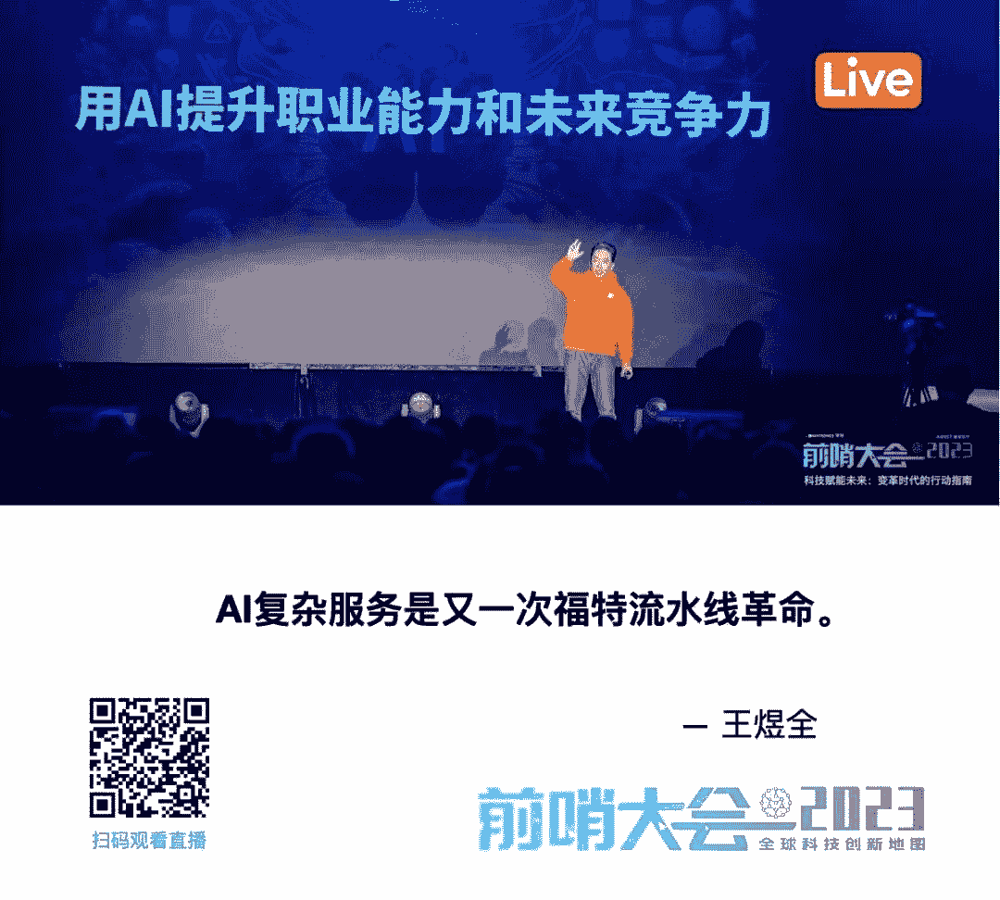

# 王煜全前哨大会2023：变革时代的行动指南

> 来源：[https://aigcreative.feishu.cn/docx/XuSvdDQmhozJAAxWrXxcT3ianMb](https://aigcreative.feishu.cn/docx/XuSvdDQmhozJAAxWrXxcT3ianMb)

> 🔗 原文链接：https://mp.weixin.qq.com/s/TM0WU-PHfEh7b1T3rOKyhg

我们正处在一个变革的年代，这场变革如此地深刻，以至于以后的规律和成功法则和以前都不一样了。也就是说，如果没有掌握正确的方法，即使你积极奋斗，结果依然不会好。

但反过来讲，如果你能够提前预知到未来，当大家都不知道未来是什么的时候，你比别人更早地看清未来，你就有了先发优势。

很多人成功以后都会回想当年自己多么有实力，但是我发现大多数成功者其实都是有运气，而且同时坚决地迈出了第一步，也就是入局早。

我们认为，这个时代孕育着巨大的机遇，因为当新的机会、新的趋势、新的规则展现出来的时候，如果你能够早早地把握，你就成了“第一批”。

我们都知道互联网的“第一批”是BAT，无线网互联网的“第一批”是字节、拼多多、滴滴等等，他们成就斐然。

如今，我们每个人都可能成为“智能革命的第一批”，所以今天的话题叫做“变革时代的行动指南”。

## 上篇：变化

### 一、变化时代的历史韵脚

我们以前理解一件事情，总是喜欢问有没有“先例”。但人工智能带来的智能革命没有成功的先例，如果你照着“先例去学”，你基本就做错了，你要找到一条新路。

但这种时候大家会陷入另一个迷茫的境地，先例都不可遵循了，那怎么找到一条路呢？难道摸着石头过河吗？

对企业来说，摸着石头过河是不可取的，因为你可能走在错误的方向。

幸好还有一个办法，就是马克·吐温说的“历史不会重复，但是会押韵”。我们可以去看一看历史的韵脚，找到今天的规律。

历史的转折出现过若干次，如果你把眼光放得更广阔一点，去看以前的一个完整的周期、完整的转折，你就会知道转折前、转折后出现了什么，你可以根据历史的“韵脚”去推导转折之后的发展趋势。

#### 1、躺赢的时代结束了

中国经历了40年的蓬勃发展期，然而任何一个经济体都不可能长期坚持超高速增长，当中国的经济体量足够大的时候，也会回归到常态。而常态就是经济总有起落，总有快慢，总有局部的好和坏。

也就是说，经济发展再快的时候，有些地方也是不好的，经济发展得再不好，有很多亮点也是可以把握住的。

这就意味着，过去我们大家都受益，但是未来能不能成功，取决于你自己的选择。

#### 2、拐点之后是萧条or腾飞？

##### （1）达里奥“金融周期理论”的缺陷

按照达里奥的“金融周期理论”，一个国家发展到兴盛之后，如果出现了衰败、大萧条，就要从零开始慢慢恢复到下一个繁荣，时间会非常长。

但实际上，1929年大萧条之后，美国迎来了大繁荣，从1945年二战结束到70年代初，接近30年的时间，经济高速发展，这和达里奥的理论相矛盾。

1920年，刚刚打完“一战”，各国都签了协议，握手言和。同时，科技带来了曙光，众多先进科技在20年代、30年代持续不断地进入社会，比如收音机、电视机、电冰箱、洗衣机等等。

大家对未来充满了期待，所以20年代不是灰暗的20年代，而是“Roaring 20s”，咆哮的20年代。

1928年到1929年，资本利率持续在5% -6%左右，但大家的预期非常高，以至于崩盘了。

所以，大萧条不是由于经济不好，而是由于经济好，预期却更高。

##### （2）卡洛塔·佩雷斯的“科技周期理论”

卡洛塔·佩雷斯提出“科技周期理论”，认为科技创新进入社会，为社会带来实际的收益时，要分成2个大周期、4个小阶段。

其中，大周期分为导入期和展开期。导入期就是新的科技路线已经确立了，并且在一个行业里得到运用和验证，但是还没有进入到各行各业之中。

这时，如果大家的预期过高，泡沫破灭，反倒会带来一个低谷。

美国经济学家Diago Comin说，一个经济体的强弱不是取决于引入先进科技的速度，而是使用先进科技的深度。

这句话和科技周期理论相结合，就可以理解经济危机的真正的根源。

科技进入社会的过程中，需要科技企业家利用先进科技把产品量产出来，让每个人都用上，增加使用的深度。只有深度够了，科技才能真正推动社会的发展。

1929年时，科技引入的广度有了，但是深度不够。人们却以为各行业都会繁荣，就会形成认知偏差，从而带来了灾难性后果。

#### 3、历史的韵脚：不同的科技，相似的拐点

现在我们碰到的情况很有可能和1929年类似，又有一大波新科技马上要进入各行各业了。

每一轮科技革命都会出现拐点，而每一轮的拐点都很相似。这时候要更有耐心，回到上一轮的科技革命中去看一看。

很多人把工业革命划分为第一次、第二次、第三次，甚至排到第四次、第五次了，但是这并不科学。

因为前几次工业革命实际上完成了一件事，我们称之为生产规模化，是物质生产的革命，它已经走完了一个完整周期。

现在，我们正在经历的数字革命，是虚拟产品的革命，正好可以把工业革命的完整周期当作参照，更好地读懂拐点之后的未来趋势。

我们很幸运，既有数字革命带来的巨大机遇，也有一个完整的已经发生的工业革命可以作为参照，作为历史的韵脚，帮助我们走得更稳健。

#### 4、工业革命之父不是瓦特，而是阿克莱特

很多人都知道工业革命之父是瓦特，但这其实是错的。

瓦特蒸汽机只生产了500台，而且完全是手工制造，没有实现规模化的工业化生产。

而在全球还有另一种说法，认为工业革命之父是阿克莱特，他也改进过蒸汽机，但他并不是像瓦特一样，在原有蒸汽机上做效率提升。

他把蒸汽机改造为适合工厂使用的机器。实际上，阿克莱特不仅被称为工业革命之父，还被称为现代工厂之父，他做的事情才是工业革命的本质，叫规模化生产。

从本质上说，瓦特只生产了一个技术产品，瓦特蒸汽机的贡献主要是两个领域，火车和轮船。但是它在整个自动化生产流程当中只是一个环节。

而阿克莱特利用复杂机械将纺织流程全部自动化，形成了连续化、系统化、自动化的生产，这才是工业革命的精髓。

#### 5、阿克莱特的启示：经验固化进生产流程

今年人工智能引发了一种恐慌情绪，很多人担心人工智能替代人类，造成广泛的失业。

那么，当年纺织机械自动化的时候，有没有造成纺织工人的大规模失业呢？

历史上确实有纺织工人失业，但并不是普遍失业，而是那些有经验的高端纺织工人失业了，但与此同时，也形成了大量的低端就业，就业人口大幅增长。

要知道，纺织以前是手工活，纺织厂中的工人都是以熟练的男工为主，需要多年的工作经验。

但是纺织机械出现以后，纺织厂厂主们最爱雇的是女工，甚至童工。当时阿克莱特的纺织厂普遍的用工年龄是10-14岁。

雇佣童工显然是不合理的，但当时的社会文明程度不高。

关键在于，原本需要非常熟练的技工才能从事纺织工作，后来，没有专业技术的人也能用自动化机器完成了，这就是自动化的价值。

所以，工业革命的精髓就是把专家经验固化到了自动化系统中，使得没有经验的人也可以操纵系统，做出比有经验的人更好的产品。

今天也同样如此，人工智能可以复制越来越多的人类经验，很多你以前不会干的事，现在可以通过人工智能完成了。所以，你会不会慢慢开始对未来有了一些期待？

#### 6、工业革命起源于英国，但美国为何后来者居上？

英国是工业革命的发源地，但是英国人很不幸，他们之前没有经历一轮完整的科技革命，也就没有把握住工业革命的精髓。

##### （1）美国盗火者塞缪尔·斯莱特

工业革命初期，英国的纺织技术相当于当今的“芯片”技术，所以英国限制纺织人才、机械、知识出口。

一位名叫塞缪尔·斯莱特的英国人，14岁的时候到纺织厂做学徒，在14岁到21岁的7年时间，他掌握了纺织业的所有秘密和技能，还把知识全部记在脑子里，移民到美国去了。

结果，斯莱特接管了一家运营不畅的美国纺织企业，不仅成功实现盈利，后续还组建了自己的工厂。

##### （2）美国制造系统：Lowell模式

斯莱特把英国纺织经验传授到美国之后，波士顿的一位投资人Lowell发现建纺织厂有利可图，就开始做纵向整合，不只是纺纱，还织布，甚至做出成衣。

在纵向整合时，用工的复杂度就增加了，男女老少都可以工作，所以，他和波士顿的其他投资人在一片荒地上打造了崭新的城市，并以他的名字lowell命名。

他也找到了工业革命的秘诀，就是形成整合式的生产，更高效地输出产品，收益也就更大。

##### （3）福特打开规模化制造的大门

不过，把工业革命的核心本质发挥到淋漓尽致的人，不是阿克莱特，而是亨利·福特。

阿克莱特生产的纺织产品相对简单，汽车产品更加复杂，而福特用流水线大幅提升了生产效率。

1913年，福特年产轿车3万辆，1914年，他们部署了流水线，结果年产轿车248000辆，产量提升数倍，这就是流水线的威力。

值得注意的是，福特让我们看到了工业革命的三个核心：规模化生产、规模化市场覆盖和规模化消费。

规模化生产用流水线实现，规模化市场覆盖由火车、轮船解决，规模化消费就是把产品尽量做得更便宜。

1916年，福特T型车售价360美金。而当时福特员工日薪约5美元，相当于72天的工资就能买一辆车。

最终，福特在20年间销售了1600万辆T型车，这个纪录几十年后才被打破，实属难得。所以找到规律，按规律办事多么重要。

我们今天仍然要向福特学习，就是因为他掌握了工业革命的真正精髓。

### 二、历史的韵脚再度出现

其实，在瓦特之前就出现蒸汽机了，叫做Newcomen蒸汽机，两者的应用领域高度相似，都是用于矿业、纺织、制造业、农业、军事等领域。

现在，GPT的应用领域与传统人工智能的应用领域也非常相似，性能极大提升，但是领域没有扩张，所以很多人认为人工智能似乎只能做到效率提升。

蒸汽机确实提升了效率，但之后被运用到各个行业中了，尤其改变了运输业。有了蒸汽轮船、蒸汽火车以后，世界的政治、经济、文化的版图全都发生了深刻的变革。

更不用说有了自动化的纺织厂、枪炮厂、印刷厂，尤其到了福特以后，复杂产品都可以被制造了。所以，蒸汽机之后出现了应用的井喷，而核心都是替代了人的经验。

那么，GPT之后会不会出现应用的井喷？我们的结论是一定会。

所以，如果今天还只盯着节能增效，就像蒸汽机的时代只盯着替代原有蒸汽机一样，会错失一个巨大的机会。

#### 1、未来的AI不只是节能增效，而是开辟全新的应用模式

千万不要以为AI只是一个节能增效工具，它会开创一个崭新的、巨大的机会的窗口，很多产业会因此而改写，也会有很多新兴产业出现。

我们非常坚定地相信，这一轮人工智能会让新一批的企业，像当年的BAT、字节一样逐渐走向成功。

即使2029年可能出现像1929年一样的危机，但别忘了1945年之后是连续的30年大繁荣。

所以，我们正面临着未来30年的黄金发展期，也是巨大的丰收期。

#### 2、前瞻者才能抓住未来

工业革命除了造就福特，还造就了洛克菲勒。1863年，洛克菲勒做石油精炼，当时是为了生产煤油。但是，当他发现汽车需求时，逐渐把重心从煤油转到汽油，因为他意识到了未来产业的发展方向。

芯片巨头英伟达刚开始做的是图形加速，用户主要是电脑游戏玩家，现在成了人工智能芯片龙头。

我们老觉得游戏很坏，但是很多非常有成就的人从小就玩游戏。所以，学习不好不要怪玩游戏，往往是不是因为玩游戏而学习不好，而是因为学习不好还玩游戏，就被人批评。学习好的人玩游戏就会视而不见。

2000年，斯坦福的研究生伊恩布克就喜欢玩游戏，他在玩游戏时接触到GPU，他还用校园里的GPU构建了一个小型计算网络，之后英伟达的CEO黄仁勋就让他开发操纵GPU的软件系统CUDA。

他们还花了很大力气在学校中推广CUDA，让学生们使用这个系统，调用GPU完成各种计算任务。这些学生们毕业了进入到工作岗位的时候，也会继续使用CUDA系统。

这才是英伟达真正的护城河，即使有人做出的人工智能的芯片，在某些性能上实现领先，但没有这套完备的软件系统，和完备的软件生态，就很难超越英伟达。

#### 3、三年看到成功模式，十年见证未来赢家

如果我们回顾历史，就会发现每10年就有一代企业在中国兴起。2000年前后是互联网企业，比如BAT；2010年前后是无线互联网企业，比如美团、字节、拼多多；现在是2020年左右，将会出现一批新的人工智能企业。

可以说，我们正处于可以亲眼目睹下一轮智能革命的赢家诞生的时间点上。今后三年里，很可能诞生下一轮智能革命的大赢家，大约10年时间就会超越现在的巨头。

#### 4、你做不了AI时代的瓦特，可以做未来的乔布斯

当年，有程序员拿技术问题当众为难乔布斯，但乔布斯回答说，你得从用户体验出发，倒推用什么技术，你不能从技术出发，然后去想如何才能卖出去。

瓦特就相当于提问的人，他的思路就是如何把蒸汽机做得更好，但不知道用来做什么。

而阿克莱特就相当于当年的乔布斯，思考的问题是如何实现纺织流程自动化。

你可能做不了瓦特，但是你能做阿克莱特，能做乔布斯，而他们才叫真正的科技企业家，是推动社会发展的核心力量。

前提是，你要熟悉前沿科技的能力边界，要做一个很好的使用者，我们称为“早期使用者”。

如果你是最早使用最先进科技的人，知道使用过程中的辛酸甘苦，知道如何改进它，使得人人都可以顺畅地使用，你就是下一个乔布斯。

### 三、科技衍生两大变革：全球产业重构与线上社会

科技往往会有涟漪效应，因为科技不只直接产生产品和应用，还会带来社会的改变。

其中两个涟漪效应非常显著，一个是全球产业链的重构，另一个是线上社会的建立。

#### 1、全球产业链重构

影响全球产业链发展的一个重要因素是美国的制造业外迁，但制造业外迁的逻辑是什么呢？

我们统计了从1981年至2020年美国不同规模企业的研发费用数据。

1981年，大约70%的研发费用来自大企业。但这一规律在慢慢被打破，现在大中小企业基本上各占1/3。

研发将从大企业来主导变成小企业主导，而小企业研发出新成果之后，需要与制造企业合作，但美国制造业企业已经外迁了。

七八十年代，美国有一股新的思潮，经济学家认为企业CEO的单一考核指标应该是股东回报，这就催生了华尔街对企业的新评判标准，就是投资回报率。

因此，越来越多的企业开始甩掉制造业包袱，把工厂迁移到制造成本更低的区域。

现在新一轮科技变革来了，小企业成了科技创新的主力军，可是他们和大企业难以合作，但和中国企业一对接，就发生了良好的化学反应。

长此以往，我们中国企业在跨国企业制造迁移过程中，学会了开放性地对接先进科技，培养了开放性、复杂产品的制造能力。

所以，中国的开放性、大规模、复杂产品制造能力是全球唯一。

#### 2、线上社会迁移

今天很多中国企业开始在国际上取得成功，比如原神成功走进了80多个国家，它也确实全球化，不光传播中国文化，也传播很多其他国家的文化。

另一个例子是TEMU，据说因为价格便宜，打得美国的一元店都很难受。

这是因为，我们的很多生活习惯都已经线上化了，所有的行为都可以被数字化记录，我们就可以从线上了解全世界人民的行为和需求，然后从中国往全世界卖产品。

这是一场进入线上社会的转折，而且从此不会再退回到线下。

我们一直强调，线上社会的特征是“物理世界坍塌，社会规则永存”。我们将越来越多地受心理距离影响，而不是受地理距离影响。

而我们做科技特训营的目的，就是希望研究出复杂系统，让大家一起理解科技与社会的发展规律，理解时代的新机遇，并且，与一群志同道合者，一起去把握机遇。

## 下篇：变革时代的制胜策略

了解先进技术，是因为先进技术会带来优势，把技术的优势发挥出来，才能形成制胜策略。

每一个先进的技术都会有它与之相匹配的制胜策略，我们要做的就是找到自己的制胜策略。用好制胜策略的人就会变成赢家，比如很多科技企业家，用科技来造富，成了赢家集团的一部分。如果整个社会都接受制胜策略，都践行着制胜策略，支持制胜策略，整个社会就变成赢家社会。

很多先进科技出现的时候，最早的人并没有发现它的正确用法，而一直到某个制胜策略真正被发掘出来，才形成真正的赢家，赢家的文化会扩散，扩散以后才进入下一轮，为下一轮的科技铺路，这是社会进步的真正原动力。

### 一、今天企业的制胜策略：极致的性能调优

成功的技术公司不是发明新东西的，而是让现有东西的性能最大化。

就像特斯拉对电池的极致调优，在电池性能上做剖析，做拆解，五项指标综合到一起，使得能效极大的提升，使得电动车业务模式可以成立，这是特斯拉的真正的成功秘诀。

所以真正的科技企业家或者科技企业干的事情，应该是极致的性能调优。

极致性能调优谁做得最好？中国。

美国人、欧洲人生产一个新车型，设计周期就要三年；中国人从有想法到交车三个月。因为中国是全产业链上下协作调优，锻炼出了一个复杂协作的能力，这个能力才是真正的中国优势。

### 二、中国真正的优势

苹果产品design in Califonia，但他没有说量产是在中国，他也不用说，因为哪个地方也量产不了。

每一代的苹果产品都需要几百名工程师，花好几个月的时间，通过协同调优完成量产化工作。

所以，我们说“从0到1”和“从1到100万”，这两个1不一样。“从0到1”的1是原型，`prototype`，“从1到100万”的1叫做可量产的原型，这两个1之间隔着几百个工程师和几个月的工作量，以及大量的对产业链和供应链的了解和经验，是遍布各环节的性能调优。

这是中国的真正优势，而不是代工。

但是很可惜，我们中国人自己不觉得这是优势，我们也觉得自己是加工、代工。美国也不觉得这是我们的优势，甚至没有一个英文词来说明什么叫量产化。如果连英文都没有，你怎么向全世界介绍中国优势？

### 三、中国优势的出海：变内卷为外卷

中国各个领域的同时内卷，造就了全产业链的极致调优能力，这是我们已经形成的优势。

但是中国不应该停留在内卷。内卷是为了练内功，我们能通过内卷把效率提升上去，然后我们就应该出海去发挥我们的效率优势。

我们的企业在国内可能竞争激烈，但是到海外经常没有对手，所以应该结束内卷，拿着内卷的成果去海外占领市场。

美国制造业要回迁，会需要中国的供应链支持、中国的制造业支持，不应该是简单地把制造业搬出中国、搬到美国。

而应该是中国制造业的全球化重新布局，有些环节放在美国，因为贴近用户，有些环节放在中国，利用中国的优势。

所谓的制造业回迁应该是一个重构，重构的主导者是中国人。因为现在产业链的核心是中国，重构的目的是贴近用户需求，而不是搬出中国。

## 四、学习日本出海的三个经验

中国出海要学习日本，有三个方面需要重点学习。

### 1、影子日本：不是外迁，而是外溢

日本的产业链是全球布局，从80年代开始，日本全球建厂大步全球化，但不像美国把制造业都迁出了，日本本国的生产没有消失，而是通过本国生产和全球生产共同发展形成更大的产业链和更强的竞争力。

中国也要走过这一步，中国制造不应该只是中国人在中国制造，而应该是中国人在全球制造。

中国人根据全球的最优布局，重新改变全球的产业链，形成最优输出，这个只有中国人才能干。

日本是外溢不是外迁，本国制造不能扔。中国所有的企业一定要记住，全球化不是从中国搬到外国，没有了中国的根，优势就丧失了，本土要继续做强。

日本用了30年时间，做到了在海外的GDP几乎等于国内GDP，被称为“影子日本”，就是在海外做了一个日本。

中国内卷了这么多年，实力强大了，一旦出海，有没有可能也用30年做一个“影子中国”？

如果有影子中国的支持，中国的经济一定好，因为那时候我们能把全球经济连成一体，使我们的体量放大很多，对我们的整体竞争力的提升将有巨大的帮助，我们在全球不可能被人打败。

### 2、先进入发达经济体

全球的经济体大致分为三类：发达经济体，发达经济体周边（如墨西哥）和新兴经济体。

中国出海是什么步骤？先去新兴经济体，发展中国家，因为市场门槛低，容易进入。

但是门槛低是有原因的，因为市场经济不完善，进去容易，但进去以后容易被关门打狗。小米在印度的遭遇不会是孤例。

日本是怎么干的？首先布局发达经济体，在欧美布完局了才来中国和其他的新兴经济体。

这个顺序非常重要，因为发达国家它确实门槛高，但是进去了以后大家遵从同样的法律和标准，相对风险低，可预测。

企业经营不怕困难，怕不可预测的风险。要学日本让我们的产品和服务先进欧美，产生示范效应，就可以从欧美扩散到其他国家，而反向的示范效应不存在。

### 3、非高速增长的时代也能成就成功的品牌

有人说，未来这些年中国经济的增速一定会降下来，不会再高速增长，机会就少了。

但我认为仍然有机会，这方面又要学日本，日本过去30年增速都低，但是塑造了一批性价比超高的品牌，比如无印良品。已经有了优质的制造能力，就没必要让知名品牌吃掉我的利润。

即使增长放缓，通过追求极致的性价比，用具有优势的价钱给用户最高的体验，用极致性价比去形成别人对我们品牌的信任，企业家仍然可以找到机会。

再用磨炼出的品牌去出海，就可以占领全世界，成为全球新物种。

当然，出海的品牌不是简单地用国内适用的产品去打海外市场，而是要做好面向海外市场的前置研发。

比如制造剪草机的中国企业，在向美国市场提供产品的时候，要理解美国消费者的需求，是在剪草后把草收集起来让垃圾车运走，而不是抛洒回草地，所以收集型比抛洒型更适用。

出海时要针对对方需求做前置的研发，为当地用户开发产品，你就会做得很成功。

## 五、中国企业要学会领军，要有领导力

中国已经有一些产业链优势了，但中国企业要想成为最大的赢家，还缺乏一个重要的东西：领导力。

领导力是告诉整个产业链什么是未来的方向，然后大家才能一起往那个方向走。

雷军和乔布斯都做手机，都上台演讲，演讲的差异在哪？

在于雷军的演讲叫高端之路，告诉大家我的产品很棒，但是乔布斯的演讲讲什么？他讲我知道未来要往哪走，请你相信我跟我一起走，大家能共赢。

乔布斯讲的是未来的方向，讲的是如何协作，讲的是如何一起去塑造未来，他的重点不是放在苹果的具体产品或技术上，而是放在大家可以协作产生价值的未来方向，所以他的演讲重点放在苹果应用商店APP store上。这就是区别。

中国已经到了一个时点，很多科技前沿的布局都挺早的，各个环节都有了一定的长板，但是我们几乎没有看到在全球能够领军的企业。

不领军就会出一个问题，曾经产业生态全面领先，但是领军企业不是你，人家会把领先成果拿走。

比如电动车产业，虽然产业生态在中国，美国只有一个拿得出手的企业特斯拉，但它在领军全球。

领军的好处是能把行业大部分利润拿走。苹果厉害在它把整个手机产业一半以上利润拿走了。这种情况未来在电动车产业发生的概率很大。

不要以为中国电动车产业强、产业生态完善，利润就最大，很有可能未来全球的电动车产业的利润一半都被特斯拉拿走。而他有底气拿走全球的一半利润，是因为中国的产业生态给了他支持。

苹果我们没话说，人家自己构建的产业生态，但是电动汽车产业我们能不能避免这样的事发生？因为是中国主导的产业生态，如果因为我们不领军而被人拿走胜利果实，那太不应该了。

所以中国的竞争要走到下一个阶段，就要学会领军，学会指方向，学会协同。

## 六、人工智能带来的新机会

回头来看最大的机会还是人工智能。

我们也反复强调这个时代的核心就是人工智能，今天的人工智能就像当年的蒸汽机一样，正在掀起数字革命，带来无数的新机会。

当然，面对同样的事情，有的人认为是机会，有的人就不这么看。举个例子，同样是AI下棋战胜人类，就有三种看法。

第一种，围棋界Alpha Go战胜李世石，有的中国的棋手从此认为围棋不值得下，因为永远战胜不了AI，那还有啥可玩的。

第二种，国际象棋冠军卡斯帕罗夫被AI深蓝打败，但他有另一种角度。

卡斯帕罗夫承认AI赢了自己，但没能让他佩服。因为当时的AI只是靠算力暴力破解，不够美。

所以卡斯帕罗夫开创一个更牛的国际象棋的玩法，人机协同的国际象棋比赛，人和机器自由组队，不管是几个人，不管几台机器你自己组，反正这一拨人一拨机器最后跟别人下棋，赢了就算你赢。

最后赢家是两个IT专家的业余棋手，组织了五六台不同的国际象棋程序，由人来选择哪个程序做得好。

卡斯帕罗夫认为，这种人机协同的方式不光赢了棋，还下出了国际象棋的新高度，下出了国际象棋的美。

第三种，是韩国棋院的角度。

年轻棋手偶尔得到高手培养就会很高兴，但高手不是天天有时间陪你的。

现在有了Alpha Go，它不但可以随时陪你，还能永远高水平的教你，这意味着什么？

意味着Alpha Go战胜李世石之后，每个人都可以请Alpha Go当教练，韩国整个棋院就是把训练教练全部改成人工智能。

现在韩国出了一批新兴的年轻棋手，叫做人工智能风格的棋手，因为他们的师傅是人工智能，通过这些你是不是能够得到一些启示？

首先，要学会和人工智能协同，千万不要和他竞争，因为他会的东西就不值得学了，它一定会比你强，即使今天不如你强，未来会比你强，因为它进化速度更快。

今天前哨大会开场的AI王煜全还不太流畅，但用不了2年它一定让你难分真假，因为它演化速度太快了，一旦开始进化就收不住。

所以你一旦跟AI冲突就别玩了，把它当成工作伙伴，而不要把它当成竞争对手，当竞争对手你必死无疑。

杜克大学的陈怡然教授有个说法：你要把人工智能当成工作伙伴，而不是你的工具。

其次，Alpha GO在围棋上是能无限复制的教练，在其他领域也会发生类似的事情。今天是围棋教练的服务被批量复制，未来还好有更多这样的智能服务出现，所以我们说服务规模化的时代来临了。

以前能规模化的只有产品，服务就做不到规模化，而且越高端越不能规模化，越专家级的服务越稀缺，未来AI会把这两者结合起来，能大规模提供、高端、个性化的持续服务。

为什么要说这4条？因为能实现这4条结合的智能服务能赚大钱。

工业革命以来，人类进入GDP指数级增长阶段，互联网出现了以后，很多人认为GDP并没有明显的增长，为什么？

因为互联网本身的价值主要是节能增效，它并没有带来太多的新增业务，线下销售搬到线上并没有新增GDP，因为本质没有变，所以整体GDP的增速没有看到上升。

但是人工智能来了以后就跟当年的工业革命一样。

福特T型车形成新的市场，带来GDP增长，你做汽车，我们发明电冰箱、电视机等等新商品，GDP自然就会猛增。

所以四到五年以后，AI用得好的国家GDP增长速度会明显加快，原因就是大量的新的智能市场形成。

这也就是为什么我们说未来30年是光明的，因为人工智能会带来GDP的加速增长。

为什么没有人发现这个趋势？因为我们用韵脚来读未来，不是只看现在。

现在大家讨论最多的还是AI大模型之争或者说AI性能优化。

这些问题工业革命的经验已经给出了回答，蒸汽机出现以后最大的机会不是围绕蒸汽机的，而是让蒸汽机用到产业里的，是阿克莱特式的，乔布斯式的。

今天的AI大模型就可以看作是蒸汽机，看到这点你就会明白，大量AI公司都会倒闭，不是它们的业务不成立，而是它们的业务将来很危险，只是做技术的性能调优，将来会被平台替代掉。

所以今天的很多基于人工智能创业企业只有两条路，要么破产，要么被收购，很多收购可能也不是因为这个企业的业务好，而是因为这些人好，团队值钱。

那么未来的方向到底在哪？那就是服务规模化，提供智能服务，比如说私人助理服务。每个人都想要有个秘书，现实中肯定不能实现。

有了人工智能，你的秘书就可以无限复制，可以保证每个人都有秘书，哪怕你就是个秘书，都有你的秘书帮你干好秘书这份工作。

## 七、人工智能进化的四个阶段

这也正是我们说人工智能未来有4个阶段的原因：性能调优、降本增效、简单服务和复杂服务。

性能调优和降本增效很好理解，但什么叫简单的服务？

就是一次就能给你解决问题的服务。比如，律师、审计师、会计师甚至心理咨询师，因为他们提供的都是单次服务，这种服务很容易被AI学会、标准化。

复杂服务什么意思？就是能够持续伴随你、了解你、能给你提供长期个性化建议的服务。

未来人工智能一定会走向复杂服务，带来又一次福特流水线革命。

它什么候会实现？也可能5年也可能10年，但至少我们现在已经在设计人工智能的复杂服务，尝试加速它的到来。

智能服务的设计，既不同于产品设计，也不同于服务设计，是个全新的系统。我们正在搭建这个系统，还会再进一步完善它，希望能一起构建出下一个经济发展的引擎。

所以OpenAI不在我们这儿没关系，因为今天的重心不是设计蒸汽机，而是把蒸汽机引入各行各业。

今天我们行业里的每一个岗位都要重新定义、重新规划，因为智能服务需要重新设计。

比如，我特别想把一个职位替代掉——公司前台。原因很简单，研发、销售都有清晰的晋升路径，前台没有。你听说过前台经理、前台总监、前台副总、前台CEO吗？

为什么要设立一个没有前途的职位？这种替代不但必要，还非常有意义。

这也正是简单服务还没有普及，我已经在研究复杂服务的原因。

这个时代需要前瞻的人来驱动，因为前瞻的人、提前布局的人才会让这个时代加速进步。硅谷流行一个词叫做有效加速主义，既然我知道技术必然到来，不如让它来得更快一点，来得更早一点，来得更猛烈一点，更好让大家受益。

希望我们是中国的有效加速主义者，让科技来得更快更早更猛，让更多中国人拥抱科技。

## 八、人工智能加持的健康服务

有效加速当然也要有效才行，我们正在做的健康服务会先做单次服务，每天给你解读健康数据，日积月累时间长了以后升级成复杂服务，把你的健康需求全部囊括。

在这里就要推荐一本新书《超越百岁》（Outlive），即将在国内出版，我前段时间也专门解读过。这本书的作者彼得阿提亚提出了一种基于生活管理的长寿方式，让人健康地保持长寿。

现代医学那么发达，按理说让健康人长寿应该很简单，然而现代医学主要靠效果衡量一项技术，只看治病救人有没有用，如果人没生病，它就不起作用。

所以现代医学这么多年的发展，让我们对病人非常了解，对健康人却几乎一无所知。

有心血管专家、糖尿病专家，却没有健康专家。有了人工智能和智能可穿戴的数据支持，我们终于可以开始构建健康专家了。

当然，这事有点梦想的成分，毕竟是希望颠覆掉现有的以病人为中心的健康体系，构建一个面向未来的以普通健康人、正常人为中心的健康体系。

这也是我为什么觉得很兴奋的原因，我们真的是活在一个了不起的时代，我们所有的梦想都有工具去帮助我们去实现，人工智能是你最好的伴侣，是最好的朋友，帮助你实现一个以前从来不能实现的梦想。

比如，我们天津海银落地的项目舌片平衡仪，就能接入到未来的健康平台上，通过人工智能分析，个性化的提供给每一个需要的人指导，帮助老年人预防摔倒的风险。

这样的技术整合越来越多，我们就一定能实现全社会的长寿，这是了不起的事情，也是人工智能真正给我们带来的福利。

## 九、人工智能加持的教育

除了医药健康，我认为下一个会被冲击的就是教育行业？

因为现代教育本质是工业革命时代的产物。工业革命需要大量的协同，所以要标准化、规模化的特定人才，每个人都是一个不同类型的螺丝钉，所以高校分出很多科，分出很多系、很多专业，每个专业都标准化地输出合格人才。

我们进入到数字革命时代，所有机器所有能够自动化的事情都不应该由人来干，人应该从过去标准化的流程当中释放出来，人应该干有创造力的事情。

比如，老师为什么老宣传我们应该勤奋，请问你读小说需要勤奋吗？读金庸小说需要勤奋吗？打游戏需要勤奋吗？

你不能把学习做得像游戏一样有趣，你就怪学生不勤奋。

今天很多学校抵制GPT，很大一部分原因是GPT比老师懂得多，会损害老师的权威。事实应该是反过来的，凡是GPT会的学校都不应该交，要不然你交了也没有用，因为我们怎么可能比GPT干得更好。

所以我们要反思教育。真正的教育是什么？是让人在未来活得更好。我们都知道人工智能是未来世界的必备工具，今天你凭什么不让孩子们掌握呢？

使用AI也不是那么简单。用过GPT的人都知道Prompt，今天会不会用Prompt，能不能问出好问题结果天差地别。

如果你认同AI是未来就会明白，真正应该学习的是如何提问，聪明地提问，让人工智能为你回答，就像今天大多数人为什么学开车而不是跑马拉松？因为开车明显更快。

## 十、AI之外的新机会

AI之外还有几个机会也值得关注。

比如2024年一定会火爆的MR，混合现实。

今年，苹果出了个Vision PRO挺火，可惜卖3500美元。Meta出的平替Oculus Quest 3很有可能成为现象级产品，单年销量有望超过千万，圣诞节就可能爆卖。

为什么？因为MR比VR有一个飞跃式的进步，不只可以在虚拟世界玩游戏，还能和现实互动，这就会产生一系列的新东西。

比如和教育结合，MR头显就能在实际场景中互动学习，相当于有个老师跟着你，随时和你互动解答。

而且都是生活问题，因为学英文当然先解决生活问题了。

我的英文到现在跟国外的任何专业交流都没问题，但是家庭生活依然有问题，因为我没有在家庭生活里体验过英文环境，所以到今天，我不知道床单、被单的英文。但是如果有个MR我就会学会了，我就可以日常交流了，你会发现世界就不一样了。

MR 之后还有两个大机会， AI 叠加而成自动驾驶，和机械臂结合的智能机器人都值得期待。

## 十一、充满AI的时代

随着AI技术继续进步，我们身边都会充满AI。

这让我想到，现在有个游戏《完蛋，我被姐姐们包围了》，讲一个男生被各种美女追着跑的故事。

未来无论男女都能体会到一样的感受，只是我们都是被各种人工智能驱动的帅哥美女包围。

我前两天参加一个讨论会，还有专家认为AI时代我们会更需要人的服务，因为AI不够人性化。我告诉他这是拿今天的AI去想象未来的AI。

未来的人工智能靠着数据优势能对你了如指掌，肯定特别会哄你开心，早晚有一天，你的人工智能好友数量会超过你的人类好友数量，因为那些人工智能好友更全心全意地帮助你。

今年7月份做前哨AI创业营时，一位19岁的小女孩就提了个非常了不起的想法，用AI组成一个苏格拉底、孔子、老子的AI牛人专家团，有什么问题AI共同讨论提供意见参考，这样的想法是不是很有意思？

今天已经有人将它变为现实，只是还没有成为产品标准化推出。这个实现的过程也不是一蹴而就的。

我们经常说科技推动世界的三个步骤，行为改变、习惯改变，观念改变，对我们每个人也是一样的。

第一行为改变，从现在做起，主动接受新科技，主动使用人工智能，还没使用的赶紧用，不会用的上我们的前哨AI小课。GPT、文心一言都可以，先用了再说，用的时候逐渐地积累经验。

第二习惯改变，要学会和机器配合、做好人机协同，培养人的机器智商，要让每个人学会做AI时代的苏格拉底，通过不断地问人工智能找到答案。我自己做研究就是这样，通过不断的深挖问题找到答案，不需要我去枯燥地搜索收集素材，也很有成就感。

最后是观念的改变。未来随着AI技术融入我们生活的方方面面，人类社交、生活的观念也会发生三大变化。

第一，未来理念共同体才是人类社交生活的中心。

以前大家和邻居成为朋友，因为地理距离限制只能认识这些人，未来会和志同道合者成为好友，因为心理距离更重要。

比如我们前哨科技特训营都是认同科技的人，大家之所以今天坐到这，因为我们都认同科技改变世界，因为我们都愿意一起来探讨科技改变世界的规律，践行规律，真正地成为这个世界的推动者，我们就可以长期一起同行，我们就可以形成叫做理念的共同体。

第二，未来每个人都必须学会接纳焦虑。

没有了地理的限制，人们不再简单从属某个组织，必须学会面对个人焦虑。

好消息是斯坦福大学做了一项研究，发现只有你认为焦虑会损害你的健康，焦虑才会损害你的健康。

就像现代医学要重新认识焦虑一样，我们每个人都要学会正确认识焦虑，它是正常的情绪反应，学会拥抱焦虑，焦虑状态很正常，享受焦虑，它能让你更优秀。

第三，未来每个人都要学会协作。

以前有个长勺寓言，地狱就是桌上摆满了美食，周边围着饥肠辘辘的人，每个人都拿着很长的勺子，却吃不到勺子里的食物；天堂中一切都一样，只是人们互相喂食。

同样一桌美食，协作就能让地狱变成天堂。

智能服务时代，每个人都能更好地发挥自己的专长，中年人不必为了养生变成一个喝枸杞茶的半吊子健康专家，让AI为你做长寿服务吧。

你需要做的是把自己的长处发挥到极致，然后让AI将它变成智能服务提供给其他人。

这样的未来世界会非常丰富多彩，因为每个人都要找到自己最擅长的部分，最热爱的部分。

这样的未来世界人与人的联系会更加紧密，因为智能革命后人和人之间大量提供服务，虽然背后是由人工智能提供的，但是前面有人来跟你互动。

这里历史的韵脚再一次出现，工业革命让很多人掌握了机械化的工作技能，智能服务革命后更多人会掌握高端服务的能力，每个人都能成为高端服务的一部分，随着人工智能不断进步，服务水平还会继续提升。

这样的未来不光有GDP的增长，还能让每个人发挥自己的优势去服务别人，提供者获得成就感，接受者获得便利，构建新的时代。

当然这一切都没有先例，都必须靠我们一同去创造！

这个过程少不了焦虑和迷茫，但这个时代需要更多人去干那些没有先例的事儿，因为这是一个崭新的时代的开始。

就像开篇我和大家说，未来的30年一定是经济黄金增长的30年，30年之后再去看今天一定会大不一样，有很多东西会匪夷所思，就跟工业革命蒸汽机出现以后30年再去看当年一样，会完全不一样，有大量的新物种会涌现。

说了这么多，因为我实在太兴奋了，想让你也兴奋；因为我已经在行动了，想让你也一起行动；因为我看到了一个崭新的转折点，希望你也一起来见证这个时代的转折。

10年、20年、30年之后，当我们一起庆祝，会感叹自己曾经做了一个多么正确的决策，决定在这个时代行动起来，不躺平，决定了我们可以看到一个多么不同的未来，体验一段完全不同的人生。

希望每年的前哨大会都和你一起去记录，记录这么一段共同成长的旅程，谢谢大家。

<https://aigcreative.feishu.cn/sync/K4Gvd9vUQsy9Oubwqaeclu0Fnbg>
