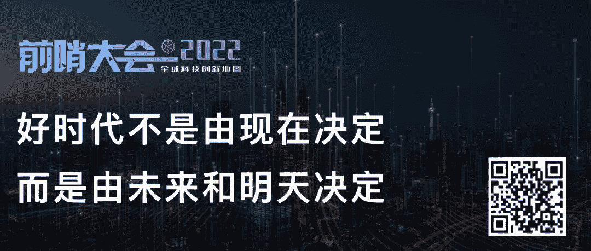
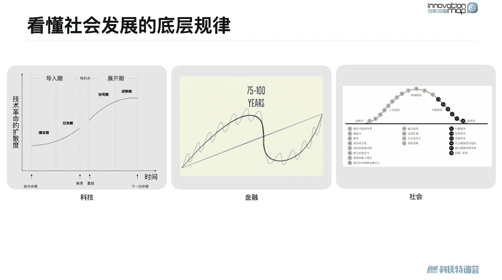
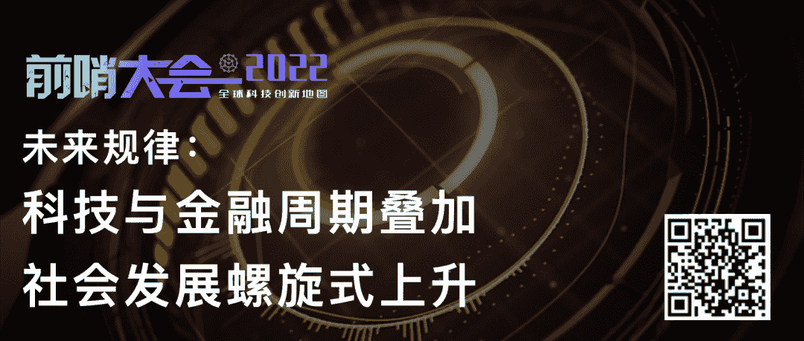
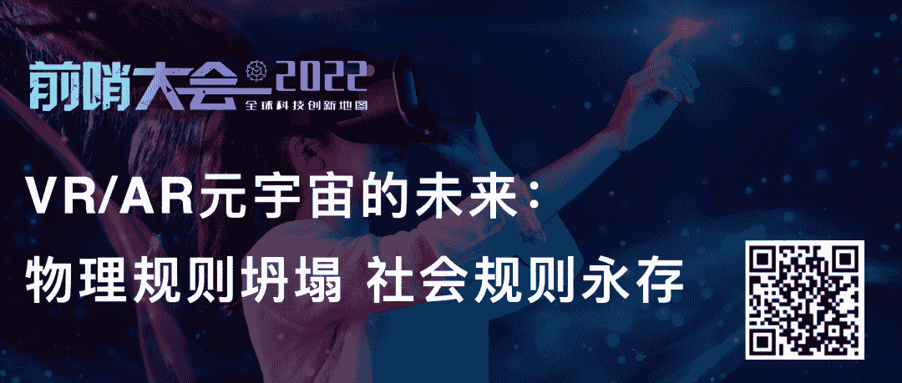

# 王煜全前哨大会2022：看透未来30年的大趋势

> 来源：[https://aigcreative.feishu.cn/docx/TsHZd8CLwoWtxcxesuAcU25hn1c](https://aigcreative.feishu.cn/docx/TsHZd8CLwoWtxcxesuAcU25hn1c)

> 🔗 原文链接： h[ttps://mp.weixin.q](https://mp.weixin.qq.com/s/AMtP520RrwGBRTDeS-oDdg)q.com/s/AMtP520R...

12月25日，王煜全为大家带来了：「前哨大会2022·让未来解决现在」，3个小时高密度的知识分享。

「上半场：知」详细阐释了王煜全独家预测方法论，4大未来趋势判断；「下半场：行」总结了实践经验和行动指南。

今天，我们放出大会上半场精读文字稿，和你一起看透未来30年。

大会全文精读稿将在特训营内部放出，2023年的产业分析即将启程，现在加入「前哨科技特训营」，还有元旦福利赠送。

欢迎长按二维码，在新一年共同站到科技前沿，一起抓住未来趋势！

## 01 - 让未来成为你的核心竞争力

你好,我是王煜全，欢迎来到前哨大会2022!

过去几年，我相信很多朋友过得都不太顺，尤其是今年2022年我听到了很多抱怨，很多人都在说，我们生活在一个很糟糕的时代.这好像很有道理，疫情还在肆虐，让我们的出行很不方便，也影响了我们的生意、影响了我们工作。很多大企业都在裁员，同时，股价也大跌，很多我们寄予厚望的科技股甚至价格腰斩，很多专投科技股的基金，股价都已经是只到了以前的一半。看起来，真的不是一个好的年代。

但真的是这样吗？如果我们认真思考一下，我们是怎么定义一个好年代的，你会发现其实一个好年代未必是我们在当下正在过着好日子，它往往是我们有未来的年代。想想我们觉得最好的年代是什么？就要回到改革开放之初80年代初的时候，论自然环境自然条件经济条件，比今天要差的远了。但是那时候我们改革开放，人人都看到了希望，人人都看到了未来，我们有了更多创业的机会，我们有了更多求学就业的机会，有了更多向全世界展望的机会，那时候人人都觉得这真的是一个好的时代。

是不是好的时代，往往不是由今天定义的，而是由未来、由明天所定义的。

那么我们现在这个时代的明天是什么，一个我们看得见的明天就是疫情应该很快会过去了，现在已经出台了一些放松疫情管控的政策，可想而知，明年大概率疫情会逐渐过去。疫情过去以后很多产业就会恢复，甚至有很多产业会出现报复性的反弹，比如说像消费产业，过去这么多年，都不能好好的跟家人出去吃顿饭了，餐饮业还会不繁荣吗？我们过去这几年都没有好好的旅游了，那旅游业还会不反弹吗？所以你都看得见机会就在那，甚至这还不是全部。

我们认为更大的一个机会，是未来会出现数字革命的展开期。我们认为，科技革命是一波一波的潮流带动的。这一波最主要的潮流，叫做数字革命，它是由软件、硬件，最早的PC，到后来的互联网，然后再到今天的人工智能，这几波潮流叠加起来实现的，那它实现了什么，就是使得每个人的经验都可以被复制了。

想想看，能够帮我们看医学片子的人工智能，相当于一个很资深的医生；帮我们能够实现自动驾驶的人工智能，相当一个非常专业的司机。这些都是人类经验的积累，能够被规模化的复制。所以我们说，我们正在迅速进入一个服务规模化的时代，在这个时代里，人人都需要别人提供更多的服务。

注意，不是产品而是服务，这种时候你的需求就会扩展很多，因为很多时候你用产品满足不了自己的需求，但是别人帮你来提供服务就可以满足你的需求。这个时候你就会发现，市场会迅速的展开、迅速的爆发，每个人都将会因此而获益。不夸张的讲，我们正在进入一个黄金30年。这黄金30年，可以和美国二战后从45年到70年代初高速发展的30年相媲美，我们每个人这一生大概只能经历这一次高速的发展。你看，多么令人兴奋的未来。

问题又来了，这是个好事，我们能把握住吗？

第一你要勇敢的行动不是夸夸其谈。

第二你的行动你的能力，要能够承担得起时代对你的要求，你要和时代的需求相匹配，才能抓住这个机会。当然这个能力的培养是要花时间的。我们认为在经济活动当中最重要的一个规律，叫做延时反馈。一方面一个企业的成长，不是说今天你决定了做一件事，明天就会成功的，它要花很长的时间，甚至我们知道的一些很快成功的案例，再快也都好几年吧。Facebook可以说是世界上最快的成功案例之一了，它从2004年成立到2012年上市也经历了8年，已经是世界纪录了。更别说很多我们今天认为飞速成长的公司，其实都已经十几二十年了，像特斯拉其实都已经十几二十年了。这意味着什么，意味着说任何的付出都不会立刻有成就，都会要一段延时，这个成绩结果才会显露出来。

不光企业经营如此，其实人也是如此，你今天付出努力，在一个领域里想要变成专家，不可能是今天付出努力，立刻就成为专家。你要花很长的时间积累，我们都知道一万小时理论。假设你一天能够花8小时，一万小时就要1,000多天，算下来就要3年的时间，这个时间的积累是跑不掉的。你只有充分的积累之后，才能享受那个成果。

我们看到了未来有机会，我们要学会去把握它。真正能够把握住未来机会的人，不光是能够看到机会，而且是能够现在就开始行动，而且能够持续行动，一直坚持到自己的能力能够得到体现、时代的机会又已经出现的时候，你用你的能力，可以把握住时代机会。这种时候，你就可以享受到胜利的成果了。和这个延迟反馈相匹配的，不管是人也好还是企业也好，你要想获得成功必须要另一个能力，叫延迟满足。

我小时候的教育是人要非常的勤奋，因为宝剑锋从磨砺出，十年磨一剑，铁杵磨成针，似乎勤奋能解决一切问题。但是你会发现，这是一个越来越多需要我们脑力的时代，因为简单重复的劳动，都被人工智能给替代掉了，需要我们有创造力，需要我们更加活跃的思想，来为我们来贡献力量。这种时候光勤奋是不够的，甚至说，勤奋能让你坚持一天甚至坚持一年，但不能让你坚持一辈子。

这种时候需要另一种特质叫做热爱，你真正爱这个工作，你喜欢它你发现了它的乐趣，你钻进去的时候你不觉得是困难的。我们学习老会说必须要勤奋，为什么，似乎不勤奋就学不下去，但是没听说打游戏需要勤奋的，没有一个小朋友说我打游戏必须要勤奋才能坚持住，要不然就坚持不住了。很多人打游戏废寝忘食通宵，他也没有任何障碍。在兴趣面前的时候，勤奋都变得是次要的。我们认为，最好的坚持是什么，是热爱这件事情。

对这个世界、对这个社会推动最大的是科技，尤其现在正是一轮科技革命，能够进入到各个行业各个领域，为全社会带来推动的这样一个时间点上，可以说科技使得每个领域都充满了机会，那么我们只要能够充分的爱科技，我们愿意在科技领域去探索去学习，能够长期的坚持，当科技的风潮真正到来的时候，无疑你就会是最后的赢家。

简单说，我们认为，现在这个时代其实是一个好的时代。好的时代的定义，不是现在已经硕果累累了，不是收获的时代，而是播种的时代。现在你要去播种，未来3年后 5年后 10年后 20年后，一定能得到特别大的收获，我希望我们每个人都能把握住这个收获。

## 02 - 未来辉煌的30年

我们人大体上都是环境的动物，环境不好，我们对未来的看法就会悲观。所以现在各种负面的声音比较多，有的说经济形势不好还会影响很大，有的说科技发展也已经停滞了，现在是一个科技大停滞的时代。但是为什么只有我们在旗帜鲜明地说，现在不光好，而且是非常的好？因为现在还没有开始，但是马上要进入一个30年的辉煌发展期，而且这个辉煌发展是人类历史上的一个新的巅峰，以前从来没有达到过，当然不是说往后就下去了。人类历史一直是指数级发展，当我们爬到新的高峰以后，又看到更高的高峰，未来一定更加的辉煌。但是至少我们现在看得见，未来有30年的高速发展期。

我们为什么敢做这样的预测，应该说基于我们很多年的预测的历史。我们有很多成败的经验教训，同时我们也吸收了别人的很多东西。第一个我们要坚定的相信，未来是可以预测的。首先我们说未来可以预测的第一个重要的证据是什么。相信在80年代经历过那段时间的人都会记得有一本书叫做《第三次浪潮》，阿尔文托弗勒的书，在第三次浪潮里，他明确的提出数字革命的概念，认为数字革命会改变一切。也就是因为有那本书，中国当时的老一辈革命家，老一辈的领导层决策者们，他们意识到中国要赶超，因为我们当时国力很弱，我们必须要有科技来做弯道超车的机会，所以我们举国支持科技产业发展。863等这一系列的计划，都是在推动科技产业发展，所以我们有了今天的地位。和当年我们的对未来的预判，是高度相关的。

我们都知道工业革命以来改写了人类历史，有很多人总结工业革命的周期也好，一波一波的潮流，有人总结叫做第一次、第二次、第三次、第四次，一次一次的工业革命，他认为现在在第四次的工业革命。还有Carlota Perez，一个委内瑞拉裔的英国学者，写了一本书叫做《技术革命与金融资本》，他就说，技术革命当然是有一波一波的潮流的。但是其实每一波的技术革命进入社会的时候，都是有一个周期性规律的。从一开始导入期，科技还没有被社会所广泛认知，它必须要找到一个试验田，先去试验一下这个科技的成果。一旦被认知了以后，社会就知道了，各行各业都可以采用这个科技，就进入到展开期。从一个行业的适用，到各个行业的广泛运用，导入需要展开期，这是Carlota Perez的理论。

另外一个，我们熟知的达里奥，他出了一本书叫做《原则2》，叫变动世界的规律。他这本书就专门讲世界是周期性变化的，只不过这周期里面，一个要有金融周期，就是投资周期和借贷周期，包括短贷周期和长贷周期。同时还有一个社会有周期，社会似乎是从贫富分化过于严重，而到贫富分化逐渐降低的周期性变动。所以他认为，有金融周期和社会周期。

我们认为，应该把这三个理论结合到一起。有两个规律性的东西，在推动社会的发展。一个是线性的规律，科技革命是叠加式的，造成了我们今天生活的水平，其实在不断的提升。科技的特点，就是大量积木不断的重新拼接和叠加，使得技术的进步看似缓慢但是持续，而且时间长了以后就非常显著，这是一个持续进步的线性发展的力量。周期性规律同时也是存在的，那周期性规律它的动力来自哪？就是科技进步，因为当有一个大的潮流来推动的时候，虽然它会形成好多好多个积木，但是潮流性的科技往往就有一个特点，就是能在各个领域里形成积木，所以他对社会的影响无疑是巨大的。那影响社会需要什么，需要用投资做支持。当我们知道科技进入社会的时候，需要分成导入期、展开期，也就是说再好的科技也需要示范。

比如说我们都知道碳纤维，今天是了不起的一个发明。大家知道吗，最早的碳纤维因为找不到应用而苦恼，因为没有钱赚，最后发现碳纤维挖掘的第一桶金，是给高尔夫球做球杆。今天我们都知道，碳纤维绝不只是那么点小用途，它可以用在飞机上，用在汽车车身上，甚至用在建筑材料上，苹果公司著名的在硅谷办公室的整个屋顶，就是由一块碳纤维组成的，因为非常的轻，你们看到它的用途已经非常广泛了。但是不得不说，最初找到那个初步的应用是非常重要的，是后面成功的基础。任何科技都往往有一个导入期，然后因为有了导入期，别人知道这科技怎么用了，再把它引入到各个行业去，才形成了展开期，这个规律是普遍存在的。

当一个科技潮流来的时候，它会带动金融的变化，也会带动这个社会贫富分化，包括这个社会结构的变化，它是有一定的周期性的，这个达里奥说的非常对，所以你把这两者结合起来，一个是线性向前的规律，一个是周期性发展的规律，就知道以前我们经常说的一个话是对的，这个社会是螺旋式上升的，而我们现在就正处于新的一轮螺旋式上升的起点。那这一轮螺旋式上升是什么，我后面给你详细的解释。

## 03 - 看懂未来的四个维度：技术维度

我们认为，要真正理解社会，可以考虑这样4个维度，尤其是科技对社会的改变，这4个维度非常关键。第一个技术的维度，技术是怎么推动社会发展。第二个技术推动社会发展，需要一个产业维度，技术被放到产业里。第三个叫企业维度，产业实际上是一个一个鲜活的企业构成的，企业、企业家也是会犯错误的。第四个，我们叫社会接受的维度，科技进入社会，不管是企业也好产业也好，都是供应侧。作为需求侧作为客户方，他也有一个主动选择的权利，接受什么不接受什么。这四点，一起共同塑造了我们的世界。

我们现在先来看一下技术维度，之前讲过技术是积木，而且，技术随着积木的不断叠加重组组合，它可以玩出更多的花样，也可以持续不断的进步。这个持续不断进步，因为它毕竟是要满足用户需求的，所以它还是大致有规律可循的，能够看出一个发展趋势来的。我们就从工业革命开始说起。

我们今天都知道，一说工业革命就是瓦特蒸汽机，但是坦白讲，工业革命的起点其实不是瓦特蒸汽机，而是英国当时广泛出现的纺织厂。这些纺织厂往往是靠水而建，是用水力来推动当时的珍妮纺织机，实现了机械化的大规模的制造。其原因在于说，工业革命发现了一个新的规律，如果我能够用机械动力大规模的生产，和大规模的销售某些物品，我就可以致富，以至于当时英国的纺织厂的拥有者最后都成了英国首富。

不是瓦特，瓦特并没有成为英国首富。瓦特的贡献在哪？瓦特贡献是在被称为第一次工业革命之后，之后出现什么革命，就是交通运输的革命。瓦特的蒸汽机被广泛运用，不是在工厂里，是在铁路上，是在轮船上。当时的轮船，是必须要用蒸汽机带动的，当时的火车必须要用蒸汽机带动，虽然已经不是瓦特那个型号了，但是无疑瓦特是做了贡献的。当时工厂使用瓦特蒸汽机的也很常见，毕竟瓦特蒸汽机是为工厂使用的。但是，大规模使用要大规模持续动力输出，蒸汽机并不满足条件。一直到后面，还有一次工业革命，叫电力革命，这才彻底解决了工厂动力问题，那时已经是20世纪初的美国了。也就是说，真正的大规模的流水线设计，是在美国实现不是在英国。为什么美国经济后来反超英国，其实是因为它彻底解决了工业化制造问题。为什么福特诞生在美国，和这整个大的背景是相关的。

整个连起来你就会发现，工业革命其实不是一次性完成的，是好几次小的革命完成的。先用珍妮纺织机让大家理解，至少有很多东西是可以工业化制造规模化生产的。一开始只是棉花，因为棉花的工业化生产最成熟，后来慢慢扩展到其他方面，甚至扩展到像电子这样非常复杂的产品，他也可以工业化生产。甚至你会发现，当电子工业化生产的时候，经常你会看到很多内部结构精巧得不得了，但是只卖几分钱的芯片。而很多不能工业化生产的手工制造的陶瓷器，反倒要卖几十块几百块。为什么？就是因为规模化解决了成本问题，批量生产。但是整个系统光批量生产不够，还要能实现批量的销售，所以后面火车轮船的采用，使得你能够在全球去布局生产销售。

如果你再回到当初英国，因为它的批量生产只限于棉花，但是他的批量销售能力已经全球化了，毕竟他叫日不落帝国，所以他大量的卖的并不只是布匹，包括这个棉花也算，把棉花种植放到了美洲来，他织了布以后在全球销售布匹；同时他还把咖啡引入到了非洲，大面积种植咖啡全球销售；把茶叶引入到了印度，大面积种植然后全球销售。当时能够规模化生产的主力产品，其实还是农产品。但是，只要能实现大规模的销售，就是有利可图的，一直到后面大规模生产能力越来越强，才逐渐变成了工业品变成了汽车，变成了电子产品，变成了电脑，都能够被规模化生产出来，而且成本做到很低。所以整个工业革命的早期的历史，就是一轮一轮的革命，解决了如何做出足够复杂能够满足用户一定需求的产品，和把这个产品能够广泛的销售到世界各地的这样一个问题，所以后面你会发现出现了越来越多的跨国企业。

但是这中间有个转折点，就是在上世纪六七十年代的时候，随着微机PC的兴起，包括软件的兴起，这种时候数字革命到来了。数字革命和传统的工业革命到底有什么区别，很多人其实说不清楚。

但是我们认为，这次革命和以前是截然不同的。为什么，因为以前叫做产品规模化，规模化的生产产品规模化的实现销售。但是数字革命以后，你的产品不再是以前那个东西了，而是服务规模化。为什么叫服务规模化，因为是人的经验终于可以复制了，而人的经验可复制，也不是一蹴而就的，不是从微机开始就可以复制的。首先你要把你的经验数字化，存到电脑里，这个工作有了软件以后有了电脑以后，尤其是PC以后，进展就比较快了。因为当每个人都带着一台电脑的时候，你主要工作就是在电脑里，就是数字化的，你存进去的所有东西，敲键盘产生的所有东西都是数字化的。

数字化还不够，然后到互联网时代，又完成了一个了不起的事情，每个人存在自己电脑里的东西，能够搬上网实现共享。越来越多的东西，我们不存在本地硬盘了，存在云端，可以拿出来共享，我写的文章可以放在博客里，放在🧣里人人都看得见。这种时候你会发现，数字化完了以后，共享形成了数字化内容的聚集，内容的集群。所以我认为，互联网是一个比图书馆更伟大的发明，因为图书馆是人类知识的聚集，但是总的来说，它的效率极低，聚集起来很容易，但是让每个人去使用、去挖掘知识就很难。而互联网因为有谷歌有百度有各种搜索工具，现在还有GPT3，不光能够聚集，更主要的是能够挖掘，还有能够共享，你能够看到还有谁也在做同样的事，大家可以在网上实现交流互动。这种时候，我们整体的进化速度都加快了，第一次实现了人类知识广泛意义上的大共享，互联网成了人类的公共图书馆。

但是这还不够，因为公共图书馆只是实现了信息的聚集分发，最主要的信息要提炼，要把人类经验当中最重要的部分提炼出来，这个就要人工智能来完成了。所以我们很幸运，在人工智能时代，尤其是最典型的象征性意义的事件，就是Alpha Go战胜了李世石。你想想看，在AlphaGo战胜李世石之前，围棋界有多少神乎其神的说法，什么势什么形了，你说不清楚这是为什么，你就只好给他找个借口，尤其是大师，我要能赢，那我的借口一定是对的。最后在能赢你的机器面前，发现你的借口都是不成立的。人工智能不光汇聚了人类的知识，而且还帮我们把知识里的糟粕给去掉，使我们知识里的精华留下来。

这件事正在一个一个行业领域地进行，这种时候你会发现，我们进入了一个新的阶段，我们不再考虑产品了，产品规模化有好处，因为它能规模化，但是它也有坏处。其实人要满足需求，他是需要一个服务，但是你得不到这个服务，我卖给你一个产品让你自我服务，你在墙上想打个孔，对不起我没有办法帮你打，我卖你一电钻。你想想看，你家里有多少产品，就是为了打一个孔就买了一电钻，就是为了一次性使用，你就留下了一个产品。有多少个，我相信数量一定不少，但是这不合理。

你要高端的个性化服务没法规模化，比如英国管家。你要高端的、规模化的服务就没法个性化，比如珠宝。你要规模化又个性化，就没法高端，所以你会发现，这三者永远不能同时具备。但是有了人工智能就没关系了，因为我可以高端，因为我可以深入的分析，用个性化针对你进行分析，同时还能规模化，用云计算可以覆盖给所有人，给每个人提供个性化的分析和建议。现在云端的人工智能围棋程序，它是和每个人对弈，和每个人都是个性化的复杂的高端服务。这个时代真的是一个黄金年代，我们终于看到，服务尤其是高端服务可以被规模化，这个是技术给我们带来的贡献。因为技术推动着满足，当它能够满足人的应用需求的时候，就一定会再往前走，满足得更好，所以我们说，我们终于跨过了产品规模化时代，进入了服务规模化时代。

这个时代，首先我们的思维就要改变。以前我们更多的是如何量产，现在我们想的是如何规模化的提供个性服务，这是不一样的思路。因为我要的是一个帮我解决问题的服务，而不是一个给我惹麻烦的产品。就从这么一个思路改变，我们就要改变多少东西，这是一个技术维度，技术在推动社会进步，技术有它的内在规律。而且，任何一个时代都有一些主导性的技术，比如这个时代的主导性技术都有哪些，我们大致可以数一数，一个人工智能和它要能够大规模实现的话，必不可少的需要有大数据、需要云计算，所以我们经常说，这三者是叠加到一起的。

同时，和这个世界相对应的，数字世界能构建起虚拟世界来，就要有VR虚拟现实和AR增强现实，虚实融合，将来叫混合现实MR，这也是一个大潮流。当然还有人把它再升华一步叫Metaverse元宇宙，可以理解，这是另一组推动社会发展的技术。

你别忘了这回的疫情，我们充分理解了生物制药技术的进步对人类的价值有多大，`mRNA`疫苗，从现在的抗感染的疫苗，正在逐渐发展成抗肿瘤的疫苗。而且抗肿瘤疫苗的意义格外的大，因为它是治疗性疫苗，而不是预防性疫苗。肿瘤没有办法预防，但是得了肿瘤不要怕有疫苗，包括未来的合成生物学等等。

另外我们也知道，现在新能源的革命也在蓬勃的发展，一方面，电动车的未来发展会往自动驾驶来迁移。另一方面，其实它也是一种新的能源形式，用电的地方越来越多，传统的化石能源的市场，正在逐渐的降低。这些革命都在推动着社会的发展，我们第一个要理解技术革命。第二个很重要的，我们要理解技术对产业的冲击和影响。我们经常听见一个词，叫做颠覆式创新。一说一个产品，就是颠覆性的产品。怎么衡量？很多人就会说匪夷所思，黑科技，似乎这就是颠覆性产品。但是我们更多看重的不是技术本身，而是技术对产业有什么影响。

# 04-看懂未来的四个维度：产业维度

我们把技术对产业影响分成三类，一类叫做产业颠覆，它会颠覆产业格局。比如说，电动车来了，我如果买电动车就不买传统燃油车。那你看特斯拉在干嘛，在颠覆传统的汽车厂，通用福特日子很难过，在被颠覆。你要不被颠覆怎么办，就得自我革命，那你也得生产电动车，因为电动车才是趋势。

第二个，叫做产业增强，新技术来了以后，颠覆不了产业格局。这种时候，其实对头部企业是起增强的作用。但是增强作用的时候，你的价值就没那么大，因为头部企业说了算，自动驾驶在当年没有电动车支持的情况下，自动驾驶能起作用只能是产业增强。你想想看，自动驾驶最后还是要装到车上，如果没有车你怎么卖东西，你的自动驾驶解决方案怎么卖，所以到最后你还是要跟车厂去谈。如果通用福特不跟你合作，你就没有用武之地，这就是为什么Mobileye当年做不起来原因。

为什么今天的自动驾驶车做起来了，也很简单，因为整个交通出行产业，是三浪叠加的三轮革命。第一轮叫电动化，用电动车去颠覆燃油车，这个是产业颠覆。第二轮叫智能化，产业颠覆了以后，电动车之间互相竞争，技术没有差异了，靠什么差异，靠自动驾驶差异。所以自动驾驶，在电动车里面其实也是产业增强，但是它增强头部电动车企业，而在整个大格局下，这个头部电动车企业，会颠覆传统燃油车企业。

第三个叫做产业新增，很多领域以前没有，突然出现一个新的领域。这个容易理解，产业新增，实际上很多技术一出现，你先不着急说这个技术黑不黑，革命不革命，颠覆不颠覆，你要判断的是这个技术对产业形成什么样的影响。如果他是产业增强，这个技术往往就需要有特别强的有产业背景的人去主导，去当CEO。为什么？因为需要和产业的头部企业去洽谈去合作。如果是产业颠覆，这个时候往往需要先绕开敌人的主力，不是先在这个城市重点发展，而是在农村发展，慢慢逐渐农村包围城市的去发展，先不要惊动那些头部企业。我们就强调一点，科技一定要看它对产业的影响，尤其是很多科技的影响，真的要实施到产业里面，有个产业化时点，判断一个科技的产业化时点和科技对产业的影响是个基本功，这才是最重要的东西。所以光懂科技不行，光看到科技多么领先不行，还要看到科技对产业的影响和什么时候到来。

# 05-看懂未来的四个维度：企业维度

第三个也很重要，中国尤其很多证券公司一分析产业，一个产业一个板块，上来就好几百个公司。熟悉我们的人都知道，我这人从来不分析那么多公司。很多人问我这公司怎么样，我的反馈是没听说过不值得关注。为什么这样，很多人觉得很奇怪，你这个不对。小公司也会瞬间做大的，你凭什么就不关注这些小公司。我说即使小公司能够迅速做大，他也得在科技上有两下子，他也得有颠覆产业的机会，他也得在某个产业里是头部才行，如果啥都不是，他就没机会，我就不关注他。所以我看任何一个产业板块的名单里，永远都不会有几十家公司在那，我永远只看几家公司，只看头部。但是头部注意不是体量，头部是看他的科技本身对这个产业的推动力，他是不是那个推动者。你会发现，其实整个产业就是少数公司决定的，这些少数公司，你也要关注到公司层面。

很多人误解我们，说你看科技看产业你不看公司怎么可能。当然要看，但是只看公司不看科技和产业，也是不行的。所以必须要同时看，看企业看什么？企业经营是有偶然性的，偶然性是什么意思，偶然性的意思就是说，明明他可能有非常好的科技，但是因为经营错误，他可能会错失机会。比如说，我们最近就经常在举一个例子，大家注意到没有，现在智能手表正在酝酿着一场革命。越来越多的人体的健康数据，可以被智能手表监测了，其中一个标志性的事件是今年苹果发布新的苹果手表的时候，他把一个新的功能放上去了叫体温监测。但是他这个体温监测，苹果明确告诉大家这个温度不准，那为什么还要监测？因为虽然不准，我的偏差是规律性的，所以持续监测，我能把人体的温度变化周期描绘出来，苹果据此就可以帮女性去分析它的排卵周期。分析排卵周期有什么用，人本身就是有各种生理节律的，我们的体温我们的血压，我们的各种东西都是在波动中的，各种体征都是在波动中的，只要符合规律的波动就是健康的，不符合规律可能就有问题。虽然我不能明确指出来问题在哪，但是可能就有问题，需要进一步排查。虽然我不能清晰的知道我的绝对温度是多少，但是我能够描画出来这个人的排卵周期，我发现他排卵周期出现了异常。为什么要检查？越来越多的指标能够被监测，基于指标，越来越多的和我们的健康相关的分析，可以越做越精。

关键是这后面有家公司，他的贡献很大，叫做Rockley Photonics。这家公司它是提供光电传感器的。你从我的身体上提取数据，当然有一部分是运动传感器动作数据，更重要的是光电传感器，把光打到皮肤上看吸收，测血氧，包括测脉搏，都是靠光电传感器的。Rockley Photonics是这里面的领军企业，尤其它有一个了不起的东西，就是它可以测连续光谱，这是所有其他人做不到的。测连续光谱什么意思？每个分子在连续光谱里，有自己的独特的吸收峰，叫拉曼光谱，就是说每个分子的吸收峰不一样，跟指纹一样，你看到这个吸收峰就知道有这个分子，看到那个吸收峰就知道有那个分子。这种通过连续光谱的吸收峰来测定这个物质当中有什么分子结构，不光是用在我们生理上，用在遥远的星球上去测这个星球由什么样的分子原子构成的，都是同样的东西。用在天文学上，但是天文学很庞大，而用在这个可穿戴上，Rockley Photonics贡献是什么，它把一个巨大的设备，本来应该像惠普打印机一样大的设备，缩小到了可以被放到手表的背后。技术很了不起吧。

但是问题来了，这个团队是一帮技术导向的团队，去年用`SPAC`方式上了市，一上市融了一大笔钱，就开始搂不住。前一阵，每个季度就花3,000多万美金，一共融了一两亿美金，一季度就花三四千万，现在马上没钱了。而这个了不起的技术，要真正实现价值还有多远，第一，技术要量产，第二个，量产要放到手表里广泛应用。最主要的问题在哪，这个应用他测的是数据，这个数据如何解读成我们的健康，还要有一堆的健康相关的应用公司分析公司来帮他做。也就是说，基本上可以判断没有三五年的时间，他的最新科研成果不太可能市场化，但是这公司能不能等得了，这是一个很典型的例子。

革命性的产品，不意味着就顺风顺水，不意味着就立刻就赚的盆满钵满。再革命的产品，它也有起伏有坎坷，因为经营当中的各个问题，都是跑不掉的，甚至这是初创期的企业拿了太多钱的普遍问题。不光是`SPAC`上市能碰到很多风险投资，拿到风险投资，企业也会碰到这种问题，好不容易拿到了红杉的钱，而且是大几千万上亿，首先给自己买个好车，首先给公司搬个好办公室，这件事非常普遍。所以一个企业经营的成功真的还是九死一生，还是非常难的。

最难的是什么，就是每个企业在发展的不同阶段，面临的问题是不同的，我们归结成三个期：初创期、高速发展期和成熟期，不同期的问题不同，但是往往换不了CEO，也就意味着一个好的CEO，我们要学会优势升级，在不同期能够掌握不同的技能，到下一期掌握新的技能逐渐的成熟起来，这也是企业家需要的素养。非常的难也非常值得敬佩。因为企业家不光要有承担风险冒险的能力、决策能力，更重要的就是要持续不断的学习和自我进化，我们看到太多的企业因为CEO不能自我进化，而倒在了发展的路上。

我们讲产业，也不能孤立的去看，说产业里到底哪个企业行，我们要看这企业背后，它是一个什么样的结构，CEO的性格是什么，他的决策机制是怎么做的，甚至说他的系统完整不完整健全不健全。举例来讲，当一个企业到成熟期的时候，就需要搭建起一个相对完备的系统，尤其是在这个时代，没有企业不是科技企业，你远离科技不现实，你总要学会把先进科技吸收进来，而且没有企业的研发永远靠内生，大量先进企业，他科技不是自己的。苹果很了不起，你看他的科技基本都从外面拿进来的，各家其实都是如此。Space x航天很厉害，他最早火箭专利全是从NASA转让过来的，都不是内生的。所以如何建立一个系统，持续关注全球的技术进展，然后把相关领域的技术持续不断的能够吸收到体内来，这是个重要技能。尤其是企业达到一定地步的时候，这是个必备技能，要不然你一定会落后。

中国这么多企业有很多已经做大了，但是我们老喊一个问题，我们不能科技升级，真的是因为不能科技升级吗？其实是因为我们还是存在着自主研发的旧观念，而没有学会能够把外部先进科技整合进来，但是自主研发只会变成武大郎开店。想想看，您是一个房地产企业，您决定要有点人工智能来支持你，这个决定是对的，但是如果你决定建立一个内部的人工智能部门，招聘一些人工智能专家为自己服务，你猜人工智能这么热的情况下，那些人工智能专家会到一个房地产公司任职吗，你自然就知道结论了。所以这是我们说的第三个维度，就是企业维度，我们要充分的理解企业，而且要理解的是什么是科技企业。因为你说不是，我是传统企业。对不起，你是传统企业，你没有向科技企业靠拢，你会被消灭，所以每一个传统企业的老板，都要学会经营科技企业，都要学会把自己企业变成科技企业，才能有长期的发展。你老强调我是传统企业，就离死不远了，是第三个维度。

# 06-看懂未来的四个维度：社会维度

我们说第四个维度是什么，这个产品到了社会，这个技术到了社会，要被社会所接受的一个过程。很早以前，美国一个著名的统计学家，叫威廉·奥格本（William F. Ogburn），他就提出来文化滞后——往往技术很领先，文化还没有准备好，所以成了阻碍。我们周围也经常出现这样的现象。什么叫阻碍，就是敌视科技，比如说，年轻人怎么能天天玩手机，因为你们沉迷玩手机耽误了学业，朋友之间本来应该正常社交的，全都在手机上玩去了，本来见面一起吃饭的人人都盯着手机。问题是人家盯着手机是在线上也在社交，见面吃饭是线下社交，线上社交，线下社交，如果线下更沉闷凭什么不允许人家线上社交，所以是我们的旧观念。

科技进入社会，它有这样的三阶段，一个叫做行为改变，一个叫习惯改变，最后才叫观念改变，因为观念改变总到最后，文化是观念的载体，所以文化总是滞后于科技的，但是如果你能够理解这规律，你就会知道，文化最终是要跟科技达成共荣达成和谐的，你就知道，今天的很多反科技文化是站不住脚的，未来的文化必然是叫`Pro Technology`，亲科技的更倾向于科技，倾向于科技能够在社会当中繁荣的，那才是正确的面向未来的文化。

当技术初步进入社会的时候，因为黑科技可能会很受关注，但是真正要融入社会变成一个习惯改变，往往要花很长的时间。当习惯逐渐改变以后，最后一定会形成观念的改变。为什么说美国是轮子上的国家，就是因为当每个人的居住更独立都住在郊外，什么事都是自己来处理，活动半径更广，搬家也更容易，这种时候，就会形成了一个独立自主的精神。

同样我们讲这些道理，我们讲历史是螺旋式上升的，我们要告诉大家通过对历史的分析，我们能够看到未来会怎么样，今天是数字革命展开期的起点，也意味着说只在很少的领域形成了行为改变，而大量领域的行为改变正在准备形成。当这些领域行为改变都形成以后，还会形成叫习惯的改变，当习惯改变以后还会有观念。

举个例子来讲，美国大选16年的时候特朗普成功上台，他依赖的是什么，是美国的那些蓝领白人，相对知识水平不高、生活在中西部的那些人。那些人以前是没有机会上网的，他们家连电脑都没有，但是因为有了手机他终于可以上网了。但是这些人因为他的知识层次不高，他往往接触到的东西也很少，他往往受一些主流媒体，或者主流声音的影响特别大，而特朗普又是个公众明星，所以他说话就特别容易被普及。因为我只能上网看手机就看个Twitter，美国的🧣，Twitter上特朗普又是个大舆论领袖，大家都跟着他。他一说的很多事，大家没经过分析觉得好像也很对，就跟上去了。

你们发现有一个重大改变，尤其在这个社会转变上面，数字革命给社会带来一个最大的改变是什么？以前的社会活动是按地理来划分的。我经常讲一个事情，我小时候特别不理解，我为什么和这些同学一个班，有些我喜欢有些我不喜欢，有些跟我有共同话题有些跟我没有共同话题，为什么把我们掺到一起。但是我长大就理解了，它不得已，因为我们住的近。但实际上我想跟谁一起，我想海内存知己天涯若比邻，我想和我能够志同道合的人，尽管住的远我也愿意跟他交流，但是以前没条件。有互联网就有条件了，以后，我们真正想在一起的是有共同兴趣的人，这个以前做不到，现在数字革命就做得到了。

未来的社会的维度划分，以前的维度划分是地理，未来的维度划分是心理。那么你就理解为什么特朗普能上台了。以前特朗普这样的人，为什么没机会上台？因为按地理来说，每个州每个市每个县，都有富人有穷人。很多穷人在当地都不是成功者，在这个县一讨论这个郡一讨论，一个市很小的市一讨论，不是成功者你就没啥话语权，本地成功者有话语权，所以在各个小地区，本地成功者都有话语权。全美国相对来说是知识精英阶层有话语权。因为相对来说，知识精英阶层占成功者比例很大。但是我们说那个叫地理维度，现在地理维度打破了。即使我是本地失败者，我现在发现隔壁那个县也有失败者，隔壁那个市也有失败者，隔壁那个州也有失败者，全美国失败者加一起数量还真的不小。这个时候我们会认为我不是失败者，不是我错了，是美国错了。因为怎么可能7,000多万人都错了。所以这些人，突然之间团结起来了，是心理的力量让他们走到一起。因为他们在心理上有相似之处，而不是地理的力量。未来这种地理的力量作用会削弱，心理力量作用会增强，当然心理力量还有一个沉淀期，我们以后再给大家展开。简单说，这是第四个维度，社会行为改变的维度，从这4个维度，我们就能够更好的看懂未来。

# 07-自动驾驶带来的大机会

在上一个部分,为大家介绍了科技推动社会发展的本质规律,是由两种运动组成的,一种是直线的线性运动,不断的由科技来推动社会发展;第二个每次科技推动社会发展,尤其是一些大的核心的科技力量,它会形成一个周期性的规律,所以线性加周期性的循环规律就形成了循环上升,这是宏观规律。但是真正让我们每个人要掌握到这个规律,而且能够从中受益,我们必须要把宏观规律分解下降到各个行业里,去看哪些行业正在因此而改变。行业受到的改变也是不一样的,不是所有的行业都同时展开,有些行业早一点有些行业要晚一点。我们要先去看那些相对成熟、已经在变化或者马上就要变化的行业,然后再从这个行业里面找到规律,从而类推还有哪些其他行业可以借鉴这个规律,也得到发展，也被科技所推动。

我们就给大家举几个这样的行业,首先一个,现在电动车,已经成为一种大的潮流了。但是最近Elon Musk,特斯拉的CEO说了这么句话，如果没有自动驾驶特斯拉这公司价值等于0，也就是说要么特斯拉非常值钱,要么特斯拉非常不值钱。但是我们来认真分析一下,首先第一个目的,特斯拉确实要替代传统燃油车,这是毋庸置疑的,这个数是算得出来的,马斯克也很清晰。他说全球的汽车保有量大约是20亿部,他认为,特斯拉一年替代掉全球保有量的1%是合适的,也就是2,000万部。他也认为自己的产能在不断扩大,到大约2030年左右,他能够做到一年产销2,000万部。2,000万部实际上已经是个非常吓人的数量了,比通用加福特的销售量还要大1/2,因为通用加福特大约能够销售到1,300万部左右。特斯拉一个公司就超过了通用加福特,也不是好几倍。所以确实如果他只是一个电动车公司,他不可能是通用加福特的好几倍,没那么大市场空间。

在这个电动车对传统燃油车的竞争当中,电动车无疑已经占了上风。但是你设想一下,当竞争对手从传统燃油车都变成了电动车以后,相互之间还有什么竞争优势。电动车的电控部分相对简单,电池部分可能基本上都是宁德时代或者比亚迪生产的,差异也不大。那还能比什么,我们就知道显然下一步就要比智能化,都是电动车,我们要看谁的自动驾驶水平更高,车外智能或者说我在车内对司机乘客的监控,包括互动等车内智能这部分更好。因为这样,用户整个的驾乘体验提升。所以当电动化这个过程完成了之后,电动车的竞争没有终结,而自然会延续到下个阶段,我们叫做智能化的竞争。

智能化竞争现在就已经开始了,我们又会给大家提一个重要转折,智能化依然不是这趟交通出行革命的终点。为什么？因为当一个车的智能水平特别高的时候,你突然会发现,你会丧失对这辆车的驾乘体验的优越感,也会丧失对这辆车拥有的欲望。为什么这么说,,比如说宝马车,他的口号就是驾乘的乐趣,就是驾驶这辆车很有乐趣,但是如果这辆车是全自动驾驶的,甚至将来连方向盘都不需要你握了,你还有驾驶乐趣吗？如果一个车你上去就可以睡觉没有任何驾驶乐趣,你为什么要拥有这辆车。而且如果你不拥有这辆车,反倒会带来更大的便利和更大的多样性。拥有这辆车,你当然可以随心所欲的打扮这辆车,但是你打扮完了,要给这辆车整个换一个行头,换另一套打扮非常难，所以你打扮完了发现常年就是它了。

但是,你交通出行的时候需求是不一样的,比如说今天我想出行是出去露营,那我希望车里带了很多露营设备；明天我想出行是商业谈判,我希望车里是个小型化妆间；后天我出行是周末约了朋友玩,我希望车里是像小沙龙一样的,座位都对着，大家一起聊天，边上还有个咖啡机；如果我日常每天上下班,我希望车里是个小型影院,不光有环绕立体声,还有很清晰的屏幕……你看我每回的需求都是不一样的,而且这些需求,确实需要用硬件来满足。如果是你一辆车,没有办法变身成满足所有需求的万能工具，但是如果你是订的交通出行服务,你事先说好第二天要一辆什么样的车,服务提供商就可以把车给你送过来。所以我们说未来当智能化以后下一轮的竞争,才是真正的这轮交通出行革命的终结,我们叫做交通出行服务。

到最后当自动驾驶成熟了以后,每个人都不想再拥有一辆车了,你需要的,是像现在我们拥有手机拥有通讯服务一样,有个服务提供商,他根据你的需求，来满足你的各种需求，来给你提供服务就好了。这种时候,终极赢家是谁？前面的竞争者是车的厂商,是自动驾驶方案提供商,但是最后的终极赢家一定是运营商,叫做交通出行服务运营商,他跟每个用户签订合作关系,从每个用户那收钱,但是每个用户的交通出行服务,他都能更好的帮你满足,这才是真正的未来。我们今天刚刚才完成了电动化,后面还有两轮革命没有完成,但是大的趋势,是不是和我们说的整体趋势是一致的,未来是服务规模化时代,交通出行都会变成服务,不强调拥有这辆车,而 强调能够拥有各种各样丰富多彩的体验,因为服务的本质是满足你体验的需求 。

我们就回到刚才的老问题,为什么特斯拉值钱？因为在今年2022年年初的一次财报上,马斯克就专门提到了说,特斯拉车的自动驾驶能力会越来越强,强到你上班去以后,你可以把这个车直接调到自动驾驶档,然后特斯拉就像Uber一样接管了你的车,帮你来调度这个车辆,有谁需要用车，他就调度你的车去送乘客去了,就相当于是一辆出租车了,当然是无人的自动驾驶出租车。所以你能看到,它比Uber有一个大的优势在哪,就是没有司机成本,我们知道未来社会里面人员成本会越来越贵,一旦省掉人员成本的话,你就会赚大钱。那能赚多少钱？先不说特斯拉能赚多少钱,马斯克给我们每个人做了测算,假设你是特斯拉的车主,你把这辆车能够调到自动驾驶档交给特斯拉去运营的话,他认为你每年能挣到3万多美金,,即使你买的是一个相对高档的Model S,或者Model X,你大概的成本也就是10万美金,也就是说你三年就可以回本。但是,你使用期限可不只是3年,你能用11年,也就是说后面这8年都是你净赚。如果你是一个特斯拉车主,你是不是会动心。所以我们就说,在未来的交通出行竞争当中,真正的大鳄还潜在水下,是交通出行服务提供商。因为一旦你成了交通出行服务提供商,尤其未来大家不希望拥有车辆而希望拥有服务,就相当于今天滴滴的用户被极大的扩展了,今天很多人不用滴滴因为自驾车,未来大家都用滴滴,用户数极大扩展了，用的频率提高了。而同时,最主要的是利润率会提升,因为是由自动驾驶车辆自动完成的,而不是由司机来完成的,所以这样一个美好的前景,如果在美国是被特斯拉实现的,它的价值当然大大的超越车厂了,这是它的核心意义。

这个我也给大家举了一个例子,这个是正在发生的革命,从交通出行服务的角度来看,从电动车开始，然后就会进入智能化，然后进入交通出行服务。如果你认同这个趋势的话,你是不是就可以提前布局了,因为交通出行服务,就等于打开了一个大平台,相当于现在手机上的APP Store一样,随之而来的就需要大量的APP,大量的有趣的应用填充进去。如果你能够为这些交通出行平台提供一个好玩的应用,人人都愿意用,你可能就是下一个成功者。

我们讲未来趋势的目的,是告诉你看清趋势以后就可以着手做计划着手开始行动了。马斯克自己的定义,他之所以有价值是因为自动驾驶。同时他也说了一句话,说特斯拉是世界上最大的机器人公司,因为他认为自动驾驶就是机器人,所以我们看到的第二个已经开始到来、而且会特别的大甚至超越交通出行服务的大的科技产业机会,就是服务机器人。

# 08-服务机器人

以前很多事情由人来干,现在都可以由机器人来完成,比如说出租车,把乘客从a点送到b点,以前是由司机来完成的，现在可以由自动驾驶出租车，没有人,机器就可以完成了。我们把这个出租车定义成机器人,但是机器人不一定非得长成车的样子,当然机器人也不一定长得像人。特斯拉前一段自己的科技日上,就展出了自己的机器人叫擎天柱,两条腿两个胳膊还有头,一切都似乎是个人,但是你看他的行为相当的笨拙。我们认为,他展示的科技含量在什么地方,在感知和手的运动部分,两只手相当灵活。同时,他的感知系统和自动驾驶车辆的感知系统是一致的,高精度的摄像头,同时有他的自动驾驶的辅助驾驶物体识别环境识别系统,但是他的腿其实是很笨拙的。

我们一直认为,未来的机器人不需要像人一样拥有两条腿,因为人是不得已的,进化的产物。我们人是从四足动物进化来的,我们最多只有四条腿,但是我要腾出两只手去做更多重要的任务,我只剩了两条腿运动,但是两条腿运动,其实是我们的弱点,因为两条腿的运动奔跑速度,一定不如四条腿,灵活性包括稳定性一定不如四条腿。我就经常举例,马四条腿可以站着睡觉,我没太听说人可以站着睡觉,两条腿想站着睡觉很容易摔倒,保持不了平衡，保持平衡部分没有必要两条腿。

著名的MIT的物理学家泰格马克出过一本书，他就认为生命3.0是人工智能生命。人工智能生命的特点是什么？我传统的生物体的生命,进化是在原有的基础上去叠加的，以前的基础不能抛弃,所以我们人眼睛视网膜才有盲点,就是以前我的这个设计就有结构缺陷,虽然眼睛越来越复杂,但这个结构缺陷不能改了,所以出现盲点。但是人工智能生命,机器人就是人工智能生命，是可以从头开始设计的,他不一定非得设计成四肢,他可以设计成六肢,可以设计成七肢八肢几个肢都行,只要能够适应环境,只要能够完成任务。

美国最领先的机器人公司Boston dynamic,他有一个人形机器人叫Atlas,但是我们跟他们交流过,他们明确告诉我们,那是一个科学实验平台,不断改进技术用的,不商业化。真正商业化的是一个大狗叫Spot，是一个四足机器人,看似四足没有胳膊,其实不是。它是可以加装胳膊的,它有一套胳膊,四足机器前面有一个胳膊,就是在头那个位置是个胳膊,胳膊的前面是个手,手上面有摄像头。你看手上面长眼睛,它已经是和所有的生物不一样了。同时如果你再给他加装两个胳膊,变成三个胳膊行不行？也行。大家不光是加胳膊，可以加很多别的东西,他是一个万能的承载平台,所以他已经超越了进化的局限。所以我们说,机器人发展到今天,已经进入了实用的地步,而且完全没必要做的那么时尚那么fancy, 关键问题是要知道这个机器人到底是干嘛的 。

服务机器人它的目标非常非常重要,这个目标一定是服务,一定是要帮人类完成服务的。 帮人类完成服务,就有两个功能,一个叫做能力增强或者叫职业增强 ,本来这个人能完成这件事,但是,他一个人只能完成一份活。现在有了机器人帮忙，一个人能完成3份活了。如果你经常住酒店,我们知道现在中国服务做的特别好,外卖越来越活跃。原来住酒店基本上是到酒店睡个觉就好了,现在住酒店经常是在外面应酬完了,回到酒店发现外面净喝酒了,没过瘾来个夜宵吧,点个外卖送进来,所以酒店里的外卖越来越普遍。你会发现,经常不是人把你的外卖送上来,而是一个机器人，叫云迹他的机器人把你外卖送到你的门口,然后给你打电话,你从屋里接起来电话,告诉你你的外卖到门口了。打开门,一扫码就把外卖取出来了。酒店里面帮你送外卖这个活,原来是要人来完成的,现在就已经交由机器人来完成。跑堂这件事不需要有人来参与了。所以很多酒店,因为你省了他跑堂的人工,他可以为这个外卖机器人付费。怎么付费？相当于雇一个人的钱，当然会便宜点,雇一个人可能还要有五险一金,还要有各种的甚至服务培训的支出,但如果是机器人就比较纯粹,一个月包月给你多少钱就好了，云迹这公司现在已经有上万台机器人,在各个酒店里为大家送东西，这样的公司他的收入就一定好。

我们也跟大家强调过,以前成功最早要靠智商,学好数理化走遍天下都不怕。后来发现不够,李嘉诚明显没有什么多么高端的文凭,但是能够把企业做的很好,所以大家就说需要情商,需要管人，让人为你来服务。但是我们也发现更成功的,国外的亿万富翁像比尔盖茨像乔布斯甚至像扎克伯格,他们的情商都不高,但是他们非常成功,因为什么,因为他们有人类的机器智商。什么叫人类机器智商？就是他们是人里最懂机器的,而且懂得机器如何为人来干活。你想想看,那么多人拥有iPhone，那么多人用windows,这些都是在给比尔盖茨,给乔布斯他们打工。所以,未来的成功者属于懂得利用机器为自己干活的人,因为机器可以被无限的复制,可以服务更多的人。比情商高还有价值,情商高你管的人也是有限的,而机器智商高,你管的机器可以是无限的,只要需求有足够大，你去铺就好了。所以,我们在服务规模化时代定义服务机器人的市场,往往去反过来去思考。不是说先去思考我要用什么样的机器人,两足还是四足像不像人,到底有什么样的强的功能。而是说我要去替代什么职业,这个职业有多少人,这个职业他的薪水是多少,如果说这职业薪水很高人数又很多,那这就是一个非常非常好的市场,值得去考虑替代他。

自动驾驶为什么未来是个大市场,因为他替代的是一个非常普遍的职业叫司机,而且是两种司机,一种是出租司机,另一种,长途货运司机,这都是从业人数非常多而且薪水不错的职业。还有哪些？当然,就我们讲酒店跑堂也是一样,中国这么多家酒店,基本每个酒店,都要有一两个人来负责跑堂,那也是一个不小的数量。其实还有另一个职业,就是客户服务人员,我们投资了一个公司,叫做Hanson Robotics,这个公司其实相当出名,因为他有一个美女机器人,名字叫做Sophia。Sophia在全世界很出名,和Will Smith、和王力宏、和很多名人都一起拍过视频，一起做过对话,非常知名。但是很多人看不懂这公司的业务模式,说这公司做了一个机器明星到处作秀,相当于捧红的一个名人。靠这名人他是一个代理公司,他能赚多少钱,这个理解还真是错误的。

**为什么？我们一直强调,在**服务规模化时代,他有一个 很重要的特性就是可复制 ,虽然你表面上看,是Sophia今天在这出了个镜,明天在那又发了个言,但是实际上我偷偷告诉你,这个Sophia不止一台,我们大约有20台Sophia。Sophia长得都一样,你以为两个地方出镜的是同一个人,但其实不是。这就是机器人的好处,人只能有这一个，同卵双胞胎三胞胎四胞胎到头了,但是机器人多少胞胎都行,只要你能够复制它。而且我们一直强调,中国的科技制造能力是世界最强的,他们和深圳的一家非常强的科技制造公司合作,解决了机器人的量产问题,目前还在持续放量,生产更多的机器人。这些机器人都长得一样，如果是人就麻烦了,亲妈都认不出谁是谁来,但是在商业市场里面就有巨大的价值。

我们服务客户的时候,我们希望客户能认出我是属于哪家公司的,大家都记得当年中国移动推动感地带,请周杰伦来做广告,周杰伦一度成为了动感地带的象征,大家一看周杰伦知道这代表中国移动。企业最希望用一个形象能够代表自己。为什么？因为我们的大脑,天生就会记住各种形象,而不是记住各种的LOGO,我为很多产业服务很多年,很多公司都服务了很长时间,但你让我回想这些公司的LOGO,真的记不起来，一个都记不起来。为什么,我的大脑不是设计来记logo的,但是这些公司我为他服务过的人,他们的形象,栩栩如生，我都能回忆起来,所以人的大脑天生适合记人脸。

如果你能用一张人脸代表你的公司,就比用logo要强很多,但是很可惜，如果你用真人,人家的脸肖像权是人家的,周杰伦肖像权是自己的,所以你用大量的广告费捧红了周杰伦,最后你还得付更多广告费,因为他红了以后他要收更多钱，这**事不合算,你对他不可控。或者说,****如**果某个艺人因为行为不良他形象受损，你也会连带受损,这个是不合算的。但是如果是一个机器人,他的形象是定制,形象长得就是人脸,他和人可以做到各种互动,而且肯定不可能有各种不良行为。他所有的互动,都是可记录的。 机器如果规模化的复制以后,他规模化的和客户互动，每一个互动都是可记录的 。现在如果用人做客服,是做不到每一次互动都可记录的。 第一,每次互动都数字化的记录下来。第二个,所有的改进所有的进步,都可以让所有机器人共享,后台升级一下程序就好了 。但是如果你的客服，如果有进步或者说需要有更多的要介绍的内容,你要召集所有客服人员回总部做培训,培训完了还不能保证质量。同时你也不能保证客服人员每天都精力充沛每天都情绪饱满,各种不确定的情况。但是机器人一切都可控。

有人说,今天的机器人服务水平,似乎比人类差很远,人多灵活呀,机器人差很远。但是科技的进化从来就是如此,一开始似乎比现在市场上的能力提供者差很远,但是只要科技不断**进步**，迅速就可以实现赶超。大家还记不记得当初最早的数字相机出来的时候受到的嘲笑,那些玩胶片的人觉得数字相机这精度算什么呀,今天基本上已经看不到玩胶片的摄影师了,更别说数字唱片了,也是一模一样的经历。 任何一个行业,科技之所以能够替代老的科技,或者替代传统的用人来做的服务,就是因为它可以不断的性能调优,从而把自己的优势发挥出来,一开始他不如你,但是等到他超越你的时候,就一骑绝尘,你想再反超一点机会都没有 。

人机互动部分,其实主要是情绪互动,这个占百分之七八十,只有百分之二三十才是信息的交换。情绪互动最核心的是什么,就是能够识别和体现出对对方情绪的反应,叫做compassion共情的能力。很多冷血的罪犯就是没有共情能力,人类必须要有共情能力,反过来讲,如果有一个机器人,给你表现出了非常强的共情能力,你就会认为它真的是人,因为人的共情能力是天生的。原来有个说法叫子非鱼焉知鱼之乐,但是人就是人,人知道每一个其他人的乐趣,我看你的脸，我就知道你的喜怒哀乐。我们大脑里面有一组叫作镜像神经元,叫做mirror neuron,镜像神经元它就是用来体会你的情绪的,你高兴我也高兴,你伤心我也伤心，同时会在我的脸上做出相似的表情来,咱俩就共情了,就感到深层次沟通连接就建立了,这是客户服务需要的核心技能。

但是让人训练出这种技能来非常难,但是机器人现在已经掌握这种技能了。Hanson robotics的技术,叫emotion mirror情绪镜像,你有什么情绪我就能体现什么情绪,我这个情绪镜像一做出来,看似是个机械反应,但是作为对象作为用户,你服务的客户就会觉得,哎呀你太懂我了,你真的是有感情的人而不是机器。

机器领域有个说法叫做恐怖谷,是日本的一个学者提出来的,恐怖谷可以说已经被Hanson robotics跨过去了,核心就在于做到了情感互动,我已经相信对方是有情感的是有血有肉的,是跟我能够做情感共鸣和呼应的,这个非常非常重要。所以未来的机器人,不是由一个系统做出来的,而是由多个系统组合起来的。我们今天说一个机器人它就是一台机器,未来的一个机器人可以是什么？我的感知系统我的眼睛可以放在墙上是个摄像头,我的运动系统是脚底下这个轮,但是我的处理系统我的大脑,是桌上那台电脑，我的各个部分是可以分离的。

当然一方面我各部分可以分离,另一方面各个机器人是可以交互的,机器人交互能力要比人强很多。为什么我们讲当自动驾驶时代到来的时候,整个城市也好交通也好,通勤能力会极大提升,因为人的驾驶能力真的不行。很多人都说,自动驾驶来了,如果出了问题还要交回给我。那是现在,但是未来是反过来的,如果你还想驾车的话，可以,但是如果一旦出现故障,自动驾驶会自动的把控制权拿过去,它帮你驾驶。为什么,因为出事故的时候,人的反应能力是不行的,但自动驾驶系统反应能力是好很多的。而且另外车和车是可以通讯的,人和人的通讯很麻烦,先要打电话拨号然后要说话,说话是一个非常低效的互动方式。而信息传输如果不用语言用数字二进制代码传输的话,效率会好很多。

从长期看,机器的服务确实是在学习人,从人那找机会去增强或者替代人类的职业,但是一旦它替代了以后,人类想拿回来几乎不可能,因为它的能力会比你强很多,客户服务就是其中很重要的一部分。公司也好企业也好，我们需要大量的和客户的互动能力,未来这种互动能力,不需要靠人，用机器人就能实现,这是我们认为未来一个特别大的一个市场,用服务机器人来给人类提供更多种多样的服务,当然很多也考验我们的想象力。

我们说未来有大量的人机互动的工作,会交给机器人来完成。原来由人干的事情,现在是机器人来做了。那么这里面就分成两种,一种是实体机器人,你到了一个商店,店外迎宾肯定是个实体。但是,如果每个人进店,都有一个机器人跟着你,太啰嗦了,店里没那么大的地方。所以最好的办法是什么,店里面还有数字屏幕,屏幕上会出现一个虚拟机器人,就好像它跟着你进去了一样,但是实际上它并没有真的进去,而且不占空间。未来的客服,既要有实体机器人,也要有虚拟机器人,虚拟机器人就叫数字人,叫Meta human,现在是一个大热门话题。

现在数字人主要被用在一些娱乐领域,比如说像初音未来这样的数字明星,或者是越来越多的数字主播。因为数字主播,可以一天24小时连轴转,人类的主播,像薇娅一天干8个小时已经受不了了,但是数字主播干多久都没事,但是数字主播依然是个小行业。现在确实有大大小小各种主播、明星非常多,但是还是个小行业,真正大的行业是什么,当然还是客服。未来的虚拟客服,也是有巨大的空间的。

我们原来就介绍过,三星公司专门分出来一个子公司叫Neon,做和人一样大的高清的整个人的身体都含在里面的数字人,它把一个屏幕做的像一面镜子,像人那么大,你看到镜子里的数字人虚拟人是栩栩如生的,跟你做各种的对话互动,让你以为你们俩只是隔着一个屏幕而已。这里面的主要用途,就是我讲的做客服,因为很多企业需要跟客户互动,数字人可以做客服。还有什么东西可做客服。数字人,首先他要完成一件事,实际上是把真实的人数字化了,但是数字化以后就可以做各种的调整,长得还是像真正的人,但是在真实世界里未必有那个人了,就是虚拟出的人脸了。但是首先他要完成一个数字化的工作,这也是这一轮数字革命的展开期的一个很明显的特征,大量实体的东西被数字化了。

实体东西你要去参与、去看到实体东西,或者说去实现交互,你必须要身临其境,必须要在那。但是物理的参与,受到很多的局限,不能有太多人吧,然后,又要同时都要到另一个地方去,你要解决交通问题吧,解决住宿问题吧,很麻烦。但是如果把实体的东西完全数字化了以后,人人都可以参与,而且就不限人数了。

# 09-VR/AR/元宇宙

这也是我们讲的下一个大潮流汹涌而来的原因,这个就是我们说的VR和AR和元宇宙。当然还可以把它细分开,这三个简单说有一定的重叠,但是也有各自独特的领域,比如说VR,我们确实把大量的现实内容数字化了,主要是放到VR世界里,主要是游戏娱乐居多。所以,你在玩游戏的时候,带上VR的头显,你就觉得是身临其境的、360度环绕的,这种体验肯定和原来盯着屏幕看的体验是完全不一样的。印象特别深，我第一次体验这种VR头显设备的时候,前方的子弹射过来能看得见轨迹,像骇客帝国里的那个镜头一样,你甚至躲过去时候,看着那个子弹从边上忽忽悠悠的飘过去,这个应用只是其中很小的一部分,我们叫To C的应用。未来有大量的To B的应用，而且还有另一个叫AR,是有大量的To B的需求。

首先要明确一下VR和AR的区别是什么，VR是全沉浸式环境,我进入到了一个完全虚拟的环境了,但是AR是把虚实叠加起来的,也就是说,我在实际的环境里我看得见周围,只不过在周围的真实环境里,没有很多数字东西,真实裸眼看没有。但是我戴上AR眼镜,数字的东西就被叠加上了,把数字东西叠加到真实环境里。那么它的用处在哪。现在推VR最好的一个公司,是Facebook,就是扎克伯格的公司。因为他收购了一个最早做VR头显的公司,叫Oculus Rift,他的头显Oculus quest 2,在去年今年,都差不多各卖出1,000万的数量,现在整个市场有2,000万了,这是非常成功的一个产品，也预示着这个VR市场已经成型,而且会越来越大了。

但是扎克伯格在到处讲未来世界的时候,他主要的重点没有放在VR上,而放在AR上,为什么明明他的VR已经做起来了,他不主推,而去推那个还没有做起来,甚至还没有产品的AR未来世界？因为他认为AR是未来人和世界、人和人、人和机所有的交互的界面,今天我们和互联网的交互,其中一个重要界面就是搜索,因为我要在互联网找东西,首先要搜到他,所以谷歌成了人和互联网交互的一个重要界面。但是扎克伯格认为,那个很麻烦,因为我们不能带着电脑到处走,而且电脑在我眼前一支，就把我周围环境挡住了,我需要的是在真实环境里的数据的提取和搜索。比如说我们想搜一个东西今天哪打折,其实是往往是有想法说这打不打折,我才输入进去他打不打折。但是理论上讲，这个想法应该被现实所触发,应该我是在街上走的时候,看到了这家店,我想知道他打不打折,然后这家实体店旁边就会蹦出来他的打折信息。那真实物理世界怎么能蹦出这信息来,这信息是数字世界,所以他就要一个技能，就是物理世界真实世界和虚拟世界叠加,所以未来的一个很重要的说法,叫做数字物理融合 Cyber Physical Systems,就是数字世界和物理世界是要融合到一起的。

未来当然眼镜的形态、头显的形态可以各种各样,但是一定会发展到一天,我们每个人都必须要戴着眼镜看世界,因为戴着眼镜看的时候,周围的世界是有标注的、有数字层的。也就是说,在我裸眼看到的物理层上面会叠加一层数字层,对我看到的所有物理层东西做解释,帮我实现互动。那么这种时候,你就会发现这个世界就更容易互动了,更容易理解,信息更容易提取,交互更方便了,这个世界变得更可亲了。

今天我们还难以想象一个物理世界为什么到处都有数字,但是玩过游戏的朋友就知道,在游戏世界里你会发现,对面来了一个角色,不管是真人的角色,还是机器生成的角色,他头顶上都有各种数值,他的这个战斗力值是多少,他的血量是多少,他还有什么其他的东西,一堆的数值。你根据这个数值决定如何跟他互动,如果他战斗力虽然很强,但是血量马上就没有了,这时候你赶紧上去砍他一刀,万一他死了就会掉一堆宝贝。如果他血量很充沛,千万不要招惹对不对,因为他会把你秒杀掉.但是你发现在现实世界里,虽然我们现实世界真实人类世界要平和的多,因为我们人类是合作的产物,但是最起码,我想知道对方的背景往往不知道。

之前我介绍过大脑善于储存人脸,人脑可以储存100万张以上的人脸,但是人类发明文字历史很短，不到1万年，意味着文字和人脸做不到精准匹配。原因是什么,原因是我跟他这个人互动的物理层,中间隔了一层信息层,这个信息层促进了我们的互动,所以未来世界是这样的,这个就是扎克伯格的愿景,他认为,因为我们每个人要和别人互动，我们要看到真实世界,我们要处理实际问题,所有这些问题处理的时候,如果有了个数字层做助理来帮你去检索,帮你去互动帮你去提供协作的支持,当然就会更美好。所以他认为,AR比VR要更大,当然要说得更仔细一点,未来世界还不能叫做AR,应该叫作MR混合现实，我们是往真实的物理世界上叠加一个虚拟的物品,这个叫AR。

但是问题来了,如果说另一个人不在这个真实环境里,他就看不见,你还得在同一个物理世界里,只不过角度不同,大家都往上面叠加了一个东西,都能看见真实物理世界的虚拟实体,所以你还得身临其境。但是我们知道人类为什么走到今天,为什么能够成为地球上最成功的物种,因为我们人类是唯一的大规模复杂协作的物种。大规模的实时的复杂协作,能够让我们的能力进一步提升,但是我们今天的大规模协作,这三个条件只能满足两个,第一个是实时的,第二个是大规模的,第三个是复杂协作,要么是实时的大规模协作就不复杂,要么是实时的复杂协作就很难大规模,要么就大规模的复杂协作一定不是实时的。为什么做不到,因为同一个物理场景,没有办法容纳这么多人,这是物理世界的局限,但是,物理世界的局限会被虚拟世界打破。

我们讲数字革命的时候,我们讲5G技术带来的,尤其是云计算、人工智能加大数据带来的数字革命的时候,讲过一句话。这一句话,在未来很长一段时间都会指导我们的方向,叫 物理世界坍塌，社会规则永存 。也就是说,我们如何协作是两部分,一个是物理的东西,现在数字化以后物理距离消除了。而另一部分,是我跟你的关系如何处理,我跟你如何互动,这部分是永远保存,甭管你长得什么样,你在虚拟世界里可以长得奇奇怪怪,但是,我们俩的协作如何、交朋友的规则,底层规律还是一样的。

首先我们说物理世界,如果我们永远只是AR,只是把虚拟叠加到物理世界里,那人还是要回到这个世界里来,刚才说的那三条还是不能同时满足。但是如果我随时把我周围的物理世界给虚拟化给数字化。我把环境都数字化了,然后再叠加一个数字化的东西,当两个都是数字化的,环境和叠加物品都是数字化的时候,人人都可以虚拟的参与,就可以容纳无限的人数了。当你把现实世界也数字化了,再去叠加时候,我们就叫做混合现实,叫MR而不是AR了,因为不是叠加到现实世界里,是整个的虚拟化。

整个虚拟化的好处在哪？就是特别方便我们深层次的协作。你想想看,如果我们设计一台特别复杂的车,里面涉及到各种的元器件,如果说我要想参与,那只好在同一个工作室。但是如果我带上AR的头显,你在你的世界里,我在我的世界里,但是我们都看的是同一台车,甚至我都能标出来我在这台车上做点改变,你实时就能看到。更不用说远程的手术协作,包括培训,大量的事情都会基于MR,使得我们的协作能力极大的增强，所以我特别有信心。

MR的世界真正到来的时候,第一 To B的市场潜力特别巨大,你要思考的是如何把这种MR的能力用到你企业里,使得你企业员工的能力得到进一步的拓展,这个叫职业增强、职业替代,我原来就讲过这条,现在看起来,实现的时间越来越近了。如果你有AR或者MR的设备,你就可以让外卖小哥变成万能维修工。因为他带上设备以后,他照到电冰箱可能坏的部位,头显摄像头就会对物体做出识别,后台人工智能做分析,可能都有哪些原因,然后你用手去做测试,找到坏的真正原因。然后立刻后台又告诉你,如何去更换坏的部件,或者如何去维修,使得它能够变好,你突然就发现这个人明明不是专家,但是因为他后面有人工智能专家,人工智能解决不了还有顶尖的产业或者是这个领域的技术专家来做后台协助支持,他能够远程给你协作、远程提供支持,你在前台瞬间就万能了。

为什么你能万能,不是因为你自己的能力,是因为你和别人实现了远程协作。所以人类未来发展的一个重大的进步,就是要 突破物理的局限 ,使得我们的同时满足这三点, 实时的大规模的复杂协作 。一旦能实现的话,你会发现,我们的技术能力又会上升一个台阶,当然我们的整个社会就又会进步了,所以说VR AR MR,甭管叫什么R,它其实是我们特别好的一个助理。同时,使我们的物理世界多了一层信息层,使我们的互动多了一堆的工具,使我们突破了物理世界的局限,这是特别特别重要的一点。我们正处在一个伟大的时点,以前的物理世界的束缚,越来越不是束缚了,未来就正在向我们展开。

另外一个更重要的是什么,今天很多人说元宇宙,听起来很厉害,讲各种故事,还要和NFT包括数字货币等等结合起来,其实完全没有必要。整个元宇宙世界,它可以有货币也不一定非得要某个数字货币,这不是最核心的关键因素。关键因素是什么, 元宇宙它就是VR AR的升级,它记录和存储的是真实物理世界的三维数据 。三维数据的好处在哪,我们人的行为都是三维数据,虽然我们人的行为现在可以被记录下来,但你用视频记录,它是会失真的。因为视频是二维影像,你把三维的东西用二维记录下来,人的动作可能用三维重建还能重建回来,当然也会有一定失真。但是如果更复杂的东西,二维就记录不下来三维的东西了。那怎么办,你必须要用三维的记录方式,来把这些东西重现出来。所以 未来的元宇宙,它实际上是把我们真实世界用三维的方式记录下来,它就是完全真实的了。三维的方式记录来的东西,又在云上可以共享,然后再用人工智能去分析,就能使我们人的各种的能力和经验,能够更好的汇总 ,甚至基于人的经验汇总,再加上人工智能，可以基于这经验,它能够去延伸去做出一定意义上的自主行为。意味着未来虚拟世界里,有自主意识的虚拟人,真的可能实现了。

大家还记不记得一个电影,叫做《失控玩家》,里面有个角色，本来是在游戏世界里的一个三维虚拟人,因为他有了人工智能有了思维能力,所以他就火起来了。未来这不是个电影,这是真实的,而且不只是一个,是虚拟人都是活的,甚至未来我们可以模拟整个世界,这个世界里充斥着各种虚拟人,虚拟人和真实世界的人,都是可以对应的。而虚拟人的相互关系,都和真实世界相互关系是可以对应的,我们可以研究，比如说一个城市如果公布一个政策,或者修改一条道路,那这城市里的虚拟人他会有什么反应,从而我们决定真实世界里,要不要做同样的事。所以未来的世界,就是真的可以被模拟的,很多人讲这个故事,认为我们生活的真实世界,只不过是更高智能模拟的一个系统,我们生活在别人的游戏里。有可能是这样,但是可能性非常非常的微小,只不过我们今天的智能,确实已经开始逐渐地创造我们能够创造出来的一个虚拟世界了,一个模拟的世界了。

未来我们生不生活在模拟世界不知道,但是我们确实能创造出生活在模拟世界里的虚拟人。这个最重要的意义在于 当人类的经验和知识,能够在真实的意义上得到更大规模的汇总,而且被总结提炼以后,还可以输出我们的经验我们的知识 。当一个虚拟人火起来以后,他就可以跟你有更多的互动,甚至可以教我们很多东西。我相信未来的孩子他们最好的老师是虚拟人老师,这种时候,我们人类的整个智慧水平就会向上迈一大步,这个才是真正光辉的未来。

当然我们回到现实,就像交通出行有几个发展阶段一样,VR AR 元宇宙也有几个发展阶段,元宇宙那个阶段,相对来说比较遥远。因为今天数据格式都还没有统一,最可能需要10年之后,但是今天VR已经爆发了,AR很有可能在未来两三年看到大规模的爆发,因为已经有大量的小规模的应用了,需要把这些应用连起来就好了，再往后还回到应用中。这也是一波一波的科技革命,会给我们带来大量的机会,只要我们把持住这个原则，基本原则把握住你就能够掌握这机会。

什么是基本原则？ 第一个,要思考这领域里面,能不能沉淀下来大量的数据 。为什么VR、AR世界值得我们讨论,因为它能够沉淀下来三维数据,更符合真实行为的记录方式,首先要能够沉淀下来大量的数据,能够被记录。 第二个,数据可以被分析用人工智能分析,能够把大量的数据提炼 ,使得不同人来的数据被汇总以后,把人类的经验能够升华出来。第三个,这些数据背后,一定是人的经验,而经验一定有高低之分。我们其实特别看重经验沉淀了以后能够分出差异来。 差异越显著,越值得用人工智能学习,去掌握高水平的技能 。因为未来的服务规模化,要符合这三点,第一当然是大规模的，没有问题。第二一定是个性化的，拥有人工智能也能实现,第三个非常重要是高端服务,人工智能汇集了人类智慧以后,提供的服务能力,是一般人做不到的,是专家级的服务。

所以我们生活在一个非常美好的时代,我们未来能享受到的,是过去帝王才能享受到的服务,帝王吃的饭当然是特别奢侈的食品了,找最牛的厨师来做的。但是如果每个人都找最牛的厨师为你做饭,这件事是不现实的,因为牛的厨师就那么几个。但是今天我们知道,而且我们认为这是一个很大的市场,就是餐饮机器人。餐饮机器人今天已经从低端开始起步了,可以做一些低端和中端的菜品了,慢慢慢慢的一定会能够做到非常复杂的米其林三星级厨师才能做到的菜品。到那一天你会发现,高端厨师的服务也已经可以普及了。顺便说,我们一直认为,在机器人领域里面,有一个特别大的市场就是餐饮机器人,尤其是连锁的餐饮饭店,他会用大量的机器人提供服务实现快速铺设,这在未来有非常大的市场,原因就是他符合这个规律。你要找到这个机会, 在一个产业里看机会,就要看这个产业有没有大量数据生成,数据背后是不是有对行为有指导意义,第三个这个行为是分级分能力差异的 ，越练习越好,最后你能够提供专家级的服务。如果是,赶紧带着人工智能进入到这个领域,赶紧利用人工智能能力,在这领域里面向大家提供专家级的服务去吧。

当然,举了这么多例子了,似乎离我们还有点远,交通出行比较近一点,服务机器还没看着,VR 、AR现在除了游戏以外,离我们也比较远,但是第一我要告诉大家,就是科技的特色。科技特色经常是看起来离我们很远的东西,一旦进入社会以后就迅速的扩散开,离我们就会非常的近。你想一想,我们周围有哪些黑科技,曾经我们认为非常黑,但是现在已经离我们很近了。自动驾驶在很多城市,没有人的出租车,已经在路上行驶了,你已经可以随时试用了。

# 10-长寿服务

还有另一个领域,我们认为是必须要提到的,它今天还没有开展,但是它马上就会开展,而一旦开展以后,它会改变整个世界,它会做到非常的巨大,我们认为它是下一个万亿级的产业,是长寿服务或者叫做健康服务，这是对所有人的服务,我们叫做健康服务,但是因为现在健康服务这个词,经常被误用，很多人用在慢病管理,把它叫健康服务，所以我们也想做到区别,我不是在慢病管理,不是对病人做管理,而是对正常健康人做管理,我们叫做长寿服务。

整个现在健康服务,有一个误区,我们会关注那些危重病人,医院如果是危重病人当然首先收治,如果你没病医院都不管你。然后,医药公司想要注册新药,最好是尖端的癌症药物,解决一个以前做不了的事,治一个以前治不了的病,越高端越好,但是问题是那些治不了的病都很小众。这在美国的新药审批就非常非常明显,美国越来越多的新药审批,那类药叫orphan drug孤儿药,这类药面对的病人总数,在美国不超过30万人,人数很少,不是普遍的大众需求,反倒成了尖端，反倒成了攻克的对象,而普遍需求反倒没人满足了。

现在满足普遍需求的健康服务,似乎就剩了一个体检，也是走过场,每年一次。我们认为每年一次体检,其实解决不了什么问题。因为对健康的了解,需要对一些数据的持续监测,甚至这些数据本身看起来不时尚不花哨,比如就是体温,但是能够实现持续监测的话,我们就会解读出很多东西来。当然有很多的数据现在还做不到持续监测,比如说血压。未来如果血压也能持续监测,我们就会对人体做出更多更复杂的解读来,其中有一个特别值得关注的点,就是智能的可穿戴。医学级别的智能可穿戴我们也说了好几年了,但是各种各样形形色色的可穿戴,并没有来到我们的周围,而现在可穿戴的主流慢慢浮出海面了,就是智能手表,尤其是苹果智能手表今年的发布会上,就公布了说它带了一个体温检测功能。这个体温检测功能他明确告诉大家,他的绝对值是不准的,看读数说现在体温是多少。不准为什么还要用,因为它的偏差是规律性的,所以它可以记录体温变化的规律。一说量体温大家都知道,37度几就算发烧,39度多就算高烧,所以你会认为好像每个人体温都一样,好像一天24小时体温都一样,其实是错的。每个人的体温都有差异,每个人体温的基线值是有差异的。同时,每个人体温在一天之内的变化,也是有差异的。我们人应该受到最严肃的对待最尊重,但是我们竟然量体温这件事,都做不到个性化,不管你是一天什么时候量的,不管你是谁,都按这个体温来,这是没有道理的。

体温的核心不是绝对值,体温的核心是波动变化值,通过测量体温的波动变化,苹果手表就可以告诉女性尤其是她的排卵周期生殖周期,排卵周期知道以后有什么用？人本身就有大量的周期和节律,人就是规律性的动物,当这个周期没有变化的时候,周期存在,但是周期和周期是规律性重复的时候,说明这人比较健康。如果周期的规律变了,这时候这人可能就有问题,就需要进一步详细去排查。简单的跟踪体温的周期变化,都可能能成为一个疾病的预示的指标。所以真正的要能够做到我们老祖宗的说法叫做治未病,未来的未,还没出现的病就要去治它,不能靠现代医学手段,体检做不到,治未病一年才测一次,你怎么保证测的时候正好要发病。医院没病不要找我，有病才找我,医药公司也是冲着大病去的,所以我们需要一个全新的健康服务,长寿服务来满足治未病。

当然光治未病不够,还有另一个,很多大病是没有办法预测的,肿瘤现在已经变成人类生存的头号杀手了,但是肿瘤的问题1/3来自遗传,1/3来自行为,就是不良行为,比如抽烟。但是1/3是偶然性,因为我们每天每时每刻,可能身体里的某个细胞都会出现基因突变,基因突变控制不好可能就会生成癌症,它可能就只是一个偶然性规律,也就是说没有办法完全杜绝癌症的发生。那怎么办？早期筛查！没关系,我虽然不能保证它不发生,但是一发生我早早就把它识别出来,再把它扼杀在摇篮里。如果肿瘤能做到在一期的时候就能够发现而且治疗,5年存活率在美国达到80%多，非常高,基本上会没有问题。那核心是什么,就是早发现,早期筛查诊断发现。

要保证一个人长寿,我认为有三个部分,一个部分,就是对健康的持续监测,哪怕是体温规律性的监测,就能发现这个人到底是不是生病了,包括亚健康状态。第二个,就是对一些致死性的大病,可能影响我们寿命的病,尤其是不能提前做到预防的,要早发现，叫早期筛查，大病的早筛。第三类,如果我们寿命延长了,我们的人体器官总会衰老总会出故障。那怎么办,该修的修该换的换,叫老年病的防治。这三条要做到的话,我们人理论上讲都能活过100岁,我非常相信2000年之后出生的人,他们的预期寿命应该是往100岁走的。但是,要实现这条的前提是什么,让他们能够活过100岁甚至能够活到更长寿命的前提,是对我们的健康实现持续的监测。

其实有很多手段,除了像智能可穿戴,包括我们的体液、唾液，包括我们血液定期的检测,一年是不够的,定期的检测这是非常重要。包括我们的环境里的监测,比如说床底下铺个设备,我们的睡眠情况就可以更好的记录。我们的便池里放个设备,通过排便就能对我们的健康也做到监测等等。那么这里面就出了一个很有趣的问题,这个时代是数字革命带来的服务规模化的时代。核心问题来了,今天这些健康公司也好，生物药科技公司也好,他们是干嘛,他们是做科技产品的,但是他们不是做服务的。这样就会给老百姓带来一个困惑,我知道这个世界上存在着很多的技术,如果我能够正确的使用，能够使我长寿,但是技术在哪我不知道,而且让每个老百姓去找到这些技术这件事本身是荒唐的,所以就需要一个角色出现了,叫长寿服务提供商。他们干嘛,他们去找到世界的前沿技术有哪些,有哪些是持续健康监测的技术,有哪些是大病早期筛查的技术,有哪些是老年病防治的技术,甚至有哪些是让我们更长寿的技术,把这些技术整合到一起,我来提供给用户,让用户享受到技术的好处。未来这也是一个巨大的机会,有一个新的角色会在这个产业里诞生,叫健康或者长寿服务提供商。

# 11 - 了解未来的特质：服务规模化

是不是发现了很多本质规律了,我们讲了那么多,交通出行有服务提供商,长寿健康有服务提供商,服务机器人背后,还是服务提供商,VR、AR背后还得有服务提供商,而且服务提供商和设备提供商、技术提供商会逐渐分离,这是产业逐渐成熟的标志,各司其职。长板和长板强强联手,相互协作,因为我擅长的是服务客户,你擅长的是提供能力,而且多能力要综合,最后统一提供给客户,所以这个时代大家就能理解了,数字革命不意味着纯虚拟,意味着虚实可以更好的结合。数字革命带来的服务规模化,是对产品规模化的继承。工业革命是产品规模化,服务规模化不是抛弃产品,而是在产品层上叠加服务层。以前你是卖产品,现在你是卖服务,当你卖服务的理念要提出来的时候,你要想的是什么,不是产品拿过去给用户提供负担的,而是我的产品我随时可以监控,甚至我可以预知我的产品可能会失效,可能会出故障,我就提前可以给你提供一个替代性产品,保证我的服务是可以持续的。

我们跟云迹公司在交流的时候,大家就讨论,未来服务和产品的区别到底在哪。产品特点是什么？卖出产品以后我就不管了,剩下叫售后，销售已经完成了,后面留个尾巴而已。但是服务提供靠什么,未来服务提供的核心模式叫订阅模式,也就是说我不是完成一次销售就走,而是我用这个产品当一个服务平台,然后长期给你提供一个能力,这个能力是满足你需求,是你真正想要的,所以你真正付费的是持续不断的得到这个能力。所以我要保证,不能因为我的产品坏而中断了你的使用,真正要提供服务的话，就要想好不是拿产品给用户添堵,而是借助产品提供更好的服务,核心是服务的不中断。如果服务要中断,就赶紧用后备产品顶上去,包括你的产品持续服务能力,也是产品好坏的一个重要的考量指标。

这些东西都意味着我们未来的机会把握,其实是有一个原则的,就是如何基于服务规模化做好业务设计,把自己的思路从产品思路转化到服务思路,核心就是持续的提供保障,持续提供从而能够得到持续的收入,所以订阅制是未来的服务规模化时代的主流收入。当然你如果要持续不断的收入,你的业务一定要更稳健,尤其如果你能覆盖更广泛的人群,人人都有需求的时候,你的业务想做不大也不太可能。而这中间未来还会有大量的机会产生,那就取决于我们是不是能够利用先进科技,去找到这个需求,去满足这个需求,去提供出以前只有高端牛人才能提供的服务,你把它通用化,让人都能享受,当然你就是未来的成功者。所以我们给大家举了一些例子,通过例子背后,也给大家剖析了规律,我们希望大家能够理解,未来是看得见的,未来是能够读懂的,剩下的就是我们如何采取行动了。

<https://aigcreative.feishu.cn/sync/K4Gvd9vUQsy9Oubwqaeclu0Fnbg>
