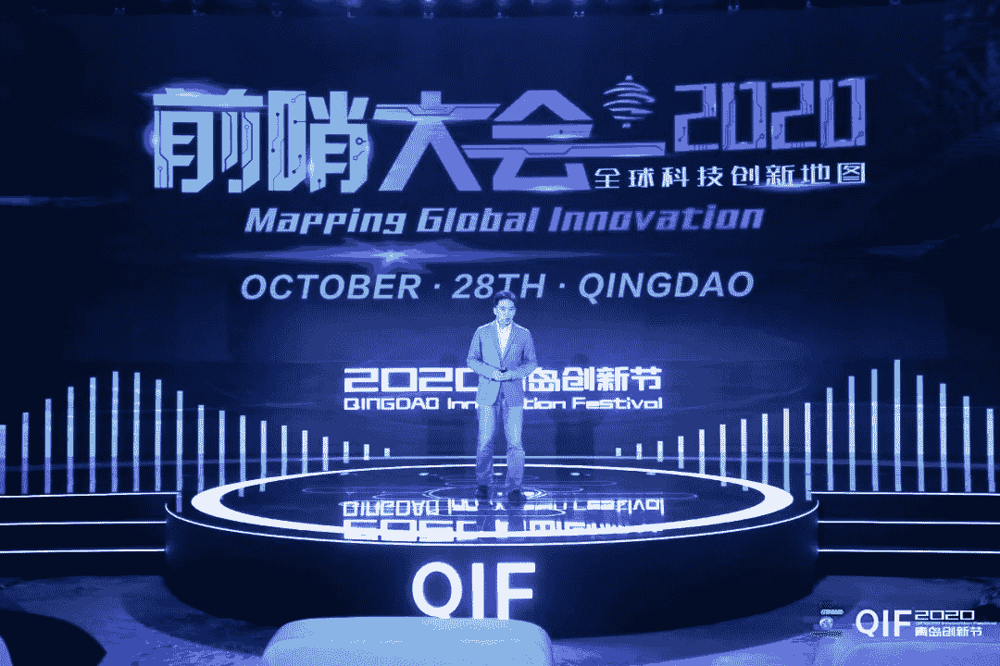
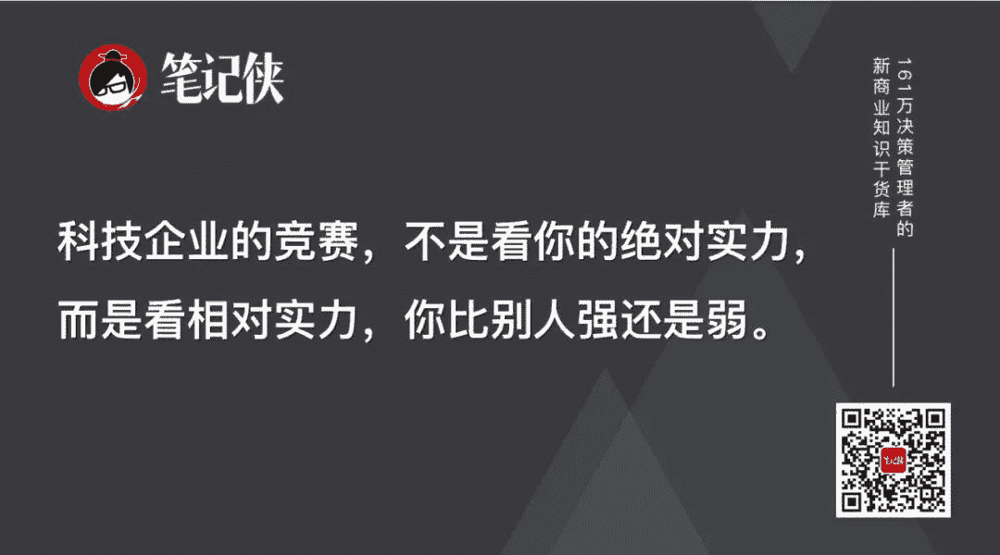
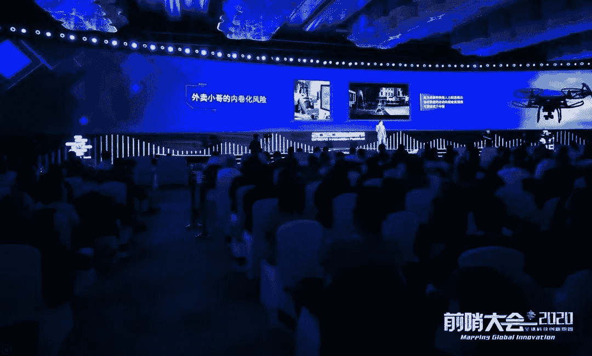
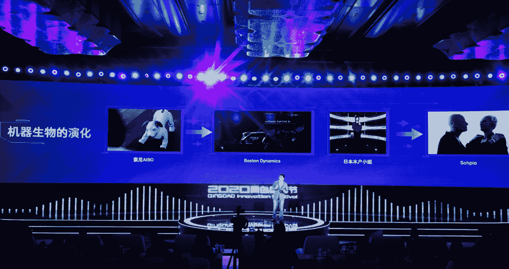
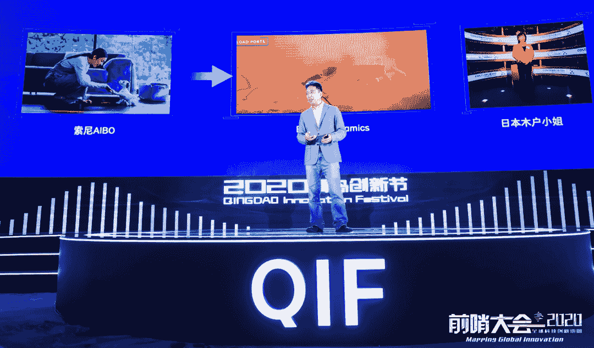
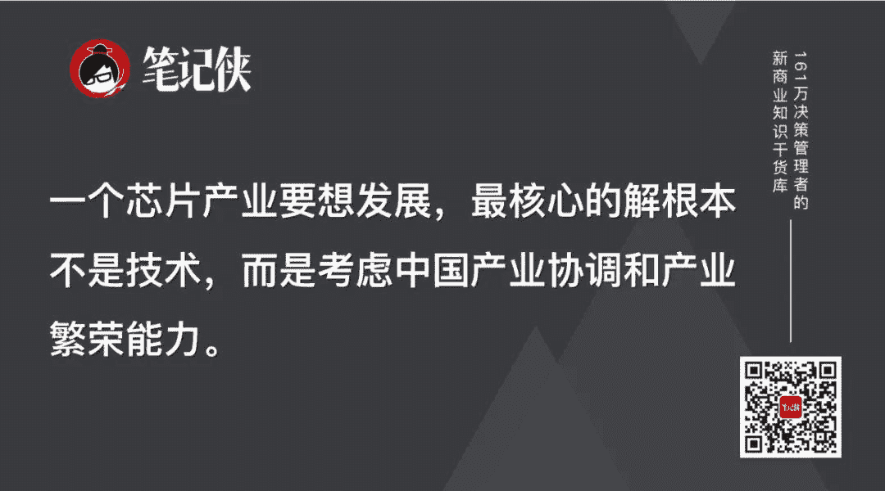
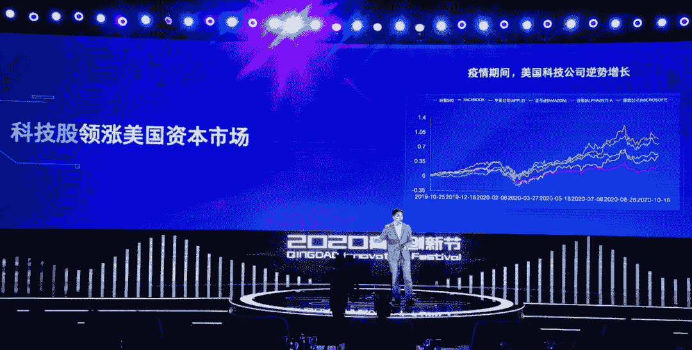
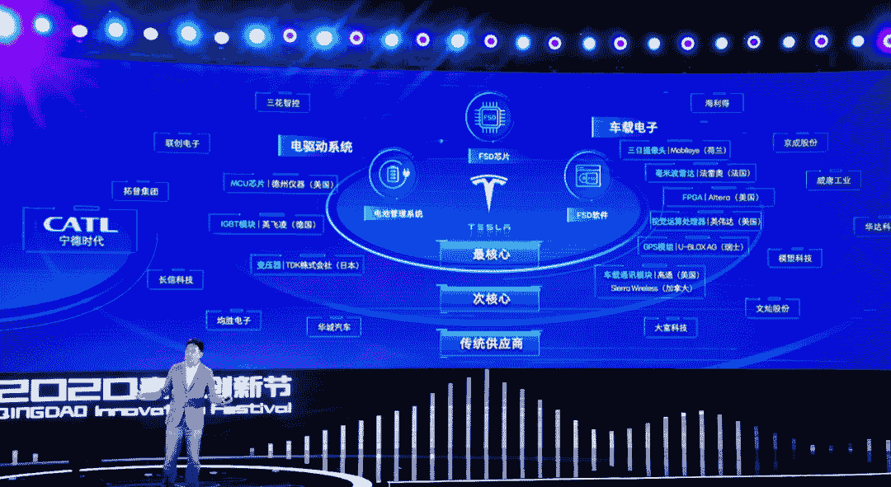
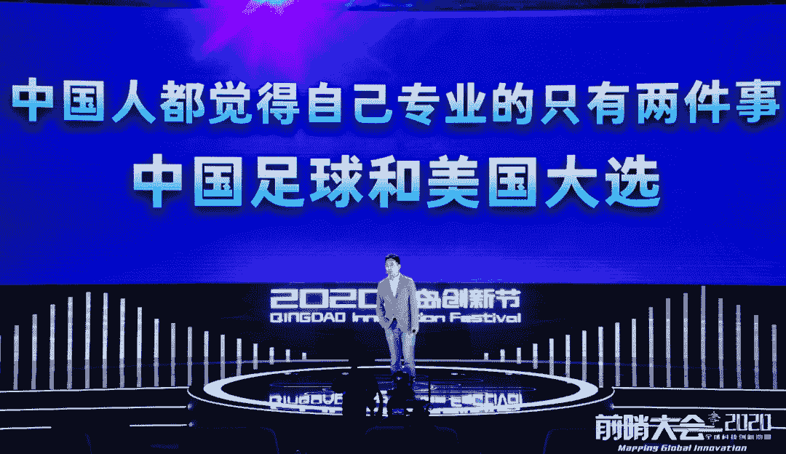
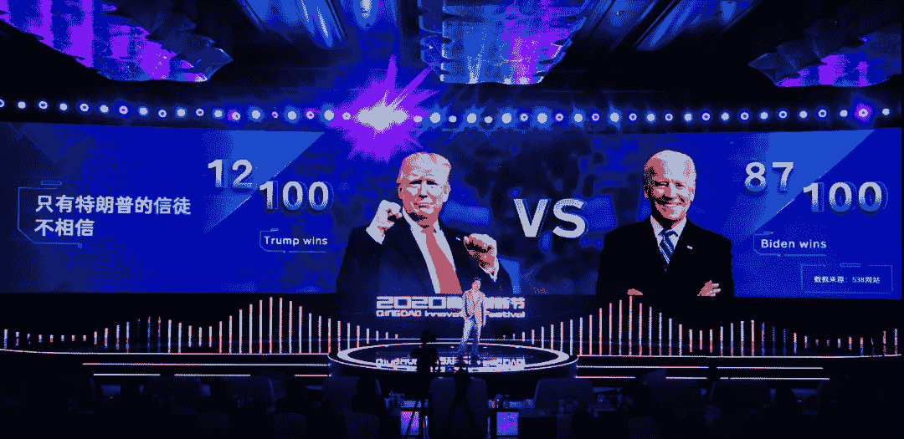

# 王煜全前哨大会2020：未来那辉煌的起点，从2020开始

> 来源：[https://aigcreative.feishu.cn/docx/G1SFdc4qgoREOtxaIuYcnQeCnHd](https://aigcreative.feishu.cn/docx/G1SFdc4qgoREOtxaIuYcnQeCnHd)

> 🔗 原文链接：https://mp.weixin.qq.com/s/-Ht5_-GgIJh6EGIKNzluGQ

**今天分享全球科技投资人**王煜全在「前哨大会2020」的演讲内容。

「前哨大会2020」梳理了过去一年的变化，未来十年的趋势，还有那些不变的大规律。相信在未来十年，回顾今年的趋势和洞察，也会有很多收获。

王煜全深度洞察和分析，值得收藏。

## 前言

大家好，我是王煜全，欢迎来到青岛创新节，欢迎来到前哨大会。

2020年很魔幻。开年的时候很正常，我们今年年初时还办了CES展访问团，然后1月份在国内开始疫情防控，中国众志成城全民抗议。当然后来就变成全世界都中招了，曾经人来人往的纽约时代广场也空空荡荡了。

我们以前经常说中国人在外面容易受到“歧视”，我突然发现今年这个歧视颠倒过来了，中国人“歧视”外国人了，因为我们为了青岛创新节，本来要邀请好多外国嘉宾过来，结果海外企业家、非盈利机构都来不了了。我还算幸运，我是中国人，还能够回来，这时候觉得祖国挺好。

不过祖国也给了我意外惊喜，我乘坐的飞机终于落地时，看见穿着像宇航服一样的工作人员，我的第一感觉是像来到了火星。但实际上我在隔离酒店每天看着同样的风景，我突然觉得世界很枯燥。

人当然是有办法去改变环境的动物。我把我的电脑连到了有远程摄像头的网站上，可以远程看很多美景。突然之间我发现这个网站有巨大价值，尤其我被关起来的时候。所以我把我的电脑设成全屏，播放的都是旅游景点的实景，摆到窗边，我想象那就是我的窗户。

我的窗外一会儿是非洲大草原，一会儿是希腊著名小镇，一会儿是罗马的著名建筑。在一个非常小的酒店房间里，连大门都迈不出去但可以环游世界。我特别喜欢每天在非洲草原的早上，看到那些野生动物，到水边喝水，活动，嬉戏。就感觉我也在非洲大草原上。

疫情无论如何都不是好事，但它也能够促成一些好事。

### 1.2020年不可被忽视的三个理由

魔幻之年还有它非常特殊的意义，不光对我们前哨大会，甚至很多人呼吁咱们当2020年不存在，明年还叫2020年。但后来我一想，真不行，为什么？

因为2020年无法被忽视，理由如下：

第一点，社会发展的重大转折出现了，这个转折由疫情引起，但是它会延续很久，甚至会让这个世界从此和以前不同。

我以前从来不会关注远程视频网站，疫情之后我就会关注它们。关注以后，我总是习惯去看它，甚至我都和我的孩子说：以后把家里的客厅电视变成一个只要它空闲就会播放世界各地景色的一个窗口，相当于我的客厅成为一个通向全世界的窗户。

**第二点，疫情导致了经济下滑**，但是有一类股票特别坚挺，就是科技股。

疫情来了，我们需要科技来帮助我们解决问题，科技的价值，在我们碰到危险和困难的时候充分体现出来了。

回顾人类历史，我们会发现，拯救人类的总是科技。70年代的一本非常著名的书《寂静的春天》表达了，未来如果环境继续恶劣下去，地球会变成一个“毒地球”，人类就没有办法住了；还有罗马俱乐部出版的《增长的极限》也表达了类似的担忧。

我们都知道马尔萨斯陷阱：如果人不断生育后代，地球资源就枯竭了。但后来大家突然发现资源没有枯竭，我们还在继续良性地发展，而且不光没有枯竭，大家还会觉得资源将来不是问题。

这都是因为科技。所以当我们碰到大问题时，真正的“解药”还是科技。

虽然疫情来了，疫苗和治疗药物亟待解决，曙光已在眼前。无外乎是明年中旬，还是明年年底面世的问题。等到疫苗批量生产出来时，至少眼前的很多行为上就会恢复到和以前一样。

**第三，在求解问题的过程当中，你就会**发现未来就开始逐渐清晰地展现在我们眼前。

国外有一位专门研究未来趋势的名人，理查德·佛罗里达，他在《重启》里面说到：每一次大的破坏，不管经济、军事、政治，后面都会带来一个大繁荣。

所以，很可能我们眼前的痛苦是很短暂的若干年之后，回顾2020年，会发现它是转折之年，是蕴含着大机会的一年。

### 2.大会主题：现状+规律=未来

接下来，我们正式启动2020年的前哨大会。2020前哨大会分为三部分：

第一部分，是这一年的变化，是现状，是要看清这一年的变化；

第二部分，透过现象看本质，找到规律。人类是善于总结规律的动物，此外，我们把它拉长，我们希望看到一百年的规律，甚至是几百年的规律；

为什么要搞懂规律？

因为了解现状，了解发展规律就能够知道未来。我们的目的是想要知道未来会发生什么，知道未来大机会到底蕴含在哪里。只有当你知道未来，并且准备得足够充分时，才能更容易地把握住机会。

我们永远不值得为现在努力，因为每一个现在都会变成过去，我们所有的准备要为未来而努力。

第三部分，我们再缩回来看未来十年会是什么样子。因为未来十年决定了我们如何去行动，决定了机会能否真的攥在我们自己的手里。

## 一、一年·变化

### 1.社会变迁影响科技进程

2020年，很魔幻，但是2020年的主旋律和科技有着非常大的关系。

第一，是2020年对我们如何使用科技产生了重大的影响，科技公司想尽办法都做不到的事情，疫情做到了。

比如，以前，那些做远程视频的网站那些公司，可能也希望大家欣赏他们提供的美景，但就没有人愿意使用；现在，把我们“关起来”，我们就老老实实地欣赏，还很享受。

不光如此，远程办公得以发展。

讲一个玩笑话，中国的疫情防控做得非常好，疫情一下就控制住了，大家都还没有完全建立远程办公的习惯。

我回国和朋友们交流，有时候谈工作，朋友就说：我还是习惯咱们见面谈。

我说：不是前面几个月都远程办公了吗？

朋友说：哎呀，没有建立起来习惯。

如果再“关”他一年他就习惯远程办公了。

疫情不是好事，但是要学会从坏事里找到好事，看到好的一面。

好的一面是什么？

是全球的远程办公都在加速发展，更有意思的在于以前有一件事儿一直没有推成，就是人们搬离城市。

有一位著名的未来学家阿尔文·托夫勒，是中国改革开放主要推动者之一，他在80年代初时在中国出版过一本非常了不起的书《未来冲击》，引起了巨大反响。这本书第一次清晰地描述了数字社会以及数字革命会产生什么样的影响，什么样的变化。

那个时点也很重要，中国刚刚改革开放，国人特别需要了解未来，而阿尔文·托夫勒给我们展现了当时世界的未来。

后来，中国的863（863——国家高技术研究发展计划），知识高科技，互联网，向全球的科技前沿看齐等想法很大程度上受到了这本书的影响。

书中对未来场景的很多描述今天也都实现了，但就一件事儿没有实现——《未来冲击》认为因为有了互联网，有了远程视频，有了很强的IT技术，所以理论上讲我们可以远程办公。

如果可以远程办公的话，大家就没有必要住在喧闹拥挤，房价又贵的城市里，应该纷纷迁出来，城市会没落，大家会住在风景更好的地方。

过去这些年，城市化，甚至叫做超级城市化一直是趋势，大家越来越喜欢聚在市中心，疫情让情况稍微有一点转机。

国外很多公司都宣布既然你前面远程办公这么久，以后就永远远程办公了。比如，国外有一个报道，某IT公司高管，原来整个开发团队经常开会，现在开不成，都要远程办公，他很聪明，墙上挂二、三十个显示屏，和别人连线。

所以，既然可以远程办公，就没有必要待在美国，把家搬到夏威夷，推开窗每天都是非常美的风光。

还有美国的电商，我们电商很方便，因为我们住在城市，美国人住郊外，电商一直不方便。疫情“普及”了电商，甚至疫情刚来时，我看到有文章批评美国电商简直太糟糕，疫情来了都崩溃了，亚马逊投递寄送时间大大拖延。

实际这就是压力测试，一种扛过去，一种没有扛过去。

虽然当时压力很大，但扛过去，市场份额就迅速提升，亚马逊是扛过去的那一类。

为什么一直讲亚马逊未来很光明，因为它已经扛住了。

看企业发展要看它的考验在哪里，扛过去了，未来就前景光明，亚马逊扛住了，因为它之前花最大力气做基础设施建设，虽然它也有很多表现不够好的地方，但是它比别人强多了。

科技企业的竞赛，不是看你的绝对实力，而是看相对实力，你比别人强还是弱。

但中国没有这种事，疫情一来，中国的科技优势一下就使上劲了，而且以前我们觉得不那么重要的科技优势现在突然变得重要。

以前有人会觉得外卖小哥重要吗？

前段时间有文章说外卖小哥太辛苦，时间被挤压得很厉害，以至于出车祸，时间挤压背后是什么？

是产业发达，系统的强大，这个系统疫情期间立了功。所以，外卖小哥登上了时代杂志封面，这是真实的人，有名有姓。

包括我们司空见惯的手机，今天因为人人都用🛰️，用小程序，健康码好像没有什么特别的，但是你真的放到中国之外的任何一个国家，还真的没什么效果。在美国，和他人见面，通常情况下对方掏出来是一个功能机，没法扫码。

所以，在中国，很多原来我们认为不起眼的技术还是领先于国外的，国外对于健康码都觉得很不可思议。

有时候，我们讲全民追求科技领先性，真的就是我们领先的一个原因。因为我们爱用科技，我们可能就容易领先。

国外公司害怕TikTok，因为中国手机app开发商的能力全世界最强。

我们应该跟老美讲：不用防它，不是因为别的原因，因为中国会产生无数个TikTok，你们早晚要失守，守不住，交出来得了？就因为我们某些东西领先。

全世界的规律是最好的东西才能出口，我们不是把我们做得差的东西拿到国外卖或者本国做不好，我在国外发展，这样的例子风毛麟角。大多数的情况是做得好的业务可以扩展出去。

以前我们做得好的是什么？

是大批量生产，现在是手机应用。这只是一个开端，手机应用后面多得是。

当然不是说TikTok没有问题，出去需要适应外面的环境，而且TikTok给大家敲一个警钟：第一，中国一定会有大量手机应用出海，这是我们的优势；第二要吸取TikTok的教训，出海之前做好准备，准备好再出去，适应人家环境，不要被人家抓住。

当然我们也强调一点，最近人人都在讨论“内卷化”，即一件事情做得太复杂、太精细，新科技反倒进不来。因为刚出来的科技都是粗糙的，性能都是相对落后的。把一件事情做到极致，就会把新科技发展路给堵了。

比如，明朝的纺织工人非常厉害，以至于纺织机出不来。国外人工智能包括机器人发达了，但对于复杂餐饮机器人制作做不了，烤蛋糕按理说机器可以做，为什么用人？

因为国外人人都喜欢烤蛋糕或者会烤，这是内卷化，相当中国很多饺子馆不用机器，用人，因为人用手比饺子机效率高多了。

但是，放在更长历史规律看配送，未来一定靠无人配送，不可能永远靠人，因为无法全面发挥人的优势能力。

原来哈佛一位教授一直在呼吁：凡机器能够干的事，不应该让人干，机器应该干重复劳动，人就应该不断地去开拓新领域，形成一种配合。

我非常认同这个观点。

那么，问题来了，由机器或者是自动驾驶实现的外卖配送，在哪更容易发展起来？

我认为很可能不是中国，因为中国有太多的外卖小哥又便宜又好。

大家可能会感到紧张，因为这就是跨越式发展。

以前的跨越式发展是我们跨人家。比如美国的固定电话太好了，移动电话就起不来。美国的电子商务领域信用卡太好了，移动支付就起不来，所以我们实现了跨越式发展。

现在，我们的外卖配送太好了，可能我们的自动配送就起不来，机器人就起不来。

但是有没有解？

有，只要沾硬件，一定是中国最厉害。

我们能不能从现在开始就出海，把国外的自动配送市场抢下来。

以前我们出海打的是现有的市场,去抢国外的现有市场。

比如,国外都是独立、独栋的，一大片草坪，每隔一段时间要修剪，劳动力又很稀缺，只能自己剪草，所以就需要剪草机，中国没有的，只有美国市场有，欧美市场有。

中国企业就没有造过，因为中国没有市场。我们说中国强，才能出口，但强的是什么？

是机械制造能力，我们发现美国有剪草机的需求，赶紧研制，研制完批量出口，比国外便宜，质量还好，就能赚钱。

但是，这也容易遭人恨，人家做得好好的，你切进去把人家市场抢了，虽然确实对消费者而言有竞争，价格下降，但对制造者而言生意黄了。

所以，坦白讲，美国说中国抢了美国的饭碗，我觉得一小部分是对的，大部分还是它自己内部的制造业外迁。

最近总书记去深圳视察，反复强调一点是新的试点又要到来。以前深圳试点要解决体制的路，但体制束缚突破以后，路怎么走是清晰的，因为照学就好。

但现在不一样，现在不是体制束缚的问题，而是具体的路往哪里走的问题，因为已经走到前面。现在要自己找方向，想办法，了解现状，从历史找到规律，延伸出去看到未来，这样才能往前走。

我们希望既然大家要想未来，如果说未来是纵向的话，你还要有横向的全球化的眼光，全局的眼光，不要只盯着中国市场，要拿全世界当自己的市场，不要盯着中国的市场需求，要盯着全世界的市场需求。

尤其是你知道全世界市场明天的需求产品，就一定是成功企业。

我知道有好几家小的无人售货车企业，说实话它们很艰难，因为在中国，大家竞争差异不大，这时候应该学那一家到国外卖剪草机的企业，到国外卖高科技产品，卖自动配送设备，市场要大得多。

当然不是今天，而是未来，你先到海外那个风口前面去等着，等到风起来，你就成功。

我希望更多的中国企业学会利用中国的优势，学会看到全世界的未来，然后在全世界的范围里面去布局，因为在全世界布局，中国优势就变成了你的优势。

我印象特别深，2018年下半年，中美贸易战已经开打，当时我们有一个团去美国访问，跟美国人交流的时，美国人问：中美贸易战对你们有没有影响，你们会不会觉得有什么问题？

我们有一位同伴是从事手机的企业，但不是最领先品牌，他说：中美贸易战对我是利好，因为美国把华为禁了，我最怕的是华为，我不怕美国企业。

大家发现没有？中国企业普遍最害怕的竞争对手是中国的同行，而不是世界的同行，因为当你跟世界比的时候有中国优势。

但问题是如果你只守在中国，天天跟中国同行打，你怕也躲不开，为什么不领先他一步到全世界开拓，当你拥有全世界市场时，你在本地的竞争对手就不是威胁了。

### 2.科技创新改变社会发展

我们讲技术对科技的选择作用，其实它在很大程度上推动科技的发展，给定足够长时间，更多的还是科技对社会的选择，对社会的促进，这是我们一直讲的主旋律。

科技对社会的促进有什么？

最近有一个热议话题，就是iPhone12复古了，iPhone12的边框和iPhone4的边框非常像。

我都有一点后悔，当年iPhone4怎么扔了，要不然拿过来换一个操作系统就可以当iPhone12使了。

当然我们知道这不可能，因为iPhone12的计算能力是iPhone4的80倍，iPhone12的计算能力比iPhone4强多了，iPhone12上跑的程序iPhone4跑不了，这是科技进步。

从2010到2020，iPhone4到iPhone12正好10年，回顾10年进步80倍。

如果你的投资是10年80倍，那是非常了不起成绩。

科技按照这个速度基本上就是摩尔定律。技术不断地在往前走，而且技术也有自己的演化，技术就跟自然界一样，给定一个足够长的时间它总在演化。

举个例子。原来机器狗很不灵活，现在的机器狗跟真狗一样，摔倒了迅速爬起来，可以处理复杂路面，复杂地形。

原来所谓的仿真人，就是一张脸，现在仿真人索非亚，注意看她的小表情（创始人是艺术家，故意把人家后脑勺露着，其实有头发，戴上非常漂亮）。

我们原来讲affective computing，他们的技术叫做情绪镜像，所谓共情，即对方什么表情你做什么表情，做出这一种表情往往不需要有意识地做，下意识就能够做到，因为我们大脑里有一组神经叫做镜像神经元，解读对方情绪，不光解读，而且实时表达出自己一样的情绪就叫共情，共情能力是人类互动的基础。

我们正常人都有比较好的共情能力，但现在机器也可以做到，所以未来你会发现和机器有感情的例子会越来越多，不知道某一天会不会有人真正地爱上机器，但你对它寄托感情这一天已经到来。

举一个我自己的例子，就是其实人的互动有时候很多小细节，如果详细打磨的话，就会发现。比如，当一个人说话，你会下意识地把脸朝向他，这是一个基本动作。

Hanson Robotics还做一个小爱因斯坦，就有这种能力。一次朋友到我家里来拜访，我正好买了一个小爱因斯坦，刚调试完放桌上。我说一句话，小爱因斯坦就朝向我，我朋友说一句话小爱因斯坦朝向它，过一段时间我们两个人觉得那个小爱因斯坦是活的，因为它会关注到你。

很多人说“索非亚除了当名誉市民，沙特公民，当偶像，还有什么用”？

我认为很有用一点是做“陪伴机器人”。

我的目标很简单，因为我一年到头在外面跑，而且现在很多人不和父母住一起。我们希望和父母沟通，希望父母感到安慰了，希望父母永远有儿女尽孝。

机器人长的是我的样子，用一个机器人替我尽孝不是很好嘛，还有，我们都对父母好像有一点不耐烦，说话好像不那么尊重，训练机器让它特别尊重老人，特别体贴老人，而且老人一个需求它还可以做智能判断，这不是很好嘛。

所以，机器人未来有很大的市场。

另外，周围环境正在改变，越来越像科幻大片里面感觉。去年，一部大片叫做《银翼杀手2049》里面，未来都市都是光怪陆离，所有的墙面都是显示的。

因为是电脑做的，效果不是那么真实，但现在如果我们经常到一些繁华地区，就会发现墙面全都是各种各样显示屏，已经很真实了。

以前我们在科幻片里面看见的卷轴屏，现在已经在研制了。

我们一直在喊话，两年前叫“显示无所不在”，去年升级了，叫“互动显示会成为一个独立产业”，它不光显示，还有智能可以跟人互动，可以感知人的存在，把人想要的信息提供给人，会成为一个独立产业。

以前买屏幕有两种选择，去电器商店买电视屏幕，去电脑商店买电脑屏幕，未来谁在乎是电脑还是电视，就是一个显示屏，智能显示屏无所不在，买的就是智能屏，不是电视也不是电脑，不管是什么设备都可以互相连通，万物互联。

当下，周围的环境正在迅速智能化，而且疫情加速了智能化的到来。

反过来讲，智能化改造了世界，使我们的未来会越来越好。

有部纪录片《华尔街》，有一期叫做金钱永不眠，TCL认为不是金钱永不眠，是技术永不眠，因为技术有持续不断发展的动力，金钱的动力是赚钱，技术发展是不断更新，更好的技术会改变这个社会，去提供更多的的产品给社会和用户，所以技术的进步是永无止境的，是永远不会停止的。

不光是在显示屏里，在每一个领域都是这样，技术是在持续发展的，所以科技创新虽然不是一切，但是它会改变一切，而且也正在改变一切。

为什么每个人都要关心科技，就是因为它和我们每一个人都息息相关，可能你做的事和科技无关，但科技会改变你做的事，会改变你的环境，甚至科技正在成为基础设施。

## 1. 科技成为社会基础设施

成为基础设施意味着非常重要，意味着离不开它，当你离不开的时候，角度就很重要。

你是看它的负面，还是看它的正面，负面又要怎么看？比如利用垄断进行不公平竞争，这里插一句，我们经常有一个误解，认为垄断是坏的，但垄断是不好不坏的，只是对市场控制力达到一定程度、市场占有率达到一定程度的客观描述，但是利用垄断来做恶是坏的。

最典型的如亚马逊，做电商，当然知道电商上面什么好卖，什么不好卖，谁买什么东西都知道。它可以选择自己生产哪些商品，当然不叫亚马逊，有一个独立商标名，不是第三方的。

所以一个电商平台，发现什么东西利润高就拿来自己做，什么利润不高就卖别人的，这好像有一点不对。更要命的是还可以通过数据能够更巧妙地去挤压其他商户。比如，推荐替代商品，推荐低价竞品等等。

这个时代很有意思，就是科技成了新基建。以前对我们影响最广泛的东西，我们把它叫做基础设施，水、电、煤气，基础设施有一个特点，常年不变。比如，德国人在青岛修的下水道，一百多年了，没有质量问题。

一个城市要有持续发展能力，基础设施就要打得很牢，常年不变。

但今天变了，今天中国有一个词叫新基建，就是特别新的东西才能成基建，要快，十年以前的东西都过时了，新基建恰恰相反要非常快速地布设，但也意味着大量的投入，监管可能会滞后。

这就是区别，是看正面还是负面，中国相对来说更看重正面。我们知道它一定会推动社会进步，这时可能有很多问题，没有关系，先跑，这个态度是对的。国外容易看负面，这有很多问题，不能去解决。

科技创新还有一个特点，就是一定会有问题，最好的做法是走中间路线，事先能够分析到科技创新的问题，加以预防。然后不拖延科技创新步伐，让科技还是早一天来，早一天变成基建，变成人人能够享受的东西。

所以，现在联合国把能够查询信息，能够获取信息的权力都当成基本人权，意味着人人都应该有上网的权力，人人应该有通过网络学习的权力，教育上应该是平等的，这是历史的进步，但真正做起来很多细节还是很难的。

国外一直讲这个问题，新的科技来了有两种说法，一种叫做科技红利，一种叫做科技分化。

因为在英文里面这两个词长得很像，红利是dividend，分化是divided，同一个词根，看起来很像，但完全不同，现在看起来都在进行中。

科技对掌握先进科技的人来说是一种红利；同时把一些人甩开，因为等到你长大了接触科技的时候，已经不适应了，因为没有养成接触科技的习惯。

很多人，包括我们今天的教育都还在讲，科技是理性，是逻辑，是推理，所以不宜太早接触，因为小孩还不懂，先学好基础，基本功，物理，化学，数学都学好，再学计算机不迟。

但对不起，计算机不是纯理工科，它是语言艺术，语言就是越早学越好。等十几岁再学电脑，肯定玩不过不到十岁就学电脑的人。

所以我们对科技的认识也要不断地更新，变化就会出来。

我觉得我们就挺幸运的，待在中国，更多地享受到的是科技红利，中国都在这方面都是领先的，对于中国的科技的未来发展和领先，我们有充分的信心。

当然这一点也挺不容易。

我从事通讯很多年，那时就一直在论证通讯要不要提早上线，但搭一个新的平台，投入巨大，而且可能有负面东西，没有新的应用机会，所以不着急投入，让上一轮投入收回成本再说。

尤其看看国外哪些新应用做起来，我们国内再搞，这一下就坏了。你不着急，等着国外，国外的设备也成熟了，国外的应用也成熟了，最后市场归人家了。

所以，科技的市场是谁耕耘，谁收获的，不能坐等，耕耘早期市场有一定的赌博成分，并不能完全判断清晰，做进去再说，我们在3G没有来时，不知道3G干什么用，4G没有来时，不知道4G干什么用，今天有人老调重弹没有必要上5G，还没有应用，只有上了才能够找到。

科技和创业是先天属性契合，一模一样的属性，要有分析能力，对未来预判，但最关键是要有决断力，果断投入的决策能力。

所以，这个时代最缺乏的是引领看到未来的能力。

以前，在科技创新方面，中国没有动力，都是学别人。现在，很多地方（行业）还可以继续这样，就是依然不愿意创新。这也不是说就无路可走，我们永远要知道创新不意味全员创新，所有人创新，不创新就死了，不是这样，我们可以做创新的支持者，连接者。

比如，我们特训营有一个朋友，他在美国读完书，家里在刚果（金）有产业，新闻说那边都是战乱，所以他不太敢去，其实说实话只要是跨国新闻，都不准确。

我从美国回来，很多人问：美国是不是基本完蛋？我的感觉他应该觉得美国满大街都躺着尸体，但实际上大多数人生活基本正常没有什么区别。因为看不到，距离才产生这一种恐惧。

所以，他去刚果（金）跟我说：其实刚果金没有想得那么恐怖，挺安全，治安什么都挺好。刚果（金）特别像中国80年代初刚改革开放时，也走改革开放这一条路，所以中国人去那里知道该怎么办事。

所以有时候很多人说：习惯后发的人喜欢前面有参照有模板，慢慢会发现中国成为全世界模板，非洲人没有办法直接参照美国人，欧洲人，但可以直接参照中国人，50万非洲人待广州就是为了从中国学习经验回去，再顺带卖一点商品，中国慢慢领跑，而在中国领跑环境下，你要领跑才能发展得更好，要继续跟跑就没有路。

如何领跑？

我们一直强调这和以前有一个特别大的区别：以前跟跑的时候，我们看的是什么？我们看产业当中的某一个环节有没有机会。比如，我们并不关心整个芯片产业繁不繁荣，我们关心芯片产业里面有没有一个芯片设计让我们设计。

所以我们看到芯片设计公司，现在可以设计更领先的芯片。但是没有人帮我制造，因为人家会限制，因为当这一个产业发展起来的时候，产业繁荣的原因是整个生态的繁荣。

生态繁荣必然会造成产业当中核心环节都有最优提供者，生态繁荣造成这里面好多株参天大树长起来。

一片森林绝对不是一棵树。

我们知道中国过去这一段时间的芯片产业之痛，但这个痛短期解决不了，尤其中国迄今为止都没有完全学会如何去创造一个生态，我们都还是跟随者打法，在别人生态里面切一块。

比如，整个汽车产业，轮胎可以做，做出更好轮胎卖到汽车厂，玻璃可以做，可以做最好玻璃卖到汽车厂，但不会集合大家一起做一辆新车。

有人说会，现在不是一大堆新能源汽车。

但那是因为国外企业进入中国给我们遗留下来了一个足够完善又足够开放的汽车产业。

假设这个不存在，进入到一个新产业。比如芯片产业，就没有这么一个足够开放，足够完善的基础，我们要重新建设，这就是我们未来的最、最、最大的挑战。

举个例子，芯片是我们的瓶颈，被人卡脖子了，很多人在喊，大量投资解决芯片问题，我认为越投资越糟糕。

因为我们的投资原则是你是好的芯片企业，你牛，我投钱给你。但芯片企业有一个概念是沾芯片事儿都得自己内部干，才能拿到钱，越投资它越自己干所有事儿。但全球芯片产业经验是什么？

是产业化纵向分层，每层有专人干，如果中国不能形成产业化纵向协作，一个人完成所有事儿，相当造一辆车一个零件都不进口肯定做不起来。

一个芯片产业要想发展，最核心的解根本不是技术，而是考虑中国产业协调和产业繁荣能力。这是未来二十年里中国最需要的能力，它比技术重要得多。

## 2. 资本助力科技企业繁荣

当然好消息是产业繁荣总会出现一些参天大树，这些参天大树，尤其是在过去我们看资本市场里面，很多的企业涨跌，科技股涨跌的波动是最大的，因为它会随着经济波动而波动。

现在，科技企业是我们最需要的，疫情来了以后，可以不工作，但不能没有娱乐，回家一定要多买一个iPad。

所以科技和我们每一个人的生活，工作息息相关了，科技股变成最抗风险的股票，这是2020年充分证明的。

以前，你问任何资本市场专家，他不会推荐你买科技股抗风险，今年不是推荐，今年是事实告诉你，最抗风险的是科技股。

当然，科技股背后也是有自己的规律的，就是好才能涨，不好不会涨。

你可以看到同样是芯片公司，就是今年的数据，一年的时间英伟达翻一点几倍，然后AMD也涨百分之几十，英特尔没有涨。因为这一回不像以前，业绩到了慢慢就涨上去了。

比如苹果，以前好多年市盈率是20，今年市盈率变40，其他都没有变，为什么市盈率翻倍？说明有大资本进去，是今年大资本给炒起来的，因为没有别的地方可以去了，只好往这里放，大资本其实挺艰难的。

简单来说，如果你手里只有一百万，买哪一只股票好？你操心的是增值，希望涨十倍。

但是，如果管一千亿不是你的钱怎么办？你会睡不着觉的，因为很难找到一个地方让它不贬值，这么多钱不贬值就成功，因为真的很难增值，小钱很容易增值，所以穷人不理解富人的痛苦。大钱特别难找到地方，尤其是风险来的时候。

说一下美国。

第一点，美国经济没有恢复，美国政府还不断发钱，你会相信一个经济体能够持续每年靠发钱持续运转吗？不可能，所以美国经济风险极大。

而且最主要问题是发钱意味着往市场里面兑水，GDP没有增长往里面兑水，就是滞胀，滞胀意味着经济不增长，光涨价。这时大资本就更糟糕，更没有地方去了，所以只好瞄上股市。

所以大资本进入股市抬高科技公司股价，但不能随便瞎抬，因为如果公司没有未来，它的投资回报就不好。所以AMD可以进，NVIDIA可以进，但是英特尔不能进，因为市场对它们的未来预期不一样。

到中国麻烦了，中国有一个说法叫做“板块”，一说板块，就意味着都可以借势炒作。英特尔这么牛都可以不赚钱，一个生产接线头的企业凭什么赚钱？

以前还好，但现在科技变成了一堆“韭菜们”的炒作题材，不知道是我们搞科技人的悲哀，还是“韭菜们”的悲哀。“韭菜”以为股票沾了科技就会涨，认为沾了人工智能就会涨。

这几年出现一个词，叫做“科技韭菜”，但实际上这是巴菲特说的“你懂你就做，不懂不要做”。当然我们不是歧视人家，但前提是花点功夫把它搞懂为什么？

不光是为他好，不光是赚不赚钱的问题，是对产业好。如果产业总是同涨同跌，怎么会有希望？

前一阵科创板二、三十支股票都涨，打死我也不相信二、三十支股票都好，没有优胜劣汰，怎么会产生好企业来。所以不要做“韭菜”，炒股也要炒得专业一点。

包括整个生态关系，也一样，芯片产业要做好，生态协调很重要，我们选对了芯片的核心企业，在股市上支持，也能帮上忙。

除了股票之外，更重要是地方政府。以前地方政府的核心任务就是招商，更多是运营地产和运营投资，是“投资公司+地产公司”。

现在不一样了，地方政府必须学会扶植生态，把完整的生态搞起来，相当于不是栽一棵树，而是培植原始森林，我们看的远远不是企业，是产业，甚至更复杂，是产业生态，从产业生态角度知道哪个企业好，哪个企业不好，哪个技术是未来，这样更透彻。

像特斯拉，我把这个产业生态列出来，分成三圈：最核心的部分，次核心的部分，相对传统的部分。最后你会发现电动车最重要的部分都是特斯拉自己做的，那对它招商什么用？

我不反对特斯拉在地方会成功，会给地方政府缴纳很多的利税，但我绝不认为它会带动地方的整个电动车产业的发展。

再加上电动车产业龙头根本不是车，我们一直讲电动车产业龙头是电池，中国已经有很好的电池企业了，叫“宁德时代”，但它只是特斯拉非常不核心的供应商，我们其实完全可以围绕“宁德时代”打造电池产业。

地方政府可以关心“宁德时代”需要什么，我们帮助你打造，这比引进特斯拉还重要。所以要理解产业的成长，产业的关系，才能繁荣这个产业。以前，大家不需要这个能力，但是以后这个能力成了未来中国经济能不能持续繁荣的核心。

当然，企业未来在中国也会出现分化，中国的企业、科技企业，同涨同跌的日子不会太久了，所以要学会判断这个生态里谁是真正的强者。

## 3. 冲突之年

为什么同涨同跌的日子不会太久了？

因为今年是重启之年，是冲突之年，当然幸好我们也是在冲突当中的（中美冲突）。但是，现在最大的问题不是中美冲突，是美国的内部冲突。

美国大选这个话题特别有意思。我总结为：以前，中国人特别关心的事是中国足球，现在是美国大选，所有人都关心美国大选。但是很奇怪，一大堆人认为特朗普赢定了，很少人认为特朗普会连任，为什么？

因为昨天的数据，离大选（11月3日）没几天了，一周时间，基本改变不了什么。

今年，大家提前投票特别踊跃，尤其是民主党，特别喜欢提前投票，因为是邮寄投票，怕来不及。

这意味着无法改变投票选择，投出去不能更改，说明现在大局已定，特朗普再呼吁什么都已经回天乏力了。

数据来源于《经济学人》。今天上午我看了是5%，因为基本大势已去。

当然，有人不认为。我再展示一项更权威的数据，数据是538网站的预测大师，他在之前预测错了，他预测希拉里会当选，结果是特朗普。

预测错了以后，他立刻写了一个声明。熟悉人工智能的人都知道，AI需要大数据“喂养”，数据越多，预测越准确。

以前没数，因为以前特朗普不是政客，所以预测失误了。过去四年从政，有了数据了，也吸取了教训，所以他的预测比过去更可信一点了。

我告诉你，他之前预测特朗普的胜率是25%，今年是预测12%，是四年前的一半。不仅是他，好多权威经济杂志都一致认定特朗普不会连任。

数据证明现在美国的几个“摇摆州”，新增用户多来自于共和党，比民主党多。

所以说明这回“摇摆州”大概被共和党攥在手里，听着有道理，逻辑没有问题。但是，如果只注意到新增用户比民主党多，没有看到几个“摇摆州”里新增用户是无党派用户，是新增选民，没有倾向性。

再给大家一个数据，他们的平均年龄比其他新增用户年龄低，这说明这群人以前可能都不是选民，第一次够资格选举。

此外，低龄用户普遍爱投民主党。所以如果“摇摆州”只看民主党、共和党，共和党新增用户更多可能赢了，但是事实上他们更多八成投拜登。

所以历史要把这些东西看透，才不会上当。

当然我这些只是说给你们大家听听的，给特朗普的坚定信徒说这话是没有用的，因为特朗普坚定信徒认为特朗普是对的，特朗普认为科学是错的，所以我刚才所有的科学分析对他们无效。你做的科学分析，我不相信科学。

这也比较罕见，一个科学这么发达的国家选出一个最不相信科学的总统。所以这是我的调侃，当然不光我调侃，美国信科学的还是主流。

信科学的两个最主要的杂志受不了，一个是《科学美国人》，有175年的历史了，一个是《自然》，也是非常顶尖的杂志。

这两个杂志有悠久的历史，就是从来不参与政治，所以从来不做任何政治上的表态。今年两个杂志没有做任何的预谋，受不了特朗普，只能支持拜登，因为特朗普不相信科学。

当然，为什么还有那么多人支持特朗普呢？如果我们再去深入挖掘一下美国的八卦，是因为开放和保守的冲突。开放，liberal，即共性的观念认同，一些大家都会遵守的共同观念。比如，家庭观念，价值观念，是非观念，很多是全人类的，是共性的。

在这些观念里面，分成两种，一种是我只在乎那个最根本的共性和观念。比如，人应该有爱恨情愁，你应该懂得爱别人，懂得付出；另外一种是你应该有公平观。这是两个最基本的观点。还有传统、尊重长辈或层级高的，社会地位这一说，中国是这样，年龄大、岁数高，日本也是这样。

还有群体感，开放的人没有小群体的感觉，《西方怪人》这本书大家可以去看，对我们理解这个世界的发展是非常有帮助的，即所谓的海洋文明包括和西方的历史结合产生的独特的现象：就是不强调小的群体性，我这个群体、你这个群体，我的家族、你的家族，不强调，人应该是平等的，全世界的人应该是平等的，没有任何高低贵贱之分的。

未来一定会是全世界的主流价值观。

但是，其实在以前，在历史上，是非常的非主流，西方人认为是人类社会的结晶，其实不是，是另类，是极其罕见的。像中国强调家庭观念、强调尊卑长幼，这才是主流。

所以主流是强调远近亲疏的关系，强调层级，强调群体，强调不能背叛。

但是，历史发展是逐渐向开放的，因为开放才能全球化。

你们村的人你都可以互敬互爱，但是现在要把全球当成一个村了，你才能在全球发展合作，才能不形成敌对。

尤其中国就有一个因为传统带来很大的问题，我们说法叫“杀熟”，其实不对，我们不骗熟人，骗熟人名声就坏了，但是骗陌生人在中国似乎没有什么太大的道德谴责，我都不认识他，把价钱稍微加一点没事。

但是在一个相对开放的文明里这事就不行，认识不认识都不应该欺骗。大多数文明是保守文明，由于经济的发展，推动了文化变革。

随着经济发展，开放的文明能够做全球的贸易，更容易合作，合作成本更低，强强更容易联手，所以它越来越繁荣，变成很多发达国家的主旋律。

这时就会有政治诉求，会争取“我才应该是社会主流价值观”。在争取过程中，会让保守者包容他，所以产生了一句非常著名的话“我不同意你的观点，但我誓死捍卫你说话的权利”。

但请注意，这是站在台下的开放者对站在台上掌权者说的话：如果我掌权了，我不会像你这样，所以你要学我，所以掌权者信了，慢慢开放者掌权了。

等美国社会政权主流成了开放者，你突然发现，他可没给你说话的权利，开放者可不允许保守者随便说话。

你到美国随便说黑人不好试试看，这叫种族歧视，你到美国说同性恋不好试试看，这是性别歧视。表面不敢说，你压着我，不代表我不这么想，要找一个出口。

出口是什么？

特朗普——我不在乎，我就歧视这个、歧视那个，大家就选他。

2016年就出现这种状况，民意调查的时候，说希拉里会赢，最后公开表态的时候，大家不敢说投特朗普，因为政治不正确。

所以公开都投希拉里，但是投票的时候都写着特朗普。因为他们内心希望，保守的人，总要让我有说话的权利，我又没有伤害谁，态度这样而已，所以这是历史的根源。

但是，问题是特朗普把这个事弄大了，两派不能共融，是要你死我活的，原来大家争论只是吵架，可没有想你死我活。

所以，现在是投分裂和团结的问题，投拜登的人，大多数新增的选民，不是因为投民主党，而是因为投了团结的票。

那么问题就回来了，美国大选和中国有什么关系？

中国的流行论调是美国不管谁上台，都制裁中国，这成了主流观点。当然，有很多“证据”，但我们说过了，证据的科学性需要检验。

在我眼里，这不是一个政治问题，这是一个经济问题。因为我们都知道，美国叫资本主义国家，就是钱说了算，但也分是大钱还是小钱，因为大钱和小钱的态度不一样。

刚才说过了，左右政坛的是资本家，有钱的人挣钱不容易，他们的困难比我们大，因为没钱的人我们挣钱特容易。大资本要巨大的蓄水池，稍微一小容不下它。

美国股市为什么大公司暴涨？

因为大公司进去了，但是不能容太多的大资本了，就炒爆了，只能融一定量的钱。

**哪里有巨大的蓄水池？**

**中国。**

因为中国的市场够大，我们的发展足够快，中国依然是在发展的，我们今年是正增长，其他国家和地区是负增长。

而且你别以为我是讲故事，历史就是如此。

你看这位老先生叫JP·摩根，美国财阀，著名的经济学家，挽救过经济危机的人，实力强大。

他如何发财的？人家也是有远见，看到未来一定会挣钱。

他父亲100年前就发现美国正在崛起，美国整个国家经济在往上走，科技在往上走，一切都在往上走。他们是英国人，他父亲就坐镇英国去融资，找英国人要钱，让儿子飞到美国，待在纽约，去花钱。

所以从一个强大的经济体，去融资给到新兴的经济体，帮它成长，其实是惯例。

因为强大经济体有钱，新兴经济体有发展机会，钱总是更青睐于新兴经济体，因为有发展机会。

全球都知道，过去40年中国经济高速发展，当然前20年美国没有看懂，风险巨大，就跟我们看刚果（金）一样。但是像JP摩根一样把儿子放到美国去的时候，发现中国没有完全开放。

原来咱们是合作的，中美合作，尤其是中美建交，美国对中国开放，才带来经济增长。但是后来发现，合作伙伴，你关起门来翻倍挣钱，我都没挣着，矛盾就来了。

大家在外面都没有听过这个理论，真话反倒不容易流传，当然大多数人可能没有看懂。

中美关系是因为有矛盾，起冲突很正常，冲突是为了解决矛盾的。所以换一个特朗普上台，特朗普上台相当于原来下棋，我觉得你走得不好，但是已经说好了按照规则来，现在我悔不了棋了，所以找一个不那么君子的人来。特朗普上台以后说你来走两步，没想到他真的不是君子，他把棋盘掀了。

美国压力更大，全世界经济都不景气，资本就想到中国来，中美“打”成这样，关系都断绝了，“今天”还说“我的好朋友习主席”，明天制裁令就拉下来了，中国就不爱理美国了，干脆停止谈判，但这是不行的。中美需要恢复关系，因为中美关系的本质是合作，况且中国已经在进一步开放了。

我们很多时候太情绪化，情绪化会影响理智判断，而过去两年全世界都不理智，情绪化。

中国产业借着中美贸易战慢慢开放，现在进入中国的是国外避险的大资产，现在它们不敢搅局了，是来赚钱来的。在我们不知道，都没有关注的时候，中国政府是非常明智的，慢慢打开门，钱在慢慢涌入。

为什么涌入？

原因很简单：第一，中国是唯一在正增长的经济体；第二，中国的银行是正利率，而美国的银行是负利率。

一方面大资本要避险，另一方面中国是足够大的蓄水池，而且能带来高增长。还想打仗的只是特朗普，那他的命运只能是下台。

所以，千万不要听外面的所谓的主流、非主流的看法，这些都不重要，重要是要能分析到本质。

如果你能分析到本质就会知道，中美都没有任何打仗的愿望。我们没有打仗的愿望，美国也因为大资本要避险，其次，庞大的军费支出是不被允许的。

当然，说到本质，我还是相信这句话：全世界人们都是和平的，都是善良的。

某个时段，可能某个不爱好和平的人入主白宫，下次美国人就把他换掉。大家千万不要误判。

所以，越是重大变革，就要越看懂规律。

# 二、百年·规律

接下来希望大家跟我一起啃啃硬骨头。

## 1.科技改变社会的规律

首先，科技改变了世界的规律。

过去一段时间，有一个很时髦的说法，叫第一性原理。国家鼓励量子科技，“第一性”就往量子上引，有时还跟佛学结合，我认为量子和佛学的共性只有一个，就是你都没搞懂。

而且对人类来说，第一，我们不是处在微观世界，是宏观世界；第二，我们是受社会影响大于受机械影响的动物。

所以，真要说人类社会的第一性原理，应该是演化论。但是演化论是相互选择的，简单说就是“物竞天择，适者生存”。这自然界是相互选择的，但基本是物物，动物和动物的相互选择，当然也有环境的相互选择。

人类逐渐摆脱了，有一本书叫《浅薄》，里面说：现在爱斯基摩人退化了，用GPS。这有什么不好吗？

大家都用了先进科技了，现在没有什么需求要在自然里生存。

原来哈佛大学一位教授提出“多元智能”，原始是8种，现在是7种，少了1种“自然智能”，也就是你到野外不迷路，能生存，这个“智能”在过去空前重要，我们的祖先如果没有这个“智能”，就死掉了。但今天，我坦白讲，在野外我也不怕，因为我有GPS。

人类进化是以某些退化为代价，但关键问题是，为什么没有都退化？因为没有意义。

也就是说，我们现在已经不在乎自然了，选择的对象就变了，变成我们人类生存环境，而人类生存环境的核心是科技。

从可取的自然选择变成了人类群体和科技的相互选择。所以我们要研究的是人是如何选择科技的，科技是如何改变人的，才能知道未来的方向。

举个例子。很多人都说，小朋友不能玩Pad，但是改不了。因为他不玩Pad，就跟大人玩，大人无法一天到晚陪着孩子。唯一让孩子安静下来的方法就是往他手里塞一个Pad，这是人类的选择。

当然玩游戏要谨慎，不要上瘾，Pad不是游戏机，里面有很多好玩的东西，千万不要沉迷里面。

大家会发现，我们不断地做出选择，选择有优劣，就有结果差异，进化就发生了。

因为我们中国人，人人都选择了智能手机，所以我们的防疫手段才会采用健康码，才会有更好的阶段性的优势。

人和技术的相互选择这是最底层的逻辑，而且人不是个体角度，是群体角度。

这个逻辑就会带来经济学的一个重大转变，因为经济学是研究拥有物品，拥有财富的科学。但是实际上拥有财富这件事及这个欲望比经济学要悠久，你不懂经济学你也知道要占有财富。

但是，最开始占有财富靠的是掠夺、权力、暴力，武力。但是从工业革命开始，全世界的暴力值在下降。

有一门科学课程叫《量化历史科学》，证明了今天是人类社会上暴力最少的时代，有史以来最美好的时代，而且更好的消息是未来还会更美好，暴力还会持续下降。

为什么工业革命会造成暴力减少？

因为大家突然发现发财的方式变了。以前发财是“零和游戏”，矿山我占了，你就没有，那就打。现在靠的是发明新产品，做新市场。

所以，工业革命从发生的第一天就有很重要的两个属性：第一个属性是大规模制造，第二个属性是大规模制造以前没有人大规模制造的物品。

工业革命特点不是一个人干活了，是规模化生产，效率更高，不光效率高，还遵循商业原理，卖给更多人，所以能赚更多钱。

大家都不傻，不需要到海外掠夺，掠夺还会丢性命，直接生产新东西就好了。再来一波人，又这么干，一波一波这么弄，最后科技就扩散了，科技扩散了以后，人人都是生产者的一部分，只不过分工不同，产品不同，但是每个人都参与到生产过程之中，然后交换，最后就变成人人都拥有各种商品，社会越来越繁荣了。

此外，为什么工业革命之前人类经济发展没有上升，只有工业革命之后指数性生产，因为规律告诉我们：生产新产品，让用户买新东西，实际是创造新市场，要在别人的基础上做到更好，这是社会的本质规律。

我们的物质生活极大丰富之后，“物质”不好卖了，精神物质会变得更丰富，就卖精神物质的东西。还有就是社会追逐使技术越来越深化，满足更多的需求，可以不断扩展。

群体和技术如何相互选择的呢？

我们总结出一句话：自从工业革命之后，技术和群体相互互动的关系形成，是靠生产者，也是消费者。

① 技术进步就是对人类需求满足的进化

所以，现代经济的特点不是对资源的占有，而是大家对需求的占有——我能够生产一个东西，有更广泛的需求，我就会变成首富。

为什么美国人说中产阶级是社会稳定的关键？

因为中产阶级有个特点：他既是生产者，也是消费者。一批有生产能力，同时有消费能力的人，才是一个社会经济足够强大的核心原因。

我们经常说中国经济体量=所有人的消费总和，但最好的是生产总和=消费总和，因为每个人都生产，每个人也都消费。

我们讲扩大内需，怎么扩大？就这么扩大，一方面能够有更多的生产，另一方面有更多的消费。所以让每个人都消费得起非常重要。

在福特那个年代，它会给工人非常高的工资，为什么？

要让工厂工人买得起车。如果一个体面工厂的工人能买得起车，这个市场一定是巨大的。所以福特不是在做车，而是在做理念，是看这个社会有多少人同时是生产者又是消费者。

这时，你会发现这是一个动态平衡。如果想让社会财富继续增长，除了要增长我的需求，还要同时增长我们满足需求的能力。所以，不断挖掘同步增长的能力，就是经济增长。

这种挖掘过程是连续的，这种连续在两个层面上连续：

第一个层面是靠技术驱动，我想满足需求，如果没有技术和能力或早有人满足过了，就又回到“零和博弈”。所以技术总是一波又一波到来，尤其很多是普世技术，所以才有周期理论。

第二个层面是周期。周期真正的动力是科技。当科技加速的时候，周期就加速，科技来的时候是叠加来的，周期就叠加，所以周期的源头是科技。

你找到源头就知道规律是什么了，而不是片面强调周期的年头。现在，周期的时间在缩短，而且出现了叠加。

比如，有的人说现在是人工智能时代，也有人说是虚拟现实时代，还有人说是大健康时代、生物制药时代、生命科学突破时代……

这些都对，因为科技在加速，所以出现了时代的叠加。

当科技加速影响到每个产业的时候，我们不成功就没有借口了。有一个做建筑的人跟我说，“我们行业太传统了”。我说，你去看看，建筑行业有一堆先进的科技。

任何一个产业都正在被科技深刻改变，你只有两种选择，一种是等着别人用科技把你改变，一种是你用科技把别人改变。

科技改变了整个环境，你没有办法置身事外。但是科技改变也有规律，因为科技改变的核心是不断满足需求。

我们原来经常喜欢打一个比方：

我卖你一个电钻，你在墙上钻个空，按一个钉子，挂画，这是产品阶段；现在是服务阶段，你不需要用到钻头，我帮你把事办了，这就是用新科技满足需求；最后到了创意阶段，你挂画是为了愉快，然后我到你家看看怎么装饰能让你更愉快。

所以，人类进步是科技与人相互选择，使得人的需求更深层次能够被满足的结果。

### ② 技术对社会的影响是链式过程

周期有个特点：每一个技术来的时候，扩散到社会的时候，不是匀速扩散，而是有的地方快有的地方慢。

快慢会造成接受程度的差异，你如果被冲击得更早，你可能接受得更早，如果晚就很麻烦。

科技是一把双刃剑，它带来的不一定都是好东西。比如，上网。现在互联网非常开放，但很多农村孩子很少有上网机会，这就造成他掌握的上网技能较少。最终，差距就拉大了。

所以真正的反应过程是从行为改变，到系统改变，最后到观念的改变。

举个例子，车出来的时候，个体可以活动的范围变大，这是行为改变。

很快，这个行为改变变成了系统改变，因为当个体的活动范围变大了，就意味着原来我只能住城里，现在可以住郊外。

一百年前，美国大多数人也是住城里。现在为什么大部分美国人都住在郊外，因为人人有车了，人们觉得不光可以拥有一辆车，还可以在郊外拥有又大又好的房子。

但人们的需求不会止步于有房有车，还需要有冰箱、洗衣机、空调等电器。于是，各种需求起来了。以前房子小，东西都在小卖部买；现在房子大了，可以直接去市场采购，于是沃尔玛这种大型百货商超兴起了。

很多时候，商业机会不会直接是科技，不是说有了车，社会结构就变了，车后面不见得是车的科技，但是“车”这个科技的受益者。

有个心理学研究表示，人在车里的时候，自我都特别大，因为我坐在自己的车里，我的自我有车这么大，但是出了车以后，只有我这么大。所以西方人更独立、更强调自我的能力，改变了人的观念。

有时候你认为有一些事是自然而然的，但其实并不是，究其根本是“人”被改造了，改造人的是科技。我们在改造科技的同时，科技也在改造我们。

### ③ 技术创新是有阵痛的

每一轮技术创新都是一定有阵痛，这个理论的来源是经济学家熊彼特的颠覆式创新理论。熊彼特的本意是告诉我们：新科技是有颠覆性的，它会冲击很多老科技、老业务，甚至冲击很多人的生存方式，对社会带来一定的负面影响。

中国现在要搞科技产业生态，国内大循环的核心就是自己要有一个完整生态，但你要理解任何新东西出来的时候，会砸烂一些老东西。我们要警惕，要事先预防，在做创新时不能忽略创新是有负面影响的。

最后，我列出三个专家，告诉你没有一个理论是凭空产生的。

最早认识到创新对社会经济有贡献的是约瑟夫·熊彼特，所以他被推到一个很重要的地位。

中间这个人是威廉·奥格本，他是第一个告诉美国政府必须要重视科技的。他有一个很重要的理论——文化滞后理论，从科技到文化的形成有一个漫长过程，最后一定是科技改变文化。而且，科技在改变文化的过程中，会有文化滞后，遭到那一个还没有被改变的文化的阻击。

最后一个人是卡罗特·佩雷兹，他自称熊彼特门徒。技术的周期性规律理论就是他提出的。

## 2.科技发展阶段性的规律

### ① 产品：生产的规模化

产品是指可以规模化生产的实体产品。我们一直讲科技推动社会改变，除了产品会改造社会以外，生产也会改变你的意识形态。因为想要实现工业化大规模生产，就会对人提出了一些要求，比如，你必须要有组织性、机制性。

在以前，人靠的是狩猎、采集、农耕生存的，根本不需要组织性、纪律性。

什么时候需要？工厂大规模生产时需要。为什么？因为需要高度协作，所以人要变成流水线上的一颗螺丝钉。

谁最早意识到这个问题？卡尔·马克思，他一方面讲资本是丑恶的，另一方面讲工人阶级最领先。为什么？工人阶级有组织性、纪律性，能够高效完成生产。

但问题是他忘了工人阶级领先是需要资本花钱，然后再有管理系统训练出来的。没有一个人天生是工人，没有人天生就有组织性纪律性，都是靠资本训练出来的。

马克思非常有洞察力，但非常不幸的是，出生的时间太早了。如果他能再活200年，看到今天的情况（更多老板为了让员工可以买得起产品，从而提高工资），就不会在生产刚刚规模化的时候，提出资本论了。

### ② 服务：经验的规模化

当初大家非常痛恨组织性、纪律性，因为他反人性。因为从农民训练成工人非常痛苦。现在大家又开始痛恨组织性、纪律性，可不是因为你要回去种地，而是因为社会要进一步发展。这时候需要什么？需要经验的规模化。

经验规模化的前提是数字化，只有IT足够发达才能有经验的规模化，因为我的经验是不可传递的。

我们今天还在讲匠人精神，但匠人精神最大的问题是不可规模化，而不可规模化就是现代科技的死敌。

如果经验能做到规模化，服务能够规模化而且还能够个性化，需求就会更大了。因为人人都希望有更多服务来服务自己。

服务规模化有两种：

第一种，用人来服务，比如过去的皇帝有一堆太监给他服务。但问题是如果人人当皇帝，谁当太监？这就造成服务不可扩大。

第二种，用机器人来服务。技术的发展，可以使得服务规模化，因为一个人可以由几个机器人来服务。

但如果想让机器人干的活跟人一样好，核心靠的是经验规模化。所以，人工智能来了。人工智能的核心是什么？以前你都总结不出来的经验，你也传播不了的经验，它能帮你传播并且规模化了。

比如，学围棋这件事儿，非常难以传播和复制，现在简单了，人工智能能通过自主学习，直接干掉围棋选手。

我们最近观察一个企业Airdoc，他们今年拿了医药局上市许可，上市的产品是软件。通过你对眼底拍照，然后上传云端做分析，可以出一堆疾病报告。

以前老中医给你反复查才能查出来的东西，现在一分钟搞定。这就是科学的力量。

### ③ 创造：创意的规模化

但机器短时间内还干不了一件事儿——创造力，所以有一个重要课题就是教机器创造，但10年内应该解决不了。所以，拿你的创造力和机器结合，然后给人提供服务是一个很好生意。

未来，个人的能力需求就是三个东西：领导力、创造力、协同力。

你要选好你在未来的定位，你到底是前瞻者，有领导力，看清未来的人；还是有创造力的行动者；还是协同大家的连接者。未来这三类人会非常珍贵。除了要选好定位，同时还要积累你的信用，尤其是在这一个领域的信用。这是我们面向未来一定要思考问题。

## 3.产业科技繁荣的规律

前面讲的是大规律，大规律是不可改变的，而产业规律是可改变的。

做的好就能好，做的不好就不好，这个规律现在尤其关键。因为中国需要把产业做健全，但懂得完善产业的行业协会，基本上是空转。

在国外，行业协会非常实，但其他形式的产业协调机构极度缺乏。未来二十年里，产业协调经验将是中国经济的关键。中国如果不能掌握整个产业繁荣的能力，会有很大的风险，因为如果你不掌握能力就没有资格领跑。

因为你要领跑，必然要从产业角度思考问题，这是我们最担心的。那反过来讲，又意味着什么？意味着要掌握这个能力，你是最稀缺的，而且你的机会也多。

一方面，我们讲实际的东西，就是我们一直反复喊的积木式创新。每个人要有自己的长板定位，要有自己的能力组架，最后像拼积木一样拼起来。只有拼起来，才能够繁荣。这就又需要人从执行能力考察变成一个创造力考察。

另外一个方面，文化也要起作用，尤其是我们认为中国是时候开始在全球角度讲更加适应未来发展的文化。

以前一说文化，大家就说西方的海洋文明很了不起，尊重个人，但是你会慢慢发现过分尊重个人，会造成有很多人钻空子，只要不违法就损人利己。

如果一个社会有大量这样的事儿出现，这个规则还真的很难维系。而商业最需要秩序。但现在的问题在哪里？就是你现在的商业协作又复杂又需要迅速达成。

一个iPhone的结构非常复杂，但是你说我们一起磨合十年做出来，那行吗？十年以后东西都作废了，所以必须得高效合作，那这就需要有非常深的信任。

以前，中国的传统文化有信任的，过去叫老乡文化，以地理和血缘关系为圈子，以社会地位为层次。分圈分层的好处是特别容易合作，唯一的问题是没有开放性，外人融不进去。

这在当下是不行，所以必须要有开放性，能够让有本事人的进来，但也要形成圈层。

深圳最了不起地方在哪里？在于它有圈层，但不是以老乡血缘构筑的圈层，而是以能力构筑的圈层。你能力强，你就层次高。跟人合作也容易，找到一个人就能找到一拨人，能够快速达成协作。

科技的推动会使整个社会产生变化，不断挖掘新需求，不断满足新需求，满足需求从过去那种基本的需求慢慢变成更高层次的创造力的需求。

所以，最后会变成全社会最有价值的财富是创造力。任何自然资源都会枯竭，只有创造力不会枯竭。

而全社会对创造力为导向的时候，人的行为会叫童年化。我们都像孩子一样很童真，童年化有一个问题是：我们都像孩子一样只会干一件事儿，其他事儿都不擅长。这也有好处，我们可以互相满足，很多我们不爱干的事儿交给机器，这就是未来。

总结一下，我们认为2020年是一个分水岭，这有两重意义：

一重意义，疫情无形当中推动了技术进步的加快。

另一重意义，技术带来的阵痛也出现了，也就是文化滞后，文化的冲突和矛盾也出来了。

这些冲突都曝露了，曝露是好事儿，曝露了以后我们就可以修复它。为什么？因为目标一致。全世界进入工业革命以后，大家的合作方式都变成了协作。

所以2020年在历史上注定会留下一笔，我们希望我们也充分把握住这一个机遇，留下这一笔。

通过这样的变革，我们就能够看到更深刻的规律，通过这一个规律，我们能够展望未来，通过展望未来就知道该怎么去准备好，当你有准备的时候，未来就能够属于你，财富只是一个附属东西。

我觉得最美好的人生是，你干的就是你想干的事儿，而你干的这一件事儿碰巧能够让你成功，碰巧能够让你在有社会成就时还能够积累财富。

# 一、十年·趋势

世界是由三样东西组成的：物质，信息，能量。

最早我们只知道物质和能量，后来发现还有信息。三者汇聚对人产生终极作用的集合体叫社会，三者也会改变社会，而我们是社会人，必然会受到影响。

接下来我们探讨一下未来十年以下四个领域会有什么变化，因为这些我们能够把握的。

## 1. 信息

### ① 芯片产业的生态布局

信息领域的基础设施已然完备。

上一次的基础完备是英特尔的X86架构使得微机大面积使用，促成IT产业振兴。这一次是人工智能产业，需要的技术架构是“CPU+GPU”。

所以，我的结论是：英特尔被抛弃已经成为定局，异构计算已经发展起来，不用担心人工智能硬件支持能力有问题。

将来，人工智能跟电一样，能从云端轻易获得。所以，这意味着你该开始想你的业务，而不用担心基建不够。

想靠芯片致富比较难，尤其想通过异构芯片成为下一个巨无霸就更难。因为下一个候选人已经诞生了——NVIDIA，它将接替英特尔，想超过它的可能性不大。

因为做硬件很难，有很多技术性东西，但做应用中国人比较擅长，这对我们的利好。

### ② 云上战争

“云战争”也基本上打完了，“几朵大的云”会成为主力。 “私有云”一定会有，“云中”的独立组件被拿出来创业一定也会有。

但是和平台比不是一个体量，现在亚马逊云 （AWS） 收入300-400亿美金了，而且还有10倍以上的增长。

不得不说，马云真的是未来的布局者，10年前投资一个搞心理学的博士王坚搞“云”。

因为现在能够替代淘宝的就两张牌，一个是蚂蚁金服，10年内市值必将超过淘宝，另一个就是阿里云，将来可能市值会超越前两者。

腾讯云也不错，腾讯擅长跟随，千年老二，还有就是华为云。

以上就是“云”的变局。

小的“云”有没有？也有。比如国外的云上专有的数据库，市值也不错，千亿规模。

或者是一个纵向的行业解决方案，比如在云上搭建物联网方案，这也是机会，这是新经济的特点。

为什么要尽量支持基础设施建设？

因为基建上总会长出新的东西。所以千万不要以为5G只是通讯，只是新基建的一部分，5G技术成熟之后，“通讯+IT”成熟之后，整个世界都会变样。

### ③ 虚实结合

除了5G技术成熟需要一点时间以外，其他IT部分的技术都已经成熟了，还有一部分正在成熟当中，就是虚实结合这部分。

比如，IT技术部分这一块，大疆都在用无人机雷达。还有，iPhone 12长得像iPhone 4不重要，重要的是它首次使用后相激光雷达，这是历史性的时刻。

为什么iPhone 12的后相激光雷达意义重大？

因为家谱全了，从最短距离的、近的扫描自己的脸几十厘米，到向前的能够扫出眼前的小物体；工业级3D相机能测量几米到几十米；自动驾驶的激光雷达能做到200米；而这次大疆的激光雷达能做到450米。

未来可能出现一、两公里的，这是连续家谱，意味着数字化的进程大大加快。

为什么要数字化？

因为数字化是可以叠加，可以交互、可以处理、可以协同的，没有空间障碍，数字世界很多规律和现实不一样。

三星原来做过远程恋爱，一键切换恋爱场景。

当然，不光是虚拟世界，激光雷达在AR方面也有作用整体来讲，现在是IT技术大飞跃的时代，技术已经足够发达，需要的是敏感发现需求的那双眼睛。

周其仁老师讲得特别关键：定义问题比解决方案更重要。找到问题，找到共性需求，自然会有很多人帮你解决，因为技术早就有了。 比如，通过扫描视网膜了解身体状况，因为人体当中唯一暴露在外面的血管和神经系统只有眼底。

现在，比的不是技术能力，而是前瞻能力，是不是在别人都没有看到的时候看到问题，用技术解决它反而是其次的事。

所以这个时代，用技术是必然的，但懂得问题比当专家更重要。

### ④ 大数据变现

从Apple Watch监测呼吸骤停的案例来看，未来正在进入一个AI医疗的时代，“大数据+人工智能”会改变一切。比如我们投资的“数字手术室”。

我认为凡是能把医疗数据化的，都有巨大的前景。

所以，我们要做的就是定义问题，然后才能让科技介入。

另一个大机会在哪？

中国的硬件优势比美国强。所以才有彼得·蒂尔的调侃：我们需要的是飞行汽车，却得到140个字符。

再比如马斯克，他早期对中国并不友好，但是他改了，因为中国的特斯拉工厂救了他，所以他现在对中国空前友好。

所以友好不友好是会变的，你关起门的时候他就不友好，你打开门他就友好，我们现在已经打开门了，有理由相信他会友好，因为都不傻。

还有一大机会是“机器人+人工智能”的结合。

### ⑤ 车间以外机器人应用

不要以为只有工业机器人，以后到处都有机器人。举个例子，实验室机器人，它能比人类更加精准。

另外一个市场，就是机器臂一定会进入家庭，洗衣服，叠衣服。

现在我们讲情调，讲品位，以前是速溶咖啡，谁有工夫天天帮你磨。现在机器就可以，而且背后还是有真正的专业技术的，是米其林大师的手法。

我认为十年之内，每个家庭多多少少都会有机器臂。但是目前还很少，因为机器手臂不便宜，需要花费二、三十万元人民币。

### ⑥ 企业Logo

以前每个企业有Logo (标识) ，企业还有代言人，代言人的最大的问题是你要掏钱，会变老。

但未来，你可以为自己塑造代言人。你来设计形象、设计性格、设计声音。所以不管进哪一家银行的支行，接待你的都是同一张笑脸，这就是服务。

Sophia正在量产过程中，合作方是一家中国的OEM （原始设备制造商） 企业。所以我们一直强调，中国的价值就在这儿，能让全球科技实现上量。

所以我们把握机会，利用我们的优势，帮助更多企业实现规模和上量，造福更多的人，造福社会，所以这才是这个时代经济学的原则： 就是用批量的东西满足更多人的需求，让整个经济的发达和放大，这就是未来。

### ⑦ 无人机战争

无人机将掀起又一场从坦克到闪电战的战争理论革命。

未来战争规则会发生巨变，这些投入巨额经费、研发高顶尖导弹的专家们可能没意识到，未来打败他们的是一堆廉价无人机的机海战术。

所以未来战争会发生质的变化，这是科技的魅力。

## 2. 物质

### ① 新材料

现在我们容易忽略的是材料科技，比如纳米科技。

现在，很多材料没有落地，不是科技不好，是我们没有找到落地场景。比如说原来的碳纤维，我们一直没有找到用处，最后只能用到高尔夫球杆，但这只是一个小市场。后来发现用到建筑和车体上：碳纤维的车体、飞机机体，房屋结构。

### ② 新制造

当然还有制造工艺。原来都是把材料进行切屑加工，叫减材制造，会造成浪费。现在是增材制造，核心就是3D打印。

过去，科技很有意思，当它热的时候，人人讨论的时候，其实它并不成熟；等它成熟的时候，热劲过了，但这确是能够挣大钱的时候。

现在是3D打印逐渐走出了只能开个模具这样的简单功能，打样的简单功能，逐渐进入真正生产制造实质性环节了。如果只是开模具，打印头像能打几个？如果批量生产，需求当然大。

因为符合塑料材料的应用，硬度和表面光洁度提升很快，变成工业级的；第二是金属3D打印，是粉末烧结出来的，但是硬度可以媲美传统的金属材料。

所以这些技术出来以后，企业能够重构生产流程。

以前，企业考虑哪些零部件需要自己生产备货，现在可以用3D打印解决。所以后勤、物流、供应链成本都会下降，所以整个工业生产会有革命式的改变。很多匪夷所思的东西，会在工业制造里面出现。

美国有一个大的创业方向，就是先进制造，创业就是解决制造的问题，当然中国也会越来越多前沿就要看到未来，像柔宇柔性屏，也是坚持了十年，挺了不起。

再往前是柔性进一步增强，印刷出来，现在是在柔性纸板上印刷，直接印的是显示屏，这都是制造技术，不断在突破。制造技术还要再往前走，充分自动化，每个步骤充分优化。

特斯拉电池给我们一个非常好的示范，它通过把整个电动车的制造切成五个环节，每个环节做优化，加总以后，总体成本下降51%，这样它就有信心在三年时间内推出来只有25000美元的车。

这时你会发现我们之前一直强调中国市场最好，如果中国电动车厂商觉得能做到，直接说特斯拉没有什么，我能在两三年内做到24999美元，这当然是一个巨大的广告机会，谁不愿意为中国企业传播呢？

问题是，我们的制造这么先进，但是为什么没有一家中国的造车企业出来应战？这又是一个担忧，需要有前瞻性看待。

过去有一段话叫“板凳要坐十年冷”，科技创新领域就是这样，你要想有收获，就要深耕，从萌芽开始培养，这是有周期的，能不能耐得住寂寞。

但这是一个连续过程，总要有人去种树，才能有人乘凉，这是我们对产业的理解。

未来中国还能超越制造。比如维看科技的盲人眼镜，等到批准之后，明年上市预计一台约一万元，这是科技带来的公益。

但这不是我们的最终目的，最终目的是把这个舌片实现量产，提供给脑科学研究，因为这相当于脑科学的电子显微镜，通过这个设备刺激大脑来进行研究。我们的终极目标，通过睡觉都在学习。

很多人天天鼓吹中国人在做代工，科技制造可不简单，因为科技大规模覆盖的前提是解决科技制造，继而掌握整个科技产业的命脉。此外，科技制造还能反哺科研，可以控制科研的制高点。

所以千万不要小看科技制造的意义。但是中国科技制造已经有落后的风险了，这是我们要警惕的，虽然我们现在领先。

### ③ 生物学世纪

生物科技技术正在经历一场变革，让人兴奋的东西CAR-T，中国慢慢这两年会通过注册。

PD-1，小分子，我们是绝对落后的。到大分子，CAR-T我们开始追上，到细胞治疗有可能并肩，甚至超越。现在很多不治之症，未来至少能够可管、可控，可以长寿，这是伟大的科技变革。

今年的诺贝尔化学奖颁给埃玛纽埃勒·沙尔庞捷和珍妮弗·道德纳，两位诺奖得主，包括大家一直喊冤的张锋，这三位是基因编辑领域的奠基人，他们的贡献是全世界人民有目共睹的，如果不颁奖 （基因编辑技术） ，诺奖委员会是会被谴责的。

### ④ 细胞治疗的未来

长寿和传统健康什么关系？

传统的医学医疗是有了病才开始，长寿产业是没病的时候就开始，要保证人类活得久，而且活得健康，有病没病都要管，而且要持续监控。

简单一句，凭现在的知识，不需要花很多钱，现在出生的人，每个人的预期寿命都应该超过100岁，这是真的。

所以我们要用实际行动迎接这个时代的到来，为每个人的健康护航，让他活过一百岁，这个时代已经来了。

我们认为外国人炒“人造肉”这个概念，因为外国没有豆腐，人造肉就是吃起来像肉的豆腐，其实用了一个伪概念，不是假肉，是人造肉，让人以为是“人制造出的肉”。

但其实真有人造肉，就是把动物的细胞在培养皿里培养出来，成为组织。“小”的意义是不杀生，“大”的意义是不环保，因为养牛会产生温室气体。

我原来学的是生物，我认为人造人在于提升营养获得效率，吃肉的本质在于获得蛋白质，并非是了解肉的每个细胞多么精巧。

丝绸产品也是一样，没必要养蚕抽丝，我可以先提取。就像你本来需要的是砖块，但是为了取这个砖块去盖一座摩天大楼，然后把这幢大楼毁坏取出砖块，这是很不合理的。

所以回归本质是合成生物学。科技帮你直达本质，这就是未来。

## 3. 能源

### ① 清洁能源时代

清洁能源时代已经近在眼前。德国最激进，2030年就不许燃油车上路，必须零排放，使用电动车。

中国好像没有那么激进，但在有生之年，我们基本能看到零排放的驾驶场景。

我们认真测算一下，人类整个电能需求涨10%，所有电动车都不够用，人类90%是工业用电，所以电动车发展到顶相当于家庭用电。

但是电动车会对清洁能源有巨大的带动，会解决储能问题，现在用废旧锂电池解决储能，清洁能源就会起来。

所以，我们不是用清洁能源直接支持电动车，但是电动车会支持其他产业。

### ② 终极解决方案

而且我们对未来的担忧在逐渐消除，过去讲增长的极限是能源的枯竭，现在看起来不需要了。

除了清洁能源、太阳能以外，还有一个大杀器没有用，就是可燃冰和可控核聚变，足够用我们100万年没有问题，而且反应堆可以做得很小，但是核聚变三、五十年很有可能有大的突破。但是即使没有，海里有一层可燃冰。

我认为10年之内很可能开采有大的突破，至少商业化有可能，能解决几十年、100年是没有问题的，所以未来能源将慢慢不会是我们担忧的范畴。

### ③ 终极的终极

如果我们再科幻一点，终极理想叫“戴森球”，它意味着恒星级别的能量，未来可以干的事多了，太空漫游都可以了。但这个幻想我们不抱期待，反正能源不再是问题了。

## 4. 社会

### ① 极致专注

每个人会极致专注，你的价值是因为你独特，你会找到做事情的意义。

那么，人如何获得幸福？

我认为是以下四点：

第一，你享受你做的事，你喜欢做的事；

第二，做你擅长的；

第三是能够赚钱；

第四是有用，对社会有意义。

我觉得科技创新同时满足这四件事。 所以我号召孩子从小懂科技，从小接触科技，了解科技。

### ② 数字分身

很多人际关系的事情未来可以用科技替代，修车、跑银行、接送孩子上下学。MIT媒体实验室的博士Pranav Mistry发现虚拟人前景很好，这技术一定是未来。

为什么这个技术是未来？

第一，你以后可能跟很多人打交道，也可能跟虚拟人打交道，不是真人。第二，我希望这技术把我变成虚拟人，以后别人跟我打交道也是跟虚拟人打交道，我们有很多应酬的时候，你可以派出虚拟人。

像当初《西游记》里，孙悟空拔出一堆毫毛，变成很多小孙悟空。这叫数字分身。

### ③ 社交增强

社交是必需的，这是人类的基础需求，但是以前所有的社交工具，第一没有增强我们的能力。社会学家罗宾·邓巴提出了一个“社交150人”理论，而通过虚拟分身可以完成多人连接，打破邓巴数的限制。

还有社交网络的信息安全领域存在机会，很多虚假信息在传播，如果能够建立支付宝的信用积分机制，这个生态型的平台很有可能是下一个巨无霸，成为下一个谷歌、Facebook，下一个阿里、腾讯。

### ④ 智能社会

是人就有缺陷，现在选总统需要全民投票，但未来投的不是总统，而是智能算法、智能系统。谁的智能算法能够更好地维护社会秩序，谁就更可靠 。智能社会一定会到来，因为智能系统看得比我们广，更靠谱。

总结一下，技术和社会相互影响，是有清晰的趋势的，把握趋势是有大量商机的。

我们对未来永远充满信心。

# 二、技术与科技互相作用

## 1. 经济

# 全球化与未来产业展望

目前是资本推动全球化的隐性回归，反全球化的人是在全球化中没有得利，甚至受到损害的人。

但是规律一定能让所有人得利，但需要时间。科技正在加强渗透，进入到每个行业，每个领域，不管那些人如何反对全球化。

全球化和科技的结合是一定的，科技有先天的全球化属性，所以一定会全面覆盖。未来大概率是资本在推动，科技继续在全球化布局。所以，你是做叫唤的那部分人，还是做闷声发大财的人？

## 2.企业

未来企业一定好吗？

芯片企业未来一定是高下立判的，靠实力，产业洞察力，未来战略布局能力，技术企业的分化，面向未来的战略能力。

**未来，是高维打低维。**

对中国企业来说，以前积累的财富能不能传承，不是传给儿子还是女儿的问题，而是持续前瞻性布局的问题，能不能传承下去取决于整合科技。

## 3.产业

今天面临严峻的考验是整个产业生态的扶植和培养。就是从跟跑，到领跑。

## 4.文化

中国的新企业家们、政治家们、所有为公共提供服务的人们，能不能有全球视角，能不能从全球角度布局，同时建立全球角度的信用。未来10年，建立全球信用的企业家，可能也会建立起全球规模。

## 结语

今天讲了10个点，最后总结一下：

> 1.人工智能进入收获期；
> 2.大数据变现；
> 3.无所不在的智能；
> 4.云上的战争；
> 5.规模化的服务提供；
> 6.虚实结合的世界；
> 7.自动驾驶和机器人结合;
> 8.清洁能源时代来临;
> 9.生命科学推动健康长寿产业；
> 10.合成生物学的曙光。

马云说“相比与国际接轨，更该思考如何与未来接轨”，但是与未来接轨，首先要知道未来是什么。

对未来的预测是很重要的事情，所以对接未来，把全世界的优秀预测者集中在一起，尤其是科技领域的预测者集中在一起，提供准确的预测，中国的未来一定会更好。

当然我们的“野心”不只这一点，我们希望汇集这三种人，最终推动中国乃至世界的科技产业的发展。

我们一直在强调的三种人，我们需要有领导力，所以需要有“前瞻者”，能够看到未来，带领大家看到未来；需要“行动者”，解决真实的问题；我们也需要需要“连接者”，有协同力，这个时代早不是单打独斗的，需要大家一起解决这个问题。

我们以后要摆脱一个观点，好像是别人都来打我们，压我们，老有“我们”和“别人”这个观念。

这个观念是不对的，全世界都是人，都是智力资源，如何把全世界当市场，中国13亿人，就有比中国大5倍的市场。

如果把全世界的智力资源当作我们的智力资源，就有一个比中国大5倍的大脑智力支持，那你当然会更成功，当覆盖全世界人口时，贡献也更大。

我认为2020年应该是中国重新启动全球化、重新进行全球化思考的一年，是我们转折的一年。也希望我们记住这一年。

未来再看这段历史的时候，知道我们未来辉煌的起点，就是从今天开始的。

谢谢大家！

<https://aigcreative.feishu.cn/sync/K4Gvd9vUQsy9Oubwqaeclu0Fnbg>
