# 王煜全前哨大会2019：10大科技趋势预测

> 来源：[https://aigcreative.feishu.cn/docx/CYhadxmK1okdsWxQTXvcLv6yn9g](https://aigcreative.feishu.cn/docx/CYhadxmK1okdsWxQTXvcLv6yn9g)

> 🔗 原文链接： h[ttps://mp.weixin.q](https://mp.weixin.qq.com/s/KcSLUyzh9poqRmeW7v2PVw)q.com/s/KcSLUyzh...

2019年4月20日，前哨大会2019在北京凯迪拉克中心M空间圆满落幕。

今年**是海银资本**创始合伙人、全球科技创新产业专家王煜全第三次举办前哨大会，前哨大会2019是对中国当下所处的后贸易时代的全面分析，不仅 是对全球科技创新趋势进行的年度盘点，更是以 未来视角 为所有希望掌握科技改变世界的梦想者提供行动指南。

**以**下是前哨大会2019完整干货整理，请阅读。

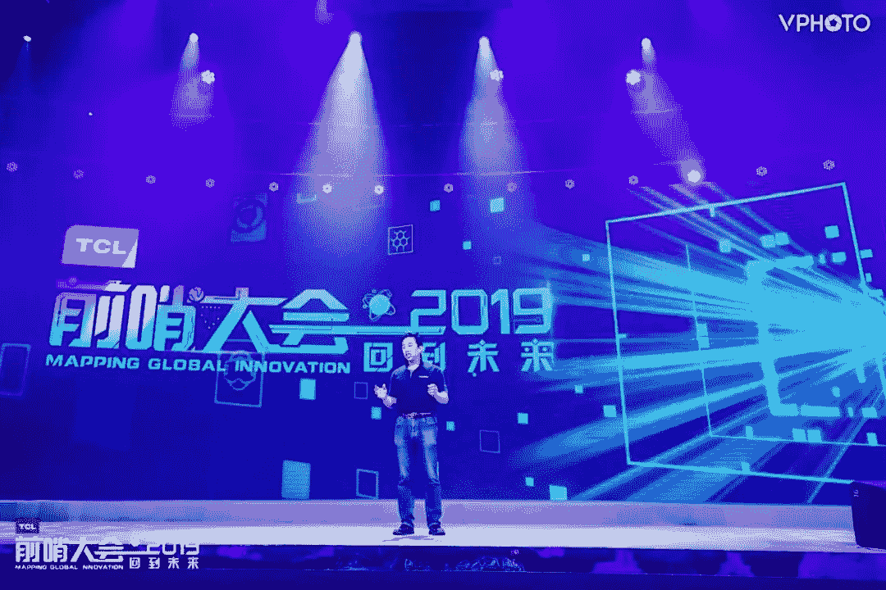

# 一、经济发展趋势背后的3大因素

如何能了解科技趋势，了解未来应该到什么地方和什么产业领域去布局？如何让所有人像关心娱乐一样去关心自己的命运？这似乎做不到。

幸亏现场有这么多人，我相信，你们关心科技、关心未来、关心我们的命运。

而且我相信，你们关心的还不只是个人的命运、自己的命运，更关心的是整个经济的大格局。这也是今年的一个热门话题。

今年，我们都知道有中美贸易摩擦。大家都在讲，今年是不是很艰难，很多经济学家都在预言今年的经济似乎不会太好。

当然我一直不太听经济学家的话，因为我认为，我们每个人的努力合起来才是经济，也就是我们每个人都能为经济做贡献。而不是靠预测来决定我们的未来经济。但我依然先跟大家讨论一段我们眼里看到的经济大势，和那些经济学家想的可能不太一样。

经济大势确实有很多不确定的因素存在；我们先不着急去找解，不着急说结论会怎么样，我们进一步去发掘，去了解这些发展趋势背后的因素到底是什么？

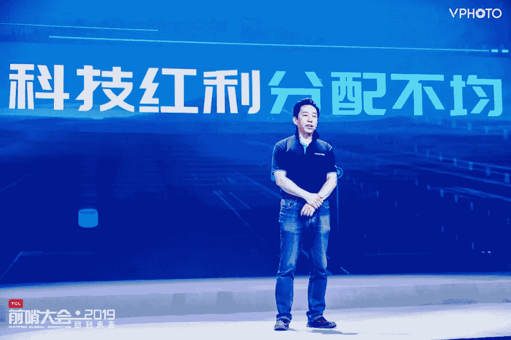

##  第一条因素，科技的红利分配不均造成的；

全球经济的发展是一直在持续的，全世界的经济发展并没有减慢，有很多科技公司赚了大钱，有很多科技产业在蓬勃发展。同时，它们对传统产业形成了很大的威胁。

这和以前是很不一样的，以前很多新兴科技产业兴起的时候，并没有一个传统产业在前面阻碍它。

比如，福特汽车刚出来的时候，肯定不能说它摧毁了马车产业。马车基本不是一个产业，所以它前面没有一个和它竞争的产业。

但现在不一样了，讲到电动车和自动驾驶，总会觉得它是不是会把传统汽车产业摧毁掉。因此，产业变革会造成一部分人受益，而另一部分人因此受伤，尤其这个事情以前就发生过。

熟悉全球经济历史的人，会记得20世纪初，当全球产业进入到工业化大生产，造成了大量的人员被从流水线当中剔除，造成了经济的动荡，也就是1929年著名的经济危机。大家反思深层原因在这里。

后来怎么解决？因为有了二战，整个社会被破坏得很厉害，需要投入建设，再加上时间拖长了以后，新的一批所谓知识工人崛起才解决了这个问题。

因此，这个问题确实值得我们思考。今天科技确实给社会带来了红利，但是红利分配严重不均。

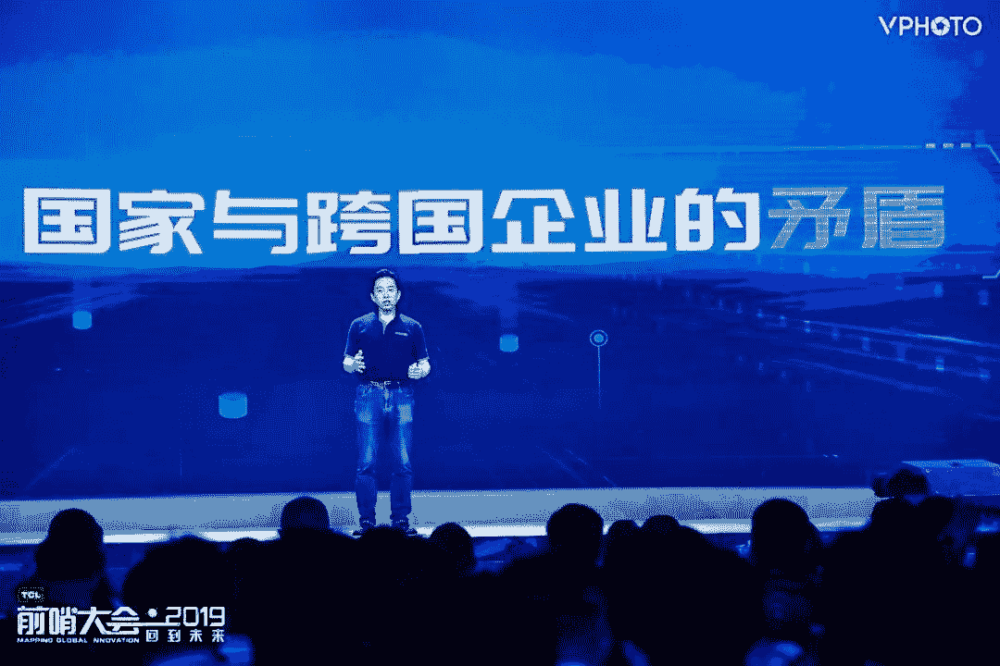

## 第二条因素，是国家和跨国企业的矛盾的问题。

不光是科技和科技企业的问题。最典型的一个例子，我们都知道苹果公司赚了大钱，它自己声称拥有的现金和现金等价物有2000多亿美金，账上趴着这么多钱，但是90%在海外。

一个企业盈了利，但是它的盈利并没有回到本国，并没有进入到本国经济生产大循环当中来，言外之意本国人民并不能受益。

矛盾来了。很多人都会说，这一轮全球化，使发展中国家受益了，而发达国家没有受益。这句话是真的有道理吗？

全球化是谁在推动的？是发展中国家吗？不是，是最发达的国家推动的。如果全球化对它不利，它会去推动？

很显然，全球化对它有利的。只不过这些国家背后站的是这些国家后面的一些大企业。

全球化对跨国企业是有着巨大利益的。只不过，利益归到了跨国企业，没有归到这些国家的民众身上，所以这些民众才会产生抱怨。这是两个很现实的原因。

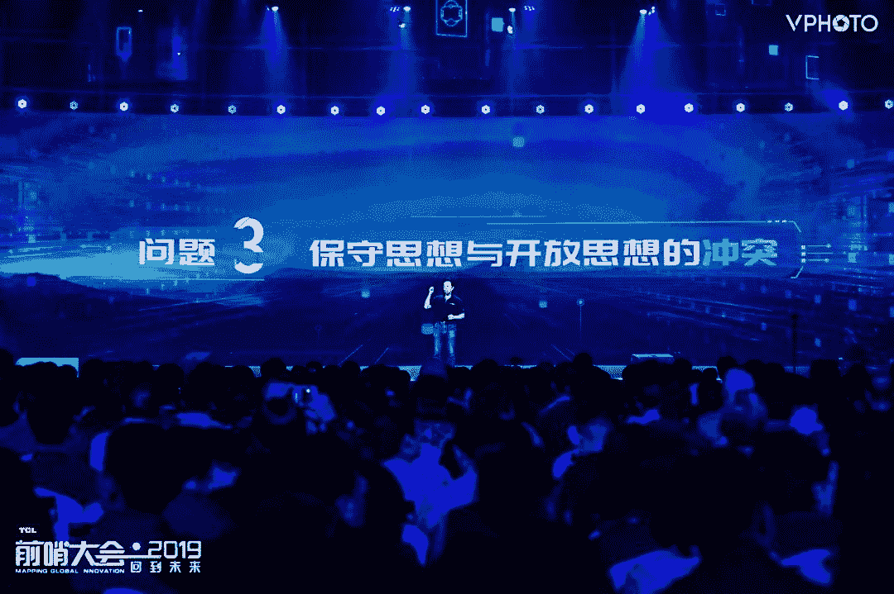

##  第三条因素——保守思想和开放思想的冲突

当然还有第三条因素，不那么直接，但对社会也是很重要的影响，叫“保守思想和开放思想的冲突”。

中国这么多年，一直在经历变化，一直在变革，我们适应了变化。如果出现了新的变化，如果自己的职位不能适应发展，可能会被淘汰掉了，自己的技能可能会过时了。

我们每个人的第一个概念是什么？要去学习，要去改变，因为这是责任。但在西方很多国家，它适应的是不变。一旦出现变化，一旦出现对他的工作和职位的冲击，他的第一个反应是什么？

要投诉，要抗议，要千万不能变。我们都知道，变化才是规律，只有拥抱变化，才有可能找到解。虽然有这么多的问题，但是结论很明确，全球化是一个大趋势，贸易战不代表全球化的问题！

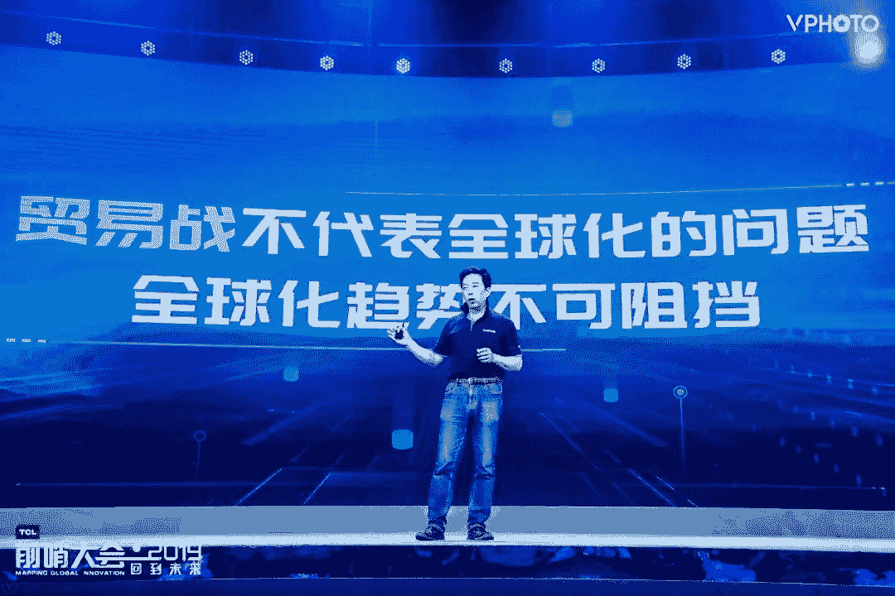

全球化的趋势是不可阻挡的，因为全球化给我们带来了巨大的利益，全球化有四个阶段，我们已经到了全球化的新阶段，全球化不光不会退转，还会继续向前发展，我们想要掌握的其实是全球化。

例子也很明显，尤其是美国的例子，美国总统特朗普在喊制造业要回迁。尽管他在喊，美国依然有更多的工厂在迁出去。2018年，通用汽车宣布关闭了在美四家工厂，北美关了五家。

因为产业的全球化，从产业角度做全球布局已经是一个事实，已经根本无法逆转，只有去顺应它，所以，后贸易战时代，全球化是迅速会回归的。最近中美之间贸易谈判有很大的进展。

我相信很快会达成协议，全球化会回归，但会进入新阶段。对中国最大的挑战是，我们如何在新的全球化状态下开展自己的业务，和过去最重要的一个区别是我们以前的全球化是非常浅的，在全球化非常初期的阶段是商品的全球化。

今天全世界已经早就进入了产业的全球化，而且正在进入更新的创新的全球化阶段。我们以前的做法是中国货销到全世界，这会越来越不可行，未来我们一定要适应全球的产业布局。

几年以前，有一次凯文·凯利到中国来访问。很多人认为他是互联网的先知，硅谷的代表，我在很多场合批评过这种看法，但是不得不说，凯文·凯利是一个思考未来的人，虽然他在思考中会有问题和偏差，但我认为，没有思考未来的人，是没有资格批评他的。

当时，大家都关心互联网热，都关心互联网明天的浪潮是什么？明天的模式是什么？下一个创业机会在哪？我的朋友张鹏，当时是《商业价值》杂志主编，现在是极客公园的负责人，他采访凯文·凯利，问他说太多人都在问你明天怎么发财？

凯文·凯利跟他感慨了一句，说大家都只关心明天下不下雨，但是却忘记了未来会进入什么季节。为什么说这话？我们当然知道未来比明天下不下雨要重要得多。

当你关注下一个发财机会在哪的时候，可能已经失去了更大的机会。因此，我们既要讨论眼前的东西，更要关注的背后的机理，从而可以判断更长期的趋势，因为趋势对我们更有价值。

**一说到长期趋势，会发现真正的****趋**势是科技。 科技才是社会发展的根本动力 。

工业革命的起源是瓦特发明了蒸汽机，谁能记得当时的英国国王是谁？福特的大规模生产汽型车改变了汽车业，也改变了全球的工业结构，大规模生产开始盛行，谁能记得当时的美联储主席是谁？

不管是经济还是政治，到最后，最本质的推动来自于科技。科技才是社会发展的根本动力。这些年，我们一直在持续不断地推广科技。

有人说，我只是做传统产业的，我对科技感兴趣，但关心科技跟我有什么关系？

我分享一个传统产业为什么要关心高科技的例子。艾米·韦伯是纽约大学教授，专门研究未来趋势。她跟我们一样，每年发布未来科技趋势报告。在她的《2019年科技趋势报告》分享上举了一个很鲜活的案例。

她说，我们都知道沃尔玛是做传统产业的，是传统大零售店。但是沃尔玛最近非常关心亚马逊，觉得未来亚马逊可能是它最大的竞争对手。为什么？这不是它主观猜测的结果。

它做过充分分析的，它发现很多科技正在改变传统零售背后的产业结构，过去我们要吃肉，用畜牧养牛养猪，现在可以已经用细胞培养的办法，直接培养牛的细胞，足够多的细胞放在一起就成了一块牛肉。

但现在不用，可能就在城市周边的一些实验室，这些肉从细胞培养瓶里长出来。甚至将来去买肉，不再是像过去，指着要这块肉，要那块肉，而是说要这瓶肉，要那瓶肉。这瓶是猪肉，那瓶是牛肉。产业链变短了，结构就变了。

所有这些变化造成了一个结果，造成了沃尔玛以前的传统优势（大规模采购优势、全国配送优势、全国连锁优势），一夜之间会不复存在。因为产业链变了极短，而且都在城市周边生产销售。

**当**科技进步了以后，传统产业不能幸免，所以必须要了解先进科技。

甚至于今天，我们找不到一个传统产业不会受到科技的冲击的。如果你是传统产业，你要非常小心。

接下来，我给大家盘点2019年我们需要关心的十大科技趋势。我们现在发布的是未来大家马上能看到的东西，甚至有很多大家已经都看到了，只是可能你没有注意到，或者你没有解读出它的深刻含义。

如果要了解产业，就要了解更长远的。因为毕竟现在再去做布局，从趋势角度，明天就发生的事，现在布局已经晚了，现在只能如何去利用了。

# **二、2019年十大科技趋势发布**

## **趋势1——车的革命 **

很多人会说，这没有什么新鲜的，而且你两年前就讲了自动驾驶。 现在确实到处都是，好像也没什么声音了，你为什么又重新再讲？

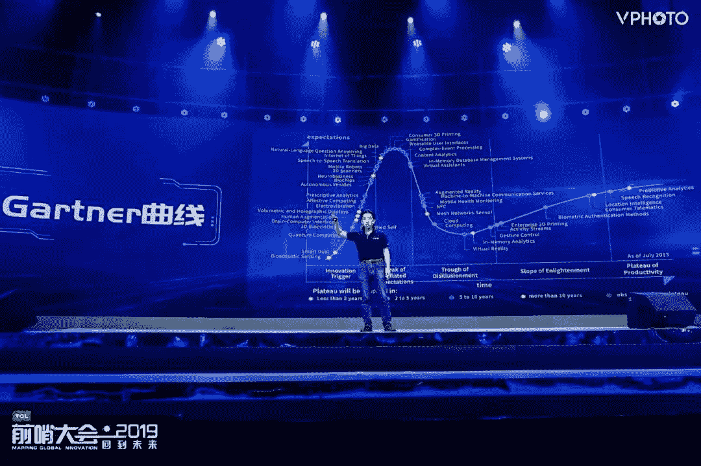

我需**要先介绍一个概**念，叫做Gartner曲线。很多人听说过Gartner曲线，但是可能不知道怎么用它。Gartner是美国的一个咨询公司，它提出这个曲线，指的是很多科技产品进入市场以后， 有两轮的热度 。

刚刚开始，科技被搞出来的时候，肯定是没有人知道的。但是慢慢地就会热起来，形成很流行的概念。概念流行到一定程度以后，会冷下去。因为概念虽然流行，但是并没有收入和利润，大家发现，老是在说这件事，但是离我又很远，也不发生，没有意义，所以就会冷下去。

冷到一定时候，其实在冷的过程中，这些概念已经在逐渐地酝酿，被开发成了产品，慢慢进入市场。虽然大家认知低了，宣传得少了，但是市场在慢慢接受，收入和利润在慢慢起来，它已经真正的进入社会了，又会进入下一轮的热度。这就是两轮的热度。

自动驾驶、电动车，甚至车联网，现在正好是在第一轮热度消退的时候，第一轮热度充分地教育了大家什么叫自动驾驶等等。

但实际上，大家会觉得离我很遥远。5级自动驾驶，在任何场景下都能应付。我们原来解释过，从人工智能的角度，确实也是不现实的。因为它是需要训练的，如果是它没见过的场景，它就没有办法做出应对措施，所以完全自动的自动驾驶是要花很长时间实现的。

但是，我们身边其实已经可以看到大量的自动驾驶应用了，所以我们说， 现在的自动驾驶早就悄悄地飞入寻常百姓家了。

我只是列出部分带有自动驾驶车功能的车型。这样的车型在中国至少应该有好几十款，甚至可能更多。在你不知道的时候，汽车产业已经在静悄悄地发生了变化。

你今年买车，一定要问这辆车有没有自动泊车功能，路边停车，如果车位很窄，就很难停，很多人会刮蹭，半天停不进去，今天不用担心了。你如果买新车，要买有这个功能的，它替你停车，一定比你好！

这些功能现在就已经有了。下次你要显得自己很时髦，去买车的时候，要问它，请问您的车里装了GPU没有？装了GPU，意味着有一定的自动处理能力，现在的人工智能能力又时尚又能够满足你的利益。

因此，这已经不是在讲一个概念的时候了。现在再推概念车，已经不对了。现在要推量产车了。为什么？街上已经开始跑着了，尤其在北京，绿色的车牌越来越多。是不是电动车也开始普及了？已经是现在进行时了。

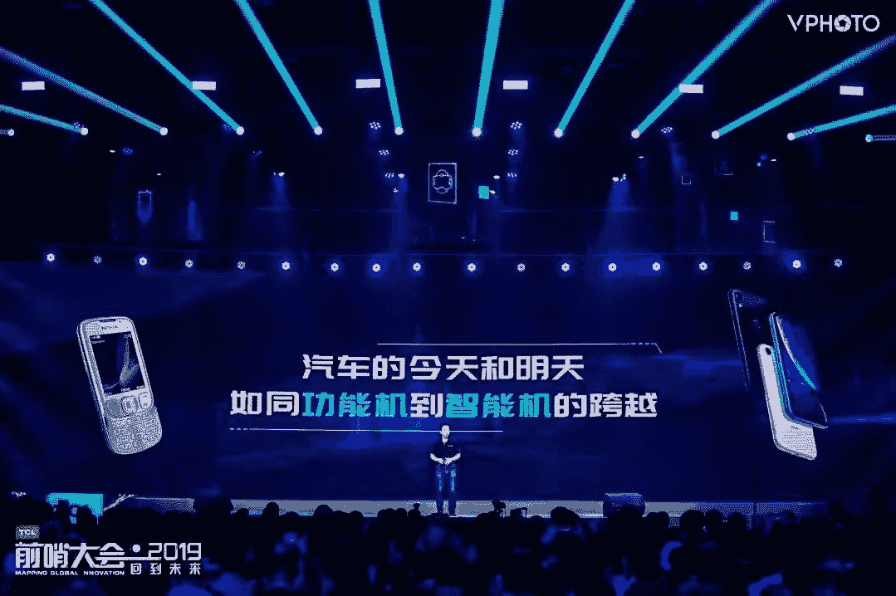

因此， 汽车变革已经开始了，而且变革非常深刻 。深刻到什么程度？深刻到相当于当年手机从功能机到智能机的转变。

所谓功能机，是我们当时的习惯叫法，就是非智能手机。不过，如果做一个比较，非智能手机也不缺什么功能，它都具备。记得2008年的时候，我当时给移动做顾问，去深圳考察。

当时还是功能机为主，智能机刚刚出一个小苗头。2007年，苹果才出第一代iPhone，当时的山寨机厂商就说，即使是苹果手机，也可以仿到三级四级，菜单内容都一模一样。

今天的汽车就相当于已经逐渐地跨越到了智能机时代。原来的车里什么功能都有，区别在哪？区别在车的功能有没有升级的能力，汽车系统升级将会成为常态。

前一阵有个新闻，有个自动驾驶汽车行驶在长安街上，然后系统要升级。车主不小心摁了当时升级的确认键，结果这车就立刻熄火，在长安街上升级了好几个小时，不能动。当然这件事应该避免，因为以后的升级一定是后台的。

就像现在大家的手机升级，是不是都发现有明确选项的，你要选择同意升级的话，它告诉你说是在晚上，有WiFi的情况之下升级。

我认为，我们的车应该至少也要达到手机的水平，以后车的升级也是晚上有WiFi的时候才升。我自己有切身感受，因为我在海外呆得时间长，经常出差的时候会租车，最近连续几次租车都是有标准的，叫做car play的设置。

car play相当于苹果的IOS一样，只不过IOS是为苹果手机和苹果电脑设计的操作系统，而car play是车企的操作系统。

如果你用苹果产品，你车里有NFC（近场通信），你手上戴着一个苹果手机，你和车连通你**你想去的地方导航，就直接从**手机投到了汽车的投屏上，你想听的音乐就直接投了车上。 车转眼就变成了手机的延伸 。

这个使用体验就变了。现在就两大操作系统，一个是IOS，一个是安卓。如果操作系统已经拿到了手机的优势，从手机延伸到汽车，车厂非听操作系统的不可，因为如果延伸不过去，体验就糟糕了。

车的革命已经开始了，而且它的深远程度会超过我们的想象。这个了不起的革命已经开始了，它会改变一个行业。

我们都知道特斯拉做卡车的自动驾驶，百度也在做卡车的自动驾驶，这个领域一定是最先商业化应用的。 为什么？ 因为它有商业价值。 因为现在特斯拉的标准设计是三辆卡车，只需要一个司机，后面两辆车跟车就好。

据统计，美国现在有350多万卡车司机，如果有200万人要失业，这在美国的动静会比中国还大。

中国人如果要失业，他立刻就想办法找下一个出路。美国如果要失业，他们就会聚集起来抗议。能不能2000多万卡车司机找到再就业的机会，甚至比做卡车司机还好的机会？这就是科技应该承担的责任。

乘用车，更是关乎到每个人。乘用车的变化一点都不比卡车小，刚才也介绍了很多汽车革命对生活场景的改变，大家可能还没听过瘾，接下来我们一起听听拜腾的电动车，会给我们的生活带来哪些具体的改变，让我们看看戴雷博士有哪些具体的案例和思考。

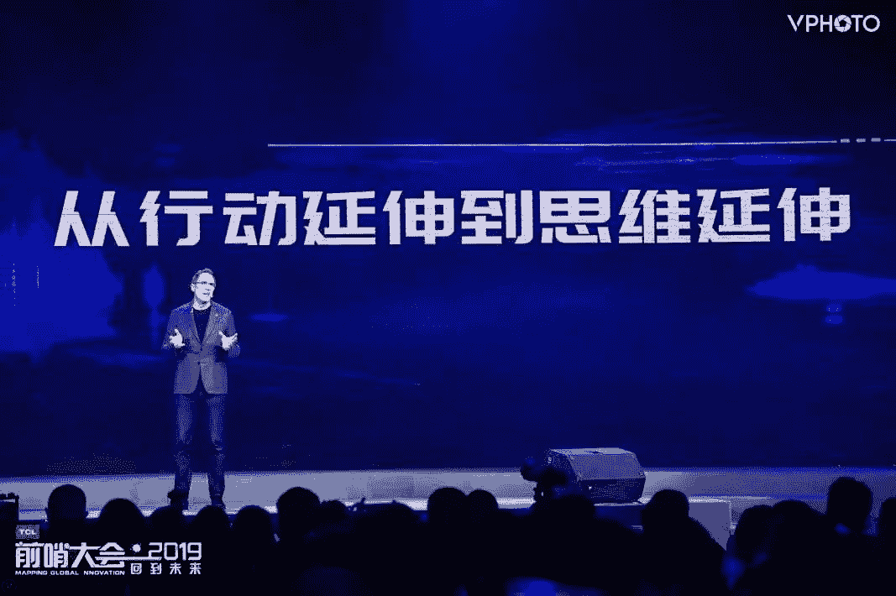

**拜腾首席执行官戴雷博士**

**汽车**发展的趋势已经从人学习车，到车学习人的时代 。 现在的消费者将越来越倾向于从智能化程度来选车。拜腾的大屏，不仅是一块屏幕，我们的车主通过专属的BYTON ID接入拜腾“智汇云”。它将智能车辆和智能生活连接起来。让你的爱车专属于你。

每一台拜腾都是独一无二的，实现千人千面。智能化的车，也让车主拥有无缝体验，不需要在手机、汽车之间切换，一个大屏掌握导航、通讯、娱乐、车辆状况等全部信息，实现“多线程作业”，车辆与人更好地融合。

**拜**腾的智能化的尝试，让我们有机会重新审视人与车的关系：

行动延伸——是指开车不仅可以去到更远的地方，让人在车辆行驶过程中更加自由——驾驶员可以与乘客进行更多互动，使得驾驶不再是一种束缚；

思维延伸——是指汽车拥有自动驾驶技术，车辆将根据路况与自身情况进行判断，为人的驾驶决策提供助力和参考，并通过OTA升级，让车越来越懂人。

目前，拜腾南京工厂建设工作正按计划稳步推进，现已开始设备安装、调试阶段。目标今年年底将实现量产投产，拜腾M-Byte将很快与大家见面。拜腾代表的趋势将成为现实。

## **趋势2——万物智能**

现在一个新的概念兴起来，叫万物智能，什么都可以智能化，不光是车。 当然，万物智能的核心也很明确，背后是人工智能。 人工智能的关键是什么？

**我们都知道。人工智**能三大要素： 数据、算力、算法 。算力、算法相对来说是可以开放的，所以到最后竞争的焦点就成了数据。

数据从哪来？从应用来。所以我们说人工智能应用才是关键。

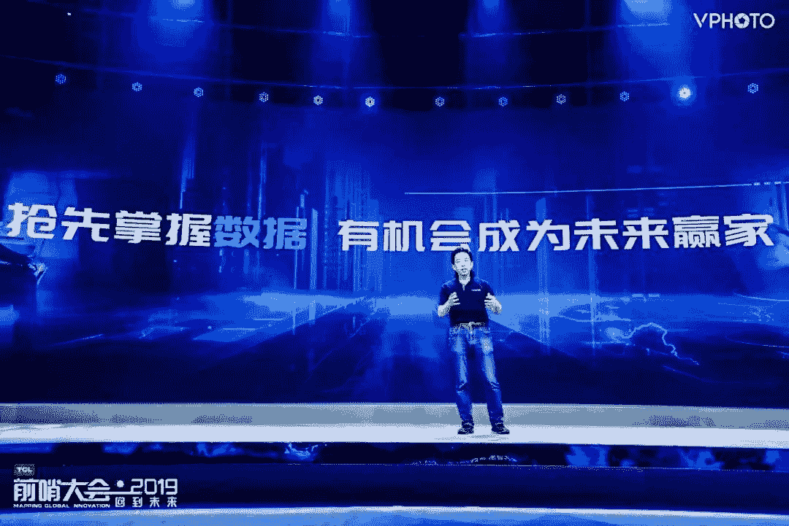

不光应用是关键，现在人工智能越来越像人，他需要什么？需要有一个学习周期，而且人工智能使得机器进入了终身学习阶段。机器可以终身学习，对我们有一个特别大的变化。

很多企业在上新技术的时候，会等到技术相对完善。但**是现在问题**来了，因为机器需要终身学习， 训练周期 变得很关键了。

所以现在必须要毫不犹豫地切进去，毫不犹豫地找到新技术和自己的结合点。尤其是毫不犹豫地把自己行业里的数据拿出来去训练，使人工智能变得更聪明。

只要你早一天训练，别人就很难追上你。所以抢先掌握数据，才能成为未来的赢家。这个是后台to B的东西。前台，万物智能的一个焦点就是智能家居。

我们都知道智能家居最早是在1995年被比尔盖茨提及，但是2016年才真正有了更加现实的意义。因为语音交互出现，由于有人工智能语音交互，你可以对每个智能的家居去发命令。所以新的交互方式使得智能家居成为可能。

尤其是5G来了之后，万物互联需要的所有的技术条件就都具备了。我们都知道4G时代，任何一台设备要和另一台设备通话，即使在同一个基站里，他也需要通过基站再去做传输。

但是5G的技术标准能做到，只要在同一个基站里，设备之间可以相互通话，这样通话的频次密度都会大很多，就意味着，你自己家里的所有的智能家居，以前必须得和某个系统去对接，现在自己就形成一个系统。

如果自己形成一个系统的话，它的智能程度就有可能能够迅速提升。所以我们说 5G来了之后，人工智能会像电力一样无所不在 。

我们说万物智能不光是核心的云平台是智能的，现在还讲所谓叫边缘计算，就是周边的设备也都是智能的，是智能和智能的叠加。如何把智能系统整合进来？

谷歌和亚马逊的做法就一个智能音箱作为和用户接触的前台，后台提供一个智能化对接的系统。

这个系统在中国也有很多人在做，智能音箱前一段也很热，但是我更看好的不是智能音箱，我反倒会更看好另一个企业叫涂鸦，因为他就做了一个第三方的智能接入平台。

谁家的智能系统都能介入，这样能够使得整个环境能够智能化起来。当然这并不是唯一的出路，甚至说未来到底哪条路最好，还未可知。

另**一条非常有机会的路，就是**做深度的对接，深度的融合，所有的智能系统能够对接到一个自己实现的智能平台上去， 让智能的系统做深度融合 。

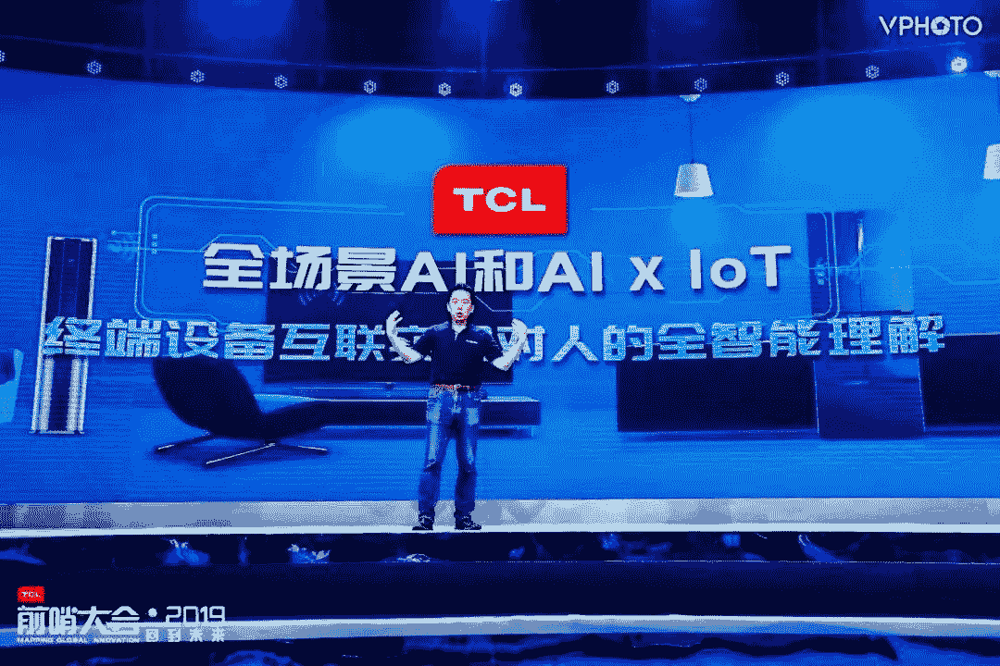

这个典型的例子就是TCL。 很多人已经知道，TCL开始了战略转型。 这些年其实他们对前沿科技就一直很关注，去年我就说过TCL和三星它们并驾齐驱的，抢先布局了量子点技术。 今天他们在人工智能领域也在紧跟前沿。

今年TCL做的一个很大的战略转型，就是把整个终端业务独立出来了，打造成了一家专注于智能终端产品的TCL控股，提出了全场景的AI和Ai*以IoT的战略，强调的就是智能终端设备在万物互联时代的一个新方向：也就终端本身要智能化，智能的终端在相互连接，数据互通共享，全面整合人工智能体系，这样为我们的生活提供更好的服务。

所以就是终端互联，然后实现全智能的环境。我们说万物互联是未来发展的一个重要方向，用户的每一个系统都能够自动智能化地互动连接起来，产生数据，经过训练，使得这个系统本身更加智能化。

因为系统之间现在可以智能化地整合了，每个智能系统的数据叠加起来，全面的智能就会更强大。当然，这么做还有一段时间。因为还有难度。迄今为止，多数的智能系统都是一个很窄的领域里面的。

比如说人工智能下围棋已经能下赢所有的人类对手了，但是你让下围棋的人工智能去开车，他还不灵。那么但是如果这些领域贯通起来，会产生什么情况？

首先有技术难度，但是一旦突破这个难度以后，有可能有很大的发展的机会。所以我们说在领跑万物智能时代的时候，抢占先机比你想象的要更重要，因为今天还看不到，但是明天很可能就会呈现出最好的机会来。

有很多企业其实当它在布局的时候机会并不清晰，他下去以后机会才逐渐明朗起来的。所以这种时候，在方大方向明确，小目标不清晰的时候，要勇敢行动。这是一个优秀企业的特质。

TCL现在在围绕着生活场景来提供智能化产品的全面覆盖，这样就可能会更早地做到更加全面的智能化，能更早地积累数据，它就会有优势。

有几个例子来说，我们现在都知道，TCL电视电视机越来越智能。电视机不光可以看电视，电视机其实也可以上网，如果电视机和你的冰箱能够连接起来。甚至说你在电视上下的单就会提醒冰箱，货品什么，保存期是多久，提醒主人在货品失效之前要吃掉它。

甚至你的冰箱跟你互动时间长了以后，会知道你的购物习惯，会知道你的消费习惯，会反过来提醒电视机，当你在购物的时候给你提供更加精准的推荐。

当周围的每个设备都更智能的时候，而这些智能又能够完全打通的时候，我们的环境就会变得非常的智能。这种时候我们对自己的理解，甚至真的是比不上机器机器。

**当然这就会带来另一个隐**忧，隐忧是什么呢？ 我会不会没有隐私了？

因为机器对我的情况了如指掌。一个坏消息告诉大家：我们其实已经进入了一个较低隐私社会。这已经是一个不可退转的趋势了！你别无选择，因为它改不回去了。其实来互联网发展到今天就在一步一步地降低大家的隐私。

比如说Facebook，看似很方便你和好朋友交流，但实际上你的隐私就极大降低了。好消息是，因为有了这些数据的收集整理和分析，你将会得到更好的服务。

今天的万物智能，就相当于电力一样会无所不在，所以很快，这个领域会出现一个像电力行业里的GE一样的大公司，这非常值得我们期待。

## **趋势3——显示无所不在**

很多人会认为这是个小趋势，但是实际上你发现没有，显示对我们的影响和我们的互动，其实比很多其他东西还要强烈很多。手机就是一个例子。

手机现在已经让我们每天都离不开它了，甚至很多人因此得了颈椎病。当然，我后面会有好消息，也许你的颈椎病未来会缓解，不是扔掉手机。

我们先看最近很热的东西，就是叫折叠屏手机。而且不仅如此，现在我们到处都会看到各种各样的显示屏在极度的差异化，而且出现在各个地方。

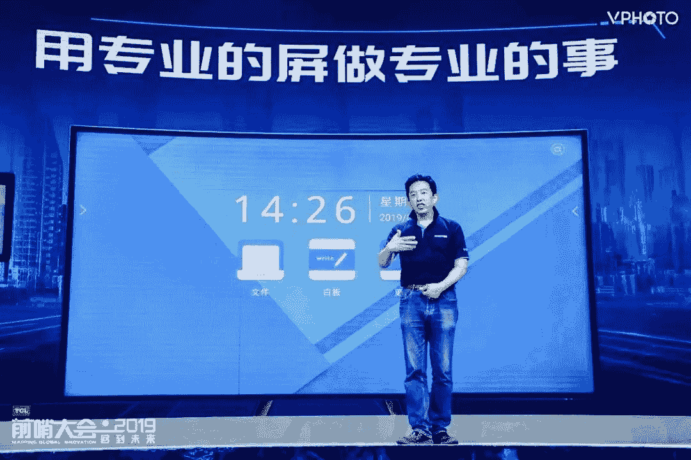

所以我们就说现在专业屏做专业事。到处都是显示屏，成为一个潮流，形成一个趋势。这块我又会再提到TCL，当然是因为TCL有很多地方做得可圈可点。

比如说可以触控的大屏，就是我们前面讲的人屏互动的重要的应用方向；包括未来办公室的墙面，未来地铁的窗户都会变成屏幕，而且能够和手机屏来互联互通。

还有一个很有意思的地方，他们出了一个很小的条形屏，可以用在超市或者商场的货架上，可以取代传统的货架价签。去年新零售是个很热的概念，很多媒体都在讲新零售条形屏看似很小。

但是可能是最快普及的一个方向，而且和我们说的智能叠加起来，你会发现它可能是有很大的潜力的，比如加上面部识别和你形成更强的智能互动，局部的智能互动，这个会很有意思。

去年我也讲到说电子竞技未来一定是大火的一个行业，果然去年迎来了一个爆发。电竞现在不再是简单的游戏，已经成了一个非常有潜力的一个竞技领域了。那么作为竞技项目，电子竞技其实对显示器有非常高的要求。 所以电竞屏幕代表了显示屏生产工艺的最高水平 。

华星光电在电竞显示屏上面重点布局的是曲面显示屏，这样能够给我们带来更好的沉浸感，这是电竞屏幕领域的新方向。随着电竞的爆发，电竞显示器的行业也会有更多的应用。

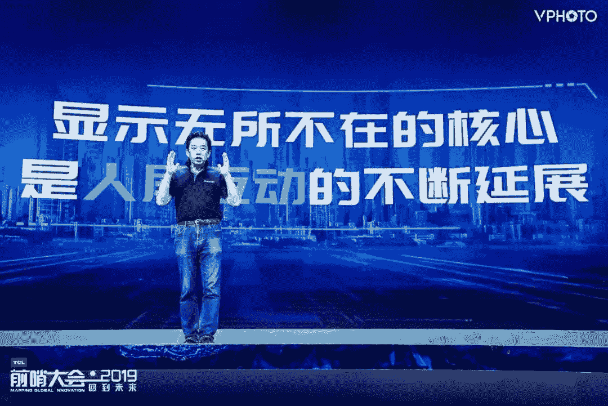

所以我们看到说华星光电这几年的不断的产业整合，提早布局各种前沿领域，不仅在量子点技术上布局了，在屏幕场景上有很多的探索。

但是最重要的这是一个把握住了一个方向，未来屏幕是智能生活解决方案的一个提供者，华星光电在这方面应该有机会成为资源，甚至产业链的整合者。最重要的是屏是要和人互动的，怎么去互动？

我们提出了一个新的理念就是手机的一个新的定义。我在十多年以前给移动做顾问的时候，就跟移动一起研究未来的手机的发展方向是什么？我们当时就提出一个理念叫做个人的智能助理叫做personal international。

当你要和环境智能形成互动的时候，有两种做法：一种是你自己去参与互动，一种是你本身有个智能设备跟智能设备去实现设备之间的互动。

你自己随身带的智能设备是什么？只有手机。

我们都知道手机刚出来的时候，很多人的玩法，还是因为想尝鲜，想使用新鲜的手机，所以是经常朋友之间互换，几个月跟朋友换一个手机。

今天换手机这件事早就绝迹了。因为你的手机里充满了你的隐私，随之而来的是，我们都成了低头族。

有没有机会改变这一点？我认为手机应该是通过屏幕进行无限地延伸的。未来大家一起聚会，屋里一定会有个手机屏幕，这种时候谁存的好玩的视频越多，分享到屏幕上的越多，谁就越受欢迎。它会变成新的社交方式，大家会摆脱低头，不是因为我们不看屏幕了，而是因为所有的屏幕都变成了手机的延伸。

当**所有的屏幕都变成手机**延伸的时候，而手机又充分了解你自己的时候，你会发现这个时候世界格外的让你觉得舒服。 甚至会改变很多产业 。

今年3月份，我们去参观了美国奥斯汀的西南偏南大会。

在西南偏南里我就看到了一个很有趣的事情，组织方案把所有的展厅附近这个柱子全都用保鲜膜给包起来了。为什么这么做？

因为西南偏南在奥斯汀，奥斯丁的常住人口70万，但是西南偏南每年开会去参会的人40万，那么多人涌入。那么每个人都想表达，怎么表达呢？就这么多的各种小广告。保鲜膜一包，随便贴吧。等到大会结束，保鲜膜一撕，很简单。

不过你再往深想一步，如果这些柱子本身都被显示屏包裹不是更好吗？如果被显示屏包裹，我想有什么广告，我在手机里做，然后就发到显示屏上去，而且组织方还能赚钱。这就变成一个新的广告模式了。

所以我们说，也许随着屏幕显示无所不在，可能会诞生下一个分众传媒，甚至我们再往深了想一步，不光是分众传媒。

我们都知道中国有一个在这个内容制作领域里面很重要的事件，就是所谓广电领域的制播分离，就是内容的提供和内容的制作分开了。如果互联网领域会有什么样的制播分离？因为屏幕显示无所不在，而我有一个好的内容又和本地的环境相关，我把它放到本地的屏幕上去。

路过的人觉得很好，就会下载，然后帮我传到更多的屏幕上，慢慢可能一个城市放的内容都来自于一个源头。这不是一个新的制播分离的方式吗？一个非中心化的内容传播的方式。

## **趋势4——混合现实 **

当然显示还有另一种方式，就是戴上头显。混合现实也是一个未来趋势，其实不用那么遥远，有很多东西已经现实在现实当中存在了。

去年，我带我们夏令营的朋友一起体验了VR主题公园，当你戴上设备以后，完全身临其境，完全沉浸到场景里了。这家公司的拓展非常快，它在全球已经有了超过十家的点，而且据了解，还有不下十家的点正在布设当中。

**增强现实、虚拟现实 **的**游戏体验的好处就是**它占地非常小，基本上200平米就能够形成一个游戏乐园，比我们设想的迪斯尼游戏乐园更加适合城市的体验。它的 未来是非常广阔的 。

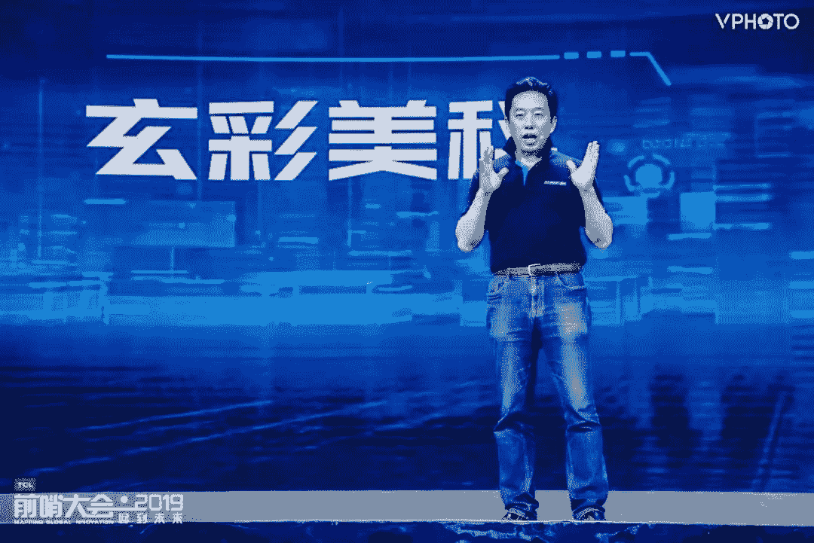

我们去年用AR（增强现实）做互动演示，请玄彩美科公司帮忙。这个演示其实很容易理解，就是现在越来越多的网上直播卖货。

**直播 **卖货的时候，要有各种各样的数据指标出来，甚至说还可以在上面设问题，答题，通过答题来抽奖，决定给谁什么好处等等。现在的虚拟现实直播、增强现实直播也已经成熟起来了。

过去播音员直播，尤其是天气预报，背后是个蓝屏，天气预报播音员永远不能拿手指指着某个地方，在他眼里看的是一片蓝，只能大概的说这片区域都会下雨。这片蓝背景，后期可以做上去各种情况，可以切换成世界地图，可以切换成天气状况的变化。

现在就是有玄彩美科公司提供，后面有台服务器，前面拿你的手机对着自己拍摄，后面支持着一个绿色屏幕就可以达到电视机的效果。有一些前卫的网红，已经开始用增强现实直播了，因为效果更好，后面的场景随时切换，跟大片一样。

我早上还跟玄彩美科创始人钱胜交流，他跟我讲的，基本上印证了我们的判断。在大潮流里，增强现实比虚拟现实来得快。增强现实领域，to C的应用就是to B的应用，对商业应用的开发要比娱乐应用要快。

未来的一波大潮流，一定是商业应用开发的。我举一个在亚马逊上购物的实际例子。现在在亚马逊买很多东西，基本是用手机来买，那么，我买了东西，以后合不合适怎么办？

现在用这个增强现实的技术，可以把虚拟物品放到实体桌子上测试一下，这东西到底行不行。假设我现在看到这么一个东西，觉得不错，我就把他放到桌子上测试一下。尤其是我转一转它的角度，还可以看看，整个体验下来，觉得把这个东西放在这里是合适的，我就可以决定购买了，就完成整个操作。

整个操作过程，可以做到 用增强现实来得到你想事先知道的情况，然后再决定购买！

类似这样的事情就发生在我们周围，这已经是一个亚马逊上能够提供的功能。我相信，未来越来越多的购物网站会把它做成标配。如果你不能提供这种功能，别人反倒不会去购物。因为我必须要知道效果，所以商业应用会很领先。

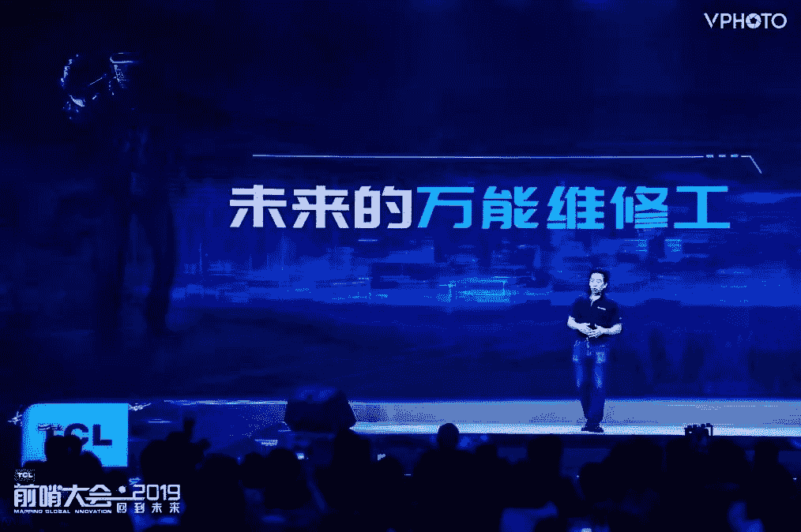

在去年我讲AR（增强现实）的时候，专门提到AR有一个特别大的价值，就是做远程维护、远程维修。在很多三四线城市和农村的人也有钱了，他也会买更多的电器。但是坏了怎么办？只好扔掉，因为越远的地方越缺乏足够有技能的维修工。

现在解决方案出来了，用AR来做。AR的变化会使得像美团这样在各地都有很多派送人员的企业，摇身一变变成了一个最大的维修企业。可以和TCL这样的企业联合去提供更好的服务。这就是变化。但是最关键的是一个变化，你要知道哪些技术会来，你要赶紧去应用。一家以色列公司已经做出来了，能够提供技术。

**未来一定有**大一大批的企业赶紧利用AR去实现自己 远程维修 的功能，远程维护对很多企业来说都至关重要。我们一直在讲前瞻科技，希望大家能够捕捉到科技机会。

多数企业家依然是听到了，但是没有行动，起个大早赶个晚集。希望我们越来越多的企业家能够行动起来，能够捕捉到这样的机会。

科技使我们能够突破原有的限制。真正好的公司是利用科技实现升维打击，你做到的事竞争对手永远做不到，这个才是有机会的。类似这样的机会非常多。

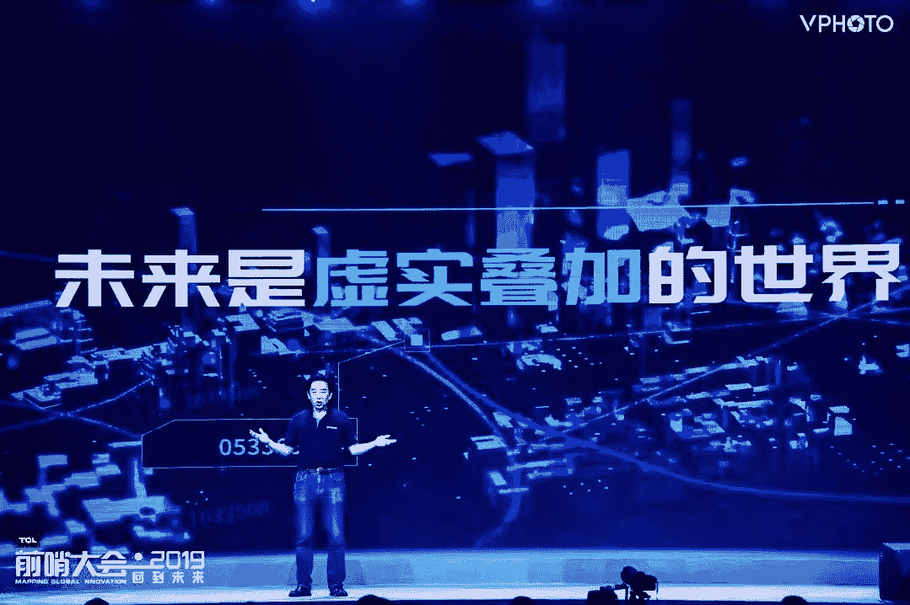

虚拟现实、增强现实来的时候，整个世界都会变了。我们能够生活在一个更加虚拟的世界里，甚至很多人认为那个世界更好。有了VR和AR，你的虚拟世界沉浸感会更充分。在这个领域，一定会出现下一个暴雪，一定会产生下一个魔兽世界，更加让你流连忘返。

有很多人会问，为什么没有提到5G？我们现在讲的是市场趋势，5G离市场略有点远。

**5G是个技术标准，**是个支撑平台，是个**产业，** 5G产业需要成熟 ，它的成熟还需要 两年 的时间。但是5G相关的应用不需要5G，比如带宽的应用在逐渐成熟。5G产业，今天我们想到的东西，可能都不是最主要的，还有很多我们没有想到的，那是最精彩的，这就需要有场景。

## **趋势5——肿瘤治疗 **

去年前哨大会，我曾经说过要想我们变得强大，要吃聪明药，然后我还介绍过，现 在的学术研究领域的人30%多都吃这类的药。

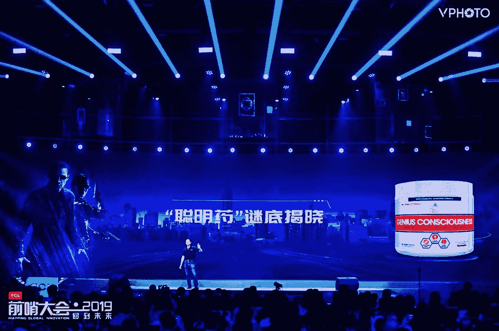

现在揭晓答案，你上亚马逊去搜索“脑促进药”，基本上两大类，一大类是一些通用型的非处方，一些化学药物或者生物药，刺激我们大脑的活跃度，相对让你更加清醒、更加专注。

另一类是一堆植物药，甚至是蘑菇提取物，号称有那样的效果，当然，历史也很悠久了。

这还确实是有很多人相信，我不在这花时间跟大家讨论了。当然，估计你如果相信你吃了药会变得更聪明，你也会更聪明。只是这个领域是不是百分之百科学确认。

但是，下一个领域，是我们称之为的长寿药。现在常说这个已经是被认为十年之内必然有大的突破。

当然常说的一个已经可以吃的药，我原来也介绍过，二甲双胍，一个常见的糖尿病的治疗药物，而且经过糖尿病人的多年服用，基本上认为是安全的。

从疗效上讲，被认为有明确的长寿的作用，因为一般来说，糖尿病人脏器会受损，所以他的平均寿命会短于普通人和正常人。但是长期服用二甲双胍的糖尿病人，他的预期寿命高于正常人。

所以，是不是考虑先得个糖尿病，再吃一下二甲双胍，也许更长寿？但是要提醒大家，作用机理还不明确，只知道确实有长寿的效果，为什么长寿，还不知道，还有待进一步治疗。

从机理上去研究长寿的公司有很多，但是还没有眼前的成果出来。虽然没有整个攻克这个难题，但是已经有逐步成果出来，就是肿瘤治疗，尤其现在有两个领域的进展都很大。

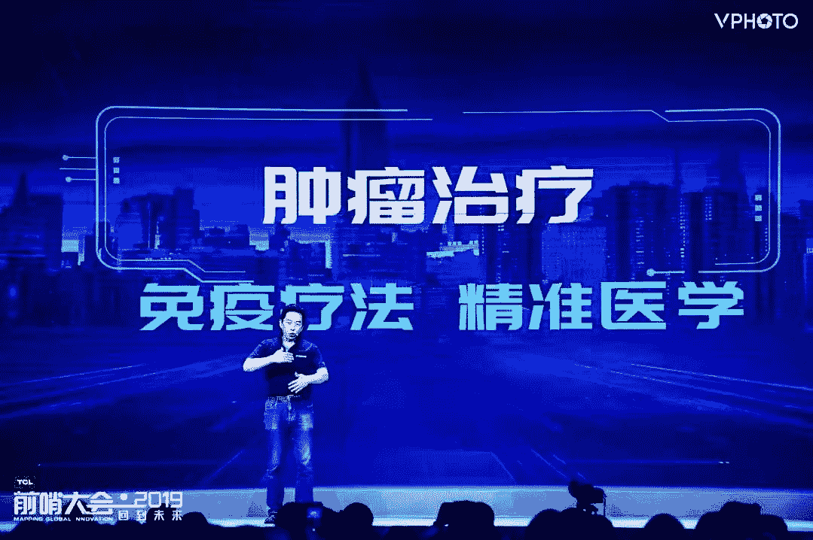

一个是细胞免疫疗法，另一个是精准医学或者精准治疗，从基因的角度看肿瘤的突变到底来自于哪个基因，然后针对性地提供基因治疗药物。

大量的这类药物，每个药物只管一个基因型突变，所以肿瘤药物会出现一个井喷。也就带来一个需求，就是要用人工智能的方法去大量研发针对性的肿瘤药物。

去年下半年，我带中国企业家出去，也专门和这家企业做了交流，叫Insilico Medicine，在人工智能领域，尤其是在人工智能硬件领域，被评为人工智能领域三家最重要的应用公司之一。这加公司的应用就是利用人工智能做药物研发。

它还有一个主要方向也是做长寿研究。当然，肿瘤药物研发也是它的一个非常重要的研究。除了治疗以外，还有检测，肿瘤检测现在进展也不小，现在的一个重要方向是所谓叫外周血中的游离DNA的检测。

如果精度提高上去，会使得早期肿瘤能够被检出，所以，慢慢的，肿瘤会成为一个更加可控的慢性病。

艾滋病一直被认为是一个几乎没救的病，但今天医学界已经认同，艾滋病已经变成了一种慢性病，只是不吃药是不可能的了，只要坚持吃药，而且药物的价格在逐渐下降，一个人是可以保证长期没有问题的存活，和正常人一样是没有问题的。

乐观地说，肿瘤疾病就会变成慢性病。这个领域也会出大公司。它不是下一个辉瑞，因为它不是药，而是下一个强生，更像医疗器械。即使在生物医药大方向，要学会判断小方向，生物制药更像医疗器械，而不像药。

尤其肿瘤都攻克了，再加上一些长寿，我们希望人能够不死。不死的说法，不是靠肉体不死，是精神不死，就是所谓黑客帝国把你的所谓数字资料全部上传到网上，然后人就永生了。

## **趋势6——商用机器人 **

**去年我们说到**扫地机器人，现在我们推出 云迹机器人 ，你去酒店稍微看一下就能看到云迹机器人，而且功能越来越健全。

我们随便在各种小的短视频网站上摘录下来的，因为它实在太招人喜欢了，一般你看到云迹，一般会拍照上传，所以网上有大量云迹的视频存在。

今年除了老朋友索菲亚之外，还有一个新朋友她的妹妹——小索菲亚，确实有很多的功能，和它姐姐一样聪明，希望小索菲亚也能和它姐姐一样红。

说起红来，人红是非多，机器红也是非多，所以现在有很多说法，小索菲亚和大索菲亚不智能，语音互动都是事先编排好的，其实他们都没有说到点，因为大索菲亚有她擅长的东西。

我们来看一下大索菲亚擅长什么东西。索菲亚擅长的叫非语言沟通，因为语言沟通可以调用任何一个现有的软件系统，非语言沟通占人类沟通里的80%。

没有人希望和冷冰冰的机器对话，你和机器人说话的时候，它眼睛都不看着你，多可怕。索菲亚和你说话一定是面带微笑，眼睛看着你的。

**服务型机器人 **已经越来越广泛地应用到我们生活方方面面。当然，不完全是长的像索菲亚的形状，你去设想一下它作为导购、导游或博物馆讲解员，你当然希望是个人，不是机器。

但很多时候你不介意它是机器，比如餐厅，智慧餐饮未来是个重大的方向。需求太明确了，谁都要吃饭，而且生活越来越好，要出去吃，出去吃一定会喜欢去更多的连锁，服务质量能够保证。

另一个痛苦是我小时候有的，有一次我写作业，把老师给的指令记错了，老师说把课本炒10遍，结果我抄100遍，那天晚上一直写到深夜。现在这个东西太好了，就是智能抄写机器人。

当然，有人说这不是教学生们学坏吗？写作业不自己抄了，用机器手去写，我认为学生用机器手写完的任务应该视同自己完成的，因为机器手不就是自己手的延伸吗？而且现在的学生这么优秀，可以用机器手完成作业。

我认为应该有一种思维，重复性的工作应该交给机器人来做，我们做创造性的工作。现在深圳有很多及其臂的企业，不光是有很多工业的机器臂，也有商业机器臂、台式机器臂非常多，还有众筹领域就有好几家。

机器臂能帮你完成很多任务，能帮你跑差，帮你倒咖啡，帮你调酒，未来会越来越多。我们相信，因为中国有这样的制造优势，加上人工智能的赋能，很有可能在机器臂领域会出现下一个大疆。

## **趋势7——新材料 **

这是一个容易被大家忽视的趋势，因为它是新材料。 我们想强调的是比魔术更神奇的是科技，尤其对我这样的魔术白痴来说这样的科技更好。

可以在很多地方看到 **记忆合金 **。比如美国人拿记忆合金做卫星天线，卫星发射上天的时候用天线收着，天线支着没法发射。放到天上以后，天线到了太空自动分开，那是记忆合金的效果。

很高大上，但市场不够大，市场最大的是日本人干的事情，日本人拿记忆合金做女性内衣，无论如何揉搓洗涤，穿到身上，体温就是它记忆合金的适合温度，它就变挺了。

国内有个内衣厂商就用的这个材料，但好像他们不太宣传自己用的记忆合金，可能怕女性觉得戴个多么高科技的金属对身体有害，我不知道。但背后就是这个东西，科技在为我们实实在在提供利益。

下面请亚利桑那州立大学工学院教授姜汉卿老师上场，看看姜老师给我们带来什么样的魔术。姜老师是科技界的跨界高手，我们说科研有师承，系出名门，牛师父带出牛徒弟。既然有师承有可能只在一个领域有造诣，姜老师在好几个领域造诣都很深，我想问他为什么会突破这个规律。

美国亚利桑那州立大学工学院教授 姜汉卿

我的师承是力学，减震是个古老的力学问题，做了几十年了，可是至今依然解决得不好，我们从全新的角度看这个问题，用机器学习的方法找到了里面的结构之一，找到若干结构可以做低频、高频和全频段减震，这里的应用就很多了。

作为前哨的忠实用户，王老师的铁粉，我纠正一下错误，我现在还不是大牛，是大牛的学生，是很努力，的科技前沿的探路者。

我研究的方法是两个要求，科研要创新，在我的领域和科研体系中要能站住脚；第二它能大规模制造，我们经过多年尝试，把力学、材料和艺术结合起来，做了基于折纸和剪纸的可拉伸电池，后面有可拉伸的电池支持，希望不久的将来大家在市场上看到柔性可拉升可折叠电池。

我的本行是力学出身，由于我先做了柔性力学，学到了材料，学到了电子，这时候我的知识面就有一定储备了，我就有可能做到创新。美国的科研体系强迫我们必须创新，否则你没法升职，从副教授升到正教授，一定要有创新。

这个想法是四年，我们做个项目，做植入设备，当时我问一个问题，有没有另外的方式能够把碳基的人和硅基的电子设备结合起来。目前是两个方法，一是可植入（像心脏起搏器），二是穿戴设备（像手表），我想有没有第三种方法，可以吃啊，那么有第二个问题，现在这些设备可以吃吗？答案是不可以，有毒啊。怎么办？我们吃的是食物，那么我们用材料学的积累，研究食物不同的食材及属性，这是很盲目的尝试，很幸运地发现可以做成电子设备。

谢谢姜教授，所以我们 看，材料领域也可以有很多令人心动的东西。

我们小时候都听过那样的科幻，一个手术机器人吃进去到胃里就开始进去做手术，如果是现有的所谓硅基的，带着铜的那个就不是做手术了，就是毒药了，未来全可食用手术机器人进去，可能真有那一天，我们还是期待姜教授做出更伟大的发明来。

新材料的好处就是不断有新的东西出现，比如过去几年比较热的石墨烯，这两年又出个新的热点叫硼烯，硼也是在地球上含量还算比较丰富的东西，据说硼烯和石墨烯一样单层延展，但很多性能超过石墨烯，有很多可期待的东西出现。

材料领域很多并不是高大上，比如已经来到我们身边的我们并没有留意，但实际有科技。我在家做饭，但做饭水平不行，戴上防割手的手套确实没有问题。很多人脚臭就很麻烦，现在把很细的银丝放进去就解决脚臭的问题。

材料科学容易被忽视，原因在于它的进步不显山不露水， 只有到应用阶段做得比较好了大家才发现是材料的功能 ，这是材料的特点。材料领域现在进步也非常大。我们认为很可能会出现下一个杜邦，因为杜邦是当年的化工材料造就了这么一个大公司。

## **趋势8——新物种 **

最早提出新物种的这个词是吴生老师，只不过后来被乐视未经授权借用了，结果自己发展的也不太好，我们今天说的不是乐视这个“新物种”，说的是这个新物种。

大家发现没有，这个新物种的臀部的肌肉格外的强壮。为什么？因为我们吃猪都喜欢吃瘦肉，所以现在生物医学工程基因工程就改造出能够长出更多肌肉的瘦肉型猪供我们食用。

我一说这个估计很多人害怕，因为你很容易联想起来，最近一个基因编辑的人体胚胎已经出生了。

不过不用害怕，我们其实介绍过一个事情，就是在六七十年代的时候，基因工程就出现了很大的飞跃。那时候很多人就在喊，千万别培养出超级细菌来把人都干掉，因为理论上讲那时候就可以培养。

今天的所为基因编辑只是在工具上更进步了，就工具好了，但是没有什么大的原理上的突破。

那时候到处都在渲染生物威胁论，1975年2月在加州一个叫做阿希洛玛的小城市，科学家们开了一个叫 阿希洛玛 会议——目的是约束生物科学家，不要干反人类的事情，不要干反伦理道德的事情。

这件事一直到最近才被咱们中国的科学家给干了。

**我还是挺相信科学家系统的，所**以 不要高估这些科技带来的威胁 ,人工智能迄今为止没有毁灭人类的能力,因为解决的办法很简单，就是把它的电源拔掉。

还有另一头猪的故事，我们原来也提到过，就是哈佛大学博士杨鹿晗和他的导师要把猪的基因里面，可能引起人的排异反应的基因敲除掉，这样的话，猪的器官移植到人体的时候，就不会有排异反应，就可以被接受了。

每年有大量的人等着器官移植，以至于可能没等到就去世了，如果器官移植问题能够解决的话，那真的是一个大的福音。

这个领域可能最早的出现的并不是一个大的医药企业，而是一个和食物相关和农业相关的大企业。

## **趋势9——大航天时代 **

我们得到专第二季《全球创新260讲》的第一个月，我们讲了几个对未来影响特别关键的趋势。其中一个就是大航天时代。

大航天时代不光国外有进展，中国的进展也很大。我们看到，嫦娥4号第一次到月球背面，而且我们也期待很快，中国能组织登月。前一段以色列组织登月没成功，美国现在也在喊2025年重返月球。

我们原来也介绍过，曾经登月用的土星5号飞船，近地轨道运载能力150吨。现在运力最大的火箭就是特斯拉刚刚推出来的猎鹰重载。猎鹰中在近地轨道运载能力大概50吨，就比土星5号差了2/3，所以还差得远，但是我们已经往那个方向去努力了，而且努力现在也有一些明确的规划。

**所以很有可能**我们这代人能够成为第一代的 跨星际物种 ，开始有移民火星的机会。说点近点，我们都知道连腾讯都投资了一个卫星公司，这卫星公司叫太空探矿，太空小卫星捕捉。

当然这卫星公司迄今还没有发射设备，因为要发射出一个在太空能够捕捉小卫星的设备才行。为什么要去太空淘金？因为我们知道很多稀有金属在太空并不稀有，如果你运气好的话，你在太空捕捉到一颗钛含量或者锰含量特别高的小行星，你就发财了。

据说全宇宙最大的钻石是天上的一颗小行星，整个小行星就是钻石。 所以我们有希望在有生之年可能能看到第一个万亿富翁，捕捉到了一颗小行星就够。

再说点近的，我们原来介绍过，这是私人的小创业公司，成立了不到十年时间，现在在天上总共拥有的卫星数量超过200颗。平均一周能够对地球表面的所有地方扫描一遍。

其实它一天时间就能在地球表面完成一个完整的扫描，因为它具备了扫描地球表面所有地方的能力。而且它的数据是商业的，对所有人开放。也就是说你今天就能买到他所有的数据，只要你肯花钱。

有一家美国公司特别聪明，他自己不做卫星，他买卫星数据，而且特意买美国各大超市门口的卫星图片，而且是要高清的。因为美国很多超市设在郊区，门口是露天停车场。你可以通过露天停车场的照片，研究停车场停了多少辆车，进而知道这个超市他的经营情况。

而且如果你对比邻近的两家超市，你能知道竞争的差异状况。如果你把美国所有的重要超市都拍下来，你甚至能知道美国的经济情况。

所以在未来， **数据就是石油 **。谁会从数据当中去练石油，去把它练成我们可用的燃料，谁就是未来的赢家。未来太空数据会是大数据里面一个特别可用而且相对开放的数据。

那么谁最早找到了炼油的秘诀，谁就会成功。数据已经在那儿了，就看你会不会炼油。

## **趋势10——个人创业者的崛起 **

第十个趋势，和我们每个人更相关了。 先给大家讲个故事。 这个故事是华人技术经理人协会会长文立民老师讲的。

有一位靠在海滩上捡塑料瓶子谋生的华人老妇找到她，说她有一个发明，能不能帮她申请专利？

文老师说可以，什么发明？她说，我在海滩捡塑料瓶子，发现很多人喜欢到海滩上晒太阳，但是他们喜欢喝冷饮，不喜欢喝热饮，如果把饮料放在沙子上，一会饮料就变热饮了。

她说，她发明了一个杯托，脚很长，把脚插在沙子里，杯子本身不接触沙子，然后把饮料放在杯托里，饮料能够保温，就能够保证它凉更长的时间，又能在海滩上晒太阳，同时享受到冷饮。就这么一个简单的发明。

文老师帮她申请了专利，她自己就找代工厂去卖，同时别人也找它来做专利授权，也来销售。她现在因为这么一个小小的专利，一年能获得六七十万美元的收入，一下生活就改变了。

很多小的似门槛不高，但是一旦能够大规模复制，而且还有一定的知识产权保障，其实也有巨大的机会。海员在海上经常好几个月都不进港，他在海上捕鲸捕鱼，然后没事干，怎么办？休闲时间，拿一颗鲸鱼牙齿做个小雕刻。自己没事雕刻一下东西，消磨时光的工艺品，到现在甚至变成了一个产业。

中国有人养鸵鸟，鸵鸟蛋专门拿出来交给另外一帮雕刻家，把鸵鸟蛋镂空做成很漂亮的雕刻卖出去。这就变成了艺术。但是，这个艺术有一个问题，就是需要专业的技能，怎么能雕个鸵鸟蛋的时候，既能做到图案很好，又能够手法很好，要培养要训练，一般人做不到。

科技就有用了，科技就是降低技能门槛的。

作曲音乐是大技能了吧，现在人工智能作曲软件，你只要随便哼个调调，它就帮你作曲，甚至完成整首曲子。你只要出一段小旋律，它帮你扩张成一整个曲子。以前要想作曲，最起码学很久音乐，现在不用，脑子里有个好听的旋律，就能帮你做出来。

不光音乐，绘画也是一样。很多人学绘画，学一辈子水彩，油画也要学很多年，中国画更是这样。现在也不用了，一个人工智能程序，你输入两幅图片，它帮你合成，能合成出梵高风格的猫头鹰。

很多人一辈子只会一种风格，现在，电脑都能学会，人工智能都能学会，然后把它延伸到各个地方去。

**未来会出现一**个新的品类，叫什么？叫 科技艺术家 。科技艺术家强调的不是技能，只是单纯的技能已经不构成竞争优势，甚至说，技能就是能够被机器掌握的。剩下的是创意。

未来科技和艺术应该在创意的角度极大地融合，越来越多的艺术家和科技一起探索边界，探索哪一些艺术的事情都应该交给科技，然后人去干那些科技都无法做到的事情。这才是人存在的真正价值。

孩子有一个了不起的地方，就是充满创造力，因为他没有任何的束缚，没有任何的条条框框。

社会本来的趋势就是人会越来越爱玩，越来越好玩，用艺术让人更爱玩，用科技让所有的技术难题都被消除，让每个人都能变成艺术家，就应该是科技的任务，而且就可以变成一个很大的产业。

我**稍微做点总结。很多人问**，为什么你说这**么多趋势？而且别人**也发布各种各样的趋势，你讲的趋势和别人什么不一样？我认为 我讲的趋势更贴近现实 。因为我是从 对产业的完整了解 中提炼出来。

**科技扩散到社会有一个时间过程 **，不是任何先进科技迅速让所有人采用的，一定是先有核心的基础技术突破，再到行业应用，再到具体的商业应用，再到社会接受它，有一个逐渐扩散的过程。

我们要了解一个行业，就要了解哪些技术正在改变这个行业，既要知道未来，同时要了解技术！以前的技术曾经怎么改变了社会，而社会又反过来作用于技术和行业，过去的叠加才是今天。

我们有一套完整的方法来支持我们做这样预测。如果你想了解更多的趋**势分析的东西**，我们最近也出了一本书，叫 《暗趋势》 ，欢迎你来看更多的细节！

你**说到底我有什**么机会使用这个科技，发现新的商业机会，去扩展我们的市场领域，那你只能参加我们的专业培训了，每年暑期的时候会做 科技特训营 ，今年已经是第四年了，是给专业人士了解科技最新进展和如何把握这个科技进展，如何利用这个科技改变人的产业，改变你的事业，也欢迎大家参加。

# **三、趋势背后的规律。**

今天的科技创新是 **端到端 **的，源头从高校实验室的科学研究来，然后技术根据原理做出可用的产品，然后再由产业实现大规模量产，送到市场送到社会，它才能够带来社会的进步。

早在瓦特的时代，科技企业就出现了。他和一个叫博尔特的资本家成立了世界上第一科技企业“博尔特与瓦特公司”。

在 **科技1.0 ****时代，**以福特为代表的科技企业，实现了科技的 量产 。科技1.0的核心是解决了量产问题，让科技产品能够覆盖所有人。

**科技的2.0 **进入到IT时代。这个时代出现大量软件企业，像微软、Oracl**e等等**。这个时代科技企业的特点是加入了 研发 ，科技一定要有研发做支持，企业将研发和产业化对接起来了。但是因为研发的时间比较久，就出现了有风险投资。不过，2.0时代的这种模式只能限于类似IT企业这样相对来说边际成本低的产业。

现在进入了 **科技企业3.0 **的阶段。3.0是什么特点？就是把前面这几个环节都打通了。不光研发和量产打通，同时还加上了科学的部分。今天的先进科技无疑例外都来自于高**校科研的结果，然后**做产业化，然后去量产。所以实际上真正要把一个科研成果送上市其实是三个环节必不可少。甚至还要延伸到用户侧，还有用户体验应用的完善，最后才能叫做 端到端的科技创新 。科技创新的效率高了，科技的水平实力高了，科技创新的壁垒也强了，对科技创新的支持也变强了。所以今天为什么出现了科技的井喷？就是因为科技企业3.0的出现。科技3.0会是一个趋势，是一个特别汹涌澎湃的浪潮。

**科技四个现代化 **

真正要解决好科技创新也需要四个现代化。

第一个要 **企业化 **。高校要和企业合作来做产品。

第二个要 **产品化 **。要能够实现把科技最后转化成产品。

第三个要 **规模化 **。光有产品不够，还要大批量的生产。

第四个叫 **资本化 **。这样你才有退出的机制，才能实现一个良性循环，才能实现自我在再生和造血。

在这中间其实第一就是现有的问题是很突出的。我们讲**科技企业3.0整**个企业发展过程当中存在 两个明显的鸿沟 ：

第一个在 **企业化 **，大量的科技产品还不能转化为企业。即使现在转化效率比以前高很多，还是做不到好科技变成好企业，因为科学家和企业家信息不对称。

第二在在 **规模化 **，大量**的科技企业不**是死在研发的路上，而是死在研发完成了以后，不能量产的规模化的前夜。因为量产需要的钱是巨大的，这个问题，国外很难解决，因为建厂是一个巨大的投入，国外缺乏人员对量产进行评估。这个事情中国能做，能评估能不能量产，甚至凭借技术能力便宜地完成量产。这是 中国的优势 。

科技创新3.0带来的井喷，能够解决我们最开始提到的现在全球化面临的严重问题，科技红利分配不均的问题。用端到端的创新解决科技红利的重新分配问题，科技红利不应该只属于大规模制造者，也不应该属于创新者，应该是全产业链分配，人人参与创新，人人参与分配。

在今天，任何做科技的企业一定要明白，在科技企业3**.0时代，**要端到端的创新，整体来讲要有 创新生态 。一个创新根本不够用，如何持续高效地产生**创新，是对**企业的新需求，也是对一个经济体，产业的新需求。对中国更是这样，如何持续不断产生新的企业，新的产品，我们定义为 创新效率 。

如何提升创新的效率 ？就要用全球的系统来解决。所以，创新是个生态问题，科技化必然伴随着全球化，因为本地资源、本国资源不能保证每个部分都是优势。

我们讲过积木式创新理论，是最优的长板相互结合。任何国家不能保证**拥有所有的全球**创新资源的长板，那就需要 创新效益理论 。

创新效益理论最核心的部分是 **全球化4.0 **。

首先，要知道整个全球化进程。

全球化1.0在一战之前，随着西方的工业革命，全球化开始。主要是全球贸易，货物交换。

全球化2.0在二战之后，进入国家全球化阶段，建立国际组织。

全球化3.0开始了产业全球化阶段，当国家之间可以用谈判而不是战争解决问题的时候，企业就可以跨国部署了。

中国的全球化还是1.0。中国制造，不应该是在中国才能制造，而是中国是制造专家，在哪儿都能建最好的制造工厂。

但是这还不够。因为我们又迎来了创新的全球化，也就是全球化4.0.

未来的竞争，是创新生态的竞争。全球化4.0，要在一个生态环境，能够对企业形**成完成的支持**，使自己的生态里，能够大量产生科技企业，最后成功的科技企业，这就叫 效率最大化 。

**所以，未来创新的**争夺在哪儿？在 创新效率的争夺 。创新效率就要能够对自己的创新生态形成系统的分析，知道如何去改进，如何去优化。比如说中国，我们有开发区，要了解开发区的优势和劣势是什么？开发区可能带来的问题是什么？

中国的产业优势不来自于劳动力成本低，来自我们的产业集群能力，就是在任何一个地区，聚集了一大堆相同产业、上下游互补的企业，甚至有点竞争关系的企业，这样就形成了非常强大的灵活性甚至强大的创新能力。

我们找到真正的规律，如何落地先进的科技，落地的前提是产业集群基础上的整体科技分析，这是中国真正需要解决的问题。这个竞争优势不能丢掉。如何创造一个创新效率更高生态，是我们在探讨的问题。

不同企业有不同企业的创新效率，大企业要创新，基础研究可以自己建，应用研究最好让小企业做，因为有灵活性。小企业试错成本低。大企业可以投一点钱，赢得与小企业合作的机会，合作程度加深以后谋求收购。

所以，中国出去，我们也是到处大张旗鼓收购，为什么效果总是不理想？因为我们没有前面这段合作。

我自己前段时间在美国参加过几个投资会议，专门是封闭的好企业和投资人的见面会，我发现周围的投资人越来越多不是来自于独立的风险投资机构，而是来自于大企业的投资部，很遗憾，没有见到中国企业。

**硅谷的成功**，不是硅谷的政策好，而是打造了一个 创新生态 。

创新发生是第一步，此外，还需要好几个核心环节，才能成功率大增。中国的优势不在创新发生上，中国的优势在创新的扩散上，创新成功如果是个连续链条，越往后中国价值越大，谁能让创新成功谁就有价值，现在后端稀缺，所以中国的价值在全球创新反倒更大。

全球创新的天堂应该是什么样的？

美国匹兹堡的人工智能技术，以色列 特拉维夫的CEO，迪拜的资本，花中东的钱，请伦敦的设计，雇印度班加罗尔的软件程序员开发，在深圳量产，去香港上市。

真正的国际化，要学会用全球的资源。

用全球化的创新生态来解决国家和跨国企业冲突的问题。现在没有封闭的跨国企业，而是完整的跨国生态。我们必须把自己汇入全球经济大潮里，在全球经济发挥最大的作用，才应该是中国人真正应该有的使命，因为我们应该比我们前辈做的更多一点。

# **四****、中国参与创新的十个机会 **

## **1、站到潮头做创新。 **

创新并不遥远，也没有你想的那么艰难，当你天天和牛人混到一起的时候就有机会做到最好。

举个直接的例子——“盲人眼镜”。虽然是小小的一个眼镜，却能让全盲的盲人感知外面的世界，改变他们的生活。中国医学转化中心一起合作落户，中国注册、申报和量产，我们希望到明年初能够完成。

我也正在筹划，希望到8月创新地图大会的时候成立脑科学研究院。这个研究院可以研究认知科学的最前沿，叫“脑机接口”。中国亿万年已经形成了周围神经向大脑神经传递信息的完整系统，没有必要直接向大脑神经传递，最好的方式是利用现在的周围神经系统向大脑传递信号，这个舌片就是最好的方式。

研究院成立后，我们将正式向外宣布向所有的学术机构、医疗机构开放这个舌片系统，你可以利用我的舌片做各种各样的研究。未来阿尔兹海默症的患者可能需要的是晚上睡觉的时候含上这个舌片，刺激他大脑各个地方，保证大脑都锻炼了，保证他神经不会退化的问题。

在下一代眼里看我们就是文盲，就像我们看7000万年前的人类一样，在我们眼里就是文盲，因为他们不是字。可能一百年以后后代看我们，说你们这帮文盲，我们有的技能你们完全没有。我们希望被后代鄙视，说明他们进步了，人类走到今天不就是一代超越一代，我们愿意做后一代的基石，不要以为我们不能推动科技最前沿。

我们有产业化的能力，能把全球最好的认知科学、学习和平台在一定产业化基础上提供给一定的科研机构，这是中国前沿科技研发做的最高尚的事儿。

## **2、从应用找科技。 **

中国人最会找市场的，发现问题就想办法。

我有个朋友江淦源，曾经拿过全国魔方比赛冠军。在魔方界他可是个大名人，我们原来一起去参加CES展，一群全世界最顶尖的魔方高手追到拉斯维加斯等着见面。

由于 江淦源对魔方有比赛要求，要求拧的 得很快，所以喜欢和人对战比赛，不断提升成绩。对战时就需要条件，慢慢给他找到了创业机会，做成一个产业，做得还不错。

他在小小魔方里植入了编码器、陀螺仪、单片机、蓝牙芯片等。智能魔方能跟踪和记录魔方的运动姿态，无论是多么细微的转动，再快地转动，还有整体姿态的角度变化都能一一记录，这样App知道魔方状态后我们就可以开发AI教程，让App根据魔方的具体状态教导用户学习魔方了。

随着玩家的速拧水平提升，玩家可以依托我们的线上平台与全球玩家随时随地地进行互联对战，甚至相互分享经验解法约战等社交功能。不再是以前我们所认为的魔方了

我觉得这个时代才干的事儿，把自己的兴趣转成事业，又快乐，又挣钱，又有成就感。所以有自己喜欢的事情，一定能够找到发挥你所长的应用。

## **3、投资布局科技前沿 **

以前的投资模式，尤其是天使投资模式，叫3F模式：朋友、家人和傻子。

为什么叫3F模式呢？原因是早期投资回报很难获得。早期投资对科技前沿企业的投一定投入和关系的建立其实又能帮助到很多大企业完成科技前沿布局。

原来吴晓波老师讲过一个概念“产融资本”，我们正在把产融资本正在实体化，落地化，怎么定义产融资本，怎么操作它。

产融资本，就是投资人和企业家，尤其大的企业一起联合对科技前沿系统做布局，既帮助企业解决了科技前沿的问题，也帮助小企业成长，投资人在联合的时候也能有更好的回报和保障，现在投资也有很多的机会，也不是只有投资人才能做，如果你和产业有很好的结合，是你切入投资最好的机会。

## **4、成为科技企业家 **

投资人和企业家，尤其大的企业一起联合对科技前沿系统做布局，既帮助企业解决了科技前沿的问题，也帮助小企业成长。投资人在联合的时候也能有更好的回报和保障，如果你和产业有很好的结合，是你切入投资最好的机会。

另外，让你自己成为那个企业家。我们不太鼓励年纪轻轻创业，因为创业不光需要人脉、资源和经验，经验的积累非常重要。教学体系里很难积累很多的经验，最主要靠实干。所以，最好的办法是加入团队，当你周围有牛人创业的时候，加入第一批创业者就可以叫联合创始人。

别以为联合创始人多么高大，其实一个企业，一个人创始的时候，早期团队只有10个人，这些人都可以叫联合创始人。我们都知道阿里的创业故事，马云的十八罗汉，那17个都可以叫联合创始人。

## **5、在已有的平台上实践创新 **

无人机已经成为一个很好的平台，在技术已经成熟的平台上做各种应用就容易找到自己的突破口。

生物研究无人机可以长期跟踪海洋生物，在上空一直俯拍就知道这个独角鲸自然运动。我们都知道鱼在捕获，捕到鱼的时候，独角鲸会拍打鱼，把鱼拍晕了，它就冲上去把鱼吃掉。

排雷无人机、无人机竞速等各种玩法，在创新生态上做创新是我们创新者可以考虑的地方。

**生**态的底层是谁，谁就有义务完成这个生态。

我们一直在讲大疆是无人机的骄傲，大疆在无人机领域基本成了英特尔，现在全球无人机企业一定会说我和大疆有合作，非常了不起。你已经成为生态的缔造者了，没有主动地去维护和开发这个生态，所以，我觉得大疆需要一个开发者大会。Google有IO大会，苹果有开发者大会，我希望尽早见到大疆的全球开发者大会，这是全球生态开发者负责任的表现。

另一个生态开发者和大疆不一样，它是软件—快手。原来快手应用的是三四线城市底层草根老百姓晒各种短视频的场所，最近有一些新的变化，快手开发出新的快手平台的电商模式。

电商需要解决的是信用，淘宝之所以成功就是解决了信用的问题。我先不着急付款，支付了以后先放在中介那儿，收获了以后确认货合格才把款付给卖方，这是信用中介。

快手完全提供了另外一个不同的思路，如果我每天在田间地头播的都是我农业的操作，我肯定是干这件事儿的人，你就可以信任我，而且我每天愿意花时间播，花精力播，我就肯定不会忽悠你就走，因为我要靠这个生活。如果你说我们不好，我就没得活了，我很在乎信誉。

所以，信用的提供是在信息流逐渐增强，信息碎片颗粒度越来越细的情况之下，新时代的一个信誉体系的构建。所以，快手其实就是用了非常简单的方式解决了原来区块链想解决的问题，用每天每个人推广自己产品的方式解决了信任的问题。

另外一个科技的前提，就是快手用人工智能实现了去中心化的分配、平民化的传播，这是了不起的。所以，这个平台也有巨大的潜力，它未来可能会演变成除了今天的农产品以外有很多的电商都可以加载上去，而且还有很多可开拓的领域，我们今天还不知道，未来会越来越完善。

## **6、做创新的超级用户。**

超级用户的典型例子是西南偏南，今年我也是带着企业家去了，西南偏南体现了一个重要的价值——用户的价值。

民宿出租公司Airbnb（爱彼迎）就是在西南偏南上获得成功的。这家公司主张向陌生人租借住宿空间，但一直没有成功。直到遇上西南偏南大会上“爱尝鲜”的思想极客，他们才真正打开市场。到今天Airbnb已经非常成功，也归功于这第一批理解他们的用户。

我们甚为，中国至少在创新中还可以有个价值，做创新的超级用户。

因为我们中国人本来就喜欢创新，新生事物就愿意去尝试。每回iPhone来了都排长队去买，每次新的东西来了都最先去体验。

包括我们手机支付做得到处都是，手机刷脸支付也到处都是，这在国外不可想象，但不要小看这个的价值。因为首批用户和应用的传播往往对创新的生死存亡是至关重要的。

所以，中国人要重新反思，知道我们在创新当中的价值。所以，今年我们一定要办这个做一个全新的科技体验节，因为好的科技产品需要有人来体验的，可能它都不完备，可能都不够完善，但你的体验可以帮他完善更好。

所以，科技体验节对科技企业、科技产品意义很大，因为一定要找到你的早期用户，收到反馈，甚至帮你扩散。对用户来说意义也很大，因为你可以尽早接触科技，这个时代，科技不是你等它成熟了再去用，而是第一时间要去拥抱。

我们要反思，认清我们在创新中的价值。

## **7、做创新的代言人 **

你不光做用户还可以做代言，现在代言人大多都是明星，但是其实普通人也能做代言。

快手里很多人通过做代言，最后成了专业鉴别产品的专家。要成为明星门槛太高了，但如果足够专业，持续不断地在某个领域积累自己的专业知识、专业经验，分享积累人脉，形成代言能力，这个人人都能干。

## **8、做科技产业的连接者 **

科技创新最大的不畅是科学家和企业家联系不紧密，所以我们一直倡导做科学家粉丝团，姜教授也是我们粉丝团宣传的科学家之一，我们的理想是让每一个企业家身边都站着一个优秀的科学家，因为企业一定要知道科技前沿。

##  **9、做创新的信用中介。 **

信用中介和信息中介的区别是信息中介是免费的，但信用中介是收费的，因为你要搭上自己的信誉去帮别人做担保，如果担保失败你就要赔钱。今年我们会带中国的企业家到海外，建立海外研发能力，和海外科研机构谈合作，我用自己的信用带着你去谈合作，建立合作能力。

## **10、做创新的支持者**

什么叫支持者，就是教育孩子会创新，我看现场也有小朋友来，特别高兴。我们每年都去夏令营，不是为了盈利赚钱，科技就是为了改变世界，世界是孩子们的。

我们前年去的机器人世界杯，去年去的美国NASA训练营，今年我们带孩子去最前沿的两部分是机器人和生物，搞刑侦生物学，小朋友用机器人编程完成复杂动作，去美国著名高中Putnam Science Academy（PSA），它除了科学特别强以外，体育特别强，这个学校高中篮球队排名第一，高中足球队全美排名第二，篮球排名第一第一在美国了不得，各个学校疯抢。

中国，我们从小接受的观念是头脑简单，四肢发达，在美国相关证明，体育好的人容易学习成绩好，所以中国的体育教育出了问题，认为体育教育就应该牺牲传统教育。我们会把先进理念，而不仅仅是知识的东西，这些知识和理念我们也会引入进来。

我们还想做科技公司科技开放日，让孩子切身体会科技非常重要。去年夏天我带着女儿去参观云迹机器人公司，我女儿特别兴奋所以要让孩子从小接触真实的科技，不要以为孩子不懂，孩子比我们懂，未来我们的孩子是科技的原住民，从小在科技领域长大。

# **五**** 、向创新者致敬**

最后一个环节，我要向所有的创新者，我的合作伙伴们，我的朋友们一起说声感谢。

我们都知道企业家会焦虑，焦虑是企业家的常态，为什么会焦虑呢？

焦虑有两种：一种叫做身份的焦虑，英伦才子阿兰·德波顿写过《身份的焦虑》，你总是担心你的邻居挣的钱比你多一点。

这不是我们企业家的焦虑，企业家的焦虑叫做成功的焦虑。当你走在一条创新的路上时，意味着这条路没有人走过，你走过一条新路回家是不是觉得格外得长。

所有的创新者都觉得寂寞，这几乎是个事实，几乎是个常态的事情。寂寞怎么办？有个地图，能够看清这条路能够达到未来；第二找更多的人同行。所以，我们帮助大家，第一让你摸索规律，让你更坚定；第二像今天一让所有人聚拢在一起，一起同行。

科技有规律，我们说企业家也有成长规律，我们说企业家有成长体系，企业家有两部分，内在动力，时代成就，时代赋能，因为你是生长在这个时代的企业家。这让每位企业家检讨反思自己在前进的路上如何做得更好，如何走得更顺利。

具体完全的内容在8月份的创新地图大会发布，结合企业家终身成长体系，探讨企业家如何成长和发展得更好的讨论。

我们基本把理论做了大的框架，

> **一、是科技趋势的理论**

> **二、是科技产业生态**

> **三、科技企业3.0**

> **四、是企业家个人成长**

今年有个重磅的工作，很多人都在问，得到内容第二季做完，第三季怎么还没来，去年我们第二季已经做完了，今年还没出来，我跟大家保证不远了，今年对四个内容的详细介绍都会在得到首发出来。

这是1950年的上海和2010年以后的上海，大家看见了什么？

看到的是变化，我们这一代人最大的财富是什么？是我们一直成长于一个不断变化的环境里，以至于我们比别人更能够认同变化和拥抱变化。

所以，我认为拥抱变化的能力才是中国真正的优势。我们一起讨论这个时代怎么来变的，要拥抱它，而不是认为未来是一成不变的。

拥抱变化还有一条就是够执着，我非常欣赏比尔·盖茨说的一句话，我们总是低估十年能做成的事儿，但高估一年内能做成的事情。一年做不了什么事儿，一转眼前哨大会已经做了三年，相信坚持十年、二十年，罗胖跨年演讲许诺20年，我们一定会不一样，坚持特别重要。

4月11日，几天之前，杰夫·贝索斯刚刚发布了第22封给亚马逊股东的信，第一封股东信是1997年发的，现在已经是2019年了，每年股东信的最后都会附上他在1997年的第一封信。

为什么？ **因为他要大家不忘初心 **，所以每年给股东的信一定是以这句话结尾“今天依然是第一天”。

什么是第一天？那就是互联网还有无限的光明，科技还有无限的光明，我们还只是刚刚开始，我们才刚刚上路。所以，我们需要有这种心态，对未来的敬畏，对未来的探索，对未来的执着。

因为我们不是因为看到希望才坚持，我们要不断坚持才能看到更广阔的视野。

对中国人来说这是不可能的事情，但依然有很多人一无反顾投入去做。我今天理解确实是，当我们面向未来看这个事儿可不可能的时候，如果做纯理性判断真的可能性很小，相当于从小培养一个孩子，让他立下志向，让他做游泳冠军，理性分析成为冠军是百万分之一，但努力就会不一样。

对于创新者来说，所有的原理，所有的系统最核心的就，是能够想象未来和为了自己想象所付出的勇气。

最后到我们大会的结束环节，我想说，我要用一首诗来结尾，这首诗来自于当初那个非常贫瘠的年代。

我们都知道，那时候不光是经济、文化都是非常贫瘠的，但依然有位诗人，他叫“食指”，他非常真诚地相信未来会改变，我们今天已经好了很多了，我们有什么理由不相信未来会改，而且经由我们的手去改变不是更值得自豪的事情吗？

所以我想用“食指”的这首相信未来和大家说再见，希望我们明年再见，一起把全世界的创新推到一个新的高度。

再次感谢所有朋友，4月20日的前哨大会现场活动结束了，接下来2019还有更多探索全球前沿科技，欢迎我们一起不断继续探索未来。

<https://aigcreative.feishu.cn/sync/K4Gvd9vUQsy9Oubwqaeclu0Fnbg>