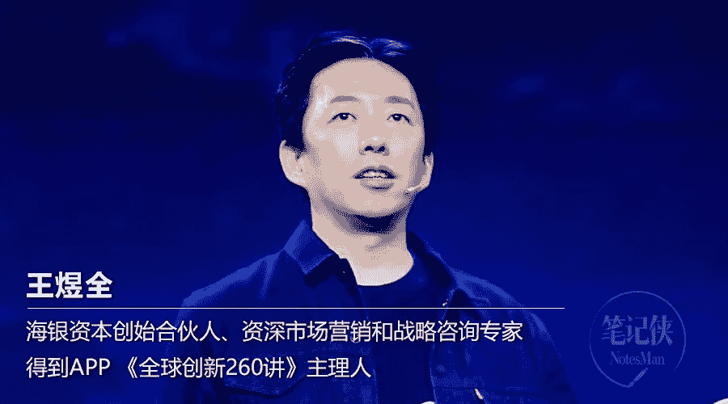
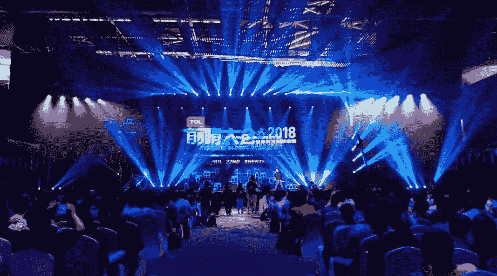
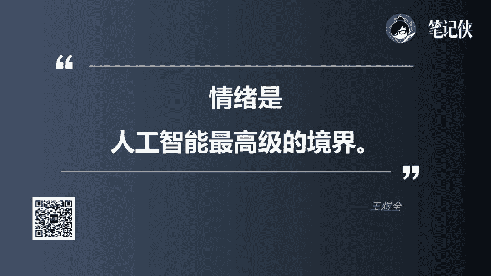
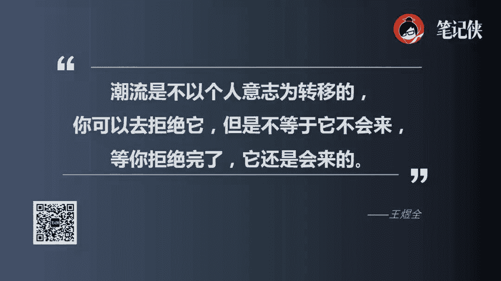
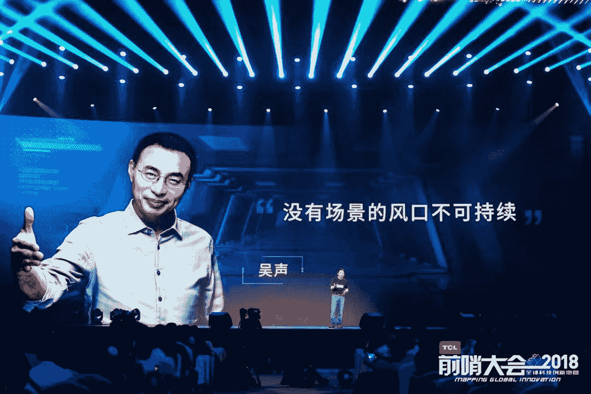
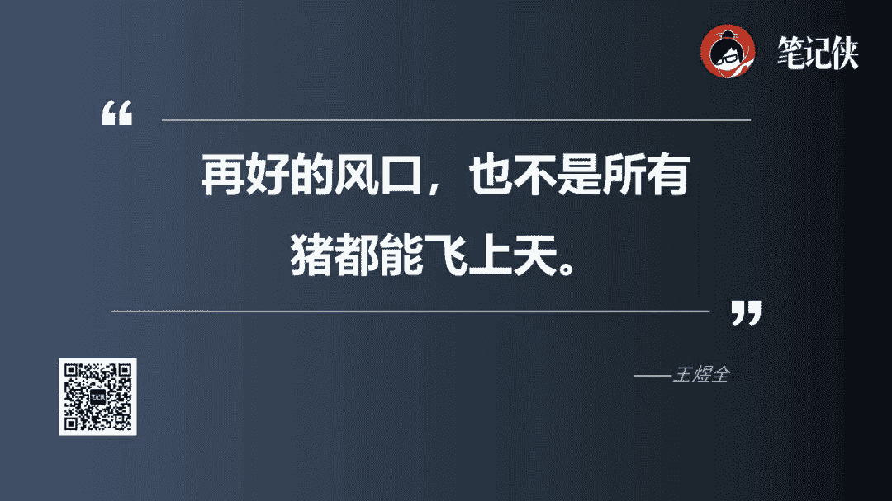

# 王煜全前哨大会2018：人与人真正的区别不是智商、情商，而是经历

> 来源：[https://aigcreative.feishu.cn/docx/YgE7dpwjyowq5ixM50sc9GChndc](https://aigcreative.feishu.cn/docx/YgE7dpwjyowq5ixM50sc9GChndc)

> 🔗 原文链接： h[ttps://mp.weixin.q](https://mp.weixin.qq.com/s/spmNvv1ZDziZC_HpxomAEg)q.com/s/spmNvv1Z...

# 一 、 序：视角比科学事实更加重要

## 1.从“世界=乌龟塔”到转换视角

刚刚过世的著名天体物理学家斯蒂芬·霍金的著作《时间简史》是这样开头的：

一位著名的科学家 （据说是伯特兰罗素） 做过一次天文学讲座，描述了地球是如何围着太阳转，太阳又是如何围着我们称为星系的巨大恒星群的中心转的。

演讲结束后，坐在后排的一位小个老太太站起来说：“你这都是胡扯。世界是驮在大乌龟背上的一块平板。”

这位科学家很有教养地笑着问老太太：“那这只乌龟是站在什么上面的呢？”

“你很聪明，年轻人，”，老太太说，“不过，很显然，这是一只驮着一只，一只只驮下去的乌龟塔啊！”

今天看起来，会觉得老太太的说法很可笑，不值一驳。不过不要忘了，这个说法以及类似的说法在人类历史上占主流的时间要比我们现在知道并且深信不疑的宇宙观占主流的时间长多了。

**人**类大多数时间都是在不具备完全信息、甚至数据非常稀缺的时候，建立起对自己、对社会、乃至对世界的认知系统的 。

但是，实际上，认知系统才应该是指导我们行动的真正指南，科学事实不是。

这就说明，不同的视角会引出不同的行动，进而带来不同的结论。

我们对这个世界的认识的改变，不仅仅是对事实的认知的加深，还包括视角的不断变化，老的视角被抛弃，新的视角被接受，一步步带来这个世界的革命。

从这个意义上说，我们看世界的视角比科学事实更加重要。

## **2.范式转移，拓展认知疆界**

著名的科学哲学家，托马斯·库恩在《科学革命的结构》中将视角变化的意义做了详细的解释：科学革命更重要的意义在于完成了视角的转换。

托马斯·库恩把这种视角的转换称为范式转移 （paradigm shift） 。

所谓范式，就是认知的模式。转移，就是改变。

**范式转移，就是认知模式的改变。**

从地球是平的，到地球是圆的，这个认知模式的转变，就是一种范式转移。

为什么范式重要？因为它是看待研究对象的方式和视角，它决定了：

我们如何看待对象、把对象看成什么；

**在对象中看到什么、忽视什么；**

**自己和对象的关系是什么；**

**……**

一旦一个范式已经形成，就会束缚我们对事物的想象力。例如，你今天就不会再把世界想象成乌龟塔了；范式转移就是冲出原有的束缚和限制，为人们的思想和行动开创新的可能性。

但范式转移不是一蹴而就的，新范式出现的时候，往往像一株幼苗，还不能立刻被认出是否会长成参天大树，而持有老范式的人会坚决抵制新范式。

案例：范式转移的威力

数字唱片刚出来的时候，很多人、尤其是那些听黑胶唱片的老玩家对数字唱片很不屑，认为数字唱片的精度不如模拟唱片。

但随着数字唱片的计算方式对曲线的拟合越来越好，直至完全拟合，数字唱片的精度已经远远把传统唱片甩在了后面，这就是范式转移的威力。

互联网带来的范式转移：

我们知道有“互联网移民”和“互联网原住民”两个群体，他们最大的区别其实是看待互联网的视角。

互联网移民是长大后才接触互联网的人，他即使接受了互联网，他思维世界依然是二分法，以线上和线下来划分，他们会觉得线上意味着骗子多，不可信。

互联网原住民是从小就伴随着互联网长大的，他们的世界里没有这种区分，他们会说，对于骗子这个概念，不论线上、线下，都有不少，关键是你要学会识别骗子，这样就可以做到在线上线下都是安全的。如果不会识别的话，哪儿都不安全。

这就是范式转移的特点，他会带动新的思维模式，让你扩展你的认知疆界。

大家好，欢迎来到2018年前哨大会，我是王煜全。

我现在有双重身份，一个身份是投资人，范围从互联网投资到科技投资，从国内投资到全球投资；另一个身份是布道者，因为看到了科技化和国际化对中国的重要性，所以我一直致力于跟踪和分析全球的科技现状和趋势，将它们带回来和大家分享。

我今天的目标就是帮助大家实现两个范式转移，一个是有关科技创新的，一个是有关世界观的。

我认为这两个范式转移对中国企业乃至中国经济的未来发展，甚至对每一个人来说，都是至关重要的，因为范式的突破会给我们带来崭新的世界，也会推动中国继续向前进步。

# **二**** 、探索10大黑科技前，****你要知道的事**

“人与人真正的区别不是智商、情商，而是经历。”

投资圈有个经典笑话：

投资有两个流派，一个是投赛道，就是投资于那些风口上的领域；另一个是投人，不管领域如何，投最好的创业者就对了。

大家知道这两个流派的投资人，哪个的业绩最好吗？答案是：命好的那个。（笑）

不论你是看准了创业者还是行业，你在中国投中了BAT，在外国投中了谷歌、Facebook，业绩就一定好。因为在命运面前，我们每个人都挺渺小的。

我一直觉得，自己能看到一些不一样的风景，主要原因是运气。而且这个运气还来源于自己当年不够优秀。

我上大学的时候成绩很不好，毕业找不到工作，只好下海创业；而出国留学、然后进国外大公司工作是那一代人人生赢家的标准轨迹，所以我的优秀的同学们都出国了。

毕业多年后，我偶遇一个当年成绩很好、但在大公司磨了很多年、已经锐气全无的同学，他和我抱怨说，在大公司也快混不下去了，他说：“如果实在混不下去了就找你来一起创业吧。”

我实在不好意思告诉他，混了这么多年，不光能力，他连眼界都退化了——他把创业和失业搞混了。

其实这样的故事不光在中国大陆上演过，当年台湾刚开放的时候也是，学习不好的同学欢送学习好的同学出国留学，后来亚洲四小龙经济腾飞，台湾那些学习不好的同学创业做了老板，生意越做越大，又欢迎学习好的同学学成归来，来为自己打工。

所以，人和人之间真正的区别其实不是智商，甚至不是情商，而是经历。

经历会塑造一个人，塑造他看问题的方法，而这些方法会最终决定一个人的成败。所以我们每个人都要感谢我们自己的独特经历，尤其是伴随着中国经济一起成长的经历，因为这些经历教会我们的，远比商学院的MBA教材要精彩得多。

现在，中国合资企业已经遍地开花、司空见惯了。但是不要忘了，没有前人的积极探索和努力提升，帮我们打开眼界，就没有我们今天的认知高度。

今年是改革开放40周年，中国进入了新的阶段，需要和世界经济体系深度融合，这对与在过去40年已经建立起了认知模式的人来说又是一个新的挑战，甚至是更严峻的挑战——不抛弃老的范式，不能成功地实现范式转移，那么，曾经的成功经验可能会变成我们未来失败的原因。

很多在过去发挥了巨大价值的经验，像招商引资、进口替代、产学研联动等方面，都需要重新升级了。

## 1.机器要有人类智商，人类也需要掌握机器智商

我今天要分享的第一个范式转移是有关科技的。

我们都知道，科技创新对社会的价值已经越来越大，甚至很多社会的大趋势都是由科技塑造的。

著名科幻作家阿瑟·克拉克说过：任何足够先进的科技，初看都与魔法无异。

当我们最早看到某些先进科技的时候，真的会以为那是魔术，觉得它是不可实现的。设想一下，假如你是个古代人，看到现代人拿着一个小盒子举在耳朵边上，看似自言自语，其实是在和千里之外的另一个人对话，你会怎么想？

所以科技产品确实有像魔术一样的魅力，但是作为科技投资人，我们要做的事情并不只是看到酷炫的科技就去投资，因为科技产业有它自己的规律，科技要领先，也要能够推动社会进步，这就需要科技能落地，能产品化。

即，我们那句口号：“ 一切不谈产业化时点的黑科技都是耍流氓 ”。

而所谓的社会趋势，其实就是科技作用于社会，推动了社会变化的显现。

了解了科技产业化的规律，就能更好地掌握科技趋势；反之，掌握了科技趋势，也可以更好地推动科技的产业化，推动科技造福社会。

下面，从今年的十大科技趋势开始，我与大家一同探索科技产业背后的规律，以及规律背后的范式转移。

## **2.展示10大黑科技前的铺垫：**

我们都知道有一位美女机器人已经得到了沙特的公民身份，她能理解人类的情绪，并且与人类情感互动。她就是Hanson Robotics公司CEO、著名的机器人专家David Hanson的孩子，Sophia。

抛开毁灭人类的笑谈，人工智能要想和人更好地交流，就需要加强感情互动，现在iPhone上的Siri,我就觉得较不近人情，因为没有情绪，是一个冷冰冰的声音跟我互动。我们都知道人和人之间互动之所以有意义，是因为我们的互动百分之七八十都是情绪。

人和人之间之所以能够感受到相互的感情沟通和交流，是因为我们大脑有一组神经元叫做镜像神经元，它的作用就是当对方脸上出现或者快乐或者悲伤或者焦虑的各种表情时候，你的脸上下意识的就会呈现出同样的表情跟他来呼应。

Sophia最大的价值就是她已经能够实现与我们情绪上的互动，在漂亮的外表下面，依靠金属的骨架和40多个马达来驱动的“肌肉”，所以Sophia表情丰富。除此之外，她还有很强的共情能力。

这背后的技术叫情绪镜像，用摄像头来捕捉你的面部表情，再通过算法来理解你的情绪，然后在自己的脸上做出同样的表情。

那为什么要让机器能够有人的情感呢？

给大家讲一个真实的小故事，几年前，一个朋友在硅谷，傍晚，他走在一条马路边的人行道上，突然有一辆车从他身边飞驰而过。吓了他一跳，定睛一看是辆谷歌的无人驾驶汽车。惹得他在🛰️朋友圈里抱怨。

我看了，跟他回复说，这辆无人驾驶汽车智力水平很高，因为它有激光雷达以及各种辅助设备，所以它能够判断出它撞不到你；但它对人类的理解能力不够，不知道它虽然撞不到你，但是会吓到你。

所以我们认为未来真正好的机器不光不会毁灭人类，而且能理解人，跟人类形成更完美的配合。我们称这种能力为“机器的人类智商”。

人类历史的发展，就是不断扩大自己控制力的过程。首先是从追求体力到追求脑力、到追求智力的演变。然后我们发现如果能协调更多高智商的人，会比自己智商高价值更大。

中国有个历史典故，韩信点兵多多益善，但是刘邦善于管理将领，他的价值就比韩信更大。这个能力被叫做情商。

我们今天都认同，情商比智商更重要。但是现在又有了新变化，我们发现其实有一类人的情商并不高，甚至可以说很低，但他做的事情的价值比情商高的人还大很多倍。比如说乔布斯、比尔·盖茨，那是为什么呢？

因为他们懂得驾驭机器。

你情商再高，能管理的人也还是有限的，西方的邓巴数定律告诉大家，一个人能够维系的关系超不过150人。

但是你如果懂得驾驭机器，你能够管理的机器就是无穷无尽的，这也是互联网的一个秘密：扩张的边际成本极低，业务覆盖越大越好。

笔记君注：150定律（Rule Of 150），即著名的“邓巴数字”，由英国牛津大学的人类学家罗宾·邓巴（RobinDunbar）在20世纪90年代提出。该定律根据猿猴的智力与社交网络推断出：人类智力将允许人类拥有稳定社交网络的人数是148人，四舍五入大约是150人。

所以，机器要有人类智商，人类也需要掌握机器智商。你要知道机器的思维方式，学会驾驭它。

人类在机器智商上和机器在人类智商上的飞跃，造就了未来十大趋势里最大的一个 。 （这个趋势是什么？我们稍后揭晓。）

# **三****、 未来的10大科技趋势**

## **趋势1：机器人来了**

我们上一节讲过，在未来，人类要掌握机器智商，机器要掌握人类智商，这才是最重要的，为什么？

因为，我们周围很快会遍布机器人，不仅会有像Sophia这样的情感互动机器人，还有大量能和我们进行语言互动、行为互动的机器人，当然还有更多的默默为我们服务的我们看不到的机器人。

（1）情绪是人工智能最高级的境界 ：要想让人工智能和人更好地交流，就需要加强感情互动。例如Sophia不仅表情丰富,她还有很强的共情能力，背后的技术是情绪镜像。

**（2）机器人对人来说意义重大 **：除了情绪；未来机器人在行动力上的进步也会非常快。

Sophia的父亲只有一个，但是Sophia有很多个 （当然，他们共用一个公民身份） ，机器人的一大优势就是可以无限复制。

所以，未来，机器人将渗透到各行各业；用不怕灾难的机器人去完成人类做不到的事情是会被实现的。

（3）要投入新的武器，才能打赢新战争。

孙正义对未来很有前瞻性，他早早就布局了机器入。

在苹果刚刚推出iPhone的时候，孙正义立刻飞到美国，不惜任何代价，一定要和苹果达成独家合作 （我们都知道苹果和运营商谈判的时候条件非常苛刻） 。

正是因为这个合作，软银日本从很小的互联网接入服务商成功转型成为通讯运营商，而且算上国际业务，现在成了日本第一大运营商。

孙正义当年为什么要不惜一切代价，非要做独家代理呢？他有句名言： iPhone就是明治维维新时期的火枪。

大家都知道，热兵器的出现对冷兵器是一种碾压式的打击。还执着于冷兵器的人，包括日本的武士、中国的八旗兵，最后都遭到了毁灭式的打击。而反过来，能够积极拥抱新武器的这些人，往往就能够取得战场上的优势。

商场如战场，先进科技本身不是企业家的竞争对手，而是企业家手里的新式武器。因为在买武器上讨价还价，耽误了军队的战斗力，等到你的竞争对手率先引入了先进武器，你可是要吃败仗的。

现在公认行动能力上的最好的机器人是波士顿动力公司。这家公司现在被孙正义的软银机器人公司收购了，这个收购充分体现了孙正义的前瞻性。

当然，中国机器人也正在崛起，我们有小i机器人、小乔机器人、京东物流机器人，不比国外差。

而且，在行业应用机器人领域，中国的机会更大。

北京大学国家发展研究院经济学教授周其仁老师有个观点，叫创新上下行，就是不光要关心先进科技做出来以后会有什么应用，还要关心本领域有哪些需求可以被先进科技满足。

中国人在前沿科技突破上尚需积累，但我们可以从应用需求上下功夫，做最会用科技的人。

所以，机器人的趋势已经来了，不管你是否注意到，机器人的数量会在短时间内出现爆炸性的增长。

当然，对待趋势，我们永远有两种做法，一种是拥抱改变，另一种是抗拒改变。

但是，大家要理解， **潮流是不以个人意志为转移的，你可以去拒绝它，但是不等**于它不会来，等你拒绝完了，它还是会来的 。或者说你会拥抱它，推动它，让它来得更快，你就成为趋势的一部分，一定也会更加成功。

在我看来，我希望即使是专家，在对自己不了解的领域也要研究之后再做评论，当趋势来的时候，最好都不要做它的阻挡者。

## **趋势2：生物技术的革命**

现在有一个时髦的说法，机器人被称作硅基生命，因为机器人越来越像人，好像变得有生命了；对应地，人类被叫做碳基生命，因为我们对人类自身的机制越来越了解，快到可以像修理机器人一样对我们自身的问题进行修理了。

基于我们身上的可穿戴电子设备原来越多，硅基生命与碳基生命正在发生融合。

（1）自我选择正在替代自然选择 ：随着生物技术的发展，基因编辑、干细胞治疗、肿瘤疫苗等等，使得人类正在被改造。我们的治疗工具、治疗手段，已经让我们自然的缺陷能够被治愈了。

以前我们的认知是，脊神经受损是不可恢复的，所以全身瘫痪也将是终身的。去年10月，我们在美国拜访了很多先进的科技公司和科学家，了解到，一位教授针对50例全身瘫痪病人做了干细胞治疗，结果有23位病人奇迹般地恢复了行走能力。

（ **2）器官移植正在成为可能 **：哈佛大学的中国的留学生杨璐菌的e-Geniuses公司，用技术把猪器官中会造成人类排异反应的基因去除，使得猪身上培养出来的器官，移植到人体内的时候不会产生排异反应。

现在，小猪已经成功降生，而且顺利养大了，应该很快就会进入移植阶段。一旦移植成功，以后的器官移植也就不再是问题。

**（3）智能穿戴解决隐患 **：AliveCor公司发明了一款手表，一旦你心脏不舒服，把手搭在金属按键上，就可以来测量你的心电的情况，这样你的数据就可以被记录、被分析，可以实时监测你的情况。

这些先进的科技的出现，使得人类正在被自己改造。而且我们的治疗工具、治疗手段，不光使得我们的缺陷可以被治愈，还可以帮我们强化自己想要的那些特征，现在甚至已经有了能使人变得更聪明的药了。

据说，因为学术研究压力巨大，美国的科研工作者们有30%多都吃这种聪明药。 （笔记君表示，这个药，我也想要！）

为了准备前哨大会，我也买了一瓶，结果回来得比较匆忙，忘了带。看来今年的前哨大会不能靠聪明药了，不过大家至少有理由期待明年的前哨大会会更好！

不过先别急着高兴，我们对人类整体的了解程度大大增加，但对每个个体依然缺乏了解。

例如，每个人的体温的基数是不一样的，有的人体温天生偏低，有的体温天生偏高，个体差异可以很大。

如果用超过37°算发烧的标准判断一位天生体温平均在34°的人在37°的时候的身体状态，那就很糟糕了，因为那相当于普通人的39度。

**趋势3：大航天时代**

现在我们正站在一个大时代的开端，完全可以媲美当年的大航海时代，会有更多崭新的发现，甚至也会有移民和殖民地。

这里面最杰出的人物就是Elon Musk，他在极力推动移居火星，所以创建了SpaceX，专门做火箭来推动这个计划的实现。

我们都熟知蒸汽机和瓦特的故事，但是他并不是蒸汽机的发明人，而是蒸汽机的改进者，他的改进使得蒸汽机可以在工业上被大规模运用，所以按我们今天的话说：瓦特是个CTO，而不是科学家。

这也是我们要想跟大家揭示的一个核心理念：大量的先进技术原理的突破来自于高校，来自于教授，但是真正要服务于社会、让社会受益，却需要大量的能够平衡科技和产业市场需求、能够一步一步提升产品效率，从而使得科技能够产品化、能够真正为社会所用的企业家。

理论的突破固然重要，但没有企业家们的持续改进，再先进的科技也只会被束之高阁。

埃隆马斯克有一个“第一性原理”，但我认为把“第一性原理”称为目标分解更好，因为“第一性原理”追求的是根本性的突破，ElonMusk做的并非根本突破，而是针对需要解决的问题，把大目标拆解为几个小目标，用现有技术提升每个小目标的完成水平。

假设你把一个大目标分解为四个部分，每一个部分的效率如果都提升50%，最后你将获得1.5的4次方，也就是5倍多的提升。

现在我们已经送了这么多颗卫星去太空，有什么好处？

Planet Labs在2017年底宣布：他们已经做到了每天对地面的任何地方都至少能拍一张照片，300颗卫星在不停的对地面拍照，能够做到每天都能无死角的监测地面的任何地方。

吴声老师说过：科技应用即场景。卫星的能力已经在爆发式的增长中了，下面就看我们能否通过对需求场景的研究，找到更多的应用机会了。

大航天时代的精彩远远不止于此。

## **趋势4：大公司的人工智能布局**

我们知道，这一轮人工智能的核心叫做深度学习。

我们今天都知道需要算法、算力和海量数据训练，这三者都具备的时候，人工智能的优势才得以彰显。

来自中国最大的程序员社区CSDN的创始人和CEO蒋涛，蒋涛提出了一个三倍速理论：如果程序员讨论某一话题的博客每年以三倍速增长，基本上这个话题就会进入爆炸性的阶段，也就是说整个社会就会接纳它了。

从数据看人工智能就符合这个理论，现在的人工智能正在爆发。需要格外指出来的是，人工智能里面有很多子项都符合蒋涛的三倍速增长理论，包括机器学习，深度学习。

来自tensorflow，这是谷歌的人工智能开发工具，谷歌的野心是在人工智能爆炸性增长的时候再造一个像手机安卓操作系统的平台，让没有IT开发能力的人都可以用上人工智能，但是只能在谷歌的平台上用。平台的核心就是用户只需要简单调用我的能力就好了，根本不需要去做深度的开发。

虽然人工智能现在非常的“热”，实际趋势很明显，大公司都在做一种完全通用的平台，谷歌、Facebook、包括国内的腾讯、阿里都在做；另一种是偏业务和能力支撑的平台，比如搜狗做的智能翻译的平台，所以直接介入人工智能业务，要有足够大的体量和实力，才能够做。

小公司要做人工智能，做平台实力不够，只做人工智能业务的话，今天还会有市场，但过个两三年就难了。

人工智能未来几年会很繁荣，但不代表有很好的创业机会。

我们都知道一句话：台风来了，猪都会飞。讲趋势的时候，我们告诉大家：即使是风口，也是有人适合。如果你贸然进入一个自己不适合的领域，那下场是不言而喻的。

## **趋势5：人工智能的行业机会**

人工智能的平台机会已经被各大公司垄断了，如果你还是想做人工智能最基础的部分，那就等于同时向世界最大的IT公司宣战。很多的已经是风口的东西，其实机会已经过了。如果你等一个事情已经成了趋势、潮流，你再加入已经晚了。

我们说人工智能平台型的机会消失了，但是人工智能行业的机会刚刚开始，因为人工智能平台的目标就是使得任何一个不懂人工智能的人都能够使用人工智能。

这个目标还没有完全实现的时候，你能够主动的迎上前去克服一点点技术困难，去使用这些人工智能技术，你就拥有了比你的业内的竞争对手更强大的武器。

要把人工智能看成武器，而不是看成竞争对手，我们认为现在人工智能相关的应用的市场是巨大的。

人工智能是一个威力巨大的先进武器，各个行业要能尽快引入人工智能，都有很大的重新洗牌的机会。做大数据分析的明略数据，插上了人工智能的翅膀之后，甚至和公安部门深入合作，把公安干警的知识融入人工智能算法，建立了犯罪人员及团伙的识别、挖掘和预测模型，实现了人工智能辅助破案。

因为人工智能的平台的发展，而造成了人工智能的各个行业机会出现井喷，如果你善于发现机会的话，迅速在本行业里面成为第一个引入人工智能的人，很有可能你的行业里你就成了整合者，你就成了下一个霸主。

## **趋势6：5G的发展**

在今年的CES展上，高通公司已经明确宣布，2019年开始，5G需要的所有技术将都会准备齐全。

对此，大公司和小公司都在做什么事情呢？

大公司的策略就是搭平台，而且尽量吸引应用在自己的平台上扎根，这样将来不管哪个应用做大了，大公司都能分一杯羹。小公司做创新、做全新的应用有得天独厚的优势，尤其是从高校拿出先进科技来做产品化。

未来除了人工智能以外，另一个巨大的应用机会就是虚拟现实和混合现实。

把现实的东西虚拟化的设备在未来有巨大的需求，也许将来你的手机有这套能够做面部识别的系统，可以把你眼前的任何物体虚拟化，扫描成三维的模型放到虚拟世界里。

这背后的技术叫什么？它的学名叫激光点投影，激光点投影并不是投影。投影是把一个完整的影像投到外部世界里；激光点投影是把一堆离散的激光点向外投射出去，再用另一个红外摄像机收集这些点反射的数据并进行分析，从而构建三维的外部世界模型。

所以，如果对科技前沿充分了解，能相对清晰地分析出未来的发展，那么要想从中受益并不是多么难的事情。

## **趋势7：自动驾驶和电动车**

再下一个趋势是自动驾驶和电动车。

中国有蔚来、小鹏、威马等一大批电动车公司正在崛起。

中国是自动驾驶最大的市场之一，在自动驾驶和电动车领域，比国外更热，创新的机会更大，这里有个典型的公司——拜腾。

拜腾汽车的创始人是两个德国人，他们不远万里来到中国，肯定是因为只有中国才能给他们机会，中国有强大的制造业和资本的支持，并且中国已经成了支持科技创新最好的土壤，尤其支持汽车产业的创新。

我认为其核心原因有2个：

①中国对制造支持的能力更强大：国外大家不太会相信一个小企业能从头建一个车厂，在中国已经有多个新造车企业，从零建起来车厂了。

②中国的科技支持的氛围会更好：这两个德国人都足够专业，我们又能够对制造的能力进行评估，所以我们很容易评估出来这个企业到底可不可行，它在中国设厂到底能不能成功。

## **趋势8：中国科技新势力**

在国际科技前沿的中国新势力正在崛起，一方面，国外的科技企业进中国来创业，另一方面，中国的科技企业正在迅速地国际化。

1.小米与Oculus的强强联合:2018年CES展上, Oculus, Facebook和小米宣布达成战略合作。从今以后，Facebook的头盔，将都是小米设计研发和生产的，也就是说小米不光提供了自己的量产能力，而且提供了自己的研发合作。

2.从英特尔Inside到DJInside：过去是Intel Inside，各个电脑企业都要把和英特尔合作展示出来，而现在变成了DJI inside，如果你有了大疆的支持，你就是无人机领域里面更高级的无人机，这是一个了不起的转变。

3.TCL抢占先机，量子点技术提前布局:TCL在量子点上的抢先布局，是第一个，包括美国的电视机企业在内，和ROKU形成战略合作，把ROKU引入到电视机深度捆绑的这样的一个企业，所以TCL在美国已经慢慢地成为了主流品牌。

越来越多的先进的中国企业在国际上脱颖而出，学习、掌握和适应了全球的这种生态式合作的打法，核心原因还要归功于中国为他们提供了深厚的产业基础的支持。

有关中国人的全球化布局，中国在全球科技创新当中，已经不是可有可无，而是一支举足轻重的力量。

但是在我们加深全球化的过程中，中国创新需要进一步不断总结自己的特色和规律,在规律基础上进一步完善。我们要理解：未来的创新，是一种生态合作型的创新，即积木式创新。

第一，要有能力，就是你这块积木要有价值、有特色；

第二，要能无缝对接，你要有信用，能标准化地合作；

第三，要有愿景，知道你的目标是什么，如何分解目标，以通过合作来实现；

第四，要有视野，知道最好的合作者在哪里，尤其是那些前沿的科技和科技公司；

第五，要有系统思维，能从整体系统的角度搭建共赢的合作体系；

第六，要有格局，有能够推动生态系统构建的能力，有推动全球科技创新和经济发展的雄心。

比如我们讲科技创新是很有门槛的，因为一个科技产品的研发是非常复杂的，需要协调多方力量，面对这种复杂的协调的情况，企业的计划命令式的操作会更有效。

但当整体生态效率提升到超过企业内部效率的时候，会成为以小公司为主来完成所有的复杂操作，未来越来越多的科技创新将由小公司协同来完成。

小公司协同就需要大量布局，大企业并购小公司，实际上是看中它的人才储备。21世纪什么最贵？人才。未来经济背后的核心是资源的争夺和布局，而未来最重要的资源其实就是智力资源，所以我们中国企业要学会对智力资源进行布局。

前哨科技特训营里的一位学员，企业家范卫平发现一个规律，很多西方国家的城市都很干净，但是到了唐人街就相对脏乱差一点，因为这些人没有把海外当成自己的家。

这就是我们讲的第二个要转变的范式：关于世界观。

1.要重新看待我们和世界的关系，不仅仅要把中国当成自己的家，而要四海为家，要有全球化的胸怀；不能只把中国人当成自己人，要把全世界的人才都当成我们能够协调合作的人才。这样才能更好地实现企业的全球化布局。

2.要重新理解我们的制造业优势,如果加上三个定语，就是“大规模、复杂性、开放式”的制造，中国不仅是世界第一，而且是唯一。

3.中国人在制造上的优势非常具有科技含量，但是我们中国不太会包装讲故事，所以我们现在也在致力于中外的对接，我们希望更多的有产业链能力和制造能力的中国企业,我们一起合作，帮中国企业评估它擅长制造就绪指数的哪几个阶段，如何能够更好地海外对接。

4.科技全球化，资本模式需要创新。新的产业发展模式，也需要新的投资模式。现在的资本运作模式，最大的问题是天使投资、PE、风险投资等各个阶段之间是脱节的，现在要打破这种分阶段的状况，有所突破，资本层面的突破，我认为可以体现在以下2个地方：

①要能够解决量产问题，这样能够帮助它更快、更颅畅地滩到资金,突破它发展过程中最大的障碍，就是技术产品化。之后的量产问题。

②是让科技创新帮助企业更快更早地实现资本运作，包括提升融资能力，和加快资本的流动。

我们期待资本市场的更多积极行动，进一步降低先进科技企业进入资本市场的门槛，做得更加系统化，从资本到资源，为创新企业提供更全面的支持。

新的产业发展模式，需要新的投资模式。我们致力于打造面向积木式创新的崭新的投资模式，主要有4个方面：

1.科技创新出现了井喷，意味着要对科技创新从产业角度实现提前布局。

2.投资者应该成为企业合作的促成者，企业成长需要的外部资源的提供者和介绍者。

3.要帮蓬勃发展的硬科技创新解决瓶颈问题。

4.要帮企业尽快上市，更好地利用资本市场实现快速发展。

## **趋势9：中美经济分歧**

科技影响社会，反过来说，社会的一些变化也在影响科技的发展。

中美经济分歧的来源是美国，要了解这个分歧，首先要了解美国的想法。中国讲和谐社会，大家互相之间的认同感比较高，但美国讲个人主义，往往是各人有各人的观点，各派有各派的代言人。不是所有的美国人都在抵制中国，对中国有意见的，主要是美国的工薪阶层。

（1）主动交流：钱都让中国人赚走了吗？

为什么会出现抵制现象？

美国的工薪阶层大都认为是中国人抢了自己的工作，认为中国的出口赚走了自己的钱。实际上在过去几十年的全球化进程中，西方发达国家的跨国企业才是最大的受益者，中国人赚的是辛苦钱，中国的出口主要是为跨国企业做代加工。

中国现在就是，承认还有很多问题，但第一，我们是从多么差的起点走到今天的，要看到我们的进步，同时不要低估我们的未来，第二，更重要的，我们都从内心相信未来会更好，而且愿意付出努力。

（2）主动融入：冲突加剧我们更需要主动拥抱对手

现在很多中国人到美国都容易不受欢迎，比如买了个房子就在在院子里种菜、晾衣服，觉得反正这是我家，我想干什么干什么，引得邻居很反感。其实就像范卫平讲的“这还是没拿那里当自己的家，不然怎么会不知道入乡随俗呢”。

（3）主动行动：加入全球化布局

中国要把制造优势做成真正的全球优势，未来地缘优势会减弱，产业优势会加强。

深入了解问题、坦诚直面问题和认真解决问题，才是中国科技企业最好的应对之道，在这个过程中，我们的国际化能力也会得到更好的锻炼。

（4）识别创新中的伪趋势

（5）不是趋势的“趋势”ICO

火的东西未必是趋势。区块链之所以让大家觉得最有诱惑力的，不是利用区块链的技术去开发什么更强大的应用，而是ICO，俗称发币，企业就可以发行自己的货币。

反过来，如果一个企业非常合格，其实没有必要用ICO的方式，也可以融到资。即使一个合格的企业觉得ICO是个机会，融到资了，往往对企业来说也不是一件好事情，因为钱来得太容易了。

（6）新零售在摸索

大家认为很热的新零售，也是多个现有技术的组合，只不过这个组合的应用场景不清晰，引用吴声老师那句话“场景得先想清楚，到底未来大家会怎么样的消费”，摸出来未来大家的消费习惯，才知道这个新零售到底是一个什么样的格局。

终端的优势不如数据端的优势显着，不管你是柜、亭还是店，最后还是要看是不是有大数据和物流系统来支持。到最后很有可能还是巨头的市场，而不是创业者的市场。

（7）人工智能创业非常危险

人工智能创业，我们前面讲过，杨澜都在喊，可见趋势已经过了。反倒是各个行业里利用人工智能来提升自己能力还是机会，但是这种机会是属于行业的。

有一些领域是属于创业公司，但大多数是属于行业。进入人工智能这行业里创业，不光要能战胜人工智能公司，还要能战胜这行业里这个有悠久历史的、比你更懂行业的那些老牌的行业公司，才可能进去创业，要不然这个人工智能创业的机会其实是已经过时了的。

（8）虚拟现实还没到来

虚拟现实VR的机会还没来，我们说5G会来，5G市场用品电商可能再过两年机会会慢慢到来，眼前看起来还这个不够完备，因为需要足够大带宽才能支持，这个实验环境都还不具备，所以这个事还要稍微等一等。

并不是有新潮流就可以创业的。很多新潮流能不能创业，还要看创业者是否具备和传统企业比的竞争优势领先性。

但还有一些变数是：①计算能力的瓶颈：量子计算；②资源的瓶颈：轻型核能。

但都需要5年甚至更长的时间。这些变数都是会让我们更好的变数，所以千万不要对未来预期过低！准备好去迎接它吧。

## **趋势10：中国人的新国际化**

（1）一个由我们行动决定的趋势

不是所有的风口都适合创业者。我们今天讲了一个全球的大趋势盘点，其中强调两个范式转移。同时第十大趋势也是大家必须要行动和实践才能真正实现的，那就是中国人的新国际化时代来临了。

（2）新深圳

中国人的新国际化时代，依照规律去推动社会转变，才是真正有意义的，最核心的是我们要落到实践上。中国人国际化必须以服务对方的心态，是把对方当成赚钱的机会，想赚了钱就走，还是想长期和对方去共同繁荣共同获利。

一旦要想让本地经济要繁荣，要去建立秩序，一旦建立秩序，经济慢慢就涨起来。现在全世界任意地方的经济水平都不是自然资源决定的，连以色列那样不毛之地，只要把智力资源充分地发掘出来，它就可以繁荣。

智力资源的核心是什么？是机制的建立，让TA有实践的机会。我们的一带一路是要把商业做出去，让对方能够繁荣。不是去掠夺和买资源，而是去帮他能够做起生意来。

中国人现在在全世界的名声已经很好了，中国人会赚钱全世界都有名。中国人会赚的不是别人不能理解的钱，我们就做小生意。但我们对外宣传时候没有把优势宣传出去，没有教别人赚钱。

（3）是孔子学院，还是管子学院？

我们都知道中国在全世界办了很多孔子学院，但是我认为中国人更应该出去办管子学院。管子是齐国的管仲，是个非常成功的商人，所以其实咱老祖宗从那时候起就想明白怎么挣钱了。

# **四****、总结 ：有关两个范式**

## **第一个范式转移：科技创新的变局**

（1）不是科学家搞科技、大企业做研发，而是创新的小企业从高校拿来科技，完成研发转化，把产品推向市场，推动了社会进步。积木式创新的核心是企业家。推动技术商业化是企业家的最大的价值。

（2）企业家才是既了解市场需求又了解先进科技，并且了解科技如何能造福社会的人。

（3）这对我们的企业家们也提出了更高的要求，企业家们要更有未来眼光、全局观念、更有战略高度。简单总结：中国要更重视企业家,企业家要更重视科技未来。

（4）这个时代叫做科技军备竞赛时代，任何一个行业，任何一个企业，都要投身于科技军备竞赛，争取做领跑者，至少不要被落下。再辉煌的企业，一旦落后就会挨打。

## **第二个范式转移：关于世界观**

（1）要重新看待我们和世界的关系，就是不仅仅要把中国当成自己的家，而要四海为家，要有全球化的胸怀；不要只把中国人当成自己人，要把全世界的人才都当成我们能够协调合作的人才。这样才能更好地实现企业的全球化布局。

（2）要重新理解我们的制造业优势，如果加上三个定语，就是“大规模、复杂性、开放式”的制造，中国不仅是世界第一，而且是唯一。

比如说iPhone就是在中国造的，为什么要在中国？因为如果在日本、德国，理论上讲也能达到这样的精度，但是不一定能达到这么大的量。而且不一定有这样的开放性，有这样的弹性机制：能够随时根据你提出的需求进行修改。

（3）中国人在制造上的优势非常具有科技含量，但是我们中国不太会包装讲故事，所以我们现在也在致力于中外的对接，我们希望更多的有产业链能力和制造能力的中国企业，我们一起合作，帮中国企业评估它擅长制造就绪指数的哪几个阶段，如何能够更好地海外对接。

（4）科技全球化，资本模式需要创新。新的产业发展模式，也需要新的投资模式。现在的资本运作模式最大的问题是天使投资、PE、风险投资等各个阶段之间是脱节的，现在要打破这种分阶段的状况有所突破，资本层面的突破，我认为可以体现在这几个地方：

第一，要能够解决量产问题，这样能够帮助它更快、更颅畅地滩到资金，突破它发展过程中最大的障碍，就是技术产品化。之后的量产问题。

第二，是让科技创新帮助企业更快更早地实现资本运作，包括提升融资能力，和加快资本的流动。

我们期待资本市场的更多积极行动，进一步降低先进科技企业进入资本市场的门槛，做得更加系统化，从资本到资源，为创新企业提供更全面的支持。

新的产业发展模式，需要新的投资模式。我们致力于打造面向积木式创新的崭新的投资模式，主要有4个方面：

1.科技创新出现了井喷，意味着要对科技创新从产业角度实现提前布局。

2.投资者应该成为企业合作的促成者，企业成长需要的外部资源的提供者和介绍者。

3.要帮蓬勃发展的硬科技创新解决瓶颈问题。

4.要帮企业尽快上市，更好地利用资本市场实现快速发展。

# **结束语：**

讲到这里今年的前哨大会就已经接近尾声了，忍不住会有些小感慨，我们回头看一下中国的科技企业，37年前还没有TCL，14年前还没有京东电商，12年前还没有大疆，8年前还没有小米……

当我们都认为这个时代是把握在BAT的手中时，其实仍然有新的企业不断涌现出来，成为行业巨头。

所以说科技永远会带来新的机会，如果你能够抓住科技的机会，可能下一届前哨大会我们要讨论的成功企业就是你创造的。

我们明年再见！

<https://aigcreative.feishu.cn/sync/K4Gvd9vUQsy9Oubwqaeclu0Fnbg>

##