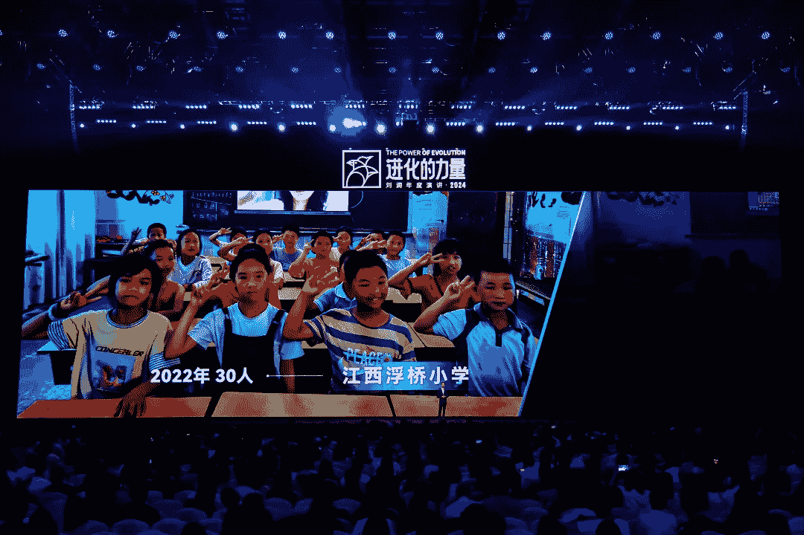

# 刘润年度演讲2024：总会花开（演讲全文）

> 来源：[https://aigcreative.feishu.cn/docx/E6YPd1coTog2dAxnqmOcZE7snYc](https://aigcreative.feishu.cn/docx/E6YPd1coTog2dAxnqmOcZE7snYc)

> 来源：👸号：刘润

> 链接：https://mp.weixin.qq.com/s/LALA9qzv-x9fm7nnfgoWeQ

2024年10月26日，“进化的力量·刘润年度演讲”如约而至。在这场演讲中，我会和你分享8个主题。

演讲的视频，在刘润视频号上有全场回放，欢迎你观看。

以下为刘润年度演讲全文。与你分享。

# 第一篇章

大家好。欢迎来到2024，“进化的力量·刘润年度演讲”！我是刘润。

**过去的一年，商业世界一言难尽。**

我知道，有的人过得还不错。但是也有一些人，遭遇了难题。

今年7月。广州地铁，发生了一件挺有意思的事。五个女生在地铁里给她们的同事过生日。

她们不但为同事跳舞，还为她买了一块“灯箱广告”。

此情此景。我要是那位同事，一定特别感动。又不敢随便乱动。

不过，在地铁里买广告给同事过生日。这也太“奢侈”了吧？

这是广州地铁传媒的总经理，余小峰。今年7月，我去广州调研时，特意去拜访了她。

她告诉我，这份生日礼物确实很有意义，但价格并不算太“奢侈”。

从今年开始，广州地铁接受个人投放广告了。个人投放5天的广告，大概只要几百块钱。

我问：“5天才几百块？这不赚钱吧？”

她说：“别说赚钱了，连成本都很难收回来。”

那为什么要做呢？

她说，因为地铁广告，遭遇了前所未有的“难题”。

这张图展示的是，2024年上半年，中国的户外广告花费，相对于去年同期的变化。

你从左往右看，除了电梯和高铁广告，其他的户外广告都在下滑。影院视频，街道设施，地铁，和机场。

**广告，被称为经济的晴雨表。**

我们个人遇到困难时，可能会想：“今年不买新手机了，也不出国旅游了。”企业遇到困难时，也会想：“今年不投广告了。”

为什么？因为研发和工资都不能减，但广告费用似乎可以减。效益不好的时候，公司就先不做广告了。就算要做，也只做那种能马上带来收益的“效果广告”，而不是慢慢才有价值的“品牌广告”。比如地铁广告。

那怎么办呢？

给地铁广告加个二维码，然后开始卖货？可是，你会一边赶地铁，一边掏出手机来扫码吗？

这就是地铁广告，所遭遇的“难题”。

其实，又何止是地铁。

每年的商业环境，就是老天给你发的一张卷子。只是有些年份的卷子，特别难。

比如2024。

2024年，很多的创业者，都遭遇了各自的“难题”。一堆的“怎么办”扑面而来。

> 跑了800个客户，600个说没钱。怎么办？好不容易找到有钱的，又把价格打到骨折。怎么办？你还在想接不接，400个竞争对手，冲过来跟你抢生意。怎么办？孩子越来越少，老人越来越多，市场都变了。怎么办？人工智能来势汹汹，好像随时都要颠覆世界。心里特焦虑。怎么办？现在都流行出海，不出海就卷死，出海又两眼一抹黑，你说怎么办？

怎么办？怎么办？怎么办？

余小峰说，所以我们开始搞个人广告。个人广告虽然不赚钱，但它有独特的价值。

有个年轻的法律博主，学美剧《风骚律师》的风格，在地铁里打了个广告。你知道，早餐不能吃什么呢？午餐和晚餐。你说这是广告吧，他啥联系方式都没留，就是纯粹想“炫”一下。

两个孩子和他们的爸爸，也在地铁里打了个广告。我妈过生日啦，纪念杨女士下凡又一年。这妈妈也太幸福了，被宠得都快化了。

大家找工作和找对象都不容易。那怎么办？打广告啊。结果两天内，这小伙子的🛰️就被加爆了，最后还真就找到了工作。

有人想感谢父亲，但是又说不出口，就打了个广告：尊敬的老爸，谢谢你做我们坚强的后盾。下面还有行小字。老妈别吃醋，感恩有您，让家里充满爱。

炫、宠、找、谢，年轻人的脑洞真大。给他们个舞台，他们能玩出花来。

可是，这对地铁广告的经营，有什么帮助呢？

余小峰说，以前，地铁里的10个灯箱全是广告。现在呢，可能有1-2个是这些脑洞大开的内容。这样一来，乘客出地铁的时候，可能就会像刷抖音一样，一路看过去。大家抬头看的次数多了，关注度也就提高了。

这就是：用“个人广告”，提高客流的“抬头率”。

这样，那些真正的企业广告主，也更愿意在这里打广告了。

所以，遭遇“难题”，怎么办？抱怨吗？躺平吗？不。不断尝试，不断探索。寻找解题思路。

广州地铁，找到了自己的“解题思路”：用个人广告，提高地铁客流的“抬头率”。

今年上半年，地铁行业广告的收入整体下滑。但是广州地铁，却实现了难得的增长。

面对难题，寻找解题思路。广州地铁，给了我很大的启发。

今年是《进化的力量·刘润年度演讲》的第四年了。也许，我们也应该改变一下了。

前几年的演讲，我们都是在讲：**趋势+潜在机会。**

2021年，我们先讲，“流量新生态”这个趋势，然后再分析，三次流量打通后，藏在私域里的潜在机会。

2022年，我们先讲，数据成为第五大生产要素这个趋势，然后再讲数字人、无人挖掘机这些数据带来的潜在机会。

2023年，我们先讲，内卷到一定程度后，必然会出现的出海加速的趋势，然后再讲，在中东、非洲、中南美这些地方，快速出现的“潜在机会”。

这就是我们一直的结构：趋势+潜在机会。

**不过今年，也许我**们该换个新的结构：难题+解题思路。

趋势很重要，它带来的机会也很重要。

但是，2024年推动创业者前行的，可能不是跳起来抓住高处的“趋势”，而是蹲下来解决脚下的“难题”。我们必须仰望星空。但同时，我们也必须凝视脚下。尤其是那些坑坑洼洼的地方。

脚下越是坑坑洼洼，创业者就越关心那些让他们“夜不能寐”的难题，和那些让他们“豁然开朗”的解题思路。

这就是：难题+解题思路。

但是，难题之所以叫“难”题，不就是因为解不出来吗？你真的有办法解决吗？

我必须诚实地告诉你，我也没有。老天今年出的这套卷子，我也没见过。

但是，难题，并不只是在考你一个人。麻烦，也不只是冲着你而来。再难的难题，也一定有人遇到过。在你所不知道的地方，可能有人早早交了卷子。

而我们要做的，就是找到他们。然后，向他们学习。

这是哥伦比亚的卡诺·克里斯塔莱斯河。它的特点是，水流很急。河床被冲刷得到处都是光滑的石头。所以河水虽然清澈好看，但没什么养分。水里几乎没什么生物，更别提鱼了。

这是不是有点像你的行业？看上去很美。但赚钱真不容易。

那怎么办呢？怎么在这种“水至清则无鱼”的急流中，生存下去？

你可能会说，干嘛非要在这么难的地方混呢，换个行业不行吗？当然可以换。但是，哪有容易的行业？你想挤进去的地方，可能也是别人想逃出来的围城。

虹河苔说，我有个“解题思路”。

**这就是虹河**苔。它说，我的“解题思路”是：不下牌桌。

水流太急？没关系。我能分泌自然界最强的天然胶水。不管水流多急，难题多大，我都能用这种胶水，把自己牢牢地粘在石头上。不下牌桌。

水里养分少？挺好的。因为竞争对手也活不了。整条河流，反而特别清澈。特别适合光合作用。虹河苔长出无数细丝，吸收水里的养分。养分少没关系，我可以“微利生存”啊。

不下牌桌。虹河苔，不但活了下来。还把一条贫瘠的河流，变成了可能是世界上最美的河流之一。

这片热带雨林，在马来群岛。

这里的植物，非常茂盛，欣欣向荣。但是它们中间，不少都有一个讨厌的冤家。一种当地的猪：婆罗洲须猪。树上的种子成熟了掉到地上，本来是为了繁衍后代。但是这些种子，却成了猪的美食。你说气不气人。可是光生气也没用，因为猪能吃树的种子，但是树却不能吃猪的孩子。

这就像你好不容易搞了个创新。想靠这个发明找到第二曲线。结果你刚创新出来，还没生根发芽呢，就被竞争对手抄走了。人家能抄你的，你还抄不了人家的。你说气不气人？

龙脑香树说，别生气。我有个“解题思路”。

这**就是龙脑香**树。参天大树。能长到40-80米高。但是，长得高不是它的“解题思路”。龙脑香树的“解题思路”，是一种独特的“创新模式”：饱和创新。

龙脑香树大概要2-10年，有时候更久，才开一次花，结一次果。更神奇的是，整个雨林里成千上万棵龙脑香树，会几乎同时开花，同时结果。更更神奇的来了。所有这些龙脑香树花了这么多年准备的数亿颗种子，会在几乎完全一样的时间，一起从树上掉下来。就跟商量好了一样。

为啥呢？因为这样猪吃不过来啊。这种创新模式就叫：饱和创新。你吃不过来，这就为我至少一部分的“创新”，留出了生根发芽的时间。

饱和创新。我没法让你不抄，但我能让你抄不过来。

这里，是中国的天山。美得不得了。因为海拔高，这里有美丽的高山湖泊，和雪山冰川。但也同样因为海拔高，这里的气温低，夏天短，土地不肥沃，太阳辐射还特别强。植物能开花的时间窗口特别短，而且还不固定。就像是变化莫测的商业世界。

这道题，怎么解？

天山雪莲说，我有个“解题思路”。

**这就是天山**雪莲。它的解题思路是：延迟开花。

天山雪莲一般是夏天开花。但要是碰上特别极端的天气，比如太干、太冷、或者下雨太多，天山雪莲会选择“暂停开花”。它生存的策略，从“向外求”，转为“向内求”。加强叶子和根茎。叶子用来制造能量，根茎用来存储能量。不能外部增长，就先内部增强。

然后，等。一直等。一直等到威胁过去。然后，再开花。

水流太急，养分太少，怎么办？虹河苔的解题思路是：不下牌桌，微利生存。

对手环立，危机四伏，怎么办？龙脑香树的解题思路是：饱和创新，实力碾压。

天气恶劣，意外频发，怎么办？天山雪莲的解题思路是：储存能量，延迟开花。

这个世界，充满了应对难题的智慧。这就是：进化的力量。

**这也是为什**么，我们今年《进化的力量·刘润年度演讲》的主题，叫：总会花开。

“总会花开”这四个字，是从秦朔老师一篇文章里，得到的灵感。我特别喜欢。

因为这个世界充满难题。但是，花，总会开。难题，总会被解开。只不过有时候，这些难题的解题思路，可能不在七步之内。

那就多走几步呗，走七十步，七百步，甚至七万步。跑到哥伦比亚的河流边，马来群岛的雨林里，广州地铁的灯箱旁。

亦或是外卖小哥的电瓶车上。

今天，我们润米咨询虽然不是上市公司，但也要发布一项重大公告。润米咨询，和美团达成了深度战略合作。我完成了所有美团要求的培训和考试，正式取得了美团的 ……

…… “众包骑手”资格，并在上海送了一次外卖。

这张照片，是真的。不是P的。

为什么要去送外卖？因为很多人觉得，送外卖是纯体力活。所以，“大不了，我就去送外卖”。可是你真的确定，你有能力靠送外卖养活自己吗？

在家里，云里雾里；到现场，才能探明就里。

所以，9月18日下午，我在上海送了6个小时的外卖。

送完就一个字的感受：**真不是闹着玩的。**

我问我的骑手师傅蒋海龙。怎么送才能每月挣到1万多啊？

他说，那你得学会“连送单”。就是同时接2单、3单，甚至10单，然后一起送。

那天的晚高峰，我接了我人生中的第一个“连送单”。连送2单。从莲花路取第一单，再到虹梅路取第二单；然后反过来，把第二单先送到宜山路，再把第一单送到钦州北路。要47分钟内搞定。

第一程还挺顺利。我5分钟就到了莲花路。拿了餐，然后马上赶往虹梅路。果然，这一程就出岔子了。

因为路不熟，所以我全程依赖导航软件。导航给我指了条穿小区的捷径。但到了小区出口时，发现那个门早就封了。我立刻慌了。赶紧找别的路。

这样，等我好不容易赶到虹梅路，拿到第二份餐时，时间已经过去了20分钟。啥也不说了。赶紧启动第三程，去送单。紧赶慢赶。15分钟后，我终于赶到了宜山路。

到了写字楼下，被告知楼前不能停车。只好把车骑回路边，再跑回写字楼。上8楼，没找到。打电话，对方说就在8楼。下楼问才知道，我把B座当A座了。赶紧跑到A座，再上8楼。把餐送到。点确认送达。

一看时间，差2分钟就超时了。好险。但离最后一单超时只剩7分钟了。给客户打电话道歉，请他再等等。他说，没事没事没事没事。别着急。路上小心。

终于把最后一单送到了。晚了3分钟。

我有点沮丧。我连两单都送不好。我问师傅，你是怎么做到连送7单的？

他说，你得对地图特别特别熟。来新订单了，接不接？停车看地图？订单早被抢走了。只有特别特别熟悉地图，你才能形成一种“瞬间判断力”。顺路就接，不顺就算了。但是，车不能停。

这种“瞬间判断”，而不是单纯的勤奋，才是外卖骑手月入过万的秘密。

我突然意识到，自己以前多无知。以为自己送外卖，可以降维打击。没练出这种“瞬间判断”的本事，就算送了1万小时的外卖，也还只是个新手。

而我，可能连一个新手都不算。

这世界上，哪有不用心钻研就能做好的职业。一个都没有。外卖小哥也是。

**向所有外卖小哥致敬！**

所以，一定要去实地调研。

**因为，步履不停，便是得救之法。**

想要为“难题”，找到可以参考的“解题思路”？那就必须一直在路上。

向那些一线的创业者学习，学习他们因为聪明，因为努力，或者仅仅是因为运气，而找到的解题思路。

所以，过去的这一年，我一直在路上。

我知道，你的工作非常繁忙。所以，请允许我，替你跑腿。

今年，我戴上我的小头盔，骑上我的小电驴，替你跑了很多地方，请教了很多人。

我跟着“问道中国”项目，陪着好几十个创业的朋友，一起调研那些优秀的企业，如何在逆境中盛开。

在黑马实验室里，我和那些正在解题的创业者们一起，激烈地讨论，大胆地尝试，共同寻找自己的答案。

在进化者访谈中，我邀请了那些“提前交卷”的创业者们，分享自己的解题思路。

而在问道全球，今年我去了不少地方。沙特。阿联酋。日本。美国。墨西哥。未来，我们还要去越南，去印尼，去新加坡，去英国，去肯尼亚。去看看那些不一样的土壤里，能开出什么不一样的花。

对了，今年我还启动了“进化的力量·刘润轻访谈”项目，我就像个海绵一样，听各行各业的高手们分享他们对各自领域的深度思考。

然后，我回到上海。开始了整整一个月的闭关。

这一个月里，我不出门、不见客户、不管理公司事务。我只想做好一件事：从这一年上百万字的调研笔记中，寻找六大难题的“解题思路”。

这六大难题是：客户难题，价格难题，内卷难题，变老难题，智能难题，和出海难题。

我远远不敢说，自己解决了这些难题。但我相信一件事：

所有难题，都有解题思路。所有的你，总会花开。

今天的演讲，请允许我与你，一一分享。

# 第二篇章

2024年，很多人抱怨，客户越来越少。

有这么一位不愿意透露姓名的朋友，是我南京大学的一位学妹，小J。她的职业，是全职自媒体。才华横溢。

前段时间，她发了篇文章。文章里，有这么张截图。

截图里，一位甲方对她说：

> “小J，如何只花1k预算，能有几十万曝光的效果？”

我的个天。1千的预算。几十万的曝光。这是摆盘水果，就想求雨啊。现在的甲方提需求，都是直接“许愿”的吗？

小J说，何止是这样。现在参加甲方的“许愿”大会，是要交押金的。你打30万押金到甲方账上，才有机会提交你的“求雨”方案。你要问为什么，就是：怕你不认真准备。收了押金，就能对你提要求了：这件事不急。但一定要快。

那大家交吗？

小J说，很多都交了。咬着牙交。因为客户越来越少。她说，去年合作一个新消费品牌。甲方也结款了。但2个月后，突然就传来倒闭和欠款的消息。

那种感觉，就像一个被台风吹落的空调外机，就砸在自己的脚边。惊恐万分。

**今年，很多**创业者，都遭遇了一道自己创业多年，都没做过的“难题”：客户减少。

有的甚至，突然大量减少。

企业的经营，就像是人的跑步。

上半身是必要的运营成本，下半身是客户带来的收入。所谓企业经营，就是一边平衡这两者，一边向着梦想一路狂奔。

可是突然，你被绊了一下。客户大量减少，但是成本还在往前冲。于是，就重重地摔在了泥潭里。

怎么办？

我先给你，讲一个故事。

这张图，就是：**东京迪士尼。**

今年6月，我陪同20多位创业者，去日本调研。收获满满。其中特别大的收获之一，来自东京迪士尼。

提问。

你猜猜看，下面四个选项，哪个才是，东京迪士尼的最主要的客户？

> A）小朋友；B）小朋友；C）小朋友；D）成年女性。

看上去 …… 这必须得是“成年女性”？

是的。恭喜你猜对了。

这有点颠覆认知。为什么不是小朋友呢？这是因为日本比中国，更早进入少子化。

假如日本今年少生了1万个新生儿。那么明年，托儿所就会少买1万个新奶瓶。三年后，早教班就会空出1万个小板凳。五年后，迪士尼就会少1万小朋友，需要米老鼠拥抱。

那怎么办？**转换客群。**

你看这个甜甜圈。粉色的。显然，是为女性而设计。

你看这个包装，特别容易撕开。也是为女性设计的。

为什么迪士尼要专门为女性设计产品？因为他们想把自己的客户，从“小朋友”转换为“成年女性”。

怎么转换？

帮助她们，找回那颗永远的“童心”。

我想问一下同学们。尤其是女同学们。你们在初二的时候，有没有喜欢的男生？有没有？你有没有？有？是谁。他叫什么。说出来。

是不是，现在让你说出TA的名字，都还有点不好意思？甚至有点不敢提及？心还是会怦怦直跳？

是的。初二，可能是一个女孩子，一辈子最“纯真”的时候。情窦初开，未经伤害。也正是因为此，初二的那颗“童心”，是让很多女性一生回眸的最美好记忆。

怎么找回？请回到迪士尼。迪士尼，是心灵的时光机。所以，东京迪士尼里的很多音乐，建筑，餐饮，服务的设计，都是为了帮助成年女性，找回那颗初二的童心。

你看，多会说话。他们把初中二年级，叫做“童心”。我们把初中二年级，叫做“中二”。

东京迪士尼的努力，带来了巨大的效果。

2022年，东京迪士尼的游客中，成年人已经占到了73.9%，而女性甚至高达79.4%。

东京迪士尼，不再只是孩子的乐园。它成了成年女性的“童话城堡”。

客户减少，怎么办？也许你可以：转换客群。

纸尿片的用户，一定是孩子吗？营养品的用户，一定是老人吗？游戏机的用户，一定是男性吗？化妆品的用户，一定是女性吗？

客户难题，是每家企业都会遇到的九九八十一难。或早或晚。当你的能力不再被需要时，当用户渐行渐远时，或许，是时候去重新发现那些真正需要你的人。

抬起头。你最重要的客户，可能还不在你的视野里。

找到他们，然后，精准营销。

**今年5月，麦肯锡****发**布了一份报告。叫做：中国消费趋势调研。在这份报告里，麦肯锡提出，中国的消费者，有5类人群值得关注。

**第一个人群是：一二线新中产。**他们大概26-41岁，在北上广深，或者杭州武汉这样的城市拼搏。

这个人群，又称“二柱子”。他既是家里的“顶梁柱”，又是公司的“中流砥柱”。

但也因此，他们是“压力”非常大的一群人。早上给爸妈转养老金，晚上给女儿报英语班。还有高昂的房贷，全靠他们支撑。

所以这个人群，反而可能是最不敢轻易“对自己好”的。

但是，这并不意味着他们不花钱。

比如，他们是国庆假期的旅游主力。比如，他们会专门抽出时间，看场话剧。再比如，他们在孩子的教育上花钱，毫不手软。

**第二个人群是：农村中老年。**年龄大概在40多岁，到60多岁之间。

他们就像一棵老树，已经过了快速生长的年纪。他们的生活，像放慢了节奏的纪录片。和儿女通电话，永远两个话题：今天吃了啥？腰还疼不疼？

你想卖新款手机给他们，有点难。但如果你想卖他们：香喷喷的猪肘，治风湿的药膏，和温暖的护膝，他总能摸出几张钞票。

**第三个人群是：一线富裕银发族。**他们差不多快60岁到65岁左右，要么已经退休了，要么马上就要退休了。

人这一生，工作40年。而他们的这40年，正好是中国经济腾飞的四十年。总是有些储蓄。现在退休了。退休是什么？退休就是：不用看老板脸色，退休金比闹钟还准时。年轻的岁月，我都献给了事业。退休的时光，我想献给生活。

所以这群人，愿意花钱。买个智能音箱体验新科技，弄个大屏彩电改善生活，给自己换辆新车体验时间。这群“银发族”，看似夕阳西下，实则朝气蓬勃。

**第四个人群是：三线富裕中老年。**

他们的人生就像一盘成功的麻将：该有的“房子”、“车子”都攒齐了，人脉关系也码了一手好牌。小城市的节奏，慢得像老式的钟表。到点一脚油门，就能回家吃饭。

所以，他们乐于为生活添点色彩。去尝尝新品奶茶，买个智能电饭煲，或者再添套按摩椅。你的品牌下沉，就是他们的消费升级。

**第五个人群是：城镇Z世代。**基本上包括了所有生活在城市的年轻人。

这一代年轻人，出生的那一天，中国就已经富强了。他们从来没有经历过真正的贫穷。小时候，看北京奥运。长大后，到处旅行。他们普遍相信，自己的生活一定会越来越好。

再加上没有孩子要养，父母也健康，所以，他们收入不高，但很敢花钱。他们会给猫主子买豪华玩具，和朋友一起听演唱会，周末一起露营徒步。

所以，不要说“大家”不花钱了。“大家”是谁？把“大家”切开。看看到底是谁不花钱。谁在花钱。为什么而花钱。

一二线新中产“追求解压”，农村中老年“关注健康”，一线富裕银发族“享受人生”，三线富裕中老年“追求品质”，城镇Z世代则“热爱体验”。

找到你的目标客户，然后“精准营销”。

什么是：精准营销？

一件高级西服，标价5000块。如果我穿它通勤，那它的“价值”，就是200块。如果我穿它面试，它的“价值”就是2000块。如果我穿它出席敲钟仪式，那它的“价值”，可能就是20000块。

所以，想把西装卖得好，关键不在于说服通勤族，穿你的西装去挤地铁，而是要找到即将敲钟的企业家，为他们专门在西装上，用金线缝上股票代码。

这就是：精准营销。把更有价值的产品，卖给更有需要的客户。

但是，我到哪里去找到这些客户呢？

新榜的创始人，徐达内，给了我一个非常大的启发。我想分享给你。

他说，核心就是：**善用平台。**

这个人，就是徐达内。

新榜，就是给新媒体做排行榜。但他现在更主要的工作，是帮助品牌，在各大互联网平台上，寻找“更有需要”的客户。所以他对今天的互联网平台，抖音，快手，🛰️，等等，有很深的洞察。

今年4月份，我陪同问道中国的创业者们，去新榜做调研。徐达内说，你想“触达”更有需要的客户，必须深刻理解这些互联网平台之间的大不同。

**先说说抖音。**

在抖音上，如果你想说一家烧烤店好吃，光说“好吃”是远远不够的。你需要眉飞色舞、抑扬顿挫。家人们谁懂啊？天哪，这烧烤真是能把我好吃哭了！吃进嘴里有三个层次的味道，简直太牛了！

想在抖音上触达更多用户，你的内容必须符合一个字：牛。

因为在抖音，你不是在和其它“账号”竞争，你是在和其它“内容”竞争。每分钟，抖音上都有几万、甚至几十万条视频同时出栏赛“牛”。不管你有多少粉丝，如果你的内容不够“牛”，就只能出栏，而无法出圈。

**再说说快手。**

在快手上做内容，你需要问自己的是：这条内容够不够“中”？“中”，就是河南话说的“地道”、“带劲”的意思。

相比抖音，快手的用户更加有烟火气。

在快手，你可能会看到这样的内容：原来驴打滚是这么做出来的，“中”！这个人居然能养这么多鸡，真“中”！天啊，他的唢呐把我的魂都吹走了，太“中”了！

所以，想在快手玩得转，内容要足够“中”，才能获得老乡们的喜爱。

**再来聊聊B站。**

在B站上做内容，秘诀是一个字：酷。

去年12月，我去杭州调研，专门拜访了一个年轻人。B站上的百大UP主。影视飓风的创始人，Tim。他是96年的。比我小20岁。你猜，他们的一条视频，可以“酷”到什么程度？

答案令人惊叹：他们买下了一颗卫星。那种真的可以上天的卫星，然后用火箭把它发射到太空。这颗卫星上携带着5000多人的梦想。我希望在深圳有一个属于自己的小房子。我希望成为一名飞行员，翱翔在蓝天。我希望妈妈的病早日康复。这些梦想，在宇宙中不断地轮播。

太酷了。

是的。B站上的年轻人非常多。而年轻，就等于是“酷”。

**再说📕。**

逛📕，就像走进一个精致的美妆店。在这儿做内容，要记住一个字：美！

很惭愧。我在去📕调研之前，从来没有在📕上发过帖子。所以，为了表示尊重，我临时抱佛脚。想把一篇长文搬运过去。

结果发现，📕的帖子，只能发1000个字符。而我的那篇文章5000字。我只好发了5个帖子。我问📕的同学，为什么会有这么奇怪的限制。

她们说，就是为了防止你这样的文字狂魔，来“卷”📕。在📕，图片和视频才是主角，文字只是点缀。

所以在📕，多发图。多发视频。然后问问自己，是不是足够“美”？

**再说🧣。**

在🧣上发内容，你得问自己：这够不够“气人”。

我那么喜欢的明星，居然出轨了！你说是不是很气人？怀孕的女员工，居然被公司辞退了？你是不是气得想摔杯子？我们的运动员参加奥运会，居然又被裁判欺负了？你是不是气得想打人？

在这几个大平台中，🧣最像传统意义上的“舆论场”。它就像一个大喇叭。能让“情绪”，尤其是气愤的情绪，传播得更广。

现在，终于来到了国民第一平台：🛰️。🛰️，就像一个热闹的社区。它有两个主要的活动场所：👸号和视频号。

**先说👸号。**

做👸号，要记住一个字：懂，就像图书馆一样，讲究逻辑清晰。

对这点，我自己也有一些粗浅的体会。刘润👸号，平时会写一些文章，分析商业世界。

我们最受欢迎的文章，是《让十几万人睡不好觉的回购协议，到底是个什么东西？》。哦，原来金融不是天书。是《美元降息之后，你还需要知道的5件事》。哦，原来经济也能说人话。是《萝卜快跑，是一场诸神之战的开始》。哦，原来创业也有大戏。

在这个图书馆里，我们不敢炫耀知识，而是帮助读者，获得“理解的乐趣”。

**最后，说说视频号。**

在这里做内容，你要问自己：这够“好”吗？像春天般美好的那个“好”吗？。

因为视频号，沉淀了更多年长的用户。他们更偏好传统的文化和价值观。婆媳，少点计较才能家和万事兴。这是不是很美“好”？今天，终于轮到日本羡慕我们了。这是不是很美“好”？人生，就是要但行好事莫问前程。这是不是很美“好”？

**牛中酷美气懂好。**

当然，所有这些平台都已经复杂到，不可能真的只用“一个字”就能完全概括。但是徐达内的分享，依然给我很多启发。

无论我们在哪个平台寻找客户，我们都要首先要对这个平台有深刻的洞察。

然后，才能善用平台，触达更多你真正的客户。

客户变少，怎么办？

善用平台。在不同的平台上，用不同的内容，触达不同的客户。客户在哪里，我们就去哪里。

然后，做好：**全域经营。**什么是全域经营？

全域经营就是：用好公域的红利，建好私域的壁垒。

什么是公域的红利？

短视频平台有个概念，叫：广告加载率。现在主流平台的广告加载率，大概在10%上下。就是你每走10步，就会遇到一个推销员。但是🛰️视频号的广告加载率，只有大约3%。就是走30步，才会遇到一个。这意味着什么？这意味这条街的商业气息还不浓，租金便宜。这就是“公域的红利”。要抓住红利。因为红利总会消失。红利，是短暂的供需失衡。

什么是私域的壁垒？

聊得再好，最后都想加个🛰️。事情再大，最后都得看朋友圈。几乎所有你的用户，都装了🛰️，所以，如果能在你的🛰️，和他的🛰️之间，建一座“私域之桥”，那么从此，你每天都可以免费过桥，触达几万，几十万，甚至几百万目标用户。建立“私域之桥”，永远都不晚。因为所有你花在建桥上的努力，都是你“私域的壁垒”，帮助你长期留存客户。

短期靠公域的红利，长期靠私域的壁垒。这就是全域经营。

最后，我用一个小故事，来结束这个模块。

这是深圳盐田的一家农贸市场。照片上，是它的一个档口。卖牛肉。我很喜欢这样的档口。非常接地气。

但是现在，各种生鲜超市和买菜APP大量出现。再接地气，农贸市场的客户也越来越少。怎么办？

这个档口的老板，叫龙泰吉，是个0**0后。他说，我有个“解题思路”**。那就是：帮客户“多做一步”，超越期待。

这就是他多做的一步。帮助客户，把“一块肉”，炒成了“一道菜”。

龙泰吉，建了一个🛰️群。对一位档口老板而言，菜市场，是他的公域，而🛰️群就是他的私域。全域经营。🛰️群里，都是经常来买牛肉的“老客户”。张三说，我要一条五花趾，烤肉用。李四说，我要一斤吊龙，涮火锅用。王五说，我要半斤肥牛，炒着吃。对了，帮我炒一下。然后，龙泰吉就会切好肉，配好菜，最后炒好。让顾客带走一道菜，而不是带走一块肉。

顾客想要的，真的是“买菜”吗？不。顾客想要的，其实是“吃饭”。

推出“免费代炒”服务后，龙泰吉立刻成了农贸市场的顶流。而整个市场的客流，也翻了一番。

客户减少，怎么办？多做一步。超越期待。从一块肉，到一道菜，到一顿饭。你每多做一步，客户就可以少做一步。而客户每少做一步，他就可以离你更近一步。

是的。你不容易。其实你的客户更不容易。

当你遇到困境时，与其想着如何让客户多掏钱，不如想着如何为他多做事。

客户难题，怎么办？

转换客群。抬起头。你最重要的客户，可能还不在你的视野里。精准营销。把更有价值的产品，卖给更有需要的客户。善用平台。在不同的平台上，用不同的内容，触达不同的客户。超越期待。你每多做一步，客户就可以少做一步。而客户每少做一步，他就可以离你更近一步。

抱怨是没用的。我们只有寻找解题思路。

不要把客户当成难题，而是要帮助客户解决难题。

祝你不断面对难题、解决难题，不断创造新的客户。

**除了客户减**少。2024年，很多企业还遭遇了另一个难题。那就是：价格下滑。

# 第三篇章

不知道，你是不是也有这样一种感觉。

今天的消费者，似乎越来越“理性”了。或者说越来越“清醒”了。

朋友们，我们来看看这张照片。猜猜这是啥？

首席铲屎官们可能会眼熟。没错。这是一只：草编猫窝。

为什么要用“草”来编猫窝呢？用皮的，用布的不好吗？因为猫主子可以用它来磨爪子。爪子太长，走路不利索。草编猫窝，又能睡觉又能磨爪子。是猫咪的“多功能沙发”。

那这个“多功能沙发”多少钱？

上个星期，我在淘宝上看了一下。大部分用户愿意花20-40元买一个。算个中间价，大概30元。

贵不贵？好像还行？嗯，但有人不这么想。

你再搜一次。这次，你搜“草编鸡窝”。

草编鸡窝和草编猫窝，几乎一模一样。但是，大部分用户，只愿意花14-28元购买“草编鸡窝”。中间价大约21元。比猫窝便宜了30%。

草编鸡窝，是草编猫窝的“平替”。

这种平替，还有很多。

想买“脱毛刀”？单价觉得贵怎么办？试试搜“医用备皮刀”。就是医院在手术前刮去毛发用的刀。8块8。十把。

想要直播间的“拍摄背景布”？搜“纯色床单”。挂起来，立马有种专业感。

“口红收纳”太贵？搜“马克笔收纳”。你不说，谁也看不出来区别。

这一代年轻人，花钱越来越清醒。医用备皮刀、纯色床单、马克笔收纳，都是这一代年轻人喜欢的“平替”。

不是我买不起。而是平替更有性价比。

日本著名战略咨询顾问大前研一，写过一本书，叫《低欲望社会》。描述这一代日本年轻人，那种对物质消费“超低欲望”的精神状态。

为什么？年轻，不正是一个人最爱花钱的年龄吗？

大前研一说，这是因为日本经济增长停滞，人们对未来缺乏信心，加上老龄化加剧，年轻人减少。日本社会就像个压力锅，咕嘟咕嘟，最后煮出了“低欲望”这道菜。

其实，不只是大前研一。日本出版了很多著作，描绘这种“低欲望”的现象。

近藤麻理惠的《怦然心动的人生整理魔法》，讲如何只保留“让心怦然心动”的物品，而丢弃所有其他。

山下英子的《断舍离》，讲如何通过减少物质占有，简化生活，来追求内心平静。

古市宪寿的《希望难民》，分析日本年轻人对未来缺乏希望的心态。

对日本的年轻人来说，在各种社会压力下，我依然希望快乐。但是，我希望这个快乐不贵。

这就是“低欲望社会”。

那么，中国，也会进入自己的“低欲望社会”吗？

说中国已经进入“低欲望社会”，为时尚早。

中国和日本虽有相似之处，但也有显著不同。最大的不同是，日本年轻人在“失去的三十年”里缓缓流淌，而中国年轻人在“腾飞的四十年”里奔腾不息。所以，中国年轻人对未来的信心，明显强于日本。

但也正是这份信心，让他们对海外品牌不再盲目追随。他们更加相信国货、配料表和朋友的推荐。

平替流行，就是年轻人对价格的态度转变：“我可以买贵的，但我不能买贵了。”

怎么办？

今年，我认识了一位新朋友。卢柏克。他说，他的工作就是帮助年轻人，获得不贵的“简约乐趣”。

这个地方，是西双版纳。下面的嘎洒镇。下面的曼丢古寨。曼丢古寨是一个千年古寨，被热带雨林包裹。而在这张照片里，被热带雨林包裹的这个房子，是一所“青年养老院”。

什么是“青年养老院”？我问卢柏克。

**他说：就是给年轻人充电的地方。**

卢柏克这个年轻人，很有趣。他曾经带着66元出发，走遍中国。一路上，他像个游牧者，靠打零工换口饭吃。有时候别人多给钱，他还会退回去。为什么？他说：

> 不要给一个想改变自己命运的人，作弊的机会。

所以，卢柏克特别能理解年轻人。年轻人不是不想努力，只是社会给了他们一个梦想，却忘了给他们一把🪜。怎么够也够不着。这时，他们需要的不是“爹味教育”，而是一个喘气的机会，充电的地方。

所以，他就做了这个“青年养老院”。

那么，在青年养老院里干嘛呢？

在这里，你可以来个1-2周的“微型退休”。没有工作群的轰炸，只有鸟叫叫你起床。想徒步就去雨林里走走，想种菜就把手插进泥土里。

真好。那价格呢？

卢柏克说：“我这里的成本不高。这地方本来是个学校宿舍，闲置了。所以成本并不高。来住一个月，我们只收一两千。这样其实也还有得赚。”

**价格太低，怎么办？卢柏克的**解题思路是：用简约乐趣，给年轻人充电。

年轻人需要养的，当然不是老。而是那颗“催人老”的心。

现在开业，是不是很少看到送“花篮”了？是的。大家都送“麦篮”了。里面是金灿灿的大麦。意思是：祝你生意红火，开业“大卖”！这就是“简约的乐趣”。

今年高考的考场外，向日葵“大卖”。为什么？因为它现在叫“一举夺魁”。9块8毛5一束。你只要花9块8毛5，就能“一举夺魁985”。真是“简约的乐趣”。

有段时间，其实我焦虑得不行。但我自己不知道。于是，薛明送来一挂绿香蕉，上面挂了个牌子：禁止蕉绿。焦虑是能被“禁止”的吗？她说：我不行，但时间可以。过段时间，这挂香蕉熟了。

果然。一成熟，就不“蕉绿”了。这就是“简约的乐趣”。

这个世界已经这么不友好。到处是难题。但我们总有“小办法”，给自己一点“小快乐”。

简约乐趣，听上去都是低成本。但是，我们不能都去西双版纳吧？我们的成本很高啊。成本高，是因为产品好啊。我总不能辣子鸡丁里不放鸡丁，黑胡椒牛排里不放牛排吧。总不能为了低成本降低品质吧？

当然不。降低成本，不一定要降低品质。

这位老师，叫胡光书。尚和管理咨询创始人。

我今年在管理理论上，受到的最大启发之一，就是来自于他。和他聊完之后，我认识到自己的自大无知。还好胡光书老师不嫌弃，及时帮我纠了偏。

纠了什么偏？那就是：低成本的核心，不是降低品质，而是减少浪费。

提问。

你是一个工程师。在工厂里拧螺丝。下面的四个动作，你觉得哪一个是浪费？

> A）找螺丝；B）拿螺丝；C）放螺丝；D）拧螺丝

给你5秒钟思考。5，4，3，2，1。答案是：有可能全是浪费。

找螺丝，拿螺丝，放螺丝，我都理解。现在机器都能做。可是，最后那一下拧紧的感觉，应该是必要的吧？为什么“拧螺丝”也是浪费呢？

**因为我们真正需要的，其实并不是“拧**螺丝”这个动作，而是“紧固的那个效果”。

紧固，为什么一定要用螺丝？榫卯结构怎么样？或者来点胶水？这样一来，拧来拧去的这个动作，是不是有可能就省了？

胡光书老师说，你去越汇乌鸡卷看看吧。

不懂，就要听话。

今年8月份，我一路小跑，来到河南鹤壁的越汇乌鸡卷。向它的CEO邓凡华请教，什么叫：减少浪费。

邓总说，我给你举个例子。

我们的工厂，每天会在不锈钢台面上，加工鸡肉。然后，清理台面，再加工鸡架。清理台面的过程，要花4分钟。

一位员工提出来，要不咱们用桌垫吧？就像吃饭时铺个餐垫，吃完直接换新的。这样，清理台面的时间，就从4分钟缩短到了1分钟。

这就是：减少浪费。

然后，加工鸡架。以前我们用“镊子”去除鸡架的内脏，要花14到20秒。所以这活，需要5个人干。

一位员工提出来，要不我们试试“弯头水果叉”呢？结果，用叉子一试，时间几乎减半！从此，5个人的活，现在3个人就能搞定。

这就是：减少浪费。

邓总说，我们最大的浪费，是库存。

以前咱们进冷冻的鸡肉。占库房，占资金，解冻还要花时间，非常麻烦。一位员工提出来，为什么不用冷鲜的鸡肉呢？虽然很容易变质，但可以少进多次嘛。今天进，今天做，今天发。

邓总说，这一招，彻底改变了我们的生产方式，虽然流程复杂了不少，但节省下了大量的库存和资金的占用。过去，我们一年的滚动库存需要占用资金2700万元，现在只要170万元。

这就是减少浪费。

真不错，但是你们的员工为什么会这么主动，提这么多减少浪费的好建议呢？

我们鼓励员工，提出减少浪费的好建议。不管有没有用，一个建议就发50块。持续改善。现在我们每年发出的奖金，超过100万。但我们因此而减少的浪费，仅2023年一年，就超过1000万。

价格下滑，怎么办？

胡光书和邓凡华的解题思路是：减少浪费。

价格问题，越来越重要。但靠降低品质和牺牲利润换来的“低价格”，从来都不是企业真正的竞争力。减少浪费带来的“低成本”才是。

客户“永远”都想用更低的价格，买到更好的产品。100年前是这样。100年后，也一定还是这样。所以，不要纠结。

这也应该是企业永恒的追求。

除此之外，还有别的思路，解答价格难题吗？

有。在过去几年中，当很多公司不得不降价时，有一家公司却逆流而上，不断提高自己的“平均售价”。

看图。

2021年，这家公司产品的“平均售价”，是11.5元。2022年，疫情期间，很多企业都在降价求存。但他们的产品，平均售价逆势上涨到12.1元。2023年，继续上涨到13.3元。今年，甚至涨到了14.6元。

3年时间，涨了26.96%。在这个大家都在降价的时代，这家公司仿佛发现了一个隐藏的楼梯，悄悄往上走。

你能猜到，这家公司是谁吗？

它就是：**名创优品。**

在很多人的印象里，名创优品是低价的代名词。但过去几年，他们正悄悄撕掉这个“标签”。

他们是怎么做到的？

那你可能必须先理解什么叫“情绪价值”。

蔡钰老师是我所知道的，最早用情绪价值来解释商业现象的老师。她在得到课程《情绪价值·30讲》里，提出过一个产品价值公式。

> 产品价值=功能价值+情绪价值+资产价值

你买了一杯咖啡来提神。你愿意为它付多少钱？20元？这就是：功能价值。

如果这是《黑神话·悟空》的联名款呢？喝着它，仿佛置身游戏世界。这时你愿意付多少钱？40块？这就是：情绪价值。

再告诉你，这是全球限量1000个的特别版杯子。玩家们正在疯抢。你是否想买来收藏，将来转手赚一笔？这就是：资产价值。

功能价值。情绪价值。资产价值。如今，越来越多的用户，不再仅仅为功能价值而买单。

一瓶可乐，因为印有奥运会标志，而身价倍增。一件T恤，因为印上热门电影的角色，而价格翻倍。一瓶香水，因为明星代言，而售价飙升。

所以，想把商品卖得更贵，关键在于向消费者传递“情绪价值”。

什么是情绪价值？蔡钰老师说，情绪价值，就是用户为了获得某种“情绪”，而愿意支付的价值。

但问题来了。“情绪”，到底值多少钱呢？我也想因为情绪价值，把20元的杯子卖200块。但是，消费者不买账啊。那么，谁能为情绪价值定价呢？

名创优品的创始人，叶国富说：IP。

什么是IP？

米老鼠是IP。Hello Kitty是IP。哈利·波特是IP。Chiikawa是IP。这些都是知名IP。

叶国富说，IP有一个非常重要的作用，就是：给情绪价值定价。

想象一下，有这么一只玩具熊。你愿意为它花多少钱？20块？30块？

但是，如果这个熊，能给你带来“情绪价值”呢？你很喜欢它呢？

有多喜欢？就像喜欢“草莓熊”一样的喜欢呢？这时候，这个熊的价格，就可以变成199元了。听起来贵吗？其实，很多人都会买。因为他们觉得值。

从30元到199元，这中间的差价，就是草莓熊这个IP，为“情绪价值”的“定价”。

**消费者对贵和便宜的感知**，是比较出来的。和谁比较？和他心中的“参考价”。

草莓熊玩具定价199元，就是“参考价”。使得99元的同款正版玩具，显得很便宜。

想明白这件事，就好办了。

很多人都在说，价格太低了。这是因为，大家都在从“功能价值”的基础上，竞相降价。从30，降到28，25，甚至18。可是，我们为什么不能从“情绪价值”的角度出发，在199元的基础上，适度降价呢？卖99元，对消费者来说仍然很有吸引力。

因此，在获得草莓熊的官方授权后，我们开始生产它的正版周边产品。最终，我们的定价是45元。果然，最后大卖。

叶国富说，品牌为功能价值定价。IP为情绪价值定价。

价格下滑，怎么办？

叶国富的解题思路是：兴趣消费。我们不卷功能价值，我们卷情绪价值。

所以，并不一定降价。把兴趣做“价值锚点”，你的商品，也可以越卖越贵。只要“用户”觉得值。

**还有一种方法，**可以让用户觉得“值”，那就是：提升用户体验。

在中国商业界，有一个独特的存在，叫“胖东来”。

大家信任它，是因为它选品能力特别强。不仅质量好，还很有特色。大家喜欢它，是因为它的服务体验很贴心，到处都是用心的小细节，很打动人。而大家尊敬它，更是因为它的老板于东来很有爱心，关爱员工，帮助同行。

所以，这几年我一直特别想去胖东来看看。

今年8月，我总算找到了机会，约上黄碧云老师，和问道中国的创业者们，一起去胖东来。真的是收获满满。但今天我想重点和你分享其中的一项收获：用户体验。

看这张照片。

重点看价格标签。有什么特别。是的，上面有个明显的“约20个/斤”。

黄老师说，曾经有顾客抓了一把零食去结账。结果被价格“刺”了一下。不买吧，很没面子。买吧，又不爽。于是，他选择了投诉。

你说这有什么好投诉的。是你自己拿多了啊。但胖东来的员工不这么想。

客户没错。员工没错。那就一定是系统出了错。改变系统。

于是，他们在价格标签上加了个“约20个/每斤”。你只想买半斤？那数10个就行。

看这个塑料袋。

你是不是也和我一样，经常搓不开？怎么办？

胖东来的店长和员工，会不断观察顾客的消费卡点，有问题立刻讨论，马上解决。这个问题，在架子上放一个小水球就解决了。沾点水，塑料袋就搓开了。

还有一次，一位顾客说：你们的袋子看上去很厚。打称。你先把水果称完，我再装进袋子里吧。

怎么办？

看照片。

我们去的这家胖东来，称重的刻度是从-10克开始的。而不是0。一个袋子，大约4克。我让出10克来。你套两个袋子也没关系。

叹为观止。

但是，最让我触动的，还不是这些超市里的细节。最让我触动的，是那个超市外的厕所。

为什么？因为，这个厕所，有8个女厕位，3个男厕位。

我一直很困惑。男女用厕所的方式和时间，是显而易见的不同。女生明显需要更多的厕位。但为什么男厕和女厕的厕位数量，是一样的？是因为“对称美学”吗？是因为“一直如此”吗？

所以，女厕门口永远排长队。甚至发生过，女生集体抢占男厕的故事。但凡有办法，哪个女生会愿意抢占男厕所啊？

但是胖东来的厕所，8个女厕位，3个男厕位。太贴心了。真是一座超市，在宠一座城。

你可能突然就理解，为什么“对员工好”这么重要了。

因为顾客的反馈，都是公司成长的土壤。员工就是枝干。这些枝干深深扎进了顾客的反馈里。只有把员工照顾好了，他们才能从顾客反馈的这片土壤里，开出体验的花，结出盈利的果。把员工照顾好了，他们自然也会想对顾客好。并因此对产品用心，对体验用心，对合作伙伴用心。持续改善。

正是这种持续改善，让胖东来不断获得客户的信任。

低价可能是一时的诱惑，而信任才是长久的承诺。

价格下滑，怎么办？

简约乐趣。用一些简约的乐趣，能给年轻人充电。减少浪费。让客户用更低的价格，买到更好的产品。兴趣消费。我们不卷功能价值，我们卷情绪价值。持续改善。低价可能是一时的诱惑，而信任才是长久的承诺。

价格，不是一场零和游戏。更不是一场有限游戏。

有限游戏是为了“赢”。但我们创业，不是为了“赢”客户，是为了“赢得”客户。

祝你持续进化，在“赢得客户”这个无限游戏里，永不离场。

**除了价格下滑。**今天很多创业者，还在遭遇另一个难题：行业越来越卷。

# 第四篇章

2024年，很多创业者感叹，今年我们的行业太“卷”了。卷得让人喘不过气。

说到“内卷”这个话题，我想餐饮业可能最有发言权。

看这张照片。你能猜出，这些设备是干什么用的吗？

它们是厨房设备：水槽。灶台。冰柜。不过都是二手的。

红餐网创始人陈洪波告诉我，从去年开始，有个行业特别火：餐厅“收尸人”。餐厅有生就有死。一旦倒闭，他们就去“收尸”。一台厨房设备，买来10000元。“收尸”的时候只要2000元。然后转手卖给下一个跃跃欲试的新玩家，大概可以卖到3000-4000元。

这些设备中最常见的，是奶茶设备！咖啡，火锅，也不少。因为他们最“卷”。

以前一杯奶茶30块。现在15块都嫌贵。以前一杯美式咖啡20多。现在不要199，不要99，只要9块9。太卷了。

番茄资本创始人卿永说，中国的餐饮业就像个“轮回池”，八百多万家餐厅中，过去一年“卷死”了三百多万，又“重生”了四百多万。速生速灭。如此往复。

其实，何止是餐饮行业。只要是存量市场，哪个不是在跑这场马拉松？

你不跑吧，别人超过你。你跑吧，又怕累趴下。

怎么办？

要破解这个难题，得先搞清楚：**到底什么是“卷”？**

看这张图。

想象一下，如果你是盒子里的一株植物，你会如何看待自己的生存空间？

如果你认为，这个盒子就是你的整个世界，那你就得使劲儿了。你多我就少，你快我就慢。但是，如果大家都这么想，就互相挤压。最后都缩成一团，活得很难受。

这就是：内卷。

再看这张图。

这四张照片，都是中国著名的风情街。你能猜出，哪个是南京的老门东吗？

答案是：第三个。

很多人逛风情街，就是想尝尝当地的“特色美食”，买点“专属纪念品”，感受下“原汁原味”。结果，每条街都像是一个模子刻出来的，臭豆腐、玻璃珠、砖瓦房。连空气都是一个味儿！

中国青年报做过一项调查。62%的受访者认为，中国的风情街，“千街一面”。

这就是：内卷。

怎么办？

这位老先生，叫三浦展。是日本著名的社会心理学家。写过《第四消费时代》，《下流社会》等等很多畅销书。对日本老龄化和少子化下的社会心理变化，有很深刻的洞察。

今年，我有幸见到了三浦展老师本人，向他请教，很有收获。

老先生和我们聊了很多。但当他聊起下北泽时，才真正开始两眼放光。

这个地方，就是下北泽。在东京。有两条地铁经过。

三浦展说，下北泽原本就是个热闹的集市。所以连锁店们蜂拥而至。但有趣的是，这些连锁店一来，下北泽反而冷清了。因为这些连锁店，就像复制粘贴的表情包一样，哪里都有。所以失去了特色。

怎么办？

面对这个困境，下北泽决定重新洗牌。

他们开始婉拒连锁店，转而欢迎一些“独此一家”的特色小店，甚至愿意减免房租来吸引它们。于是，卖有机蔬菜的、卖绝版唱片的，各种特色小店纷纷入驻。随着这些小店的增多，下北泽的人气也逐渐回升，重现往日繁华。

内卷，是因为我们在同一个维度上竞争。但是，与其疲于奔命地做“第一”，为什么不独树一帜地做“唯一”呢。我都做到“唯一”了，你还怎么和我争？

在这个千篇一律的世界里，“独特性”可能才是最稀缺的资源。

今年，我读了一本书，叫《为什么伟大不能被计划》。是两位曾在OpenAI工作过的人工智能专家写的。写得真不错。其中有句话让我特别有感触：

> 进化的创造性，是逃离竞争后的产物。

如果森林里的动物，全体参加“吃树叶”的比赛，那么长颈鹿必定胜出，因为它脖子最长。

但谁规定一定要“吃树叶”呢？低头看看，旁边有灌木，前面有草地，地里还有掉落的种子。于是，自然界就进化出了山羊，兔子，和松鼠。

行业太卷，怎么办？

比我们先卷起来的日本，给我们的解题思路是：独自花开。内卷的尽头，是不一样。

为什么一定要在盒子这个生态位里面卷？我更想在盒子的外面，独自花开。

进化的力量，不仅是“卷赢别人”的力量，更是“逃离竞争”的力量。

向它的旁边。向它的下面。

这个人叫，谭黎敏，西井科技的创始人。我今年采访的所有创始人里，他绝对是最“酷”的之一。

为什么？我们来看看他的产品。

这就是他们的产品。很酷吧。看起来就像科幻电影里的道具。

它是一辆无人驾驶卡车。没错，“无人”驾驶。别的无人驾驶车，还给你留个方向盘。可这辆车，连个驾驶舱都没有。

你说这车真的能开吗？在哪里开？

在集装箱码头。

集装箱码头，需要大量的卡车。这些卡车的工作，就是把集装箱从岸边运到堆场，再从堆场反过来运到岸边。来来回回。像钟摆一样24小时循环。

所以，开这些卡车的司机，非常辛苦。24小时作业，几班倒。不仅累，要求还高。先拿C照。没安全事故，再升B照。然后再升A照。但问题来了，有这本事的老司机，宁愿去跑长途。因为赚钱更多。很少有老司机愿意在码头待着。因此，码头司机越来越难招。

怎么办？于是，他们就设计了这辆“无人驾驶卡车”：小Q。

那为什么，要把小Q设计成这样？

因为不同“场景”下的无人驾驶，很不一样。

家用车的无人驾驶，非常困难。第一，车里坐着活人。第二，路上到处是行人。第三，车速还不慢。第四，路况复杂得像迷宫。在这种情况下，想实现安全的无人驾驶，确实很难。

但是，集装箱码头这个“细分场景”不一样。

集装箱码头的环境，相对简单。没有醉酒的司机。也没有行人来回穿梭。车速很慢，平均只有20-30公里每小时。而且路线更是特别简单。所以，集装箱码头，更容易实现无人驾驶。

**所以，当大家都在城市里比拼家用车“无人驾驶”时，他**们决定，瞄准集装箱码头这个“细分场景”。

事实证明，他们选择的方向是正确的。小Q在码头大受欢迎。因为它能帮助码头降低成本，提高效率。

在英国，一辆卡车24小时不间断运营，需要5个人轮班。有些国家更夸张，要7个人轮班，每辆卡车的运营成本高达40多万英镑每年，相当昂贵。而我们的小Q，平均售价只有30万英镑左右。这意味着一年就能回本。之后使用，就相当于免费了。

所以，现在小Q不仅在国内进入了天津、武汉、唐山、内蒙古等一些海港和陆路口岸，还销往了海外市场。其中包括泰国、阿联酋，尤其是一些人工成本较高的国家，如英国、瑞典和丹麦等。

但其实，在不太被关注的集装箱码头，“无人驾驶卡车”早就开始默默赚钱了。

这就是“细分场景”的力量。

这是梁宁，得到APP《产品思维·30讲》的主理人。在我认识的人当中，她对产品的理解最入木三分。

最近她出了本新书《真需求》。我很幸运，提前读到了内部版。书里有张精彩的插图。在征得她的同意后，我想与你分享。

想象“鞋子”是棵大树。最初有一个粗壮的枝干，叫“运动鞋”。记得小时候，穿新运动鞋的感觉吗？仿佛能飞起来。

但如今你跟店员说要买双运动鞋，他可能会很困惑地问：您要球鞋、跑鞋、旱冰鞋还是登山鞋？

运动这个“场景”被“细分”了。假如你说要球鞋，店员又会问：是足球鞋、篮球鞋、网球鞋还是羽毛球鞋？

用户需求就像这棵树，不断分叉，长出新枝丫。每个枝丫代表一个特定需求，一个细分场景。

当对手在某个枝头和你“卷”时，怎么办？长出新的枝丫。这个新枝丫上的细分场景，可能还无人竞争。

**洞察细分场景，就是洞察未来。**

所以，行业太卷，怎么办？

谭黎敏的解题思路是：俯下身去，仔细观察那些可能被忽视的“细分场景”。与你能力匹配的细分场景里，藏着黄金。

所以，何必在同一个“生态位”不断卷价格？你可以选择在这个生态位的“旁边”，做到“独自花开”；也可以在这个生态位的“下面”，找到“细分场景”。

又或者，在这个生态位的“背后”，为他们“创造工具”。

这位99年的小伙子，叫尚阳星。

他在南方科技大学读硕士，但同时也在搞创业。他的公司叫桥介数物，专门做“小脑算法”。

**什么是“小脑算法”？**

人类能跑能跳，还能翻跟头不摔跤，全靠“小脑”掌握平衡。尚阳星的公司，就是用人工智能训练出有平衡感的“机器小脑”，然后把它卖给“人形机器人”公司。这样一来，人形机器人就能像人类一样保持平衡了。

我们来看视频。

是不是挺厉害的？把“小脑”，卖给“人形机器人”公司，就像把发动机卖给跑车厂。但是，这能赚钱吗？

他说，能。你知道“世界人工智能大会”上，那18个“人形机器人”吗？其中7个，都用上了我们的“小脑”。

这么厉害。那你为什么不自己做“人形机器人”呢？

因为，这个“生态位”，实在是太卷了。

你看啊，小米搞了个叫CyberOne的机器人，特斯拉弄了个Optimus，跟擎天柱似的。连OpenAI都投资了Figure AI。更别提老牌的Boston Dynamics了。还有一大堆中国公司也在搞。

我们太小。卷不过他们。人形机器人肯定是金矿，但大家都在抢。与其跟他们挤破头，不如在背后为他们创造工具。

说得真好。看着这个激情四射的年轻人，我突然特别想问：你的梦想是什么。

他说，我的梦想，是在人类历史上，留下点什么。去年年底，我拿到了奇绩创坛的投资。我也刚向学校申请了硕士休学。学校非常支持。我想先把公司做出点成绩来。大机会正在到来，我一定不能错过。

最近，我们常听到有人说“我要考公”、“我要考编”、“我要找份稳定的工作”。这当然没问题。这很好。但是，当我听到“我要在人类历史上留下点什么”时，心中还是涌起一股感动。这就是梦想。

是的，梦想！只要年轻人充满梦想，中国就充满希望。

所以，行业内卷，怎么办？

尚阳星的解题思路是：创造工具。他们去淘金，我给他们提供铲子。

一个“生态位”之所以竞争激烈，是因为大家都想占据它。这时我们也许可以换个角度，环顾四周：

看看它的旁边，是否可以让你“独自花开”；

看看它的下面，是否可以让你深度挖掘；

看看它的背后，是否有机会需要你“创造工具”。

跳出当前的“生态位”，“逃离竞争”。它的旁边，它的下面，它的背后，也许都充满机会。

**甚至，是它的上面。**

如果你经常坐飞机，尤其是虹桥机场的常客，那这张照片你一定很熟悉。

照片里这两位，就是华与华的创始人。左边这个帅一点的是华楠。右边这个自以为其实更帅的，就是华杉。

今年4月，我怀着满满的敬意去华与华调研。华杉老师接待了我们。

**当谈到，现在品牌很卷，品牌营**销咨询这个行业也很卷时，华杉老师说：他们卷，你不参与不就完了吗。

怎么不参与？

卷，就是一个甲方，邀请三个乙方。然后让你们比。这种项目。我从不参加。

“登门提亲”可以。“比武招亲”就算了。

华杉老师说，我给你举个例子。

有一次，某国企邀请华与华参加方案投标。领导说：“请你理解，这是我们的流程。就算你水平再高，也得按流程走啊”。

华杉问：要是请彼得·德鲁克来，你们也会让他投标吗？

领导说：当然不会。他是彼得·德鲁克啊。他例外。

华杉说：那我明白了。让我投标，就是因为我不如彼得·德鲁克呗。没事，我继续努力。也许哪一天，你会为我例外呢。

华杉说，别在竞争的漩涡里打转，要站在漩涡上面看风景。

但这样的前提是，你必须在更高“生态位”，自己卷自己。

华杉每天晚上9点半准时睡觉，凌晨5点雷打不动地起床。把大脑最清醒的两小时用来写作。这个习惯已经坚持了2000多天，从不间断。他给自己定了个小目标：58岁前要写70本书，差不多1000万字。除此之外，他每天还要读书一小时，学英语45分钟。这个学习计划全年无休，只有大年三十才放个假。

因为这样不断地精进自我，华与华的方法论，越来越成熟。破例登门的企业，也越来越多。

华杉说，自从创立以来，我们从来“不投标，不比稿”。我们不参与“内卷”。

行业太卷，怎么办？

华杉的解题思路是：精进自我。冲上更高的生态位，那里没有内卷。

内卷难题怎么办？

独自花开。内卷的尽头，是“不一样”。细分场景。与你能力匹配的细分场景里，藏着黄金。创造工具。他们去淘金，我给他们提供铲子。精进自我。冲上更高的生态位，那里没有内卷。

“内卷”，往往是因为大家都挤在同一个“生态位”上。

但其实，机会无处不在：在这个位置的旁边、下面、背后，甚至是上面，也许都蕴藏着无限可能。

同一维度的竞争，就会内卷；创造新的生态位，才能进化！

让我们向那些勇于突破、不断创造全新“生态位”的进化者们，致敬！

# 第五篇章

我们继续今天的主题。难题。

使人疲惫的不是远方的高山，而是鞋子里的一粒沙。

客户难题、价格难题、内卷难题，就像鞋里的沙，让人只顾着看脚下，抬不起头来。但难题不都在脚下，前面还有三座高山，近在眼前。

它们是：**变老难题，智能难题，出海难题。**

我们一个一个来说。

我们这个社会正在逐渐变老。

我对这个问题有切身体会，是因为润米咨询资助了几所远程支教的小学。

给大家看张照片，这是江西的浮桥小学。2022年我们刚开始资助这所学校做远程支教时，学校里有30个孩子。但到今年9月，整个学校就只剩4个孩子了。

再看这张，这是甘肃的红崖湾小学。2018年，我们开始资助这个学校时，整个学校有16个孩子。6年过去了，现在整个学校就只有6个孩子了。而且其中4个，还是从幼儿园合并过来的。

我们资助的5所小学里，有4所小学的人数都在减少。

我问了支教中国2.0的负责人朱老师，这是怎么回事。她告诉我，是因为现在新生儿越来越少了。

看这张图表。

根据国家统计局最新的数据。2016年，中国新生婴儿1883万。2017年，1765万。逐年下降。一直到2023年，902万。几乎腰斩。孩子越来越少。

而与此同时，中国老年人数量越来越多。

2016年，中国60岁以上的老人数量，约为2.33亿。2017年，2.42亿。逐年增加。一直到2023年，2.97亿。平均每年增加约942万。

一边是孩子减少。一边是老人增多。“孩子变少，社会变老”这头灰犀牛，正在离我们越来越近。

怎么办？

向那些已经变老的国家，取经。比如日本。

日本和中国，有太多不同。但是，在“社会变老”这个问题上，和我们非常像。

看图。

这张图，是日本和中国的出生人口对比。

我们先看日本。

日本有两次生孩子特别多的时候，一次是在1947年到1949年左右，另一次是1971年到1974年左右。那几年，日本每年出生的孩子都超过200万。这两次呢，就叫日本的“婴儿潮”。

那中国呢。

中国也有几次生孩子特别多的时候。最近的两次，一次是1963年左右，另一次是1987年左右。

现在我们仔细看图。对比一下，发现什么没有？

日本和中国的两次婴儿潮，时间上刚好相差大约14年。

我们再看一下，日本和中国总人口的变化。

日本的总人口，在2008年，出现了首次下降。而中国呢？中国是在2022年第一次出现下降。

**也是相差14年。**

想象一下，社会变老就像一列飞驰的火车。日本就在车头，而我们中国呢，在后面第14节车厢。日本现在看到的风景，遇到的问题，在第14节车厢的我们，或许也将面对。

那么，在“车头”的日本，看到了什么样的景象，又遇到了哪些难题呢？

继续看图。

这张图，是日本的人口结构趋势图。人口结构就像个三明治。底层是孩子，中间是成人，顶层是老人。

日本这个三明治，整体越来越小。同时，它的底层越来越薄，中间也在越来越少，但是顶层越来越厚。

这就是我们说的：社会变老。

那中国呢？看图。

中国这个“三明治”，是不是看上去和日本的很像？

这就是为什么，今年6月份我要去日本调研。

我们想去看看，日本面对类似问题时，都试过哪些“解题思路”。他们已经踩过的坑，我们就不用再掉进去了。但是如果他们有好办法，我们也可以借鉴一下。

那么，我们在日本，看到了什么呢？

我们的大巴车司机，今年66岁。咱们来听听，他怎么看自己这个年纪还在开大巴。

65岁可以退休。但退休工资养不活自己。所以老人家还得开车谋生。一天开10小时车，至少得干到70岁。有些人甚至要干到75岁。

他说这些话时非常平静。在他看来，日本老龄化了，所以这是很正常的事情。反倒是我听得内心不能平静。

让老人工作到70岁，甚至75岁，是不是太残忍了？为什么要这样？

因为，国家的财政预算，就像一块大蛋糕，总是有限的。

2024年，英国政府从这块蛋糕里，切了10.7%，大约十分之一，用于“养老支出”。德国切得更多，26.8%，约四分之一。那么日本呢？日本切了33.6%。

也就是说，日本政府财政预算的三分之一，都用在了老年人身上。

但这依然不够，怎么办？

日本找到了一条重要的解题思路：**介护保险。**

什么是“介护保险”？

介护，就像给老年人配备了一个保姆。帮助老人洗澡、翻身、穿衣服。介护保险，就是给这个保姆发工资的“储蓄罐”。

请注意，介护保险不同于养老保险。它是一项额外的保险，从40岁开始强制加入，一直要支付到生命结束为止。为什么要这样呢？因为你可能还不太理解，什么是真正的“老年”。

真正的老，可不是你想象的那样，和朋友们在海边买栋大房子，然后面朝大海，春暖花开。

**真正的老，最后**的老，就是六个字：生活不能自理。就像手机没电了，什么也做不了。大多数人都会经历这个阶段，平均有几年的时间。为什么？原因很多，比如“认知症”。就像记忆被偷走了。今天吃药了吗？钥匙放哪了？全忘了！这时，“介护服务”就成了救命稻草。

听到这些，你是不是感到有些沉重？那么，怎么做才能帮助我们自己，以及身边的人，有尊严地老去呢？

这里，就出现了民营养老机构的机会。

陈晓莹博士，是日本最大的民营养老机构之一，倍乐生知一恺迩的中国业务负责人。

她说，2000年《介护保险法》颁布后，日本的民营养老机构，进入了爆发期。福利型养老机构，一个工作人员要照顾三个老人。照顾不过来。所以，支付能力强的老人，更喜欢民营机构。因为这里可以1:2，甚至1:1服务。这些机构更加“视人为人”。

**什么是“视人为人”？**

陈博士说，我给你举几个例子。

有一位老人对你说：我看到墙上爬满了蜘蛛。你怎么说？你不能说：哪有蜘蛛？别瞎想。乖。

因为在老人眼中，他所看到的幻觉是真实存在的。否认他认为真实的东西，就是对他的伤害。你要说：那我们一起把蜘蛛扫干净吧。

有一位老人喜欢收藏手套。为什么？因为他以前是一位理发师，但他自己已经不记得了。

于是，院长决定请这位老人给自己理发。理得好不好并不重要，重要的是，老人因此感到很开心。因为觉得自己有用，老人就有了尊严。

还有一位老人，透过窗户看到年轻人在冲浪，于是小声说：我也想试试。养老院的工作人员听到后，与老人一起制定了一个，为期半年的康复训练计划。半年后，83岁的她，在工作人员的保护下，完成了人生的第一次冲浪。她说，这是我这辈子最幸福的一天。

我听完陈博士的分享，目瞪口呆。

社会变老，怎么办？倍乐生的解题思路是，视人为人。帮助别人有尊严地老去，很值钱。甚至无价。

陈博士说，我们其实还尝试过一种办法，把养老院，和小学的托管服务结合起来。

放学后，父母还没下班，小学生们就来到养老院写作业。老人们会关心地问：今天有哪些作业啊？为什么这一页还没写啊？

有时，孩子也会问，为什么爷爷让我们自己吃饭，你却要人喂呢？为什么爷爷吃的是糊状食物呢？工作人员解释说，这是因为爷爷生病后，吞咽功能退化了。所以，你们要多锻炼身体，这样将来退化得会慢一些。

**真好。我们都有小的时候。但是，孩子，你没有老**过。多和老人在一起，才能理解生命的全貌。

当然，老龄化，指的并不全是需要“介护”的老人。

我们去调研了日本最大的女性杂志，Halmek。

他们的高管说，老龄化，其实分为三个阶段。每个阶段，老人的需求，都不一样。

他们给我们看了一张图。

横轴是年龄，就像手机的使用时间；纵轴是健康状态，就像手机的剩余电量。

一个人，什么时候开始算“老”呢？从50岁开始算起。50岁到65岁这个阶段，刚开始掉电，但电量依然充足。所以叫“准新老人”。

然后，65岁退休。这时虽然用了很久，但依然没有电量焦虑。所以，我们把65岁-75岁这个阶段，叫“活力老人”。

这两个阶段的“老人”，依然续航强劲，不需要充电宝。真正需要插线充电的，是75岁以上的“护理老人”。

**所以，我们不能只关注需要特别照顾的“护理老人”，而忽视了“准新**老人”和“活力老人”这两个“蓝海市场”。

我听完心头一紧。我今年48岁。四舍五入，已经是“准新老人”了。

那你们是怎么“重视”这个蓝海市场的呢？

他说，服务50岁以上的女性。因为在这个国家老龄化后，她们是最有钱，而且最有时间的人。我给你分享两组数据。

第一，你猜，日本女性中，50岁以上的占多少比例？

50%。也就是说，如果以50岁为界，大部分日本女性，已经或正在步入老龄化。

第二，你猜，日本所有金融资产中，有多少比例掌握在50岁以上的人口手中？高达81.7%。所以，日本的财富，主要掌握在老人手中。而在日本大多数家庭里面，女性掌握着财政大权。所以，做老年人市场，其实也就是做女性市场。

有意思。那怎么做呢？

他们说，我们的做法是，首先提供一本杂志。这本杂志只接受订阅，专门教女性如何做蛋糕、化妆和保持身材，等等。

杂志，给我们带来了不错的收入。但不是全部。我们还在带货。

比如，这款胡萝卜汁。

我们在杂志上讲，如何做胡萝卜汁。有些读者跟着学。有些读者说，你们能不能直接卖啊。于是，我们就开始卖这款胡萝卜汁。卖杏仁油。卖应对尿失禁问题的内裤。

“应对尿失禁问题的内裤”，怎么卖？

先在杂志里做一期，关于尿失禁问题的特别报道。然后，组织社群交流，开展有关这个话题的讲座。

现在，我们杂志订阅量已经到了48万份。在女性杂志中，排名第一。

与此同时，我们的带货收入，也占到公司收入的80%-90%。

社群交流，也是我们重要的工作。光是今年3月，我们组织的，线下线上的社群交流活动，参加人数超过4万人。

我们的使命是：帮助50岁以上的女性，更好地生活。

社会变老，怎么办？

Halmek的解题思路：定位女性。帮助50岁以上的女性，更好地生活。

注意，是女性。而不是银发女性。Halmek说，我们的杂志里，永远不会出现“银发”，“老人”这种词。因为没有人愿意承认，自己是老人。所以，我们不是一本老年杂志。我们是一本女性杂志。

是啊。

我都不愿意承认自己“即将年过半百，但已双眼老花”。更别说女同学们了。

所以，别整什么“老年面霜”，“老年旅游”了。“老年面霜”可以叫“智慧护肤”。“老年旅游”可以叫“第二青春环游记”。Slogan我都帮你想好了：“青春不在家里。青春在路上”。

所以，社会变老，怎么办？

不管是准新老人，还是活力老人，还是护理老人，给他们尊严。尊严之中，蕴含着巨大的机会。

说到这里，我非常想与你分享一个故事。它发生在中国河南。

这里是河南福寿园，一位抗战老英雄长眠于此。

我去河南福寿园调研的时候，和总经理陈振楠聊了聊。他说，殡葬业，其实是生命服务业。所有老龄化的终点，都是一捧尘土。让生者得到安慰，让逝者得到尊严，才是我们殡葬业工作的真正意义。

比如，如何纪念这样一位抗战老英雄。

陈总说，他们做了很多研究。发现，老英雄在生命的最后时刻，很想回到那些他曾经战斗过的地方，看看它们今天的样子。于是他们有了想法。他们托了很多人，去到老英雄曾经浴血奋战的新立屯，死拼硬抢的薛家屯，刺刀见红的323高地，背水一战的黄崖洞，采集了老英雄参与的所有15场战役，当地的“土壤”。

然后，在老英雄的追思会上，他们把这些故土洒在了墓穴里。仿佛在告诉他：不用挂念，您曾战斗过的地方，如今花果盛开，幸福洋溢。如你所愿。

**最后。“**刺刀见红连”的新兵，吹响了：熄灯号。

现场，所有战友都哭了。这可能是你最后一次听到熄灯号了。这一次，您可以好好休息了。

我听完陈振楠的分享。不知道说什么好。

寻梦环游记里说，真正的死亡，是世间再无有关你的记忆。

社会变老，怎么办？福寿园的解题思路是，铭刻记忆。把记号做美，把记载做厚，把纪念做长。

让每个人人生的最后一天，都被永远铭记。

社会变老，怎么办？

介护保险。为洗澡，翻身，穿衣服，提供保险，其实中国也有类似的尝试，叫“长护险”。视人为人。有尊严的老去，很值钱。甚至无价。定位女性。帮助50岁以上的女性，更好地生活。铭刻记忆。把记号做美，把记载做厚，把纪念做长。

社会变老，是我们每个中国人必将面临的难题。

我祝你今天就能行动起来。一起努力。

让更多人，可以有尊严地老去；让更多人，可以在怀念中离去。

讲完社会变老的难题。我们来讲讲智能来袭的难题。

# 第六篇章

两个星期前，伊隆·马斯克又整了个大招。

他正式发布了CyberCab。无人驾驶出租车。据说每公里运营成本，不到1块钱人民币。还有CyberVan，无人驾驶公交车。可以坐20个人，还可以拉货。

很多人兴奋不已，也有人忧心忡忡。它们会不会抢走我的工作？不会把人类都毁灭了吧？

这种担心不光是美国有。中国也有。

今年夏天，百度的无人驾驶出租车“萝卜快跑”，在武汉刮起了一场数字台风。

4块钱跑10公里，是不是在打价格战？无人驾驶，那出了事故算谁的？这样搞下去，传统出租车怎么办？

**这是一家客运公司的请愿书**。标题是：巡游出租车已到死亡边缘。

这边有人在说，科技垄断资源，抢夺底层人的饭碗，许多巡游出租车养家糊口困难，被逼退出这个行业。

那里有人在说，科技的初衷是让人类生活得更好，现实是让底层人吃不饱。

人工智能真的来了。它已经不是一个遥不可及的新闻话题。它就发生在你我身上。

那么，我们应该怎么办呢？

这个“怎么办”，非常难回答。这样，我先给你讲一个故事吧。

这个故事的主人公，叫：**卢德。**

1811年，英国诺丁汉。一家织袜工厂的60台织袜机，一夜之间被砸成废铁。凶手是谁？没错，就是工厂自己的织袜工人。

为什么会这样呢？

想象一下，你苦练了十年厨艺，突然来了个炒菜机器人。你慌不慌？机器织袜是便宜，可工人们的饭碗怎么办？于是，他们自称是“卢德”将军的手下，趁着夜黑风高，把机器砸了。这场运动也就被称为“卢德运动”。

这场运动，就像野火一样蔓延开来。织袜机、剪毛机、动力织布机，统统遭殃。后来，事情越闹越大，逐渐演变成了打砸抢烧，甚至还发生了刺杀事件。

史学家哈孟德夫妇，在描述这段历史时说：“这个时期的英国史，读起来像是一部内战史”。

说到这里，我想做个小小的调查。

关于卢德运动，你支持谁？

> A：我挺新科技。反对技术变革，极其愚昧。技术进步，虽然带来了短暂的失业。但长远来看，会创造出更多的就业机会。

> B：我挺卢德派。如果一项新技术，不能让普通人受益，那它再先进也是恶魔。如果我现在就吃不上饭，那可能活不到你说的那个“长远来看”。

你会选A，支持技术派，还是会选B，支持卢德派。A，还是B？

那么，到底应该选什么呢？其实，大部分人最终的选择既不是A，也不是B。

**而是C：挺消费者。**

想象一下，你面前有两双袜子。颜色、大小、材料、质量，全都一模一样。一双要卖99，另一双只卖9块9。你会买哪双？

我猜，如果它真的是一模一样的话，大多数人会选9块9的。毕竟，省下的钱还能去吃顿好的。

但等一下，听我说。99块的这双袜子，是工人一针一线手工织出来的。9块9的呢，是机器批量生产的。但他们真的一模一样。即便请来最权威的专家鉴定，他们也会告诉你：没有丝毫差别。现在，你选哪双？

你可能会犹豫。特别是，如果你奶奶就是织袜子高手。你可能心里会有点过意不去。但最后，你可能还是会选9块9。包邮。为什么？因为谁的钱，都不是大风刮来的。

决定辩论输赢的，是观众。决定技术进退的，是消费者。

卢德派和技术派，就像两个商贩，一个卖苹果，一个卖橘子。而你，就是消费者。你选什么，世界就变成什么样。

而你呢，几乎总会选择用更少的钱，过更美好的日子。

所以，人工智能就像一阵风，挡不住也不该挡。与其担心被吹跑，不如想想如何借风起飞。

而整个社会，可以通过“二次分配”来迎接人工智能。

假设我们的商业世界就两群人。创新者和普通人。创新者因为新技术，在商业竞争里通过“一次分配”多挣了100块钱。那么社会应该从中拿出比如20块，甚至30块，“二次分配”给，因为这项技术而受到影响的人。

这就是“二次分配”。

创新者吃肉，也得让普通人喝上汤。

但在智能大潮中，如果你不想只是喝汤，也想吃肉，该怎么办？

那就只有拥抱它。毫无保留地拥抱它。

今年9月，我陪同问道全球的创业者们前往硅谷，调研当地的人工智能行业。

上次来硅谷还是在2019年，疫情前。5年后再访，恍若隔世。这里的人工智能产业，熊熊燃烧。

5天里，我们实地拜访了一些公司，也邀请了专家分享。既有OpenAI、Google这样的巨头，也有Plug&Play、Q Bay这样的孵化器，还有Traini、Brix这样的创业公司，以及我的老朋友吴军、万维钢等等。

**我带着一个核心问题，请教每一位**专家：我们到底应该如何拥抱人工智能？

听着他们的回答，我频频点头，拼命记录。

太有收获了。

回国后，我反复研读笔记，一条“解题思路”，在我脑海当中，逐渐清晰起来。我称之为“拥抱人工智能的十种姿势”。

我们一个个来说。

**第一种姿势，叫“看新闻”。**

ChatGPT又升级了，Sora更聪明了，马斯克又出大招了，中国公司也加入战局了 ... 网上各种新闻满天飞，像放烟花一样热闹。

看新闻，是大部分人拥抱“人工智能”的方式，这没错。

但如果你只看新闻，只会让你越来越焦虑。

> 英伟达赚翻天，我咋没这运气？Ilya离职了，难道AI要毁灭世界了？AI会不会背地里偷偷嘲笑我们？万一AI造反，我是不是该挖个地下室躲起来？

这些问题，除了让你睡不好觉，什么用也没有。

真想体验AI的魅力，就要从观众席跳到球场上，进入第二种姿势：开始用。

拥抱的第一步，是张开双臂。使用的第一步，是装好APP。哎。单押。

尽量亲自安装。亲自注册。亲自体验。只有不断亲自练习，你才能学会如何写出一个好的“咒语”。

什么是“咒语”？咒语，是让AI为你施展魔法的指令。

我们的商业社群，“进化岛”上有一位岛民，叫甲木，是LangGPT的联合创始人。

有一天，他在岛上发了条帖子。说看了我们👸号上一篇李婷老师的，讲“情绪价值营销”的文章，觉得特别有启发。然后呢，他就把文章内容改成了一个“咒语”。你只要告诉它一个产品的名字，它就能给你写出一条广告语来。

于是，我试了试。

我先随便输入了一个产品：一双浴室里用的防滑拖鞋。然后，它就给了我一张卡片。“脚下自在，心中安然”。这文采，可比我强多了。

然后我接着输入：3万元一根的曲别针。我想看看它怎么卖这种贵到奇葩的产品。它说：“弯折间藏世界，一钩连接非凡”。我知道，它尽力了。

我又输入：2024，进化的力量，刘润年度演讲。它说“与时代共振，启迪你的进化密码”。

是不是有点意思？甲木老师已经把这条“咒语”分享在进化岛上了。如果你也想体验一下，可以去看一看。感谢甲木老师的授权。

一定要开始用。记住，只有开始使用，你才能把“观感”转化为“体感”。

**接下来是第三步：多探索。**

多探索，就是培养对AI强烈的好奇心。你要不停地问自己：这件事，能不能让AI来搞定？那件事，能不能请AI来帮忙？

我高中那会儿，正是席慕蓉和汪国真风靡的年代。那时候，不管认字多少，大家都爱写两句诗。特别喜欢写那种懵懵懂懂、云里雾里的情诗。写诗不是为了送人，主要是为了自我陶醉。

我也不例外。这就是我当时写的一首诗。

> 我的心中，只有我的啦啦啦。可我要到哪里去寻找她。有她的眼睛就没有她绝代的长发。这世界的女孩没有一个像她。

写得怎么样？我知道，确实不怎么样。但这不就是我们的青春嘛，谁还没个“中二”的时候呢。

我一直想给这首“神作”谱个曲。可惜身边没几个懂音乐的朋友。直到有一天，人工智能来了。我立马试了一下。你听听看。

1994年，“人”写的词，2024年，“AI”谱的曲。这跨越30年的“3A”大作，AI作曲、AI唱歌、AI画画。就是人工智能的魅力。

我突然冒出个想法：如果润米咨询，决定来卖这首歌，应该如何请AI帮忙呢？

腾讯广告的同学说，那你可以试试用我们的“妙思”，先让AI给这首歌，设计个唱片封面。

接着呢，让AI帮你弄张海报，把这个封面放到春天的校园里。

然后呢，再让AI帮你分析最有机会的客户群体，投放广告。

这样一来，你就可以等着有人来买你的“青春之歌”了。

所以，多探索，多尝试。保持像猫一样的好奇心。不断拓宽你对AI的理解边界。

看新闻，开始用，多探索，掌握这些，你就算是AI的“票友级”玩家了。不过，如果想用AI创业，那还得继续努力，争取达到“职业级”水平。

而进入“职业级”第一步，就是：学原理。

提问。你买车的目的是什么？

如果只是为了上下班通勤，那么学会“开车”就足够了。但如果你想成为职业赛车手，那就必须真正的“懂车”。

懂车啊，就是说你掀开引擎盖子的时候，能认出哪个是发动机，哪个是水箱，哪个是喷油嘴。但更重要的是，你得知道怎么调这些东西，让车跑得更快，最后赢得比赛。

有人经常问AI专家，“如何用AI，改变我的行业？”这就像问电工“如何安装电灯，能让我的餐厅生意更好”一样。他怎么知道呢？这个答案，只有你自己去找。

所以啊，就算你不是学计算机的，我也特别建议你至少要搞懂五个AI的基本概念：神经网络、深度学习、监督学习、强化学习、参数。

懂点AI的基本原理，就像戴上了透视眼镜，能让你发现行业中隐藏的真正机会。

然而，AI再强大，也只是个“大脑”。要真正改变世界，还需要了解“身体”的作用。

这就是：**具身。**

具身不仅包括大脑的决策，还包括身体的感知和行动。

我们看视频。

这是一款帮助患者康复的“外骨骼机器人”。它能精准地“感知”我的动作。我一动，它就动。更神奇的是，它甚至能“感知”我的意图。即使我没有动，只要我想动，它就会做出相应的动作。

那么，这有什么用呢？

举个例子。假设行走需要10分力气。当外骨骼机器人“感知”到你只有2分力时，它会自动补足剩下的8分力，帮助你进行低强度训练。随着训练的进行，你的力气逐渐恢复到了5分。这时，机器人就只需补充另外的5分力。通过这种逐步调整，你就能慢慢恢复行走能力。

可是，它是怎么“感知”到我想动的呢？这个机器人有一个传感器，它可以感知你的肌肉“电流”，从而理解你的意图。这就是“感知”的力量。

人之所以是人，是因为我们不仅仅有聪明的大脑可以做“决策”，还有灵敏的感官可以“感知”世界，以及灵活的双手可以付诸“行动”。

感知、决策、行动，构成了一个完整的智能体，也就是具身智能。

你可能会发现，人形机器人和无人驾驶汽车，其实都是具身智能的尝试。

被大模型武装的“具身智能”不仅仅能和你聊天，它能真正地改变这个世界。

学原理，懂具身，然后就该动手了。

怎么动手？不如从装个本地模型开始。

比如，META的LLaMA模型，或者绘图用的Stable Diffusion模型。等等。

装模型的目的，是从“操作层面”上了解人工智能。理解什么是“训练”，什么是“推理”。

下周一要考试，这个周末你拼命刷题，废寝忘食。这个刷题的过程就是“训练”。到了周一，你拿到卷子，根据刷题获得的知识一道道解题。这个解题的过程就是“推理”。

LLaMA，和Stable Diffusion，就是刷好题的“学霸”。装AI模型，就像把学霸请到家里，仔细观察他们是如何解题的。

**之后，你就可以进入更难的一步，也**是成为“职业级”选手的关键一步：训数据。

网上有条视频非常火。关于宠物的。我们看一下。

狗主人说：“旺财，亲我一下呗？”然后把手机递给了旺财。手机里的APP“叽里呱啦”地汪了一通，旺财就真就亲了主人一口！

这款神奇的APP，叫Traini。它的联合创始人，是我们在硅谷见到的第一位华人创业者，Jason。

Jason说，我们收集了10万只狗狗的照片、声音和视频。然后找专家，给这些数据贴标签。比如，狗眼泪汪汪，那就是“伤心”；耳朵竖起来，那就是“想玩”；鼻子皱起来，那就是“警惕”。然后，我们把这些数据喂给AI。让它疯狂刷题。

虽然现在，我们还做不到“精准翻译”。不过经过海量数据的训练，我们已经能比较准确地，识别狗狗的“心情”了。

这就是：训数据。

人工智能有三大要素：**算法、算力和数据。**当大家的算法水平相当，算力也达到极限时，那最终比拼的，就是数据了。我拥有独特的数据，或者我的数据质量更高，我的AI效果当然就会更好。

装模型。训数据。到了这一步，你就已经踏上了AI的“职业化”之路。这条路，九九八十一难。而其中最关键的一难，可能就是：找方案。

你在照片里看到的这一卷卷丝线，是化学纤维。简称化纤。它的上游是石油，下游是用于纺织业，最后被做成各种衣物。

化纤行业长期面临两个问题：断线和色差。为了解决这些问题，工厂里的工人们，需要用强光手电，仔细检查每一卷化纤，就像在寻找针尖上的瑕疵。又累又费事。

那么，我们可以找AI要方案吗？

恒逸化纤，找到了一个方案，他们采用了“AI智能眼”的解决方案。AI智能眼，每隔5秒钟眨一下，它眨这一下，就能准确识别出化纤的质量问题。检测准确率，甚至超过了人工质检。

这就是：找方案。

每次技术革新，都像是搭积木：**首先是“基础技术”的出现，然后是“补充**技术”的发展，最后是“应用技术”的繁荣。

互联网，就是一种基础技术。但是一开始，大家并不知道互联网有什么用。直到浏览器出现。浏览器，就是互联网的补充技术。有了浏览器，互联网才真正被激活。大量应用技术井喷式发展。搜索引擎，电子商务，视频网站，社交软件，等等等等。

1994年互联网作为基础技术刚进入中国时，今天的那些互联网应用巨头，百度、阿里、字节、腾讯，都还不存在。今天的AI可能也是一样，基础技术刚刚出现。未来真正的AI巨头，可能今天根本不在牌桌上。大量的机会还在前方。

好的。这一步，已经是“职业级”选手的最高水平了。

还想更进一步，就需要进入“大师级”的领域。比如，做模型。

是的。做模型，是少数人的游戏。

为什么？因为它，实在是太烧钱了。

2023年一年，OpenAI训练ChatGPT4.0的成本，高达7800万美元。而谷歌训练Gemini Ultra模型，更是耗费了1.91亿美元。如果把这些模型比作人，它们一天也要吃三顿饭，那Gemini每顿饭的成本，是17万美元。100多万人民币。

一顿饭，100多万人民币。难怪我脑子不好使。我要是一顿饭花100块，都觉得自己在挥霍了。

所以，做基础模型太烧钱，普通人很难参与其中。但如果我还是很想参与，怎么办？为它提供数据。

基础模型有时就像个书呆子，答不出一些看似简单的问题。比如：9.11和9.8，哪个大？大部分基础模型，都认为9.11大。问为什么，它们会回答：因为11比8大。AI似乎数学不太好。

为什么？因为他们缺乏高质量的数学数据。没学过，所以不会。

机会来了。上海交通大学，大三的学生焦旸想，那我就生产这方面的数据，卖给他们呗。于是，他开始用推理机生产优质的数学数据，然后卖给科技巨头。现在，他的创业公司，也已经获得了天使投资。

**所以，如果你真想参与基础模型，也许不一定要在“主战场”上和**巨头正面竞争，你可以在“侧翼”寻找机会。

那么，做模型，是拥抱人工智能的最高姿势了吗？

**还不是。“改范式”才是。**

这次硅谷调研中，给我最深启发的，是加州大学伯克利分校的教授、OpenAI最早的10名员工之一的，Pieter Abbeel。

他说：今天的人工智能，也许方向就是错的。

比如算法。今天的AI，要看成千上万只狗的照片，才认识狗。但是人类，看几只就认识了。

比如算力。今天的AI，需要耗费千万、甚至上亿美元来训练。可是人类，一天吃几顿饭就行了。

比如数据。今天的AI，学习的数据都是人类已经写下来的。可是那些没写下来的思考过程呢？

因此，很多科学家正在探索，AI是否有更好的“范式”。比如从“硅基智能”，重回“碳基智能”？

我不知道。

但是，如果你愿意投身这项研究，即便只发现一丝微光，就可能像Geoffrey Hinton一样，获得诺贝尔物理学奖。因为，这能再次改变世界。

智能来袭，怎么办？

**作为个人用户，**我建议你从看新闻，走向开始用，走向多探索，成为“票友级”玩家。

**但如果，你想借助AI创业，**我建议你学原理，懂具身，装模型，训数据，找方案，成为“职业级”选手。

**而如果，你想改变世界，**我建议你做模型，甚至改范式，做真正的“大师级”研究。

那我们自己呢？

我们也在跌跌撞撞中不断尝试。今天演讲中的一些配图，特别是中场视频，都有AI的功劳。文稿的检查，也请AI帮了忙。我们前进三步，后退两步，偶尔还会摔一跤。但每次都爬起来，都会继续向前。

**因为，我不知道，10年后替代我们的，是不是AI。但我知道，明天**就要替代我们的，是比我们更会用AI的人。

既然这个世界，必将充满AI。那么，让我们拥抱AI。

# 第七篇章

变老难题。智能难题。下面，我们来看看出海难题。

“出海”这件事，不知道对你来说，怎么样。反正对我来说，非常难。

2012年，我第一次去南极。从上海飞迪拜。从迪拜飞里约热内卢。从里约热内卢飞布宜诺斯艾利斯。从布宜诺斯艾利斯，飞到世界**的尽头乌斯怀亚**。两天两夜。我带着一个28寸的大箱子。终于把我最重要的物资，安全带到了船上。然后，出海。我最重要的物资是：20包方便面。

2016年，我去中东。我箱子里最重要的物资是：大米，榨菜，和这个“神器”，一口可以煮粥的锅。

我就是一个行走的厨房。今年，我去墨西哥。我决定再也不带这种又丑、又重、有损国人形象的“锅”了。于是我换了一口，更好看的锅。

锅对我来说，就是侠客的剑，厨子的刀。我出海的“宿命”，就是：背锅。

我一直搞不懂，没有湘菜川菜淮扬菜，火锅烧烤小龙虾，外国人是怎么活到今天的。

所以，出海干嘛？家里不好吗？

可是有些时候，家里再好，远赴他乡都是必须。

我给你讲个故事。

在很久很久以前，有一个国家。他们的经济面临挑战，他们的企业遭遇困境。怎样的挑战与困境呢？

关于这段历史，有诗为证。

> 对美摩擦频起争，地产泡沫忽成空；

> 内需渐缓难复兴，老龄少子叹长风。

猜猜看，这是哪个国家？

没错，就是日本！

上世纪80年代，日本和美国的贸易摩擦逐渐加剧，直接促成了1985年的《广场协议》。此后，日元大幅升值，使得“日本货”价格上涨，出口因此受到重创。然后，日本政府下猛药刺激经济。这又导致了房地产迅速积累泡沫。泡沫最终在90年代破灭。国民和企业负债累累。再加上老龄化和少子化日益严重，日本从此陷入了“失去的三十年”。

马克·吐温，讲过一句著名的话：**历史不会重复，但会押韵。**说得真好。

当企业面临巨大挑战，甚至感到束手无策时，不要“原地焦虑”。我们应该抬起头，回顾历史。看看三十年前，踩到同样“韵脚”的日本，是如何应对难题的。

日本应对的方式之一，是：**黑字还流计划。**

什么是：黑字还流计划？

我靠出口，在国外赚了100块。拿回日本的话，因为经济不太好，每年可能只能赚2块钱。那我干嘛不把这钱留在国外呢？比如，投到中国、新加坡、或者越南。那边发展快。等这100块变成，比如103块、105块，甚至110块的时候，再带回日本，不是更好吗？

以前做账的时候，赚钱的项目用黑笔写，亏钱的用红笔写。所以这种让“黑字”先在海外多赚点，然后再带回日本的计划，就叫：黑字还流计划。

黑字还流计划，激励了大量日本企业，加强了对海外的投资。

1994年，日本的海外收入，只占日本GDP的3%左右。后来，很多日本公司开始加速出海。他们在世界各地建设工厂，雇用当地人，生产当地需要的东西，服务当地的顾客。到了2022年，日本的海外收入，占日本GDP的比例，已经增加到了10%。

而其中，有些跨国公司的海外收入占比，甚至远远超过了国内。

2023财年，松下的海外收入，占整个松下的60%。索尼，占77%。本田甚至达到89%。

出海，是增速放缓这个难题的解题思路。

那么，我们能不能也搞个“黑字还流计划”呢？我们能不能也从商品出口，转为企业出海，来解决增长放缓的问题呢？

当然可以。但是“出海”这件事，并不简单。

因为出海既是“解题思路”，但它自己，同时又是“难题”本身。

为什么？

因为当我们在讲“出”这个字时，我们心中的重点，依然是我们自己。

什么意思？

你跟爸妈说“我出门了”，他们可能会说：“身上多带点钱，路上注意安全，晚上早点回来”。他们可能不在意你去哪，他们关心的是“你”。

但如果你说“我去奶奶家”，他们可能会说：“看看奶奶的钙片吃完了没？帮我把这桶油带过去，多陪奶奶聊聊天。”这时，他们关注的就是“奶奶”了。

要是你说“我去同学家”呢？他们可能会说：“记得跟叔叔阿姨问好，要好好做作业，记得听话。”这时，他们关心的就是你“同学的父母”了。

所以，关键不是出门，而是进门。因为“出门”的重点是你自己，而“进门”的重点是对方。

出海，也是一样。

出海真正难的地方，不是“出海”，而是“登陆”。

你在迪拜登陆，你在美国登陆，或者你在墨西哥登陆，碰到的都是不同的人。甚至有不同的价值观。

你要做的，就是先把船停好。然后真正融入他们的生活。这样你才能慢慢搞清楚，他们一天吃几顿饭？几点睡觉？喜欢看什么电影？最愿意把钱花在哪儿？再然后，才能他们提供，只有他们才需要的“不同的”产品。

过去一年，我去了不少国家调研。沙特、阿联酋、日本、美国，还有墨西哥。

我找在这些国家待了很久的中国企业聊天。向他们请教，他们是怎么来的，又是怎么在这里站稳脚跟的。

他们见到中国来的亲人，特别热情。掏心掏肺地跟我说了好多好多，特别实在，特别有用。我特别感谢他们的真诚和信任。他们的千言万语，总结成一句话就是：所谓的全球化，就是在每个国家的本地化。

而要想做到“本地化”，第一步就得先了解这儿的“土壤”。

比如沙特。

很多人觉得沙特就是富得流油。确实，他们有石油。而且，皇天不负有钱人。最近又发现了金矿。但想去沙特发展，光知道这些不够。

你要知道，沙特禁酒。“感情深、一口闷”，“不喝就是不给我面子”，在这儿是行不通的。

还有，不少沙特人做事很“较真”。白纸黑字，说到做到。如果螺丝的规格，和写在合同里的不一样，你说“我给你换个更好的”，对不起，这也算违约。

不过，沙特对中国人还是挺友好的。我们的向导老黄说，他经常丢手机，但每次都找回来了。有次车陷在沙漠里，十几个沙特人主动来帮忙。还怎么都不肯要钱。

迪拜，就更不同了。

很多人觉得迪拜也是“石油土豪”。“头顶一块布，全球我最富”。其实，迪拜石油少，只占阿联酋的5%。它主要靠旅游赚钱。因此，和沙特不同。迪拜居住着大量外国人。300多万人口中，90%以上都是外国人。底层很多是巴基斯坦人、孟加拉人。中层很多印度人。高管很多欧美人。外国人多，但你还是得雇本地人。在迪拜很多地方，都有“本地化率”的要求。也就是说，每25个员工里，必须有1个本地人。

沙特、迪拜这些地方的“土壤”，已经很“不同”了。

**但墨西哥，真是让我大开眼界。**

今年9月，我们去墨西哥调研。刚落地，向导就反复提醒我们：注意安全。安全，是到墨西哥的第一课。

我们没当回事。结果过了一天。我们居然就真的被偷了。看视频。

看监控录像时，我们都震惊了。小偷动作太熟练，一看就是老手。

我们问当地企业，墨西哥这么不安全吗？他们说，你们遇到的还是“2C”的犯罪分子。对2C的犯罪分子，口袋里放20美金，基本能消灾。而2B的犯罪分子，才是真的嚣张。他们守在仓库门口。卡车一出来就抢。一车手机，约等于一车现金。所以，我们出大货时，常常要安排装甲车押运。

什么第一课。这明明是最后一课。我默默打开了手机。看看飞回国最早的航班，要多少钱。

不过，墨西哥也有好的地方。特别是对员工的保护，让人感动。

在墨西哥，员工下班后有“失联权”。要加班？一次最多三小时，一周不能超过三次，别太拼命。老板要是敢“剥削”员工，可能要坐牢3到10年。

另外，墨西哥法律规定，公司每年要拿出10%的利润，给员工分红。这不是奖金，跟业绩没关系。每个员工，最多能拿到3个月工资的分红。要是钱多分不完，怎么办？那就留着，明年继续分。

对了，公司的核心业务不准外包。为啥要外包？你是不是想降低成本？这在墨西哥可不行。

听到这里，我默默打开了手机。看看墨西哥的工作签证，好不好办。

不过，你要注意，墨西哥的贫富差距非常严重。一半以上的人口，生活在贫困线以下。

但他们非常热情开朗。就像墨西哥辣椒。周五拿到工资，晚上就去狂欢。任何假期都能过成狂欢节。穷开心。

你可能会问，他们不用买房吗？不用操心孩子上学吗？不怕老了没人管吗？不为将来发愁吗？

当地人告诉我，在墨西哥人心中，有很多东西比钱更重要，比如家人、比如朋友、比如阳光。真正的快乐不是来自于金钱，而是来自于内心的富足。所以，墨西哥人脸上，总挂着没心没肺的笑容。

**快乐不是目的，快乐是过程。**

听到这里。我哑口无言。

**我们以为的对错，可能只是不同。**

登陆一个国家，要先捧起当地的土壤。仔细观察。看见不同，理解不同，接受不同。然后，你才能心平气和地，翻开一块又一块，“不同”的石头，在下面找到“本地化”的机会。

我给你讲两个“本地化”的故事。

第一个，发生在沙特。

这张照片，是沙特。

沙特有的是石油，但是水却很少。所以你看地图，就会发现那里全是沙漠。

现在，我们把这张地图放大一下。仔细看。你看到了什么？

奇怪。沙漠里怎么会有这么多整整齐齐的绿色圆点？

我们继续放大。这些绿色的圆盘，有深有浅，排列整齐。你能猜出来，这是什么吗？

没错。它们是农田。

**上个世纪8**0年代，沙特启动了一项令人惊叹的伟大工程：沙漠造田。你看到的每个圆盘，其实都是一片农田。

不过，农田不都是方的吗？他们怎么弄成圆的了呢？

因为这些农田，用的是“指针灌溉系统”。它就像一个巨型的洒水器，中间有根长长的管子，从地下深处吸水。然后通过那根像钟表指针一样的长臂，边转圈边洒水。所以，它是圆的。

这种方法把沙漠变成了农田，但是特别费水。你看地图上那些圆形的农田，有些只有一半是绿的。这就是因为水不够用了，所以只能浇一半的地。

要用水。但是又不能这么用水。沙特遇到了和我们“不同”的“难题”。

怎么办？

这是极飞科技的联合创始人，龚槚钦。Justin。Justin说：用滴灌系统啊。

滴灌系统，就像是在植物根部装了个小针眼，一滴一滴地给它们“喂水”。这样做比直接往地上洒水好多了，因为它不会让水白白蒸发掉。

但是这么大一片的“滴灌系统”，你至少得装100个“水龙头”。然后还得雇十几个人，24小时不停地开关水阀。一会儿给这块地浇水，一会儿给那块地施肥。用水是少了，但是用人多了。

怎么办？

Justin说，这就到体现“中国优势”的时候了。智能化啊。

我们做了个智能阀门。你知道吗，我们中国的供应链太牛了。就算加了智能功能，成本还是只有国外老式电动阀门的三分之一。超级便宜！而且特别方便，一个人拿手机就能控制100个阀门。用上这个智能阀门后，滴灌系统的人工费用，直接砍到了原来的十分之一。

Justin说，多少的好答案，都在等待一个真难题。

以前沙特的沙漠农田，想用滴灌系统省水，就得多雇人，花不少钱。是个真难题。现在有了我们中国的智能阀门，既省水又省钱，一举两得。

比出海更重要的，是登陆。然后，问问别人有什么难题，是你正好可以解决的。

这就是“本地化”。

第二个本地化的故事，发生在墨西哥。

看图。

这张图显示的是，中国和墨西哥在美国进口总额中的占比。橙色的线，是墨西哥的占比；绿色的线，是中国的。

你看，2003年之前，墨西哥卖给美国的东西比中国多。这可能也是为什么，2001中国加入WTO时，墨西哥是最后一个投赞成票的。

中国加入WTO之后，很快就在2003年超过墨西哥，2007年超过加拿大，成为美国最大的“进口来源国”。并一直到2018年。之后，美国对从中国进口的商品，加征关税。

然后，一些公司开始调整自己的供应链。再加上从2020年开始，美国、墨西哥和加拿大三国签署的《美墨加协定》正式生效，美国对墨西哥大部分商品都不收关税。于是，美国从中国进口的商品比例迅速下降。

2023年，墨西哥超越中国，再次成为美国最大的“进口来源国”。

怎么办？

这是不是就意味着，我们以后和美国人做生意，越来越难呢？我们的产品，会慢慢被墨西哥替代呢？

不一定。

地图上的这个城市，叫蒙特雷。这次我去墨西哥调研，首要的目的地，其实不是墨西哥的首都墨西哥城，而是靠近美墨边境的一个小城市：蒙特雷。

为啥去这里？这里有什么特别的？

有几百家中国企业，和他们在这里争分夺秒建的工厂。

比如，海信。

我问海信的刘总，为什么要在蒙特雷建工厂？

刘总说，蒙特雷是墨西哥最大的工业城市之一。更重要的是，它离美墨边境特别近，开车不到3个小时。我们在这儿生产的产品，只要满足《美墨加协定》的优惠条件，就能最快速卖到美国。

刘总指着一款烤炉说，而且，我们不是简单地把中国工厂搬过来。我们在这儿生产的是满足当地需求的产品。比如这个烤炉，是海信美国团队和欧洲团队一起研发的，在蒙特雷造的，最后卖到美国。

海信，已经是一家真正的全球化企业。

海信2023年，大约2000亿的收入中，42.6%都来自海外。

这就是，用全球的资源，服务全球的需求。

两个本地化的故事讲完了。

所以，出海难题，怎么办？

本地化。

**比**出门更重要的，是进门。比出海更重要的，是登陆。看见不同，理解不同，接受不同，然后在不同里寻找“本地化”的机会。

讲到这里，我的心里充满自豪。

不管世界变得多么陌生，不管我们遇到什么难题，我们勤劳勇敢的中国人，总是能找到一条新路，通往未来。虽然这条新路上，有九九八十一难。

在海外扎根的中国勇士们，你们辛苦了。你们的探索，让后来的中国人少走很多弯路。你们的勇气，为后来的中国人点亮一盏盏灯。

中国的大航海时代，正在到来。所以，我们也会一直在路上。

今天的演讲结束后，我会收拾行囊。然后准备，再次出发。

今年12月，我会带队去越南和印尼。我好奇的是，那些中国供应链“溢出”到东南亚的机会，哪些在凋谢，哪些在盛开？

明年1月，我会带队去波士顿，和纽约。我好奇的是，那些大学的孵化器，和金融的加速器，在如何改变全球的商业？

3月，我会带队去新加坡。我好奇的是，这个全球竞争力冠军，是如何生长出自己的“小国大略”？

6月，我会带队去伦敦。我好奇的是，这个世界第一城的历史，与创新能交融出怎样的品牌机遇？

9月，我会带队去肯尼亚。我好奇的是，这个狂野的东非之国，如何引领非洲的经济增长？

从明天开始，我将继续替你跑很多腿，替你见很多人。替你提很多问。替你记录很多他们的“解题思路”。然后把他们的解题思路，分享给你。

我也欢迎你，加入我们。

因为，坐在家里，只能揣测。去到现场，才有答案。

欢迎你加入，中国的大航海时代。

# 第八篇章

可是，2024年，很多创业者和我说，太累了。

**心力交瘁。**

低头看：客户难题，价格难题，内卷难题。抬头看：变老难题，智能难题，出海难题。环顾四周，到处都是难题。

难题多到，连假都不敢请。

员工累了，可以跟你请假，你会拍拍他的肩膀说：好好休息，好好休息。身体是革命的本钱。我找人帮你顶上。但是你自己累了，却突然发现，不知道该向谁请假。

不能请假。因为每天一睁眼，就是几十万的工资要发。

**我亲爱的创业者们，你们辛苦了！**

最近几年，我有幸，在牛文文的“创业黑马”里，带了个“实验室”。其实，与其说是我“带”了个实验室，不如说是跟大家一块儿学习，一块儿成长。我和实验室里各行各业的创业者，差不多两个月见一回，聊聊最让他们睡不着觉的问题。这些问题，一般都是关于战略啊、组织啊，或者管理方面的。

不过最近，有位创业者的话，把我吓了一跳。他说：润总，现在最让我睡不着觉的问题就是，去公司。

每个人都盼着我带来好消息，盼着公司能重回高速增长。但现实太残酷了，我也不知道该怎么办。

我创业25年了，以前每天都舍不得离开公司。现在却害怕面对员工。我不敢跟任何人说实话，怕大家心散了，公司就垮了。只能强装笑脸，假装一切都在掌握。

这种煎熬太痛苦了。

是啊。这种煎熬真的太痛苦了。

**很多创业者，一辈子没经历过这种“痛苦”。因为他**们以前创业就像攀岩。但现在却变成了徒步。

徒步，徒多远都是一样的景色，没有变化。甚至看不到希望。你从周围得不到任何“鼓励”。路上没有鲜花。终点才有掌声。这路上唯一能让你坚持的，就是你自己内心的力量。

不要放弃。不要放弃。不要放弃。

而这种让你坚持不放弃的力量，就是：心力。

你可以向别人要经验，向世界要答案；但只有向内心，你才能要到力量。

心力，就像是我们生命里的一块电池。遇到难题时，没电寸步难行。

心力的考验，可能是每一位创业者，在成为企业家道路上的，第八十一难。

那么，如何补充“心力”呢？

为了搞清楚这块电池怎么充电，我专门去请教了上海交通大学的仇子龙教授。他是研究生命科学的专家。对这块电池的原理和充电方法，有自己的独特看法。

仇老师说，我先给你解释一下，人为啥需要“心力”这块电池。

遇到难题就想退缩。这是人性。因为难题背后，经常藏着“危险”。于是我们焦虑、我们沮丧、我们恐惧。这些情绪，都是为了让你能够避开危险。要不然，人类哪能活到今天？所以，退缩是人性，是基因里的“小程序”。

不过，如果这时候你的“心力电池”是满格的，它就能给你打气：怕啥呀兄弟，咱们进化了几百万年，这点困难算啥，别怂，上啊！

**所以呢，对创业者来说，保持“心力电池”电量充**足特别重要。你得学会经常给自己“充电”。

怎么充呢？

仇子龙老师说，我来教你四个充电的方法。你可以自己试试，说不定也能给你的团队充充电。它们是：多巴胺充电法，内啡肽充电法，血清素充电法，和催产素充电法。

**先从多巴胺充电法开始。**

想象一下，你考试拿满分、女神答应你表白、或者你公司上市敲钟的那一刻。是不是感觉特别爽？

为啥这么爽呢？

这是因为，“完成目标”对我们的生存很重要。能完成目标的人，更容易活下去。所以每次你追求目标，尤其是真的完成目标时，你的身体就会自动释放一种叫“多巴胺”的东西，让你感到快乐。那种快乐，就像你辛苦种了一季的苹果，终于收获时咬下去的那一口甜。

现在你明白，为什么有些创业者会“心力交瘁”？因为他们的“苹果”一直种不出来。所以，太久没有尝到成功的甜头了。

那怎么办呢？

自己给自己按下那个“快乐按钮”。你可以学学《繁花》里的小汪。经常庆功。

什么？又签了一个新客户？庆祝一下。这个月终于盈利了？庆祝一下。公司撑了4个月还没倒闭？这个要开香槟，好好庆祝一下。

经常庆功，就能成功。这话是有道理的。其实就是把大目标分成一堆小目标。完成一个就给自己一点奖励，用多巴胺给自己充电。然后用这股电量，去追求下一个目标。

**然后，说说内啡肽充电法。**

你有没有这样的朋友？每天都要先跑个5公里。再开车来上班。有一次，我忍不住问他：你为什么不直接跑来上班呢？他说，办公室不能洗澡啊。那你得起多早啊，不辛苦吗？他说：不跑才辛苦呢，一天不跑，浑身难受。我觉得，他在凡尔赛。

仇老师说，他这不是凡尔赛，而是体验到了“跑者高潮”。这就像什么呢？就像你吃了根辣椒，刚开始辣得眼泪直流，但过了一会儿，反而觉得全身暖洋洋的，特别舒服。

我们人类，一般不会“自找苦吃”。但有时候“苦”会自己找上门。比如不小心踢到桌角，疼得龇牙咧嘴。这时，身体就像个小药房，会分泌“天然止痛药”，内啡肽。帮你缓解疼痛，还能让你感到愉悦。

跑步也是这样。刚开始跑时，就像被人追着打似的。但是逐渐逐渐，你感觉身体越跑越轻、越跑越轻。甚至很爽。这就是内啡肽在起作用。而且，内啡肽给你充的电，能用很久。跑完后的整个上午，你都觉得神清气爽，工作效率倍增。

那么，如何用内啡肽，给自己和团队充电呢？

我们公司有个“土”办法，叫“没苦硬吃，汗水合伙”。

我们建了个运动打卡群，叫“汗水合伙人”。大家自愿加入。只要今天运动了30分钟，就可以在群里打卡。什么运动都算，怎么证明都行。要求不高，只要一个月打卡10次。如果实在没做到，就发个红包，多少随意。

运动这事儿，一开始确实有点反人性。需要通过“他律”，来形成“自律”。但只要坚持，它就没那么反人性了。因为内啡肽，开始给你悄悄充电。

**再来说说血清素充电法。**

想象一下，你躺在海边，阳光洒在身上，海风轻轻吹过，睡得那叫一个香。醒来后，仿佛时间都停住了。什么“洞房花烛夜，金榜题名时”，跟这一刻比，都是浮云。

这种纯粹的、无条件的幸福，就是血清素的魔力。它就像一个情绪稳定器，能让你面对外部的狂风暴雨，都心中不惧。

那创业者，如何让自己和员工也有这种快乐呢？

其实很简单。吃好喝好，睡个好觉，晒晒太阳。和朋友们聊聊天，感受来自周围的温暖。

几年前，我去有赞商城调研，白鸦跟我分享了他的一种做法：发感谢卡。我觉得很有意思，就学了过来。

每个月，公司都会给员工一张感谢卡。你可以写给任何帮助过你的人，表示感谢。除了上级。因为他帮你，是分内的事。

有人会感谢小A，上次陪他去医院。有人会感谢小B，为了他特意从回家路上赶回公司。还有人会感谢小C，你不经意的一个小小帮助，解决了他的大问题。

然后，公司会给小A，小B，和小C，每个人各发200块钱的购物卡。但钱其实不是关键。关键是让大家知道，自己有多重要，体验到那种由衷的快乐和满足感。

**最后，是催产素充电法。**

芬兰北部，有片神奇的森林。每年八月，这里都会举办一个特别的比赛：世界抱树锦标赛。

这比赛就像森林里的音乐节，吸引了很多人来参加。有人抱着树唱歌，有人抱着树念诗，还有人扮成棕熊不停地蹭树。搞得树都不好意思了。

为什么会有这么奇怪的比赛呢？人们为什么会喜欢抱树呢？这是因为，“拥抱”能让身体分泌催产素，让人感到快乐。

想象一下，小宝宝哭得像个小喇叭，你一抱，他就安静了。为什么？因为催产素出来工作了。所以催产素，又叫“爱的激素”。你抱抱小狗，撸撸小猫，心都要化了，也是因为催产素在起作用。它能让你心情舒畅，压力全无。

那管理者，如何创造催产素，给自己和团队充电呢？深深的拥抱。

墨西哥调研结束，要回国的那天，我们办了个告别晚宴。大家依依不舍。其实调研的目的不是为了调研，而是为了改变。但改变，就需要强大的心力。怎么办？

深深地拥抱。然后说：加油。

心力不够，怎么办？给自己充个电。

用多巴胺充电，就像喝了罐能量饮料，让你干劲十足，想着目标就来劲。

用内啡肽充电，就像吃了颗止痛药，压力一下子就没那么大了，整个人都轻松了。

用血清素充电，就像喝了杯热巧克力，暖暖的，让你觉得一切都很美好，心里特别踏实。

用催产素充电，就像抱着一只可爱的猫咪，感觉特别舒服，好像整个世界都要被萌化了。

面对难题，永远有人大战黑木崖，有人归隐牛背山。

这个世界上，总有解决不完的难题。但只要还有心力，你就没有失败；只要留在牌桌，你就还有机会。

然后，你才能冷静下来，用饱满的“心力”，去思考真正“重要”，而不只是“紧急”的问题。

比如：战略。

**越是焦头烂额，越不能忘记真正的战略**思考。因为越有战略定力，就越能反哺心力。

我是个热爱旅行的人。去过南极北极，甚至到过北极点。就是地球最北边那个点，北纬90度。

不过，我去北极点的方式挺“普通”的。我是坐船去的。一艘俄罗斯的核动力破冰船。就像热餐刀切黄油一样，以每小时33公里的速度，轻松碾碎2-3米厚的冰层，一路开到北极点。战斗民族。

这是“普通”的方式。哪“不普通”的方式呢？不普通的方式，是：徒步去。

先坐直升飞机，飞到离北极点还有一个纬度的地方，然后降落在浮冰上。这时，你离北极点大约还有110公里。

然后呢？然后背着装备，拿着指北针，一路向北走？

不行。为什么？因为你的脚下全是浮冰。浮冰与浮冰之间，有很多裂缝。你要拿出GPS，打开卫星地图。然后，规划出一条去北极点的路线。

**这条路线，就是你的“战略”。**

第一天，走了20公里。扎营睡觉。第二天醒来，请问，你觉得最重要的第一件事是什么？

是再次拿出GPS，打开卫星地图。重新定位。为什么？因为脚下的浮冰一直在动。

一直在动的浮冰，就是你的“难题”。

完了，昨天浮冰被大风，往回吹了30公里。白走了。

这时候怎么办？

扔掉GPS，扔掉卫星地图吗？反正计划赶不上变化，不要什么“战略”了。爱咋咋地，随便走吧，活下去就行！

“随便走”，是活不下去的！

遇到再多难题，也不要放弃战略思考。

这时你应该做的是：重新规划路线。这就是你新的“战略”。然后继续走，再搭帐篷，再休息。醒来后，再重新规划路线，再继续走。就这样一直往复，不断逼近北极点。

**这像极了今天的商业环境。**

你心怀梦想。但实现梦想的战略，不断被打脸。这时你应该做的，不是放弃战略。而是不断地调整战略。

这样，才能不管路有多难走，终能一步步靠近，自己真正的梦想。

属于你的梦想。

去年的年度演讲，我斗胆提了个倡议。如果你愿意的话，就把这个周末，每年10月份的最后一个周末，作为“年度战略规划日”。创业者的节日。

为什么？

因为，每年的11月和12月，都是创业者最忙碌的时候。我们很容易只顾着处理“紧急”的事，忙着给今年画个句号。这当然很重要，没有今年，哪来明年。但也正因为如此，我们很容易忽视“重要”的事，比如思考明年的“战略”。

去年，我决定为这个节日做两件事：

> 第一，演讲结束后，我会“立刻”在“刘润”👸号发布，今天演讲的全文稿。如果你需要，今天晚上就能复盘。这件事，我们今年还会继续做。

> 第二，我也会把，今天演讲的全套PPT，附在全文稿尾部，供大家下载。如果你需要，也许明天就能和你的高管们一起，参考着PPT，开始真正的战略讨论。这件事，我们今年也会继续做。

但除此之外，我们今年还会做第三件事。

就是陪那些，想做企业战略，但却不知道从哪儿下手的创业者，一起花两天时间，思考各自“浮冰上的难题”。

怎么思考？

润米咨询提出过一个“战略六变量”的思考模型。它包括：价值、稀缺、壁垒、资产、杠杆，和飞轮。

我们一个一个来说。

第一个变量，是价值，这是你存在的根本理由。

湘菜馆的价值，是让你吃得满头大汗，脱口秀的价值，是让你笑得前仰后合。所以，每一年，你都要问自己：顾客还喜欢吃我的小龙虾吗？老年人是不是更需要我开的幼儿园？明年，我还能给用户带来价值吗？

就像东京迪士尼，他们把目标客户从孩子调整为成年女性，这就是在重新思考自己的“价值”。

第二个变量，是稀缺。要卖得贵，得靠稀缺。

海洋之星卖得贵，是因为全球只有一个。寿司之神卖得贵，是因为他家的店只有那么几张桌子。所以，你要问自己：离职博主的赛道，是不是开始拥挤了？密室逃脱，是不是满街都是了？明年，我还稀缺吗？

西井科技，没去挤乘用车市场，而是选择了“无人驾驶卡车”这个细分场景，就是找到了“稀缺”的好方向。

第三个变量，是壁垒。要长久不衰，得靠壁垒。

华为一直领先，是因为有专利壁垒。🛰️一直没人能取代，是因为有生态壁垒。所以，你要问自己：我能保住自己的特许经营权的壁垒吗？我的独门秘方这个壁垒还能“独门”多久？明年，我的壁垒会不会更牢固？

越汇乌鸡卷一直在减少浪费、降低成本，就是在不断加固自己的“壁垒”。

第四个变量，是资产。要赚钱容易，得靠资产。

奢侈品看着赚钱容易，是因为有品牌资产。头部主播看着赚钱容易，是因为有粉丝资产。所以，你要问自己：顾客开始在网上搜我的品牌了吗？我的私域用户在快速增长吗？明年，我的资产会不会比今年更厚？

华与华不投标不比稿，而是靠品牌声誉获取客户，就是“资产”的真正价值。

第五个变量，是杠杆。要做大，得靠杠杆。

互联网公司能做大，是靠产品杠杆。加盟连锁店能做大，是靠资本杠杆。所以，你要问自己：我还在靠闷头努力解决难题吗？我可以和谁强强联合呢？明年，我能给我的规模加“杠杆”吗？

徐达内说的，用“牛中酷美气懂好”的逻辑，选最有效率的平台，就是巧妙地利用了“杠杆”。

第六个变量，是飞轮。要发展快，得靠飞轮。

卖得越多越便宜，越便宜卖得越多，这是价格飞轮。名声越好，客户越好；客户越好，名声越好。这就是品牌飞轮。飞轮一开始推得很慢，但越推越快。所以，你要问自己：我的销量正在推动价格的飞轮吗？我的客户正在推动品牌的飞轮吗？明年，我的飞轮会不会转得更快？

极飞科技的智能水阀，越便宜卖越多，卖越多越便宜，就是“飞轮”的良性循环。

价值、稀缺、壁垒、资产、杠杆、飞轮。这就是润米咨询的“战略六变量”。

之所以叫“变量”，是因为商业环境一直在变，所以你的处境也跟在着变。每年你都应该好好静下心来，仔细想想这六个变量，是让你更强大了，还是更脆弱了。

然后：看五年，想三年，认认真真干一年。

最终，不管浮冰向什么方向漂移，我都祝愿你能抵达，你自己的北极点。

# **最后的话**

今天的演讲，就要结束了。

哦，对了，我还有个故事没讲完，就是我们在墨西哥被偷东西的故事。

在演讲结束前，请允许我把它讲完吧。

那位创业者的包，被偷的两天后，一个墨西哥小姑娘在脸书上给他留言，说捡到了他的包。

大家听到这个消息，都特别高兴。

不过，大家也有点担心，这是不是来要钱的？或者，是犯罪团伙想“一鱼两吃”？但没关系，就算要钱也行。毕竟能拿回护照，少了很多麻烦。

**但没想到，这姑娘还了东西后，死活不肯**收钱。推来推去的，她最后只收了个小礼物。

回去后，这姑娘给他发了条消息：

> 感谢你的礼物，其实你不需要这么客气，我很高兴。无论发生什么，你在这里结识了一位新朋友，即使这个城市并不那么友好。

这条消息，让我们每个人，都带着满满的温暖，而不是恐惧，回到了中国。

这个世界会好吗？

**这个世界一定会好。但这世界不会自动**变好。这个世界，只会因为你的努力而变好。

不管前面的路有多难走，你都要相信，在那有一丝光亮的尽头，我们所有的努力，最终：总会花开。

最后，我想说声谢谢。

首先，我要感谢在这一年里，我所拜访过的创业者、企业家，和专家老师们。你们像达尔文雀一样的勇敢探索，给了我非常大的启发和动力。如果今天的内容对大家有些帮助，请感谢他们无私的分享。如果没有启发，那都怪我太愚钝。理解不够。我会继续努力。

我还要感谢所有的合作伙伴。没有你们给予的心力，我真的觉得，我可能会做不完今年的演讲。感谢你们一直的信任和支持。

最后，我要感谢每一位关注、观看2024“进化的力量·刘润年度演讲”的你。你们觉得有价值，是我坚持做这件事的全部理由。

感谢。感谢你们每一个人。祝福你们每一个人，不管遇到什么难题，都能心中有火，眼里有光。

**苦难是花开的序曲，冬天总要为春天作序。不管**遭遇多长的冬天，祝你们 …… 总会花开。

**感谢。明年十月，我们再见。**

<https://aigcreative.feishu.cn/sync/K4Gvd9vUQsy9Oubwqaeclu0Fnbg>