# AIHub小工具的过往

> 来源：[https://seigy6zzam.feishu.cn/docx/Tt8id64I5oKRNqxAGUGciUB4nyc](https://seigy6zzam.feishu.cn/docx/Tt8id64I5oKRNqxAGUGciUB4nyc)

## 关于自己最新状态说明

因为周末（3.26）爆肝视频和功能上架失败的事情，自己还是比较受打击的，而且海外服务对咱们的feng在持续升级，现在要使用到服务需要不断跟着他们的调整一起升级，但是我平常工作日又比较忙，只有周末有时间可以集中解决一些问题，这样就造成给大家答疑回复不是很及时，最新在想继续做下去是不是还有意义。但是今天早上看到一个粉丝小伙伴，还是坚持跟我沟通问题，没有因为我加班回复不及时而放弃，另外一个粉丝小伙伴完全靠着自己解决了所有遇到的问题，还有小伙伴单纯看到这个飞书的文档加上我的联系解决问题，这些点滴我还是很受到触动的，所以觉得只要大家有需要，这个免费的功能还是会持续坚持下去，但是只针对还愿意陪我一起折腾的小伙伴，也希望更多能折腾的小伙伴可以参与进来，我之前申请了一个👸号跟B站账号同名（AI乐桃），想要不失联的小伙伴可以加进去，后面看人多了建个群方便在我不及时回复的时候大家可以互助交流（真的想要吐槽下B站的审核，还有up主管理的评论回复功能，本来准备在B站上直接交流的，但是真的太不方便了😂）

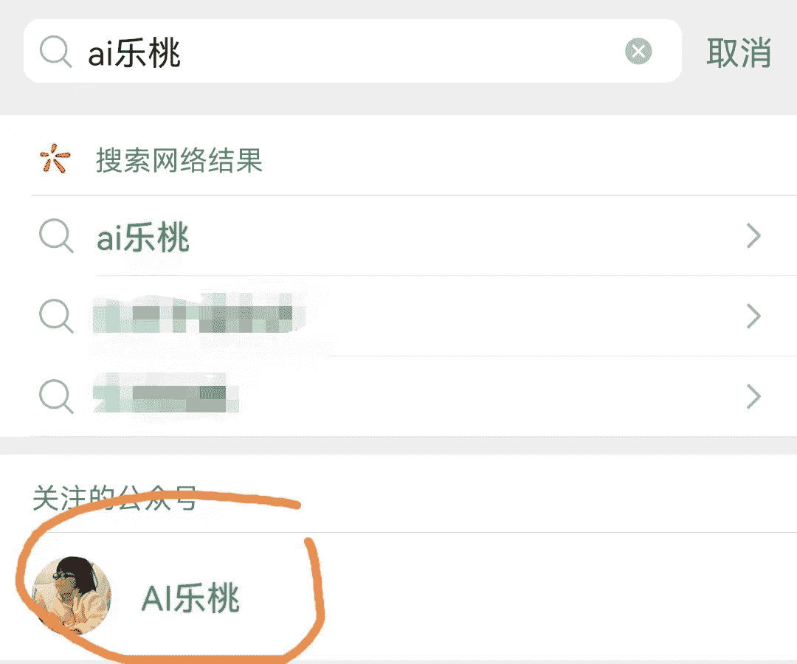

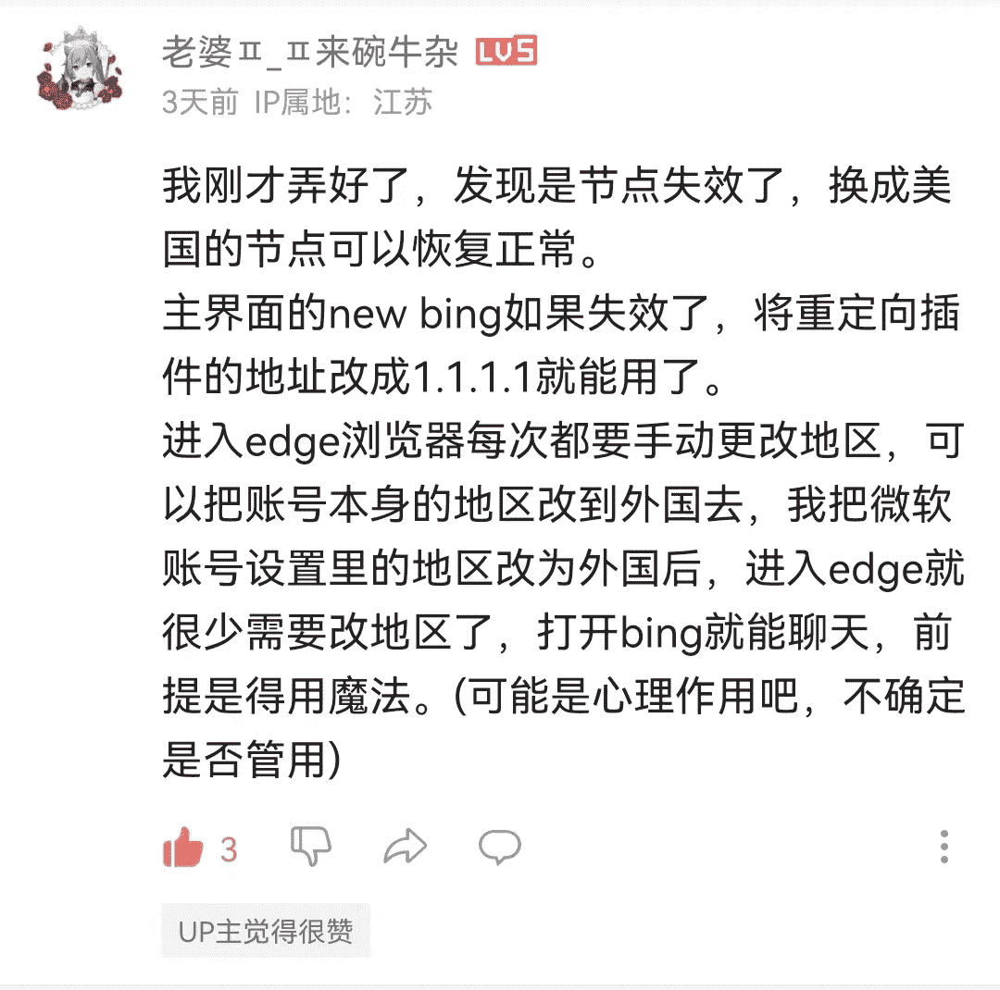

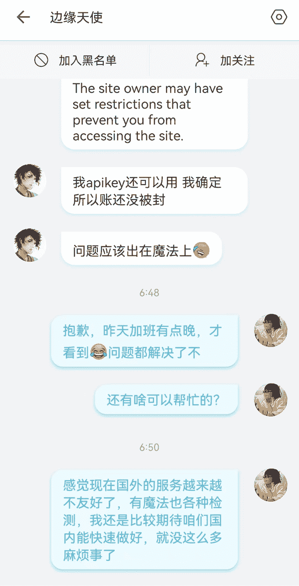

## 看问题前先看演示

因为B站的审核大大，硬说我的内容涉及广告，不让我发，再加上申诉也不给出我明确的理由，不知道哪里触犯了红线，大晚上的搞了很久，忙碌的打工人实在没有精力跟他们搞心态，所以大家随缘更新吧

> 重要重要重要‼️：因为一直没有上架插件市场，所以暂时每次升级只能手动安装，因为对于chrome插件才刚刚学习，还在摸索中，后续会在不影响大家使用体验的前提下提供升级机制🙏。如果手动安装新版本的插件，之前本地的历史消息会丢失，所以参考下面的说明对于重要的历史记录进行内容手动复制和保存到文件（新版本0.0.3已经支持一键导入导出历史记录了）。

> 关于功能说明视频中涉及Bing [API域名的方](https://gitee.com/jja8/NewBingGoGo/blob/master/docs/%E5%88%9B%E5%BB%BA%E8%87%AA%E5%B7%B1%E7%9A%84%E9%AD%94%E6%B3%95%E9%93%BE%E6%8E%A5.md)法可以参考👉这里别人分享的方法

> 千万不要用自己不信任的人提供的服务哦！！！

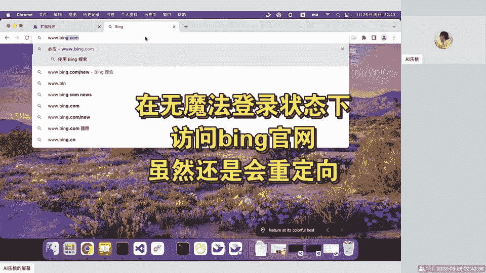

[studio_video_1679846324441914.mp4](https://internal-api-drive-stream.feishu.cn/space/api/box/stream/download/all/QkPPbRM91oWd8wxFBwAct9JtnAh)

## 大家遇到最新问题说明

### 使用魔法

#### ☑️Cannot read properties of `undefined` (reading `value`)

我自己试了下是微软服务检测了`x-forwarded-for`的header，所以需要浏览器插件改下设置1.1.1.1，具体可以参考小伙伴的分享，之前用魔法是不需要的，也是最近改的策略，相当于原来无魔法的基本方法，回到原点😂

已经在0.0.4内置解决，无需单开插件

具体解决方法如下👇：

| 步骤 | 1. 安装mod header插件 | 1. 打开魔法的全局代理模式 | 1. 设置mod header的 `x-forwarded-for` 值为 1.1.1.1 |

| --- | --- | --- | --- |

| 截图 | 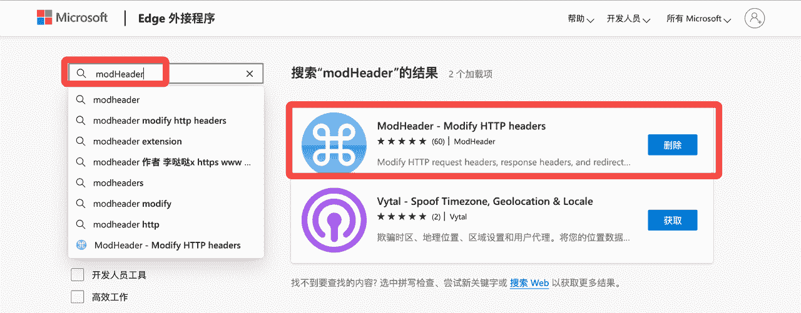 | 自行脑补吧 | 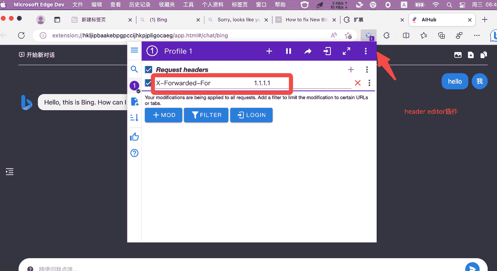 |

说明：下个版本0.0.4会内置在aiHub里面，也就不需要开两个插件了，另外这个`modHeader`需要加下过滤只对微软相关的服务生效，不然部分其他网站访问会受到影响，我自己是开一个单独的edge浏览器用的，所以无感

### 不使用魔法

不使用魔法的好处是可以完全免费，坏处就是很多事情需要自己弄，比较花时间，遇到的问题也相对比较多，而且因为up白天工作比较忙，难以及时回复大家，只是早起来更新文档，所以大家还想在免费这条路上折腾，可以关注下这篇文档，如果不想这么折腾，想图个方便的，可以关注👸号“AI乐桃”私聊交流

如果参考上面别人分享的方法，自己申请服务的方法暂时收集到的问题如下

#### 503错误

猜测：一般是你的服务部署出现问题，因为没有更多上下文的情况下比较难具体分析原因，后面还有用railway出现的话，可以提供更多的信息方便定位哈

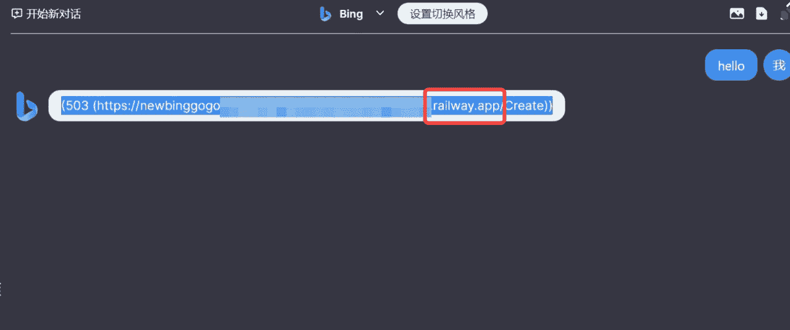

#### Fail to fetch

参考[别人分享的方法](https://gitee.com/jja8/NewBingGoGo.wikis/blob/master/%E5%88%9B%E5%BB%BA%E9%AD%94%E6%B3%95%E9%93%BE%E6%8E%A5/%E4%BD%BF%E7%94%A8%E5%85%8D%E8%B4%B9%E7%9A%84%E7%9A%84%E4%BA%91%E6%9C%8D%E5%8A%A1%E6%8F%90%E4%BE%9B%E5%95%86%E5%95%86%E5%95%86...) [查看无需申请域名的](https://gitee.com/jja8/NewBingGoGo.wikis/blob/master/%E5%88%9B%E5%BB%BA%E9%AD%94%E6%B3%95%E9%93%BE%E6%8E%A5/%E4%BD%BF%E7%94%A8%E5%85%8D%E8%B4%B9%E7%9A%84%E7%9A%84%E4%BA%91%E6%9C%8D%E5%8A%A1%E6%8F%90%E4%BE%9B%E5%95%86%E5%95%86%E5%95%86...)方法，[推荐文档里面的railway方法](https://gitee.com/jja8/NewBingGoGo.wikis/blob/master/%E5%88%9B%E5%BB%BA%E9%AD%94%E6%B3%95%E9%93%BE%E6%8E%A5/%E4%BD%BF%E7%94%A8%E5%85%8D%E8%B4%B9%E7%9A%84%E7%9A%84%E4%BA%91%E6%9C%8D%E5%8A%A1%E6%8F%90%E4%BE%9B%E5%95%86%E5%95%86%E5%95%86...)和[gitpod方法](https://gitee.com/jja8/NewBingGoGo.wikis/blob/master/%E5%88%9B%E5%BB%BA%E9%AD%94%E6%B3%95%E9%93%BE%E6%8E%A5/%E4%BD%BF%E7%94%A8%E5%85%8D%E8%B4%B9%E7%9A%84%E7%9A%84%E4%BA%91%E6%9C%8D%E5%8A%A1%E6%8F%90%E4%BE%9B%E5%95%86%E5%95%86%E5%95%86...#replit-%E6%AF%94%E8%BE%83%E6%8E%A8%E8%8D%90)，这两个方法都无需单独购买和申请域名（之前不幸已经申请域名的同学不要气馁，有自己的域名肯定更稳定些），不过这两个方法都需要有个github的账号，稍微有点门槛🤦‍♂️，如果没有github账号可以参考replit方法，最后可能就是最hard模式，部署自己的服务或者使用cloudflare方法，但是要绑定自己的域名😂

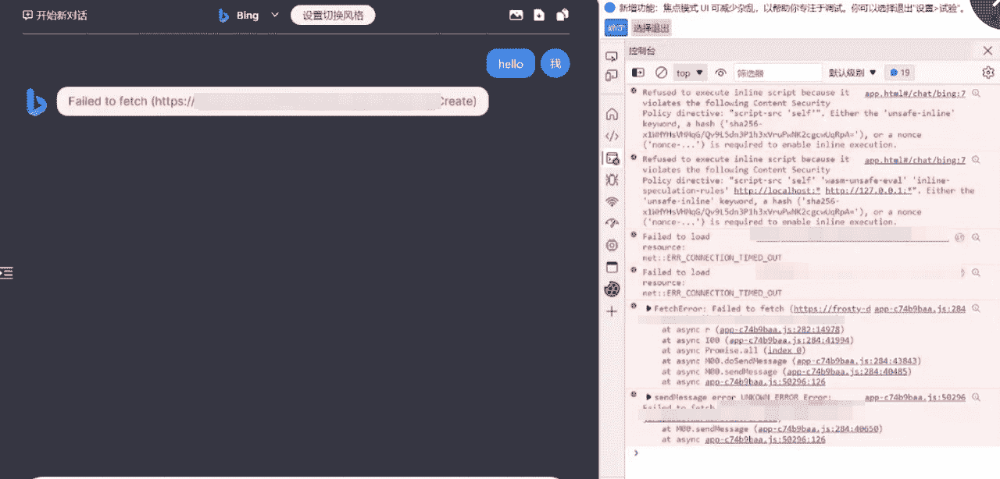

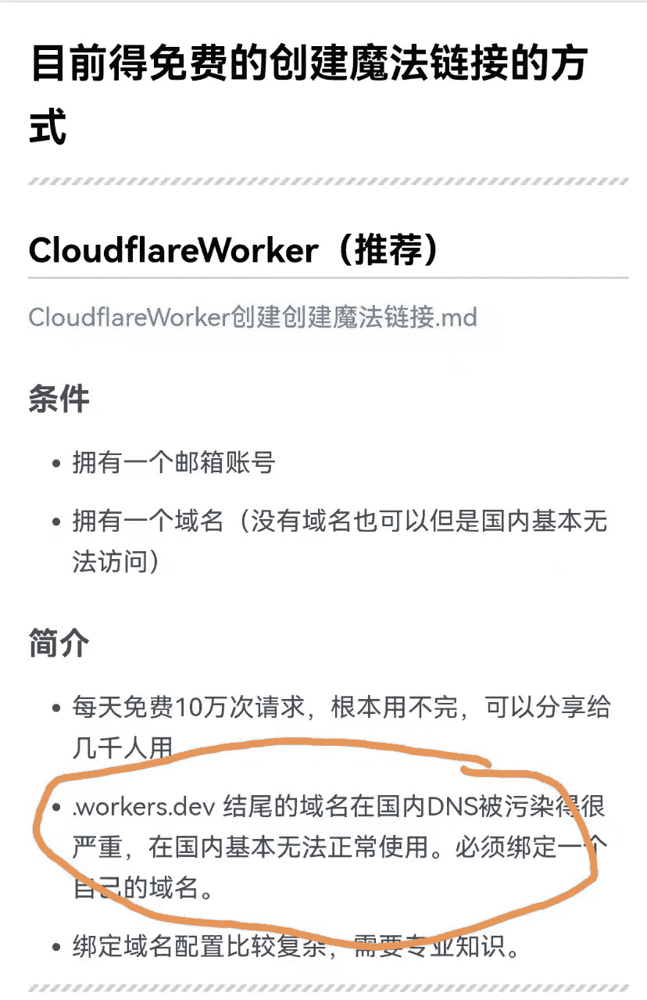

## 其他常见问题回复

[不愿意手动升级](https://seigy6zzam.feishu.cn/docx/KTp7dtDJZoSbbFxxmUpcUfXznhc#Y6Ocd6Q2koMaicxGCsAcg3jYnVc)的小伙伴，对于老版本如果有使用问题可以参考老版本常见问题

### 在哪里下载插件？

插件后面都会放在这个云存储的地址（不要直接点击链接，拷贝下面的链接在浏览器打开，如果用飞书打开因为这个域名被污染了会提示风险下载不了，可能也要重新考虑给大家分享的方式），只是说明下现在有的两个版本如下：

| 版本 | 链接 | 说明 |

| --- | --- | --- |

| 0.0.3 | [🔥🔥🔥下载地址](https://ghweltjnrtdojssavwfh.supabase.co/storage/v1/object/public/aihub/aihub-0.0.3.zip) | 修复微软新策略调整404问题，补充新功能 |

| 0.0.2 | [下载地址](https://ghweltjnrtdojssavwfh.supabase.co/storage/v1/object/public/aihub/aihub-0.0.2.zip) | 主要修复严重影响使用的输入框样式问题 |

| 0.0.1 | [下载地址](https://ghweltjnrtdojssavwfh.supabase.co/storage/v1/object/public/aihub/aihub-0.0.1.zip) | 最开始的版本，只有bing可以保存历史记录 |

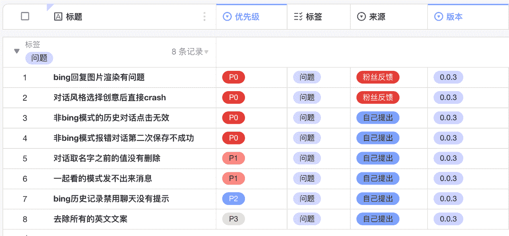

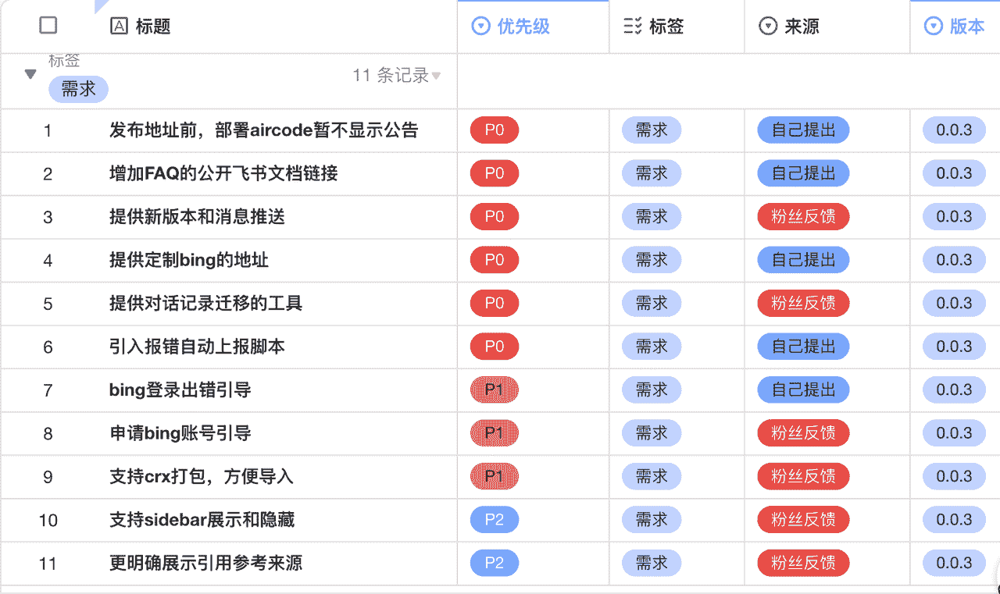

### WebSocket closed with reason:  (1006)

这个具体原因可能比较多，暂时还没有小伙伴给出完整截图，看起来像是连接被微软重置了，或者你这是不是公司内的，公司有防火墙检测到了？

### Failed to execute `insertBefore` on `Node`: The node before which the new node is to be inserted is not a child of this node.

看好几个小伙伴出现，但我咋试都没出现过😂只能猜测是不是跟其他浏览器插件冲突了，可以试试先把其他都关了，逐个开排除出跟哪个冲突了哈，也不完全是，暂时没有小伙伴给出控制台具体的报错，不好排查，大家如果是偶尔出现只能先刷新一下了😂 感谢“乱叶纷飞”小伙伴的分享，大家可以试试能不能解决👇

### Fail to fetch

下面两个图，第一个应该是你用chatGPT，国内现在应该是封的，我还在想怎么帮没有魔法的小伙伴解决，第二个就不太确定了，为啥直接建立长链接的请求直接被拒绝了，可以看看是不是下面三种原因之一：

+ 之前看别人的分享通过改`host`文件使用bing服务，但`host`方法现在失效了，其实可以不用改`host`了

+ 是不是之前账号出了啥问题被限制了

+ 使用的网路有什么防火墙的软件限制

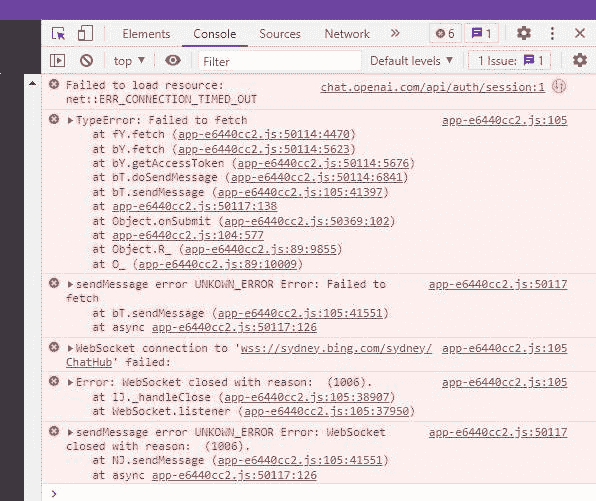

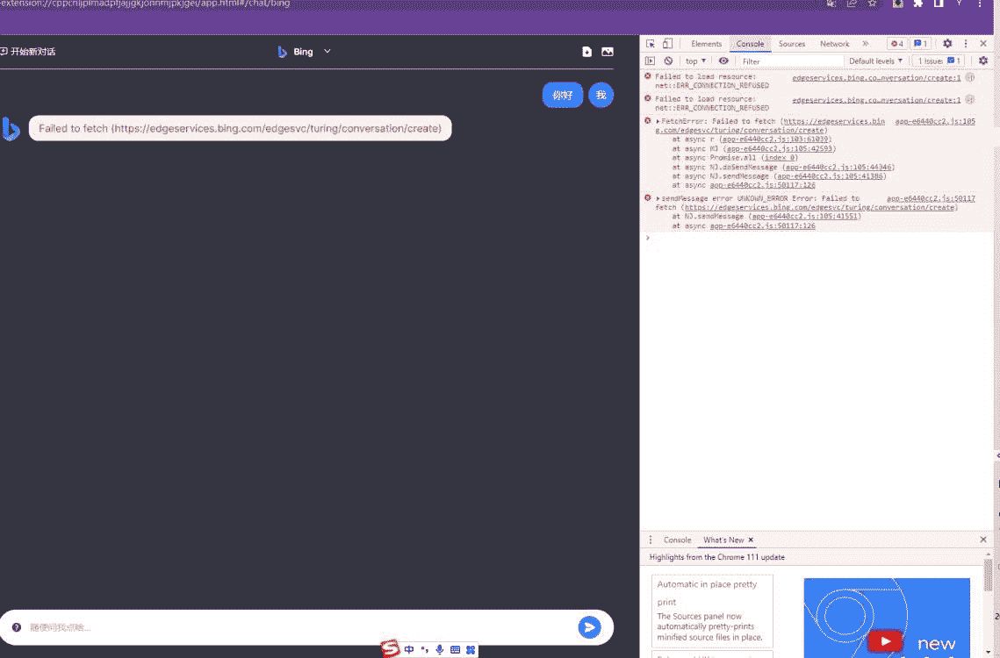

### 是否支持手机端使用？

其实是准备适配的，我自己就有需求，我还试了下，但是好像狐猴不能加载解压缩文件，要打包发布到edge插件市场，怕被封大家都用不了就没弄，后面大家呼声比较高的话研究下怎么弄，给这条点赞让我看到小伙伴的呼声

### 跟官网网页版差别大吗？

模拟调用了bing的接口，理论上应该一样，只是看有些小伙伴反馈跟之前有点差别，可能最近微软调整了策略，后面看再研究下暂时一般需求没有太影响使用，自己试验感觉的确是有差别的，比如时效性方面不太一样，可以问这个问题测试出来，

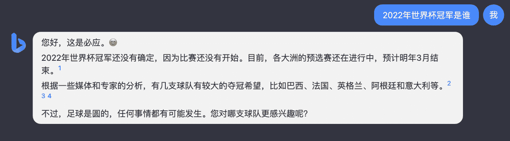

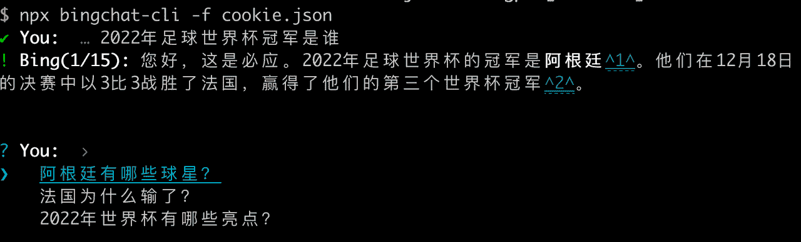

我试验了下，主要因为选择的回答风格默认是“平衡”，兼顾了创意和精准，这个可以在设置界面里面调整，如果对于准确性要求更高，可以选择“精准”

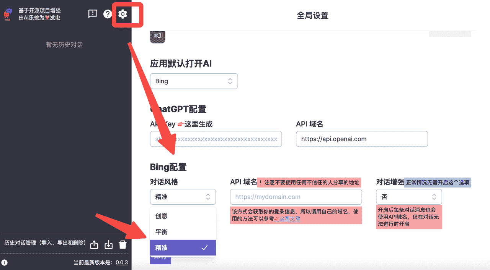

### 为啥可以用New Bing，需要录入`key`之类信息吗？

如果用bing不需要，用chatGPT需要，使用bing相当于你用了你自己的账号，我帮你模拟了跟微软服务通信的过程，绕过重定向的限制，所以其实还是用你的账号，只是因为不是官方界面，不确定啥时候可能不管用了，因为我自己也在用，所以会长期保持跟进

### 我的微软账号是否有封号风险？

我专门对照过接口，暂时应该是一样的，除非后面改了，本来每次回答都会有一定`temperature`来随机的，看是不是这个原因，封号不好说，我自己用的小号，感觉长期看微软应该会放开申请，我申请了好几个新号，准备换着用，现在只有两个过申请的小号

### 如何使用ChatGPT功能

说明：这个视频里面没说，主要是chatGPT的部分还有点bug，准备这周末修复下，现在如果你单次聊是没问题的，保存历史记录有问题，如果介意可以等等最新版本哦

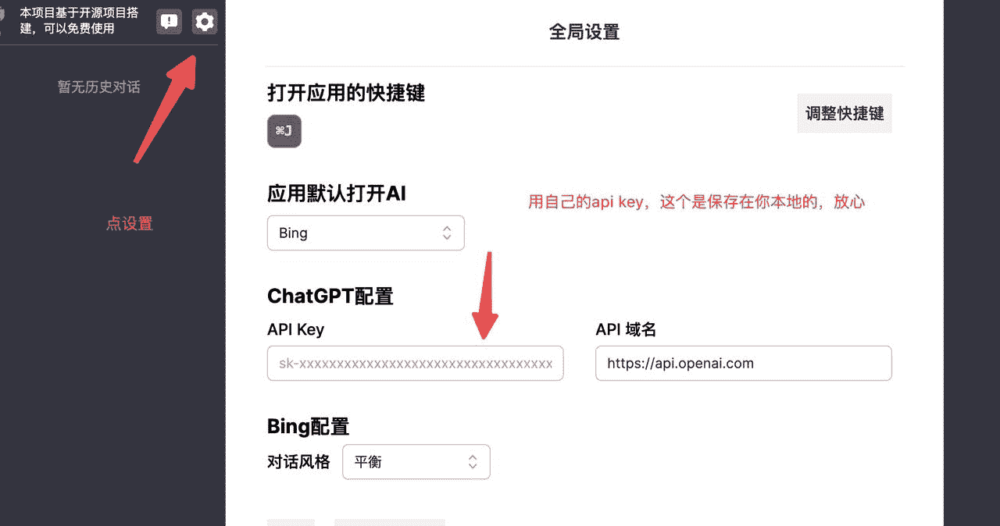

### 项目的问题会持续维护吗？

如果大家持续有需求，这个项目会一直进行下去，第一波基于开源`chathub`的改造只是增强了自己使用频率比较高的新版bing功能，其他功能的使用因为改动比较仓促有不少小问题需要优化，我已经都记录下来了，后面会根据优先级持续优化，请大家多多关注我的频道，你们的支持是我坚持为爱发电的动力👍

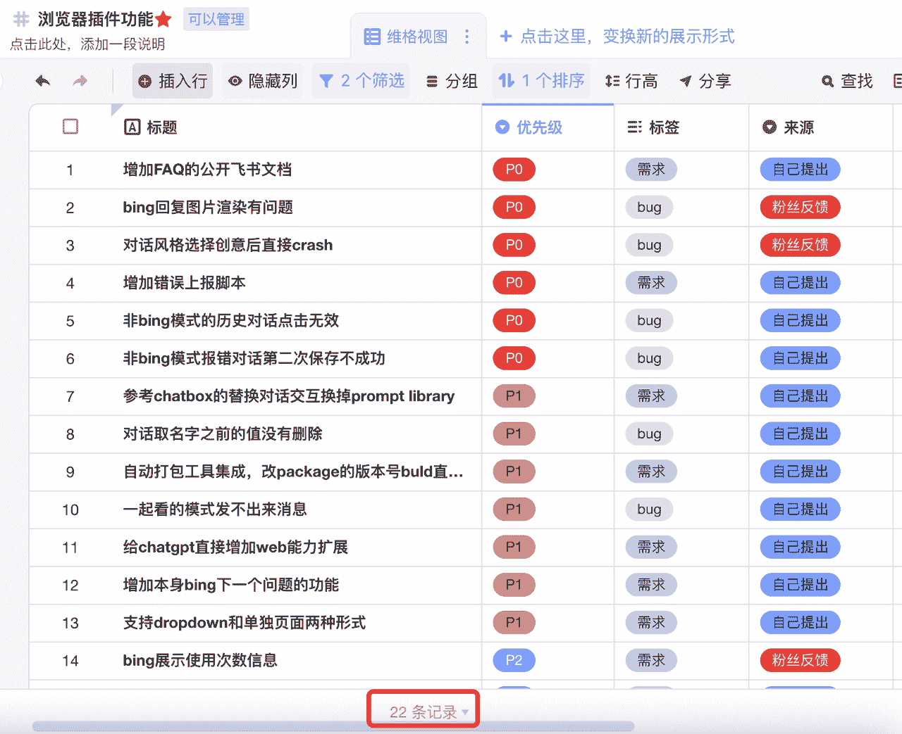

如果你想直接提出你的需求和问题，可以通过这里提交：https://vika.cn/share/shrQUgYknjwPQXsjzCmQi

### 如何更有效反馈遇到的问题

因为第一期发布比较仓促，没有添加网页出错的上报脚本，所以最近跟很多小伙伴沟通的时候比较难定位到问题，简单说明下如何更好的反馈自己遇到的特殊问题（下一个版本可能加下错误上报可能就没这么麻烦了😂）：

1. 右键点击检查菜单，打开浏览器控制台

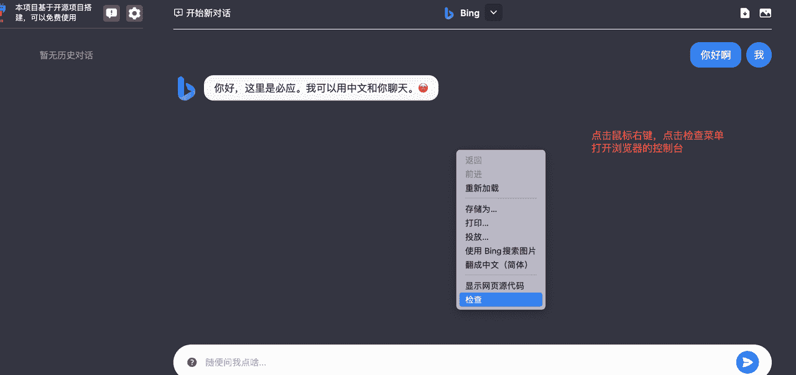

1. 查看控制台报错和网络请求情况

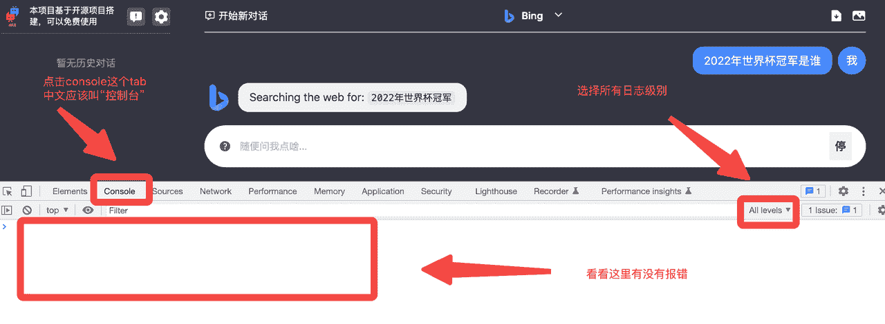

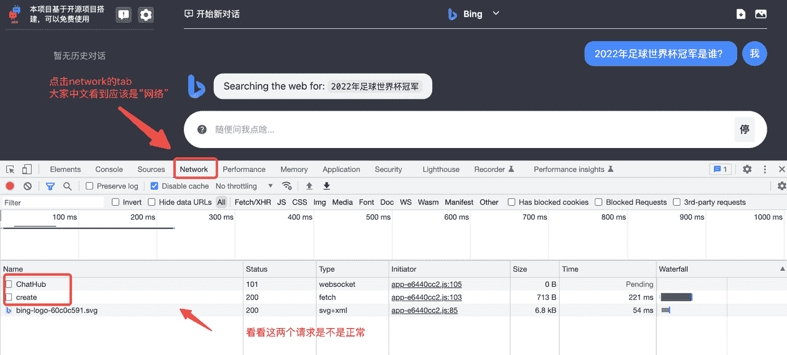

## 版本0.0.2的说明

特别说明：

因为近期微软的策略有进一步升级了，之前的方法还有我保留的备用方法都失效了😂，很多小伙伴可能在不用魔法的情况下都会看到👇这个报错，包括我之前尝试的命令行的备选方案也一样，初步想到一些方案，但是可能还要验证下可行性，最近搬砖的工作比较多，工作日时间不多，所以还想要使用的小伙伴请耐心等待下哈🙏，看我周末是不是能搞出来吧😂

另外建议大家可以使用`markdown`的导出功能（看第三个图），保留自己之前的重要聊天记录，因为如果周末可以搞出来的话，可能插件升级会让重要的聊天记录丢失（想了下实在没有想到兼容的方案🤦‍♂️）

另外如果着急的小伙伴可以尝试自己找靠谱的代理，感觉这次如果不想个彻底点的方法，可能下次难免难逃厄运😂 如果大家有更好的方案也可以跟我交流，给大家提供帮助

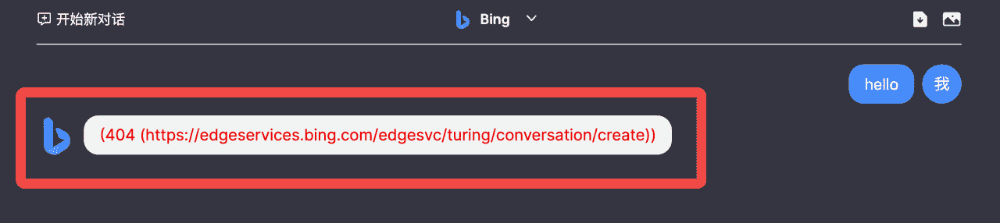

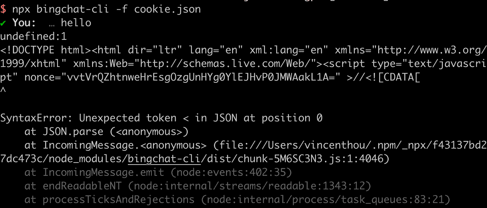

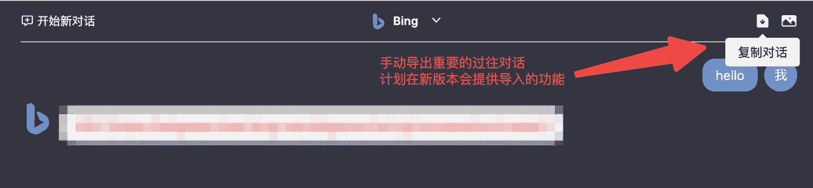

> 本来只是自己的小痛点，尝试分享给大家感觉也有很多小伙伴需要，自己感觉很有动力持续优化。这一轮新的AI浪潮崛起感觉是一次新的进化升级机会，希望自己跟本频道的小伙伴们一起共同成长，我也会因为大家的支持持续输出好的内容和工具。初期的功能比较仓促，难免有疏漏和问题，希望大家谅解🙏，跟大家交流过程中发现有不少共性的问题，这里收集了大家反馈比较常见的问题，可以看看👇还有问题的可以直接点击内容评论哦

# 版本0.0.2之前常见问题

下面主要是0.0.1和0.0.2的问题，一些问题新版本0.0.3已经修复了

## 输入框样式影响输入

这个是0.0.1的问题，已经修复可以使用最新的版本哦，后面新的版本也都是通过云存储发布，每次只要换地址里面的版本号就可以了，后面看提供最新版本提示的功能

`http://rrsp9azzr.bkt.clouddn.com/aihub-0.0.2.zip`

## 清单文件缺失或不可读取，无法加载清单

下载下来的zip文件需要先解压，加载扩展时选里面解压出来的扩展文件夹，不要直接选择zip文件

## Forbidden: Sorry, you are not allowed to access this service.

说明没有new Bing的资格，请去 `https://bing.com/new` 加入 waitlist，具体方法可以在B站搜索其他up分享，最新的0.0.3也支持了一键申请

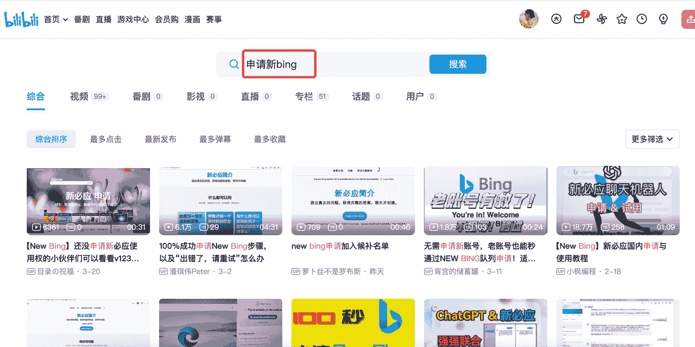

## Windows上如何安装？

在edge浏览器加载本地插件可以看官方文档哈 👇
