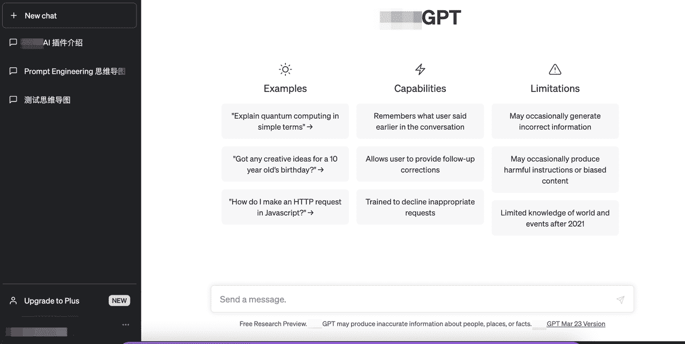
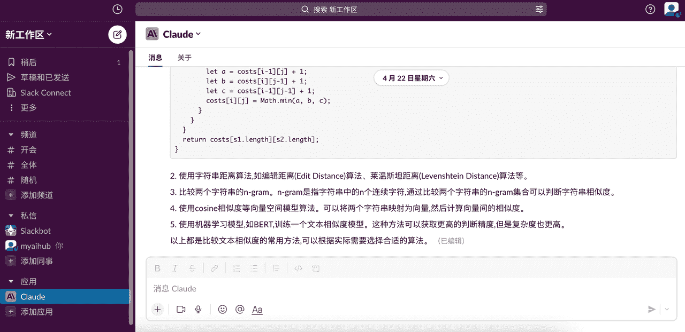
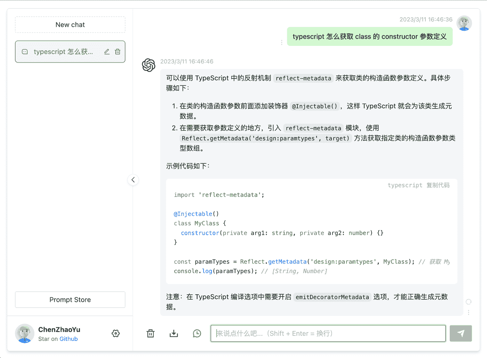
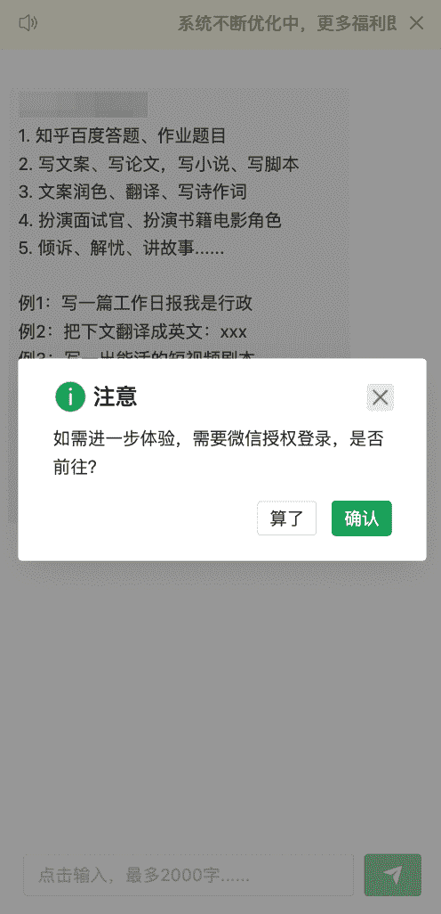

# 【WIP】一文搞懂号称可用xxxxGPT的工具

> 来源：[https://seigy6zzam.feishu.cn/docx/YDCad4qGOoFUCNxWrTccuvg4n6s](https://seigy6zzam.feishu.cn/docx/YDCad4qGOoFUCNxWrTccuvg4n6s)

# 海外LLM纯粹聊天工具

大部分不能直接访问到，有个别可以尝试

## xxxxGPT

这个应该无需多言，这一轮新的浪潮都是因此而起

## Claude

因为觉得原来公司跟初衷背离，从OpenAI公司出走，开创新的公司，期望提供更加安全的AI产品，暂时没有线上的产品，类似AI绘图的当红企业 MidJourney 通过聊天软件中提供应用的方式先放出来尝鲜

## Bard

## Cohere

# 国内LLM纯粹聊天工具

## 文心一言

## 通义千文

# xxxxGPT增强插件

## KeepGPT

## AIRPM

## WebGPT

# 集合多种LLM引擎

## Poe

## Vercel Lab

# 基于OpenAI接口垂直产品

## Bing

## Cohesive

## Cursor

# AutoGPT

## Godmod

## AgentGPT

## Jarvis

## Baby AGI

# xxxxGPT改头换面

这个实际就是搭建了访问xxxxGPT的通路，访问openAI的接口服务

## 原始的xxxxGPT的页面

这种没啥好说的，所有的东西都是OpenAI官方的，只是通过技术手段让你可以访问了而已，而且这种方式很容易xx

## 基于开源代码实现

这个开源的产品很多，就不一一列举了，有很多有想法的开源贡献者们，提供了很多在原来xxxxGPT产品上增强的功能体验，比如文件上传，支持ASR和TTS，支持会话导出和分享，角色扮演，个性化聊天界面等；也有突出极简风格的，专注于单纯聊天。

在此基础上，增加付费功能和登录功能等用户服务，在这波流量下快速积累财富🐶，下面这个应该是我见过最多的👇

## 完全重新实现页面

很多宣称所谓国内可访问xxxxGPT的大部分都是这个类型，因为国内的LLM公司还没有太多开放接口服务的，所以这种产品大部分都是使用的openAI接口。而且很多有自己的研发资源，因为聊天界面实现复杂度不是很高，预期使用开源代码改，很多更愿意自己实现定制界面。

这里面也会分两类

+   一类只实现最基础的聊天功能，主打闲聊场景，不准备让你更好改进效率，知道也就是一波流量，没有提供很复杂的功能，把钱收到位就行

+   还有一类会增加很多高级的功能，比如小机器人（主要就是包装好了prompt），热搜榜（排序你的提问）等辅助功能，当然大部分也有分级付费的功能咯

# 开源LLM

大公司垄断核心技术，那必然有开源大神们会出手，包括LLM模型本身也有配套的模型训练工具集合，甚至整个开放性训练服务

## 清华ChatGLM

## Llama系列

## Colossalai

## OpenAssistant