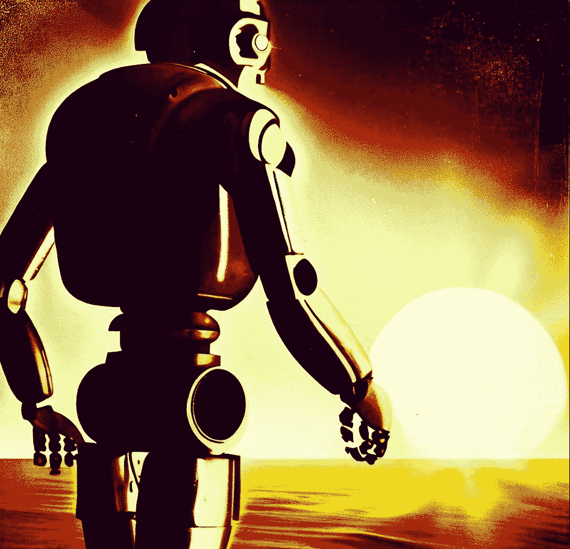
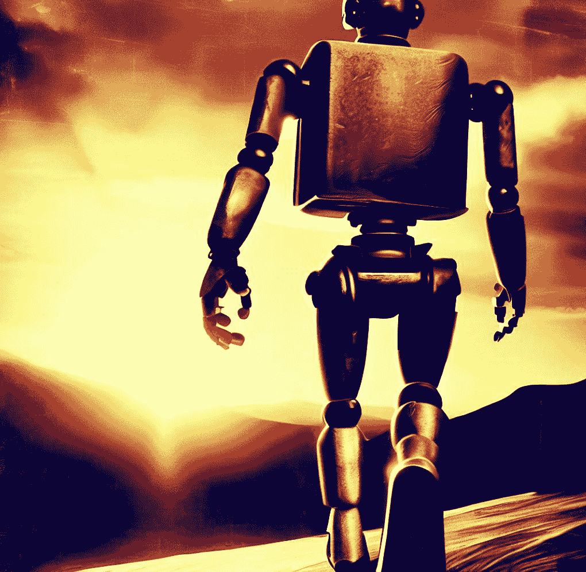
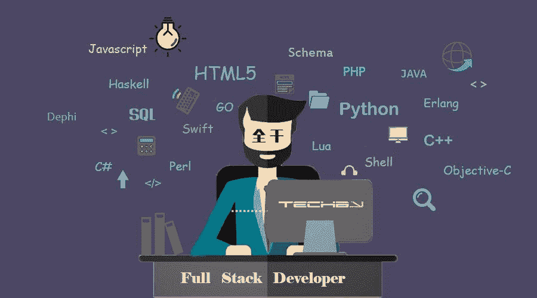
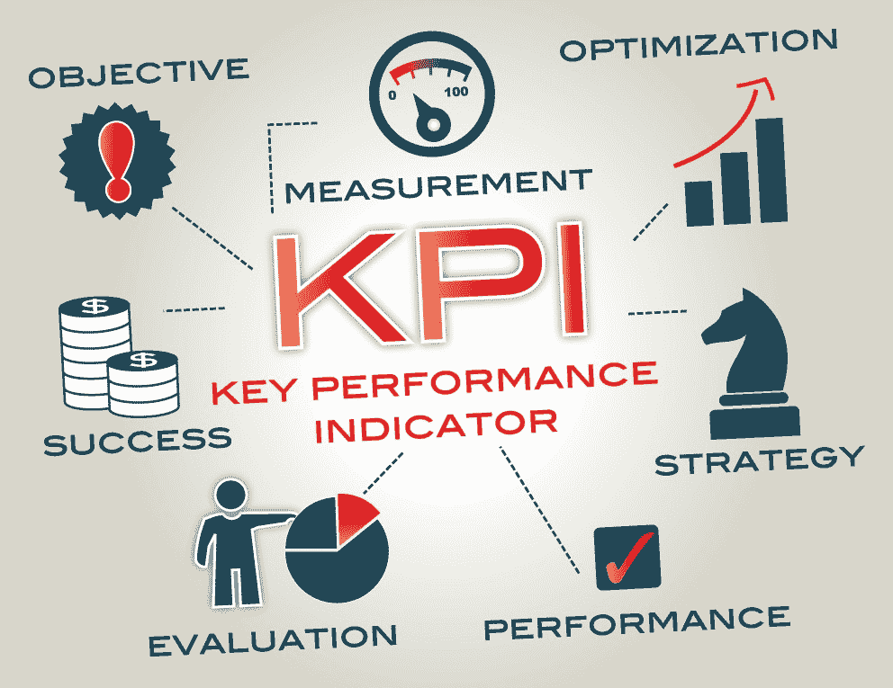
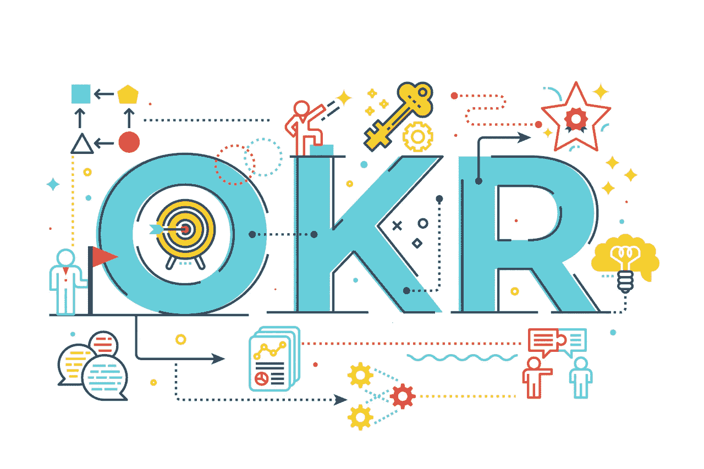
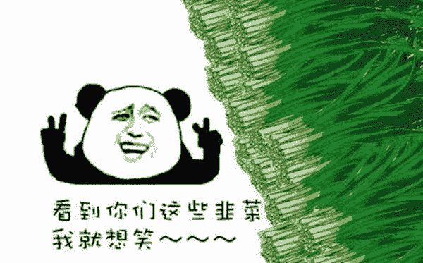
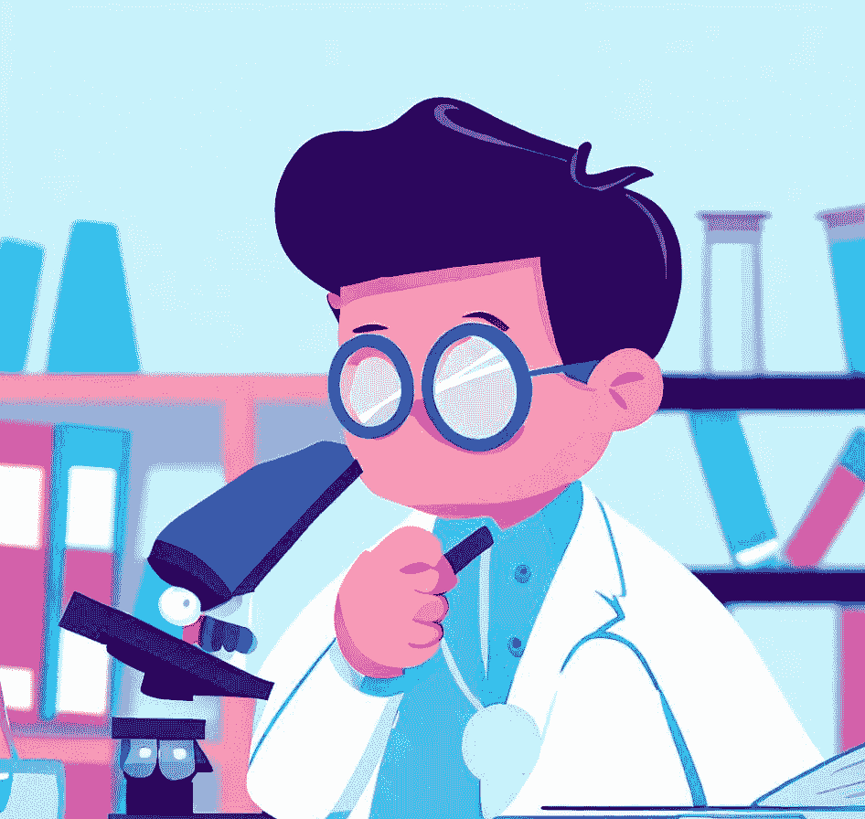
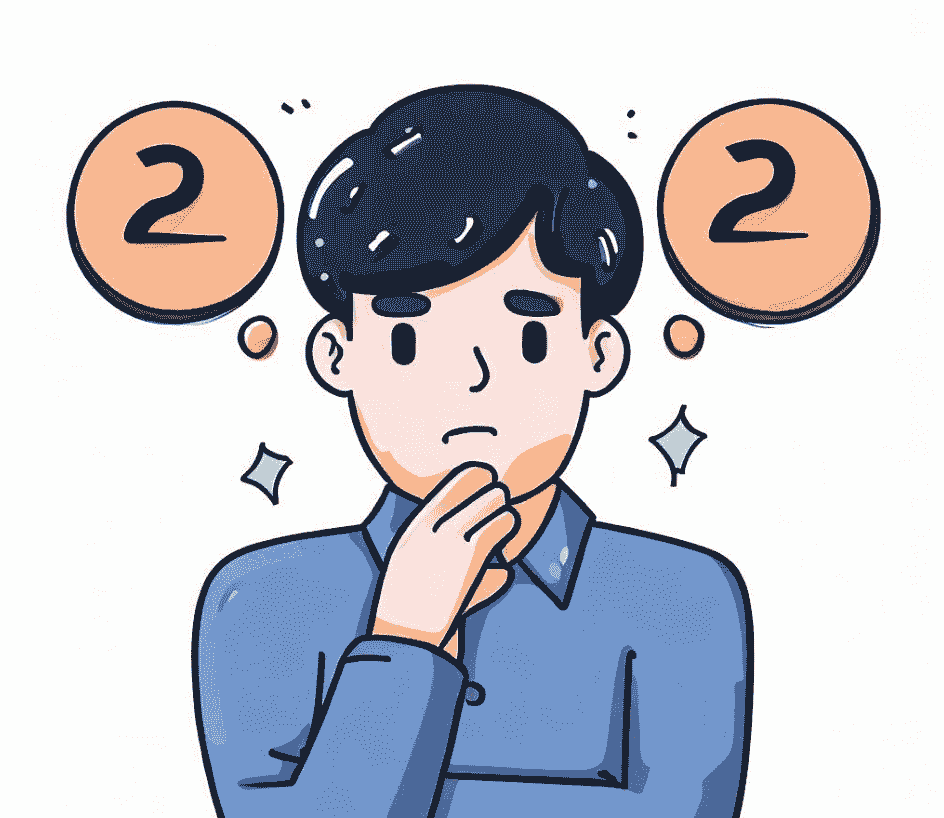

# 【文字稿】AI来了我们应该怎么办

> 来源：[https://seigy6zzam.feishu.cn/docx/GoTcdrdYVoyROuxv9eic94lUnQf](https://seigy6zzam.feishu.cn/docx/GoTcdrdYVoyROuxv9eic94lUnQf)

# 体力劳动代替脑力劳动？

很多自媒体都是这么鼓吹的，还有很多梗是关于外卖员人数激增这个现象的

但是实际是论文里面说AI的介入可以让这些“高暴露度”的工作可以提效一倍

**而这****导致的现**象**会是早期的**参与者，会去卷到晚期介入者或者拒绝者，出现职业的两极分化，总人数减少

**而这些早期参**与者可能会能者多劳，需要变成斜杠青年

比如之前我是个软件工程师，我只需要写好代码就可以，现在有了AI工具，我可以

+   做SEO

+   定义产品功能

+   设计界面

+   做产品logo

+   撰写推广文案

**关键问题变成了判断哪些事情**应该做以及什么时候做，从KPI导向变成OKR导向，工作的内容将会不是基于你的经验去完成特定的工作任务而是如何更好的定义你的工作任务

# AI到底是助力还是阻力？

+   **早期参与者：**需要学习大量新的知识，比如prompt engineering，不同AI工具的适用场景，重新定义工作流

+   **晚期参与者和拒绝者：**被早期参与者卷到，面临洗牌，然后要么转换职业角色，或者被其他早期参与者割韭菜

# 科学思维

**定义：**基于证据，逻辑和推理，敢于一直持怀疑态度，去不停的验证假设的一种思考方式

**大白话：****我们需要保持发现的眼睛**，能够基于自己的发现提出假设**，然后通过不断试**错验证自己的假设**，持续优化，这个过程**就像很多科学家做**实验🔬，**或者互联网产品做 A/B 试验一样（所以这种思维跟增长黑客也比较像）

# 批判性思维

**定义：**是一种在分析问题和做出决策时，能运用独立思考和辩证法看问题的能力

**大白话：**我们不断自我反省，不断从多个视角设置正反两个方面来看自己或者别人的观点，有点像是个思想开放的杠精，能够接纳别人新的思想，同时保持审慎的态度，做决策能够更加公正客观，而不是习惯性拍脑袋，具有定义问题的能力，而不局限于解决别人给你的问题

# 所以现在呢

资本已经入局，降临派和拯救派都影响不了，分化已经在潜移默化的开始发生，发展已经是不可能停止的了，所以身处其中，对我们所有人都是机会也是挑战

# 说明

本文中部分素材来自AI生成，部分来自网上搜索，你可以分出来吗🐶