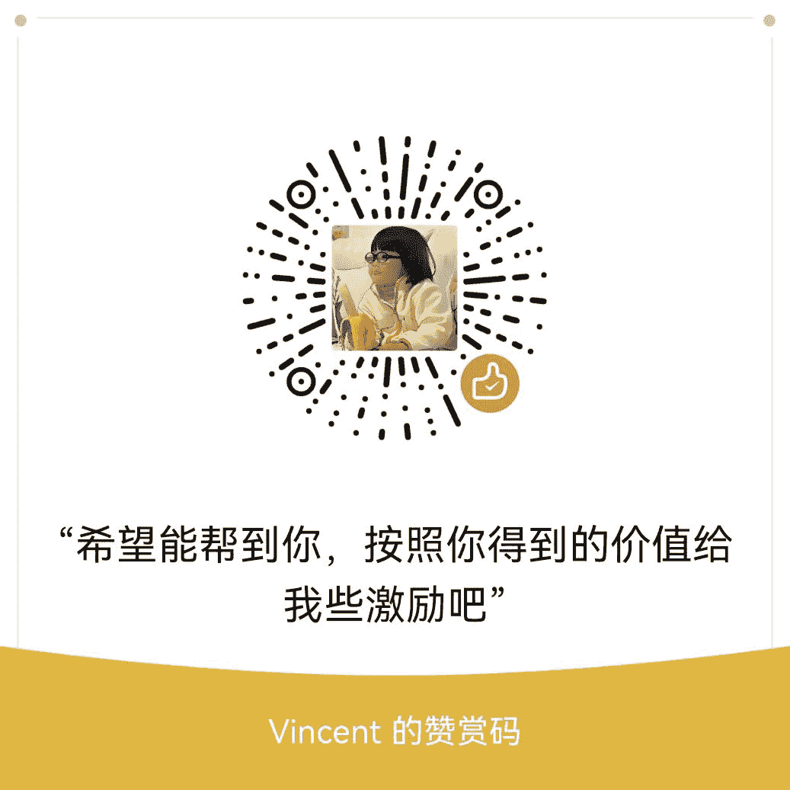

# 👨‍🏫学习资料

> 来源：[https://seigy6zzam.feishu.cn/docx/DGcudRWtPoJyn2xp9oOc4iS7nQc](https://seigy6zzam.feishu.cn/docx/DGcudRWtPoJyn2xp9oOc4iS7nQc)

# 目标

+   🌤易**于理解：将**复杂的概念转换成生动的语言，关键说清楚什么场景怎么用

+   🐟授**人以渔：不**只是罗列各种场景，能够知其然也知其所以然，学会定制自己的prompt

+   🤗边**做边学：坚**持贯彻边学边试验的原则，嵌入试验工具直接查看试验效果

# **关于本教程的说明**

本教程期望包含高效率使用当前各种人工智能的最实用和基础的方法，其中的内容也是我在自己学习相关知识的基础上总结消化的。希望有缘看到这篇教程的朋友可以跟我一起学习，在这个新的大时代机会中找到自己的小机会

本教程不是什么？

+   本教程不是 prompt 大全，如果你预期是找到能直接用的 prompt，建议可以期待下我们在开发中的社区或者直接google以及直接问 GPT 工具自己。本教程更多地是教你方法，以及解释这些方法为何有效

+   本教程不是权威指南，在这个领域我也仍然在学习，而且因为相关的技术变化太快，可能我所知道的东西也不一定是最新的，但是我希望可以持续学习，并且迭代这个教程，让教程中的内容可以保持新鲜度，也希望在迭代过程中把真正有更长有效期的知识沉淀下来

# **如何阅读**

在阅读本教程的过程中，期望你可以参与进来：

1.  清空自己：相关的技巧有其阶段性的价值，但是学习这些技巧的过程其实是帮助我们更好理解相关AI技术的能力边界，因为现在领先的人工智能技术可解释性还有很大进步空间，所以个别技巧有些玄学的成分，但是期望通过自洽的解释帮助你更好理解，新的知识会对你原来的认知有冲击，所以一个开放和学习的心态可以帮助你走的更远

1.  及时反馈：因为技术变化很快，如果单靠我个人的力量其实难以将这个教程做的面面俱到，所以教程中提供了留言的功能，如果阅读过程中发现文档中有错漏或者你觉得写的不清楚的地方，欢迎随时留言讨论，期望所有有缘看到这个教程的朋友可以一起交流经验以及自己在利用相关技巧解决自己问题过程中的心得

1.  边学边做：这个也是本教程最核心传递给大家的思路，这个跟之前我们学校教育的方式差别比较大，但是我觉得是在面对不确定事情学习最有效的方法，本教程力求所有相关的例子和概念大家可以直接使用工具动手实验，通过科学和批判性思维的方法审视本教程技巧的有效性，心里面时刻想着要解决的问题本身，而不是需要先把教程里面所有东西都读完才开始动手

# **可能关心的问题**

## **有社群或者群吗？**

不[🗨交流社群](https://seigy6zzam.feishu.cn/wiki/wikcnc1SxcTJEGRxd7aLOM5xihh)可能跟大家预期的不一样，不会是一个聊天群。我希望进群的都是共创者，换句话说，不是伸手党，而是愿意跟大家一起分享交流的朋友，详细信息查看👉

目前大家可以通过 文章下面的评论 来交流。也欢迎各位通过以下社交平台关注我

+   这是我的[B站账号](https://space.bilibili.com/1532854091)，会不定期分享应用案例和深入知识分享，欢迎关注

+   👸号：👇我的👸号，不定期分享行业动态以及相关工具，如果对你有帮助也请给我些鼓励👇

# 子页面目录