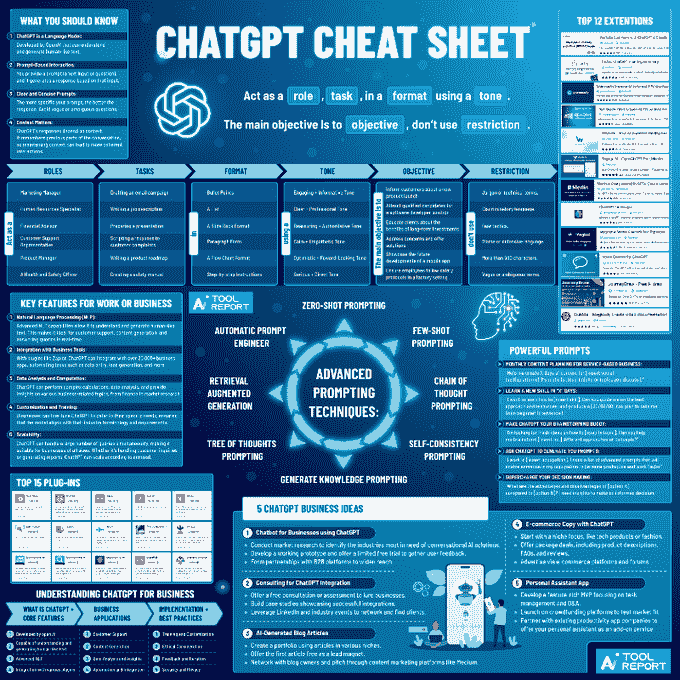

# 💬指令LLM教程

> 来源：[https://seigy6zzam.feishu.cn/docx/SxV9dAlSWoY1kGxr2gYcJPpAnSb](https://seigy6zzam.feishu.cn/docx/SxV9dAlSWoY1kGxr2gYcJPpAnSb)

# **AI****是什么？**

抛开很多专业术语，更多希望给大家感性的认识，更深度的理解可以结合跟 GPT 模型提问来深入了解，首先说说经典的 AI 模型。

大家中学的时候肯定都学过函数，函数一般都会被表示成 y = f(x) 的形式，这个形式表示了针对输入，经过一定的计算之后会有特定的输出。传统的 AI 就是期望这个函数足够强大，能够计算不局限于单一的输入，经过复杂的公式计算后可以得到确定的单一输出。研究人员利用计算机的计算能力，通过给他很多的输入和输出的数据，确定评估指标啥时候这个函数跟我们喂给它的数据匹配上了，这个函数的大致结构也就确定下来了。但是大家明显感觉到这样是有缺陷的，主要有这些点：

+   你需要知道所有影响结果的输入因素有哪些，收集到尽量多的输入和输出的匹配对，不是专业的人干不来

+   因为它是根据我们喂给它的数据来确定这个函数是什么样子的，所以训练后会出现两种极端的情况，一种是学习不认真，就像小学生学习数学，如果只学了加法和减法，而没学乘法和除法，那么在遇到复杂的数学问题时就无法解决。另外一种是学习太认真，就像小学生在做数学题时，如果只记住了题目的答案，而没有理解题目背后的思想和方法，那么在遇到新的问题时就无法解决。

+   如果这个输入到输出的函数太复杂了，比较难通过一般的数学公式描述的时候，我们单纯去模拟这个函数就会比较难有比较好的效果

后来有很多研究人员发现，其实可以参考人脑神经元的结构来设计 AI 的这个函数，大家大概知道我们的人脑是一个网络的结构，包括大量的神经元和神经元之间的连接，这些神经元通过电信号和化学信号来传递信息，从而实现了人类的各种智能行为和思维过程。收到这个启发，研究人员仍然可以沿用之前的评估方法，设计网络的结果来代替实现这个函数，只是具体这个函数是什么就不那么容易通过简单的数学公式来表示了，甚至是特别复杂的情况，他们只是设计了网络的结构，但是具体里面发生了什么并不能完全解释，但是效果上就是有效的，具体来说：

+   研究人员不需要提前知道有哪些具体的输入因素会影响输出，只要把输入和输出的匹配数据一股脑喂给计算机，通过设计网络的结果，让计算机自己发现哪些是真正有效的影响输入因素，这大大简化了之前人工确定容易出错的问题，以及繁琐的工作量

+   因为很多时候，研究人员只是明确评估的方法，然后知道有很多网络的结构是有效的，但是针对很具体的问题，会不断的通过假设和验证的科学思维方法，借助计算机的计算能力训练出来一个好的模型，但是这里面有时候有点玄学，所以很多人也戏称这个过程像是道士在“炼丹”

# **GPT****是什么？**

GPT的全称是 Generative Pre-trained Transformer，是一种基于Transformer架构的预训练语言模型。它可以用来生成自然语言文本，如文章、对话等。GPT模型已经在自然语言处理领域取得了很大的成功，并被广泛应用于文本生成、对话系统等任务中。我们分开来看这个单词。

+   Generative：即它可以生成自然语言文本。GPT模型是一种基于神经网络的语言模型，它可以通过对前面的文本进行学习，预测下一个单词或字符的概率分布，并根据这个分布生成文本。因此，GPT模型可以用于生成各种自然语言文本，如文章、对话等。这种生成能力使得GPT模型在文本生成、对话系统等任务中具有很高的应用价值。

+   Pre-trained：指的是在特定的任务上已经进行了训练的模型。在深度学习中，预训练模型通常是在大规模的数据集上进行训练，并学习到了广泛的语言知识和语言模式，因此可以被用于各种自然语言处理任务中。预训练模型的优点是可以减少训练时间和数据量，并且可以提高模型的泛化能力。在GPT模型中，预训练是指在大规模语料库上进行的无监督学习，以便使模型能够学习到自然语言中的语法、语义、上下文等信息。

+   Transformer：是一种基于自注意力机制（self-attention）的神经网络结构，用于处理序列到序列（sequence-to-sequence）的任务，如机器翻译、摘要生成等。Transformer模型是由Google在2017年提出的，它通过自注意力机制来捕捉输入序列中的上下文信息，并且避免了传统循环神经网络（RNN）中存在的梯度消失和梯度爆炸等问题。Transformer模型已经被证明在自然语言处理领域中取得了很大的成功，并被广泛应用于各种文本生成任务中。GPT模型就是基于Transformer架构设计的预训练语言模型。

额，没有看懂？大白话解释下：

+   Generative：它可以生成一切文字性内容，不管是无中生有，提纲挈领，移花接木等后面会详细展开的能力，它都得心应手

+   Pre-trained：它预先自己学习了大量的喂给它的文本，比如新闻报道、小说、博客文章、社交媒体评论等等，可谓是“博览群书”了

+   Transformer：AI既然是个黑盒子，那盒子里面的结果根据不同的任务会不一样，而Transformer是一种相对通用的结果，它的实现过程有点像是翻译的工作，先将另外一种语言的信息你自己读明白，然后翻译成另外一种语言（任何），这里的翻译只是对于过程的类比，这个效果让它不局限于翻译的工作。

# **ChatGPT****跟****GPT****是什么关系？**

ChatGPT在GPT的基础上进行了优化，使得它可以更好地适应对话场景，并且可以生成更加符合对话语境的文本。ChatGPT是基于GPT模型的对话生成模型，旨在通过对话模拟实现自然语言交互。 它是为了改善人机对话体验而设计的，主要应用于聊天机器人、智能客服等场景。 与GPT模型相比，ChatGPT在训练过程中引入了特殊的微调和优化方法，以提高在特定领域的对话生成质量和连贯性。 ChatGPT在生成对话时更加注重上下文的连贯性和个性化的表达，以实现更加自然的对话体验。

GPT是由OpenAI公司开发的一种基于深度学习的自然语言处理模型，它采用了Transformer网络结构，可以对自然语言进行预测、生成和理解。GPT模型的发展历史可以追溯到2018年，当时OpenAI发布了第一个版本的GPT模型，即GPT-1。随后，OpenAI又发布了GPT-2和GPT-3等版本，其中GPT-3是目前最先进的版本。

GPT模型的发展历程中，主要是通过增加网络层数、改进网络结构、优化训练算法等方式来提高模型的性能和效果。在实际应用中，GPT模型已经被广泛应用于文本生成、机器翻译、对话系统等领域。

以上是关于GPT模型发展历史的简要介绍。

所以 ChatGPT 为什么会火出圈，一方面是因为 GPT 能力上的突破，另一方面结合能力上的突破

说明：以上文章内容由作者整理框架，ChatGPT3.5 + New Bing + 文心一言配合生成细节，由作者审阅完成

