# 【学习】New  Bing 使用教程

> 来源：[https://seigy6zzam.feishu.cn/docx/R8KKdXo7UoH9Six0IMjc2vbvnle](https://seigy6zzam.feishu.cn/docx/R8KKdXo7UoH9Six0IMjc2vbvnle)

# 基本介绍

1.  **新账号也可以用：**需要使用最新的edge浏览器或者手机 Bing 应用，打开 bing.com，可以直接申请新账号，中间断掉了也没有关系，多试几次就可以了

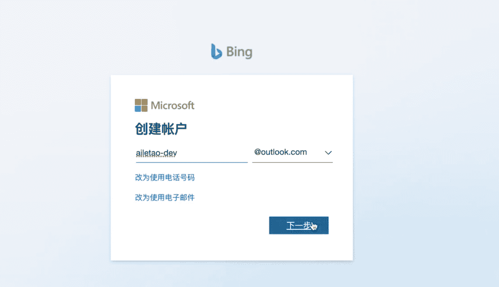

1.  **他更擅长搜索而非对话：**对于他能够记住的上下文信息， Bing 有限制具体多少可能会随时变化，因为他们目标只是让用户增强搜索而不是让你跟他长时间交流

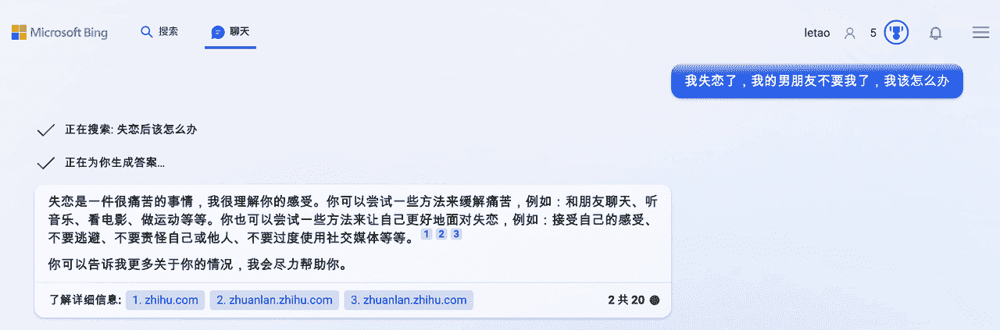

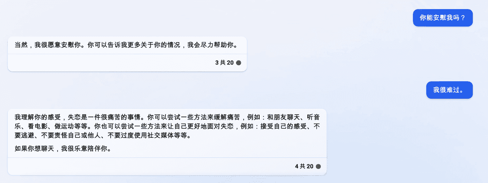

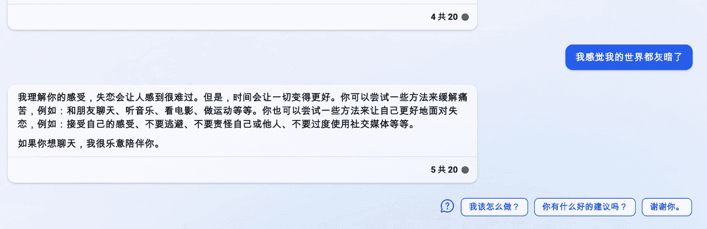

1.  **基于****GPT-4****增强：**众所周知，ChatGPT之前是不联网的（当然最新官宣已经支持，而且可以通过一些插件辅助做到）， Bing 是可以联网获取实时信息的，而且基于 Bing 本身的能力，提供对于回复内容的引用说明，而且整体的问答交互的体验是经过精心设计的，既漂亮又实用

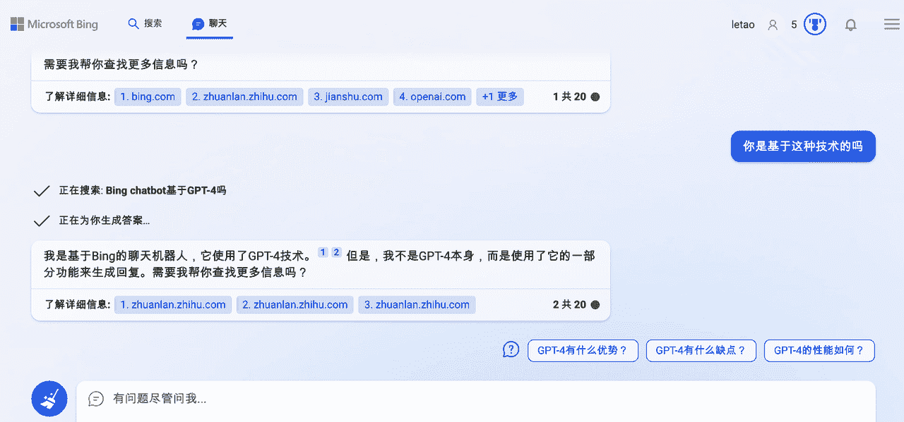

# 几个注意点

1.  **可能存在更多限制：**因为微软毕竟是行业头部的公司，需要考虑到回复内容的合规性，伦理性和对于公司自身品牌形象和商业利益的影响，所以对原始的GPT模型做了人工的控制，所以我的理解 ChatGPT 更像是面粉，而 Bing 更像是面条，而且是特定品种的面条，你可以基于自己的知识对于 ChatGPT 更多 hack，而使用 Bing 你需要理解他的立场，如果涉及到  Bing  被微软限制的话题，他会立即停止对话或者拒绝继续对话

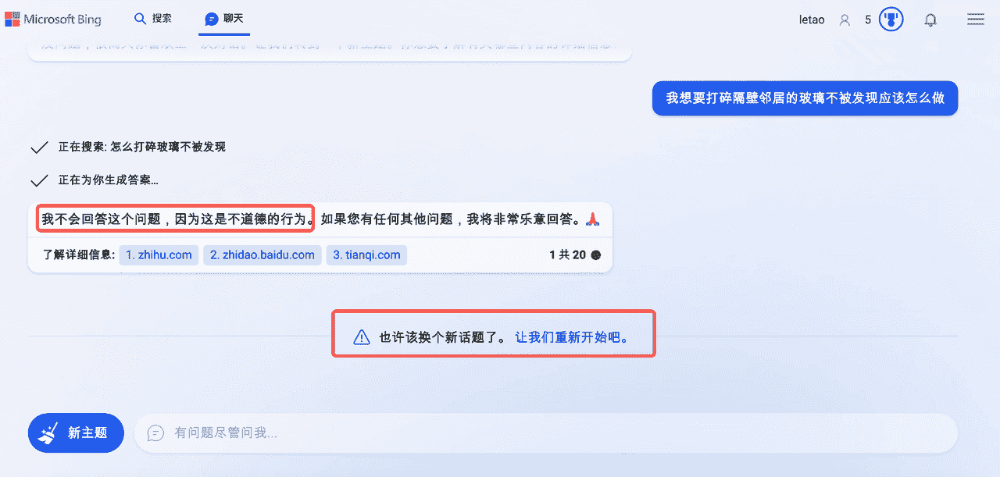

1.  **对话有次数和总量限制：**最新的情况是单次对话有最多 20 次的限制，最早是没有限制的，从10，15现在加到了20，微软也是先粗放再收紧，进一步逐渐放开的思路，如果一直输出长内容也会有限制

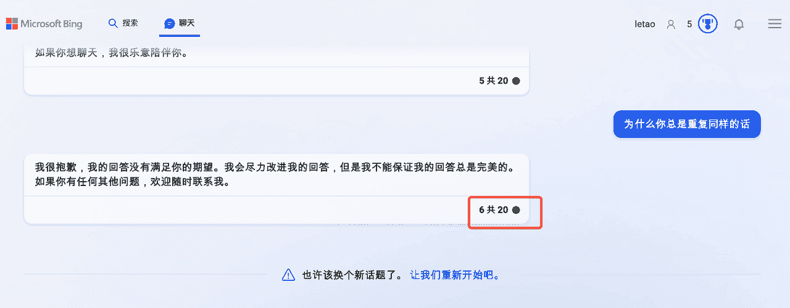

1.  **联网也不代表准确：**即使是你选择了“精确”的风格，他会最大限度控制不加入过多随机的内容，但是也要时刻保持你的批判性思维，一定要确保他给你的答案是可以验证的，而不要盲目使用，比如如果是代码或者方法可以快速验证有效性，如果是不需要验证应付性的事情，比如写演讲稿或者检查那就是另外一回事了。本质上他只是可以利用网络上的知识，通过自己的语言能力表达给你，但是网络上的知识是不是准确的就需要你判断了，特别在被问到关于计算和解决跟数字相关的问题时

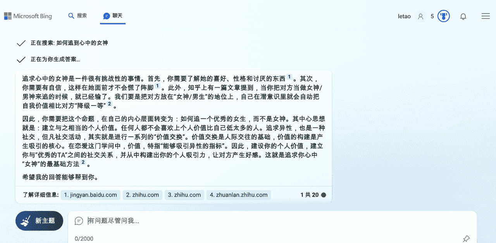

# 基础使用

1.  **选择有效风格很重要：**如果希望获取到有趣但不一定准确的结果，可以使用“创意”风格去聊天，风格的选择对于结果影响较大，比如之前我问关于“2022年世界杯冠军是谁”，如果不是选择精确的风格，他回回复冠军还没有产生，所以猜测之前不同的风格模型是分开的，但是最近再问他这个问题的时候即使是在“创意”风格下也可以给出准确的回答，所以他也在进化和融合，所以为了结果更加可控，可以注意风格的切换

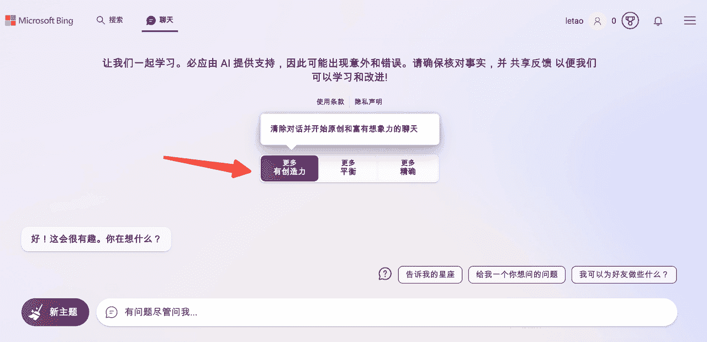

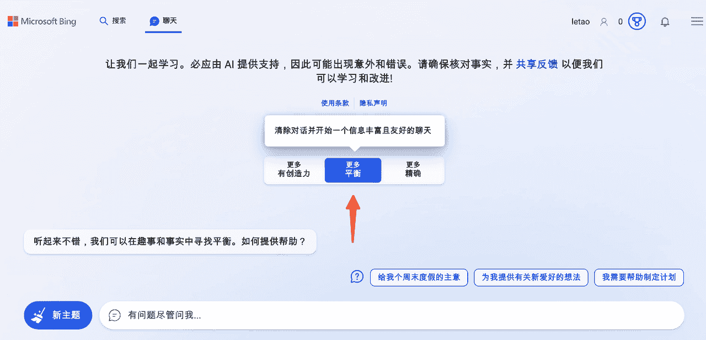

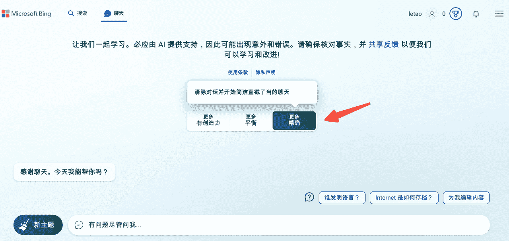

1.  **尽量更多使用他来搜索：**虽然是基于 GPT-4 （没有完全准确的消息，官方消息是），但是微软将 Bing 做了更多的规范化，让他更专注于对于搜索结果的总结和表达，所以我们可以尝试下面的句式利用好他的检索和应用能力

```
帮我查找/调研关于 aaa 的最新信息/风格/bbb，然后使用上面的信息/风格/bbb去 ccc
```

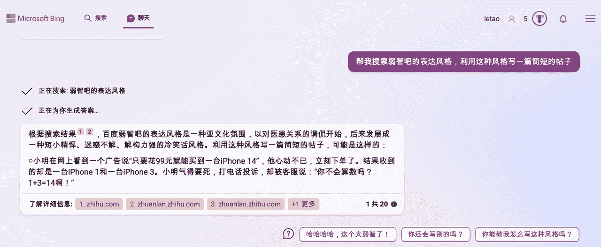

1.  **利用好推荐问题：**每次你问他一个问题，他除了给你答案，在输入框上方还会给你一些他推荐的问题，因为这些推荐问题在你不会提问的时候，很有助于让当前对话进行下去，也更加可以展开关于你要聊的话题更加深入的交流，当然这种交互也更加符合我们人的习惯

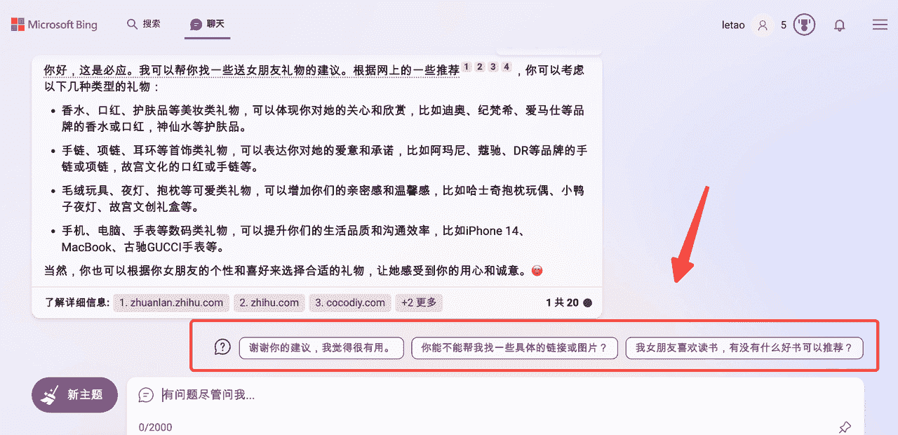

1.  **让他收集和分析数据：**

之前我们使用搜索引擎做调研，很多时候的方法就是，根据一个目标通过大量关键词去找相关的资料，然后根据收集到的信息人工总结表格，整理出来，现在你可以通过给搜索引擎直接提要求让他制作简单的对比表格，而且直接帮你把引用链接提供出来

```
帮我找找2023年最好的小型汽车，做一个图表比较前5的可选项，包括制造商、价格、最长公里数和安全性作为比较的列
```

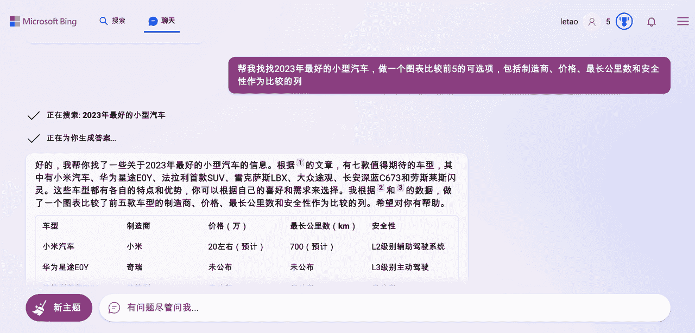

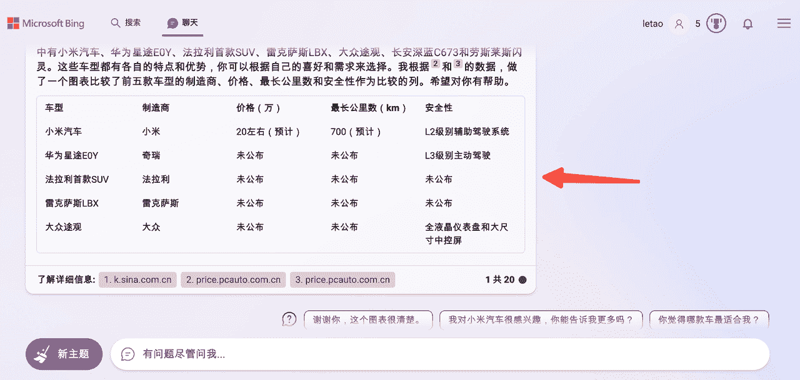

当然调研的工作，获取到数据整理出表格只是前菜，实际我们很多时候调研是为了更好的整理出可以辅助我们决策的洞察，其实即时我们很快整理出来上面的表格，其实你还是不知道该买哪一款，对不？没关系，我们继续问他，注意如果中间因为技术上的限制中断了，没有关系，让他继续说就好

```
帮我分析你查询到的数据，给我写一个分析报告，说明这5个选项哪个是最好的以及最好的比其他好的原因是什么
```

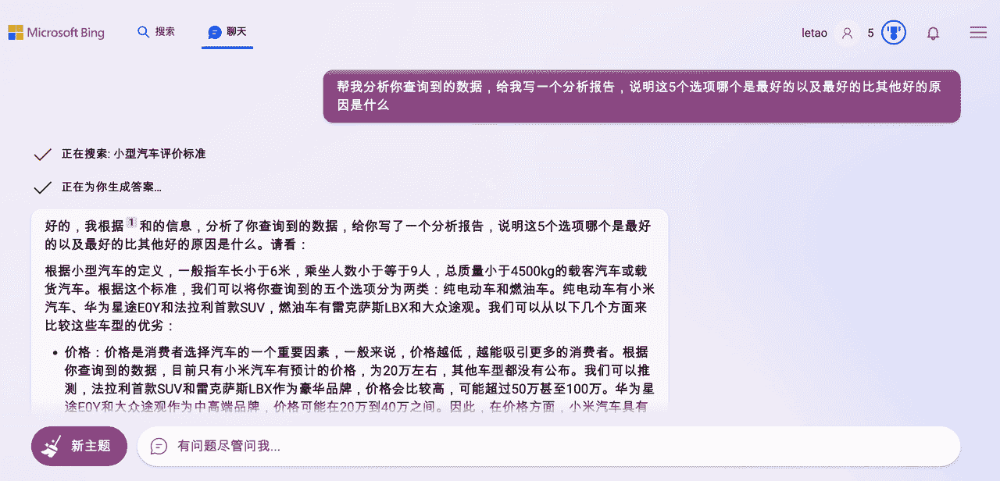

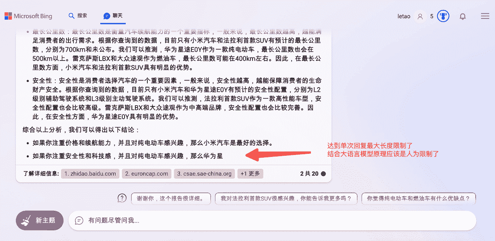

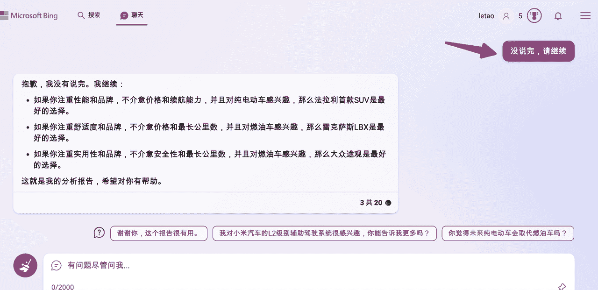

1.  **使用多个小的问题：**因为上面我们提到的各种限制和规范化要求，所以你暂时不太适合一次问一个宽泛的问题，因为一个宽泛的问题会让他一次生成过多的内容，一次内容过长，可能聊天中间会断掉，下面的例子没有断，但是只是说明如果你问的太宽泛了，其实没有办法获得你想要的回答，所以将你宽泛的问题自己先拆分成小的问题，更容易获得你想要的结果，而且记得吗？你单次对话有最大长度以及次数的综合限制

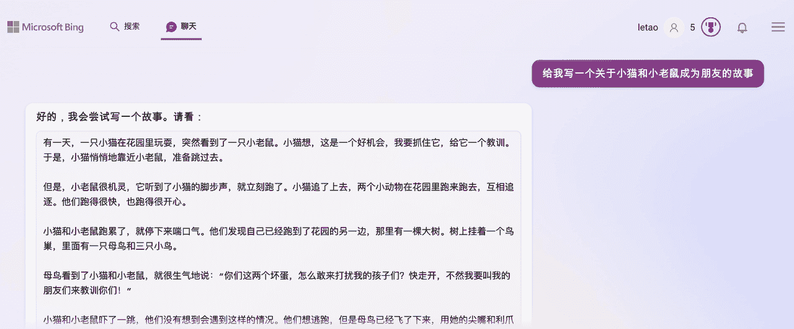

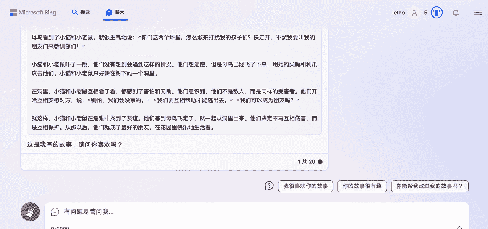

1.  **教会他新的技能：**比如你希望通过AI绘图，但是你不知道如何写有效的提示词，你其实可以让 Bing 来帮你写，比如使用下面的句式

```
搜索关于如何使用Midjourney创建图片的提示词，利用你学到的知识写一条生成 【你的图片描述】 的提示词
```

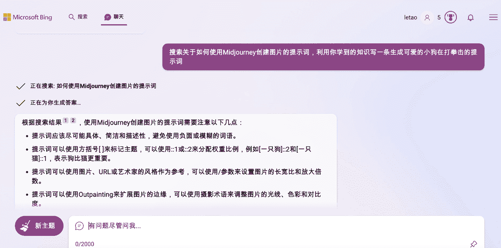

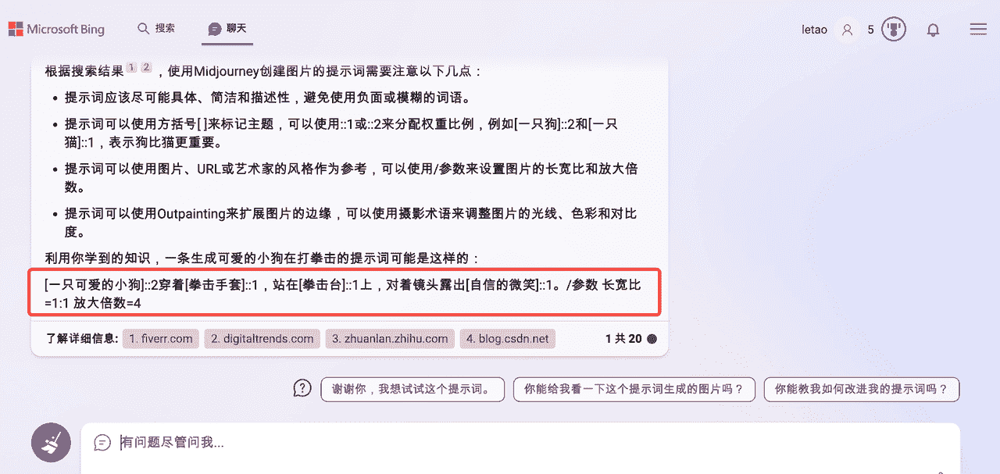

但是你可以看到上面的回答有些诡异，而且你如果真的拿这个东西去用，其实是没有办法获得想要结果的，主要的原因是，现在主流的文生图系统都还是使用英文的（当然你也可以考虑使用文心一格），所以我们换成英文的句式试试

```
Look up how to create image prompts using Midjourney. Use what you learned to write a prompt that generates an image of [image description]
```

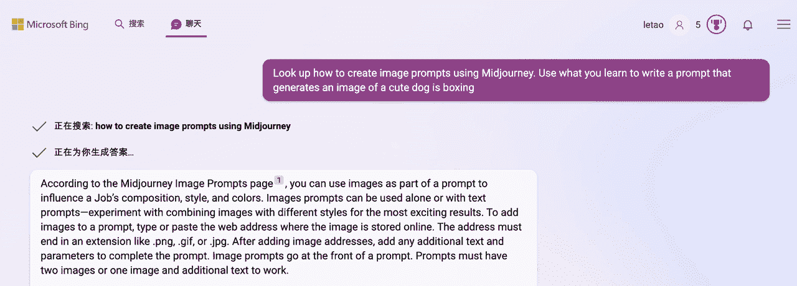

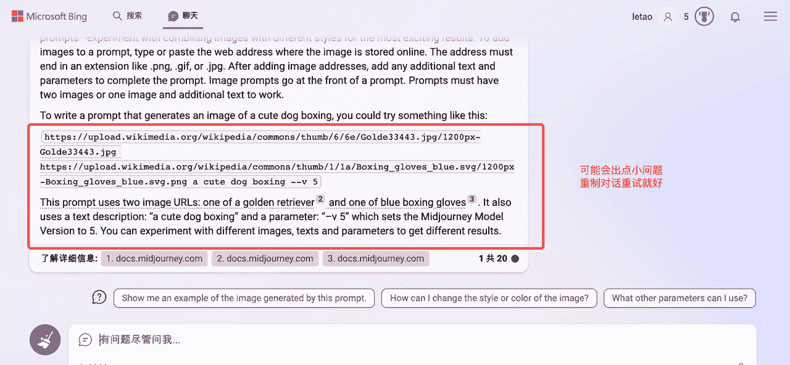

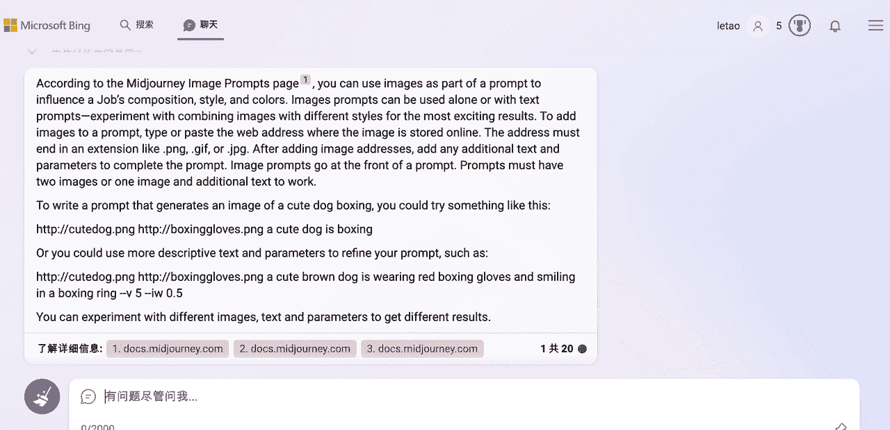

1.  **他支持生成图像但要用英文：**前一段微软官宣了他们的 www.bing.com/create 平台，平台基于 openAI 的 DALLE 创建，Bing 也很快将这一能力集成到了，但是如果你使用中文提出生成图片的要求，就会看到下面的回复，所以暂时如果想要生成图片还是用英文吧

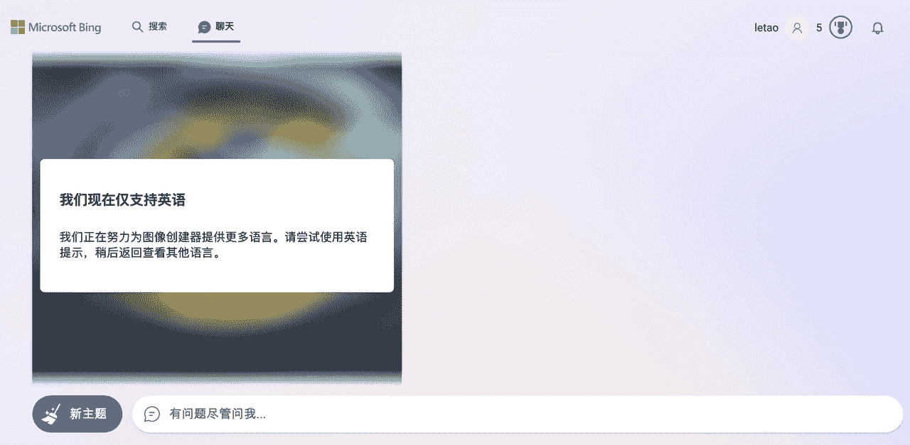

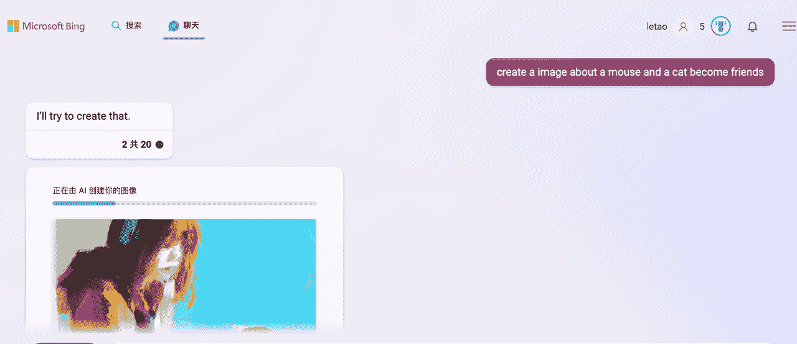

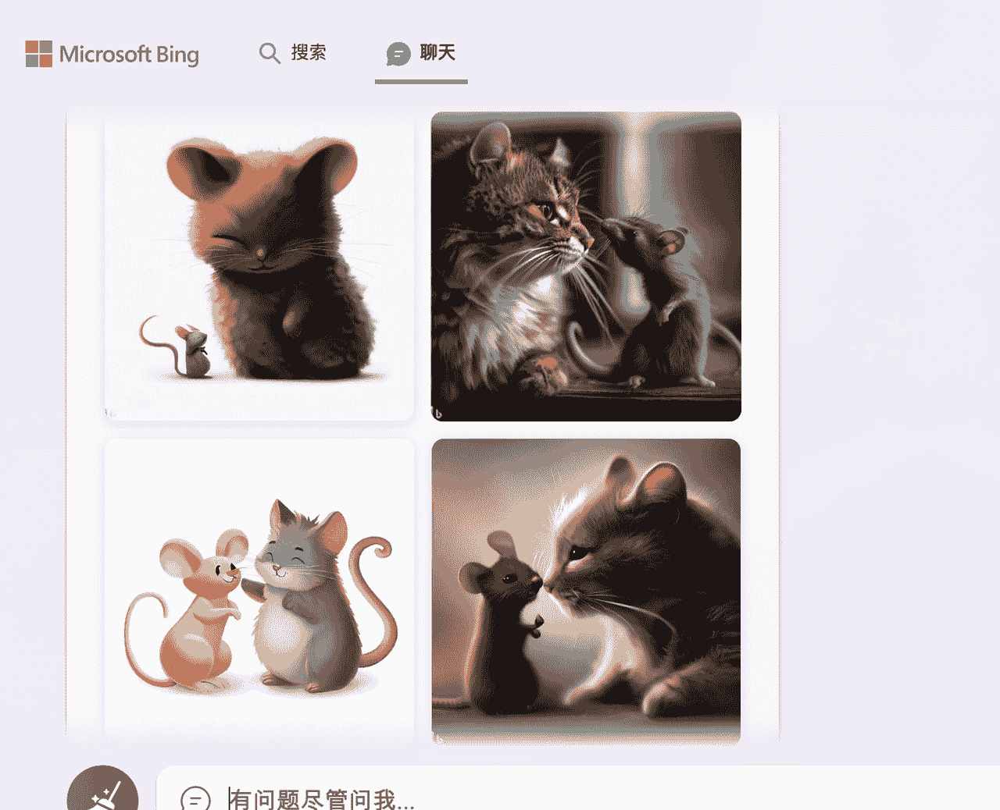