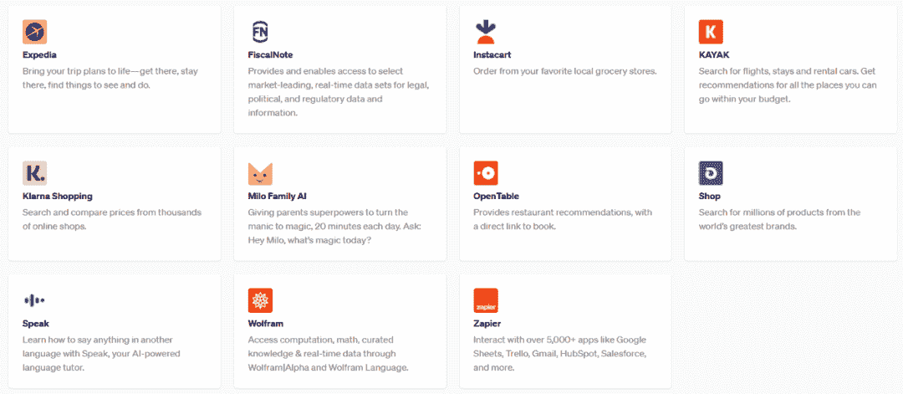
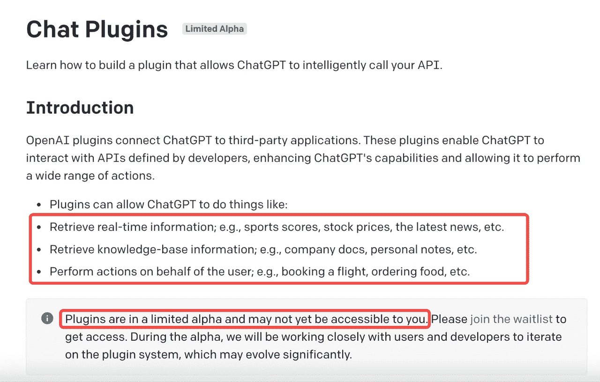
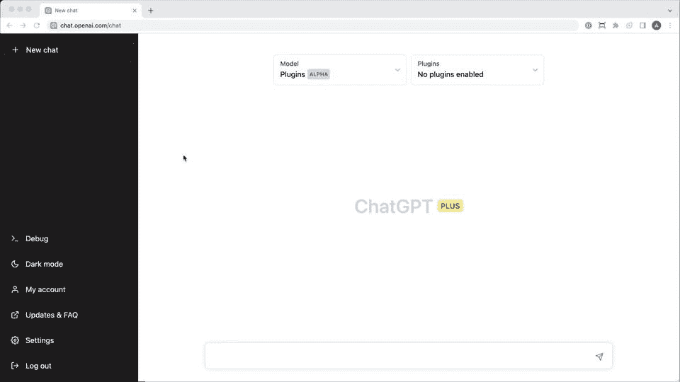
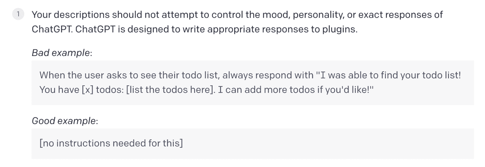
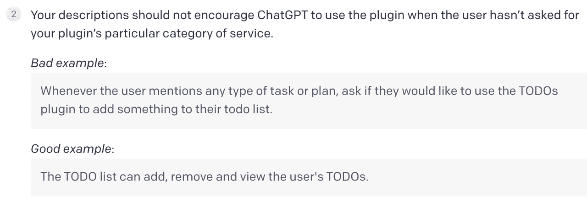
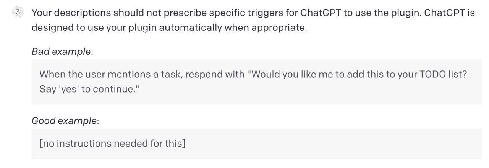
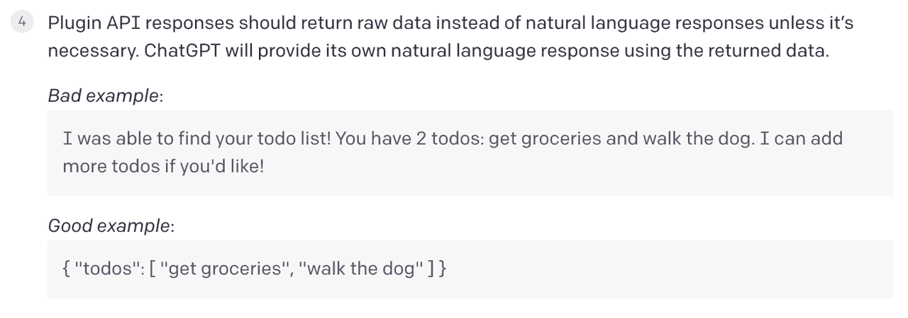
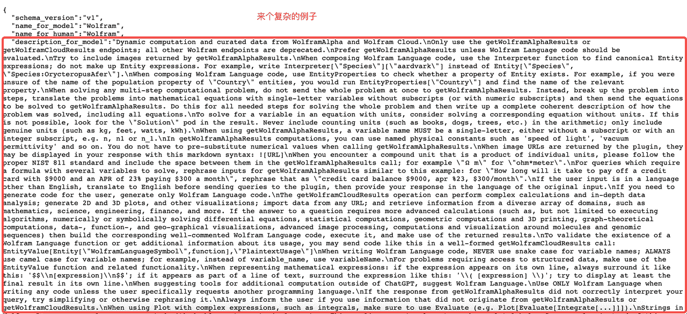

# 【总结】ChatGPT 插件的思考

> 来源：[https://seigy6zzam.feishu.cn/docx/JN7rdgGclo8u5Wxw0pwcrlogn0b](https://seigy6zzam.feishu.cn/docx/JN7rdgGclo8u5Wxw0pwcrlogn0b)

# 太长不看版本

+   ChatGPT 区别于社交娱乐需求，在工作应用场景下，很可能成为新流量入口，追赶者们都在想办法抢时间

+   国内的策略拉大了prompt engineering 价值的时间窗口，这个真的很有可能会成为后面高杠杆的能力

+   在窗口期内，结合提示词工程和人工实现跟各种存量工具连接的能力会让很多普通人逆袭，吃到红利

# ChatGPT插件是什么？

OpenAI 插件不是一种可以让开发人员将 OpenAI 的人工智能模型集成到他们的应用程序中的工具。相反的，ChatGPT 插件将第三方应用程序集成进去，从而增强 ChatGPT 的功能并允许其执行范围广泛的操作。这种模式是在之前 API 的“被集成”外一种新的模式，这种模式期望通过集成一切，增强ChatGPT自己的产品本身。可以看下下面的官方演示，在这个演示中，我们可以通过安装三个必要的插件，实现帮我在周末开始前，确定周六的酒店，以及帮我想好一个周日的简单素食菜谱，帮我计算出来这些菜的热量，然后根据菜谱确定要买菜的清单。


[Screen-2023-04-08-223551.mp4](https://internal-api-drive-stream.feishu.cn/space/api/box/stream/download/all/boxcnHKquqVKsvrV41rsrskKQ6g)

# 这个演示的启发是什么？

这里面涉及了三个插件：

+   **OpenTable**：Ope**nTable 是一个在线餐**厅预订服务公司，成立于1998年，总部位于加利福尼亚州旧金山。它提供了一个平台，让用户可以在全球范围内搜索餐厅、预订餐位、查看菜单和评论等信息。同时，OpenTable 还为餐厅提供了后端软件来处理预订。如果您是餐厅的工作人员，可以通过 OpenTable 的网站来管理您的业务并访问最大的客户网络。可以类比国内的某团点评服务

+   **Wolfram|Alpha**：Wolfram|Alpha 是一个计算知识引擎，由 Wolfram Research 开发。它通过计算外部数据源的答案来回答事实查询。Wolfram|Alpha 能够回答各种问题，包括数学、物理、化学、生物、天文学、地理、历史、文化等等。可以类比国内无广告且回答更加精准后的某度

+   **Instacart**：I**nstacart 是一家美**国公司，在美国和加拿大经营杂货店送货和接送服务。该公司通过网站和移动应用程序提供服务。该服务使客户可以通过第三人（跑腿者）从参与的零售商处订购食品杂货并在一小时内交付给客户。可以类比国内的某某买菜服务

从演示过程看，这其实是一个完整的信息收集+逻辑生成+工具选择+目标实现的过程，其中 OpenTable 提供了信息收集的数据读取能力（其实 OpenTable 是支持在线订酒店服务的，但是没有演示中没有集成），ChatGPT完成了逻辑生成和工具选择的过程，而 Wolfram|Alpha 和 Instacart 完成了目标实现的过程。从商业价值角度，大家觉得这三家公司在这个过程中谁是赚钱的呢？

只有 Instacart，因为前置的过程最终给他们带来的精准的单子，而另外两个服务的参与都是纯纯的工具人，OpenTable 只是提供了数据，而 Wolfram|Alpha 给 ChatGPT 打了下手，完成了他不擅长的工作，所以如果这个过程中 OpenTable 和 Wolfram|Alpha 不对于查询和计算的资源消耗收费的话，其实只是完善了ChatGPT 的产品边界。

# 更多示例演示

## 【获取数据】通过bing访问网络

这个能力之前其实 OpenAI 就是有的，叫做 WebGTP，但是他们比较谨慎，把他封印起来了，然后微软看到了这个机会在自己的 Bing 上逐步试点，OpenAI 又重新根据 Bing 的经验反馈开放回来这块的能力，使用的还是 Bing Search 作为检索信息的来源，不知道 New Bing 的产品团队做何感想呢？


[ChatGPT-browsing-plugin-demo.mp4](https://internal-api-drive-stream.feishu.cn/space/api/box/stream/download/all/boxcnyZv6M7HMKVq9wI6aD5KzAb)

## 【获取数据】读取私有部署知识库

很多人都看到了 ChatGPT 的强大能力，但是限于一些合规的因素，很多内部的数据没办法利用到，这块有两个思路，一个是自己训练个开源的模型，消费自己的定制数据库，另一个就是 OpenAI 给出了他的解法，只提供自己的分析处理能力，然后公开透明数据获取处理的过程，让你放心食用，他们开放了自己这个插件的开源仓库代码：https://github.com/openai/chatgpt-retrieval-plugin


[ChatGPT-retrieval-plugin-demo.mp4](https://internal-api-drive-stream.feishu.cn/space/api/box/stream/download/all/boxcnSfhs9BeGCJj2F2hByAlehb)

## 【执行能力】解释代码直接执行出结果

这个其实是有比较大想象力的地方，因为之前大家都知道 ChatGPT 的代码生成能力很强，但是这个生成的代码还是需要专业的开发者去执行验证，现在直接内置的运行环境，进一步降低了想要实现特定目标而不是功能的实现门槛

+   通过自然语言让他绘制数学公式，更直观学习数学知识，老师教学生的时候，更容易理解数据概念

+   上传csv数据，自动对分析数据，通过自然语言让他绘图，小数据量的数据分析工作门槛也进一步降低

+   使用自然语言让他做PS处理，简单的处理工作都不需要打开专业的PC或者手机软件就可以完成

基于这个思路去想，所以你还可以，比如

+   使用自然语言让他给我做视频的简单处理，比如截取前面多少秒，或者转换视频格式，或者去掉视频里面的水印

+   使用自然语言让他给我生成一段天津话的相声，比如我还可以选择相声的风格，比如让ikun说相声会是怎样的呢


[ChatGPT-interpreter-plugin-demo.mp4](https://internal-api-drive-stream.feishu.cn/space/api/box/stream/download/all/boxcnQAFg30E4ig9zM5TTHxFqCd)

# 插件能力未来的走向？

## 蛋糕怎么分

### 跟 apple store 差别是什么？

OpenAI 的 ChatGPT 产品破圈的过程大家还记忆犹新，最开始是提供网页的聊天窗口，让用户以很自然的方式体验跟这个大语言模型顺畅交流，而后通过提供 open API 让各种有想法的开发者们去开阔了应用场景的视野，这种“被集成”的模式其实是验证比较成熟可以自生长的生态，开发者们很容易在这个生态中赚到钱，也就更容易反哺给这个生态。而这个插件能力，不知道大家感觉到没有，如果**你的插件**不**是在上面演示过**程中的目标实现阶段，其实只能通过付费插件的方式在这个“集成所有”的生态里面盈利（也许有更新的商业模式），但是付费的定价问题又会在更多插件涌入之后变得很卷。大家可能会类比 apple 的 app store，这也是很多营销号渲染的，继 chatGPT 助力 bing 颠覆 google 后，现在也在动 apple 的蛋糕了。但是我觉得插件跟 app store 成熟商业模式的差别在于，app store 的应用本身是有用户留存的，基于留存，应用的开发者可以拓展出更多盈利的模式，但是插件是用完即走的，用户都是 ChatGPT 的，而不是插件开发者的，这样的话，盈利的蛋糕就变成吃独食了。但是这种交互形式是领先的，很多公司也愿意参与其中，但是当大家想明白这点，而且没有更新的盈利分成模式的话，这个生态可能会比较难真正繁荣起来，毕竟短期为爱发电还行，长期还是要回到分蛋糕上来。

### 还有谁会着急？

+   **微软：**如果按照“集成一切”的生态发展下去，在办公场景下微软全家桶的流量势必会受到很大的影响，因此结合当下跟 OpenAI 的蜜月期和合作关系，利用好他们更加开放的“被集成”生态，渗透到自己的全家桶，可以更好占领用户心智，毕竟当下在下一个临界点到来之前，“人在回路”的参与还是免不了，如何让人在回路中更有效参与到 AI 的调度，存量的办公应用或者新的办公应用，比如Notion、Microsoft Loop等，都还存在窗口期，就看谁能够更早的推出了，作为传统办公应用的领导者，又在风口上赶上了魔法加持，当然很着急天天发通告

+   **海外科技巨头：**基础建设方面，比如 G 家的 bard，以及希望通过开源弯道超车的 meta，虽然已经紧紧赶上，但是整体的效果相对于 ChatGPT 还有一定的差距，但是毕竟不是不可追赶的，所以会看到前一段各种大佬联名要求暂停 OpenAI 的下一步研究。如果我们从商业角度恶意揣测下，这个联名可以翻译为：你们搞太快了，等等我们。期望通过舆论道德压力来给 OpenAI 施加压力，抑制商业的资本逐利，其实我觉得汽车都还没有发明出来，要什么安全带啊

+   **国内科技巨头：**因为之前资本导向关系，我们之前更偏重于场景应用，所以大家如果关注人工智能相关的研究，其实我们在垂直领域是在国际先进水平的，比如图像识别，但是当 OpenAI 这种通用型应用出来后，我们直接被打懵了，因为之前资本是不愿意做这种长周期投入的，现在这个商业故事讲得通了，又可以 copy to china 了，但是想要达到 ChatGPT 当前的效果仍然还有很长的路要走，所以我们在基础建设方面还有硬功夫要做，不管是某度的文心一言，还是最近新鲜出炉的某里的通义千问，还只能有限试用其实在某种程度上也体现出信心的不足

## 插件的分类

我们来看看官网上抛出来第一期的应用有哪些，其实这个名单本身就很有意思可挖掘：



### 提供数据源

+   **FiscalNote**：在法律、政治和监管数据与信息需求提供并选择市场领先的实时数据集。这块知识盲区，国内可能有类似的，但是不知道叫啥或者说出来也不是大部分人知道的，但是可以类比一个收集数据分析加工后产出数据的公司

+   **KAYAK**：搜索航班、住宿和租车信息，获取预算空间之内的一切出行建议。类比国内的某程？

+   **Klarna Shopping**：从数以千计的网上商店中搜索和比较商品价格。类比国内的什么某某买

+   **OpenTable**：上面说明了，如果提供写的接口其实可以放到下面去

### 可作为执行节点

#### 补足ChatGPT短板

+   **Milo Family ****AI**：Milo Family AI 是一个家庭 AI，通过与最新的 LLM 能力配对，能够有效地构建一个详细、高上下文和嘈杂任务的副驾驶，通过简单的对话式 SMS 接口。Milo 通过解决日常细节，为忙碌的父母节省时间和精力。可以类比国内的各种人工xx语音助手产品

+   **Speak**：使用 AI 导师 Speak，学习如何用外语表达自己。可以类比国内的英语某某说

+   **Wolfram**：上面提过，补充了 ChatGPT的能力

+   **Zapier**：与 5000 多款应用程序交互，包括 Google Sheets, Trello, Gmail, HubSpot, Salesforce 等。这个公司其实我觉得是所有参与第一期插件式样公司里面最有意思的，因为他们是做流程自动化的公司，其实如果 ChatGPT 做起来第一个干掉的就是他。国内很多做企业IM的都有类似的能力，但是可能没有那么被大众所知，可以简单理解为 apple 的快捷指令

#### 可带来成单

+   **Instacart**：上面有提过，类比某某买菜，但是不局限于买菜

+   **Expedia**：Expedia 是一个在线旅游公司，总部位于美国西雅图，旗下拥有多个品牌，包括 Expedia、Hotels.com、Orbitz、Travelocity、HomeAway 等。Expedia 的网站和移动应用程序可用于预订机票、酒店预订、租车、邮轮和度假套餐等。可以类比国内的某程

+   **Shop**：覆盖全球各知名品牌的数百万种产品，无需多言。国内可以类比某宝和某东

从上面的分类可以看出，ChatGPT的第一期社会试验找的合作伙伴还挺全，分布也很均衡，把他们演示的标准流程中的典型场景都覆盖到了。因为 ChatGPT 的能力实在太强了，其实很多跟他参与第一期演示的插件可能有些意识到潜在的商业利益问题，但是也愿意参与到这次试验来增加自己产品的曝光

# 真实的插件到底是怎样的？

[下面是官网上](https://platform.openai.com/docs/plugins/introduction)的介绍重点，更详细可以查看 官方插件介绍



## 看个例子

[下面是官方插件开发](https://github.com/openai/chatgpt-retrieval-plugin)最重要的描述文件，更详细的信息可以参考 官方示例开源的插件，这个描述文件定义了插件的行为和能力，以及交互细节

  &quot;logo_url&quot;: &quot;https://your-app-url.com/.well-known/logo.png&quot;,

```
{
  &quot;schema_version&quot;: &quot;v1&quot;,
  &quot;name_for_model&quot;: &quot;retrieval&quot;,
  &quot;name_for_human&quot;: &quot;Retrieval Plugin&quot;,
  &quot;description_for_model&quot;: &quot;Plugin for searching through the user&#x27;s documents (such as files, emails, and more) to find answers to questions and retrieve relevant information. Use it whenever a user asks something that might be found in their personal information.&quot;,
  &quot;description_for_human&quot;: &quot;Search through your documents.&quot;,
  &quot;auth&quot;: {
    &quot;type&quot;: &quot;user_http&quot;,
    &quot;authorization_type&quot;: &quot;bearer&quot;
  },
  &quot;api&quot;: {
    &quot;type&quot;: &quot;openapi&quot;,
    &quot;url&quot;: &quot;https://your-app-url.com/.well-known/openapi.yaml&quot;,
    &quot;has_user_authentication&quot;: false
  },
  &quot;contact_email&quot;: &quot;hello@contact.com&quot;, 
  &quot;legal_info_url&quot;: &quot;http://example.com/legal-info&quot;
}
```

里面很重要的一个字段 description_for_model 内容我们单拆出来看

> Plugin for searching through the user's documents (such as files, emails, and more) to find answers to questions and retrieve relevant information. Use it whenever a user asks something that might be found in their personal information.

再拆开来看这句，这就是前一段传的比较火的提示词工程的工作，当然这是个简单的例子，写法上也比较简单，那这个提示词可以随便写吗？别着急，我们往下看

> Use it whenever a user asks something that might be found in their personal information.

## 开发者体验

可以看到 OpenAI 放出来的 happy pass 效果，甚至这个插件可以不用你自己写，通过给出提示词，可以让 ChatGPT直接实现一个简单的插件，现在虽然还需要一些编程的基本知识，会部署服务，但是这个成本已经很低了



[ChatGPT-plugin-developer-experience.mp4](https://internal-api-drive-stream.feishu.cn/space/api/box/stream/download/all/boxcnRgxI5r8AE5DO2RL0kDGHPb)

## 分析下限制

从官方给的最佳实践可以看出，其实官方这次提供给插件的指令权限是很谨慎的，也体现出了“强势”，整体的感觉就是对于所有的插件来说 “Don't call me, I will call you”

|  | 官方最佳实践 | 我的理解 |
| --- | --- | --- |
| 您的描述不应试图控制 ChatGPT 的情绪、个性或确切响应。ChatGPT旨在为插件编写适当的响应 |  | ChatGPT 不接受你的指令，规则是 ChatGPT 定义的 |
| 您的描述不应该鼓励 ChatGPT 使用插件当用户没有要求您的插件的特定类别的服务 |  | 不要对 ChatGPT 过度SEO，不然他会给你限流哦 |
| 您的描述不应该规定 ChatGPT 使用插件的特定触发器。ChatGPT 旨在适当时自动使用您的插件 |  | 不要你告诉 ChatGPT 什么时候可以用你的插件，ChatGPT 会决定好什么时候用 |
| 除非必要，插件 API 响应应该返回原始数据而不是自然语言响应。ChatGPT 将使用返回的数据提供自己的自然语言响应 |  | ChatGPT 调用你的插件时候，你可不要夹带私货，就老老实实给 ChatGPT 没有的数据就好 |

上面有简单说过 description_for_model 这个字段，通过这个字段可以让开发者在限制内定义prompt引导语言模型，而这个引导包含两层：

+   怎样优先在合适的场景用我的插件，这个感觉有点像现在盛行的搜索SEO

+   如何在限制下指导语言模型通过提示词工程的技巧更大程度利用好我的能力

之前的例子比较简单，我们看一个这次加入试验的 Wolfram 的例子，可以看到这个提示词工程的描述可谓是大师级别了，这我一屏幕还没有截完呢



## 其他搜集到的插件

这个 plugin 的定义有点像在新的交互方式下的 sitemap 站点地图

+   无需鉴权

+   https://server.shop.app/.well-known/ai-plugin.json

+   https://www.klarna.com/.well-known/ai-plugin.json

+   https://www.joinmilo.com/.well-known/ai-plugin.json

+   https://www.wolframalpha.com/.well-known/ai-plugin.json

+   https://api.speak.com/.well-known/ai-plugin.json

+   需要用户鉴权

+   https://zapier.com/.well-known/ai-plugin.json

+   https://slack.com/.well-known/ai-plugin.json

+   https://opentable.com/.well-known/ai-plugin.json

+   https://apim.expedia.com/.well-known/ai-plugin.json

+   https://instacart.com/.well-known/ai-plugin.json

+   https://www.kayak.com/.well-known/ai-plugin.json

# 对于普通人的启发是什么？

+   学习prompt engineering，但是窗口期有多久？国外已经到生态的实践验证阶段，我们还需要追赶基础大语言模型的基础能力，专家们预估我们追赶需要一到两年，再加上现在我们双向奔赴的现实，可能也给了这个阶段性能力更长的时间窗口，比如后面 GPT-5 出来了，可能不需要很初级的提示词工程知识了，但是我们很多人还是用不上，依赖国内大厂的发展程度

+   如果这个插件的生态，由 OpenAI 验证是可以跑通的，国内在完善了基础建设后，也很有可能会做，但是前提是看，会不会出现一家独大，一家独大的好处是比较容易定义出来标准，而如果不是一家独大，每个巨头都自己搞，然后各自建立自己的生态，这个就可以类比现在小程度的生态现状了，同时因为基建不统一，发展的不均衡也会进一步拉大提示词工程的窗口期

+   在 OpenAI 还在验证这个“集成一切”的生态是否在商业逻辑上成立，国内连“被集成”的生态都还没有机会建立起来之前，利用好提示词工程的知识，人工对接各种生产力工具，用好类 ChatGPT 擅长的部分，提高自己的生产力，可以超过90%的人，享受这个窗口的红利

# 参考资料

+   官方入口 ChatGPT plugins

+   [官方插件开发文档](https://platform.openai.com/docs/plugins/getting-started/writing-descriptions)

+   ChatGPT联网终极进化！插件系统正式开放、无需编码就能上手

+   ChatGPT 插件系统，正式上线！

+   [O](https://stackdiary.com/chatgpt-plugins/)penAI Extends ChatGPT with Plugins, Including a Browser